# 1. Game design

This document covers Advanced Nether Earth as a player meets it. It goes from the disk's boot to the last screen:
the menus, the ship, the bases, building robots, giving them orders, fighting, capturing, the daily production,
saving, and how a game is won or lost. Each rule links the technical document that shows where it lives in the code
and which recording saw it. The last sections check what the authors say about the game against the code.

The recordings and runs it rests on ([Terms](README.md#terms)):

- `tour`, `lose`, `win`: the scripted sessions of `tools/fig_tour.py` (`work/docP`), on Pentagon 128 + TR-DOS with
  a Kempston card, from the game-menu snapshot. [05](05-controls.md) lists their steps.
  - `tour` builds a robot, gives orders, drives a robot by hand, fights and waits a game day.
  - `lose` and `win` reach the two endings by a poke from the `tour`'s first play frame: an experiment, not a
    played game.
- `deep`: a bot's game of 36009 frames, 11.9 game days (`work/docL/deep`, [10](10-gameplay-logic.md)). It built
  seven robots, gave orders, captured factories and fought.
- `r1`, `r2`: stage 3's recordings from power-on (`work/stage3/r1`, `r2`). `r1` has the intro, the boot menu and
  the help; `r2` has a disk save and two loads.

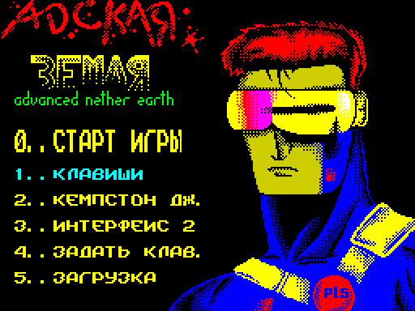

How to read the figure:

- **The screen** is the game menu as the `tour` starts, at 2x.
- **The six items** are 0 start, 1 keys, 2 Kempston, 3 Interface 2, 4 redefine, 5 load. The chosen control is
  cyan, the others yellow.

`python3 tools/fig_tour.py draw` draws it from `work/docP/tour/states.json`.

## 1.1 The game in one paragraph

**Advanced Nether Earth** (in the menus **АДСКАЯ ЗЕМЛЯ**, "Hellish Earth"), Eternity Industry, Kovrov, released on
9 March 1998 for the 128K Spectrum with a Beta Disk. It is a real-time strategy game with Russian texts, AY music,
a help program, two ending sequences and disk save and load ([08](08-hud-and-text.md)).

The player flies a command ship over a strip of land 512 cells long and 16 wide. Two sides own bases on it:

- the humans, **ЛЮДИ** on the panel, are the player. They hold one warbase at the west end;
- the aliens, **ИНОП.** (the help calls them the Isignians), are the computer. They hold three warbases further
  east.

The player does not fight: robots do. The ship sinks onto its own warbase's pad to build a robot from parts, paid
for with resources. It lands on a robot's head to give it an order: stand, advance, retreat, destroy or capture.
There are 24 factories, all neutral at the start. Each pays one resource every game day to the side that holds it;
warbases pay the general resource. A robot that stands 144 game turns on a base's door takes the base. The game is
won when the aliens have no warbase left and lost when the humans have none ([10](10-gameplay-logic.md)).

## 1.2 Around the game

The disk boots through several programs before play, each with its own screen and tune
([03](03-build-and-load.md), [04](04-game-loop.md) 4.4):

1. **The intro**, to the tune MAD NIGHT. The Eternity Industry picture, then a scroller of credits and greetings
   beside a rotating star. SPACE ends it ([08](08-hud-and-text.md) 8.8). [listen: MAD NIGHT](audio/mad-night.mp3)
2. **The title picture**, silent, while the boot program loads.
3. **The boot menu**, to X-Man's tune TOMY. "1-Game 2-Help 3-NOT used" under the АДСКАЯ ЗЕМЛЯ logo.
   [listen: TOMY](audio/tomy.mp3)
4. **The help**, to the same tune. Seven bars: five topics of Russian pages, the credits and the exit. A pointer
   picks a bar; each page is typed under a picture ([08](08-hud-and-text.md) 8.7).
5. **The title cards**, silent, as the game starts.
6. **The game menu**, to the tune TAIGA, which plays on through the whole game. 0 starts, 1-3 choose the controls,
   4 redefines the keys, 5 loads a saved game ([05](05-controls.md) 5.2). [listen: TAIGA](audio/taiga.mp3)

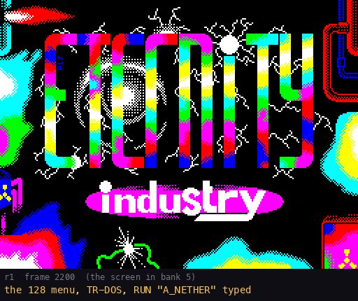

The GIF is `r1` frames 2200-8320, every 40th frame; [08](08-hud-and-text.md) 8.8 reads it.
`python3 tools/fig_programs.py draw` makes it.

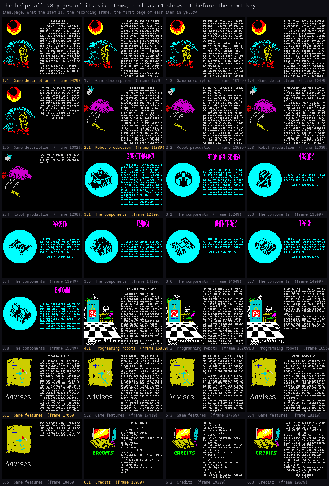

How to read the figure:

- **Each cell** is one help page at 1x, its typing finished; the caption gives the item, the page and the `r1` frame.
- **Items 1-5** are the rules the authors wrote for the player; **item 6** is the credits. 1.13 checks the rules
  against the code.

`python3 tools/fig_programs.py draw` draws it from `work/docP/r1/samples.bin`.

## 1.3 The screen

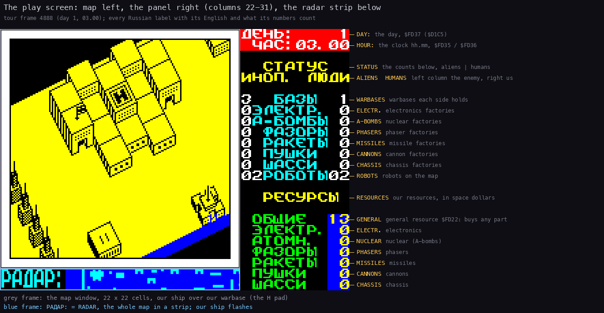

How to read the figure:

- **The screen** is `tour` frame 4888, day 1 at 03.00, at 3x.
- **The labels on the right** give each panel row's English and what its numbers count ([08](08-hud-and-text.md)
  8.4).

`python3 tools/fig_tour.py draw` draws it from `work/docP/tour/states.json`.

| Area | Where | What it shows |
| --- | --- | --- |
| **View** | the grey frame, 22 by 22 cells | the map round the ship, redrawn every game turn ([02](02-architecture.md)) |
| **Clock** | top right | ДЕНЬ (day) and ЧАС (hour.minutes), printed every turn by `ClockPrint` `$AD85` |
| **Status** | right, СТАТУС | each side's warbases, factories by kind and robots: the aliens' left, the humans' right |
| **Resources** | right, РЕСУРСЫ | our seven resources in space dollars |
| **Radar** | bottom, РАДАР: | a window of the map, with the robots as dots |

Landing on a robot replaces the status and resources by the robot's menu; leaving it prints them again.

## 1.4 Controls

The game is played with one stick and three extra keys ([05](05-controls.md)):

- **The stick**: the keys Q, A, O, P and SYMBOL SHIFT for fire, or a Kempston joystick, or Interface 2. Any
  eight keys can be redefined from the game menu.
- **The extra keys**: 1 pause, I abort (back to the game menu), 5 save to disk.
- **Fire** lifts the ship in flight and picks the lit item in every menu.

## 1.5 The ship

The ship flies over the map; its shadow below shows its height ([05](05-controls.md) 5.3).

- Left and right move it along the strip, up and down across it.
- Fire held lifts it 2 a pass up to 48. Released, it sinks 1 a pass down to whatever is under it.
- It cannot move into anything taller than itself.
- The view steps when the ship nears its edge.
- The ship cannot shoot and cannot be hurt. A low ship blocks robots: a robot does not step into the ship's cell
  when the ship is lower than its top ([10](10-gameplay-logic.md) 10.5).

## 1.6 Bases and factories

- **Warbases.** Four, each with a door and, if it is ours, a pad marked with a letter H. We start with one, the
  aliens with three.
- **Factories.** 24, each of one kind: electronics, nuclear, phasers, missiles, cannon or chassis. All are neutral
  at the start.
- **Capture.** A robot of either side on a base's door counts the turns up. At 144 turns the base is its side's. An
  empty door resets the count. Any robot captures, whatever its order. 144 turns are at least 28.8 s (10 frames a
  turn); `deep` measured about 30 s ([10](10-gameplay-logic.md) 10.7).
- **A captured warbase** gets a pad: a second place to build.

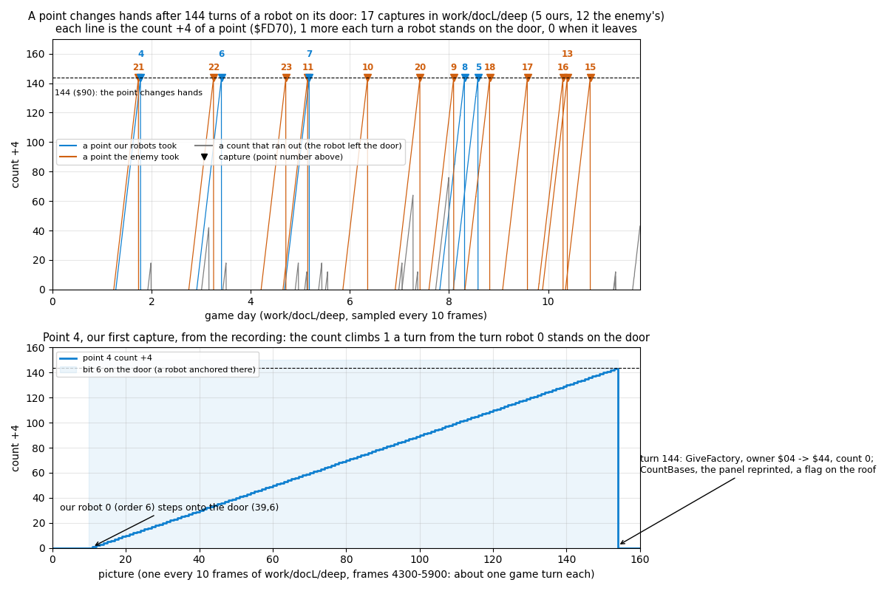

How to read the figure:

- **The top** shows each run of a capture count in `deep`, coloured by the side that took the point; grey runs ran
  out because the robot left.
- **The bottom** shows one capture turn by turn: the count rises by 1 a turn and the point changes hands at 144.

[10](10-gameplay-logic.md) 10.7 gives the command that drew it.

## 1.7 Building a robot

The ship sinks onto our warbase's pad at altitude 15 with the door free. The construction menu takes the whole
screen ([05](05-controls.md) 5.4, [10](10-gameplay-logic.md) 10.4).

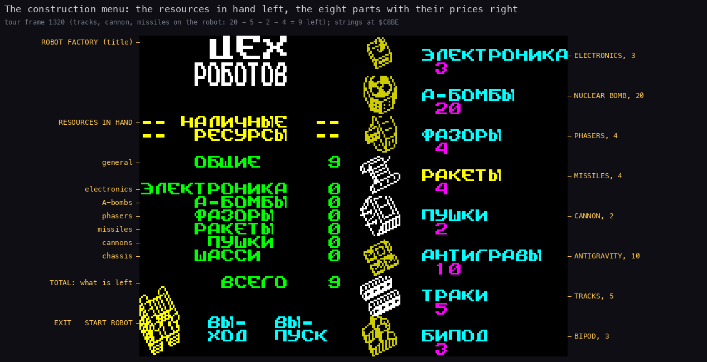

How to read the figure:

- **The right column** is the eight parts with their prices; up and down move the bar, fire adds or removes a
  part.
- **The left column** is the resources in hand and the total; **the bottom left** is the robot as built.

`python3 tools/fig_tour.py draw` draws it from `work/docP/tour/states.json`.

| Part | Russian | Price | What it does in the code |
| --- | --- | ---: | --- |
| bipod | БИПОД | 3 | the slowest chassis: 6 turns a step on flat ground; climbs low ground only |
| tracks | ТРАКИ | 5 | 4 turns a step; also climbs ground of height 6 |
| anti-grav | АНТИГРАВЫ | 10 | 3 turns a step; also crosses the types `$0C-$0E` |
| cannon | ПУШКИ | 2 | weapon 1, range 5 steps of 2 cells |
| missiles | РАКЕТЫ | 4 | weapon 2, range 7 steps |
| phasers | ФАЗОРЫ | 4 | weapon 3, range 5 steps |
| nuclear | А-БОМБЫ | 20 | the bomb: needed for the orders to destroy buildings |
| electronics | ЭЛЕКТРОНИКА | 3 | sees 12 cells ahead instead of 10; one more step of range |

- A part is paid from its own resource first, the rest from general. A part we cannot pay for is refused with a
  beep.
- A robot has exactly one chassis and one to three weapons. Electronics are optional.
- ВЫПУСК (RELEASE) sends the robot out of the door; ВЫХОД (EXIT) leaves. Each side has 24 robot slots.
- The new robot walks a few steps down from the door and stands there, order 0, strength 100.

## 1.8 Orders

The ship lands on our robot's head; the panel shows its menu ([05](05-controls.md) 5.5).

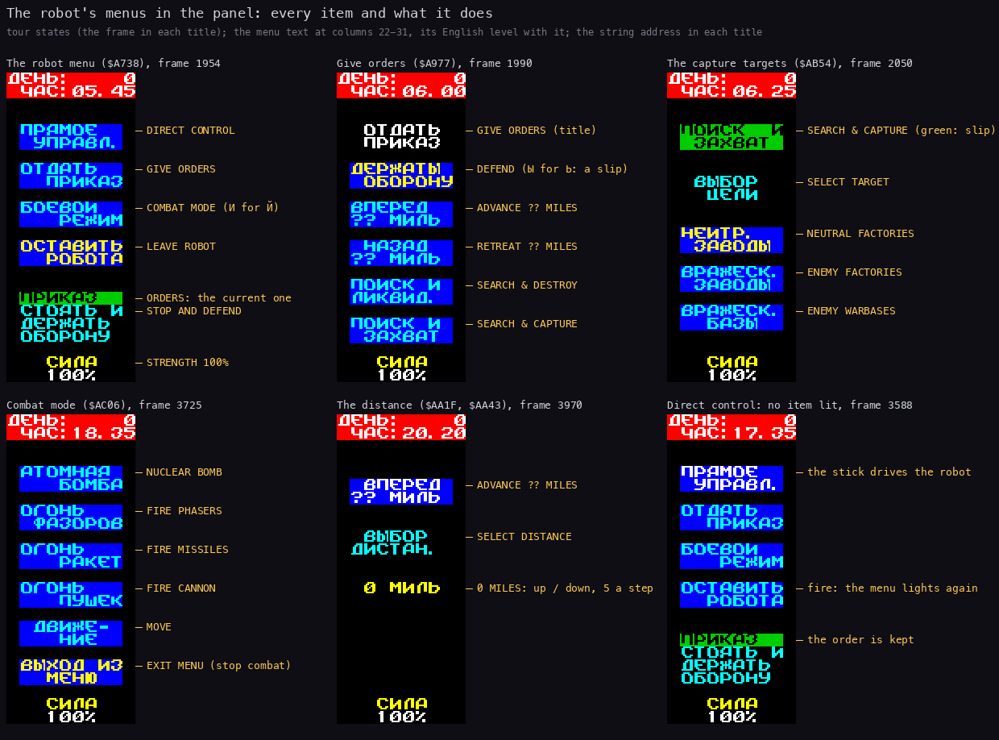

How to read the figure:

- **Each column** is the panel of one `tour` state at 2x, the English level with each item.
- **From the left**: the robot menu, the orders, a target menu, the combat menu, the distance menu, direct control.

`python3 tools/fig_tour.py draw` draws it from `work/docP/tour/states.json`.

- **ПРЯМОЕ УПРАВЛ.** (direct control): the stick drives the robot; fire returns to the robot menu.
- **ОТДАТЬ ПРИКАЗ** (give orders): stand and defend; advance or retreat 0-99 miles; search and destroy robots,
  factories or warbases; search and capture neutral factories, enemy factories or enemy warbases.
- **БОЕВОИ РЕЖИМ** (combat mode): fire one weapon or set off the bomb by hand.
- **ОСТАВИТЬ РОБОТА** (leave robot): the ship lifts off and the robot carries out its order.

The war goes on while the menu is open; only the construction menu stops it. The orders to destroy buildings need the
nuclear part, and a robot that reaches its target sets off its bomb. An order whose search finds no target turns into
"stand" ([10](10-gameplay-logic.md) 10.5).

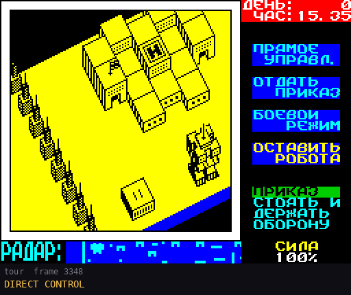

How to read the figure:

- **The frames** are `tour` 3348-3688, every 4th frame ([05](05-controls.md) 5.6).
- **Down, then right**: a robot facing another way first turns in place, then steps one cell a robot turn.
- **Fire** lights the robot menu again.

`python3 tools/fig_tour.py draw` draws it from `work/docP/tour/samples.bin`.

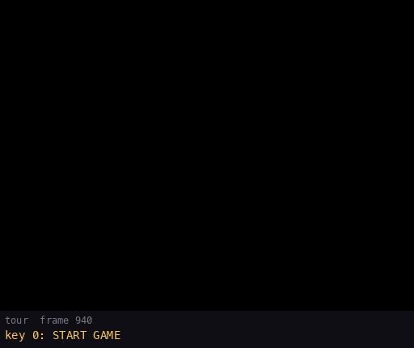

How to read the figure:

- **The frames** are the `tour`'s play from the new game (950) to the robot setting off (2226), every 6th frame.
- **The steps**: the flight to the pad, the construction menu (1100), the robot out of the door (1410), the landing
  on it, the orders, LEAVE ROBOT.

`python3 tools/fig_tour.py draw` draws it from `work/docP/tour/samples.bin`.

## 1.9 Fighting

Robots fight on their own ([10](10-gameplay-logic.md) 10.6).

- A robot sees along three lanes: 8 cells each way and 10 ahead (12 with electronics). Buildings, shots and other
  robots hide what is behind them.
- With an opponent ahead it fires when a shot of its side is free: each weapon is chosen on a coin flip and the best
  chosen fires.
- A shot flies 2 cells a turn. It hurts the first live robot near its path, of either side, and stops at buildings.
- Damage = ((60 - height - ground) / 4) × (weapon + 1). A tall robot on high ground takes less. A robot of height
  19 on flat ground loses 20 to a cannon, 30 to missiles, 40 to phasers.
- Every robot starts with strength 100. At 0 it blinks out over four turns and leaves a low wreck that every chassis
  can climb.
- **The bomb** destroys the first intact base in reach and every robot within a round area 9 cells across, both
  sides', and the robot itself ([10](10-gameplay-logic.md) 10.9).

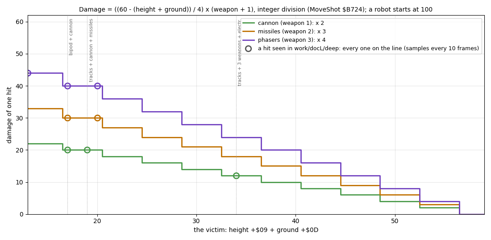

How to read the figure:

- **The three step lines** are the damage formula for cannon, missiles and phasers against the victim's height +
  ground.
- **Each circle** is a hit seen in `deep`; all sit on the formula.

[10](10-gameplay-logic.md) 10.6 gives the command that drew it.

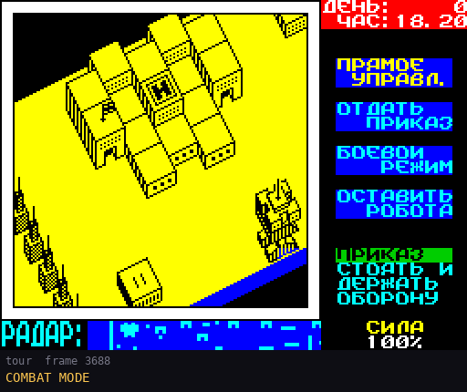

How to read the figure:

- **The frames** are `tour` 3688-3882 ([05](05-controls.md) 5.6).
- **3725**: FIRE CANNON; the shot flies two cells a turn and ends. **3842**: EXIT MENU.

`python3 tools/fig_tour.py draw` draws it from `work/docP/tour/samples.bin`.

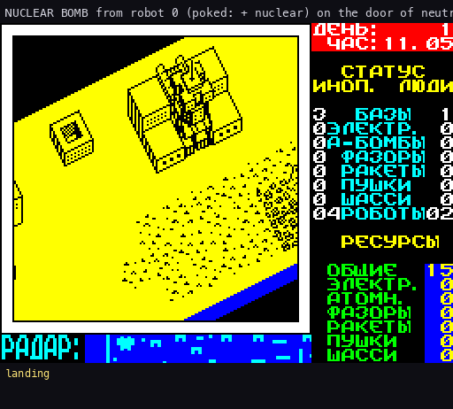

How to read the figure:

- **The frames** are an experiment of [10](10-gameplay-logic.md) 10.9: robot 0 given the nuclear part by a poke,
  the bomb set off from combat mode.
- **The flash** is random paper colours; **after** it the factory is debris and the robot is gone.

[10](10-gameplay-logic.md) 10.9 gives the command that drew it.

## 1.10 The enemy

The aliens play by the same rules: the same parts, prices, capture and production ([10](10-gameplay-logic.md) 10.8).

- In 3 turns of 4 the enemy commander looks at one of its slots (`EnemyCommander` `$B7F4`).
- A free slot may get a robot of random parts at a random warbase of its own, paid like ours; it may borrow up to
  half its general resource.
- Its robots carry more weapons as its army grows: 2 from 8 robots, 3 from 16.
- An enemy robot whose search for a building finds none switches to search and destroy robots; ours stands.

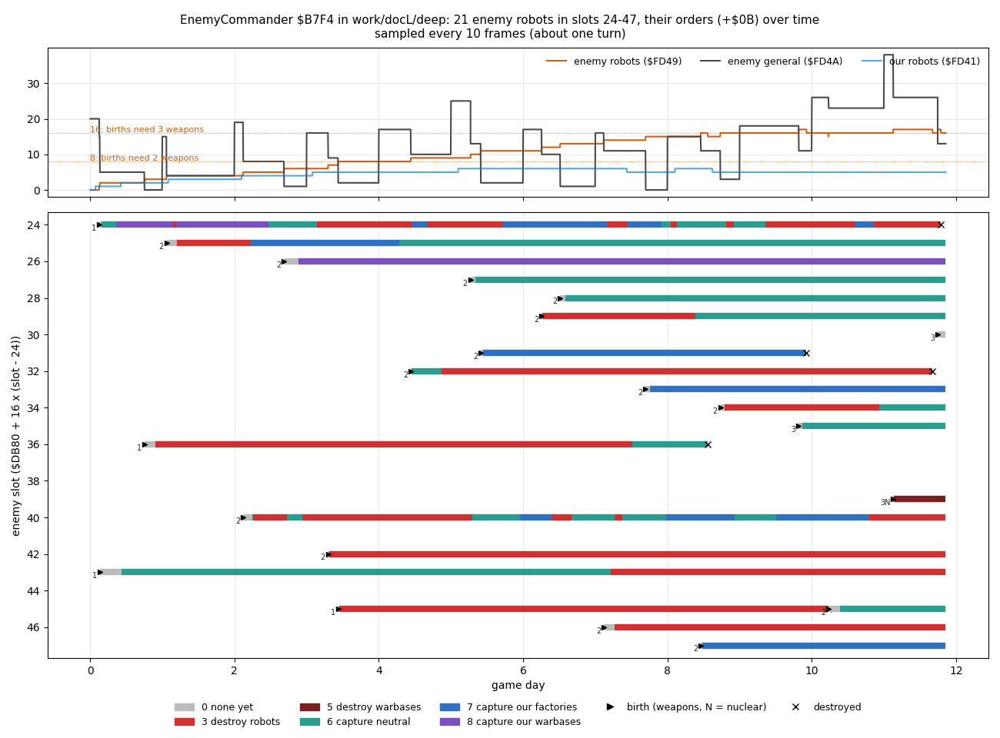

How to read the figure:

- **The top** is the enemy's robot count, its general resource and our robots, with the weapon thresholds dotted.
- **The bottom** has one row per enemy slot: a bar is one robot's life, coloured by its order.

[10](10-gameplay-logic.md) 10.8 gives the command that drew it.

## 1.11 Time and production

- A game turn is at least 10 frames (0.2 s). Each turn the clock moves 5 minutes, so an hour is 12 turns and a day
  288 turns, at least 57.6 s ([10](10-gameplay-logic.md) 10.2).
- At midnight each side earns 5 general per warbase and 2 of a part resource per factory of that kind. No resource
  goes above 99 ([10](10-gameplay-logic.md) 10.3).
- A new game gives each side 20 general and nothing else.

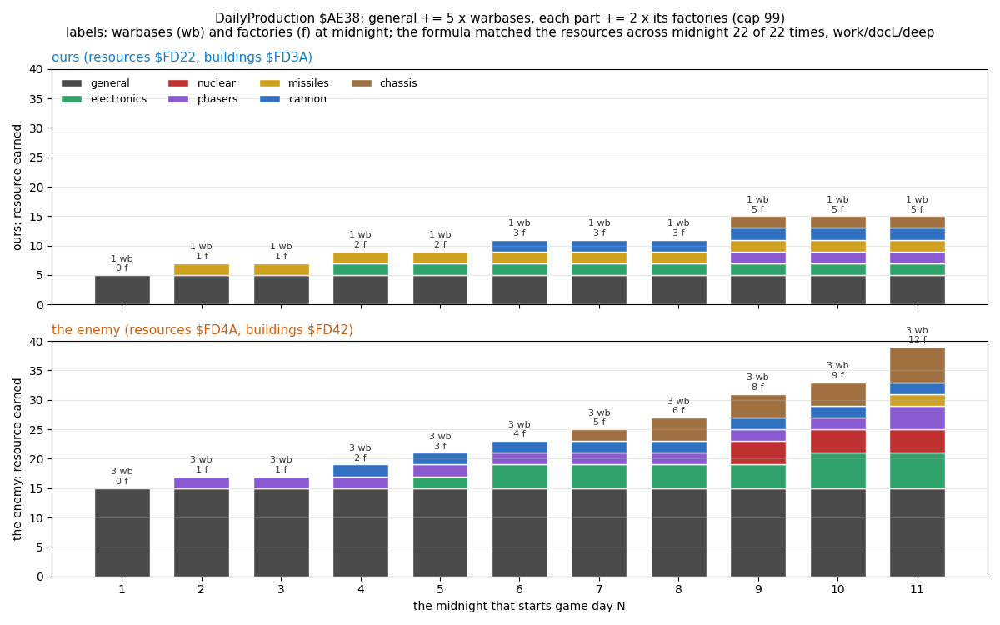

How to read the figure:

- **One bar** per midnight and side: 5 × warbases + 2 × each factory kind.
- **The enemy's** 3 warbases earn 15 general a day to our 5; its factories pull ahead from day 5.

[10](10-gameplay-logic.md) 10.3 gives the command that drew it.

## 1.12 Winning, losing and saving

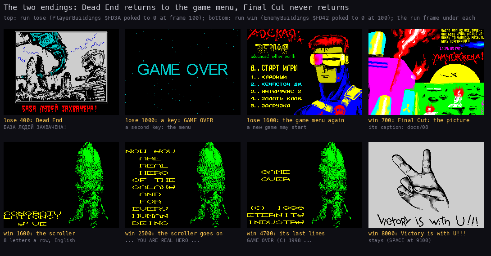

How to read the figure:

- **The top row** is `lose`: Dead End's picture, GAME OVER after a key, the game menu after a second key.
- **The bottom row** is `win`: Final Cut's picture and caption, the scroller, "Victory is with U!!!".

`python3 tools/fig_tour.py draw` draws it from `work/docP/lose` and `work/docP/win`.

- **Win**: the aliens' warbase count reaches 0. `CheckGameEnd` (`$AE6B`) tests this first and starts Final Cut from
  bank 6, to X-Man's tune REM. Final Cut never returns: the machine has to be reset ([08](08-hud-and-text.md) 8.9).
  [listen: REM](audio/rem.mp3)
- **Loss**: our warbase count reaches 0. Dead End runs from bank 3, to the tune NETHER EARTH (END): "БАЗА ЛЮДЕЙ
  ЗАХВАЧЕНА!" (the humans' base is captured), GAME OVER, then the game menu. [listen: NETHER EARTH (END)](audio/nether-earth-end.mp3)
- **Save**: the key 5 in play opens the disk module's save screen; a name of up to 8 letters is saved as a file on
  the disk ([05](05-controls.md) 5.8).
- **Load**: key 5 in the game menu opens the load screen; the loaded game goes on from where it was saved. The file
  has no checksum: a damaged file loads without a word ([10](10-gameplay-logic.md) 10.10).

## 1.13 The authors' claims against the code

The authors describe the game in three places: the help pages, the intro's scroller and the file `NETHER+.W`
([08](08-hud-and-text.md) 8.7-8.10). Each claim about the game is checked here against ANE's code.

| Claim | Where | The code | Verdict |
| --- | --- | --- | --- |
| "All Earth scraped together for the first purchases is 20 space dollars" | help 1.2 | `NewGameSetup` `$A683`: `Resources` `$FD22` = 20, the enemy's `$FD4A` = 20 | true |
| The prices of the parts | help 3.1-3.8 | `PartCosts` `$CAF0` = `03 05 0A 02 04 04 14 03` (bipod to electronics); the construction menu prints the same | true except the bipod: 3, not 5 |
| One chassis, at least one weapon, no more than 3 kinds of weapon | help 2.2 | `ConstructionMenuLoop` `$CA0F`: one chassis; the weapon bits are never all four; START needs a chassis and a weapon | true |
| A robot's toughness is in proportion to the cost of its chassis and weapons | help 2.2 | every robot starts with strength 100 (`$64`); the damage falls with the robot's height, the sum of `PartHeights` `$D7B4` (bipod 11, tracks 7, anti-grav 8) | false: height, not cost, and the cheapest chassis is the tallest |
| Electronics act more sensibly and react faster | help 3.1 | bit 7 of the parts is tested in two places: `SpotEnemies` `$B63C` (12 cells ahead instead of 10) and `FireShot` `$B6E1` (one more step of range) | partly: it sees and shoots further; no other code reads it |
| The phaser's shot crosses 3 screens, the cannon's 2 | help 3.3, 3.5 | `FireShot` `$B6D6`: 5 steps for cannon and phasers, 7 for missiles (`$B6D9-$B6DF`) | false: the phaser does not out-range the cannon; missiles reach furthest |
| A robot damaged more than 50 % fires one missile at half power | help 3.4 | `MoveShot` `$B724`: the damage is ((60 - height - ground) / 4) × (weapon + 1), with no test of the shooter's strength | false |
| Tracks: speed halved on mountains | help 3.7 | `StepDelays` `$B61D`: tracks 4 turns a step on flat ground, 6 on low, 7 on high | roughly: 1.75 times slower on high ground |
| Bipod: smooth ground only | help 3.8 | `FreeDirections` `$B513`: a bipod climbs ground heights 0, 2 and 3 | partly: it also climbs low ground |
| Up to 3 robots may be released in a row before programming | help 2.3 | no count of unprogrammed robots; a release needs the door and the row under it free (`$A6C8-$A6EE`) and a free slot | no limit of three in the code |
| One order can be held by a limited number of robots, "usually no more than four" | help 4.3 | `SetOrder` `$ABC8` only turns the building-destroying orders into 0 for a robot without the bomb; `ConsiderBuilding` `$B36C` skips a building another robot with the same order is already after | false as a number: no limit of four; an order fails when no target is left |
| Up to 50 robots a side in big battles | help 5.1 | 24 robot slots a side: ours `$DA00` + 16 × n, the enemy's `$DB80` + 16 × n | false: at most 24 |
| 3 robots destroyed in one place make a pile that even anti-gravs cannot pass | help 5.1 | `RobotDestroyed` `$B116` lays a 2 × 2 wreck of height 3 on bare ground only; every chassis climbs it | false: wrecks do not pile up |
| The bomb destroys all buildings and robots within one screen | help 3.2 | `NuclearBlast` `$B99F`: the first intact base in reach, and every robot in a round area 9 cells across | partly: one base, not all buildings |
| Two robots fire at each other through a wall | help 5.2 | `SpotEnemies` `$B626` / `ScanLane` `$B66E`: the first object on a lane ends it, so a wall hides the opponent; a shot ends at a building | false |
| Robots on "search and destroy robots" shoot your own robots | help 5.2-5.3 | a shot hurts the first live robot of either side (`MoveShot` `$B724`); a friend in the lane hides the enemy from the shooter | true: there is friendly fire |
| A capture takes about 45 seconds | help 5.4 | `GameTurnEnd` `$AD90`: 144 turns (`$90`), at least 28.8 s; `deep` about 30 s | false: about 30 s |
| "Normal" disk load and save that handle every disk error | `NETHER+.W` | the disk module's texts and paths for no disk, load and save errors, file not found, write protect, full catalogue and full disk ([08](08-hud-and-text.md) 8.6); `r2` saved and loaded | true; the errors were not provoked in a recording |
| "Some bugs found while working on the game are fixed" | `NETHER+.W` | names no bug; [10](10-gameplay-logic.md) 10.11 lists the bugs the code still has | cannot be checked |
| The game is easy: a test game was won with 2 or 3 robots | `NETHER+.W` | not tested; `deep` built 7 robots in 11.9 days and did not win | not checked |

Known only from the code, with no recording: the release limit, the order limit, the 50 % missile rule, the wall
story and the pile of wrecks. The recordings agree with the code where they reach: the damage of every hit in `deep`
fits the formula, and the capture took 144 turns 17 times. The construction menu prints 3 as the bipod's price.

## 1.14 Design notes

- **A war of production.** The player never shoots; the choices are what to build, where to send it and when to
  capture. Factories decide the long game: the enemy's 3 warbases earn 15 general a day to our 5.
- **Robots act on their own.** An order is a goal; the robot steers, looks and fires by itself. The ship can only
  ride along (direct control) or fire one weapon by hand (combat mode).
- **The world keeps running in the robot menu.** Choosing an order costs game time; only the construction menu
  stops the war.
- **The help is generous and not always right.** Its rules are partly the authors' impressions: the claims in 1.13
  that the code does not bear out read as advice, not as rules.
- **Two different ends.** A lost game goes back to the menu; a won game ends in Final Cut, which never returns.
