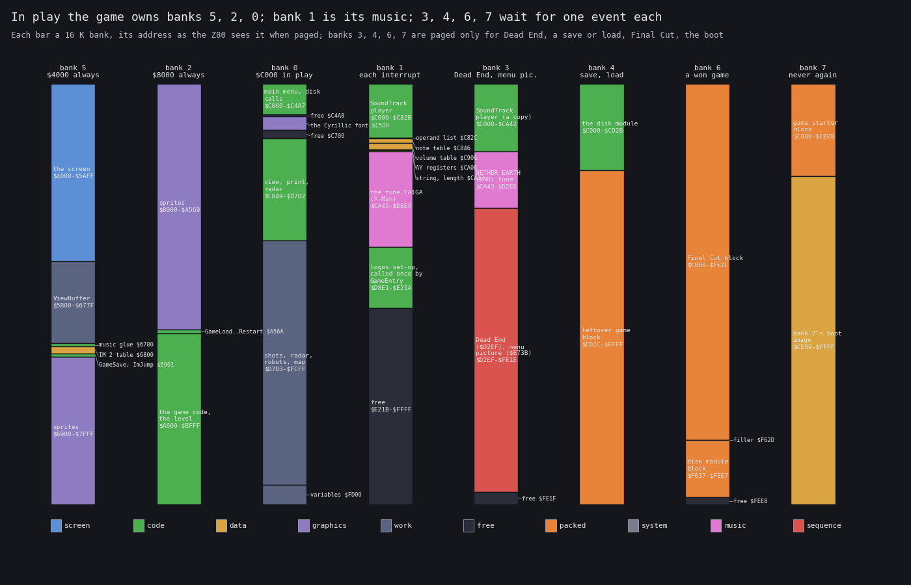
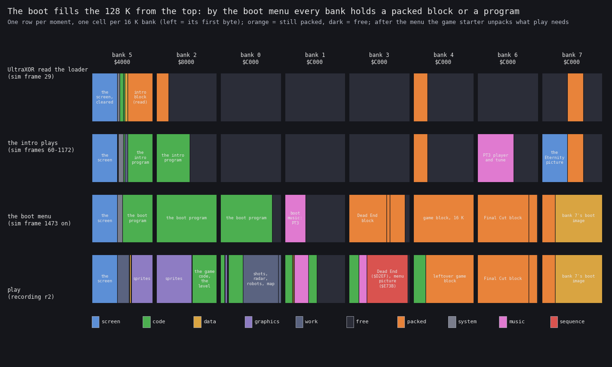
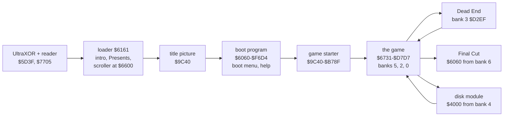
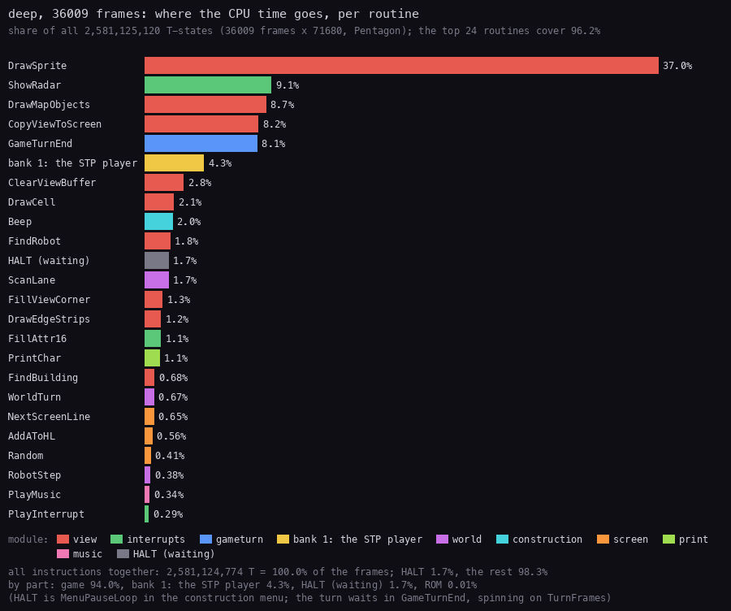
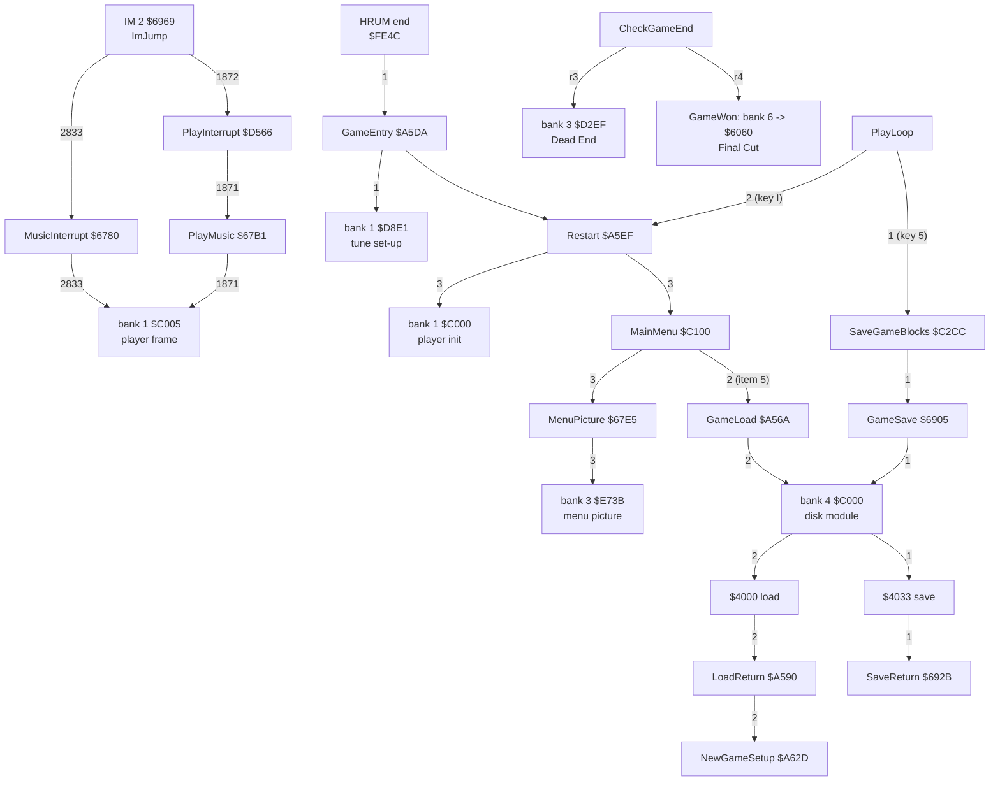

# 2. Architecture

This document describes how Advanced Nether Earth uses the 128 K machine: which bank holds what at each moment, which
code pages which bank, how the interrupts share the frame, and how the source is split into modules. The game in play
lives in banks 5, 2 and 0, the 48 K a Spectrum sees without paging. Bank 1 holds the game music and is paged in for
part of every interrupt. Banks 3, 4, 6 and 7 hold one program each, packed or unpacked, waiting for a single event:
a lost game, a save or load, a won game, the start of the game.

The recordings and runs it rests on ([Terms](README.md#terms)):

- `r2`: power-on with the original SCL on Pentagon 128 + TR-DOS 5.04T, the boot, the game menu, play, a disk save, a
  load of it, a load of `nether.N` (`work/stage3/r2`; frames 102-10802; 766 975 995 T, 45 216 264 instructions,
  9764 interrupts; replayed with 0 divergences over 428 checks). Its L1 analysis (`work/stage3/r2/l1.json`, 714
  routines) gives the call counts below;
- `r3`, `r4`: a play snapshot with a poke (`PlayerBuildings` `$FD3A` = 0, `EnemyBuildings` `$FD42` = 0): Dead End
  and Final Cut (`work/stage3/r3`, `r4`);
- `ane_sim`: the static boot of `tools/ane_sim.py`, with its log of reads, `$7FFD` writes and depacks
  (`work/stage2/tmp/log3.txt`; doc 03, 3.5);
- the dumps `work/images/scl-{intro,menu,play}-bank*.bin` (stage 1 recording `s2`, frames 5000, 8400, 11500).

## 2.1 The machine budget

| Resource | What ANE uses |
| --- | --- |
| CPU | Z80 at 3.5 MHz; Pentagon timing, 71 680 T a frame (`r2`: 766 975 995 T over 10 700 frames) |
| RAM | all eight 16 K banks: 5, 2, 0 for the game; 1 its music; 3, 4, 6, 7 one program each (2.2) |
| ROMs | the 48 BASIC ROM paged in play (`$7FFD` bit 4 = 1); TR-DOS through `$3D2F` and its gadgets at the boot (doc 03, 3.3) and the save and load |
| Screen | screen 5 (`$4000`) in play; screen 7 (bank 7 `$C000`) only in the intro's flashes |
| Sound | the AY-3-8912 through `$FFFD` / `$BFFD` (two players: doc 09); port `$FE` for the border |
| Disk | the Beta interface (WD1793): `$1F`, `$3F`, `$5F`, `$7F`, `$FF`, only through TR-DOS ROM code |
| Input | the keyboard (`$FE`) only: the game reads a Kempston (`IN A,($1F)`, doc 05), the help program does not (its pointer moves by Q A O P, 6-0 or CAPS SHIFT + 5-8) |

The ports `r2` saw written, with the code that wrote them (L1 `ports_out`):

| Port | Writers | What |
| --- | --- | --- |
| `$7FFD` | `GameLoad` `$A56A`, `GameEntry` `$A5DA`, `Restart` `$A5EF`, the music handlers, the disk module `$49BF`, UltraXOR's reader, the loader, the boot program, bank 7's depacker (`$5B0E`, `$5B23`) | the bank at `$C000` (bits 0-2), the shown screen (bit 3), the ROM (bit 4) |
| `$FFFD`, `$BFFD` | the SoundTrack player (bank 1 `$C736`, bank 6 for the intro), the disk module's silence (`$C023`), the intro | AY register select, data |
| `$xxFE` | the game (`$D0B9`), the tune set-up `$D8E1`, the game starter (`$9C40`, `$9C73`), the title picture, the disk module (`$426D`) | the border colour |
| `$1F`-`$FF` (Beta) | TR-DOS ROM code only | the disk |

What runs where over all of `r2` (instructions executed, L1 `instructions`; the boot and play together):

| Page | Instructions | Share | Mostly |
| --- | ---: | ---: | --- |
| bank 0 | 14 790 383 | 32.7 % | the game's code from `$C000` |
| bank 5 | 8 062 273 | 17.8 % | the loader, the boot program, the glue at `$6780-$697F`, the disk module at `$4000` |
| bank 2 | 2 192 883 | 4.8 % | the game's code from `$A600`, the game starter at `$9C40` |
| bank 1 | 1 707 318 | 3.8 % | the music players |
| bank 6 | 773 847 | 1.7 % | the intro's player |
| bank 3 | 597 032 | 1.3 % | the menu picture (`$E73B`) |
| bank 4 | 79 124 | 0.2 % | the disk module's start |
| bank 7 | 262 | 0.0 % | bank 7's image is data |
| the ROMs | 17 013 142 | 37.6 % | the 128 menu before `RUN`, TR-DOS for every disk access |

## 2.2 The memory map



How to read the figure:

- **Each bar** is one 16 K bank, at the address the Z80 sees when it is paged: banks 5 and 2 at `$4000` and `$8000`
  always; the others at `$C000`.
- **Colours** are the kind of each region; every region is labelled with its range, small ones beside the bar.
- **Above each bar**: when the bank is paged.
- **The claim**: play needs only banks 5, 2 and 0 plus bank 1 for the music; banks 3, 4, 6 and 7 hold one program
  each for one event, three of them still packed.



How to read the figure:

- **One row per moment**: after UltraXOR's first reads (`ane_sim` frame 29), while the intro plays (60-1172), at the
  boot menu (1473 on), in play (`r2`).
- **One cell per bank**, its first byte on the left; orange = a packed block, dark = free.
- **The claim**: the boot fills memory from the top banks down; by the boot menu every bank holds a packed block or a
  program, and the game starter (doc 03, 3.4) unpacks into banks 0, 1, 3, 4 what play needs.

`python3 tools/fig_banks.py` draws both from `tools/fig_banks.txt` (one line per region, with its witnesses in the
header: the reader's reads, the depacks of `ane_sim`, the dumps, `src/loader.asm`, `src/sfx/blocks.asm`).

The banks in play:

| Bank | Range | What | Witness |
| --- | --- | --- | --- |
| 5 | `$4000-$5AFF` | the screen | |
| 5 | `$5B00-$677F` | the view buffer | `scl-play-bank5` |
| 5 | `$6780-$67FF` | `MusicInterrupt` `$6780`, `PlayMusic` `$67B1`, `GameBank` `$67D9`, `SetGameBank` `$67DA`, `MenuPicture` `$67E5` | `r2` calls (2.5) |
| 5 | `$6800-$6900` | the IM 2 table: 257 bytes of `$69` (zero on the disk, written by `Start`) | I = `$68` |
| 5 | `$6905-$697F` | `GameSave` `$6905`, `SaveReturn` `$692B`, `ImJump` `$6969` (`JP`), `ImHandler` `$696A` (the handler's address) | `r2` |
| 5 | `$6980-$7FFF` | sprites | |
| 2 | `$8000-$A569` | sprites | |
| 2 | `$A56A-$A5FF` | `GameLoad` `$A56A`, `LoadReturn` `$A590`, `GameEntry` `$A5DA`, `Restart` `$A5EF`; `$A5ED` is the stack top of `MenuPicture` and `GameSave` | `r2` |
| 2 | `$A600-$BFFF` | the game's code (`Start` `$A600` on), level tables | |
| 0 | `$C000-$C4A7` | the game's code: the main menu `$C100`, the disk calls | |
| 0 | `$C4A8-$C4FF`, `$C700-$C848` | free | |
| 0 | `$C500-$C6FF` | the Cyrillic font: codes `$20-$5F`, glyph at `$C400` + 8 x code | doc 08 |
| 0 | `$C849-$D7D2` | the game's code: construction, the view, print, the radar, `PlayInterrupt` `$D566` | |
| 0 | `$D7D3-$FCFF` | the world: shots, the radar layers, the robots, the map | |
| 0 | `$FD00-$FFFF` | the variables, the buildings; `$D92B-$FFFF` is what a save writes (doc 03, 3.7) | |
| 1 | `$C000-$CA42` | New SoundTrack Player (Phantom Family): `$C000` init, `$C005` a frame | doc 09 |
| 1 | `$CA43-$D8E0` | the tune "TAIGA" (X-Man, 1997), its length word at `$CA43` | doc 09 |
| 1 | `$D8E1-$E21A` | code: the logos and graphics `GameEntry` calls once | `ane_sim` 2151-2496 |
| 3 | `$C000-$FE1E` | Dead End (entered at `$D2EF`), its tune "NETHER EARTH (END)", the menu picture's code `$E73B` | `r3`, `r2` |
| 4 | `$C000-$CD2B` | the disk module: `$C000` start, then its copy runs at `$4000` (load) / `$4033` (save) | `r2` |
| 4 | `$CD2C-$FFFF` | the rest of the game's packed block (read there at the boot, never used again) | |
| 6 | `$C000-$F62C` | Final Cut's HRUM block, copied to `$6060` by a won game | `r4` |
| 6 | `$F62D-$F636` | sector filler | |
| 6 | `$F637-$FEE7` | the disk module's HRUM block (already unpacked into bank 4) | |
| 7 | `$C000-$FFFF` | bank 7's boot image: the game starter's block at `$C000`, the rest unused in play | |

## 2.3 The stages

The boot chain is doc 03, 3.4. Seen from memory:



| Stage | Lives in | Pages | Ends |
| --- | --- | --- | --- |
| UltraXOR, the reader | `$5D3B-$813A`, the reader at `$5D3F` | `$10`-`$17` for its reads | `JP $6060` |
| the loader and its three programs | `$6161-$62C7`, each program at `$6600` | bank 6 for the player each frame, 7 and 4 for the copies | SPACE: `RET` to the reader |
| the boot program | `$6060-$F6D4` (banks 5, 2, 0) | bank 1 each frame for the boot music | key 1: the game starter |
| the game starter | `$9C40-$B78F` (bank 2) | banks 3, 4, 6 for the depacks | the game's block, `JP $A5DA` |
| the game | `$6731-$D7D7`, data to `$FFFF` | 1 each interrupt, 3, 4, 6 for one event | Final Cut does not come back |
| Dead End | bank 3 | | the game menu (`r3`) |
| the disk module | bank 4, then `$4000-$4CC6` | `$10` back | `LoadReturn`, `SaveReturn` or `Restart` |
| Final Cut | `$6060-$F76C` | | never returns (`r4`, 16 000 frames) |

- The game overwrites the boot program: both live at `$6060` and on. Of the boot, play keeps only what the game
  starter unpacked into banks 1, 3, 4 and the blocks in banks 4, 6 and 7.
- Dead End and Final Cut are entered with IM 1 and the AY silenced (`Silence`).

## 2.4 Time: frames and interrupts

The game runs IM 2 with I = `$68`. The table at `$6800-$6900` holds 257 bytes of `$69`, so any data-bus byte gives the
vector `$6969`. There `ImJump` holds `JP` and `ImHandler` the handler's address, written by the code that changes
state.

| Handler | Address | Installed by | Work a frame | `r2` entries from `$6969` |
| --- | --- | --- | --- | ---: |
| `MusicInterrupt` | `$6780` | `Start`, `ConstructionMenu`, `SaveGame`, `LoadError` | saves every register, pages bank 1, one frame of the player (`$C005`), pages `GameBank` back | 2833 |
| `PlayInterrupt` | `$D566` (bank 0) | `EnterPlay` | the turn counter, the radar (`ShowRadar` `$D59E`, 8134 T), then `PlayMusic` `$67B1`: bank 1, one frame of the player, back | 1872 |

- On Pentagon the data bus reads `$FF` during the acknowledge: every interrupt takes its vector from `$68FF-$6900`.
  The other 255 bytes of the table are there for machines whose bus floats.
- A frame of the player (`$C005`) takes 2338 T on average (`r2`, 4765 entries).
- `PlayInterrupt`'s `CALL ShowRadar` is a `JP PlayMusic`; `PlayMusic` calls `ShowRadar` itself and jumps back
  after the call. `r2` counts 1871 `PlayMusic` entries for 1872 `PlayInterrupt` entries: the recording ends in
  the last one.
- `GameBank` (`$67D9`) is the last value the game wrote to `$7FFD` through `SetGameBank`; both handlers page it back.
  The menu picture is drawn with bank 3 paged and `GameBank` = `$13`, so the music handler returns to bank 3.
- `r2` has 9764 interrupts in 10 700 frames: the disk I/O, the depacks and the boot's reads run with `DI`.

<!-- snippet: MusicInterrupt -->
<!-- snippet: PlayMusic -->

### Where the time goes



How to read the figure:

- **A bar** is one routine of `src/game/game.ann` (banks 5, 2 and 0): its own T-states over all of `deep` (L1,
  `work/docL/deep/l1.json`, the bot's game of [01](01-game-design.md)), as a share of all the recording's T-states
  (36 009 frames x 71 680 = 2 581 125 120). Labels inside a routine count for it; the routines it calls count for
  themselves.
- **Bank 1** has no `.ann`: its bar is all the code run in bank 1, the New SoundTrack Player
  ([9.2](09-sound.md#92-new-soundtrack-player)).
- **The colour** is the routine's module (the legend). HALT is its own bar: the CPU waiting for the interrupt, here
  `MenuPauseLoop` `$CB4C` in the construction menu (640 frames).
- **The top 24** routines cover 96.2 %. All instructions together are 100.0 % of the frames; the ROMs 0.01 %.
- **What it shows**:
  - `DrawSprite` `$CF2D` takes 37.0 %; with `DrawMapObjects` (8.7 %), `CopyViewToScreen` (8.2 %),
    `ClearViewBuffer` (2.8 %), `DrawCell` (2.1 %) and `FindRobot` (1.8 %) the `view` module is 64.0 %
    ([6.1](06-rendering.md#61-the-play-view-a-buffer-redrawn-from-nothing));
  - the play interrupt's radar: `ShowRadar` 9.1 %, `FillAttr16` 1.1 %;
  - `GameTurnEnd` 8.1 %: `TurnPace`'s wait for the tenth frame ([4.7](04-game-loop.md#47-time));
  - the music: the player in bank 1 4.3 % and `PlayMusic` 0.3 %, the budget of
    [9.5](09-sound.md#95-the-cost-of-a-frame-of-music);
  - the robots and the enemy: `ScanLane` 1.7 %, `WorldTurn` 0.7 %, `RobotStep` 0.4 %; the `world` module 4.1 %.
- **The point**: the 128K adds the music for about 4.6 % of the CPU and nothing else to play. Drawing the view
  still takes almost two thirds, the radar a tenth, the turn's wait a twelfth; the game's logic is about 5 %.

```bash
python3 ../../kit/fig_budget.py work/docL/deep/l1.json docs/img/arch/budget.png \
    --ann src/game/game.ann,page=0/2/5 --page-name '1=bank 1: the STP player' \
    --title 'deep, 36009 frames: where the CPU time goes, per routine' \
    --note '(HALT is MenuPauseLoop in the construction menu; the turn waits in GameTurnEnd, spinning on TurnFrames)'
```

## 2.5 The call graph of ANE's own code

ANE's own code is what pages banks, plays the music, reaches the disk, and starts the endings. The graph has every
such routine with `r2`'s call counts (L1 `calls`; `work/docs/docS/r2-routines.txt`).



- The numbers on the edges are `r2`'s calls; `r3` and `r4` mark the two ends, reached only with a poke.
- `GameEntry` runs once per boot. Every other start of the game (`I` in play, a load given up, the end of Dead End)
  goes through `Restart`, which initialises the player in bank 1 and falls into `Start`.
- The disk module's `$49BF` writes `$7FFD` = `$10` before it returns (7 calls in `r2`).
- `GameStop` (`$6D6A` typo) is no longer called: it would write the handler's address into the view buffer.
  Known from code only.

<!-- snippet: GameEntry -->
<!-- snippet: GameWon -->

## 2.6 Module map

The source is one folder per part (`work/stage3/BRIEF-SOURCE.md`; doc 03, 3.9 has the build). Each part is
assembled at its own addresses, then packed.

| Part | Folder | Runs at | Bank(s) | Doc |
| --- | --- | --- | --- | --- |
| the boot BASIC, UltraXOR, the sector reader | `src/boot/` | `$5D3B-$813A`, the reader `$5D3F` | 5, 2 | [03](03-build-and-load.md) |
| the loader | `src/loader.asm` | `$6161-$62C7` | 5 | [03](03-build-and-load.md) |
| the intro, Presents, the scroller, the title picture | `src/intro/` | `$6600`, `$9C40` | 5, 2, 0; 7 for the picture | [03](03-build-and-load.md) |
| the boot program: boot menu, help | `src/bootmenu/` | `$6060-$F6D4` | 5, 2, 0 | [08](08-hud-and-text.md) |
| the game starter, bank 7's image | `src/disk/` | `$9C40-$B78F`, bank 7 | 2, 7 | [03](03-build-and-load.md) |
| the game | `src/game/<module>.asm` | `$6731-$D7D7`, data to `$FFFF` | 5, 2, 0 | [04](04-game-loop.md), [10](10-gameplay-logic.md), [12](12-routine-reference.md) |
| the disk module | `src/disk/` | bank 4 `$C000`, copied to `$4000` | 4, 5 | [03](03-build-and-load.md) |
| the players, the music banks, the tunes | `src/music/`, `src/res/music/` | bank 1 `$C000`, bank 6 for the intro, bank 3 for Dead End | 1, 3, 6 | [09](09-sound.md) |
| Dead End, Final Cut | `src/endings/` | bank 3 `$C000`; `$6060-$F76C` | 3, 6 | [10](10-gameplay-logic.md) |
| the packing, the disk | `src/sfx/`, `src/disk.txt` | | | [03](03-build-and-load.md) |

The game's own modules (`src/game/<module>.asm`, generated from `src/game/game.ann`) are being written; their list
goes here when `work/stage3/SOURCE-STATE.md` publishes it.

<!-- snippet: GameModules -->

## 2.7 Paging: who writes `$7FFD`

- In play only ANE's own code pages: the two music handlers (bank 1 and back), `SetGameBank` (`MenuPicture`: bank 3),
  `GameSave` / `GameLoad` (bank 4), the loss branch of `CheckGameEnd` (bank 3), `GameWon` (bank 6), `GameEntry`
  and `Restart` (bank 1 for the player's set-up).
- The value is always `$1x`: the 48 BASIC ROM (bit 4), screen 5 (bit 3 clear). The game's base value `$10` puts
  bank 0 at `$C000`.
- `GameSave` waits for a frame's start (`EI; HALT`) before it pages bank 4, so the music handler does not run with
  bank 4 paged: the handler pages `GameBank` back, which is still `$10`.
- At the boot, the boot program's `SetPage` (`$624D`) pages bank 1 and back every frame; the game starter uses it
  for banks 3, 4, 6 (doc 03, 3.5: 13 469 of the boot's 16 010 writes).

## 2.8 Design notes

- **The game's 48 K stays where it was.** Everything 128 K adds sits in banks the game reaches only through a short
  glue at `$6780-$697F` and `$A56A-$A5FF`. Bank 0 at `$C000` is the game's own memory, so any other bank is paged
  only for a call that returns or for a jump that never comes back.
- **The IM 2 table moved under `$C000`.** A table at the top of memory would be paged out with bank 0; at `$6800` in
  bank 5 it is always there, whatever bank 1, 3 or 4 is at `$C000`.
- **One byte keeps the paging honest.** `GameBank` is the only record of the bank the game wants; both handlers
  restore it, so the music can interrupt the menu picture's bank 3 code.
- **The 128 K is a store, not a workspace.** Banks 3, 4, 6, 7 are loaded at the boot and never written in play; the
  machine's extra memory replaces the tape, not the game's working space.
