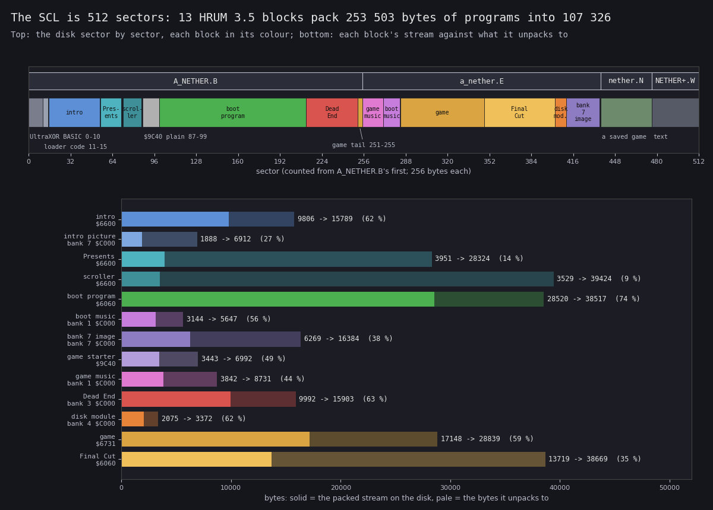
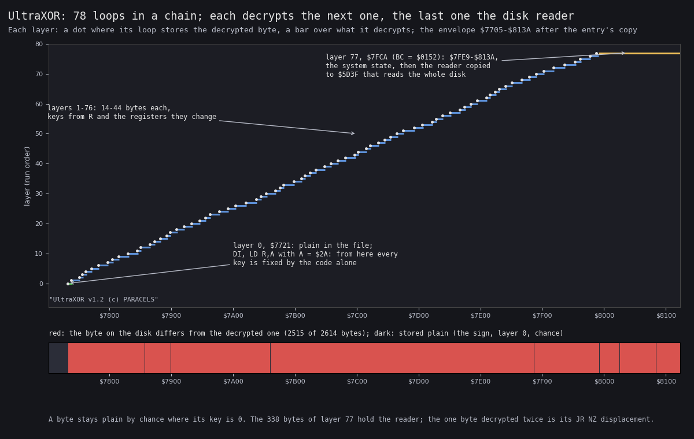
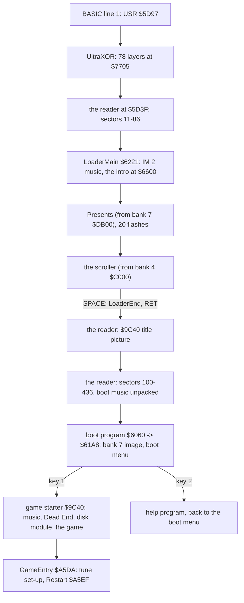
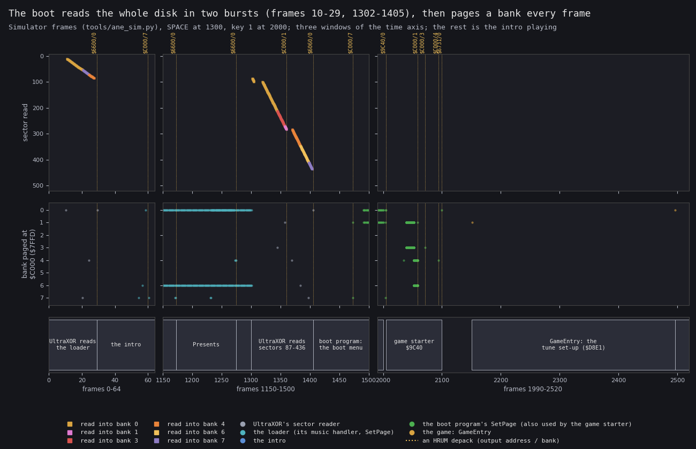
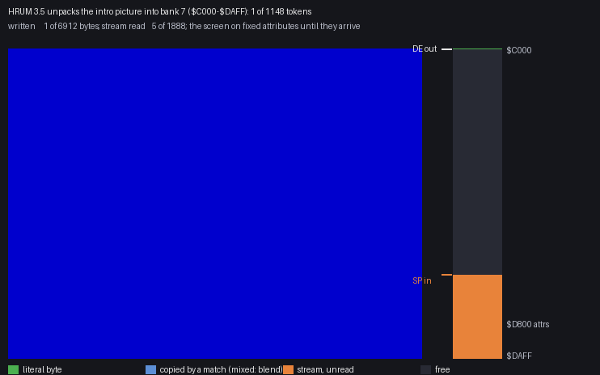
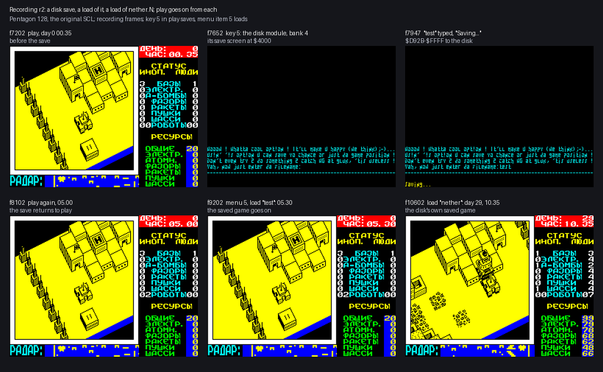
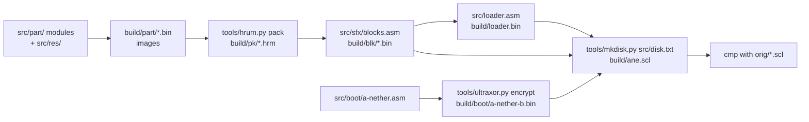

# 3. Build and load

This document covers how Advanced Nether Earth gets from its disk into the 128 K, and how the source tree makes the
same disk again. The disk is dense: one SCL of 512 sectors, of which the boot reads 426 in two bursts. A protection
envelope (UltraXOR v1.2) hides the sector reader; thirteen self-extracting HRUM 3.5 blocks hold every program; the
boot fills all eight banks before the boot menu shows. A second, later medium (the "Final Cut" disk of 2017) holds
only the won-game sequence, packed with Hrust 1.

The recordings and runs it rests on ([Terms](README.md#terms)):

- `ane_sim`: `tools/ane_sim.py`, a static run of the boot (SkoolKit's simulator with 128 K paging, the 128 and
  TR-DOS 5.04T ROMs, a WD1793 model reading the SCL, scripted keys) from `RUN "A_NETHER"` to the game's `Restart`.
  It logs every sector read, every `$7FFD` write and every HRUM depack. Its frames are its own (71 680 T each,
  frame 0 = the BASIC's `USR`), with SPACE at 1300 and `1` at 2000. Log: `work/stage2/tmp/log3.txt`;
- `r1`: power-on, the intro to the scroller's wrap, the boot menu, every help page, the game menu (Pentagon 128 +
  TR-DOS, the original SCL; `work/stage3/r1`);
- `r2`: power-on to play, then a disk save, a load of it, a load of the disk's own `nether.N`
  (`work/stage3/r2`, frames 102-10802, 45 216 264 instructions, replayed with 0 divergences);
- `r5`: the SCL with two bytes of `nether.N` changed, loaded (`work/stage3/r5`);
- `c1`: power-on with the Final Cut disk `orig/ANE_FC.TRD` to the end of its sequence (`work/stage1/c1`).

Recording frames are the recordings' own; in `r1`, `r2`, `r5` a frame is the input script's frame + 1602.

## 3.1 The disk

The release is the TOSEC SCL `orig/Advanced Nether Earth (1998)(Eternity Industry)(128K)(RU).scl`: four files,
512 sectors. The sector numbers in this document count from `A_NETHER.B`'s first sector across the files, as the
boot's reads do (`A_NETHER.B` starts at the disk's logical sector 16: sector k is logical 16 + k).

| File | Catalogue | Sectors | What |
| --- | --- | --- | --- |
| `A_NETHER.B` | BASIC, 2808 bytes (program 2795) | 0-254 (255) | the boot BASIC and UltraXOR (0-10); then raw sectors the reader takes by number: the loader, blocks |
| `a_nether.E` | type `E`, start 0, length 0 | 255-436 (182) | only sectors: the rest of the blocks |
| `nether.N` | CODE 55595 (`$D92B`), 9941 bytes | 437-475 (39) | a saved game (3.7) |
| `NETHER+.W` | type `W`, 38912, 9143 bytes | 476-511 (36) | the authors' text in CP866: history, features, credits |

- `A_NETHER.B`'s catalogue length covers 2808 bytes, 11 sectors; its sector count says 255. TR-DOS's `LOAD` reads
  the 11; UltraXOR's reader reads the rest by number.
- `a_nether.E`'s catalogue words are zero: no command loads it by name.
- Neither `nether.N` nor `NETHER+.W` is read by the boot. `nether.N` is read only when the player loads a game by
  that name (`r2` frame 10167).



How to read the figure:

- **Top strip**: the 512 sectors left to right, the four files above them. Each HRUM block is in its own colour,
  labelled with its name and sectors. Grey areas are not HRUM: the BASIC with UltraXOR (0-10), the loader's code
  (11-15, its intro block follows in the same sectors), the plain title picture (87-99), the saved game, the text.
- **The game block** lies in two places: 284-347 (its first 16 384 bytes) and the end of sector 251 to 255 (its last
  914 bytes), next to Dead End's block in the sectors read to bank 3.
- **Bottom bars**: per block, the packed stream (solid) on top of what it unpacks to (pale), with "stream ->
  unpacked (ratio)". The blocks are in boot order.
- **The claim**: 253 503 bytes of programs ride in 107 326 bytes of streams (42 %), and the disk is full: only the
  saved game and the text are outside the boot.

`python3 tools/fig_blocks.py` draws it from `build/pk/*.hrm`, `build/blk/*.bin`, `src/sfx/blocks.asm` and
`src/disk.txt` (needs `tools/build.sh` first).

The sectors in order (`src/disk.txt` is the same map as the build's input):

| Sectors | Read to | What |
| --- | --- | --- |
| 0-10 | `$5D3B` (TR-DOS `LOAD`) | the BASIC: line 0 is UltraXOR, line 1 `CLOSE # USR Eternity` (3.2) |
| 11-54 | `$6161-$8D60` | the loader (`$6161-$62C7`), zeros, the intro's block at `$6600` (3.4) |
| 55-71 | bank 7 `$DB00` | "Presents" (block 3) |
| 72-86 | bank 4 `$C000` | the credits scroller (block 4) |
| 87-99 | `$9C40` | the title picture with its own screen depacker, not HRUM |
| 100-211 | `$6060` | the boot program: the boot menu, the help (block 5) |
| 212-270 | bank 3 `$C000-$FAFF` | Dead End's block, the game block's last 914 bytes, the game music's block |
| 271-283 | bank 1 `$C000` | the boot music (block 6), unpacked at once |
| 284-347 | bank 4 `$C000-$FFFF` | the game block's first 16 384 bytes |
| 348-410 | bank 6 `$C000` | Final Cut's block; the disk module's block from sector 402 byte 55 |
| 411-436 | bank 7 `$C000` | bank 7's image (block 7): the game starter's block and data |
| 437-475 | never at the boot | `nether.N`, a saved game |
| 476-511 | never | `NETHER+.W`, the authors' text |

The bytes after each block's end in its last sector are not read by anything.
They are leftovers of the authors' tools, kept as they are (`src/res/disk/README.md`):

- twice HRUM's own signature, `HRUM v3.5 by Dmitry Pyankov / Tel.(38822)-4421-1.Bye!!! / Gorno-Altaisk, 09.01.97`;
- zeros, and older sector contents.

## 3.2 The BASIC and UltraXOR (sectors 0-10)

`A_NETHER.B` is a BASIC program loaded at PROG (`$5D3B`). Its line 0 is machine code.
Its line 1 is `CLOSE # USR Eternity`, where the variable `Eternity` holds 23959 (`$5D97`).
TR-DOS's autostart line is 1 (`$AA 01 00` after the variables).

The plain form is `src/boot/a-nether.asm` (with `src/boot/ultraxor-layers.asm`); `tools/ultraxor.py encrypt` turns
it into the disk's bytes.

### Traps in line 0

- `$5D3F`, where a `RANDOMIZE USR 23871` would enter: clears `$4000-$5BFF` and jumps to `$0000`.
- `$5D5A` (`PUSH IX; JP $3D2F`), the text "TRUL-LYA-LYA...", a `CALL $3D13; RET` stub and "LAMERZ MUST DIE !!!":
  never run.
- Six bytes at `$5D91` no path runs (`ED 01 ED 6E FD CB`): a disassembly started at `$5D91` runs out of step with
  the entry.

### The entry

`$5D97` clears the screen and copies the envelope (`$5DE0-$8815`, `$0A36` bytes) to `$7705`.
The copy is disguised: the length and the addresses are assembled from single-byte loads, with undocumented `ED`
NOPs between them.

```asm
; $5D97: the entry (line 1's USR Eternity). The jumps over bytes and the ED NOPs are there to confuse a reader
Entry:
    DI
    LD SP,CopyTo
    CALL ClearScreen
    LD L,$5D                    ; L = $5D
    DB $ED,$07                  ; ED NOP (undocumented)
    ...
    PUSH DE
    LDIR                        ; $5DE0-$8815 -> $7705-$813A
    POP IX
    JP (IX)                     ; $7705
    DB "(C)1998 ETERNITY INDUSTRY"
```

`src/boot/a-nether.asm`, `Entry`.

### The layers

`$7705` jumps over the sign "UltraXOR v1.2 (c) PARACELS" to layer 0. Layer 0 is the only plain loop.
It turns the interrupts off and sets R to `$2A`; from there every R value is fixed by the code alone.

```asm
Layer0:
    DI
    LD A,$2A
    LD R,A
    ...
    LD HL,Layer0Disp            ; the first byte decrypted: this loop's own DJNZ displacement
    LD B,$0F                    ; 15 bytes, $7757-$7765
.loop:
    LD A,R                      ; the key: R ...
    RRCA
    ...
    LD SP,IX                    ; against a debugger: a breakpoint or an interrupt would push onto the code
    XOR (HL)
    LD (HL),A                   ; the byte decrypted
    INC HL
    DB $10                      ; DJNZ .loop: its displacement is the first byte the loop decrypts
Layer0Disp:
    DB Layer0.loop - $ - 1
```

`src/boot/a-nether.asm`, `Layer0`.



How to read the figure:

- **Across**: the envelope's addresses after the copy, `$7705-$813A`.
- **Up**: the layer in run order, 0 to 77. Each layer is a dot where its loop stores the byte (`LD (HL),A`) and a
  bar over the bytes it decrypts.
- **The staircase**: every bar starts right after its own dot. A loop decrypts the next loop, starting with its
  own `DJNZ` displacement, so a loop's last instruction is ready only once it has run once.
- **The red strip** below: the bytes whose disk value differs from the decrypted one, 2515 of 2614. The dark ones
  are the sign, layer 0 and bytes whose key happened to be 0.
- **The claim**: 78 loops in a chain, each 14-44 bytes; the last (`$7FCA`, `BC = $0152`) decrypts the 338 bytes
  `$7FE9-$813A`, the system set-up and the sector reader. One byte (`$7FE9`, layer 77's `JR NZ` displacement) is
  decrypted twice: it ends layer 76's range too.

`python3 tools/fig_ultraxor.py` draws it from `tools/ultraxor.py layers build/boot/a-nether-plain.bin` and the
disk file `build/boot/a-nether-b.bin`.

Each loop mixes `LD A,R` with a polymorphic chain: `RRCA`, `RLCA`, `NEG`, `CPL`, XOR / ADD / SUB with B, C, D, E, H,
L and the IX / IY halves, INC / DEC of them, undocumented `ED xx` NOPs and `IM`s that move R. `LD SP,HL` or
`LD SP,IX` in a loop makes any push (a breakpoint, an interrupt) write onto the code.

### After the last layer

`$7FEA` sets the state TR-DOS and the ROM expect: SP `$8000`, I `$3F`, IM 1, IY `$5C3A`, HL' `$2758`.
It then copies the reader (301 bytes) over line 0, to `$5D3F`, and jumps there.

## 3.3 The sector reader (`$5D3F`)

The reader drives the WD1793 directly, but every port write goes through a TR-DOS ROM gadget: an `OUT` followed by a
`RET`. It pushes the gadget's address and jumps to TR-DOS's `RET` at `$3D2F`, which pages the TR-DOS ROM in on the
way. No TR-DOS command is called; nothing in the catalogue tells where the sectors are.

| Gadget | What it does there |
| --- | --- |
| `$2A53` | `OUT (C),A`: the data register (`$7F`) = the cylinder; the track register (`$3F`) |
| `$2FC3` | `OUT ($1F),A`: SEEK, FORCE INTERRUPT |
| `$2F1B` | the sector register, READ SECTOR, the `INI` loop to HL |
| `$1FF3` | `OUT ($FF),A`: the Beta system register (side, reset) |

```asm
; IX in the TR-DOS ROM, as a call: its RET at $3D2F pages the ROM in and returns to IX, and IX's RET back here
RomCall:
    PUSH IX
    JP $3D2F
```

`src/boot/a-nether.asm`, `RomCall`.

The reads, in the reader's order (`src/boot/a-nether.asm`, `Reader`; frames from `ane_sim`):

| Step | `$7FFD` | Sectors | To | Then |
| --- | --- | --- | --- | --- |
| 1 | `$10` | 11-54 (44) | `$6161` | |
| 2 | `$17` | 55-71 (17) | bank 7 `$DB00` | |
| 3 | `$14` | 72-86 (15) | bank 4 `$C000` | `CALL $6221`: the loader, the intro (frames 29-1300); back on SPACE |
| 4 | | | | white screen and border (`$3F` attributes) |
| 5 | `$10` | 87-99 (13) | `$9C40` | `CALL $9C40`: the title picture |
| 6 | | 100-211 (112) | `$6060` | |
| 7 | `$13` | 212-270 (59) | bank 3 `$C000` | |
| 8 | `$11` | 271-283 (13) | bank 1 `$C000` | `CALL $C000`: the boot music unpacks (frame 1360) |
| 9 | `$14` | 284-347 (64) | bank 4 `$C000` | |
| 10 | `$16` | 348-410 (63) | bank 6 `$C000` | |
| 11 | `$17` | 411-436 (26) | bank 7 `$C000` | `$10`, `JP $6060`: the boot program (frame 1405) |

- 426 sectors in two bursts: frames 10-29 (steps 1-3) and 1302-1403 (steps 5-11). `ane_sim` logs 434 sector reads:
  8 of them read a sector again.
- After step 3 the reader resets the controller and puts the head's cylinder in the track register (`ResetFdc`):
  the loader then runs for 1270 frames with the drive idle.
- The reader keeps the next sector in TR-DOS's `$5CF4`, so step 5 goes on from sector 87 after the intro.

## 3.4 The boot chain



| Stage | Code | Frames (`ane_sim`) | What |
| --- | --- | --- | --- |
| UltraXOR | `$5D97`, `$7705-$813A`, the reader `$5D3F` | 0-29 | 3.2, 3.3 |
| the loader | `$6161-$62C7` (`src/loader.asm`) | 29-1300 | `LoaderMain` at `$6221` runs three programs, each a HRUM block called at `$6600`, and plays their music from IM 2 |
| the intro | block 1 at `$6600` | 29-1172 | unpacks the Eternity Industry picture into bank 7's screen (frame 60) and copies its player and the tune "MAD NIGHT" to bank 6 |
| Presents | block 3, copied from bank 7 `$DB00` | 1172-1274 | the "Eternity Presents" logo; then 20 flashes between screens 5 and 7 |
| the scroller | block 4, copied from bank 4 `$C000` | 1274-1300 | the credits scroller, "PRESS 'SPACE'"; it wraps about every 4500 frames (`r1` 3600-8000) |
| the title picture | `$9C40`, plain | 1302-1319 | "АДСКАЯ ЗЕМЛЯ / ADVANCED NETHER EARTH / ETERNITY INDUSTRY PRODUCTION"; its own screen depacker (`CALL $0052` to find where it runs) |
| the boot program | block 5 at `$6060`, `JP $61A8` | 1405 on | unpacks bank 7's image (frame 1473, depacker at `$5B00`), plays the boot music from bank 1, the boot menu `1-Game 2-Help 3-NOT used` (`r1` 8699) |
| the game starter | block 8 from bank 7's image, `$9C40-$B78F` | 2005-2100 | unpacks the game music (bank 1, 2059), Dead End (bank 3, 2071), the disk module (bank 4, 2094), the game (`$6731`, 2100) |
| the game | `GameEntry` `$A5DA` | 2151 on | pages bank 1, sets up the game music's logos (`$D8E1`, 345 frames), pages `$10`, `Restart` `$A5EF`: the game menu (`r1` 21600) |

### The loader and its music

`LoaderInterrupt` sits at `$6161` so that a vector table of `$61` bytes reaches it whatever the data bus holds.
The intro builds that table; the handler plays a frame of the intro's player in bank 6 and checks SPACE.

```asm
LoaderMain:
    DI
    LD (LoaderEnd + 2),SP       ; UltraXOR's SP: LoaderEnd returns to its caller
    CALL IntroRun               ; the intro (Intro: the block at $6600 below) unpacks and runs
    LD BC,309
    CALL WaitFrames             ; the intro's picture with its tune, about 6 seconds
    LD HL,$5800
    CALL WhiteScreen
    LD A,$17                    ; bank 7: its $DB00 holds the next block
    CALL SetPage
    LD HL,$DB00
    LD DE,IntroRun
    LD BC,$1005                 ; Block02's length (src/sfx/blocks.asm)
    LDIR
```

`src/loader.asm`, `LoaderMain`.

- The scroller never returns. SPACE in `LoaderInterrupt` jumps to `LoaderEnd`, which restores UltraXOR's SP, IM 1,
  silences the player, sets IY and HL' and `RET`s into the reader (step 4 of 3.3).
- `LoaderEnd` returns to a caller whose stack the intro and two programs have used: only SP, saved by `LoaderMain`,
  links them.

<!-- snippet: IntroMain -->
<!-- snippet: BootMenu -->
<!-- snippet: GameStarter -->

## 3.5 The `$7FFD` writes over time



How to read the figure:

- **Across**: `ane_sim` frames in three windows: the first read (0-64), the end of the intro to the boot menu
  (1150-1500), the game's start (1990-2520). Outside them nothing reads the disk; the intro and the boot menu play.
- **Top row**: every sector read, its number up the side, its colour the bank it goes to.
- **Middle row**: every `$7FFD` write as a dot at the bank it pages in (bits 0-2), coloured by the code that wrote it.
- **Dotted lines**: HRUM depacks, labelled with the output address and the bank paged at the time.
- **Bottom row**: the stages of 3.4.
- **The claim**: the disk is read in two bursts (frames 10-29 and 1302-1403); after that the boot program pages
  bank 1 and back every frame for its music, and the game starter pages banks 3, 4 and 6 for its depacks.

`python3 tools/fig_boot.py` draws it from `ane_sim`'s log:
`VENV/bin/python tools/ane_sim.py --until A5EF --keys 1300:space:10 2000:1:10 --frames 4500 --log work/stage2/tmp/log3.txt`.

The 16 010 writes by writer (`tools/fig_boot.py` prints the counts):

| Writes | Writer | Values |
| ---: | --- | --- |
| 13 469 | the boot program's `SetPage` (`$624D`), also called by the game starter | `$11` / `$10` every frame from 1473; `$13` 3994, `$14` 2227, `$16` 2225 times in 2035-2094 |
| 2 480 | the loader: `LoaderInterrupt` (`$6185`, `$619B`), `SetPage` (`$620D`) | `$16` / `$1E` for the player, back `$10` / `$18` (bit 3: screen 7 during the flashes) |
| 49 | the intro (`$66B3`) | `$10`, `$17` |
| 10 | UltraXOR's reader (`$5E69`) | `$10`, `$11`, `$13`, `$14`, `$16`, `$17` |
| 2 | `GameEntry` (`$A5E3`, `$A5ED`) | `$11` at frame 2151, `$10` at 2496 |

In play the writes go on in the game's own code (doc 02, 2.4): every interrupt pages bank 1 for the music and back.

## 3.6 The packed blocks

Every program on the disk but the title picture is a self-extracting HRUM 3.5 block (Dmitry Pyankov: his name in
`NETHER+.W`, his signature left in two sector tails). The table is generated: `python3 tools/fig_blocks.py --md`.

| # | Block | Sectors | Read to | Stream | Block | Unpacked | Stream / unpacked | Unpacks to | Depacker | Set-up | End | What | Doc |
| ---: | --- | --- | --- | ---: | ---: | ---: | ---: | --- | --- | --- | --- | --- | --- |
| 1 | `Intro` | 15-54 | `$6161` (the loader) | 9806 | 9956 | 15789 | 62 % | `$6600-$A3AC` | `$5B89` | DI, returns | EI, `JP $6600` | the intro program: the Eternity picture, the tune MAD NIGHT | [3.4](#34-the-boot-chain) |
| 2 | `IntroScreen` | inside the intro (`$7537`) | in the intro | 1888 | 2038 | 6912 | 27 % | bank 7 `$C000-$DAFF` | `$5B89` | DI, returns | EI, `RET` | the Eternity Industry picture | [3.4](#34-the-boot-chain) |
| 3 | `Block02` | 55-71 | bank 7 `$DB00` | 3951 | 4101 | 28324 | 14 % | `$6600-$D4A3` | `$5B89` | EI, returns | EI, `JP $6600` | "Presents" | [3.4](#34-the-boot-chain) |
| 4 | `Block03` | 72-86 | bank 4 `$C000` | 3529 | 3679 | 39424 | 9 % | `$6600-$FFFF` | `$5B89` | EI, returns | EI, `JP $6600` | the credits scroller | [3.4](#34-the-boot-chain) |
| 5 | `Block05` | 100-211 | `$6060` | 28520 | 28670 | 38517 | 74 % | `$6060-$F6D4` | `$FE4C` | DI, no return | SP `$6060`, DI, `JP $61A8` | the boot program: boot menu, help | [3.4](#34-the-boot-chain) |
| 6 | `Block04` | 271-283 | bank 1 `$C000` | 3144 | 3294 | 5647 | 56 % | bank 1 `$C000-$D60E` | `$FE4C` | DI, returns | DI, `RET` | the boot music: PT3 player, X-Man tune | [9](09-sound.md) |
| 7 | `BootBank7` | 411-436 | bank 7 `$C000` | 6269 | 6419 | 16384 | 38 % | bank 7 `$C000-$FFFF` | `$5B00` | DI, returns | DI, `RET` | bank 7's image (holds the game starter) | [3.4](#34-the-boot-chain) |
| 8 | `Part9C40` | inside bank 7's image (`$C000`) | in bank 7's image | 3443 | 3593 | 6992 | 49 % | `$9C40-$B78F` | `$FE4C` | DI, returns | DI, `JP $9C40` | the game starter | [3.4](#34-the-boot-chain) |
| 9 | `Music` | 255-270 | bank 3 `$C000` | 3842 | 3992 | 8731 | 44 % | bank 1 `$C000-$E21A` | `$FE4C` | DI, returns | EI, `RET` | the game music: SoundTrack player, "TAIGA" | [9](09-sound.md) |
| 10 | `DeadEnd` | 212-251 | bank 3 `$C000` | 9992 | 10142 | 15903 | 63 % | bank 3 `$C000-$FE1E` | `$FE4C` | DI, returns | DI, `RET` | Dead End (a lost game), the menu picture | [10](10-gameplay-logic.md) |
| 11 | `DiskIo` | 402-410 | bank 6 `$C000` | 2075 | 2225 | 3372 | 62 % | bank 4 `$C000-$CD2B` | `$FE4C` | DI, returns | DI, `RET` | the disk module: save, load | [3.7](#37-the-saved-game-nethern) |
| 12 | `Game` | 251-255 + 284-347 | bank 4 `$C000` + bank 3 | 17148 | 17298 | 28839 | 59 % | `$6731-$D7D7` | `$FE4C` | DI, no return | SP `$6731`, DI, `JP $A5DA` | the game | [2](02-architecture.md) |
| 13 | `FinalCut` | 348-402 | bank 6 `$C000` | 13719 | 13869 | 38669 | 35 % | `$6060-$F76C` | `$FE4C` | DI, no return | SP `$6060`, DI, `JP $61A8` | Final Cut (a won game) | [10](10-gameplay-logic.md) |
| | **total**, 13 blocks | | | **107326** | **109276** | **253503** | **42 %** | | | | | | |
| 14 | `Title9C40` (not packed) | 87-99 | `$9C40` | | 3328 | 3328 | 100 % | `$9C40-$A93F`, then its own screen depacker draws `$4000-$5AFF` | none | UltraXOR's reader: `CALL $9C40` | `RET` to the reader | the title picture, its own LZ (`CALL $0052` finds where it runs) | [3.4](#34-the-boot-chain) |

- **Stream**: the packed stream, `build/pk/NAME.hrm`. **Block**: what lies on the disk, the stream plus 150 bytes of
  set-up and depacker. **Unpacked**: the image, its last 5 bytes in the depacker's tail.
- **Read to**: where the reader or a program puts the block; **Unpacks to**: where it runs and writes. Blocks 2 and 8
  sit inside other blocks' images and are written there by those depacks.
- **Set-up**: "returns" = the set-up saves the caller's SP and the depacker ends with `RET` to the caller; "no
  return" = the image replaces the caller (SP lost, the end `JP`s into the image).
- The totals count the 13 HRUM blocks; the title picture is the one plain block.
- The Final Cut disk's Hrust 1 block is in 3.8.

### The block

A block is 31 bytes of set-up, the 119-byte depacker and the stream (`src/sfx/hrum35.asm`, macro `HRUM_SFX`).

1. The set-up copies the depacker to a free place: `$5B89` for the loader's blocks, `$FE4C` for the boot program's
   and the game's, `$5B00` for bank 7's image (its output covers `$FE4C`).
2. It `RET`s into the copy. The copy's first instruction, `LDDR`, moves the stream up so that it ends where the
   output will end.
3. The depacker reads the stream upwards with `POP` and writes the output upwards from its start. The output chases
   the stream and never reaches it: the stream is shorter than what it unpacks to.
4. The last 5 output bytes are not in the stream. They sit in the depacker's tail and are copied last, over the
   stream's last bytes.
5. The end sets SP (the caller's, or a fixed one), `EI` or `DI`, and `RET` or `JP`.

```asm
  MACRO HRUM_SFX EntryEi, SpSave, Depacker, Out, OutLen, Stream, StreamLen, TailFile, ExitSp, ExitEi, ExitJp
.setup:
    IF EntryEi
      EI
    ELSE
      DI
    ENDIF
    IF SpSave
      LD (.depacker + .dpSp + 1 - .dpStart),SP  ; the caller's SP into the copy's LD SP,nn
    ELSE
      LD (0),SP                 ; nowhere: this block does not return
    ENDIF
    LD HL,.depacker
    LD DE,Depacker
    LD BC,.dpEnd - .dpStart
    PUSH DE                     ; the set-up's RET enters the copy
    LDIR
    LD DE,Out                   ; DE' = the output pointer
    EXX
    LD HL,.stream + StreamLen - 1     ; LDDR: the stream's last byte ...
    LD DE,Out + OutLen - 1            ; ... to the output's last byte
    LD BC,StreamLen
    RET
```

`src/sfx/hrum35.asm`, `HRUM_SFX`.

### The stream

The format, as `tools/hrum.py` reads and writes it:

- 16-bit flag words read by `POP`, interleaved with the bytes (read by `DEC SP; POP AF`). A word is read as soon as the
  previous one's 16 bits are used.
- The first token is a literal. Then flag 1 = a literal byte; flag 0 = a match.
- A match's length code is a run of 2-bit values: 0-2 end it, 3 adds 3 and goes on, up to 16.
- Code 1 copies 1 byte from offset -8..-1 (3 bits). Code 2 copies 2 bytes from -256..-1 (a byte).
- Code 3 copies 3; code 4 reads the length from a byte (0 = the end of the stream); codes 5-16 copy 4-15.
- After a length of 3 or more, one more flag picks an 8-bit offset (-256..-1) or a 12-bit one (4 bits, then a byte).

The packer that gives the original streams is greedy: at each place the longest match within 4096 bytes (2 within
256, 1 within 8, at most 255), the nearest of equal ones, else a literal; the last 5 bytes go to the tail.
`tools/hrum.py pack` reproduces all 13 streams byte for byte.



How to read the animation:

- **Left**: bank 7's screen `$C000-$DAFF` as the depacker fills it. The bitmap is shown on fixed white-on-blue
  attributes until the attributes arrive; the last picture is the real screen.
- **Right**: the 6912 bytes of the output as a bar, `$C000` at the top. Green = written by a literal, blue = copied by
  a match (a blend where a line holds both), orange = the stream not read yet, dark = not written.
- **DE out / SP in**: the next byte written and the next stream byte read.
- **The claim**: the output grows into the space the stream frees; at the closest the two are 4 bytes apart.

`python3 tools/fig_hrum.py anim` replays `build/pk/introscreen.hrm` with the format above and writes the GIF.

The closest the output comes to the unread stream, per block (`python3 tools/fig_hrum.py gaps`):

| Block | Tokens | Literals | Closest gap (bytes) |
| --- | ---: | ---: | ---: |
| `introscreen` | 1148 | 350 | 4 |
| `intro` | 8218 | 5975 | 3 |
| `d02` (Presents) | 1997 | 602 | 4 |
| `d03` (the scroller) | 2599 | 1441 | 4 |
| `d04` (the boot music) | 2453 | 1301 | 4 |
| `d05` (the boot program) | 22948 | 16280 | 2 |
| `d06` (bank 7's image) | 4512 | 3305 | 2 |
| `d07` (the game starter) | 2599 | 1817 | 4 |
| `music` | 2975 | 1593 | 4 |
| `deadend` | 8709 | 6519 | 2 |
| `diskio` | 1607 | 900 | 4 |
| `game` | 12905 | 7184 | 2 |
| `finalcut` | 9551 | 5429 | 2 |

The margin is never more than 4 bytes. Packing in place is safe here only because the packer's last 5 bytes go to the
tail: the stream's end is overwritten by the tail copy, after the depacker has read it.

## 3.7 The saved game, nether.N

The game saves and loads on disk, not on tape. Key 5 in play saves; item 5 of the game menu loads
(`r2`, frames 7652 and 8932). Both go through the disk module in bank 4.



How to read the figure:

- Six screens of `r2`, each with its frame. Top: play, the save screen, "Saving...". Bottom: play after the save,
  after loading `test`, after loading `nether`.
- **The claim**: a save writes the game to a file and play goes on; a load puts any such file back, including the
  disk's own `nether.N` (day 29, 10.35: an advanced game the authors left on the disk).

`python3 tools/fig_save.py` lays out `r2`'s screens (`work/stage3/r2/screens-rec`).

### The file

`nether.N` is CODE 55595 (`$D92B`), 9941 bytes: `$D92B-$FFFF`, the whole top of bank 0, and nothing else.

- The save first stages the game's lists the file needs into `$D92B` and on (`SaveGameBlocks`), then `DI` and
  `JP GameSave` (`$6905`).
- The bytes above the game's variables, `$FDFC-$FFFF` in the disk's file, are what lay there when the authors saved:
  the HRUM depacker's copy at `$FE4C` (`ED B8 16 03`), stack words, zeros.
- There is no checksum. The game's own checksum test of a loaded game is NOPed (`LoadGameBlocks` + `$2A`), and
  `LoadReturn` (`$A590`) writes `$FFFF` to `$5B00`, the view buffer's first word, which nothing reads. `r5` loads a `nether.N` with the day changed from 29 to 99 and the general
  resources from 99 to 7: play shows day 99 and 7 without a word (`r5` frames 7600-8200).

### The path

| Step | Code | `r2` count | What |
| --- | --- | ---: | --- |
| save | `PlayLoop` -> `SaveGameBlocks` -> `GameSave` `$6905` | 1 | saves SP, IX = `$4033`, pages bank 4, sets the ROM's FLAGS / LAST_K for TR-DOS, `JP $C000` |
| load | `MainMenu` item 5 -> `GameLoad` `$A56A` | 2 | IX = `$4000`, pages bank 4, `JP $C000` |
| the module's start | bank 4 `$C000` | 3 | clears the screen, SP `$5000`, IM 1 with the ROM's IY and HL', silences the AY, copies `$C065-$CD2B` to `$4000`, `JP (IX)` |
| load | `$4000` | 2 | the name, then TR-DOS reads the file to `$D92B` (9941 bytes); `$7FFD` `$10` (`$49BF`), `JP $A590` |
| save | `$4033` | 1 | the name, then TR-DOS writes `$D92B-$FFFF` as CODE; back to `SaveReturn` `$692B` |
| after a load | `LoadReturn` `$A590` | 2 | `$5B00` = `$FFFF`, then `NewGameSetup` with the module's flags: NZ goes on to play |
| after a save | `SaveReturn` `$692B` | 1 | IM 2 with I = `$68`, back into the play loop |
| a load given up | `$4000` -> `Restart` `$A5EF` | | the module's result flag picks `LoadReturn` or `Restart` |

- The module runs on the cleared screen at `$4000`: its code is the screen while it runs. The play screen is drawn
  again after it.
- Its texts are English: "Wooow ! Whatta cool opt!on !...", "Yah, now just enter da filename:", "No disk !",
  "Load error ! (R)etry/(A)bort.", "File not found !", "Write protect !", "Cat full !", "Disk full !",
  "Saving...OK", "Loading had errors !!!".
- Known from code only: the error paths (no disk, write protect, a full catalogue, a full disk). No recording
  reached them.

<!-- snippet: GameSave -->
<!-- snippet: DiskLoad -->

## 3.8 The Final Cut disk (2017)

`orig/ANE_FC.TRD` holds only the won-game sequence of the 1998 game, with a new BASIC and Hrust 1 in place of HRUM.
It has no game, help, intro or Dead End.

| File | Catalogue | What |
| --- | --- | --- |
| `boot.B` | BASIC, 33 bytes, track 4 sector 8 | `10 RANDOMIZE USR 15619: REM : RUN "ane_fc" LINE 10` |
| `ane_fc.B` | BASIC, 174 bytes, 56 sectors from track 1 sector 0 | the loader in a BASIC line, then the Hrust 1 block |

- Line 10033 (autostart 10000) holds machine code: SP `$5FFF`, return addresses `$61A8`, `$3D13`, `$15FF`,
  `$33C3` pushed, the screen cleared with `LDIR`, TR-DOS `$3D13` with `C` = 5: 55 sectors to `$61A8`
  (`c1`, arrival at `$5D4F`, frame 1909).
- After the line: `KALANTAJ KONSTANTIN. UKRAINE. KRIVOY ROG. 10.05.2017`.

The block (generated by `python3 tools/fig_blocks.py --md` from the disk's catalogue and the `HR` header):

| # | Block | Sectors | Read to | Stream | Read | Unpacked | Stream / unpacked | Unpacks to | Depacker | Set-up | End | What | Doc |
| ---: | --- | --- | --- | ---: | ---: | ---: | ---: | --- | --- | --- | --- | --- | --- |
| 1 | `ane_fc` Hrust 1 block | `ane_fc.B` file sectors 2-55 (track 1 sector 0 on) | `$61A8` (TR-DOS `$3D13`, `C` = 5, 55 sectors) | 13699 | 14080 (55 sectors read) | 38669 | 35 % | `$6060-$F76C` | `$FE4C` (`$DE` bytes, its 6 last bytes to `$FF2C`) | `$61A8`: DI, copies the depacker, LDDR | SP `$6060`, DI, `JP $61A8` (the image) | Final Cut alone | [3.8](#38-the-final-cut-disk-2017) |

- `$61A8` (`DI`) copies the depacker (`$DE` bytes) to `$FE4C` and its 6 last bytes to `$FF2C`, moves the stream up
  to end at `$F76C` (`LDDR`) and unpacks `$6060-$F76C` (`c1` frame 1977).
- The end: HL' `$2758`, SP `$6060`, `DI`, `JP $61A8` into the image. The image is the same Final Cut image the SCL's
  block 13 unpacks.
- The `HR` header: unpacked length `$970D` (38 669), packed `$3583` (13 699), then the stream.

## 3.9 The source build

`tools/build.sh` writes the SCL from the sources and compares it with the original: **identical, byte for byte**.



The source tree, one folder per part (the layout of `work/stage3/BRIEF-SOURCE.md`):

| Part | Source | Builds |
| --- | --- | --- |
| the game in play (banks 5, 2, 0 and its piece in bank 3) | `src/game/<module>.asm` from `src/game/game.ann`, resources in `src/res/game/` | `tools/build_game.sh` -> `build/game/*.bin` |
| the intro, Presents, the scroller, the `$9C40` picture | `src/intro/`, `src/res/intro/` | `build/intro/` |
| the boot program: the boot menu and the help | `src/bootmenu/`, `src/res/bootmenu/` | `build/bootmenu/` |
| Dead End, Final Cut | `src/endings/`, `src/res/endings/` | `build/endings/` |
| the disk module (bank 4), bank 7's image | `src/disk/`, `src/res/diskmod/` | `build/disk/` |
| the players, the music banks, the tunes | `src/music/`, `src/res/music/` (`.pt2`, `.pt3`) | `tools/build_music.sh` -> `build/music/` |
| the boot BASIC and UltraXOR | `src/boot/a-nether.asm`, `src/boot/ultraxor-layers.asm` | `build/boot/a-nether-b.bin` |
| the loader | `src/loader.asm` | `build/loader.bin` |
| the packing and the disk | `src/sfx/hrum35.asm`, `src/sfx/blocks.asm`, `src/disk.txt`, `tools/hrum.py`, `tools/packall.py`, `tools/mkdisk.py` | `build/pk/`, `build/blk/`, `build/ane.scl` |

The steps:

1. Each part's `tools/build_<part>.sh` writes its images under `build/<part>/`, checked against the original bytes.
2. HRUM in two passes: the two blocks that sit inside other images first (`src/sfx/blocks.asm` with `INNER`:
   the intro's picture, the game starter), the two images that hold them (`src/images.asm`), then every other
   block. `tools/packall.py` writes each stream and `build/pk/sizes.inc` (`PK_NAME`, `UN_NAME`).
3. The loader (`src/loader.asm`) with the intro's block in it.
4. The boot BASIC: UltraXOR's plain form assembled, then encrypted by `tools/ultraxor.py` (the key schedule
   replayed from R = `$2A`).
5. The disk: `tools/mkdisk.py` from `src/disk.txt` (every byte of every sector from a listed file; the text from
   UTF-8 to CP866).

Kept as the original bytes (`src/res/disk/README.md`): `nether.N` (a saved game, data the authors left) and the
sector tails no read reaches.

Every block is built from source: the boot BASIC, UltraXOR, the loader, the packing and the disk by
`tools/build.sh`; the game, the boot menu and help, the disk module, the music, the intro and the endings by their
part scripts (`tools/build_<part>.sh`). No raw image is left; only the saved game and the unread filler bytes stay
as bytes (`src/res/disk/`).

## 3.10 Design notes

- **Everything is read before the boot menu.** The menu, the help, the game start, Dead End, Final Cut and the disk
  module run from memory. Only a save and a load touch the disk again.
- **The protection protects the reader, not the data.** The blocks lie at fixed sectors with no catalogue entry; the
  only map of the disk is in the reader, inside 78 layers of encryption. Once the reader is decrypted, the disk is
  open: nothing checks it again.
- **Packing in place.** Every block unpacks over its own stream with a margin of 2-4 bytes and the last 5 bytes
  carried in the depacker. Banks 3, 4, 6 and 7 hold packed blocks until the event that needs them.
- **The game is split across two banks on disk.** Its 17 298-byte block does not fit one 16 K bank: 16 384 bytes go
  to bank 4 and the last 914 to bank 3, behind Dead End; the game starter joins them before the depack.
- **The saved game is a raw memory range.** No version, no checksum: any 9941-byte CODE file at `$D92B` loads.
