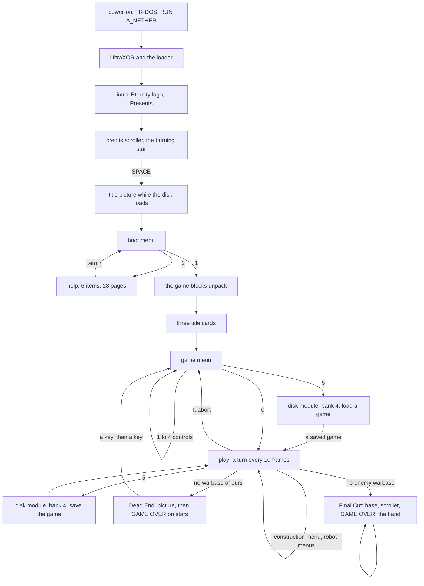
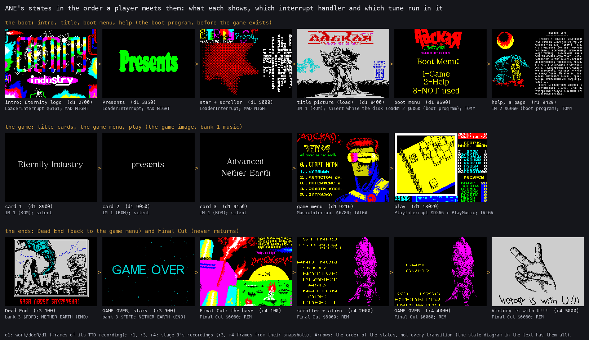
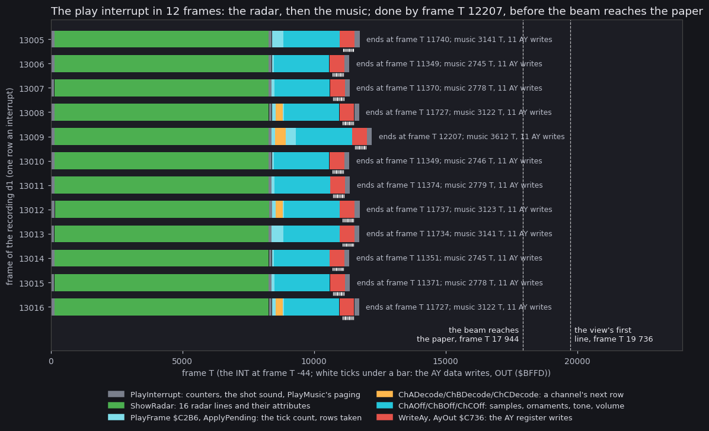
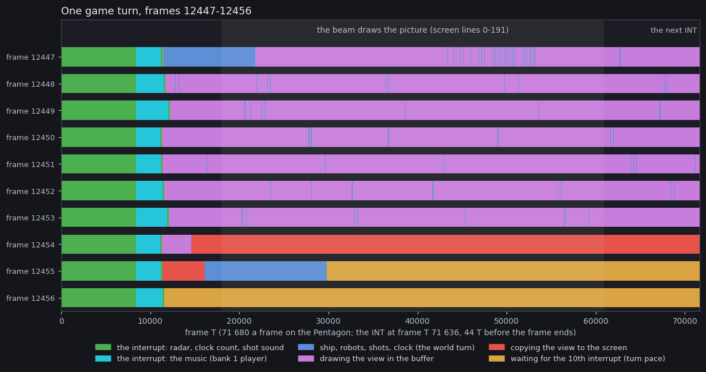
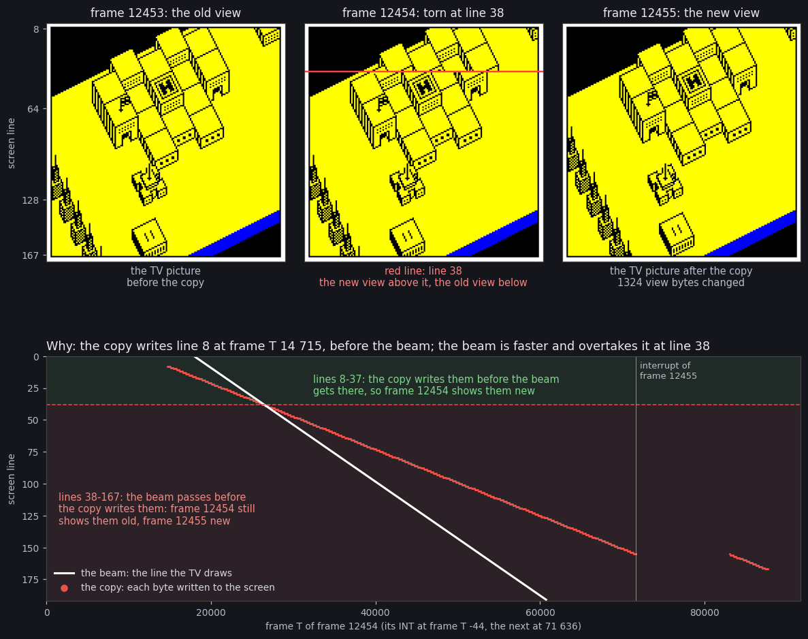
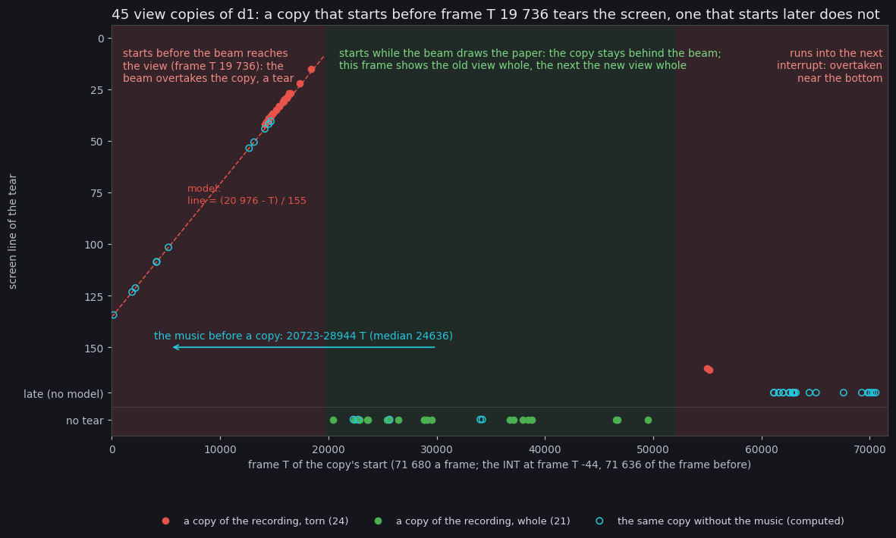

# 04. Game loop

Advanced Nether Earth is a chain of programs, not one.
Each program has its own screen, its own interrupt handler and its own tune.

- **The boot.** The intro and its credits scroller, the title picture while the disk loads, the boot menu and
  its help pages. They run from the boot's blocks before the game image exists.
- **The game.** Three title cards, the game menu and play. They run from the game image at `$6731-$D7D7` with
  the music in bank 1.
- **The two ends.** Dead End (a loss) goes back to the game menu. Final Cut (a win) never returns.

Play is a game turn of at least 10 frames:

1. the controls, the ship and the world;
2. the view drawn into a buffer and copied to the screen;
3. the clock and the end test;
4. a wait for the tenth interrupt.

Every frame of play starts with the play interrupt: the radar, then one frame of the music.
The music costs 2 745-3 612 T-states a frame, about 4 % of the frame.
It moves the copy's start in the frame, which decides where the copy tears the screen.

Evidence:

- **d1** (`work/docR/d1`) is my own recording, port base 14110, Pentagon 128 with TR-DOS, the original SCL, from
  power-on.
  - Inputs: `work/docR/inputs/d1.txt`. SPACE at script frame 6600 (the intro off), 1 at 7100 (the game), 0 at
    9600 (play), then P, A, O, Q (the ship).
  - Recording frame = script frame + 1601. 12 900 frames are captured, up to recording frame 14 500.
  - Its traces (`work/docR/d1/traces/`) are the measured points below.
  - Its L1 (`work/docR/d1/l1.json`) gives the call counts of every handler.
- **r1, r3, r4** are stage 3's recordings (`work/stage3/NOTES.md`).
  - r1: the boot, every help page and the game menu.
  - r3: Dead End, from a snapshot with `PlayerBuildings` (`$FD3A`) poked to 0.
  - r4: Final Cut, from a snapshot with `EnemyBuildings` (`$FD42`) poked to 0.
  - Copies of r3 and r4 were opened on my port base for their traces (`work/docR/r3`, `work/docR/r4`).
- **The code.**
  - The game: `src/game/*.asm` and its listing `build/game/game.lst`.
  - The music: `src/music/*.asm`.
  - The boot parts: `src/intro/`, `src/boot/`.
  - The endings: `src/endings/` (first read from disassemblies of their raw images, `work/docR/dis/b3.lst`,
    `fc.lst`).

## 4.1 The state machine



How to read it:

- A box is a state with its own screen.
- An arrow is what moves the player on: a key, or the game's own test.
- The menus inside play (construction, the robot menus, direct control) keep the game going, so they belong to
  play.
- Final Cut ends in an endless loop (`JR $` at `$6238` of its image), so only a reset leaves it.
- Abort (I) and the end of Dead End both go through `Restart` `$A5EF` (section 4.3).
- The save comes back to play (`SaveReturn` `$692B`); a load goes on to play with the loaded game (`LoadReturn`
  `$A590`, `NewGameSetup` with NZ).

## 4.2 The states



How to read it:

- One picture is one state, at the frame under the picture.
  - d1 and r1 frames are recording frames.
  - r3 and r4 frames count from their snapshots.
- The grey line names the interrupt handler that runs in that state and the tune it plays (section 4.4, chapter
  09).
- The arrows give the order of the states. The diagram above gives every transition.
- Drawn by `python3 tools/fig_states.py --out docs/img/loop/states.png`.
  - The screens come from `work/docR/shots2` (taken from d1 with `kit/screen_shot.py`) and
    `work/stage3/*/screens-rec`.

| State | Code | Interrupt, tune | Leaves | Witness |
| --- | --- | --- | --- | --- |
| Intro: logo, Presents | `Intro` `$6600`, then `Presents` `$6600` (bank 0) | `LoaderInterrupt` `$6161`; MAD NIGHT from bank 6 | on to the scroller | d1 2125-3400 |
| Scroller and star | `ScrollerStart` `$6600` | `LoaderInterrupt`, which also calls `TextInterrupt` through `LoaderHook` `$618A` | SPACE ends the boot program's intro | d1 3403-8201 |
| Title picture | `TitlePicture` `$9C40`, called by UltraXOR's reader | IM 1 (ROM), silent | the boot program loads | d1 from 8215 |
| Boot menu | the boot program at `$6060`, menu loop `$AA9E` | IM 2 `$6060`; TOMY (PT3, bank 1) | 1 (`$B168`), 2 (help), 3 (`CALL $6273`) | r1 8699; d1 to 8701 |
| Help | item routines' table `$AC2A`, page printer `$B13A` | IM 2 `$6060`; TOMY | item 7 | r1 9079-20239 |
| Game blocks unpack | the game starter (bank 7) | IM 1, silent | `GameEntry` `$A5DA` | d1 8701-8851 |
| Title cards | `TitleCards` `$D8E1` (bank 1) | IM 1 (ROM), silent | returns to `GameEntry` | d1 8852-9197 |
| Game menu | `MainMenu` `$C100`, its picture `MenuPicture` `$67E5` | `MusicInterrupt` `$6780`; TAIGA | 0: play | d1 9198-11201 |
| Disk load | `GameLoad` in `src/game/disk.asm`, then bank 4's `DiskModule` | IM 1 (the module goes back to the ROM's state): no music handler | `LoadReturn` `$A590` | r2 8932-9202 |
| Play | `PlayLoop` `$A69A` | `PlayInterrupt` `$D566` + `PlayMusic` `$67B1`; TAIGA | `CheckGameEnd`, key I | d1 11215-14500 |
| Disk save | `SaveGameStage`, `GameSave` (`src/game/im2.asm`), bank 4's `DiskModule` | IM 1: no music handler | `SaveReturn` `$692B`: play again | r2 7652-8102 |
| Dead End | `DeadEnd` `$D2EF` (bank 3) | `$FDFD` (bank 3); NETHER EARTH (END) | two keys, then `Restart` | r3 7-1500 |
| Final Cut | `FinalCut` `$6060` (its own image) | `$6060` of the image; REM (PT3 at `$DB00`) | never | r4 0-16000 |

The handler of each state is counted in the L1 call counts (calls of kind `interrupt`):

- d1: `$6161` takes 6 018 interrupts, `$6969` (the game's IM 2 jump) 5 304, the ROM's `$0038` 2 304, `$6060`
  (the boot program) 57.
- Their players in d1:
  - `$6161` calls bank 6's `$C005` 6 018 times;
  - `MusicInterrupt` calls bank 1's `$C005` 2 030 times;
  - `PlayMusic` calls it 3 273 times;
  - the boot program's `$6060` calls bank 1's PT3 frame entry (`$C358`) 57 times.
- r1: `$6060` calls the PT3 player 11 597 times, so the boot menu and every help page keep the boot tune.

## 4.3 Entry and restart

The game block's last bytes jump to `GameEntry` `$A5DA`:

1. `DI`, SP 0, bank 1 paged.
2. `CALL MusicStart` (`TitleCards` `$D8E1` in bank 1): the game tune's `Init`, IM 1, the three cards (chapter
   06.9).
3. Bank 0 again, and on into `Restart`.

`Restart` `$A5EF` is every new start of the game: the first one, abort key I (`$A712`), a load error, the end of
Dead End.

1. `DI`, SP 0, bank 1's `PlayerInit` (`$C000`): TAIGA from its start, the AY silent; bank 0 back.
2. `ImTable`: 257 bytes of `$69` at `$6800-$6900`.
3. `ImJump` `$6969` = `$C3` (a `JP`); `ImHandler` `$696A` = `MusicInterrupt`.
4. I = `$68`, IM 2, `EI`.
5. `RandomSeed` = `$39,$30,$39,$30`.
6. `CALL MainMenu`, then a new game is set up and play begins at `EnterPlay` `$A68E`.

<!-- snippet: Restart -->
From `src/game/start.asm`:

```asm
Restart:
  DI                      ; no interrupts while the table is built
  LD SP,$0000             ; SP = 0
  LD A,$11                ; bank 1
  LD BC,$7FFD
  OUT (C),A
  CALL PlayerInit         ; the player: the tune from its start
  LD A,$10                ; bank 0 again
  LD BC,$7FFD
  OUT (C),A
  LD HL,ImTable           ; the IM 2 table: 257 bytes of $69 at $6800-$6900
  LD BC,$0069
FillVectorTable:
  LD (HL),C               ; 256 bytes, then the 257th below
  INC HL
  DJNZ FillVectorTable
  LD (HL),C
  LD A,$C3                ; the JP at $6969: every vector lands on ImHandler
  LD (ImJump),A
  LD HL,MusicInterrupt    ; MusicInterrupt: the tune plays while the menu runs
  LD (ImHandler),HL
  LD A,$68                ; I = $68: the vectors are read from ImTable
  LD I,A
  IM 2
  EI
  LD HL,$3039             ; the random seed $FD00-$FD03 = $39,$30,$39,$30
                          ; (12345 twice)
  LD (RandomSeed),HL
  LD (RandomSeed+2),HL
  CALL MainMenu           ; the main menu: back with Z = СТАРТ ИГРЫ (start
```

The IM 2 table lives in bank 5, which no paging hides.

- Any byte on the bus gives the vector `$6969`.
- At `$6969` stands `ImJump`, so every interrupt runs `JP (ImHandler)`.
- Each change of handler writes the word `ImHandler`.

## 4.4 The interrupts

| Handler | Where | Runs in | Work a frame |
| --- | --- | --- | --- |
| `LoaderInterrupt` | `$6161`, the loader | the intro, Presents, the scroller | pages bank 6, `CALL $C005` (MAD NIGHT); then `LoaderHook`, which the scroller patches to `TextInterrupt`; SPACE ends the intro |
| ROM IM 1 | `$0038` | the title picture, the loads, the cards, the first frames of each end | the ROM's frame count and key scan; no sound |
| the boot program | `$6060` | the boot menu, the help | `CALL $C005` of bank 1: one frame of TOMY |
| `MusicInterrupt` | `$6780` | the game menu, the construction menu | bank 1, `CALL PlayerFrame` (TAIGA), back to the bank in `GameBank` (`$67D9`) |
| `PlayInterrupt` | `$D566` | play | `TurnFrames` + 1, the radar picture chosen, `JP PlayMusic`; back at `InterruptSound` `$D585`: the shot sound |
| `PlayMusic` | `$67B1` | inside `PlayInterrupt` | `CALL ShowRadar`, bank 1, `CALL PlayerFrame`, the game's bank back, `JP InterruptSound` |
| Dead End's | `$FDFD` (bank 3), table `$FC00`, I = `$FC` | Dead End | all registers kept, `CALL $C005` of bank 3 (NETHER EARTH (END)) |
| Final Cut's | `$6060` of its image, table `$5B00`, I = `$5B` | Final Cut | pages bank 7, `CALL $DB05` (REM), bank 0 back |

<!-- snippet: MusicInterrupt -->
From `src/game/music.asm`:

```asm
MusicInterrupt:
  DI                      ; (the CPU has already turned interrupts off on
                          ; acceptance)
  PUSH AF
  PUSH BC
  PUSH DE
  PUSH HL
  PUSH IX
  PUSH IY
  EXX
  EX AF,AF'
  PUSH AF
  PUSH BC
  PUSH DE
  PUSH HL
  LD A,$11                ; bank 1: the tunes and their player
  LD BC,$7FFD
  OUT (C),A
  CALL PlayerFrame        ; one frame of the tune
  LD BC,$7FFD
  LD A,(GameBank)         ; the bank the game had paged
  OUT (C),A
  POP HL
  POP DE
  POP BC
  POP AF
  EX AF,AF'
  EXX
  POP IY
  POP IX
  POP HL
  POP DE
  POP BC
  POP AF
  EI                      ; interrupts on again
  RET
```

In play the radar and the music share one interrupt.

- `PlayInterrupt` counts the frame (`TurnFrames` `$FD34`) and toggles `RadarPhase`.
  - Phase 0 picks `RadarOwn` (`$D800`, attribute `$4D`, bright cyan); phase 1 picks `RadarEnemy` (`$D900`,
    `$4E`, bright yellow).
- Then `JP PlayMusic`.
  - `PlayMusic` calls `ShowRadar` `$D59E`: 16 lines of 16 bytes and their attributes.
  - Then it plays one frame of the tune in bank 1 and pages back the bank in `GameBank`.
- `JP InterruptSound` returns into `PlayInterrupt`, which steps `SoundFx` and calls `SoundEffect` when a shot
  sounds (chapter 09.6).

<!-- snippet: PlayMusic -->
From `src/game/music.asm`:

```asm
PlayMusic:
  CALL ShowRadar          ; this frame's radar picture, as PlayInterrupt set it
                          ; up
  PUSH AF
  PUSH BC
  PUSH DE
  PUSH HL
  PUSH IX
  PUSH IY
  LD A,$11                ; bank 1
  LD BC,$7FFD
  OUT (C),A
  CALL PlayerFrame        ; one frame of the tune
  LD BC,$7FFD
  LD A,(GameBank)         ; the game's bank again
  OUT (C),A
  POP IY
  POP IX
  POP HL
  POP DE
  POP BC
  POP AF
  JP InterruptSound       ; on in PlayInterrupt: the sound effect, the exit
```



How to read it:

- One row is one interrupt of d1, frames 13005-13016: a whole game turn and two frames around it.
- Time runs right in frame T: the T-state in the emulator's frame, as unreal-ng's access trace stores it. Frame
  T 0 is not the interrupt: on the Pentagon the INT rises at frame T -44 (71 636 of the frame before;
  unreal-ng `ApplyModelTimingDefaults`, `intstart` 71635), 17 988 T before the first paper pixel.
- Green is `ShowRadar`. Grey is `PlayInterrupt`'s own work and `PlayMusic`'s paging.
- The four blue and orange colours are the music player's parts (chapter 09.2):
  - pale cyan: `PlayFrame` and `ApplyPending`, the tick count;
  - orange: a channel's next row (`ChADecode`, `ChBDecode`, `ChCDecode`);
  - cyan: the channels' ticks (`ChAOff`, `ChBOff`, `ChCOff`);
  - red: the AY writes (`WriteAy`, `AyOut`).
- The white ticks under a bar are the AY data writes (`OUT ($BFFD)`).
- The dashed lines are the beam: the paper starts at frame T 17 944, the view's first line at frame T 19 736.
- Drawn by `python3 tools/fig_interrupt.py --trace work/docR/d1/traces/13005_0-13017_0.uatr --out docs/img/loop/interrupt-frames.png`.

What it shows:

- The interrupt starts just before the frame: its first instruction (the IM 2 jump at `$6969`) runs at frame
  T 71 655-71 666 of the frame before, 19-30 T after the INT; the handler `$D566` follows 10 T later.
- The radar runs from about frame T 145 to frame T 8 270, 8 124 T in every frame (`work/docR/radar_cost.py`).
- The music starts at frame T 8 394-8 416 and costs 2 745-3 612 T.
  - A frame where a channel reads its next row (orange) costs the most.
- Every interrupt ends between frame T 11 349 and frame T 12 207, long before the beam reaches the paper.
  - So the radar never shows half drawn.
  - The music writes no screen byte.
- A frame with a shot adds `SoundEffect`'s burst after the music: up to about 15 000 T (chapter 09.6).
  - Such an interrupt runs into the paper's time but still writes no screen byte.
  - No recording has a shot inside a traced window: this is from the code.

## 4.5 The turn

`PlayLoop` `$A69A` runs one game turn after another.

1. `WaitKey`: the controls; the pause while key 1 is held.
2. `MoveShip` and `WorldTurn`: the ship, the robots, the shots.
3. `DrawView` `$CCBD`: the view drawn into `ViewBuffer` `$5B00-$677F` (chapter 06.1).
   - It ends with `JP CopyViewToScreen` `$D071`: the buffer to the screen, 20 `LDI` a line, 160 lines.
4. `GameTurn` `$AD62`:
   - the random step and the clock (+5 minutes a turn);
   - `CheckGameEnd` `$AE6B` (section 4.6);
   - the captures;
   - `TurnPace` `$AE1D`.
5. The robot menu or the construction menu when the ship has landed on one; keys I and 5.

`TurnPace` waits until `PlayInterrupt` has counted at least 10 frames, then clears the count.

<!-- snippet: TurnPace -->
From `src/game/gameturn.asm`:

```asm
TurnPace:
  LD A,(TurnFrames)            ; at least 10 frames a turn
  CP $0A                  ; 10 frames since the last turn?
  JR C,TurnPace           ; not yet: wait (the interrupt counts on)
  XOR A                   ; the next turn's frames
  LD (TurnFrames),A            ; TurnFrames = 0
  RET                     ; the turn is over
```

The turn below is one of d1 while the view scrolls (key O held): the view changes by 1 324 bytes from the turn before.



How to read it:

- One row is one frame of the turn, in frame T from the frame's start (left) to its end (right). The interrupt
  that belongs to a row starts 13-25 T before it, so its green bar starts at the left edge; the thin line at the right
  is the next INT, frame T 71 636.
- Each instruction is coloured by its phase (`tools/ane_trace.py`):
  - green: the interrupt's radar;
  - cyan: the music;
  - blue: the world turn;
  - violet: drawing the view;
  - red: copying it;
  - gold: waiting.
- The lighter band is the time the beam draws the picture, screen lines 0-191.
- Drawn by `python3 tools/fig_beam_turn.py --trace work/docR/d1/traces/12446_0-12458_0.uatr --copy-frame 12454 --turn-out docs/img/loop/turn-frames.png --tear-out docs/img/loop/tear-tv.png`.

The turn of the figure, measured in d1 (frame T):

| Moment | Frame:T |
| --- | --- |
| the turn starts (the instruction after `TurnPace`) | 12447:11 426 |
| `DrawView` starts | 12447:21 792 |
| the copy's first instruction | 12454:14 645 |
| the copy's first screen write | 12454:14 715 |
| the copy's last screen write | 12455:15 987 |
| the next turn starts | 12457:12 122 |



How to read it:

- Top: the play view of the three TV pictures around the copy, rebuilt from the trace.
  - Each screen byte has the value it held when the beam fetched it.
  - Left, frame 12453: the old view. Right, frame 12455: the new view.
  - Middle, frame 12454: the new view above the red line (line 38), the old view below it.
- Bottom: the copy against the beam in frame 12454. The frame T runs across, the screen line runs down; the thin
  vertical line is the next INT (frame T 71 636).
  - The white diagonal is the beam: the screen line the TV draws at that moment.
  - Every red dot is a byte the copy writes to the screen.
  - Above the crossing (green band) the copy is ahead; below it (red band) the beam came first.
- Drawn by the same command.

The copy:

- It takes 72 952 T of wall time from its first screen write to its last, with the interrupt it crosses.
- Its own instructions take 61 736 T, 379 T a line.
- It starts at frame T 14 645: 3 299 T before the beam reaches the paper (frame T 17 944), 5 091 T before the view's
  first line (frame T 19 736).
- The beam overtakes it at screen line 38, where 19 of the line's 20 bytes are already new.
- So frame 12454 shows the new view above line 38 and the old one below.
- Frame 12455 shows the new view whole.

Where the 716 800 T of this turn went, frames 12447-12456
(`python3 tools/ane_trace.py frames --trace work/docR/d1/traces/12446_0-12458_0.uatr`):

| Phase | T-states | Share |
| --- | --- | --- |
| the interrupt without the music (the radar, the counters) | 86 211 | 12.0 % |
| the music | 29 946 | 4.2 % |
| the world turn | 29 388 | 4.1 % |
| drawing the view | 407 566 | 56.9 % |
| copying the view | 61 736 | 8.6 % |
| waiting for the 10th interrupt | 101 957 | 14.2 % |

- The view takes about 5.7 frames of CPU time and 7 frames of wall time with the interrupts.
- The turn keeps 14 % in hand early in a game: d1 is on day 0, with few robots.
- All 328 turns of d1 (frames 11 227-14 500) took 10 frames.
- A turn that needs more than 10 frames is not stretched to 20.
  - `TurnPace` tests "at least 10" (`JR C`), so such a turn ends at once, at the frame where its work ends.
  - No recording reached such a turn.

### Where the copy starts, and the tear

The copy starts wherever the turn's work ends, so its place in the frame wanders from turn to turn.
That place decides what the player sees.



How to read it:

- One filled dot is one copy in d1's traces.
  - Across: the frame T of its first instruction.
  - Down: the screen line where the beam overtook it. The rows "late" and "no tear" are at the bottom.
- The red dashed curve is the model for a copy that starts before the view's first line (frame T 19 736).
  - Line = (20 976 - T) / 155, with T the frame T, because the copy writes a line every 379 T and the beam draws
    one every 224 T.
- Hollow cyan marks are the same copies moved earlier by the T-states the music took between the turn's start and
  the copy. They are computed, not recorded.
- Drawn by `python3 tools/fig_tear.py --trace work/docR/d1/traces/11400_0-11525_0.uatr --trace work/docR/d1/traces/12300_0-12425_0.uatr --trace work/docR/d1/traces/13600_0-13725_0.uatr --trace work/docR/d1/traces/14250_0-14375_0.uatr --out docs/img/loop/tear-band.png`.

What it shows:

- 24 of the 45 copies tear.
  - A copy that starts at frame T 14 104-18 376 tears at lines 15-42.
  - A copy that starts near frame T 55 000 runs into the next interrupt and is caught at lines 160-161.
- A copy that starts between about frame T 20 000 and frame T 49 480 stays behind the beam.
  - Its frame shows the old view whole; the next frame shows the new one.
- The music before a copy adds 20 723-28 944 T (median 24 636).
  - The turn starts after an interrupt, and each of the seven interrupts of the draw plays its music frame.
- Without the music the copies would start that much earlier in their frames.
  - Then 11 would tear high, 29 late, and 5 not at all.
  - So the music does not cause the tears; it moves them.
- A tear lasts one frame (20.5 ms) and covers only the view. The radar and the panel are drawn elsewhere.

## 4.6 The ends of a game

`CheckGameEnd` `$AE6B` tests the warbase counts once a turn, from `GameTurn`.

- `EnemyBuildings` `$FD42` = 0: `GameWon` `$AEB1`, Final Cut.
- Else `PlayerBuildings` `$FD3A` = 0: the lost path from `$AE76`, Dead End.

Both paths first call `Silence` `$AE94`.

- A `HALT`, so the music handler plays its last frame.
- `DI`, then AY registers 0-14 written 0.

Both then set I = `$3F` and IM 1, so the ROM's handler runs while the banks change.

<!-- snippet: CheckGameEnd -->
From `src/game/endings.asm`:

```asm
CheckGameEnd:
  LD A,(EnemyBuildings)            ; the enemy's warbases
  OR A
  JR Z,GameWon            ; none left: won
  LD A,(PlayerBuildings)            ; ours
  OR A
  RET NZ                  ; we still have one: play on
  CALL Silence            ; lost: the tune off
  LD A,$3F                ; the ROM's I and IM 1: no game handler from here on
  LD I,A
  IM 1
  EI
  LD A,$13                ; bank 3: Dead End
  LD BC,$7FFD
  OUT (C),A
  JP DeadEnd              ; Dead End's entry, never back
```

### Dead End (r3)

The lost path pages bank 3 with the 48 ROM (`$7FFD` = `$13`) and jumps to `DeadEnd` `$D2EF`.

| r3 frames | What runs | Address |
| --- | --- | --- |
| 0-6 | the last game turn, under `PlayInterrupt` | |
| 7-10 | SP 0; the screen cleared from `$5AFF` down, under the ROM's IM 1 | `$D348` |
| 10-25 | `DI`; `Init` of bank 3's player (NETHER EARTH (END)); the picture unpacked to the screen (chapter 06.10) | `$C000`, `$D723` |
| 26 | the IM 2 table: 257 bytes of `$FD` at `$FC00`, I = `$FC`, IM 2, `EI`; from now the handler `$FDFD` plays the tune | `$D2FC` |
| to 800 | `HALT`, then the whole keyboard read (`IN ($FE)` with A = 0) until a key | `$D310` |
| 800-1400 | the screen cleared, "GAME OVER" unpacked, then the star field, one move a frame, until a key | `$E4A7`, `$D323` |
| 1400 | `Init` again (the AY silent), the screen cleared, I = `$3F`, IM 1, `JP Restart` | `$D338` |
| 1500 | the game menu, a new game ready | |

- The star loop tests the key without waiting for the first key's release.
  - A key still held after "GAME OVER" is unpacked ends Dead End after one pass (from the code).
- r3 shows both waits, so SPACE was pressed twice.

<!-- snippet: DeadEnd -->
From `src/endings/deadend/deadend.asm`:

```asm
DeadEnd:
  LD SP,$0000             ; the stack at the top of memory (SP = 0: the first
                          ; push goes to $FFFE)
  CALL ClearScreen        ; a black screen
  DI
  CALL nst.Init              ; start the tune: the player's init (it leaves
                          ; interrupts enabled; mode 1 is still on)
  CALL LzScreen           ; the Dead End picture to the screen
  LD HL,Im2Table          ; the vector table: 257 bytes of $FD, so any data bus
                          ; value gives the handler at $FDFD
  LD DE,Im2Table+$0001
  LD (HL),$FD
  LD BC,$0100
  LDIR
  LD A,Im2Table/$100      ; I = the table's page
  LD I,A
  IM 2
  EI                      ; from now on the tune plays every frame
  HALT
DeadEndKey:
  XOR A                   ; wait for any key (all half rows, the five key bits)
  IN A,($FE)
  CPL
  AND $1F
  JR Z,DeadEndKey
  CALL ClearScreen        ; the GAME OVER screen
  CALL HrustScreen
  HALT
  CALL StarsSave          ; save the bytes under the stars' first places
DeadEndStars:
  HALT                    ; a frame of the starfield
  CALL StarsRestore
  CALL StarsMove
  CALL StarsSave
  CALL StarsDraw
  XOR A                   ; until a key
  IN A,($FE)
  CPL
  AND $1F
  JR Z,DeadEndStars
  CALL nst.Init              ; silence the AY (the player's init writes the silent
                          ; registers)
  CALL ClearScreen
  LD A,$3F                ; I as the ROM keeps it, interrupt mode 1, back to
                          ; the game menu
  LD I,A
  IM 1
  EI
  JP Restart
```

### Final Cut (r4)

`GameWon`:

1. `Silence`, I = `$3F`, IM 1, `EI`.
2. Bank 6 (`$16`); `$3637` bytes from `FinalCutBlock` (`$C000`) copied to `FinalCut` `$6060`, over the game itself.
3. Bank 0 again, `JP FinalCut`.

The block unpacks itself (HRUM) over `$6060-$F76C` in r4 frames 0-59.
Final Cut then runs on its own:

1. `$61A8`: the attributes black (`$6407`).
   - Bank 7 gets `$70F5-$A66C` of the image at `$C000`: the shadow screen's alien, the PT3 player at `$DB00`, REM
     at `$E921`.
   - `Pt3Init` (`CALL $DB00`).
   - The IM 2 table at `$5B00` (all `$60`), I = `$5B`, IM 2.
2. The burning alien base (bank 0 `$C16D`, `$1B00` bytes) copied to the screen.
   - Then 1 280 frames of `HALT` (`$500`, 26 s).
3. The second alien screen (`$A66D`) copied to the normal screen.
   - A table of 192 line pairs built over `$70F5`.
   - Then the scroller's loop `$6215`: one screen scrolled a line each frame, the two screens shown in turn
     (chapter 06.11).
4. The text's end: 460 times two frames, the two screens shown in turn and nothing scrolled (920 frames, "GAME
   OVER").
5. `$6419`: the last picture, "Victory is with U!!!", then `JR $` at `$6238` for ever.
   - The interrupt plays REM on.

<!-- snippet: FinalCut -->
From `src/endings/finalcut/fcmain.asm`:

```asm
FinalCut:
  DI
  CALL FcBlack            ; black: border and attributes
  LD A,$17                ; bank 7 at $C000
  CALL FcPage
  LD HL,Bank7Block        ; the alien screen, the PT3 player and the tune to
                          ; bank 7 ($3578 bytes)
  LD DE,AlienGreenScreen
  LD BC,$3578
  LDIR
  CALL Pt3Init              ; start the tune
  LD A,$10                ; bank 0 back, the normal screen shown
  CALL FcPage
  LD HL,$5B00             ; the vector table at $5B00: 257 bytes of $60, so the
                          ; vector is $6060 (FcInterrupt)
  LD DE,$5B01
  LD (HL),$60
  LD BC,$0100
  LDIR
  LD A,$5B                ; I = $5B, interrupt mode 2
  LD I,A
  IM 2
  EI
  HALT
  LD HL,CaptionScreen             ; the caption screen
  LD DE,$4000
  LD BC,$1B00
  LDIR
  LD BC,$0500             ; for $500 frames (26.2 s at the Pentagon's 48.83 Hz)
FcCaptionWait:
  HALT
  DEC BC
  LD A,B
  OR C
  JR NZ,FcCaptionWait
  CALL FcBlack            ; black again
  LD A,$10
  CALL FcPage
  LD HL,AlienMagentaScreen             ; the magenta alien screen (the green one is in bank
                          ; 7 at $C000)
  LD DE,$4000
  LD BC,$1B00
  LDIR
  LD HL,Bank7Block        ; the line table over Bank7Block (copied already):
                          ; for each of the 192 pixel lines of the $C000
                          ; window, its address and the next line's
  LD DE,$C000
  LD B,$C0
FcLineTableLoop:
  LD (HL),E
  INC HL
  LD (HL),D
  INC HL
  CALL FcNextLine
  LD (HL),E
  INC HL
  LD (HL),D
  INC HL
  DJNZ FcLineTableLoop
FcScrollFrame:
  EI                      ; a frame of the scroll
  HALT
FcDrawPage:
  LD A,$17                ; the page to draw on: $17 (bank 7, the shadow
                          ; screen) and $1D (bank 5, the normal screen) in turn
                          ; (the operand)
  CALL FcPage
  XOR $0A
  LD (FcDrawPage+$0001),A
  CALL FcScroll           ; scroll it and draw the next pixel row of the text
FcShowPage:
  LD A,$10                ; the screen to show: $10 (normal) and $18 (shadow)
                          ; in turn (the operand), with bank 0
  CALL FcPage
  PUSH AF
  XOR $08
  LD (FcShowPage+$0001),A
  POP AF
  OR $07                  ; and bank 7 paged with it
  CALL FcPage
  JP FcScrollFrame
```

r4 runs 16 000 frames:

- the base at frames 100-1200;
- the scroller at 2000-3000;
- GAME OVER at 4000;
- the last picture from 5000 to the end.

## 4.7 Time

| Quantity | Value | Source |
| --- | --- | --- |
| a frame on the Pentagon | 71 680 T, 20.48 ms (48.83 a second) | the machine |
| the INT | frame T -44 (71 636 of the frame before) | unreal-ng `intstart` 71635 |
| the paper | from frame T 17 944 (17 988 T after the INT), 224 T a line | the machine |
| a game turn | at least 10 frames, 0.205 s | `TurnPace`; d1: 328 turns of 10 frames |
| a game hour, a game day | 12 turns (2.46 s), 288 turns (59 s) | `GameTurn`: 5 minutes a turn |
| the play interrupt | ends at frame T 11 349-12 207 | d1 13005-13016 |
| the radar in it | 8 124 T | the same |
| the music in it | 2 745-3 612 T (all tunes: 750-4 777 T, chapter 09) | the same; `tools/ay_play.py` |
| drawing one view | about 410 000 T of CPU, 7 frames of wall time | d1 13007-13014 |
| copying the view | 61 736 T, 379 T a line | d1 13014 |
| the title cards | 345 frames | d1 8852-9197 |
| Final Cut's base | 1 280 frames | `$61E4` |

## 4.8 Design notes

- **One interrupt does two jobs in play.**
  - The music is chained into the radar's interrupt: `PlayInterrupt`'s `CALL ShowRadar` became `JP PlayMusic`, and
    `PlayMusic` comes back by a jump.
  - The order keeps the radar's screen writes ahead of the beam.
  - The music writes no screen byte, so its place does not matter for the picture.
- **The music's cost is set by the frame, not by the turn.**
  - The tune plays every frame, waiting or drawing.
  - So a turn pays 10 music frames, about 30 000 T (4 %), whatever it does.
- **No `HALT` before the copy.**
  - The copy starts whenever the draw ends, so it tears in about half the turns.
  - A `HALT` there would avoid the high tear but cost up to a frame a turn, which the 14 % reserve covers only early
    in a game.
- **Each end is a program of its own.**
  - Dead End runs in bank 3 with its own IM 2 table and leaves through `Restart`, which rebuilds the game's state.
  - Final Cut overwrites the game, so there is nothing to return to.
- **Every handler keeps the table in bank 5 or below `$C000`.**
  - The game's table (`$6800`) and Final Cut's (`$5B00`) are never paged out.
  - Dead End's table (`$FC00`) is in bank 3, which stays paged while it runs.

## 4.9 What no recording reached

- A turn longer than 10 frames, as in a late game full of robots. `TurnPace` says what would happen.
- The shot sound inside a traced interrupt. d1 fires no shot (`SoundEffect` has no call in its L1), so its cost
  in 09.6 is computed from the code.
- The help pages and the boot menu were not traced. Their handler and tune come from r1's L1 counts.
