# 5. Controls

This document lists every control of Advanced Nether Earth, from the boot menu to the last screen. It covers each
key and what it does in each place, and the code that reads it.

The game is played with one stick and five extra keys.

- **The stick** is the keys, a Kempston joystick or Sinclair's Interface 2. It gives up, down, left, right and
  fire.
- **The extra keys** are pause, abort and save. The game menu also has its own number keys.
- **Fire** does two jobs. In flight it lifts the ship. In every menu it picks the lit item.
- **The two programs around the game** have their own keys: the boot menu and the help program.
- **The two endings** each wait for a key. Dead End waits twice. Final Cut ignores every key.

The recordings and runs it rests on ([Terms](README.md#terms)):

- `tour`: a scripted session on Pentagon 128 + TR-DOS with a Kempston card (`tools/fig_tour.py tour`,
  `work/docP/tour`). It starts at the game menu from `work/stage1/explore/gamemenu.szx`; its frames count from that
  snapshot. It redefines the keys, picks Kempston and starts a game. Then it builds a robot, gives orders and drives
  a robot by hand. It also fights, sets a distance, pauses and waits a day. Its last step is a poke (`PlayerBuildings`
  `$FD3A` = 0) that loses the game. The event list with frames is `work/docP/tour/events.json`.
- `lose` and `win`: two runs from the `tour`'s first play frame (`work/docP/tour/play.szx`).
  - `lose` pokes `PlayerBuildings` to 0 and presses SPACE at 740 and 1356.
  - `win` pokes `EnemyBuildings` `$FD42` to 0 and presses SPACE at 9100.
- `r1` and `r2`: stage 3's recordings from power-on (`work/stage3/r1`, `r2`). In these a frame is the input script's
  frame + 1602.
  - `r1` holds the intro, the boot menu, all 28 help pages and the game menu.
  - `r2` holds play, a disk save and two loads.

## 5.1 The devices

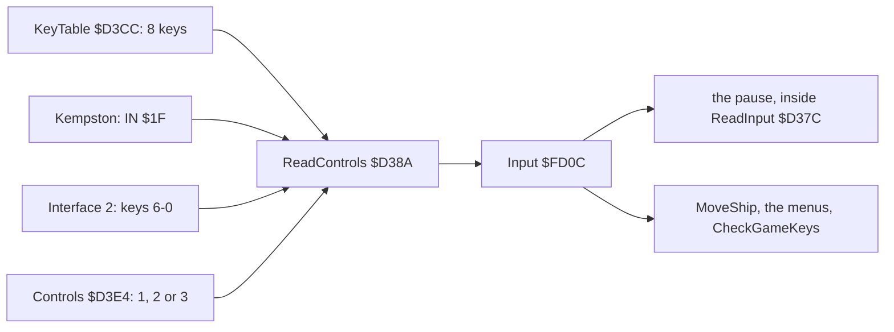

`ReadControls` (`$D38A`) builds one byte, `Input` (`$FD0C`), from the eight keys and the chosen stick.

| `Input` bit | Control | Default key | Kempston bit | Interface 2 key |
| ---: | --- | --- | ---: | --- |
| 7 | pause | `1` | none | none |
| 6 | abort | `I` | none | none |
| 5 | save | `5` | none | none |
| 4 | fire | SYMBOL SHIFT | 4 | `0` |
| 3 | up | `Q` | 3 | `9` |
| 2 | down | `A` | 2 | `8` |
| 1 | left | `O` | 1 | `6` |
| 0 | right | `P` | 0 | `7` |

- **The keys are read in every mode.** `ReadControls` runs through the eight 3-byte entries of `KeyTable` first. It
  then ORs in the stick that `Controls` names ([11](11-data-reference.md)).
  - 1 means the keys alone.
  - 2 means the Kempston too, read with `IN A,($1F)` and masked to five bits (`$D3AB`).
  - 3 means Interface 2 too, read from half-row `$EF` (keys 6-0) and reordered into the same bits (`$D3B2-$D3C6`).
- **A `KeyTable` entry is three bytes**: the half-row (the port's high byte), the bit mask and the key's code. The
  code is only used by the redefine screen, which prints it and refuses duplicates (5.2).
  - The entries are in bit order: pause `$D3CC`, abort `$D3CF`, save `$D3D2`, fire `$D3D5`, up `$D3D8`, down
    `$D3DB`, left `$D3DE`, right `$D3E1`.
  - The image holds `f7 01 31 df 04 49 f7 10 35 7f 02 82 fb 01 51 fd 01 41 df 02 4f df 01 50`, then `Controls` = 1.
    These are the keys of the table above.
- **The pause lives in `ReadInput`** (`$D37C`), the routine every input loop calls.
  - If bit 7 is set, it waits until the pause key is up and another control is down.
  - Then it returns that other input.
  - So the pause freezes whatever loop asked for input: play, a menu or the construction screen.
  - Any other control ends the pause, and that control also acts.
  - Witness: `tour` 4412 key 1, the screen stands until fire at 4482. Then the world runs on.
  - Nothing on the screen says "paused".

## 5.2 The game menu and the redefine screen

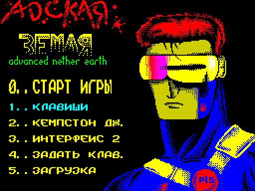

How to read the figure:

- **The picture** is the game menu as `tour` frame 60 shows it, with its tune playing. The title is "АДСКАЯ ЗЕМЛЯ /
  advanced nether earth".
- **The choices** are 0..СТАРТ ИГРЫ (START GAME), 1..КЛАВИШИ (KEYS), 2..КЕМПСТОН ДЖ. (KEMPSTON J.), 3..ИНТЕРФЕЙС 2
  (INTERFACE 2), 4..ЗАДАТЬ КЛАВ. (DEFINE KEYS) and 5..ЗАГРУЗКА (LOAD).
  - The first line is double height.
  - "ИНТЕРФЕЙС" is printed "ИНТЕРФЕИС": the font has no Й ([08](08-hud-and-text.md)).
- **The colour of 1-3 is the state.** `ControlsOptionAttr` (`$C336`) prints the option equal to `Controls` with
  attribute `$45` (cyan) and the others with `$46` (yellow). Here 1..КЛАВИШИ is cyan (row 13 attribute `$45`).

`python3 tools/fig_tour.py draw` draws it from `work/docP/tour/states.json` (`tour` must have run).

`MainMenu` (`$C100`) prints the menu and then waits with `HALT` for a key, read through the ROM's `KEY-SCAN`
(`$028E`) and its key table (`$0205`) at `$C1A1-$C1C9`.

| Key | Code | What it does |
| --- | --- | --- |
| `0` | `$C1D1` | returns zero: a new game (`$A62D`); `tour` 922, play from 950 |
| `1` | `$C1D3` | `Controls` = 1, the menu reprinted; `tour` has `Controls` = 1 at 60 |
| `2` | `$C1D7` | `Controls` = 2; `tour` 876, the KEMPSTON line turns cyan (row 15 attribute `$45` at 922) |
| `3` | `$C1DB` | `Controls` = 3 |
| `4` | `$C1CB` | `RedefineKeys` (`$C34A`), then the menu again; `tour` 360-726 |
| `5` | `$C1FD` | `JP $A56A`: the disk module's load screen in bank 4 (5.8); `r2` 8932, 10167 |

Other keys do nothing.

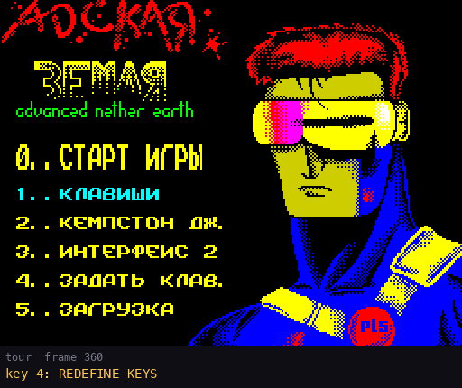

How to read the figure:

- **Each frame** is the screen at the `tour` frame under it. The yellow line names the step of the script.
- **The title** is "ЗАДАЙТЕ КЛАВ." (SET THE KEYS), printed "ЗАДАИТЕ" for want of Й.
- **The prompts** read "НАЖМ. КЛАВИШУ ..." (PRESS THE KEY FOR ...), one at a time, in this order:
  - ВВЕРХ (up);
  - ВНИЗ (down);
  - ВЛЕВО (left);
  - ВПР. (right);
  - ОГОНЬ (fire);
  - a blank line;
  - ПАУЗА (pause);
  - СБРОС (abort, literally "reset");
  - ВЫГР. (save, literally "unload").
- **The name after each prompt** is the key pressed. Four keys have names:
  - SYMBOL SHIFT prints as "ЯУМ ЯН" (the font's Я and Н on the codes of S and H; the string is `SYM SH`);
  - ENTER prints as "ЕНТЕР";
  - CAPS SHIFT prints as "К. ШИФТ";
  - SPACE prints as "ПРОБЕЛ".
- **Any other key prints its own code through the game font.** Q shows as "Ы", P as "Р", A as "А", O as "О" and I
  as "И" (8.2).

`python3 tools/fig_tour.py draw` draws it from `work/docP/tour/samples.bin`.

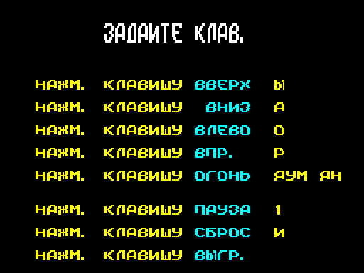

`RedefineKeys` (`$C34A`) works like this:

1. It clears the screen and waits until no key is down (`$C36A`).
2. It zeroes all 24 bytes of `KeyTable` (`$C372`).
3. For each control it prints the prompt (`PrintKeyPrompt` `$C40C`) and calls `DefineKey` (`$C427`).
4. `DefineKey` waits for a key through `KEY-SCAN`. It looks the key's code up in the ROM table.
5. It compares that code with the code bytes of all eight entries (`$C43F-$C44A`). **A key already given is refused**,
   and the wait goes on.
6. It stores the code, then the bit mask and the half-row built from the scan code (`$C44D-$C469`).
7. It prints the key's name (`$C46A-$C4A5`).
8. After the eighth key it waits until all keys are up, then for a fixed delay (`$C3FA-$C40B`). Then it is back at the
   menu.

`tour` gives Q, A, O, P, SYMBOL SHIFT, 1, I, 5 (406-686). The menu is back at 726, and `KeyTable` then reads `f7 01
31 df 04 49 f7 10 35 7f 02 0e fb 01 51 fd 01 41 df 02 4f df 01 50`. That is the image's table except the fire
entry's code byte: `$0E`, the ROM's code for SYMBOL SHIFT, where the image holds `$82`.

## 5.3 The ship

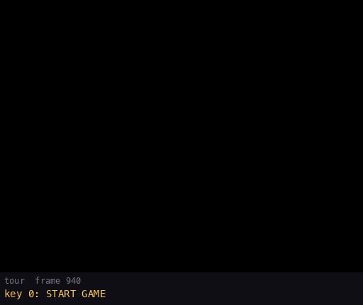

How to read the figure:

- **The frames** are the `tour`'s play from the new game (950) to the robot setting off (2226), one picture every 6
  frames. The step of the script is in yellow.
- **950-1040**: the ship flies to the warbase pad at (22,5) and sinks to altitude 15. The construction menu opens at
  1100.
- **1100-1337**: the menu (5.4). The robot rolls out at 1410.
- **1568-2226**: the ship lands on the robot. The robot menu opens at 1942, followed by orders, a target and LEAVE
  ROBOT. The robot sets off.

`python3 tools/fig_tour.py draw` draws it from `work/docP/tour/samples.bin`.

`MoveShip` (`$AF11`) runs once a pass of the play loop (`$A69A-$A6A6`: `ReadInput`, `MoveShip`, the robots, the
shots, `GameTurn`).

| Input | Code | Effect |
| --- | --- | --- |
| left / right | `$AF25-$AF55` | `ShipX` (`$FD0E`, a word) one cell down / up, within 14-501; left and right together do nothing |
| up / down | `$AF7B-$AFA0` | `ShipY` (`$FD0D`) one cell down / up, within 1-15 (0 is refused) |
| fire held | `$AFAE-$AFC1` | `Altitude` (`$FD10`) + 2 a pass, up to 48 |
| fire not held | `$AFC3-$AFD8` | `Altitude` - 1 a pass, down to the height of what is under the ship |

- **A move into something taller than the ship is refused.** `CheckShipMove` (`$B052`) checks the cells under the
  ship's new place. A carry keeps the old place.
- **The view follows the ship.** When the ship is 13 or 22 columns into the view, the view's first column
  (`$FD0A`) steps (`$AF57-$AF74`).
- **A climb holds the altitude for a few passes.** `ClimbTurns` (`$FD30`) counts down while up or down is pressed
  and after each move. While it is not zero the altitude does not change. A new game sets it to 3 (`$A67E`).
- **The ship's start** is set by the new game (`$A66F-$A67C`): `ShipX` 17, `ShipY` 10, altitude 0.

Landing is the only way into the two play menus. The play loop tests the object under the ship (`$A6A9-$A6EE`):

- **On a robot**, with `Altitude` equal to the robot's top (`$A6BA-$A6C3`), it calls `RobotMenu` (`$A720`). `tour`
  lands on its robot at 1568 and the menu opens at 1942. The test on the robot's record at `$A6B5` is read in
  [10](10-gameplay-logic.md).
- **On one of our warbases**, at altitude exactly 15, with the cells round the ship free (`$A6C8-$A6EE`), it calls
  `ConstructionMenu` (`$C849`). `tour` reaches altitude 15 on the pad at 1040, and the menu opens at 1100.

## 5.4 The construction menu

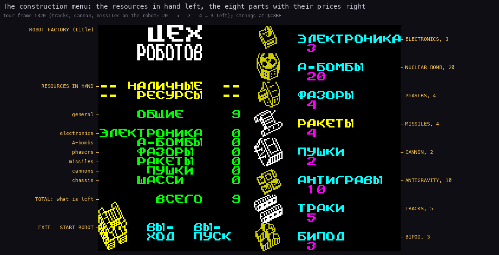

How to read the figure:

- **The screen** is `tour` frame 1320. Tracks, cannon and missiles are on the robot, and the robot is drawn bottom
  left.
- **Left, ЦЕХ РОБОТОВ** (ROBOT FACTORY): the resources in hand ("-- НАЛИЧНЫЕ -- / -- РЕСУРСЫ --"). These are general
  (ОБЩИЕ), then the five part resources and ВСЕГО (TOTAL, what is left after the parts chosen).
- **Bottom left**: the two commands. ВЫ-ХОД is EXIT. ВЫ-ПУСК is START, which releases the robot.
- **Right**: the eight parts with their prices in magenta, from top to bottom:
  - ЭЛЕКТРОНИКА 3 (electronics);
  - А-БОМБЫ 20 (nuclear);
  - ФАЗОРЫ 4 (phasers);
  - РАКЕТЫ 4 (missiles);
  - ПУШКИ 2 (cannon);
  - АНТИГРАВЫ 10 (anti-grav);
  - ТРАКИ 5 (tracks);
  - БИПОД 3 (bipod).
- **The arithmetic**: 20 - 5 - 2 - 4 = 9, the ВСЕГО on the screen.

`python3 tools/fig_tour.py draw` draws it from `work/docP/tour/states.json`.

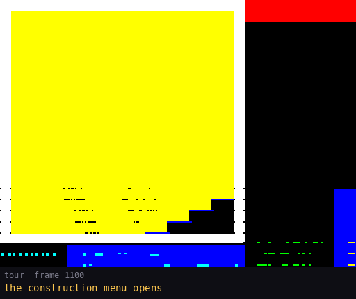

How to read the figure:

- **The frames** are `tour` 1100-1430. The yellow line is the step of the script.
- **1116**: fire on BIPOD takes 3 from the resources.
- **1136**: fire on TRACKS replaces the bipod. 3 comes back and 5 is taken.
- **1175**: CANNON takes 2.
- **1225**: NUCLEAR (20) is more than the 13 left. Nothing happens.
- **1295**: MISSILES takes 4.
- **1320**: fire on MISSILES again takes them off and gives the 4 back.
- **1337**: START. The menu closes and the robot is at the warbase door at 1410.

`python3 tools/fig_tour.py draw` draws it from `work/docP/tour/samples.bin`.

- **Up and down** move the cursor within a column. **Left and right** switch between the parts column and the two
  commands (`CursorLeft` `$CB0E`, `CursorUpDown` `$CB1B`; the cursor is `MenuCursor` `$FD1F`).
- **Fire** toggles the part under the cursor, or runs EXIT / START (`ConstructionMenuLoop` `$CA0F`, fire at
  `$CA19`).
  - A second chassis replaces the first.
  - A part put on sounds a beeper tone (the beeper routine `$CCAC` with period `$64`, at `$CA8F`).
  - A part taken off, or one the resources cannot pay for, sounds a lower tone (period `$78`, `$CAAC`). No message
    is printed.
  - The prices are `PartCosts` (`$CAF0`): `03 05 0A 02 04 04 14 03` for bipod, tracks, anti-grav, cannon, missiles,
    phasers, nuclear, electronics.
- **START** (`StartRobot` `$CB52`) puts the robot at the door and the ship over it. The play handler is restored.
- **The tune plays during the menu.** `ConstructionMenu` puts `MusicInterrupt` (`$6780`) in the handler word
  `$696A` ([04](04-game-loop.md)).

## 5.5 The robot menu, orders and targets

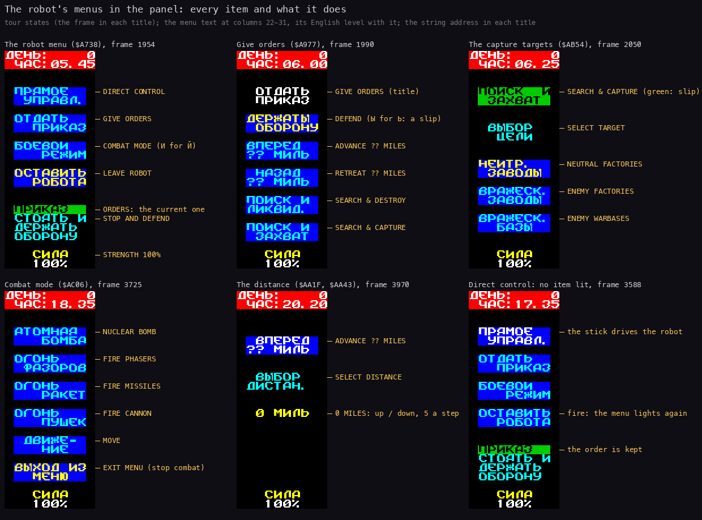

How to read the figure:

- **Each column** is the right panel (character columns 22-31) of one `tour` state. It is drawn at 2x, with the
  English level with each item.
- **The robot menu** (`RobotMenu` `$A720`, text `$A738`) has four items:
  - ПРЯМОЕ УПРАВЛ. (DIRECT CONTROL);
  - ОТДАТЬ ПРИКАЗ (GIVE ORDERS);
  - БОЕВОЙ РЕЖИМ (COMBAT MODE, printed БОЕВОИ);
  - ОСТАВИТЬ РОБОТА (LEAVE ROBOT).
- **Under the four items** the menu shows the robot's current order under ПРИКАЗ (ORDERS) and its strength СИЛА 100%.
- **Give orders** (`OrdersMenu` `$A971`) has five items:
  - DEFEND (printed "ДЕРЖАТЫ ОБОРОНУ", a slip for ДЕРЖАТЬ);
  - ADVANCE ?? MILES;
  - RETREAT ?? MILES;
  - SEARCH & DESTROY;
  - SEARCH & CAPTURE.
- **Each SEARCH item opens a target menu.** The capture targets (`CaptureMenu` `$AB4E`) are NEUTRAL FACTORIES, ENEMY
  FACTORIES and ENEMY WARBASES. The destroy targets (`$AAD8`) are ENEMY ROBOTS, ENEMY FACTORIES and ENEMY WARBASES.
- **Combat mode** (`CombatMenu` `$AC00`) has six items:
  - NUCLEAR BOMB;
  - FIRE PHASERS;
  - FIRE MISSILES;
  - FIRE CANNON;
  - MOVE;
  - EXIT MENU.
- **The distance** (`DistanceMenu` `$AA40`) is a counter "0 МИЛЬ" (0 MILES) under ВЫБОР ДИСТАН. (SELECT DISTANCE).
- **Direct control** leaves the robot menu on the screen with no item lit.

`python3 tools/fig_tour.py draw` draws it from `work/docP/tour/states.json`.

In all these menus, up and down move the lit item and fire picks it (the menu loop `$ACD7-$AD1C`).

- **The lit item** has attribute `$4E` (yellow on blue). The others have `$4D` (cyan on blue) (`$AD3C`).
- **Each move** sounds a short tone (period `$14`).
- **The world does not stop.** The menu loop runs the world turn (`$B0CA`) while it waits.
- **The menu closes by itself** when the robot is destroyed (its record's byte 1 is 0, `$ACE2`).

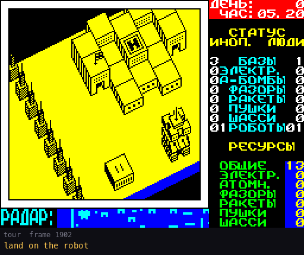

How to read the figure:

- **The frames** are `tour` 1902-2286.
- **1942**: the robot menu opens.
- **1954**: GIVE ORDERS opens the five orders.
- **1990**: SEARCH & CAPTURE opens the targets.
- **2050**: NEUTRAL FACTORIES.
- **2068**: LEAVE ROBOT. Fire is held, so the ship climbs off the robot at once.
- **2226**: the robot sets off for the nearest neutral factory.

`python3 tools/fig_tour.py draw` draws it from `work/docP/tour/samples.bin`.

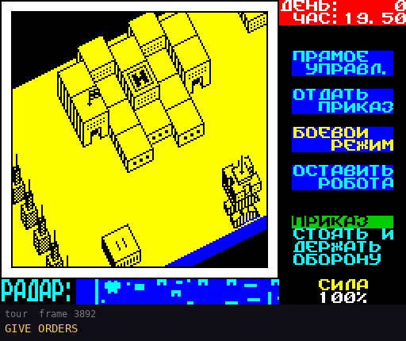

How to read the figure:

- **The frames** are `tour` 3891-4183.
- **3921**: ADVANCE ?? MILES opens the counter at 0.
- **3970-4051**: each up adds 5, up to 25.
- **4071**: down takes 5 off.
- **4091**: fire sets ADVANCE 20 MILES. The robot's order byte becomes `$28` (robot 1 record:
  `19 fb 19 00 0f 01 05 09 01 11 01 01 64 00 28 05`).

`python3 tools/fig_tour.py draw` draws it from `work/docP/tour/samples.bin`.

## 5.6 Direct control and combat

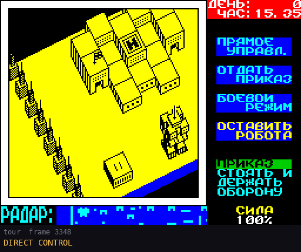

How to read the figure:

- **The frames** are `tour` 3348-3688, one picture every 4 frames.
- **3348**: DIRECT CONTROL. The menu stays with no item lit.
- **3402-3588**: down, then right. A robot facing another way first turns in place, then steps one cell a robot
  turn.
- **3658**: fire. The robot menu is lit again.

`python3 tools/fig_tour.py draw` draws it from `work/docP/tour/samples.bin`.

- **In direct control** the stick moves the robot and fire ends it (`DirectControl` `$A941`, its input loop at
  `$A960`).
- **The robot keeps its order.** ПРИКАЗ still shows it, and the robot goes back to it when the player leaves.

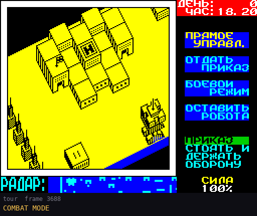

How to read the figure:

- **The frames** are `tour` 3688-3882.
- **3688**: COMBAT MODE opens the six combat items.
- **3725**: FIRE CANNON. A shot leaves the robot.
- **3764-3812**: the shot flies, two cells a turn, and ends.
- **3842**: EXIT MENU (stop combat). The robot menu is back.

`python3 tools/fig_tour.py draw` draws it from `work/docP/tour/samples.bin`.

- **Each FIRE item fires the weapon of that kind once**, if the robot has it (`CombatFireShot` `$ACB3`, then
  `FireShot` `$B6D6`). The robots, the shots and `GameTurn` then run one turn, and the menu waits again.
- **An item for a part the robot lacks** gives a low tone (period `$FA`, `$ACCE`) and nothing else. The test reads
  the robot's parts byte (record byte 7, `$AC9C`).
- **MOVE** calls `DirectControl` (`$A941`), as in direct control. Fire ends it and the combat menu is back
  (`$AC93`).
- **NUCLEAR BOMB** sets the bomb off (`$B99F`) and closes the menu (`$A812`). Its blast is in
  [10](10-gameplay-logic.md).
- **EXIT MENU** returns to the robot menu (`$AC8B`).
- **The robot does not move while it fires.** This is how the help describes it: "стрелять в ручную можно только из
  одного вида оружия, и при этом приходится стоять на месте" (by hand you can fire only one kind of weapon, and you
  have to stand still).

## 5.7 The keys in play

`CheckGameKeys` (`$A70D`) runs in the play loop after the landings:

- **Abort (bit 6)** jumps to `Restart` (`$A5EF`). That re-installs the interrupts and shows the game menu. The game
  is gone without an ending.
- **Save (bit 5)** jumps to `$C2CC`. That copies the game's state block (`$D7D3`, 45 bytes, and the buildings
  `$FF01`, 168 bytes) to `$D92B` and jumps to the disk bridge `$6905`, which pages in the disk module (5.8). `r2`
  presses 5 at script frame 6000, and the save screen is up at recording frame 7652. The game goes on at 8102.
- **Pause (bit 7)** is handled inside `ReadInput` (5.1).

The tape save and load of the game's tape version (`$C200-$C30E`, with "ВКЛЮЧИТЕ МАГНИТОФОН" PRESS PLAY ON TAPE)
are still in the image. No code jumps to them. Only the save's tail at `$C2CC` is reused ([08](08-hud-and-text.md)
8.3).

## 5.8 The disk module

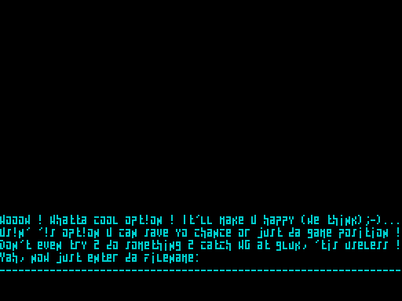

How to read the figure:

- **The screen** is `r2` frame 7652, right after key 5 in play.
- **The text** is the disk module's (bank 4, its own small font), in cyan.
- **The last line** "Yah, now just enter da filename:" is followed by the name typed so far.

`python3 tools/fig_programs.py draw` draws it from `work/docP/r2/samples.bin` (the bank 5 screen).

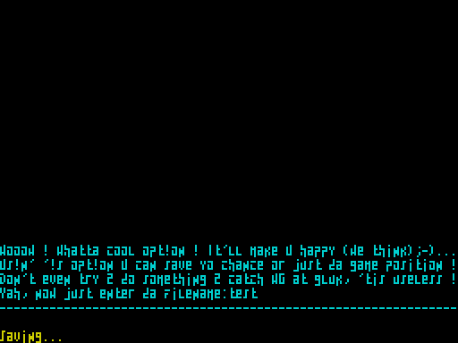

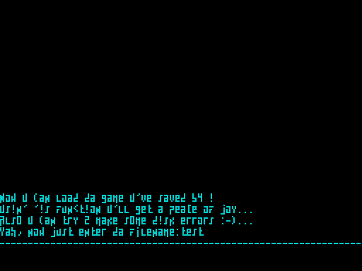

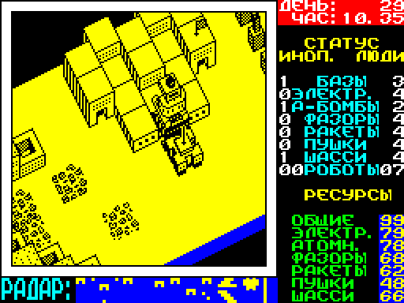

- **The name** is typed on the keyboard and ended with ENTER. `r2` types `test` and later `nether` (`work/stage3/
  inputs/r2-save-load.txt`).
- **"Saving..."** shows at 7947, and play is back at 8102.
- **The load** goes through game menu 5. The load screen is at 8932 and the game goes on at 9202.
- **A failed disk operation** offers "(R)etry/(A)bort" (the module's strings, [08](08-hud-and-text.md) 8.6).
- **No recording makes a disk error.** The error screens are known from the module's strings only.

## 5.9 The boot menu and the help program

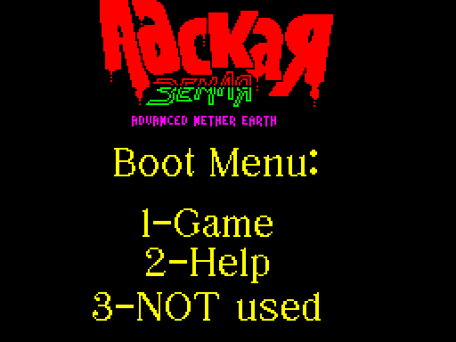

How to read the figure:

- **The screen** is `r1` frame 8699: the boot menu after the intro and the title picture.
- **The keys** are 1 (Game), 2 (Help) and 3 ("NOT used").

`python3 tools/fig_programs.py draw` draws it from `work/docP/r1/samples.bin`.

The boot menu's loop is at `$AA9E` in the boot program (`$6060`, source [`src/bootmenu/`](../src/bootmenu/menus.asm)):

| Key | Code | What |
| --- | --- | --- |
| `1` | `$B168` | the boot tune's init, IM 1, `JP $61C4`: the game's start ([03](03-build-and-load.md)) |
| `2` | `$AAB1` | the help menu |
| `3` | `CALL $6273` | "NOT used", as the menu says ([03](03-build-and-load.md) has what `$6273` does) |

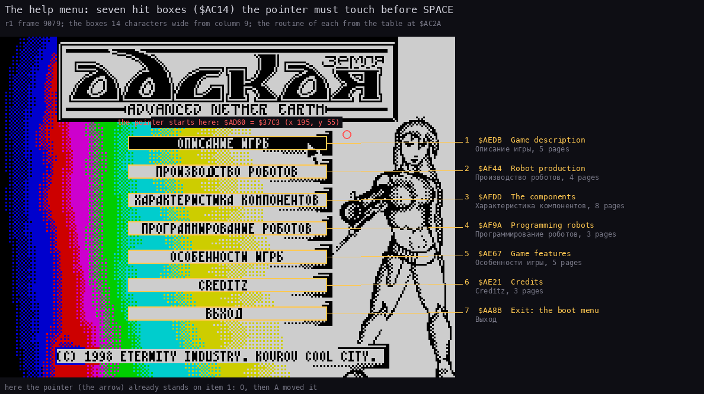

How to read the figure:

- **The screen** is `r1` frame 9079, at 3x.
- **The yellow boxes** are the hit boxes of the table at `$AC14`: column 9, rows 7, 9, ... 19, 14 characters wide.
- **On the right** of each box are its routine from the table at `$AC2A`, the item's English and Russian title, and
  its page count.
- **The red circle** is where the pointer starts: `$AD60` = `$37C3`, x 195, y 55, set by the boot menu at `$AA97`.
- **Here the arrow already stands on item 1**: `r1` moved it with O, then A.

`python3 tools/fig_programs.py draw` draws it from `work/docP/r1/samples.bin`.

- **The pointer** is moved with Q / A / O / P and SPACE, together with the Sinclair joystick keys 6 7 8 9 0 (left,
  right, down, up, fire), or, while CAPS SHIFT is held, the cursor keys 5 6 7 8 and 0 (`ReadControls` `$ADB3`, the
  bits in `Controls` `$AE20`, bit 4 fire). There is no Kempston read in the help: only the game reads one.
- **The pointer speeds up while a key is held** (`$AC75`).
- **SPACE** opens the item under the pointer.
- **In a page**, SPACE goes back to the menu (`$AAB1`), at once or after the text. ENTER or `0` after the text goes
  to the next page (`$B183`). After the last page the menu is back.
- **A page types itself out** (`$B13A`, a delay of `BC = $02BC` a character). A 759-character page takes about 250
  frames.
- **Item 7 "Выход"** (EXIT) returns to the boot menu (`$AA8B`). `r1` uses it at 20239.

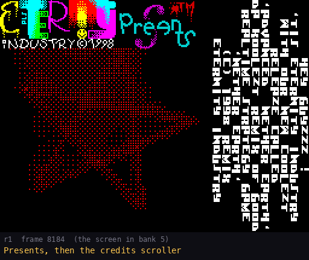

How to read the figure:

- **The frames** are `r1` 8180-10140, one every 8 frames. The yellow line is the script's last key.
- **8202**: SPACE ends the intro. The title picture follows, then the boot menu (8699).
- **8702**: key 2 opens the help menu.
- **9002**: O, then A, move the pointer onto item 1.
- **9082**: SPACE. The first page types itself out.
- **9432, 9782**: ENTER, the next page.

`python3 tools/fig_programs.py draw` draws it from `work/docP/r1/samples.bin`.

## 5.10 The intro and the endings

- **The intro** runs until SPACE (`r1` 8202). Its scroller wraps after about 4500 frames and starts again
  ([08](08-hud-and-text.md) 8.8).
- **Dead End** waits for a key with its own key read in bank 3 (`$D312` / `$D331`). It then shows "GAME OVER" on a
  star field and waits for a second key. Then the game menu returns with `MusicInterrupt` in the handler word.
  `lose`: SPACE at 740 gives GAME OVER at 756, and SPACE at 1356 gives the menu.
- **Final Cut** reads no key. `win` presses SPACE at 9100, and "Victory is with U!!!" stays to the run's end at
  10616. Stage 3's `r4` stays there for 16000 frames.

## 5.11 Design notes

- **One byte for every control.** All inputs land in `Input` before anything acts on them. So the stick and the keys
  are one control, and they can be mixed.
- **The pause costs no code in play.** It sits in the one input routine, so every screen that reads input pauses
  for free. The price is that the screen gives no sign of it.
- **The redefine screen shows the font's limits.** It prints a key's ROM code through a font whose letters are
  Russian. Most letter keys therefore show as the Russian letter drawn on that code.
- **The menus are driven with the stick alone.** The construction menu and the four robot menus need only
  up/down/left/right and fire. So a Kempston player never touches the keyboard in play, except for the save, the
  pause and the abort.
 