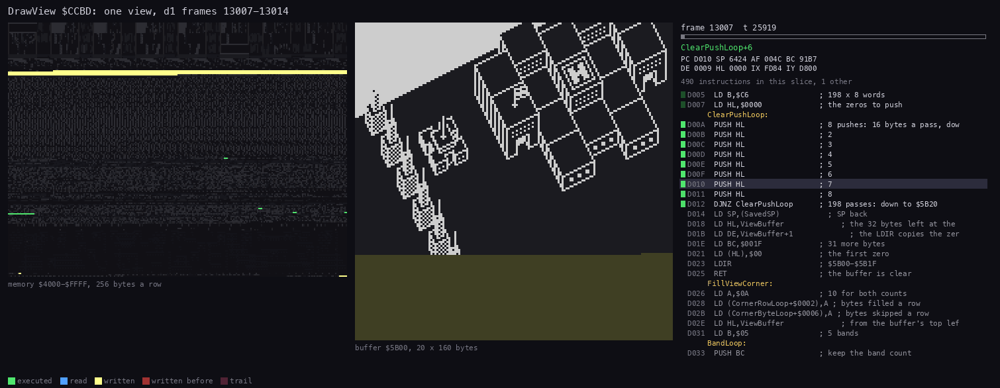
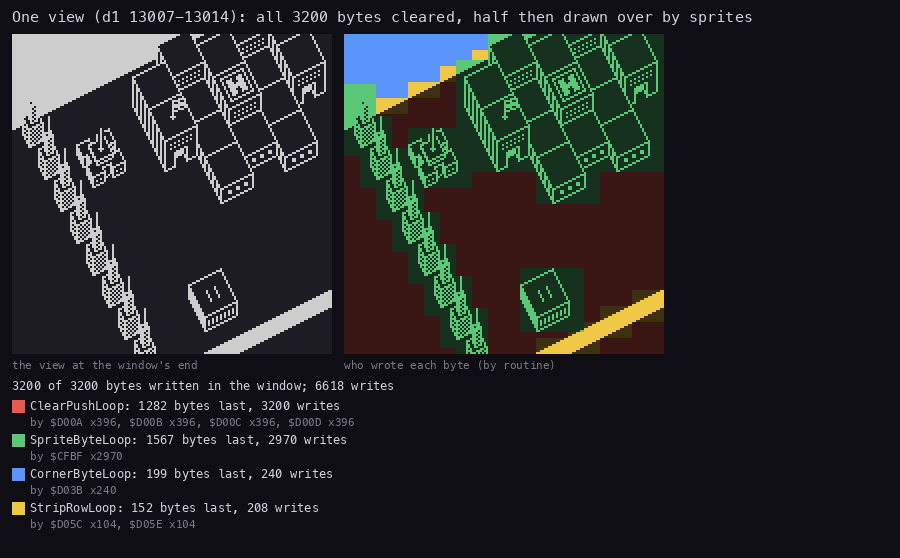
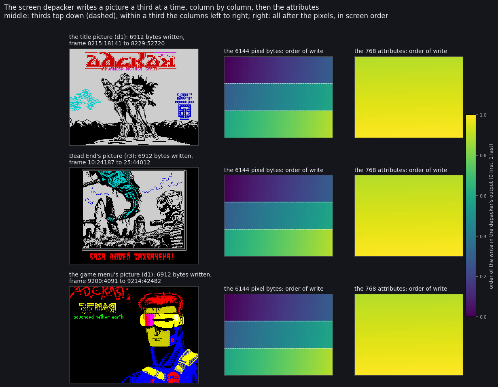
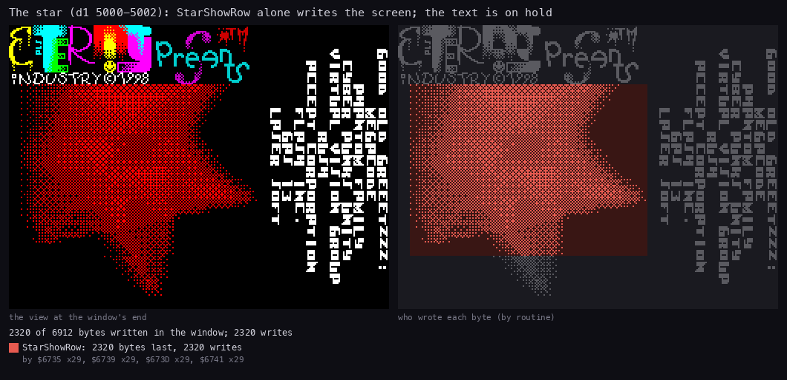
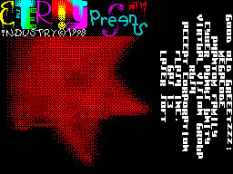
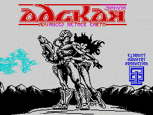
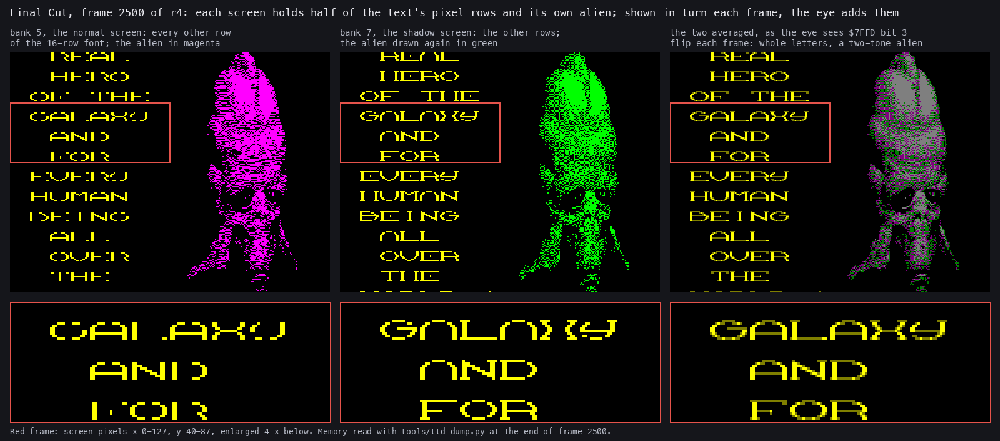

# 06. Rendering

Every picture of Advanced Nether Earth is drawn by one of a few methods.
Each section below covers one method: how its code draws, and what a recording shows.

| Picture | Drawn by | When | Section |
| --- | --- | --- | --- |
| the play view | `DrawView` `$CCBD`: sprites into a buffer, then a copy to the screen | every game turn | 6.1-6.3 |
| the radar | `ShowRadar` `$D59E`, in the interrupt | every frame of play | 6.4 |
| the title picture, the game menu, Dead End's picture, the intro logo | one relocatable LZ screen depacker in four copies | once each | 6.5 |
| the intro logo, "Presents" | the depacker in screen 5 behind screen 7; 16 pre-drawn frames | the intro | 6.6 |
| the burning star and the credits | a heat grid shown in dither; text typed in the interrupt | the scroller | 6.7 |
| the title cards | bitmaps copied, attributes cycled | before the game menu | 6.8 |
| GAME OVER and the star field | a Hrust 1 depacker; 120 stars saved, moved and ORed | Dead End | 6.9 |
| Final Cut's scroller | two screens, scrolled in turn, shown in turn | Final Cut | 6.10 |

Evidence:

- The recordings: d1 (`work/docR/d1`), r3 and r4 (Dead End and Final Cut, `work/stage3/r3`, `r4`, copies in
  `work/docR`).
  - Chapter 04 gives their inputs and frames.
- The code: `src/game/view.asm`, `src/game/interrupts.asm`, `src/intro/*/`, `src/music/title-cards.asm`,
  `src/endings/deadend/`, `src/endings/finalcut/`.

## 6.1 The play view: a buffer redrawn from nothing

The play area is 160 x 160 pixels at character row 1, column 1 of the screen.

- It is drawn every game turn into `ViewBuffer` `$5B00-$677F`: 20 bytes a line, 160 lines, plain line order.
- Nothing scrolls and nothing is erased.
  - To move the view, the game adds 1 to `ViewX` (`$FD0A`) and draws everything again.
- When the drawing is done, `CopyViewToScreen` copies the buffer to the screen (6.3).

`DrawView` has three parts:

1. `DrawViewBackground` `$CFD7`:
   - `ClearViewBuffer` clears all 3 200 bytes with `PUSH` (SP parked in `SavedSP`);
   - `FillViewCorner` and `DrawEdgeStrips` paint the corners and the map's edge.
2. `DrawMapObjects`: the ship's shadow, then the visible 32 x 16 map cells along diagonals, back to front.
   - The diagonal x - y = 31 comes first, down to x - y = -15.
   - Each cell that is not 0 goes to `DrawCell`: its block, then the robot, building or shot on it, then the ship.
   - The walk is the depth order. There is no sort.
3. `JP CopyViewToScreen`.

<!-- snippet: DrawView -->
From `src/game/view.asm`:

```asm
DrawView:
  CALL DrawViewBackground ; clear the buffer, paint the corners and the map's
                          ; edge
  CALL DrawMapObjects     ; the shadow, the blocks, buildings, robots, shots
                          ; and the ship
  JP CopyViewToScreen     ; the buffer to the screen; its RET ends DrawView
```

Every picture ends in `DrawSprite` `$CF2D`; each caller first writes the sprite's height into its operand at `$CF3F`.

- The projection: half-byte column L = 2E + D - 24, bottom line H = 8D + 100 - 4E - height, for map row D and view
  column E.
- A sprite is a list of (mask, pixels) byte pairs from its bottom line up, drawn with `AND` then `OR`.
- Each sprite has two pre-shifted pictures (`SpriteTable` `$D6E8`), for an even and an odd half-byte column.
- It is clipped on all four sides of the buffer.
- Robots are stacks of part sprites (`DrawRobot`, `DrawRobotPart`); buildings take `BuildingSprites` and
  `BuildingHeights` by type.

An object that a later block would paint over is deferred:

- `DrawMover` (robots, shots) and `DrawCell` (the ship) find the neighbour drawn last (`FindLatestBlock`,
  `CheckObjectNeighbour`, `CheckBlockNeighbour`, `KeepLaterCell`).
- They mark that cell (bit 6, or bit 7 for the ship) and draw the object when the walk reaches it.



How to read it:

- One picture is a slice of 5 519 T of `DrawView` in d1, frames 13007-13014 (90 slices, the whole call).
- Left: memory `$4000-$FFFF`, 256 bytes a row.
  - Green: code executed in the slice. Blue: bytes read. Yellow: bytes written. Red: written in earlier slices.
- Middle: the view buffer `$5B00` as a 160 x 160 picture.
  - The bytes written in the slice are lit yellow; the sprite being drawn is clear.
- Right: the frame and T-state, the routine, the registers, and the listing around PC with the slice's executed
  lines marked.
- Drawn by `python3 ../../kit/routine_anim.py --trace work/docR/d1/traces/13007_20400-13014_15300.uatr --listing build/game/game.lst --view buffer:5B00:20x160 --pc CCBD-D0B8 --range 4000-FFFF --pictures 90 --title 'DrawView $CCBD: one view, d1 frames 13007-13014' --out docs/img/render/drawview.gif`.

What it shows:

- The first slices clear the buffer: the whole middle panel turns black at once.
- The corners and the edge strip come next.
- Then the blocks appear diagonal by diagonal, from the top right of the view to the bottom left.
- Robots and buildings appear on their cells as the walk passes, never before the blocks behind them.

## 6.2 Who writes the view



How to read it:

- Left: the view buffer at the end of the window (d1 frames 13007-13014), as it goes to the screen.
- Right: each byte coloured by the routine that wrote it last.
- Under them: the routines with the bytes they wrote last, their writes, and the instructions that wrote.
- Drawn by `python3 ../../kit/writers_map.py --trace work/docR/d1/traces/13007_20400-13014_15300.uatr --listing build/game/game.lst --view buffer:5B00:20x160 --by routine --title 'One view (d1 13007-13014): all 3200 bytes cleared, half then drawn over by sprites' --out docs/img/render/writers-view.png`.

What it shows:

| Writer | Bytes written last | Writes | Instruction |
| --- | --- | --- | --- |
| `ClearPushLoop` | 1 282 | 3 200 | the `PUSH`es at `$D00A-$D00D` |
| `SpriteByteLoop` | 1 567 | 2 970 | `$CFBF` |
| `CornerByteLoop` | 199 | 240 | `$D03B` |
| `StripRowLoop` | 152 | 208 | `$D05C`, `$D05E` |

- Every byte of the buffer is written: the clear covers all 3 200.
- Sprites rewrite 2 970 bytes, so some bytes are drawn twice: a nearer sprite over a farther one.
- 1 282 bytes stay as the clear left them: the empty ground, black.
- So a view costs a fixed clear (3 200 bytes) plus the sprites, whose number grows with the robots on screen.

Its cost in d1 (chapter 04.5): about 410 000 T to draw, 61 736 T to copy, for an early game with few robots.
The code's header measures about 578 000 T for a full call in a busier scene: that is why a turn is 10 frames.

## 6.3 The copy to the screen

`CopyViewToScreen` `$D071` copies the 160 lines of 20 bytes to the screen from `$4021`.

- 20 unrolled `LDI` a line; `PUSH`/`POP` keep the counts and the line's start.
- The screen address steps the usual way: `INC D` a pixel line, + 32 a character row, D back by 8 inside a third.
- No `HALT` comes before it, so it runs wherever the turn is (chapter 04.5).

<!-- snippet: CopyViewToScreen -->
From `src/game/view.asm`:

```asm
CopyViewToScreen:
  LD HL,ViewBuffer             ; from the buffer's first line
  LD DE,$4021             ; the screen: line 0 of character row 1, column 1
  LD C,$14                ; 20 character rows
CopyCharRowLoop:
  LD B,$08                ; 8 pixel lines a character row
CopyLineLoop:
  PUSH BC                 ; keep the counts (the LDIs change BC)
  PUSH DE                 ; and the line's screen address
  LDI                     ; the 20 bytes of the line, unrolled: byte 1
  LDI                     ; 2
  LDI                     ; 3
  LDI                     ; 4
  LDI                     ; 5
  LDI                     ; 6
  LDI                     ; 7
  LDI                     ; 8
  LDI                     ; 9
  LDI                     ; 10
  LDI                     ; 11
  LDI                     ; 12
  LDI                     ; 13
  LDI                     ; 14
  LDI                     ; 15
  LDI                     ; 16
  LDI                     ; 17
  LDI                     ; 18
  LDI                     ; 19
  LDI                     ; 20
  POP DE                  ; the line's start again
  POP BC                  ; the counts back
  INC D                   ; the next pixel line
  DJNZ CopyLineLoop       ; the next pixel line of the character row
  LD A,E                  ; the next character row
  ADD A,$20               ; + 32: the next character row (the source HL runs on
                          ; by itself)
  LD E,A                  ; the low byte
  JR C,CopyCharRowNext    ; carry: into the next third, where D (+8 from the
                          ; lines) already points
  LD A,D                  ; inside the same third ...
  SUB $08                 ; ... D back by the 8 lines
  LD D,A                  ; (the character row's line 0)
CopyCharRowNext:
  DEC C                   ; the next character row
  JP NZ,CopyCharRowLoop   ; the next of the 20 character rows
  RET                     ; the view is on the screen
```

Measured in d1, frame 13014:

- 61 736 T of its own, 379 T a line.
- The beam draws a line every 224 T, so a copy that starts above the beam is overtaken.
- Chapter 04.5 has the beam figures: a torn TV frame rebuilt from d1 (line 38), and the 24 tears of 45 copies.

## 6.4 The radar

`ShowRadar` `$D59E` puts a 128 x 16 picture at character rows 22-23, columns 6-21, every frame of play.

- `PlayInterrupt` gives it `RadarOwn` (`$D800`, attribute `$4D`, bright cyan on blue) and `RadarEnemy` (`$D900`,
  `$4E`, bright yellow on blue) in turn.
- Both pictures hold the terrain. Each also holds one side's robots.
- So the terrain stays still and each side's robots blink in their own colour at 24.4 Hz.
- 16 lines of 16 bytes by `LDIR`, then 32 attribute bytes (`FillAttr16`).

<!-- snippet: ShowRadar -->
From `src/game/interrupts.asm`:

```asm
ShowRadar:
  PUSH BC                 ; keep the attribute C
  LD B,$10                ; 16 lines
  LD DE,$50C6             ; screen line 0 of character row 22, column 6
RadarLineLoop:
  PUSH BC                 ; keep the count
  PUSH DE                 ; and the line's screen address
  LD BC,$0010             ; 16 bytes: 128 map columns
  LDIR                    ; one picture line onto the screen
  POP DE                  ; the line's start
  EX DE,HL                ; HL = the screen address (DE = the picture's next
                          ; line)
  CALL NextScreenLine     ; the next screen line
  EX DE,HL                ; back: DE = screen, HL = picture
  POP BC                  ; the count back
  DJNZ RadarLineLoop      ; the next line
  POP BC                  ; the attribute back
  LD HL,$5AC6             ; the attributes of row 22
  CALL FillAttr16         ; 16 cells of row 22
  LD L,$E6                ; row 23 ($5AE6), then on into FillAttr16 for its 16
                          ; cells

; Write C into 16 bytes from HL
;
; In: HL, C. Out: HL past the 16 bytes, B = 0. The tail of ShowRadar (rows 22
; and 23 of the radar).
FillAttr16:
  LD B,$10                ; 16 cells
FillAttrLoop:
  LD (HL),C               ; the attribute
  INC HL                  ; the next cell
  DJNZ FillAttrLoop       ; 16 cells
  RET                     ; done
```

Measured in d1, frames 13005-13016: 8 124 T every frame, from about frame T 145 to frame T 8 270.
The beam reaches row 22 at about frame T 17 944 + 176 x 224 = 57 368 (frame T: the T-state in the emulator's frame;
the INT is at frame T -44), so the radar is always complete before it is shown.

## 6.5 The screen depacker: a third at a time, column by column

Four full-screen pictures are unpacked by the same relocatable LZ depacker, in four copies:

| Copy | Picture | Where | Measured |
| --- | --- | --- | --- |
| `TitlePicture` `$9C40` | the title, while the disk loads | the boot | d1 8215:18141 to 8229:52720, 14 frames |
| `LogoPicture` `$66C1` | the intro's decorated logo | the intro | not traced |
| `LzScreen` `$D723` (bank 3) | Dead End's picture | Dead End | r3 10:24187 to 25:44012, 15 frames |
| `MenuPicture` `$E73B` (bank 3) | the game menu | called by the game's `MenuPicture` `$67E5` | d1 9200:4091 to 9214:42482, 14 frames |

How each copy finds itself:

- `CALL $0052` jumps to a `RET` in the 48 ROM, so its own return address stays just under SP.
- It reads that back as its base and patches the three `CALL`s to its byte writer (their operands hold `$74A6`, the
  address the authors' template was assembled for).
- The stream lies at base + `$BE`.

The stream (`src/intro/title/titlepic.asm`, `src/endings/deadend/lzscreen.asm`):

| Token | Meaning |
| --- | --- |
| `0LLLLHHH` + a byte | copy (L + 3) bytes (3-18) from (H x 256 + the byte) back (up to 2 047) |
| `10NNNNNN` + N bytes | N literal bytes (1-63) |
| `11NNNNNN` + a byte | the byte (N + 3) times (3-66) |
| `$80` | the end |

The output order is the trick: bytes go out per third of the screen, column by column, each column's 8 character
cells top down, each cell's 8 pixel lines; then the 768 attributes.

- A back reference counts in that order.
- So the depacker turns each copied byte's sequence address back into a screen address before it reads.
- Down a column the picture repeats more than along a line, which helps the packer.

<!-- snippet: LzScreen -->
From `src/endings/deadend/lzscreen.asm`:

```asm
LzToken:
  LD A,(HL)               ; the next token: bit 7 clear, a match
  BIT 7,A
  JR NZ,LzNotMatch
  AND $07                 ; C = the distance's high bits
  LD C,A
  LD A,(HL)
  RRCA
  RRCA
  RRCA
  AND $0F
  ADD A,$03
  LD B,A                  ; B = the length (3-18)
  INC HL
  LD A,E                  ; HL = DE - distance: the source's sequence address
  SUB (HL)
  INC HL
  PUSH HL
  LD L,A
  LD A,D
  SBC A,C
  LD H,A
LzMatchByte:
  PUSH HL                 ; the sequence address to a screen address
                          ; (attributes stay as they are)
  LD A,H
  AND $58
  CP $58
  JR Z,LzMatchRead
  LD C,A
  LD A,L
  AND $07
  OR C
  LD C,A
  ADD HL,HL
  ADD HL,HL
  LD A,H
  AND $1F
  LD H,A
  LD A,L
  AND $E0
  OR H
  LD L,A
  LD H,C
LzMatchRead:
  LD A,(HL)               ; the byte from the screen
LzMatchCall:
  CALL LzPutByteOrg       ; (CALL LzPutByte)
  POP HL
  INC HL
  DJNZ LzMatchByte
  POP HL
  JR LzToken
```



How to read it:

- One row per picture: the title (d1), Dead End (r3), the game menu (d1).
- Left: the picture as the depacker's writes leave it, with the frames of its first and last write.
- Middle: the 6 144 pixel bytes, each coloured by when it was written (dark first, yellow last).
  - The dashed lines split the thirds.
- Right: the 768 attributes, coloured the same way.
- Only the depacker's own writes count (`@LO-HI`), so the screen clear before it does not.
- Drawn by `python3 tools/fig_unpack_order.py --out docs/img/render/unpack-order.png --trace "the title picture (d1)=work/docR/d1/traces/8215_0-8232_0.uatr" --trace "Dead End's picture (r3)=work/docR/r3/traces/0_0-100_0.uatr@D723-D7E5" --trace "the game menu's picture (d1)=work/docR/d1/traces/9199_0-9216_0.uatr@E73B-E7FD"`.

What it shows:

- All three pictures fill the same way: the top third left to right, then the middle, then the bottom.
- Inside a third the colour changes across, not down: a whole column is done before the next.
- The attributes come last, all of them in screen order.
- So the player sees each picture appear as a black-and-white sweep from the left, third by third, then coloured at
  once.
- Each takes 14-15 frames.
  - The title runs with interrupts off (`DI` at `TitlePicture`); `LzScreen` runs with them on.
  - d1 measures about 14 frames (`8215:18141-8229:52720`).

## 6.6 The intro logo and "Presents"

The intro uses the two screens of the 128K.

- The plain "ETERNITY industry" logo is unpacked into screen 7, which is shown (`$7FFD` = `$18`).
- Meanwhile `LogoPicture` unpacks the decorated logo (lightning, sparks, colour) into screen 5, out of sight.
- After 576 frames and the 192 frames of the broken envelope call (9.7), screen 5 is shown.
- So the decoration appears all at once, with no drawing seen.

"Presents" (`src/intro/presents/presentsmain.asm`) is 16 pre-drawn frames of 176 x 80 pixels.

- Each frame is 22 bytes x 80 lines (1 760 bytes), shown at character columns 5-26, lines 56-135 (from `$40E5`).
- `PresentsShowLines` is an unrolled copy routine built at run time, after the image.
- Each frame stays 2 interrupts: 32 frames, about 0.65 s.
- The frames have no mask: each overwrites the whole window, so a smaller frame clears what a larger one left.
- The word turns a full turn while it grows from a speck to 176 pixels across.
- Then the loader flashes screen 5 (the word) against the white screen 7 twenty times.


How to read it:

- Screens of d1, frames 3260-3420, every 4th frame, one picture each.
- Drawn by `python3 ../../kit/screen_anim.py --work work/docR/d1 --from 3260 --to 3420 --step 4 --scale 1 work/docR/anim/presents.gif` (copied to `docs/img/render/`).

## 6.7 The burning star and the credits

The scroller (`src/intro/scroller/`) shows the logo screen, a burning pentagram on the left and credits typed on the
right.
The star and the text run apart:

- The star runs in the main loop, one pass every 4 frames.
- The text runs in the interrupt, one character a frame.

### The star: a heat grid shown in dither

`StarBuffer` (`$9800`) is a grid of heat cells, one byte a cell (0-15), one page a row.

- It is shown at a quarter of the resolution: a cell is 4 x 4 pixels, 40 x 38 cells from column 1, line 40.

A pass of the loop (`ScrollerStart`):

1. `StarPoints`: the five tips from `StarPath`, a circle of 90 points; the tips are 18 points (72 degrees) apart and
   move one point a pass.
2. `StarLine` five times: the pentagram's lines at heat `StarHeat`, by Bresenham's method.
3. `StarBurn`: every cell becomes the mean of four cells below it, so the lines spread and fade upwards.
4. `StarShow`: the grid to the screen; two `HALT`s.
5. `StarHeat` one up or down between 15 and 2, so the lines pulse.

<!-- snippet: StarBurn -->
From `src/intro/scroller/star.asm`:

```asm
StarBurn:
  LD BC,$9801             ; BC = cell (1, 0): the cell written
  LD HL,StarBuffer+$0100  ; HL = cell (0, 1): the three cells under it
  LD DE,StarBuffer+$0201  ; DE = cell (1, 2): the one under those
  LD IXL,$26              ; 38 rows
StarBurnRow:
  LD A,(DE)               ; one row
  INC E
  ADD A,(HL)
  INC L
  ADD A,(HL)
  INC L
  ADD A,(HL)
  DEC L
  SRL A
  SRL A
  LD (BC),A
  INC C
  LD A,(DE)
  INC E
  ADD A,(HL)
  INC L
  ADD A,(HL)
  INC L
  ADD A,(HL)
  ...                     ; (the rest as in src/intro/scroller/star.asm)
```

`StarShow` turns each pair of cells into one screen byte, 4 lines high:

- `PairIndex` (pages `$80-$8F`) maps the pair (left, right) to a pattern number.
- `DitherPatterns` (from page `$7C`) holds 4 lines of the pattern; each nibble is one cell's dither level.
- SP walks `StarRows` (the screen addresses of the rows) and the grid rows; `LD (DE),A` / `INC D` write the 4 lines.

<!-- snippet: StarShowRow -->
From `src/intro/scroller/star.asm`:

```asm
StarShow:
  EI
  HALT
  DI
  LD (StarShowSP+$0001),SP ; SP kept in the LD SP at the end
  LD HL,StarRows          ; HL = StarRows, C = 29 rows
  LD C,$1D
  EXX
  LD B,$7C                ; B' = the patterns' first page, IX = the first row
                          ; of StarBuffer
  LD IX,StarBuffer+$0001
  EXX
StarShowRow:
  LD SP,HL                ; SP = the row's entry in StarRows
  INC L
  INC L
  EXX
  POP DE                  ; DE = the row's screen address
  LD SP,IX                ; SP = the row of cells; IX the next row
  INC IXH
  POP HL                  ; L, H = two cells (x, x + 1)
  SET 7,H                 ; H = $80 + the right cell: the pair's place in
                          ; PairIndex
  LD C,(HL)               ; C = the pair's index, the low byte of its pattern
  LD A,(BC)               ; four lines of the pattern, down (the next pair up
                          ; again)
  LD (DE),A
  INC B
  INC D
  LD A,(BC)
  LD (DE),A
  INC B
  INC D
  LD A,(BC)
  LD (DE),A
  INC B
  INC D
  LD A,(BC)
  LD (DE),A
  INC E
  POP HL
  SET 7,H
  LD C,(HL)
  LD A,(BC)
  LD (DE),A
  DEC B
  DEC D
  LD A,(BC)
  LD (DE),A
  DEC B
  ...                     ; (the rest as in src/intro/scroller/star.asm)
```



How to read it:

- Left: the screen at the end of the window.
- Right: each screen byte coloured by the routine that wrote it last, grey where nothing wrote in the window.
- Drawn by `python3 ../../kit/writers_map.py --trace work/docR/d1/traces/5000_0-5003_0.uatr --listing build/intro/scroller.lst --by routine --out docs/img/render/writers-star.png --title "The star (d1 5000-5002): StarShowRow alone writes the screen; the text is on hold"`.

What it shows:

- `StarShowRow` writes 2 320 bytes: 29 rows of cells, 4 lines each, 20 bytes a line.
- Nothing else writes the screen in these frames: the text is on hold (`HoldText`).
- The writes are the four `LD (DE),A` of a cell pair, 29 times each, at `$6735`, `$6739`, `$673D`, `$6741`.



How to read it:

- Screens of d1, one a frame. The star turns one point of 90 every pass (4 frames) and its heat pulses.
- Drawn by `python3 ../../kit/screen_anim.py --work work/docR/d1 --from 5000 --to 5060 --step 1 --scale 1 work/docR/anim/star.gif` (copied).

Measured: d1 calls `StarBurn` 1 200 times in frames 3403-8200, one pass every 4 frames.

### The credits: typed in the interrupt

`ScrollerStart` writes `CALL TextInterrupt` into the loader's `LoaderHook` (`$618A`), so `LoaderInterrupt` calls it
every frame after the tune (`src/intro/scroller/text.asm`).

- `TypeChar`: one character a frame, down a column of 24 rows; the next line goes in the next column to the left;
  ten columns.
- `HoldText`: 200 frames.
- `WipeColumn`: the ten columns go black from the right, one a frame.
- The glyphs (`ScrollerFont`) are turned a quarter clockwise, so the columns read top down.
- 100 lines are ten screens; a cycle is 10 x (240 + 1 + 200 + 11) frames, about 4 520 frames.

## 6.8 The title cards

`TitleCards` `$D8E1` (bank 1, `src/music/title-cards.asm`) shows three cards on a black screen:
"Eternity Industry", "presents", "Advanced Nether Earth".

<!-- snippet: TitleCards -->
From `src/music/title-cards.asm`:

```asm
TitleCards:
    DI
    LD    A,$3F                         ; I back to the ROM's value, IM 1: HALT waits a frame
    LD    I,A
    IM    1
    EI
    CALL  Init                          ; the game tune (src/music/stp-player.asm)
    XOR   A
    OUT   ($FE),A                       ; border black
    LD    HL,$5B00                      ; the screen and attributes cleared, downwards from $5AFF: the loop stops at
TitleCardsClear:                        ; the first byte that does not keep 0 (the ROM's last byte, $3FFF)
    DEC   HL
    LD    (HL),A
    OR    (HL)
    JR    Z,TitleCardsClear
    LD    HL,TitleEternityIndustry
    LD    DE,$4824                      ; screen third 1, character row 1, column 4
    LD    BC,$2018                      ; 32 lines of 24 bytes
    CALL  DrawBitmap
    LD    HL,FadeIn
    CALL  FadeAttributes
    CALL  Wait80
    LD    HL,FadeOut
    CALL  FadeAttributes
    CALL  ClearPixels
```

For each card:

1. `DrawBitmap` copies its bitmap line by line: 32 x 24 bytes at `$4824`, 32 x 12 at `$482A`, 56 x 18 at `$4807`.
2. `FadeAttributes` with `FadeIn`: the whole attribute area set to ink 0, 1, ... 7 on black, two frames each.
3. `Wait80`: 80 frames.
4. `FadeAttributes` with `FadeOut`: ink 7 down to 0.
5. `ClearPixels`.

<!-- snippet: FadeAttributes -->
From `src/music/title-cards.asm`:

```asm
FadeAttributes:
    LD    B,$08
FadeAttributesStep:
    PUSH  BC
    PUSH  HL
    LD    A,(HL)
    LD    HL,$5800
    LD    D,H
    LD    E,L
    INC   E
    LD    (HL),A
    LD    BC,$02FF
    LDIR
    HALT
    HALT
    POP   HL
    INC   HL
    POP   BC
    DJNZ  FadeAttributesStep
    RET

; the fades: ink 0-7 on black paper, up and down
FadeIn:
    DB    $00,$01,$02,$03,$04,$05,$06,$07
FadeOut:
    DB    $07,$06,$05,$04,$03,$02,$01,$00
```

- The fade is not a grey ramp: ink 0-7 is black, blue, red, magenta, green, cyan, yellow, white.
- So each card comes up through the colours to white in 16 frames, and goes back the same way.
- A card takes 112 frames; d1 shows the three in frames 8852-9197.
- The screen is IM 1, so every `HALT` is one frame and nothing plays (chapter 04.4).



How to read it:

- Screens of d1, every 3rd frame; the ink colour steps show in the first and last pictures of each card.
- Drawn by `python3 ../../kit/screen_anim.py --work work/docR/d1 --from 8852 --to 9200 --step 3 --scale 1 work/docR/anim/cards.gif` (copied).

## 6.9 Dead End: GAME OVER on a star field

Dead End (`src/endings/deadend/`) draws three things.

- The picture: `LzScreen` (6.5), r3 frames 10-25.
- "GAME OVER": `HrustScreen` `$E4A7`, a relocatable Hrust 1 depacker (a bit stream, MSB first from 16-bit words).
  - It patches its eleven `CALL`s to `HrustGetBit` from a table at its end before it starts.
- The star field over GAME OVER, one move a frame (`DeadEndStars` `$D323`).

The star field has 120 stars in four layers of 30 (`StarsLayer1` .. `StarsLayer4`, tables of screen addresses).
A frame of it:

1. `HALT`.
2. `StarsRestore`: the 120 saved screen bytes back under the stars.
3. `StarsMove`: each layer's mask rotates; on its carry the layer's addresses step one byte right.
4. `StarsSave`: the bytes under the new places saved in `StarsSaved`.
5. `StarsDraw`: each layer's mask ORed in.
6. A key ends it.

<!-- snippet: StarsMove -->
From `src/endings/deadend/deadend.asm`:

```asm
StarsMove:
  LD A,$80                ; layer 1's mask (the operand: StarsMove+1)
  OR A
  RRCA
  LD (StarsMove+$0001),A
  LD HL,StarsLayer1
  CALL C,StarsStep
StarsMask2:
  LD A,$80                ; layer 2's mask
  OR A
  RRCA
  RRCA
  LD (StarsMask2+$0001),A
  LD HL,StarsLayer2
  CALL C,StarsStep
StarsMask3:
  LD A,$80                ; layer 3's mask
  OR A
  RRCA
  RRCA
  RRCA
  RRCA
  LD (StarsMask3+$0001),A
  LD HL,StarsLayer3
  CALL C,StarsStep
  LD (StarsMask3+$0001),A
StarsMask4:
  LD A,$80                ; layer 4's mask: always $80
  LD HL,StarsLayer4
  CALL StarsStep
  RET
```

- Layer 1 rotates its mask one bit a frame, layer 2 two, layer 3 four; layer 4 moves a whole byte every frame.
- So the layers move 1, 2, 4 and 8 pixels a frame: a parallax of four depths.
- A move is an `INC` of the address's low byte only.
  - So a star runs along its pixel line and, past column 31, drops to the next character row of the same third.
- SP walks the tables in every routine (one `POP` or `LDI` a star), so a frame costs about 13 000 T (r3 trace
  1000).
- The stars are ORed, so a star crossing a letter of GAME OVER is not seen, and the restore puts the letter back.


How to read it:

- Screens of r3, one a frame, at twice the size.
- Drawn by `python3 ../../kit/screen_anim.py --work work/docR/r3 --from 900 --to 950 --step 1 --scale 2 --delay 40 work/docR/anim/de-stars.gif` (copied).

## 6.10 Final Cut: two screens, scrolled in turn, shown in turn

Final Cut's scroller (`src/endings/finalcut/fcmain.asm`) uses both screens of the 128K.

- Screen 5 (bank 5) holds the alien in magenta (`AlienMagentaScreen`, copied from `$A66D`).
- Screen 7 (bank 7) holds the alien in green (`AlienGreenScreen`, in `Bank7Block`).
- The text scrolls up on the left half of the screen (16 bytes, 128 pixels) in a 16-line font, 8 characters a
  row.

A frame (`FcScrollFrame` `$6215`):

1. `HALT`.
2. `FcDrawPage`: page the screen to draw at `$C000`: `$17` (bank 7) and `$1D` (bank 5) in turn.
3. `FcScroll`: that screen's left half up one line, then the text's next pixel row on its bottom line.
4. `FcShowPage`: show screen 5 and screen 7 in turn (`$7FFD` bit 3), with bank 7 paged.

<!-- snippet: FcScroll -->
From `src/endings/finalcut/fcmain.asm`:

```asm
FcScroll:
  LD (FcScrollSp+$0001),SP ; SP into FcScrollSp's operand
  LD BC,$0C00
  LD SP,Bank7Block        ; SP = the line table
FcScrollLoop:
  POP DE
  POP HL
  LDI
  LDI
  LDI
  LDI
  LDI
  LDI
  LDI
  LDI
  LDI
  LDI
  LDI
  LDI
  LDI
  LDI
  LDI
  LDI
  POP DE
  POP HL
  ...                     ; (the rest as in src/endings/finalcut/fcmain.asm)
```

- `FcScroll` walks a table of 192 line pairs (the line, the line below) with SP: `POP DE`, `POP HL`, 16 `LDI`, three
  lines a pass. About 53 000 T a frame.
- `FcRow` counts the glyph's pixel row, 0-15. At row 0 the text pointer moves on 8 characters; a 0 there is the end.

So each screen is scrolled every other frame, and gets every other pixel row of the font.



How to read it:

- Three screens of the same moment, read from r4's memory at the end of frame 2500.
  - Left: screen 5. Middle: screen 7. Right: the two averaged, as the eye sees them alternate at 48.8 Hz.
- The red frame (pixels x 0-127, y 40-87) is enlarged 4 times under each screen.
- Drawn by:
  - `python3 tools/ttd_dump.py --work work/docR/r4 --frame 2500 --out work/docR/fcdump/f2500 --pages 5-7`;
  - `python3 tools/fig_fc_interlace.py --bank5 work/docR/fcdump/f2500-bank5.bin --bank7 work/docR/fcdump/f2500-bank7.bin --frame 2500 --out docs/img/render/fc-interlace.png`.

What it shows:

- Each screen alone has broken letters: every other pixel row of the font is missing.
- The two screens shown in turn give whole letters, at half brightness.
- The alien is magenta on one screen and green on the other; the eye mixes them into a two-tone grey alien.
- The text scrolls one line a frame on the eye's mix, though each screen moves only every other frame.

At the text's end `FcTextEnd` stops the scroll and shows the two screens in turn for 920 frames (GAME OVER), then
`FcVictory` shows "Victory is with U!!!" (chapter 04.6).

## 6.11 Design notes

- **Draw everything, every turn.**
  - The view has no dirty rectangles and no scroll: a clear, a painter's walk and a copy.
  - The cost is fixed and large (most of a 10-frame turn), but the code is simple and never shows stale pieces.
- **A buffer, but no wait for the beam.** The buffer stops the player from seeing the drawing; the copy without a
  `HALT` still lets him see a tear for one frame (chapter 04.5).
- **Column-order pictures.** The screen depacker writes down columns, which packs better and gives the left-to-right
  sweep the player sees.
- **SP as a fast pointer.** The view clear, the copy's line table in Final Cut, the star field and the star display
  all walk their data with SP.
- **Two screens for free colour.** Final Cut shows two pictures in turn to get a third colour and full letters from
  half the work a frame.

## 6.12 What no recording reached

- `LogoPicture` in the intro was not traced: its timing is not measured.
- The help pages' pictures and text (the boot program's Hrust 1 depacker) belong to chapter 08 and were not traced
  here.
- A view with many robots (late game): the draw cost there is the code header's estimate, not a trace of mine.
