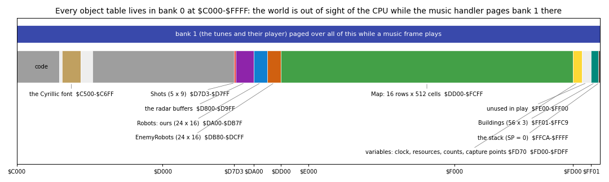
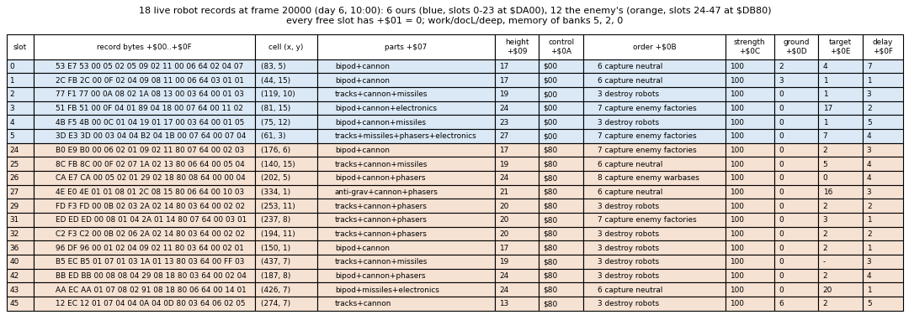
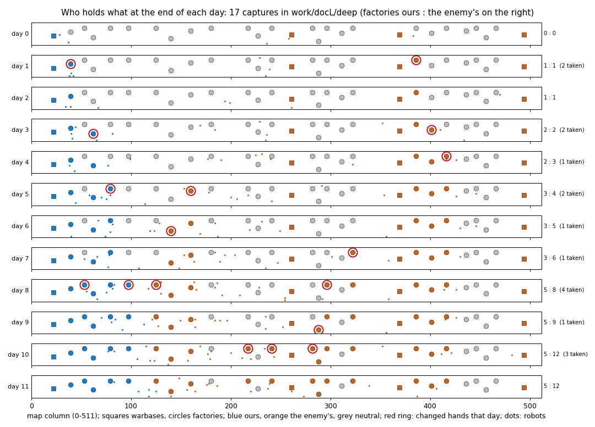
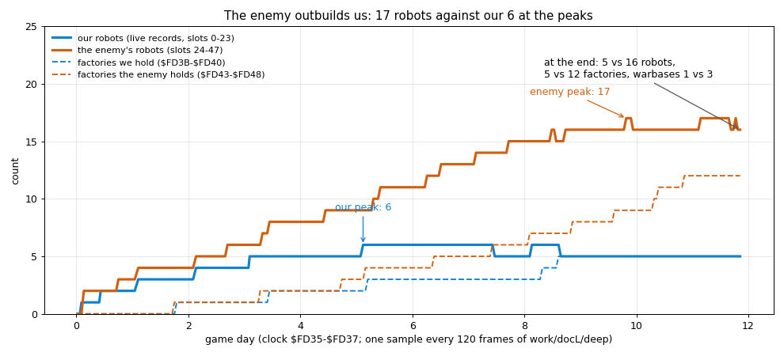

# 7. Objects

The world of Advanced Nether Earth is four tables and a map, all in RAM bank 0 at `$C000`-`$FFFF`:

- 48 robot records of 16 bytes (`Robots` `$DA00`, 24 a side);
- 5 shot records of 9 bytes (`Shots` `$D7D3`);
- 56 building records of 3 bytes (`Buildings` `$FF01`);
- 28 capture points of 5 bytes (`Warbases` `$FD70`, `Factories` `$FD84`);
- the map `Map` `$DD00`: 16 rows of 512 cells.

The records point into the map. A cell byte carries the terrain and two marks: bit 6 "an object is anchored here" and
bit 7 "the ship is here". Movers find each other through the map, never through a list:

- a robot looking ahead reads cells;
- a shot hits whatever anchor it lands next to;
- a capture point counts while its door cell has bit 6.

Evidence:

- the code, read in the game image (`work/mkgame/original.bin`) at the addresses named; the labels are those of the
  annotations of the game's source (`src/game/`);
- `work/docL/deep`: the bot's game, 36009 frames (11.9 game days) from stage 3's game-menu snapshot, Kempston, Pentagon
  128 ([10.12](10-gameplay-logic.md#1012-the-figure-experiments) has the command). L1 counts and times come from its
  `l1.json`;
- `work/docL/cache/deep10.npz`: the memory of banks 5, 2 and 0 at every 10th frame of `work/docL/deep` (3601
  pictures), read with TTD `memory_at` (`tools/fig_events.py sample`); `deep-fight.npz` is every frame of 22300-22919;
- the figures of `tools/fig_objects.py` (the command under each), drawn from those pictures without an emulator.

## 7.1 Where the world lives



```sh
python3 tools/fig_objects.py banks --image work/images/scl-play-bank0.bin --out docs/img/objects/bank0-tables.png
```

How to read the figure:

- **Across:** the addresses `$C000`-`$FFFF` of the CPU, with bank 0 paged (the game's normal state, `GameBank` `$67D9`
  = `$10`).
- **The coloured bars:** each table, labelled with its size and range; grey is code, light grey bytes no table uses.
- **The blue band above:** bank 1, which `MusicInterrupt` `$6780` and `PlayMusic` `$67B1` page at `$C000` for one
  frame of the tune.

What it shows:

- All the moving state is in bank 0: shots, the two radar buffers (`$D800`, `$D900`), the robots, the map, the
  variables page `$FD00`, the buildings and the stack.
- `$FE00`-`$FF00` is not used in play. The IM 2 table is at `$6800`-`$6900` in bank 5, which no paging hides.
- Every frame of play the interrupt pages bank 1 at `$C000`, calls the player at `$C005`, and pages back the value
  kept in `GameBank`. For those 3056 T-states a frame on average (the player's inclusive time in `work/docL/deep`:
  110 046 969 T over 36008 calls, 4.3 % of the 71680 T of a Pentagon frame) the CPU sees the tunes where the world
  was.
- The interrupt of play reads bank 0 too (`TurnFrames` `$FD34`, the radar buffers, `SoundFx` `$FD53`), but only
  while bank 0 is paged: `PlayMusic` sits between `ShowRadar` and the sound step and pages `GameBank` back before it
  jumps into `PlayInterrupt` again.

A debugger that pauses inside the music call sees the tunes at `$C000`. `tools/ane_bot.py` therefore reads
`$C000`-`$FFFF` from RAM page 0, not through the CPU (its `Bank0Reader`), and `tools/fig_events.py` pokes there only
after it has run past the music call.

## 7.2 The world turn

`WorldTurn` `$B0CA` runs once a game turn: from `PlayLoop` `$A69A` and from every robot-menu loop. It ran 3416 times
in `work/docL/deep`.

1. `EnemyCommander` `$B7F4`: one random enemy slot is built or re-planned ([10.8](10-gameplay-logic.md#108-the-enemy-commander)).
2. The 48 robot records in slot order, each with `+$01` not 0, through `UpdateRobot` `$B0FA` (52 106 calls).
3. The 5 shot records through `UpdateShot` `$B70D`, each live one.

A robot does not act every turn: its `+$0F` counts turns down to its next step (7.4). A `WorldTurn` took 42 961 T
on average in `work/docL/deep` (146 755 453 T inclusive over 3416 calls), 60 % of a frame.

<!-- snippet: WorldTurn -->

From `src/game/world.asm`:

```asm
WorldTurn:
  CALL EnemyCommander     ; first the computer: one of its slots built or
                          ; re-ordered
  LD B,$30                ; the 48 robot records
  LD IY,Robots             ; IY = the first record, slot 0 (ours; 24-47 the
                          ; enemy's follow at $DB80)
WorldTurnRobotLoop:
  PUSH BC                 ; a live robot (+$01 = the high byte of its cell, 0 =
                          ; free)
  LD A,(IY+$01)           ; +$01 = 0: a free slot
  OR A                    ; (test it)
  CALL NZ,UpdateRobot     ; a live robot takes its turn
  LD DE,$0010             ; the next 16-byte record
  ADD IY,DE               ; (IY on it)
  POP BC                  ; the record count back
  DJNZ WorldTurnRobotLoop ; all 48
```

## 7.3 Robots

`Robots` `$DA00` holds slots 0-23, the player's. `EnemyRobots` `$DB80` holds slots 24-47, the computer's. A slot is
free when `+$01` = 0. The side is the slot range and, for code that has only the record, `+$0A` bit 7.

| Offset | Name | Meaning | Written by |
| --- | --- | --- | --- |
| `+$00/+$01` | cell | the map cell of the anchor (bit 6 set there); `+$01` = 0: a free slot | `PlaceRobot` `$CC7C` |
| `+$02/+$03` | X | the anchor's column, 0-511 | `PlaceRobot` |
| `+$04` | Y | the anchor's row, 0-15 | `PlaceRobot` |
| `+$05` | course | the direction of the current course, one `Input` bit (1 right, 2 left, 4 down, 8 up), 0 standing | `RobotStep` `$B154`; 4 at birth |
| `+$06` | steps | steps left on the course: 3-6 from a new course, \|dx\| - 1 near a target, `$FF` "stay facing down" | `RobotStep`, `TurnOrStep` `$B471`; 5 at birth (3 the enemy's) |
| `+$07` | parts | bit 0 bipod, 1 tracks, 2 anti-grav, 3 cannon, 4 missiles, 5 phasers, 6 nuclear, 7 electronics | `StartRobot` `$CB52`, `EnemyCommander` |
| `+$08` | facing | the direction it faces, one `Input` bit; picks the part sprites and the shot's direction | `TurnOrStep`; 4 at birth |
| `+$09` | height | the sum of `PartHeights` `$D7B4` over its parts (bipod + cannon 17) | `ShowRobotDesign` `$CC1F`, `EnemyCommander` |
| `+$0A` | control | 0 the AI, 1 the player sits on it (frozen), 2 direct control, `$80` the enemy's | the robot menu, `EnemyCommander` |
| `+$0B` | order | 0 stop, 1 advance, 2 retreat, 3-5 destroy robots / factories / warbases, 6-8 capture neutral factories / enemy factories / enemy warbases | the robot menu, `SteerByOrder` `$B222`, `StepPosition` `$B4B9` |
| `+$0C` | strength | 100 (`$64`) at birth, minus the damage; at 0 or below on a hit `$FC`, then + 1 a turn: dying; 0: removed | `MoveShot` `$B724`, `UpdateRobot` |
| `+$0D` | ground | the highest ground under its 2 × 2 footprint; the parts are drawn from here | `TurnOrStep` |
| `+$0E` | target | orders 1-2: columns left (miles × 2); order 3: the opponent's slot in its side; 4-8: the building's index in its table; `$FF` none | the robot menu, `SteerByOrder`, `StepPosition` |
| `+$0F` | delay | turns to the next step, from `StepDelays` `$B61D` | `SetStepDelay` `$B5F3`; 1 at birth |



```sh
python3 tools/fig_objects.py records --cache work/docL/cache/deep10.npz --frame 20000 --out docs/img/objects/robot-records.png
```

How to read the figure:

- one row per live record (`+$01` not 0) at frame 20000 (day 6, 10:00); blue rows are ours (`$DA00` on), orange the
  enemy's (`$DB80` on);
- the second column is the record's 16 bytes; the others decode them by the table above;
- `strength` is `+$0C` read as a signed byte.

What it shows:

- Every record's `+$01` is `$E0`-`$FB`: rows 1-15 of the map (`$DD00` + `$200` × Y).
- Every `+$0C` is `$64`: no robot was hurt at that moment.
- Our orders are the bot's 3, 6 and 7. The enemy's are 3, 6, 7 and 8 (one robot, slot 26, after our warbase).
- `+$0A` is `$00` for ours and `$80` for the enemy's; `+$0E` is `$FF` only for enemy slot 40, which has no target
  yet.

**`+$05`, `+$06`, `+$08`, `+$0F` checked over time.** Slot 0 (bipod + cannon, ground 0, order 6) in `deep10.npz`
from frame 18000:

| Frame | Y | `+$05` | `+$06` | `+$08` | `+$0F` | What happened |
| --- | --- | --- | --- | --- | --- | --- |
| 18000 | 13 | 4 | 2 | 4 | 1 | course down, facing down |
| 18010 | 14 | 4 | 1 | 4 | 6 | a step down: Y + 1, steps - 1, the delay reloaded to 6 |
| 18070 | 15 | 4 | 0 | 4 | 6 | the next step, 60 frames (6 turns) later |
| 18130 | 15 | 8 | 7 | 2 | 6 | the course spent: a new course up, 7 steps; the first turn (down to left) costs this step |
| 18190 | 15 | 8 | 7 | 8 | 6 | the second turn (left to up) costs the next; the steps are kept |
| 18250 | 14 | 8 | 6 | 8 | 6 | a step up |

Over all 3460 pictures in play (52 591 live records):

- `+$0F` takes the values 1-8, as `StepDelays` gives them, and 0 in 50 samples taken inside a turn.
- `+$06` is 0-7. A new course gets 3-6, and the turn toward it adds one, so 7 appears (2342 samples).
- `+$05` is one of 0, 1, 2, 4, 8. It equals `+$08` in 45 497 of the 52 591 samples: a robot faces its course except
  while it turns toward a new one or stands.
- `+$00/+$01` equalled the cell of `+$02`-`+$04` in 52 590 of the 52 591 samples.

**Footprint.** A robot covers 2 × 2 cells: (X, Y), (X+1, Y), (X, Y-1), (X+1, Y-1). Only the anchor (X, Y) gets bit 6.
The probes that test a move therefore look for anchors one cell around the cells they would enter (`FreeDirections`
`$B513`).

**Birth, ours.** The construction menu writes the record while it is still open; `PlayLoop` finishes it when the menu
closes. `work/docL/deep`, slot 0, the bot's first robot (bipod + cannon):

| Frame | Handler | Slot 0 (`$DA00`) | What |
| --- | --- | --- | --- |
| 300 | `MusicInterrupt` | `.. .. .. .. .. .. .. 01 04 0B` | the menu's preview: parts bipod, facing 4, height 11 |
| 340 | `MusicInterrupt` | `.. .. .. .. .. .. .. 09 04 11` | cannon added: parts `$09`, height 17 |
| 360 | `MusicInterrupt` | `16 EF 16 00 09 00 00 09 04 11` | START: `StartRobot` places it at (22, 9), the door under the pad (ShipX, ShipY + 4), cell `$EF16` |
| 420 | `PlayInterrupt` | `16 F1 16 00 0A 04 04 09 04 11 00 00 64 00 00 06` | in play: `PlayLoop` set `+$05` 4, `+$06` 5, order 0, strength 100, `+$0F` 1; one step down taken |

**Birth, the enemy's.** Slot 24 first appears at frame 580: `05 F0 05 01 09 04 02 09 04 11 80 00 64 00 FF 06`.
Column `$105` = 261 is the door of the enemy's first warbase. `+$0A` is `$80`, `+$0E` `$FF`, and `+$06` was 3 at birth
(2 after its first step).

**The full table.** With all 24 of our slots in use, `ConstructionMenu` `$C849` returns at once with IY = `$DB80`,
enemy slot 24, and `PlayLoop` writes the birth values there ([10.11](10-gameplay-logic.md#1011-bugs)). Read from the
code; no recording filled our 24 slots.

## 7.4 A robot's step

`UpdateRobot` `$B0FA`:

1. `+$0C` = 0: removed (`RobotDestroyed` `$B116`). Bit 6 goes off; a wreck block (type 6 or 7, height 3) is laid when
   the four footprint cells are bare; the radar dot is erased, the slot freed (`+$01` = 0), the counts and the panel
   redone.
2. `+$0C` negative: dying, + 1 a turn. Bit 6 on the cell toggles with the value, so the robot blinks for four turns.
3. `+$0A` = 1: nothing (the player is on it).
4. Otherwise `Side` `$FD51` = `+$0A` bit 7 and `+$0F` - 1. At 0, `RobotStep` `$B154`:
   - the robot is lifted off the map (bit 6 and the radar dot removed);
   - under direct control `Input` decides;
   - else the AI: an opponent seen ahead is fired at if a shot record of the side is free (the robot stands that
     step), an opponent to the side is turned to, otherwise the course goes on while `+$06` lasts and the way is
     free, or `SteerByOrder` `$B222` picks a new one.
5. `RobotMove` `$B20D`: `TurnOrStep` `$B471` (a turn of at most 90 degrees costs the step; a step moves one cell and
   sets `+$0D`), `SetStepDelay` reloads `+$0F`, `PlaceRobot` puts the robot back (cell, bit 6, radar dot).

<!-- snippet: UpdateRobot -->

From `src/game/world.asm`:

```asm
UpdateRobot:
  LD A,(IY+$0C)           ; A = the strength +$0C
  OR A                    ; zero, positive or negative (dying)?
  JR Z,RobotDestroyed     ; strength 0: destroyed
  JP P,RobotStep          ; strength positive: alive
  INC (IY+$0C)            ; dying: one turn closer to 0
  LD L,(IY+$00)           ; HL = the robot's anchor cell ...
  LD H,(IY+$01)           ; ... (high byte)
  AND $01                 ; the old value's bit 0: the object bit flickers
  JR NZ,RobotDyingShow    ; odd old value: show the robot this turn
  RES 6,(HL)              ; even: hidden from sight and shots this turn
  RET                     ; done: a dying robot does nothing else
RobotDyingShow:
  SET 6,(HL)              ; odd: the object is there
```

| `StepDelays` `$B61D` (bytes `06 04 03 08 06 03 09 07 04`), turns a step | bipod | tracks | anti-grav |
| --- | --- | --- | --- |
| ground 0 | 6 | 4 | 3 |
| ground 1-3 | 8 | 6 | 3 |
| ground 4 and more | 9 | 7 | 4 |

In `work/docL/deep` slot 0 (bipod, flat ground) stepped every 6 turns, 60 frames, as the table says.

Sight (`SpotEnemies` `$B626`, `ScanLane` `$B66E`): 8 cells in each direction, 10 ahead (12 with electronics), three
lanes wide. The first object on a lane ends it, so buildings and friends give cover. Steering by order, the passable
terrain per chassis and the enemy's planning are rules: [10](10-gameplay-logic.md).

## 7.5 Shots

`Shots` `$D7D3`, 5 records of 9 bytes:

- record 0 is the player's COMBAT MODE shot;
- records 1-2 our robots';
- records 3-4 the enemy's (`FindFreeShot` `$B6B8`).

A record is free when `+$01` = 0; a freed record keeps its other bytes.

| Offset | Meaning |
| --- | --- |
| `+$00/+$01` | the map cell (bit 6 set while it flies); `+$01` = 0 free |
| `+$02/+$03`, `+$04` | column, row |
| `+$05` | direction, the shooter's facing (1, 2, 4, 8) |
| `+$06` | steps left: 5, missiles 7, + 1 with electronics |
| `+$07` | weapon: 1 cannon, 2 missiles, 3 phasers |
| `+$08` | the flight height `$0A`: ground that high stops it |

A step is 2 cells, one a turn, the first at once (`FireShot` `$B6D6`). `MoveShot` `$B724` ends a shot out of steps,
off rows 0-15 or over ground of height 10 and more. Otherwise it looks at the 3 × 3 cells around it: a live robot of
either side anchored there takes the damage of [10.6](10-gameplay-logic.md#106-shooting-and-damage).

The witnesses in `work/docL/deep`:

- In `deep-fight.npz` (every frame 22300-22919) a record is live in one frame only: record 3 at frame 22345,
  `77 ED 77 00 08 04 05 01 0A` (cell `$ED77` = (119, 8), down, 5 steps left, cannon). The shooter stood next to
  our robot 2 at (119, 11), and the first step of the shot hit it.
- At frame 36000 records 1 and 3 hold the stale bytes of finished shots: `7B 00 7B 00 0D 04 08 02 0A` (our missile,
  down, `+$01` = 0) and `7C 00 79 00 0E 02 05 01 0A` (an enemy cannon shot, left).
- `FireShot` ran 294 times, `MoveShot` 352 times and `UpdateShot` 58 times: most shots hit on their first step,
  inside `FireShot`, and never reached a turn of `UpdateShot`.

`SoundFx` `$FD53` gets 1 on firing, `$FC` a miss, `$FA` a hit, `$C8` a robot destroyed.

## 7.6 The map

`Map` `$DD00`-`$FCFF`: 16 rows of 512 cells, cell (x, y) at `$DD00` + `$200` × y + x. Built at every new game by
`BuildMap` `$BC6F` from the scenery and base lists and the shapes of `ShapeTable` `$BF9C`.

| Bits | Meaning |
| --- | --- |
| 0-4 | the block type: the sprite id and the height (`TerrainHeights` `$D7BC`: 0, 0, 2 ×4, 3 ×2, 6 ×4, 0 ×3, 7, 15, 7, 15, 0, 0, 99) |
| 5 | not the anchor of its 2 × 2 block (`PutBlock` `$BD91` writes the anchor plain and the other three cells with bit 5) |
| 6 | an object's anchor: a robot, a building, a flying shot |
| 7 | the ship's cell (`PutShipOnMap` `$B024` / `LiftShipFromMap` `$B01D`) |

Columns 16-27 and 36-43, rows 1-8 at frame 20000 of `work/docL/deep` (`deep10.npz`): our warbase (its door at (22, 9)) and the
missiles factory of point 4 (its door at (39, 6)):

```
row  16 17 18 19 20 21 22 23 24 25 26 27 ... 36 37 38 39 40 41 42 43
 1   00 00 00 00 30 30 00 00 30 30 00 00     00 00 00 00 00 00 00 00
 2   00 00 30 30 10 30 30 30 10 30 30 30     00 00 00 00 00 00 00 00
 3   00 00 10 30 2F 2F 10 30 2F 2F 10 30     00 30 30 30 30 30 30 00
 4   00 00 30 30 0F 2F 30 30 0F 2F 30 30     00 50 30 50 30 10 30 00
 5   00 00 50 30 2F 2F 50 30 2F 2F 10 30     00 2F 2F 00 00 2F 2F 00
 6   00 00 00 00 0F 2F 2F 2F 0F 2F 00 00     00 0F 2F 00 00 0F 2F 00
 7   00 00 00 00 2F 2F 0F 2F AF 2F 00 00     00 00 00 00 00 00 00 00
 8   00 00 00 00 0F 2F 00 00 0F 2F 00 00     00 00 00 00 00 00 00 00
```

- The doors (22, 9) and (39, 6) are plain `$00`: no robot stood on them at that frame.
- `$10` is a tall block's anchor, `$30` its other three cells (bit 5); `$0F` / `$2F` the same for a low block.
- `$50` at (18, 5) and (22, 5) is a tall block's anchor with bit 6: two building records stand there, our flag and
  our pad. `$50` at (37, 4) and (39, 4) are the flag and the roof of point 4's factory, ours since frame 5840.
- `$AF` at (24, 7) is a low block's non-anchor cell with the ship (bit 7): `ShipX` / `ShipY` = (24, 7).
- Over the whole map at that frame 1773 cells have bit 5, 55 bit 6 and 1 bit 7.

## 7.7 Buildings and capture points

**Capture points**: `Warbases` `$FD70` (4) and `Factories` `$FD84` (24), 5 bytes each. The code addresses them from
the owner byte (`$FD73`, `$FD87`), index × 5.

| Offset | Meaning |
| --- | --- |
| `+0/+1` | X of the door cell |
| `+2` | Y of the door cell |
| `+3` | bits 0-2 type (0 warbase, 1 electronics, 2 nuclear, 3 phasers, 4 missiles, 5 cannon, 6 chassis), bit 5 the enemy's, bit 6 ours, `$80` destroyed by a nuclear blast |
| `+4` | turns a robot has stood on the door |

At the start of `work/docL/deep` (frame 120):

- point 0, our warbase, has its door at (22, 9), owner `$40`;
- points 1-3, the enemy's warbases, at (261, 8), (369, 8) and (494, 8), owner `$20`;
- points 4-27 are neutral factories (point 4 at (39, 6), type 4, missiles).

The capture tick is in `GameTurnEnd` `$AD90` (`CaptureLoop` `$ADB7`); its rule is
[10.7](10-gameplay-logic.md#107-capture). In `work/docL/deep` the owner bytes changed 17 times (5 to us, 12 to the
enemy), the highest count seen was 143, and no `+3` had bit 7 (no base was destroyed).



```sh
python3 tools/fig_objects.py owners --cache work/docL/cache/deep10.npz --out docs/img/objects/owners.png
```

How to read the figure:

- one strip per game day, the map's 512 columns across and its 16 rows down, at the last sample of the day (`Clock`
  `$FD35`, the day at `$FD37`);
- squares are warbases, circles factories, at their doors; blue ours, orange the enemy's, grey neutral;
- a red ring marks a point that changed hands that day; the dots are the robots;
- on the right, the factories ours : the enemy's, and the captures of the day.

What it shows:

- We take the factories near our warbase in the west: points 4 (39, 6), 6, 7, 8 and 5, from day 1 to day 8.
- The enemy, building from three warbases, takes the east half first (points 21, 22, 23 from day 1), then the
  middle (points 9-20 from day 5).
- Factories go from 0 : 0 on day 0 to 5 : 12 on day 11. No warbase changed hands.

**Buildings** `$FF01`: 56 records of 3 bytes, the map cell (2 bytes, high byte 0 = free) and a type:

- 0 the pad of a warbase of ours;
- 1-6 a factory's roof (its product shown);
- 7 our flag, 8 the enemy's.

They are what `DrawCellObject` `$CE12` draws and what `FindBuilding` `$CDF5` finds under the ship (the pad opens the
construction menu). `AddBuilding` `$BC43` takes the first free record and `RemoveBuilding` `$BC5D` frees one. A
factory gets its flag 2 columns left (ours) or right (the enemy's) of the roof. A warbase of ours gets a pad and a
flag, the enemy's only a flag.

| Frame of `work/docL/deep` | Records in use | Types |
| --- | --- | --- |
| 250 | 29 | 24 roofs, our pad, our flag, 3 enemy flags |
| 20000 | 37 | 24 roofs, our pad, 4 flags ours, 8 the enemy's |
| 36000 | 46 | 24 roofs, our pad, 6 flags ours, 15 the enemy's |

The 17 more records by frame 36000 match the 17 captures: one flag each.

## 7.8 Over the whole game



```sh
python3 tools/fig_objects.py time --cache work/docL/cache/deep10.npz --step 120 --out docs/img/objects/robots-over-time.png
```

How to read the figure:

- **Across:** the game, day by day (a game day is 288 turns, about 3030 frames; one sample every 120 frames).
- **Thick lines:** the live robot records per side (`+$01` not 0, 24 slots a side); blue ours, orange the enemy's.
- **Dashed lines:** the factories each side holds (the sum of `PlayerBuildings` `$FD3B`-`$FD40` / `EnemyBuildings`
  `$FD43`-`$FD48`).

What it shows:

- We peak at 6 robots (day 5), the enemy at 17 (day 9).
- The enemy builds faster: it has three warbases (5 general resource a day each) and the factories it captures.
- At frame 36000: 5 against 16 robots, 5 against 12 factories, warbases 1 against 3.

## 7.9 Design notes

- **The map is the index.** Every mover has a record, but every question "what is there" goes through the cell's
  bit 6 and a search of the records by cell address (`FindRobot` `$CDD8`, `FindBuilding`, the shot search): 48 + 56
  + 5 compares at most, no spatial lists to keep.
- **One anchor a 2 × 2 object.** Marking only the anchor keeps placing and removing to one cell, at the price of
  probes that look one cell further.
- **Slots fixed by side.** 24 a side, so the enemy can never crowd the player out of records, and a record's side is
  known from its address.
- **One bank for the world.** With all tables in bank 0 the game pages nothing while it plays; only the music handler
  borrows `$C000` for its few thousand T-states a frame, and gives it back before the game resumes.
