# 8. HUD and text

This document holds every text Advanced Nether Earth shows, in full, with an English translation. It also covers the
fonts and the routines that print them, and the play screen's panel.

The texts sit in six places, with three fonts:

- **The game**: 49 inline strings in Russian. They are printed by one routine through the game's 8x8 Cyrillic font.
- **The disk module** (bank 4): the save and load screens in English, in its own small font.
- **The help program** (the boot program at `$6060`): 28 pages in Russian and English. It has two 4-pixel fonts,
  one Latin and one Cyrillic.
- **The intro**: an English scroller of credits and greetings.
- **The endings**: Dead End's Russian caption and "GAME OVER". Final Cut's Russian caption, its English scroller
  and "Victory is with U!!!".
- **The file `NETHER+.W`** on the disk: the authors' history and credits, in CP866 Russian and English. No program
  reads it.

The recordings and runs it rests on ([Terms](README.md#terms)):

- `tour`, `lose`, `win`: the scripted sessions of `tools/fig_tour.py` (`work/docP/tour`, `lose`, `win`;
  [05](05-controls.md) lists them). Their frames count from the game-menu snapshot (`tour`) or from the `tour`'s
  first play frame (`lose`, `win`).
- `r1`, `r2`: stage 3's recordings from power-on (`work/stage3/r1`, `r2`). Their frame is the input script's frame +
  1602.
  - `r1` has the intro, the boot menu, all 28 help pages and the game menu.
  - `r2` has play, a disk save and two loads.
- The game image `work/images/scl-play-cpu.bin`: the Z80's 64 K in play, with bank 0 at `$C000`. The strings are
  read from it by `python3 tools/fig_text.py strings`.
- The sources of the other programs, each built bit-exact: the boot menu and the help
  ([`src/bootmenu/`](../src/bootmenu/texts.asm), texts in `src/res/bootmenu/text/`), the disk module
  ([`src/disk/diskio/diskmod.asm`](../src/disk/diskio/diskmod.asm)), the intro (`src/intro/`, texts in
  `src/res/intro/`) and the endings (`src/endings/`, texts and screens in `src/res/endings/`).

The game's texts are a source resource: [`src/res/game/text/game-texts.txt`](../src/res/game/text/game-texts.txt)
holds every inline string in address order and [`src/res/game/text/order-names.txt`](../src/res/game/text/order-names.txt)
the order names. `tools/game_res.py` builds them into the `.bin` files the game modules include. One line of the file,
the robot menu (8.3), with its control codes spelt out:

```text
text/robot-menu.bin                {at 4,23} {attr $4D} "ПРЯМОЕ  " {nl} " УПРАВЛ." {nl} {nl} "ОТДАТЬ  " {nl} "  ПРИКАЗ" {nl} {nl} "БОЕВОИ  " {nl} "   РЕЖИМ" {nl} {nl} "ОСТАВИТЬ" {nl} "  РОБОТА" {at 17,23} {attr $20} "ПРИКАЗ  " {end}
```

The routine that prints them, from [`src/game/print.asm`](../src/game/print.asm):

```asm
PrintInline:
  EXX                     ; the alternate set: the caller's BC, DE, HL stay
PrintInlineLoop:
  POP HL                  ; the next byte after the CALL: the return address
                          ; moves with it
  LD A,(HL)               ; the next string byte
  INC HL                  ; one on
  PUSH HL                 ; the return address follows it
  OR A                    ; 0?
  JR Z,PrintInlineEnd     ; the end of the string
  CALL PrintControl       ; a control code or a character
  JR PrintInlineLoop      ; the next byte
PrintInlineEnd:
  EXX                     ; 0: return past the string
  RET                     ; past the string
```

## 8.1 The print routine

All the game's text goes through `PrintInline` (`$D42D`). The string follows the `CALL` in the code. The routine
pops the return address, prints up to a 0 byte, and returns past the string.

| Byte | Meaning | Code |
| --- | --- | --- |
| 0 | end of the string | `$D433` |
| 1 Y X | the print position: character row Y, column X (`$FD31`), turned into a screen address (`$D493`) | `$D461` |
| 2 A | the attribute for what follows (`$FD13`) | `$D457` |
| 3 | the next row, same column (`$D470`) | `$D446` |
| 4 N | the size: N's high nibble to `$FD16` (the height), N's low nibble to `$FD17` (the width) | `$D47C` |
| `$20-$5F` | a character: the glyph at `$C400` + 8 x code, printed by `PrintChar` (`$D4B1`) | `$D44C` |

- **Three sizes are used.**
  - `$00` is the normal 8x8.
  - `$21` doubles the height: the game menu's first line, the redefine title and "РАДАР:".
  - `$22` doubles both height and width: the "ЦЕХ" of the construction menu.
- **A size with a non-zero width goes through the large printer** (`$D4DA`). It repeats each glyph row `$FD16` times
  and, for width 2, doubles each pixel (`$D502-$D52E`).
- **The attribute is written per character cell** (`$FD14`, `$D4CE`). So a string colours exactly its own cells.
- **One character comes from `$D427`**, the entry the number printers use.
  - `$D3E5` prints A as three digits with leading spaces.
  - `$D3EC` prints A as three digits with leading zeros.
  - `$D3F3` prints HL as five digits.
  - A digit is code `$30` + n through the same font.
- **The redefine screen's prompts use `PrintKeyPrompt`** (`$C40C`). It prints "НАЖМ. КЛАВИШУ" through `PrintInline`
  and then the control's name that follows its `CALL`.

## 8.2 The game font

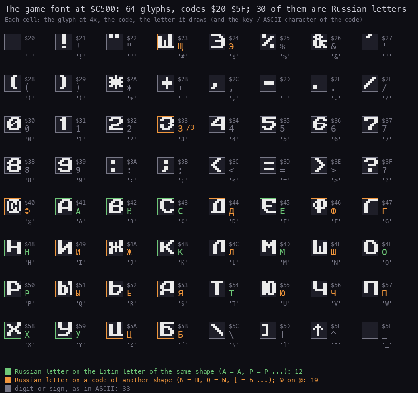

How to read the figure:

- **Each cell** shows the glyph at 4x, its code, the letter it draws, and the character the code has in ASCII.
- **Green**: a Russian letter drawn on the Latin letter of the same shape. There are 12: А В С Е Н К М О Р Т Х У on
  A B C E H K M O P T X Y.
- **Orange**: a Russian letter drawn on a code of another shape. There are 18, and © is on `@`:
  - Д on D, Ф on F, Г on G, И on I, Ж on J, Л on L;
  - Ш on N, Ы on Q, Ь on R, Я on S, Ю on U, Ч on V;
  - П on W, Ц on Z, Б on `[`, Щ on `#`, Э on `$`, З on `3`.
- **Grey**: digits and signs, as in ASCII.
- **The digit 3 is drawn as the letter З.** The two look alike, so the numbers read right.

`python3 tools/fig_text.py font` draws it from `work/images/scl-play-cpu.bin`. The font is a source resource:
[`src/res/game/gfx/font.png`](../src/res/game/gfx/font.png), included as `GameFont` by
[`src/game/font.asm`](../src/game/font.asm).

- **The font is 512 bytes at `$C500-$C6FF`**, glyphs for codes `$20-$5F` (`GameFont`, [11](11-data-reference.md)).
- **Three Russian letters have no glyph.**
  - Й is written И, which shows in "БОЕВОИ", "ЗАДАИТЕ", "ИНТЕРФЕИС" and "НЕИТР.".
  - Ё is written Е.
  - Ъ never occurs.
- **The font has no Latin letters left.** The game prints no English, and a key name made of Latin letters comes
  out Russian: SYM SH becomes "ЯУМ ЯН" (8.3).
- **The authors chose the encoding by shape where they could** (12 letters). The other 18 Russian letters took the
  codes of Latin letters Russian does not need: D, F, G, I, J, L, N, Q, R, S, U, V, W, Z and three signs.

## 8.3 Every string of the game

The 49 strings, in the image's order, decoded. ⟨Y,X⟩ is a position, ⟨a NN⟩ an attribute, ⟨s NN⟩ a size and " / "
the next row. The table gives the text as printed (with the slips) and the English.

### The game menu (`MainMenu` `$C100`)

| Address | Printed | English | Seen |
| --- | --- | --- | --- |
| `$C109` | ⟨a `$46`⟩⟨s `$21`⟩⟨10,1⟩ 0..СТАРТ ИГРЫ | 0..START GAME (double height, yellow) | `tour` 60 |
| `$C128` | / / / 1..КЛАВИШИ | 1..KEYS | `tour` 60 |
| `$C13F` | / / 2..КЕМПСТОН ДЖ. | 2..KEMPSTON J. (joystick) | `tour` 60 |
| `$C159` | / / 3..ИНТЕРФЕИС 2 / / ⟨a `$46`⟩ 4..ЗАДАТЬ КЛАВ. / / 5..ЗАГРУЗКА | 3..INTERFACE 2, 4..DEFINE KEYS, 5..LOAD | `tour` 60 |
| `$C33F`, `$C346` | ⟨a `$46`⟩, ⟨a `$45`⟩ | the colour of options 1-3: cyan (`$45`) for the chosen stick, yellow (`$46`) for the others | `tour` 60, 922 |

### The redefine screen (`RedefineKeys` `$C34A`)

| Address | Printed | English | Seen |
| --- | --- | --- | --- |
| `$C350` | ⟨2,9⟩⟨a `$47`⟩⟨s `$21`⟩ ЗАДАИТЕ КЛАВ. ⟨5,3⟩⟨s `$00`⟩ | SET THE KEYS (ЗАДАЙТЕ without Й) | `tour` 406 |
| `$C40F` | / / ⟨a `$46`⟩ НАЖМ. КЛАВИШУ ⟨a `$45`⟩ | PRESS THE KEY (НАЖМИТЕ shortened) | `tour` 406 |
| `$C382` | ВВЕРХ | UP | `tour` 406 |
| `$C391` | ВНИЗ | DOWN | `tour` 446 |
| `$C3A0` | ВЛЕВО | LEFT | `tour` 486 |
| `$C3AF` | ВПР. | RIGHT (ВПРАВО shortened) | `tour` 526 |
| `$C3BE` | ОГОНЬ | FIRE | `tour` 566 |
| `$C3D0` | ПАУЗА | PAUSE | `tour` 606 |
| `$C3DF` | СБРОС | ABORT (literally RESET) | `tour` 646 |
| `$C3EE` | ВЫГР. | SAVE (ВЫГРУЗКА shortened, literally UNLOAD) | `tour` 686 |
| `$C42B` | (two spaces) ⟨a `$46`⟩ | blanks the name place before a key is given | `tour` 406 |
| `$C472` | ЯУМ ЯН | SYM SH(IFT): the Latin letters S, Y, M, H through the Russian font | `tour` 566 |
| `$C481` | ЕНТЕР | ENTER, spelt in Russian letters | not pressed |
| `$C48F` | К. ШИФТ | C(APS) SHIFT | not pressed |
| `$C4A0` | ПРОБЕЛ | SPACE | not pressed |

### The tape version's leftovers (never printed)

These strings belong to the tape save and load at `$C200-$C30E`. No code jumps there ([05](05-controls.md) 5.7),
so no recording shows them.

| Address | Printed | English |
| --- | --- | --- |
| `$C203` | ⟨22,7⟩⟨a `$45`⟩⟨s `$21`⟩ ВКЛЮЧИТЕ МАГНИТОФОН | SWITCH ON THE TAPE RECORDER |
| `$C26C` | ⟨22,2⟩⟨a `$47`⟩⟨s `$22`⟩ ОШИБКА ВВОДА ! | LOADING ERROR! (literally INPUT ERROR) |
| `$C296` | ⟨22,0⟩⟨a `$45`⟩ ВКЛЮЧИТЕ МАГНИТОФОН / И НАЖМИТЕ ЛЮБУЮ КЛАВ. | SWITCH ON THE TAPE RECORDER AND PRESS ANY KEY |

### The play screen (`$D1C5`, `$D1EB`)

| Address | Printed | English | Seen |
| --- | --- | --- | --- |
| `$D1C5` | ⟨a `$57`⟩⟨0,22⟩ ДЕНЬ: / ЧАС: ⟨22,0⟩⟨s `$21`⟩⟨a `$45`⟩ РАДАР: | DAY:, HOUR:, RADAR: (double height) | `tour` 970 |
| `$D1EB` | ⟨3,22⟩⟨a `$46`⟩ СТАТУС / ИНОП. ЛЮДИ | STATUS; ALIENS (ИНОПЛАНЕТЯНЕ shortened), HUMANS | `tour` 970 |
| (same) | ⟨6,23⟩⟨a `$45`⟩ БАЗЫ / ЭЛЕКТР. / А-БОМБЫ / ФАЗОРЫ / РАКЕТЫ / ПУШКИ / ШАССИ / РОБОТЫ | WARBASES, ELECTR(ONICS), A-BOMBS, PHASERS, MISSILES, CANNONS, CHASSIS, ROBOTS | `tour` 970 |
| (same) | ⟨15,23⟩⟨a `$46`⟩ РЕСУРСЫ / / ⟨a `$44`⟩ ОБЩИЕ / ЭЛЕКТР. / АТОМН. / ФАЗОРЫ / РАКЕТЫ / ПУШКИ / ШАССИ | RESOURCES: GENERAL, ELECTR., NUCLEAR (АТОМНЫЕ shortened), PHASERS, MISSILES, CANNONS, CHASSIS | `tour` 970 |
| `$D29B` | ⟨16,30⟩⟨a `$4E`⟩⟨s `$00`⟩ | where the resource numbers go | `tour` 970 |
| `$D2BB` | ⟨6,22⟩⟨a `$47`⟩ | where the aliens' counts go (column 22) | `tour` 970 |
| `$D2CE` | ⟨6,31⟩ | where the humans' counts go (column 31) | `tour` 970 |
| `$D2DB` | ⟨13,30⟩ | where the humans' robot count goes (two digits) | `tour` 970 |
| `$D2F9` | ⟨2,22⟩⟨s `$00`⟩⟨a `$00`⟩ | `ClearPanel`: the panel's rows 2-23 blanked | `tour` 1942 |
| `$D306` | ten spaces, then the next row | one blank panel row | `tour` 1942 |

### The construction menu (`ConstructionMenu` `$C849`, text `$C8BE`)

| Printed | English |
| --- | --- |
| ⟨s `$22`⟩⟨a `$47`⟩⟨0,3⟩ ЦЕХ ⟨2,2⟩⟨s `$21`⟩ РОБОТОВ | ROBOT FACTORY (literally ROBOTS' WORKSHOP) |
| ⟨a `$45`⟩⟨1,21⟩ ЭЛЕКТРОНИКА ⟨4,21⟩ А-БОМБЫ ⟨7,21⟩ ФАЗОРЫ ⟨10,21⟩ РАКЕТЫ ⟨13,21⟩ ПУШКИ ⟨16,21⟩ АНТИГРАВЫ ⟨19,21⟩ ТРАКИ ⟨22,21⟩ БИПОД | ELECTRONICS, A-BOMBS, PHASERS, MISSILES, CANNONS, ANTI-GRAVS, TRACKS, BIPOD |
| ⟨21,5⟩ ВЫ- ВЫ- / ХОД ПУСК | EX-IT, RE-LEASE (START) |
| ⟨a `$43`⟩⟨2,22⟩ 3 ⟨5,22⟩ 20 ⟨8,22⟩ 4 ⟨11,22⟩ 4 ⟨14,22⟩ 2 ⟨17,22⟩ 10 ⟨20,22⟩ 5 ⟨23,22⟩ 3 | the prices, in magenta: 3, 20, 4, 4, 2, 10, 5, 3 |
| ⟨a `$46`⟩⟨6,0⟩ -- НАЛИЧНЫЕ -- / -- РЕСУРСЫ -- | -- RESOURCES IN HAND -- |
| ⟨a `$44`⟩⟨9,4⟩ ОБЩИЕ ⟨11,0⟩ ЭЛЕКТРОНИКА ⟨12,4⟩ А-БОМБЫ / ФАЗОРЫ ⟨14,3⟩ РАКЕТЫ ⟨15,5⟩ ПУШКИ ⟨16,4⟩ ШАССИ ⟨18,6⟩ ВСЕГО | GENERAL, ELECTRONICS, A-BOMBS, PHASERS, MISSILES, CANNONS, CHASSIS, TOTAL |
| `$CBFF` ⟨18,12⟩, `$CC10` ⟨0,13⟩ | the places of the total and of the robot's picture |

The prices printed here are fixed text, not read from `PartCosts` (`$CAF0`). They agree with it: `03 05 0A 02 04
04 14 03`, from bipod to electronics. Witness: `tour` 1100-1320 (the costs taken and given back, [05](05-controls.md)
5.4).

### The robot's menus

| Address | Printed | English | Seen |
| --- | --- | --- | --- |
| `$A738` | ⟨4,23⟩⟨a `$4D`⟩ ПРЯМОЕ / УПРАВЛ. / / ОТДАТЬ / ПРИКАЗ / / БОЕВОИ / РЕЖИМ / / ОСТАВИТЬ / РОБОТА ⟨17,23⟩⟨a `$20`⟩ ПРИКАЗ | DIRECT CONTROL, GIVE ORDERS, COMBAT MODE (БОЕВОЙ without Й), LEAVE ROBOT; ORDERS (the current one, below) | `tour` 1942 |
| `$A7AD` | ⟨18,23⟩⟨a `$45`⟩ | where the current order's three rows go | `tour` 1942 |
| `$A7D8` | ⟨19,25⟩ | where an order's distance goes | `tour` 4163 |
| `$A820` | ⟨22,23⟩⟨a `$46`⟩ СИЛА ⟨23,25⟩⟨a `$47`⟩ | STRENGTH, then the percent (three digits by `$D401` and "%") | `tour` 1942 |
| `$A977` | ⟨4,24⟩⟨a `$47`⟩ ОТДАТЬ / ПРИКАЗ ⟨a `$4D`⟩⟨7,23⟩ ДЕРЖАТЫ / ОБОРОНУ / / ВПЕРЕД / ?? МИЛЬ / / НАЗАД / ?? МИЛЬ / / ПОИСК И / ЛИКВИД. / / ПОИСК И / ЗАХВАТ | GIVE ORDERS: DEFEND (ДЕРЖАТЬ with Ы for Ь), ADVANCE ?? MILES, RETREAT ?? MILES, SEARCH & DESTROY, SEARCH & CAPTURE | `tour` 1954 |
| `$AA1F` | ⟨5,23⟩⟨a `$4F`⟩ ВПЕРЕД | ADVANCE (the distance menu's title) | `tour` 3921 |
| `$AA32` | ⟨5,23⟩⟨a `$20`⟩ НАЗАД | RETREAT (the distance menu's title, green paper) | not chosen |
| `$AA43` | / ?? МИЛЬ ⟨9,23⟩⟨a `$45`⟩ ВЫБОР / ДИСТАН. ⟨13,24⟩⟨a `$46`⟩ 0 МИЛЬ | ?? MILES, SELECT DISTANCE (ДИСТАНЦИИ shortened), 0 MILES | `tour` 3921 |
| `$AAA7` | ⟨13,23⟩⟨a `$46`⟩ | where the distance count goes | `tour` 3970 |
| `$AAD8` | ⟨4,23⟩⟨a `$4F`⟩ ПОИСК И / ЛИКВИД. ⟨8,24⟩⟨a `$45`⟩ ВЫБОР / ЦЕЛИ ⟨12,23⟩⟨a `$4D`⟩ ВРАЖЕСК. / РОБОТЫ / / ВРАЖЕСК. / ЗАВОДЫ / / ВРАЖЕСК. / БАЗЫ | SEARCH & DESTROY; SELECT TARGET; ENEMY ROBOTS, ENEMY FACTORIES, ENEMY WARBASES | not chosen |
| `$AB54` | ⟨4,23⟩⟨a `$20`⟩ ПОИСК И / ЗАХВАТ ⟨8,24⟩⟨a `$45`⟩ ВЫБОР / ЦЕЛИ ⟨12,23⟩⟨a `$4D`⟩ НЕИТР. / ЗАВОДЫ / / ВРАЖЕСК. / ЗАВОДЫ / / ВРАЖЕСК. / БАЗЫ | SEARCH & CAPTURE (green paper); SELECT TARGET; NEUTRAL FACTORIES (НЕЙТР. without Й), ENEMY FACTORIES, ENEMY WARBASES | `tour` 1990 |
| `$AC06` | ⟨4,23⟩⟨a `$4D`⟩ АТОМНАЯ / БОМБА / / ОГОНЬ / ФАЗОРОВ / / ОГОНЬ / РАКЕТ / / ОГОНЬ / ПУШЕК / / ДВИЖЕ- / НИЕ / / ВЫХОД ИЗ / МЕНЮ | NUCLEAR BOMB, FIRE PHASERS, FIRE MISSILES, FIRE CANNONS, MOVE-MENT, EXIT MENU | `tour` 3688 |
| `$AD88` | ⟨0,27⟩⟨s `$00`⟩⟨a `$57`⟩ | where the day number goes (`ClockPrint` `$AD85`) | `tour` 970 |

The current order under ПРИКАЗ is not an inline string. It is one of nine 3-row entries at `$A848`, each row 8
characters, the entry ended by 0. `$A7AD` places it.

| Entry | Printed | English |
| ---: | --- | --- |
| 0 | СТОЯТЬ И / ДЕРЖАТЬ / ОБОРОНУ | STAND AND DEFEND |
| 1 | ВПЕРЕД / (blank) / МИЛЬ | ADVANCE n MILES (the number goes on the blank row, `$A7D8`) |
| 2 | НАЗАД / (blank) / МИЛЬ | RETREAT n MILES |
| 3 | ЛИКВИД. / ВРАЖЕСК. / РОБОТОВ | DESTROY ENEMY ROBOTS |
| 4 | ЛИКВИД. / ВРАЖЕСК. / ЗАВОДЫ | DESTROY ENEMY FACTORIES |
| 5 | ЛИКВИД. / ВРАЖЕСК. / БАЗЫ | DESTROY ENEMY WARBASES |
| 6 | ЗАХВАТ / НЕИТРАЛ. / ЗАВОДОВ | CAPTURE NEUTRAL FACTORIES |
| 7 | ЗАХВАТ / ВРАЖЕСК. / ЗАВОДОВ | CAPTURE ENEMY FACTORIES |
| 8 | ЗАХВАТ / ВРАЖЕСК. / БАЗ | CAPTURE ENEMY WARBASES |

`tour` shows entry 0 at 1942 (a new robot's order) and entry 1 with "20" at 4163 (after ADVANCE 20 MILES).

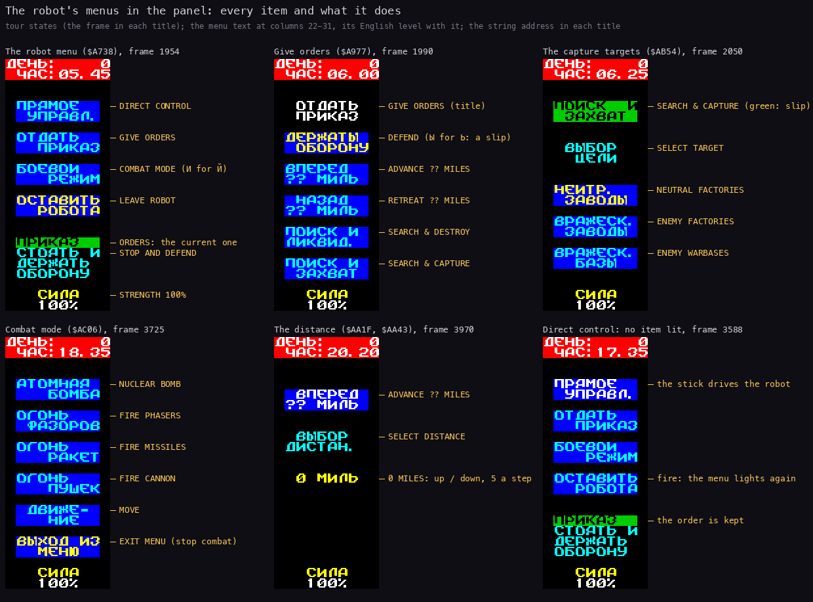

How to read the figure:

- **Each column** is the panel (columns 22-31) of one `tour` state at 2x. The English is level with each item.
- **The titles** give the string's address and the frame.
- **The slips** are marked: Ы for Ь in "ДЕРЖАТЫ", И for Й in "БОЕВОИ", the green paper of "ПОИСК И ЗАХВАТ" (8.5).

`python3 tools/fig_tour.py draw` draws it from `work/docP/tour/states.json`.

## 8.4 The play screen and its panel

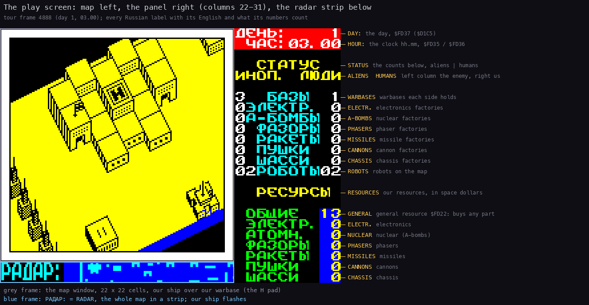

How to read the figure:

- **The screen** is `tour` frame 4888, day 1 at 03.00, at 3x.
- **Every label of the panel** has its English and what its numbers count, level with its row on the right.
- **СТАТУС** (STATUS) holds two columns of counts.
  - The left column (`$D2BB`, column 22) is the aliens', under ИНОП.
  - The right column (`$D2CE`, column 31) is ours, under ЛЮДИ.
  - At this frame the aliens hold 3 warbases and we hold 1. Each side has 2 robots.
- **РЕСУРСЫ** (RESOURCES) holds our seven resources in space dollars, at column 30 (`$D29B`). General is 13 here.
- **The grey frame** is the map window, 22 by 22 cells. The blue frame is the radar strip, rows 22-23.

`python3 tools/fig_tour.py draw` draws it from `work/docP/tour/states.json`.

- **ДЕНЬ: and ЧАС:** are the day and the clock: `Clock` `$FD35` (minutes), `$FD36` (hours), `$FD37` (the day).
  `ClockPrint` (`$AD85`) prints them. `r5` loads a game with `$FD35-$FD37` = 45, 13, 99 and shows day 99 at 13.45
  (stage 3, `work/stage3/NOTES.md`).
- **The panel changes with the mode.**
  - Play shows the status and resources.
  - Landing on a robot clears rows 2-23 (`ClearPanel` `$D2F6`) and prints the robot's menu (8.3).
  - Leaving the robot prints the status again (`$D1E5`).
- **The construction menu takes the whole screen** (8.3, [05](05-controls.md) 5.4).

## 8.5 Slips seen on the screen

The translation was made over existing strings of fixed length. Some slips show on the screen:

- **Attribute `$20` (green paper, black ink) on three titles.** These are "ПРИКАЗ" under the robot menu (`$A738`,
  at (17,23)), "ПОИСК И ЗАХВАТ" (`$AB54`) and "НАЗАД" (`$AA32`). The other titles of the same menus use `$4F` or
  `$47`. `tour` 1942 and 1990 show the green bars.
- **"ДЕРЖАТЫ ОБОРОНУ"** in the orders menu (`$A977`) has Ы for Ь. The order names (`$A848`) spell it right:
  "ДЕРЖАТЬ".
- **"ЛИКВИД. ВРАЖЕСК. ЗАВОДЫ"** (entry 4 at `$A848`) uses the nominative where the genitive "ЗАВОДОВ" belongs, as
  entry 7 has it.
- **Й is И everywhere**, because the font has no Й: БОЕВОИ, ЗАДАИТЕ, ИНТЕРФЕИС, НЕИТР.
- **The key names keep Latin spellings.** "SYM SH" comes out "ЯУМ ЯН" because the font draws S as Я and H as Н.
  "ЕНТЕР" is ENTER spelt in Russian letters.
- **A letter key on the redefine screen shows as the Russian letter on its code.** Q shows as Ы, I as И
  ([05](05-controls.md) 5.2).

## 8.6 The disk module's texts

The disk module (bank 4) prints English in its own 4-pixel font. The
texts are as stored, with the authors' spelling. `!` stands for i in "opt!on", `(` for c in "U (an", `[` for c in
"pea[e", `<` for c in "fun<t!on" and `0` for o in "Als0".

The texts in the module's source, [`src/disk/diskio/diskmod.asm`](../src/disk/diskio/diskmod.asm) (`SaveText1`
to `RuleLine`; the status texts from `NoDiskText` on). Each record is the column, the row, the characters and `$FF`:

```asm
SaveText1:
  DEFM $00,$11,"Wooow ! Whatta cool opt!on ! It'll make U happy (we think);-).."
  DEFM ".",$FF
...
NamePrompt:
  DEFM $00,$14,"Yah, now just enter da filename:",$FF
...
LoadErrorText:
  DEFM $00,$17,"Load error ! (R(etry/(A)bort.",$FF
```

| Address | Text | Shown |
| --- | --- | --- |
| `$C10B` | Wooow ! Whatta cool opt!on ! It'll make U happy (we think);-)... | the save screen, `r2` 7652 |
| `$C14E` | Us!n' '!s opt!on U can save yo chance or just da game position ! | the save screen |
| `$C191` | Don't even try 2 do something 2 catch WG at gluk, 'tis useless ! | the save screen |
| `$C1D4` | Now U (an load da game U've saved b4 ! | the load screen, `r2` 8932 |
| `$C1FD` | Us!n' '!s fun<t!on U'll get a pea[e of joy... | the load screen |
| `$C22D` | Als0 U (an try 2 make s0me d!sk errors :-)... | the load screen |
| `$C25D` | Yah, now just enter da filename: | both screens |
| `$C280` | 64 dashes | a rule |
| `$C718` | No disk ! | no recording |
| `$C724` | Load error ! (R(etry/(A)bort. | no recording (the stored "(R(etry" is a slip for "(R)etry") |
| `$C744`, `$C751` | Loading..., Loading...OK | `r2` 9202, 10602 |
| `$C760` | Loading had errors !!! | no recording |
| `$C779` | File not found ! | no recording |
| `$C78C` | Write protect ! | no recording |
| `$C79E` | Save error ! (R)etry/(A)bort. | no recording |
| `$C7BE` | Cat full ! | no recording |
| `$C7CB` | Disk full ! | no recording |
| `$C7D9`, `$C7E5` | Saving..., Saving...OK | `r2` 7947 |
| `$C7F3` | Saving had errors !!! | no recording |

In English:

- The save screen says: "Wow! What a cool option! It'll make you happy (we think). Using this option you can save
  your chance, or just the game position! Don't even try to do something to catch the WG (the WD1793 disk
  controller) at a glitch, it's useless!"
- The load screen says: "Now you can load the game you've saved before! Using this function you'll get a piece of
  joy... Also you can try to make some disk errors."

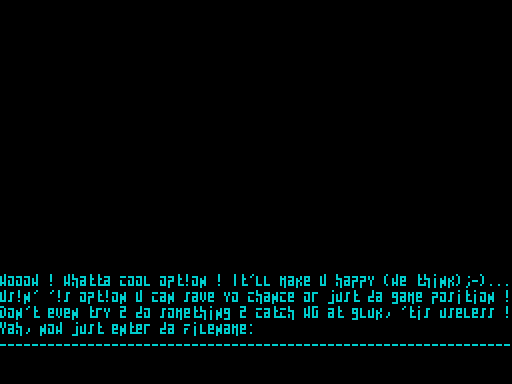

How to read the figure:

- **The screen** is `r2` frame 7652 at 2x: the save screen the moment after key 5 in play.
- **The four lines** are `$C10B`, `$C14E`, `$C191` and `$C25D`, cyan, with the name typed after the last.

`python3 tools/fig_programs.py draw` draws it from `work/docP/r2/samples.bin`.

## 8.7 The boot menu and the help program

The boot program (disk block 5, unpacked to `$6060-$F6D4`) shows the boot menu, then on key 2 the help. Its texts
are typed in two fonts of 4-pixel glyphs, two characters to a byte's width.

- The boot menu is one picture (`BootMenuPicture`, `$A462`): "АДСКАЯ ЗЕМЛЯ" (HELLISH EARTH) over "Advanced Nether
  Earth", and the line "Boot Menu: 1-Game 2-Help 3-NOT used". Keys 1, 2 and 3 run the game, the help and nothing
  of use ([05](05-controls.md) 5.9).
- The help menu is a picture (`HelpMenuPicture`, `$802B`): the title, seven empty bars, a woman with a gun and a
  colour band. `HelpMenu` (`$AAB1`) prints the seven names into the bars (`MenuDescription` `$B7CD` to `MenuExit`
  `$B843`).
- The line under the menu is `MenuCopyright` (`$B84A`): "(C) 1998 ETERNITY INDUSTRY. KOVROV COOL CITY."

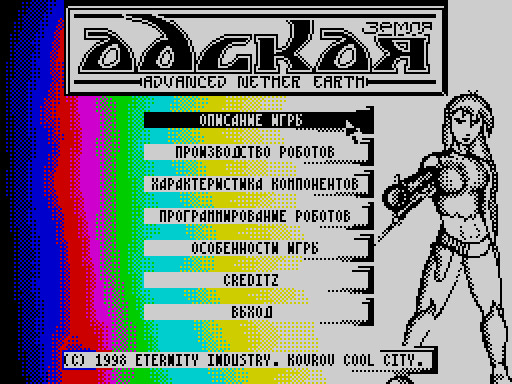

How to read the figure:

- **The screen** is `r1` frame 9079 at 2x, the help menu just after key 2.
- **The seven bars**, top down: Описание игры, Производство роботов, Характеристика компонентов, Программирование
  роботов, Особенности игры, Creditz, Выход.
- **The arrow** at the first bar's right end is the pointer. It starts at x 195, y 55 (`$37C3`, set at `$AA97`);
  the input script has moved it onto the bar with O, then A.

`python3 tools/fig_programs.py draw` draws it from `work/docP/r1/samples.bin`.

The bars in English:

| Bar | English | Pages | Routine |
| --- | --- | --- | --- |
| Описание игры | Game description | 5 | `$AEDB` |
| Производство роботов | Robot production | 4 | `$AF44` |
| Характеристика компонентов | The components' characteristics | 8 | `$AFDD` |
| Программирование роботов | Programming robots | 3 | `$AF9A` |
| Особенности игры | Features of the game | 5 | `$AE67` |
| Creditz | Credits | 3 | `$AE21` |
| Выход | Exit (to the boot menu) | 0 | `$AA8B` |

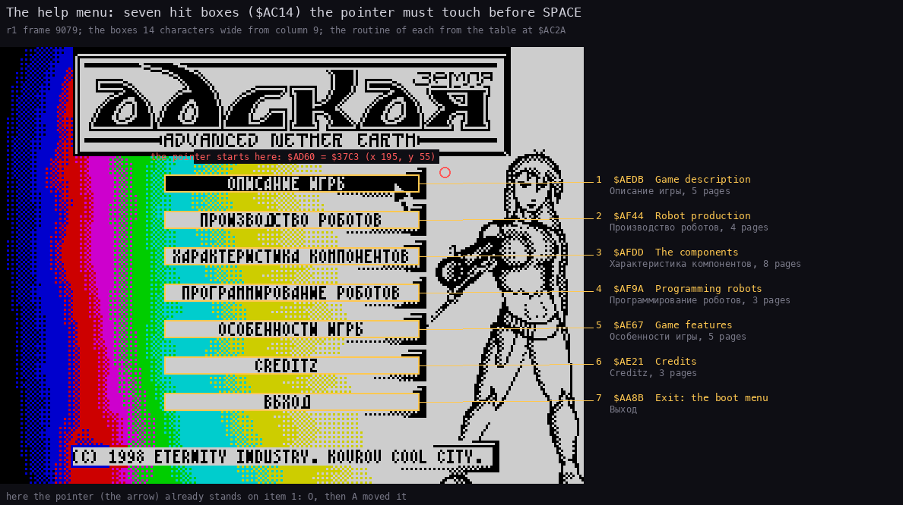

How to read the figure:

- **Each box** is one entry of the table at `$AC14`: columns 9-22, rows 7, 9, ..., 19.
- **The labels on the right** give the bar's English, its routine from `$AC2A` and its page count.
- **The red circle** marks the pointer's start (`$AD60` = `$37C3`). The arrow on bar 1 has been moved there by
  the input script.

`python3 tools/fig_programs.py draw` draws it from `work/docP/r1/samples.bin`.

### The help's two fonts and its Russian

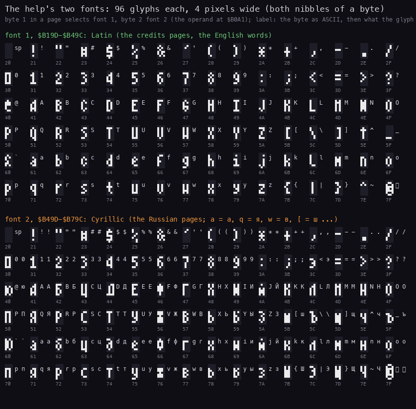

How to read the figure:

- **Font 1** (`$B19D-$B49C`) is Latin. The credits and the English words use it.
- **Font 2** (`$B49D-$B79C`) is Cyrillic. The Russian pages use it.
- **Each label** is the byte as ASCII, then the letter font 2 draws for it.
- **Byte 1** in a page's text selects font 1; **byte 2** selects font 2 (the operand at `$B0A1`).

`python3 tools/fig_text.py helpfont` draws it from the boot program's image (`build/bootmenu/d05-6060.bin`). The fonts
are source resources: [`src/res/bootmenu/fonts/latin.png`](../src/res/bootmenu/fonts/latin.png) and
[`cyrillic.png`](../src/res/bootmenu/fonts/cyrillic.png), included by `src/bootmenu/print.asm`.

The Russian pages are stored as Latin letters that font 2 draws as Cyrillic:

- Lower case: a=а b=б c=ц d=д e=е f=ф g=г h=х i=и j=й k=к l=л m=м n=н o=о p=п q=я r=р s=с t=т u=у v=ж w=в
  x=ь y=ы z=з.
- Signs: `[`=ш `]`=щ `^`=ч `@`=ю `_`=ъ `<`=э.
- Capitals: Latin capitals are Cyrillic capitals; `{`=Ш `}`=Щ `~`=Ч `|`=Э.

The source keeps the texts as UTF-8 in [`src/res/bootmenu/text/`](../src/res/bootmenu/text/) (`menu.txt`,
`description.txt`, `production.txt`, `components.txt`, `programming.txt`, `features.txt`, `credits.txt`;
`tools/bootmenu_res.py` turns them into the authors' codes), and
[`src/bootmenu/texts.asm`](../src/bootmenu/texts.asm) includes them. Each string starts with its font code:

```asm
; "ОПИСАНИЕ ИГРЫ"
MenuDescription:
  INCBIN "res/text/menu.bin",$0000,15
```

### How a page shows

- The routine of a bar unpacks the page's picture (`$68C5`) and types the text under it. A page is one string; the
  authors padded its lines with spaces to 33 characters, and the printer wraps them.
- `$B13A` types one character, then waits a delay loop (`BC` = `$02BC`). A full page of 759 characters takes about
  250 frames.
- SPACE goes back to the menu, while typing or after (`$AAB1`). ENTER or 0 after the typing goes to the next page.
  After the last page the menu comes back.

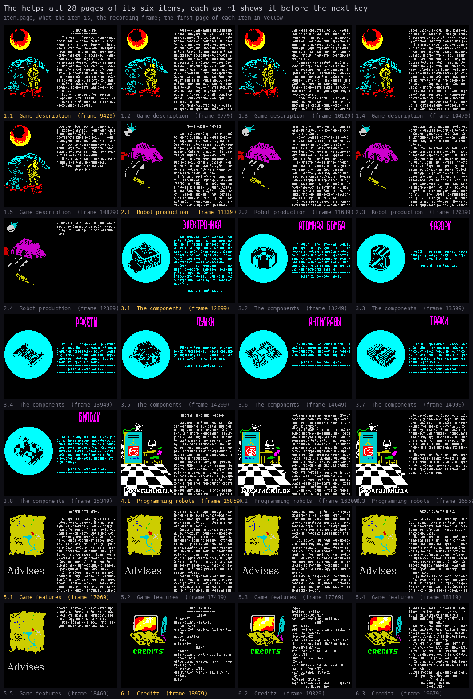

How to read the figure:

- **Each cell** is one help page at 1x, its typing finished.
- **The caption** gives the item, the page, the item's English and the `r1` frame.
- **The first page of each item** has its caption in the accent colour.

`python3 tools/fig_programs.py draw` draws it from `work/docP/r1/samples.bin`.

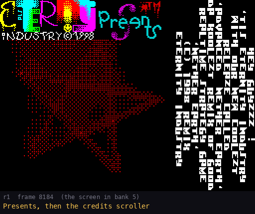

The GIF is `r1` frames 8180-10140, every 8th frame: the boot menu, key 2, the help menu, item 1 and its first pages.
`python3 tools/fig_programs.py draw` makes it.

### Every help page

The Russian is as typed, decoded, with the authors' line breaks and hyphens. The English follows each page as one
paragraph. The page's text address is in the boot program's image.

### Item 1: Описание игры (Game description)

Page 1.1 (`r1` 9429, text at `$C125`):

```text
         ОПИСАНИЕ ИГРЫ
        ---------------
   Тревога !  Гнусные  исигнианцы
посягнули на самое святое для зе-
млянина - на нашу  Землю !  Зная,
что в открытом  бою они  потерпят
поражение,  исигнианцы  применили
новую тактику - завоевание  нашей
планеты должны осуществить  авто-
матические боевые роботы, вершина
их извращенной технической мысли.
Эти роботы собираются в сборочных
цехах, расположенных на специаль-
ном планетоиде, летающем по орби-
те вокруг Земли. На этом же  пла-
нетоиде находятся заводы.  Произ-
водящие компоненты для сборки ро-
ботов ...
   Всего на планетоиде имеется  4
сборочных цеха  (базы),  один  из
которых нам удалось захватить при
неожиданной высадке.
```

GAME DESCRIPTION. Alarm! The vile Isignians have laid hands on what is most sacred to an Earthling: our Earth! Knowing that they would be defeated in open battle, the Isignians have adopted a new tactic. The conquest of our planet is to be carried out by automatic combat robots, the summit of their perverted technical thought. These robots are assembled in assembly workshops on a special planetoid that flies in orbit around the Earth. On the same planetoid stand the factories that produce the components the robots are assembled from... In all the planetoid has 4 assembly workshops (bases), one of which we managed to capture in a surprise landing.

Page 1.2 (`r1` 9779, text at `$C3FD`):

```text
   Однако, дальнейшее продвижение
земных вооруженных сил  оказалось
невозможным. Что же делать ? Надо
воспользоваться захваченным цехом
для сборки своих роботов, которые
должны сокрушить исигнианские за-
воды и базы.  Правительство Земли
изыскивает всевозможные средства,
чтобы помочь Вам, но поставки ко-
мпонентов для сборки роботов бло-
кированы исигнианцами. Однако  не
отчаивайтесь ! Исигнианцы  насто-
лько  продажны,  что коммерческие
директора их военных заводов про-
дадут вам за наличные любые необ-
ходимые компоненты, включая атом-
ные бомбы - только плати! Все,что
для начала закупок удалось  наск-
рести на Земле,  это 20 космодол-
ларов - смехотворно мало при дей-
ствующих ценах.
  Хотя правительство Земли обеща-
ет время от времени  подбрасывать
```

However, any further advance of the Earth's armed forces proved impossible. What is to be done? We must use the captured workshop to assemble our own robots, and they must crush the Isignian factories and bases. The Government of Earth is seeking every means to help you, but the Isignians block the deliveries of robot components. Do not despair, though! The Isignians are so corrupt that the commercial directors of their military factories will sell you for cash any component you need, atomic bombs included: just pay! All that could be scraped together on Earth to start the purchases is 20 space dollars, ridiculously little at the current prices. Although the Government of Earth promises to toss

Page 1.3 (`r1` 10129, text at `$C6F6`):

```text
Вам новые средства, более  надеж-
ным методом добывания нужных ком-
понентов   является  установление
контроля над заводами, производя-
щими такие компоненты.Кстати иси-
гнианцы будут стремиться устанав-
ливать на заводах военное положе-
ние,  чтобы  получать  компоненты
бесплатно.
   Помните, что каждый завод про-
изводит определенный вид компоне-
нта, поэтому при  его захвате  Вы
будете поучать  бесплатно  именно
этот компонент,и Вам придется по-
купать  детали за  наличные!  Для
удобства счета поставляемые  бес-
платно компоненты также  пересчи-
тываются на свою суммарную цену в
космодолларах.
   После старта игры Вы, команду-
ющий силами землян,  оказываетесь
висящим на своем комндирском  ка-
тере  над  захваченным  сборочным
```

you new funds from time to time, a more reliable way to obtain the components you need is to take control of the factories that produce them. By the way, the Isignians will try to impose martial law at the factories so as to get components for free. Remember that each factory produces one kind of component, so when you capture it you will get exactly that component for free, and you will have to buy the [other] parts for cash! For ease of counting, the components delivered for free are also converted into their total price in space dollars. When the game starts you, the commander of the Earthlings' forces, find yourself hovering in your command craft over the captured assembly

Page 1.4 (`r1` 10479, text at `$C9EF`):

```text
цехом-базой. Внизу,  под катером,
Вы можете видеть ее  четкую тень.
Ориентируясь по этой тени,  можно
чувствовать высоту полета катера.
   Ваш катер имеет систему защит-
ных полей, предохраняюших его  от
поражения  любыми видами  оружия.
Однако, и стрелять из-под  защит-
ного поля невозможно, поэтому все
боевые действия будут вести, сде-
ланные Вами роботы. Вы можете то-
лько наблюдать за боем(иногда мо-
жно помешать исигнианским роботам
прдвигаться вперед, приземлившись
на их пути), управлять своими ро-
ботами,  собирать их в  сборочных
цехах и программировать.
   Справа на основном экране игры
выводятся  непрерывно  меняющиеся
соотношения сил землян и исигниа-
нцев в виде количества баз, заво-
дов и изготовленных роботов,а так
же в виде колличества накопленных
```

workshop-base. Below, under the craft, you can see its sharp shadow; by this shadow you can feel the craft's height. Your craft has a system of protective fields that shields it from every kind of weapon. But it is also impossible to fire from under the protective field, so all the fighting will be done by the robots you make. You can only watch the battle (sometimes you can stop Isignian robots advancing by landing in their way), control your robots, assemble them in the assembly workshops and program them. On the right of the main game screen the ever-changing balance of forces of the Earthlings and the Isignians is shown: the numbers of bases, factories and robots built, and also the amount of accumulated

Page 1.5 (`r1` 10829, text at `$CCE8`):

```text
ресурсов. Все ресурсы исчисляются
в  космодолларах.  Контролируемые
Вами заводы будут поставлять  Вам
соответствующие ресурсы,  а конт-
ролируемые исигнианцами - постав-
лять ресурсы исигнианцам.Обе сто-
роны могут так же покупать недос-
тающие ресурсы на  неконтролируе-
мых заводах за наличные.
   Цель игры - захватить или раз-
рушить все базы исигнианцев.
   Задача вполне выполнима.
          Удачи Вам !
```

resources. All resources are counted in space dollars. The factories you control will deliver the corresponding resources to you, and those the Isignians control will deliver them to the Isignians. Both sides can also buy the resources they lack for cash at the uncontrolled factories. The aim of the game is to capture or destroy all the Isignian bases. The task is quite feasible. Good luck!

### Item 2: Производство роботов (Robot production)

Page 2.1 (`r1` 11339, text at `$CE97`):

```text
       ПРОИЗВОДСТВО РОБОТОВ
      ----------------------
   Ваш  сборочный цех  имеет  вид
большого здания, на крыше которо-
го нарисована большая  буква 'Н'.
Эта буква  обозначает  посадочную
площадку для Вашего командирского
катера. Сядьте на нее - и Вы ока-
жетесь внутри сборочного цеха.
   Слева перечислены имеющиеся  у
Вас ресурсы, справа указаны  ком-
поненты, из которых Вы будете со-
бирать роботов.Под названиями ко-
мпонентов стоит их цена.
  Выбирайте необходимые компонен-
ты,  перемещая   курсор клавишами
'ВВЕРХ' и 'ВНИЗ', и соединяйте их
в робота клавишей 'ОГОНЬ'. Созда-
ваемый Вами робот будет собирать-
ся в левом  нижнем  углу  экрана.
Если Вы хотите снять с робота ка-
кой-либо   компонент,   поступите
также, как и при его  установке -
```

ROBOT PRODUCTION. Your assembly workshop looks like a large building with a big letter 'H' painted on its roof. The letter marks the landing pad for your command craft. Land on it and you will find yourself inside the assembly workshop. On the left the resources you have are listed; on the right are the components you will assemble robots from. Under the components' names stands their price. Choose the components you need by moving the cursor with the 'UP' and 'DOWN' keys, and join them into a robot with the 'FIRE' key. The robot you are making is assembled in the bottom left corner of the screen. If you want to take a component off the robot, do as when fitting it:

Page 2.2 (`r1` 11689, text at `$D190`):

```text
укажите его  курсором  и  нажмите
клавишу 'ОГОНЬ', и компонент сни-
мется с робота.
   Робот должен состоять из одно-
го вида  шасси (АШ, ТШ или БШ) и,
по крайнеи мере, одного вида ору-
жия (А, Ф, РУ, АУ). Установка бо-
лее 3-х видов оружия или несколь-
ких одинаковых  видов  оружия  на
одного робота не допускается.
   Живучесть робота прямо пропор-
ционально стоимости шасси и уста-
новленного оружия (не  считая  А-
бомбы).Поэтому для глубокого про-
рыва есть смысл создавать  боевые
башни, несущие фазор,ракеты и пу-
шки,снабженные электроникой и пе-
редвигающиеся на антигравах. Мощ-
ность залпа таких башен столь ве-
лика, что они уничтожают дешевого
робота с первого выстрела.
   В тоже время закреплять успех,
захватывая заводы и охраняя их от
```

point at it with the cursor and press 'FIRE', and the component comes off the robot. A robot must consist of one kind of chassis (АШ, ТШ or БШ: anti-grav, track or bipod chassis) and at least one kind of weapon (А, Ф, РУ, АУ: atomic bomb, phaser, missile launcher, artillery mount). Fitting more than 3 kinds of weapon, or several weapons of one kind, on one robot is not allowed. A robot's toughness is in direct proportion to the cost of its chassis and fitted weapons (the A-bomb not counted). So for a deep breakthrough it makes sense to build battle towers carrying phaser, missiles and cannons, fitted with electronics and moving on anti-gravs. The firepower of such towers is so great that they destroy a cheap robot with the first shot. At the same time, consolidating success, capturing factories and guarding them from

Page 2.3 (`r1` 12039, text at `$D489`):

```text
прорывающихся вражеских  роботов,
могут и дешевые роботы на биподах
с одними пушками, иногда даже без
электроники. Вместо  одной  башни
можно выпустить  4 таких  дешевых
робота.
   Как только робот  собран,  его
можно выпускать на свободу,указав
с помощью курсора пункт  'ВЫПУСК'
в сборочном цеху и нажать клавишу
'ОГОНЬ'. Если  вы  хотите  просто
выйти из сборочного цеха, укажите
таким же образом на пункт 'ВЫХОД'
   Выпущеный робот поедет  в  бок
основного экрана  до упора и  ос-
тановится, ожидая пока вы его  не
запрограммируете. Можно выпускать
не программируя  до  3-х  роботов
подряд, и затем их уже программи-
ровать -  это  будет  значительно
быстрее, чем выпускать их и прог-
раммировать  по-одному.  Помните,
что выпущенного робота уже нельзя
```

breaking-through enemy robots can be left to cheap robots on bipods with cannons alone, sometimes even without electronics. Instead of one tower you can release 4 such cheap robots. As soon as the robot is assembled you can set it free by pointing the cursor at 'ВЫПУСК' (RELEASE) in the assembly workshop and pressing 'FIRE'. If you just want to leave the workshop, point the same way at 'ВЫХОД' (EXIT). The released robot drives to the side of the main screen as far as it can and stops, waiting until you program it. You can release up to 3 robots in a row without programming them and program them afterwards: much quicker than releasing and programming them one at a time. Remember that a released robot can no longer be

Page 2.4 (`r1` 12389, text at `$D782`):

```text
разобрать на детали, он уже рабо-
тает, но делать этот робот ничего
не будет - он еще не запрограмми-
рован !
```

taken apart for parts; it is working, but it will do nothing: it is not programmed yet!

### Item 3: Характеристика компонентов (The components)

Page 3.1 (`r1` 12899, text at `$D808`):

```text
   ЭЛЕКТРОНИКА- мозг роботов.Если
робот будет воевать самостоятель-
но (не в  режиме 'прямого  управ-
ления'), да еще  имея задание ис-
кать что либо  (например, задание
'поиск и захват  вражеских  заво-
дов'), электроника  позволит  ему
действовать более осмысленно.
   Кроме того, электроника  повы-
шает  скорость  защитной  реакции
робота  при  нападении  на   него
вражеского робота.  Однако и  без
электроники робот будет  работос-
пособен.
---------------------------------
      Цена: 3 космодоллара.
---------------------------------
```

ELECTRONICS: the robots' brain. If the robot fights on its own (not in 'direct control' mode), and moreover has a task of looking for something (for example the task 'search and capture enemy factories'), electronics let it act more sensibly. Electronics also raise the speed of the robot's defensive reaction when an enemy robot attacks it. A robot works without electronics too, though. Price: 3 space dollars.

Page 3.2 (`r1` 13249, text at `$DA3B`):

```text
   А-БОМБА - это  атомная  бомба.
При взрыве она разрушает все  ст-
роения и роботов в пределах одно-
го экрана. Она очень  дорогостоя-
щая,поэтому используйте ее только
для выполнения особых задач, нап-
ример для  уничтожения  вражеских
баз или расчистки завалов.
---------------------------------
     Цена: 20 космодолларов.
---------------------------------
```

A-BOMB: an atomic bomb. When it explodes it destroys all buildings and robots within one screen. It is very expensive, so use it only for special tasks, for example to destroy enemy bases or to clear blockages. Price: 20 space dollars.

Page 3.3 (`r1` 13599, text at `$DBA8`):

```text
   ФАЗОР - лучевая  пушка.  Имеет
большую  убойную  силу,   выстрел
проходит через 3 экрана.
---------------------------------
      Цена: 4 космодоллара.
---------------------------------
```

PHASER: a ray gun. Great destructive power; the shot travels through 3 screens. Price: 4 space dollars.

Page 3.4 (`r1` 13949, text at `$DC70`):

```text
   РАКЕТЫ -  спаренная   ракетная
установка. Имеет большую  убойную
силу,при повреждении робота более
50% стреляет одной ракетой, теряя
половину  убойной  силы.  Выстрел
проходит через 3 экрана.
---------------------------------
      Цена: 4 космодоллара.
---------------------------------
```

MISSILES: a twin missile launcher. Great destructive power; when the robot is damaged by more than 50 % it fires one missile, losing half its destructive power. The shot travels through 3 screens. Price: 4 space dollars.

Page 3.5 (`r1` 14299, text at `$DD9B`):

```text
   ПУШКИ - двухствольная артилле-
рийская установка.  Имеет среднюю
убойную силу (как 1 ракета), выс-
трел проходит через 2 экрана.
---------------------------------
      Цена: 2 космодоллара.
---------------------------------
```

CANNONS: a twin-barrelled artillery mount. Medium destructive power (like 1 missile); the shot travels through 2 screens. Price: 2 space dollars.

Page 3.6 (`r1` 14649, text at `$DE84`):

```text
   АНТИГРАВЫ - отличное шасси для
робота.  Имеют высшую скорость  и
проходимость,  проходя над горами
и пропастями. Довольно дороги.
---------------------------------
     Цена: 10 космодолларов.
---------------------------------
```

ANTI-GRAVS: an excellent chassis for a robot. The highest speed and cross-country ability: they pass over mountains and chasms. Rather expensive. Price: 10 space dollars.

Page 3.7 (`r1` 14999, text at `$DF6D`):

```text
   ТРАКИ - гусеничное  шасси  для
робота.Имеет высокую проходимость
проходит через горы, но не прохо-
дит через пропасти. Скорость сре-
дняя и падает в два раза при дви-
жении через горы.
---------------------------------
      Цена: 5 космодолларов.
---------------------------------
```

TRACKS: a caterpillar chassis for a robot. High cross-country ability: it passes over mountains but not over chasms. Medium speed, halved when crossing mountains. Price: 5 space dollars.

Page 3.8 (`r1` 15349, text at `$E098`):

```text
   БИПОД - двуногое шасси для ро-
бота. Имеет низкую  проходимость,
может двигаться только по гладкой
поверхности планетоида.  Скорость
движения  также  довольно  низка.
предназначено для дешевых роботов
и роботов-камикадзе, несущих ато-
мную бомбу.
---------------------------------
      Цена: 5 космодолларов.
---------------------------------
```

BIPOD: a two-legged chassis for a robot. Low cross-country ability: it can move only on the smooth surface of the planetoid. Its speed is rather low too. Meant for cheap robots and for kamikaze robots carrying an atomic bomb. Price: 5 space dollars.

### Item 4: Программирование роботов (Programming robots)

Page 4.1 (`r1` 15859, text at `$E205`):

```text
    ПРОГРАММИРОВАНИЕ РОБОТОВ
   --------------------------
   Выпущенного Вами  робота  надо
запрограммировать, отдав ему при-
каз произвести те или иные дейст-
вия. Для программирования  вашего
робота надо опустить  ваш  коман-
дирский катер прямо ему на  голо-
ву - при этом произойдет  подклю-
чение к его управлению, и на  эк-
ране появится меню программирова-
ния (справа, вместо информации  о
статусе и ресурсах).
  Можно выбрать следующие режимы:
БОЕВОЙ РЕЖИМ - в этом  режиме  Вы
можете непосредственно  управлять
роботом и стрелять из его  оружия
(к сожалению  стрелять  в  ручную
можно только из одного вида  ору-
жия, и при этом приходится стоять
на месте).
ПРЯМОЕ УПРАВЛЕНИЕ - в этом режиме
можно непосредственно   управлять
```

PROGRAMMING ROBOTS. A robot you have released must be programmed by giving it an order to do this or that. To program your robot, lower your command craft right onto its head: this connects you to its controls, and the programming menu appears on the screen (on the right, in place of the status and resources). You can choose the following modes. COMBAT MODE: in this mode you can control the robot directly and fire its weapons (unfortunately by hand you can fire only one kind of weapon, and you have to stand still meanwhile). DIRECT CONTROL: in this mode you can directly control

Page 4.2 (`r1` 16209, text at `$E4FE`):

```text
роботом,а нажатие клавиши 'ОГОНЬ'
позволит покинуть его,  предоста-
вив ему возможность самому  стре-
лять из оружия.
ОТДАТЬ ПРИКАЗ - это и есть собст-
венно программирование. При  этом
робот получает приказ для  самос-
тоятельных действий.  Как  только
Вы покините  робота, он  начинает
выполнять этот  приказ. При  этом
режиме программирования Вам пред-
ложат еще два меню различных при-
казов('СТОЯТЬ И ДЕРЖАТЬ ОБОРОНУ',
'ПОИСК И ЗАХВАТ НЕЙТРАЛЬНЫХ ЗАВО-
ДОВ', 'ПОИСК И ЛИКВИДАЦИЯ ВРАЖЕС-
КИХ ЗАВОДОВ' и т.д.).
ПОКИНУТЬ РОБОТА - при этом Вы за-
канчиваете   программирование   и
предоставляете роботу возможность
действовать самостоятельно,  хотя
и в рамках отданного приказа.
   Внимание: один и тот же приказ
может  иметь  ограниченное  число
```

the robot, and pressing 'FIRE' lets you leave it, letting it fire its weapons by itself. GIVE ORDERS: this is the programming proper. The robot receives an order for independent action; as soon as you leave the robot it starts to carry the order out. In this mode you will be offered two more menus of different orders ('STAND AND HOLD THE DEFENCE', 'SEARCH AND CAPTURE NEUTRAL FACTORIES', 'SEARCH AND DESTROY ENEMY FACTORIES' and so on). LEAVE ROBOT: with this you end the programming and let the robot act on its own, though within the order given. Attention: one and the same order can be held by a limited number of

Page 4.3 (`r1` 16559, text at `$E7F7`):

```text
роботов(обычно не более четырех),
поэтому убеждайтесь перед покида-
нием  робота,  что робот  получил
именно тот приказ, который Вы хо-
тели ему отдать.  Если  робот  не
принимает Ваш приказ,  попробуйте
отдать ему другой,близкий по смы-
слу приказ (еапример, вместо 'ПО-
ИСК И ЗАХВАТ ВРАЖЕСКИХ ЗАВОДОВ' -
'ПОИСК И ЗАХВАТ НЕЙТРАЛЬНЫХ ЗАВО-
ДОВ').
   Примечание: Вы можете перепро-
граммировать ваших роботов в  лю-
бой момент, в том числе и во вре-
мя боя. Однако  помните,  что  во
время программирования робот  аб-
солютно беззащитен.
```

robots (usually no more than four), so make sure before leaving the robot that it has received exactly the order you meant to give. If the robot does not accept your order, try giving it another of similar meaning (for example 'SEARCH AND CAPTURE NEUTRAL FACTORIES' instead of 'SEARCH AND CAPTURE ENEMY FACTORIES'). Note: you can reprogram your robots at any moment, in battle too. But remember that while it is being programmed a robot is completely defenceless.

### Item 5: Особенности игры (Game features)

Page 5.1 (`r1` 17069, text at `$EA2A`):

```text
       ОСОБЕННОСТИ ИГРЫ:
      -------------------
   В  процессе  боя  уничтожаются
роботы обеих сторон. При их  раз-
рушении остаются обломки, затруд-
няющие движение  других  роботов.
Если в одном месте будут последо-
вательно уничтожены 3 робота, го-
ра обломков достигнет такой высо-
ты, что через нее не смогут прое-
хать даже  роботы  на  антигравах
при массированном применении  ро-
ботов (а в серьезных  боях  могут
участвовать до 50 роботов с той и
с другой стороны). Это приводит к
образованию непроходимых завалов,
парализующих боевые действия.
   Для разбора такого завала под-
ведите к нему  робота  с  атомной
бомбой и  взорвите  ее  (вручную,
войдя в боевой режим).Обломки при
этом, скорее всего,не уничтожать-
ся. Они слишком  прочные.  Однако
```

FEATURES OF THE GAME. In battle the robots of both sides get destroyed. Wrecked, they leave debris that hinders the movement of other robots. If 3 robots are destroyed one after another in one place, the pile of debris grows so high that even robots on anti-gravs cannot pass it. When robots are used in mass (and in serious battles up to 50 robots on each side may take part), impassable blockages form and paralyse the fighting. To clear such a blockage bring a robot with an atomic bomb up to it and set the bomb off (by hand, in combat mode). The debris will most likely not be destroyed: it is too strong. But

Page 5.2 (`r1` 17419, text at `$ED23`):

```text
уничтожаться стоящие вокруг  зда-
ния,и на их месте образуются про-
ходы. Чтобы при этом не уничтожи-
лись ваши роботы,  предварительно
отведите их назад.
   Сквозь здания и завалы выстре-
лы не проходят, однако, некоторые
роботы могут  этого не  понимать.
Например, если по разные  стороны
стены встретятся два робота  (ваш
и вражеский), запрограммированные
на 'поиск и уничтожение вражеских
роботов',  они  начнут   стрелять
друг в друга сквозь стену и будут
делать это до тех пор, пока у вас
не лопнет терпение.В таком случае
входите в боевой режим и помогите
вашему роботу.
   Роботы запрограммированные ва-
ми на 'поиск и уничтожение враже-
ских роботов',  могут  вам  очень
навредить,так как открывают огонь
по врагу заранее, не обращая вни-
```

the buildings standing around will be destroyed, and passages will open in their place. So that your robots are not destroyed as well, move them back first. Shots do not pass through buildings and blockages, but some robots may not understand this. For example, if two robots (yours and an enemy) programmed for 'search and destroy enemy robots' meet on the two sides of a wall, they start firing at each other through the wall and keep it up until your patience bursts. Then enter combat mode and help your robot. Robots you have programmed for 'search and destroy enemy robots' can do you much harm, since they open fire at the enemy early, paying no

Page 5.3 (`r1` 17769, text at `$F01C`):

```text
мания на своих  роботов,  могущих
оказаться в на  линии  огня.  При
этом вместо врага они  уничтожают
своих. Старайтесь выпускать таких
роботов первыми или  программиро-
вать этот режим по мере необходи-
мости на роботах,вырвавшихся впе-
ред.
   Все роботы выглядят одинаково,
и по внешнему виду невозможно от-
личить своих от чужих. Однако вз-
гляните на экран радара  -  и  вы
увидите, где находятся ваши робо-
ты. Ваш катер на радаре обозначен
мигающей точкой, точки такого  же
цвета, но горящие постоянно - ва-
ши роботы, а точки другого цвета-
враги.
для того же старайтесь  запомнить
внешний вид и  конструкцию  ваших
роботов. Если вы увидите  робота,
которого  вы  не  выпускали - это
вражеский робот.
```

attention to your own robots that may be in the line of fire; so instead of the enemy they destroy their own. Try to release such robots first, or program this mode as needed on robots that have broken out ahead. All robots look the same, and you cannot tell your own from the others by their looks. But glance at the radar screen and you will see where your robots are. Your craft is marked on the radar by a blinking dot; dots of the same colour lit steadily are your robots, and dots of the other colour are enemies. For the same reason try to remember the look and build of your robots: if you see a robot you did not release, it is an enemy robot.

Page 5.4 (`r1` 18119, text at `$F315`):

```text
      ЗАХВАТ ЗАВОДОВ И БАЗ:
     -----------------------
   Захватить завод очень просто -
достаточно въехать во двор  заво-
да и простоять там около  45 сек.
Таким же  образом   захватываются
вражеские базы.
   На захваченном вами заводе по-
является ваш флаг - флаг с продо-
льной полоской. На  крыше  захва-
ченной вами базы появляется боль-
шая буква 'Н'. Теперь на этой ба-
зе можно собирать своих роботов.
   Вражеские заводы и базы  имеют
сверху серый флажок.  Заводы  без
такого флажка являются  нейтраль-
ными  (работают  на  коммерческих
принципах).
   Трудность при захвате  заводов
и баз только одна - дворики заво-
ов и баз открыты  с  трех  сторон
для выстрелов врага,и продержать-
ся в них нужное время довольно не
```

CAPTURING FACTORIES AND BASES. Capturing a factory is very simple: it is enough to drive into the factory's yard and stand there about 45 seconds. Enemy bases are captured the same way. On a factory you have captured your flag appears: a flag with a lengthwise stripe. On the roof of a base you have captured a big letter 'H' appears, and now you can assemble your robots at that base. Enemy factories and bases have a grey flag on top; factories without such a flag are neutral (they work on commercial principles). Capturing factories and bases has only one difficulty: the yards of factories and bases are open on three sides to enemy fire, and holding out in them for the time needed is not

Page 5.5 (`r1` 18469, text at `$F60E`):

```text
просто. Поэтому захват нужно про-
изводить  двумя  роботами  - один
будет отвлекать и уничтожать вра-
гов, а другой - захватывать.
   Вот, пожалуй, и все,  что  вам
нужно знать для победы. Удачи !
```

easy. So a capture should be made by two robots: one distracts and destroys the enemies, the other captures. Well, that is perhaps all you need to know to win. Good luck!

### Item 6: Creditz

The credits are in English, in font 1, so they need no translation. They run as one text from `$B87A` to `$C100`:
the last page goes on past `$BFFF` into `$C000`, where "Mayhem,X" continues as "L-Design".

Page 6.1 (`r1` 18979, text at `$B87A`):

```text
        TOTAL CREDITZ:
       ----------------
             INTRO:
 Senat/EI:
main coding, criticz.
 Paracels/EI:
grafix, XOR service, fixing, text
 Syrus/EI:
music, criticz.
 D-Man/EI:
main criticz.
            HELP:
 D-Man/EI:
main coding, texts, details scrn.
 Paracels/EI:
title scrn, producing scrn, prog-
ramming scrn.
 Demiurge Ash/EI:
description scrn, credits scrn.
 X-Man:
music.
```

Page 6.2 (`r1` 19329, text at `$BB31`):

```text
 Spy/EI:
testing, criticz.
 Crazy Softvor/EI:
main beta-testing, criticz.
             GAME:
 D-Man/EI:
add  coding, restoring,  packing,
dead end coding.
 Paracels/EI:
final cut coding, menu scrn, fin-
al cut scrn, turbo WG93 control.
 Demiurge Ash/EI:
title scrn, dead end scrn.
 Syrus/EI:
muzak in Dead End.
 X-Man:
main muzak, muzak in Final Cut.
 Crazy Softvor/EI:
main testing, criticz.
 Spy/EI:
testing, criticz.
Tape version was kindly  supplied
        by Melted Snow
```

Page 6.3 (`r1` 19679, text at `$BE2A`, then `$C000` and `$C07D`):

```text
Thanks for moral support &  some-
times   quite   wise  advises  to
all from Eternity Industry !
  AND NOW WE'D LIKE 2 GREET ALL
           OUR PALS:
MegaCode,  Phantom Family,  Cyber
Punks Unity,Virtual Vision Group,
Accept corp., Flash inc., C.I.C.,
Player, Serzh,GAS 13,Melted Snow,
RUSH ISPA, Global Corp.
  BIG HELLO 2 OTHER COOL PEOPLE:
Prestige, Progress, Extreme,Rush,
Virtual Brozerz, Max Petrov, LAV,
X-Trade,Mednonogov, E-Mage,Style,
Mayhem,XL-Design of coz 2 U !
If U want 2 contact with Eter-nity
Industry please write at thenext
address:
601901 Россия, Владимирская обл.,
  г.Ковров, ул. Чернышевского
          д.7, кв.17
       Калинину Дмитрию
```

The page's rows are 33 characters; the block above rejoins the part from `$C000`, whose row breaks fall mid-word in
the store. The address is in font 2: "601901 Russia, Vladimir region, Kovrov, Chernyshevskogo street, house 7, flat 17,
to Kalinin Dmitry". The help writes it without "(D-Man/EI)"; `NETHER+.W` gives the same address with the alias
(8.10).

## 8.8 The intro

The intro runs after the loader, before the boot menu. It has no Russian.

- First the Eternity Industry picture (`r1` 2400-3200).
- Then the "Eternity Industry Presents" logo at the top, a rotating star on the left, and the credits text on the
  right (from `r1` 3600).
- The text is typed down the screen's right columns, a character a frame, 24 characters a column. Ten columns make
  a screen. A screen stays 200 frames, then the columns go black from the right, one a frame, and the next ten come.
- The glyphs lie turned a quarter clockwise, so a column reads top down with the head turned right.
- The 100 lines are ten screens, about 4520 frames. After "N'JOY !!!" the text starts again (`r1` 8000). SPACE
  ends the intro and starts the boot program (`r1` 8202).

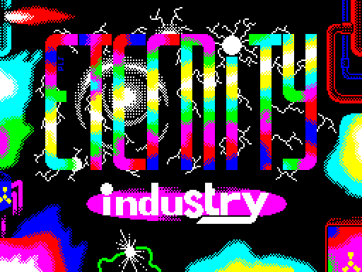

How to read the figure:

- **The screen** is `r1` frame 2800 at 2x: the group's picture, shown before the scroller.

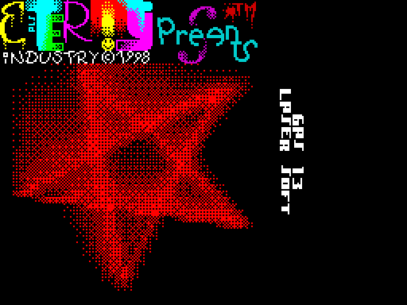

How to read the figure:

- **The screen** is `r1` frame 5200 at 2x.
- **The top** is the "Eternity Industry Presents" logo; **the left** is the star, drawn in dithered red.
- **The two columns on the right** are "GAS 13" and "LASER SOFT", from the greetings, read with the head turned
  right.

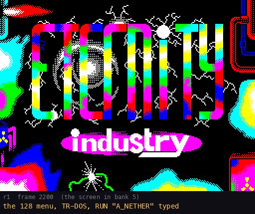

The GIF is `r1` frames 2200-8320, every 40th frame. `python3 tools/fig_programs.py draw` draws the three figures from
`work/docP/r1/samples.bin`.

The scroller's text in full, one row a column, `|` marking the 24-character ends. Its source is
[`src/res/intro/scroller/text.txt`](../src/res/intro/scroller/text.txt) (`ScrollerText`, typed by
[`src/intro/scroller/text.asm`](../src/intro/scroller/text.asm)).

```text
|      HEY GUYZZZ !      |
| 'TIS ETERNITY INDUSTRY |
|  WITH OUR NEW COOLEZT  |
|     RELEAZE CALLED     |
|'ADVANCED  NETHER EARTH'|
|DA KOOLEZT REMIX OF GOOD|
| REALTIME STRATEGY GAME |
|     'NETHER EARTH'     |
|     (C) 1998 REMIX     |
|    ETERNITY INDUSTRY   |
|------------------------|
| DA SMASHED UP CREDITZ: |
|INTRO CODING.......SENAT|
|GFX.............PARACELS|
|MUZAK..............SYRUS|
|VIOLENTLY PACKED...D-MAN|
|MORAL SUPPORT.........EI|
|XOR SERVICE.....PARACELS|
|------------------------|
|GAME CREDZ COMIN' UP--->|
|  CHILLY GAME CREDITZ:  |
|PRODUCED..............EI|
|SUPPLIED.....MELTED SNOW|
|REMIXED............D-MAN|
|PACKED.............D-MAN|
|TESTED.............CRAZY|
|------------------------|
|YAH! IT WAS A LITTLE BIT|
|BORING DOIN' ALL THIS...|
|BUT NOW 'TIS JUST COOOL!|
|  GOOD OLD GREEETZZZ:   |
|       MEGACODE         |
|     PHANTOM FAMILY     |
|   CYBER PUNKS UNITY    |
|  VIRTUAL VISION GROUP  |
|         RUSH           |
|   ACCEPT CORPORATION   |
|       FLASH INC.       |
|         GAS 13         |
|       LASER SOFT       |
|      GLOBAL CORP.      |
|         SERZH          |
|         PLAYER         |
|       MELTED SNOW      |
|        RED LTD.        |
|         MAFIA          |
|       XL-DESIGN        |
|    SLAVA MEDNONOGOV    |
|     VIRTUAL BROZERZ    |
|       MAX PETROV       |
|         MAYHEM         |
|         EXCESS         |
|      JURRASIC SOFT.    |
|        ZOMBUSTERS      |
|          STEP          |
|         EXTREME        |
|         PROGRESS       |
|          ZER0          |
|        EXTASY 3        |
|      AND OZERZ !!!     |
| CRAZY COOMIN' SOON FROM|
|   ETERNITY INDUSTRY:   |
|  MANDARIN COPIER V1.0  |
| RPG 12 MYSTERIOUS BOOKS|
|   NEW ISSUES OF BUZZ   |
|     AND MANY OTHER     |
|    COOLEZT PROJECTS    |
|          !!!           |
|      LOOK FOR IT !     |
|                    --->|
| PLATINUM RELEAZE DATE: |
|    9TH OF MARCH 1998   |
|                        |
| SPECCY RULEZ 4EVER !!! |
|                        |
|   AND NOW              |
|       WE WANNA         |
|            SAY YOU     |
|                        |
|        BYE !!!         |
|************************|
|***                  ***|
|******    ****    ******|
|***       ****       ***|
|********  ****  ********|
|          ****          |
|   ******************   |
|       (C) 1998         |
|    ETERNITY INDUSTRY   |
|    KOVROV COOL CITY!   |
|                        |
|                        |
|                        |
|     PRESS 'SPACE'      |
|                        |
|         AND            |
|                        |
|       N'JOY !!!        |
|                        |
|                        |
```

The text is English with the authors' spelling ("COOLEZT", "CREDITZ", "GREEETZZZ", "COOOMIN'"). In plain words:

- **The release**: "Hey guys! This is Eternity Industry with our new coolest release called Advanced Nether Earth,
  the coolest remix of the good real-time strategy game Nether Earth. (C) 1998 remix Eternity Industry."
- **The intro's credits**: intro coding Senat; graphics Paracels; music Syrus; "violently packed" D-Man; moral
  support EI; XOR service (the UltraXOR protection) Paracels.
- **The game's credits**: produced by EI; supplied by Melted Snow; remixed and packed by D-Man; tested by Crazy.
- **A remark**: "Yeah! It was a little bit boring doing all this, but now it's just cool!"
- **The greetings**: 29 groups and people, from MegaCode to Extasy 3, "and others!!!".
- **Coming soon from Eternity Industry**: Mandarin Copier v1.0, the RPG "12 Mysterious Books", new issues of the
  magazine Buzz, and many other projects.
- **The date**: "Platinum release date: 9th of March 1998. Speccy rulez forever!"
- **The end**: "And now we want to say to you: bye!!!", the letters EI drawn in asterisks, "(C) 1998 Eternity
  Industry, Kovrov Cool City!", "Press 'SPACE' and enjoy!!!".

## 8.9 The endings

The game ends in one of two programs ([05](05-controls.md) 5.10). Both were reached by a poke in an experiment:
`lose` sets `PlayerBuildings` (`$FD3A`) to 0, `win` sets `EnemyBuildings` (`$FD42`) to 0.

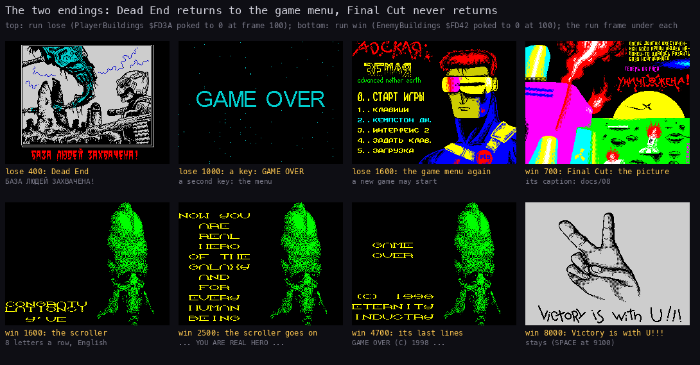

How to read the figure:

- **The top row** is the run `lose`: Dead End's picture (400), "GAME OVER" after a key (1000), the game menu after a
  second key (1600).
- **The bottom row** is the run `win`: Final Cut's picture with its caption (700), the scroller (1600, 2500), its last
  lines (4700) and "Victory is with U!!!" (8000).
- **The run frame** is under each screen, with what the screen holds.

`python3 tools/fig_tour.py draw` draws it from `work/docP/lose` and `work/docP/win`.

### Dead End: the loss

| Text | English | Where |
| --- | --- | --- |
| БАЗА ЛЮДЕЙ ЗАХВАЧЕНА! | THE HUMANS' BASE IS CAPTURED! | in red under the picture of a robot over a warbase |
| GAME OVER | GAME OVER | cyan, on a star field, after a key |

A second key returns to the game menu.


The GIF is the run `lose` from 20 frames before the poke to its end, every 20th frame. `python3 tools/fig_tour.py draw`
makes it.

### Final Cut: the win

The picture of the burning alien base carries a Russian caption, read from the screen (it is part of the picture):

> После долгих ожесточенных боёв армии людей наконец-то удалось разбить базу исгинианцев. Теперь их раса
> уничтожена!

In English: "After long fierce battles the human army has at last managed to smash the base of the Isginians.
Now their race is destroyed!" The caption writes "исгинианцев"; the help writes the name "исигнианцы" (8.7).

Then the scroll: an alien beside the text, the screen flipping between a green and a magenta alien every frame. The
text is 8 characters a row in a 16 x 16 font, scrolled up a pixel line a frame. It is `ScrollText` (`$645C`, 167 rows
of 8 characters, then 0) in Final Cut's image; its source is
[`src/res/endings/text/scroll.txt`](../src/res/endings/text/scroll.txt), one row a line, included as `ScrollText` by
[`src/endings/finalcut/fcmain.asm`](../src/endings/finalcut/fcmain.asm):

```text
CONGRATU
LATIONS!

  Y'VE

 FINALY

DESTRO-
     YED

 THOSE

 STINKY

ISIGNIA-
    NTS!

AND NOW

 YOUR

 NATIVE

 PLANET

  AND

 NATION

  ARE

 FREE !

NOW YOU

  ARE

  REAL

  HERO

 OF THE

 GALAXY

  AND

  FOR

 EVERY

 HUMAN

 BEING

  ALL

  OVER

  THE

 WORLD !

LOOSERS-

ISIGNIA-
     NTS

  ARE

COWARDLY

RUNNING

  BACK

TO THEIR

 DIRTY

 PLANET

AND NOW

  YOU

  CAN

 BREATH

  DEEP

  AND

 ACCEPT

  FROM

  THE

THANKFUL

 PEOPLE

A LITTLE

  GIFT

  FOR

 GIVING

  THEM

FREEDOM!

  GAME

  OVER

(C) 1998

ETERNITY

INDUSTRY
```

Runs of empty rows are shortened to one here; the file keeps them all. In plain English: "Congratulations! You've finally destroyed those
stinky Isignians! And now your native planet and nation are free! Now you are the real hero of the galaxy and of
every human being all over the world! The losers, the Isignians, are cowardly running back to their dirty planet,
and now you can breathe deep and accept from the thankful people a little gift for giving them freedom! Game over.
(C) 1998 Eternity Industry."

The last picture is a hand making the V sign with "Victory is with U!!!" (Victory is with you). It stays: Final Cut
never returns to the game.

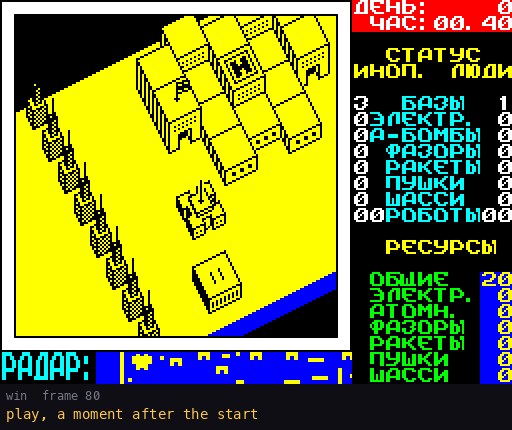

The GIF is the run `win` from 20 frames before the poke to 5400 frames after it, every 40th frame.
`python3 tools/fig_tour.py draw` makes it.

## 8.10 The file NETHER+.W

`NETHER+.W` is a text file on the disk. No program reads it: it is meant to be read in a disk tool or a text
viewer. The disk stores it in CP866 with CR LF; the repo keeps it as UTF-8 in
[`src/res/text/nether-plus-w.txt`](../src/res/text/nether-plus-w.txt), and `tools/mkdisk.py` writes it back.

It opens with ASCII art: the "Eternity Industry" logo, "Proudly presents", "Realtime strategy game", the word
"ADVANCED" in block letters and the line "A D V A N C E D   N E T H E R   E A R T H". The art is in the file and is
not repeated here.

### НЕМНОГО ИСТОРИИ (A LITTLE HISTORY)

```text
   Для начала  хотелось бы немного  рассказать о  создании  этой
игрушки. Кто не хочет читать эту нудную историю, советую пролис-
тать следующий абзац.
   Примерно года 3-4 назад (сейчас уже не припомню точно), когда
у меня был Spectrum 48К (конечно же с любимыми всеми нами кассе-
тами), один  мой  знакомый  притащил мне кассету с новыми игруш-
ками. И вот начался долгий и утомительный процесс загрузки  всех
игрушек. А грузили мы,  сейчас  скажу  с  чего - моно-магнитофон
"Электроника  М327". Много  мы  всякой дури  просмотрели, и  тут
увидели скромную игру, которая была руссифицированна и не  имела
точного названия; помню:Базик-заголовок назывался NETHER  и все.
И вот с этого дня мы все просто затащились от этой игры,  играли
в нее до отупения. Но  вскоре этот  самый знакомый  продал  свой
комп,а у меня как на зло,запоролась кассета с этой замечательной
игрой (ну не мне Вам говорить как порятся кассеты). Потом ко мне
попала версия на английском языке и вот тогда-то я узнал  полное
название. Но почему то не записал-ее мне хотелось на русском(вот
дурак !). И как-то я про нее забыл.
   И вот когда у меня уже появился 128-й Pentagon  с дисководом,
естественно, и я немного поумнел, ко мне в руки  попала ломанная
дисковая версия данной игры. Она была настолько изуродована, что
не подлежала никакому восстановлению. В ней все отгрузки состоя-
ний были занулены, а вместо них поставлены RET'ы; игра ОЧЕНЬ си-
льно глючила, так что не было никакого желания ее  переделывать.
Да хочется сказать, что эту версию делал наш местный  ковровский
хакер.
   Немного позже этот же хакер (не буду называть его имени)  вы-
пустил еще одну версию этой игры. Эта версия оказалась еще глюч-
нее предыдущей,хотя там были сделаны отгрузки состояний на диск.
Но для чего ? Они совсем не работали. Мы конечно же сообщили  им
(это некая хакерская группа) о глюках, но как мне кажется они не
собираются их признавать и ничего переделывать не будут.
   Мы решили-так дело не пойдет- надо что-то делать. Не позволим
издеваться над нашей любимой  игрой. Но, чтобы  самим начать пе-
ределывать  эту  игру , нам  нужна  была , боле-менее , нормаль-
ная кассетная версия. И вот начались долгие поиски,т.к. с ломан-
ным дерьмом мне не хотелось иметь дела. И вот вскоре Melted Snow
у себя на кассетах нашел ту самую руссифицированную версию  этой
игры. Нашей радости не было  предела, и мы тут же начали  работу
над ней. И вот теперь Вы можете видеть плод наших стараний.
```

In English:

- To begin with, the author would like to tell a little about how this game was made. Whoever does not want to read
  the boring story should skip the next paragraph.
- About 3-4 years ago (he no longer remembers exactly), when he had a Spectrum 48K with cassettes, a friend brought
  a cassette of new games. They loaded them all on a mono tape recorder "Elektronika M327". Among much rubbish they
  found a modest Russian-language game with no exact title: the BASIC header was just NETHER.
- From that day they were hooked and played it until they were dazed. Soon the friend sold his computer, and the
  author's cassette with the game went bad. Later he got the English version and learned the full title, but did
  not keep it: he wanted it in Russian ("what a fool!"). Then he forgot about it.
- When he had a 128K Pentagon with a disk drive, a cracked disk version came to him. It was so mangled that it
  could not be restored: all the state loads were zeroed and replaced by RETs, and the game glitched badly. A local
  Kovrov hacker had made it.
- Later the same hacker (he will not name him) released another version. It was even buggier, though it had state
  saves to disk; they did not work at all. The authors told the group about the bugs, but it seems they will
  neither admit them nor fix anything.
- "We decided: this will not do, something must be done; we will not let our favourite game be mocked." To remake
  it they needed a more or less normal tape version, and they did not want to touch the cracked rubbish. Soon
  Melted Snow found on his cassettes that very Russian version. Their joy was boundless, and they started work at
  once. "And now you can see the fruit of our efforts."

### ЧТО ЖЕ НОВОГО ПОЯВИЛОСЬ (WHAT IS NEW)

```text
   Итак, что же нового появилось в данной  версии игры. Как  Вы,
наверное, уже успели заметить появилась прекрасная графика, т.е.
заставочная и менюшная картинки, а также красивый final cut и не
менее красивый dead end :-(. Это стало возможным благодаря Demi-
urge Ash'у и Paracels'у - нашим great  gfx maker'ам, за  что  им
огромное спасибо !
   Также появилась прекрасная музыка на AY'шку,  за что  спасибо
X-Man'у и Syrus'у/EI.
   Сделаны НОРМАЛЬНЫЕ load/save процедуры. За что говорю  огром-
ное спасибо Paracels'у за его TURBO WG_DRIVER. Кстати этот драй-
вер обрабатывает всевозможные ошибки, возникающие при  работе  с
диском !
   Исправлены некоторые баги, которые  были найдены  в  процессе
работы над игрой.
   Я решил не делать никаких cheat'ов,т.к. эту игруху очень лег-
ко  пройти. Вот однажды мы  сели  поиграться в  тестовую  версию
"Advanced Nether Earth'a"  и прошли ее,  выпустив  всего 2 или 3
робота (!), так что cheat, я думаю, здесь ни к чему.
```

In English:

- New in this version: fine graphics, that is the title and menu pictures, a beautiful Final Cut and an equally
  beautiful Dead End ":-(". Thanks to Demiurge Ash and Paracels, "our great gfx makers".
- Fine AY music, thanks to X-Man and Syrus/EI.
- NORMAL load/save procedures, thanks to Paracels for his TURBO WG_DRIVER. This driver handles every error that can
  arise when working with the disk.
- Some bugs found while working on the game are fixed.
- No cheats: the game is very easy to finish. Once they sat down to play a test version and won it releasing only
  2 or 3 robots, "so I think a cheat is of no use here".

The claims are checked against the code in [01](01-game-design.md) (section 1.13).

### THAKS WORLD ! (THANKS, WORLD!)

```text
   Хочу сказать огромное спасибо всем тем, кто всячески  помогал
мне в создании этой игры.
   Во-первых, спасибо тем, кто эту игру сделал. К моему великому
сожалению я не знаю кто же все-таки создал этот  шедевр, но  все
равно спасибо !
 - Спасибо Melted Snow за предоставленную кассетную версию.
 - Спасибо Spy и Crazy за бета тестинг.
 - Спасибо Paracels за прекрасную графику, Turbo WG-Drive  и  за
   то, что вечно ходил вокруг и всячески надоедал мне.
 - Спасибо Demiurge Ash за не менее крутую графику.
 - Спасибо Senat за навороченную интруху.
 - Спасибо Syrus за крутую музыку.
 - Спасибо X-Man'у за не менее крутую музу.
 - Ну как же не сказать спасибо себе (кроме самого себя никто не
   скажет) за то, что все-таки  хватило  терпения  доделать  эту
   игру до конца.
```

In English:

- A big thank-you to everyone who helped make the game.
- First, thanks to those who made the game itself: "to my great regret I do not know who created this masterpiece,
  but thanks all the same!"
- Thanks to Melted Snow for the tape version; to Spy and Crazy for beta testing; to Paracels for the fine graphics,
  the Turbo WG-Drive, "and for always walking around and pestering me"; to Demiurge Ash for equally cool graphics;
  to Senat for the fancy intro; to Syrus for cool music; to X-Man for equally cool music.
- "And how could I not thank myself (nobody else will) for having the patience to finish this game after all."

### The credits, the software and the greetings

These parts are in English, with Russian words in three places:

```text
                     Full, Total Creditz.
                    ----------------------

Whole project organized by D-Man from Eternity Industry.

ИНТРУХА:
■■■■■■■■
Senat/EI         - Intro coding.
Syrus/EI         - Cool muzak.
Paracels/EI      - graphics, some code, fixing, text.

HELP:
■■■■■
D-Man/EI         - Main  coding,  texts,   debuged,  screens  in
                   "Характеристика компонентов", Main screen.
Paracels/EI      - Screns in "Пройзводство роботов", "Программи-
                   рование роботов",  "Особенности  игры",  Menu
                   screen, Main screen, debuged.
Demiurge Ash/EI  - Screens in "Описание игры" & "Credits",  cri-
                   tics, logo "Адская Земля" in Menu screen.
Crazy/EI         - Testing, mistakes debuged, critics.
X-Man            - Muzak.

GAME:
■■■■■
D-Man/EI         - Add coding, disked, remixed, debuged, packed,
                   Dead End coding & all other things.
Paracels/EI      - Menu  screen, Final Cut  screen with exploded
                   plant & "Victory with U!", critics,  debuged,
                   Load/Save procedures (full WG'93 control),Fi-
                   nal Cut coding.
Demiurge Ash/EI  - Title screen, screen in Dead End, critics.
Syrus/EI         - Small muzak in Dead End.
Crazy/EI         - Testing, critics.
X-Man            - Muzak in game, muzak in Final Cut.

                        Software Used:
                       ----------------

                   Alasm 3.8c & 3.9 (by Alem)
                   STS 5.1 & 6.2 (by Stalker)
           Xas 9.06+ & 7.432 (by Max Petrov & Creator)
                Art Studio 128+ (by J.Hutchby)
            Maxsoft Screen Packer v1.3 (by MaxSoft)
                      ASC v?.?? (by ASC)
                Pro Tracker 2.4 (by GDC & PhF)
                   Pro Tracker 3.1a (by GDC)
                 Hrum v3.5i (by Dmitry Pyankov)

                          Helloes:
                         ----------
```

- "ИНТРУХА" is slang for "the intro". The help screens are named by their Russian bar names (8.7); "Пройзводство"
  there is a slip for "Производство". "Адская Земля" is "Hellish Earth", the logo of the menu pictures.

The greetings follow:

```text
Ну а теперь пришло время для приветов (куда мы без них):
Сначала приветы всем нашим друзьям:

Kovrov: Melted Snow, Father Michael;

Vladimir: MegaCode/Extreme (Exploder, Sat, Tox, Snake & Scar);

Voronezh: Virtual Vision Group (Rom Corp. & others);

Tcheboksary: Phantom Family (Andrew FER & others.);

Gomel: RUSH (Kvazar & others);

Novosibirsk: Flash inc. (Fikus & others.);

Armavir: Accept Corp./Mafia PC (M.O.T.,Phantom Lord & others);

Tchaikovsky: C.I.C. (J, Y & others);

Rybinsk: Auryn Group/Cyber Punks Unity (Elf & others.);

Yoshkar-Ola: Red Ltd. (Glen & others);

Krasnodar: GAS 13;

Obolensk: Laser Software (Mr.Z, Mitchell & others);

Stary Oskol: Global Corp. (Dr. Max, KUM,Andy First,Alex Kerman);

Velikie Luki: Player & others;

Shadrinsk: Serzh & others.;


А теперь приветы всем тем, кто внес свой большой вкалад в разви-
тие Speccy:

Extreme, Progress, Prestige, Rush, Code Busters, Mayhem,Aliance,
Antaress & other coolest unifications of best speccy people.

                        Contact Adress:
                       -----------------

Для тех, кто хочет с нами связаться, оставляю свои координаты:

             601901 Владимирская обл., г.Ковров,
                ул.Чернышевского, д.7, кв. 17,
                Калинин Дмитрий (aka D-Man/EI)

────────────────────────────────────────────────────────────────
Last Release Date: 9th of March  1998                     D-Man,
                                              Eternity Industry,
                                               Kovrov Cool City.
```

In English:

- "And now it is time for the greetings (where would we be without them). First, greetings to all our friends:"
  then fifteen towns with their groups and people, from Kovrov to Shadrinsk.
- "And now greetings to all those who made a big contribution to the development of the Speccy:" ("вкалад" is a
  slip for "вклад"), then Extreme, Progress, Prestige and others.
- "For those who want to contact us, here are my details:" 601901, Vladimir region, Kovrov, Chernyshevskogo
  street, house 7, flat 17, Kalinin Dmitry (aka D-Man/EI).
- "Last release date: 9th of March 1998. D-Man, Eternity Industry, Kovrov Cool City."

## 8.11 Design notes

- **One printer, one font in play.** Every game text goes through `PrintInline` with inline control codes. The
  Russian fits a 64-glyph font by putting letters on Latin codes. The cost is the missing Й, Ё and Ъ, so some words
  are spelt with И and Е (8.5).
- **The help is a separate program with its own fonts.** Its 4-pixel fonts give 64 characters a row of space but it
  uses 33-character rows, typed slowly under a picture. Its Cyrillic font has Й and Ъ, unlike the game's.
- **Texts in pictures.** The boot menu's lines, Dead End's caption and Final Cut's caption are drawn in their
  pictures, so they cannot be changed as text. The help menu's bar names are text, printed into the bars.
- **English for the extras.** The intro, the credits, the disk module, Final Cut's scroller and "Victory is with
  U!!!" are English in the demo-scene style, while the game and the help are Russian.
- **Spelling of the enemy.** The help says "исигнианцы", Final Cut's caption "исгинианцев", Final Cut's scroller
  "ISIGNIANTS".
- **Kept for editing.** The game's texts and font, the help's texts and fonts, the intro scroller's text, Final
  Cut's scroll text and `NETHER+.W` are build inputs in `src/res/`. The build makes the disk from them and checks it
  byte for byte.
