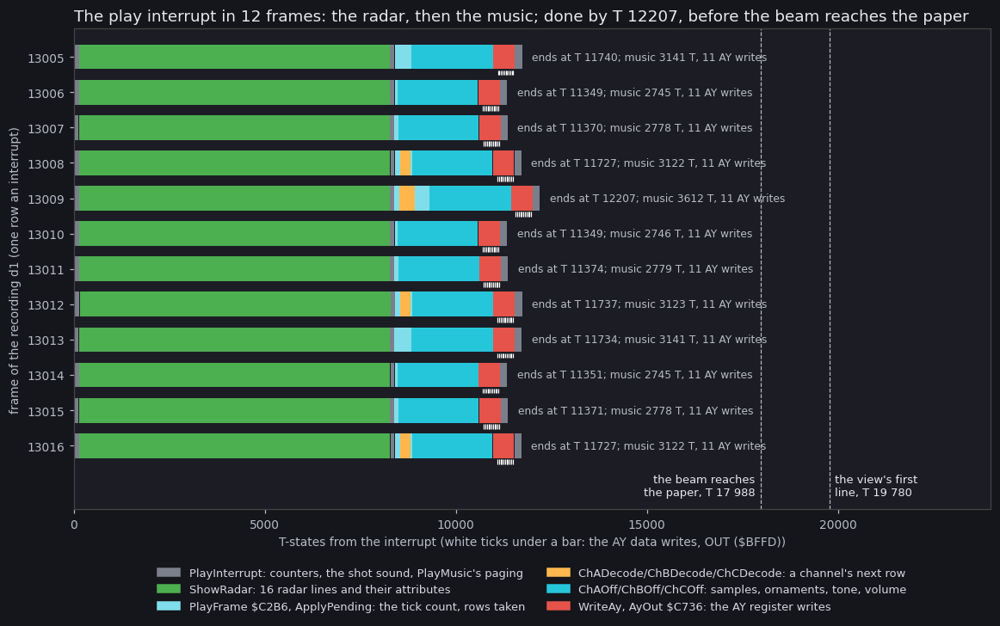
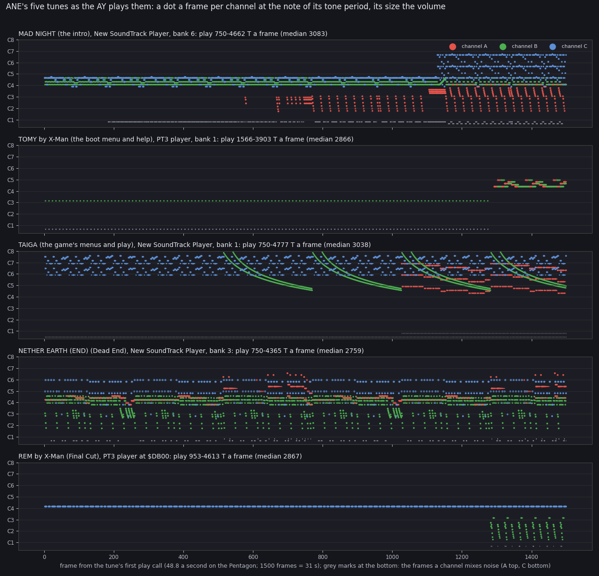
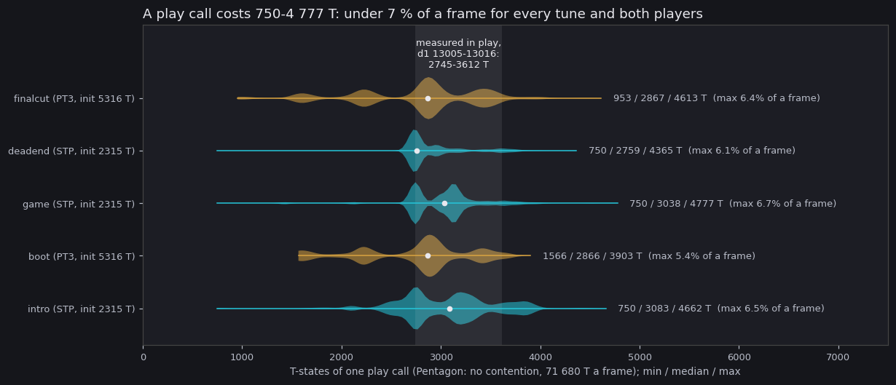

# 09. Sound

Advanced Nether Earth has two kinds of sound.

- **AY music**: five tunes, played by two compile players, one frame of music per interrupt.
- **Beeper effects** in the game: the shot sounds in the play interrupt and the menu beeps.

| Tune | Composer | Player | Where it lives | Plays in | Interrupt |
| --- | --- | --- | --- | --- | --- |
| MAD NIGHT (15.02.98) | Syrus | New SoundTrack Player | intro image `$7D2D`, copied to bank 6 `$C000` | the intro, Presents, the scroller | `LoaderInterrupt` `$6161` |
| TOMY | X-Man | PT 3 Player v1.0 | bank 1 `$C000`, the tune at `$CE21` | the boot menu, the help | the boot program's `$6060` |
| TAIGA (1997) | X-Man | New SoundTrack Player | bank 1 `$C000`, the tune at `$CA45` | the game menu, the construction menu, play | `MusicInterrupt` `$6780`, `PlayMusic` `$67B1` |
| NETHER EARTH (END) | Syrus | New SoundTrack Player | bank 3 `$C000`, the tune at `$CA45` | Dead End | `$FDFD` (bank 3) |
| REM | X-Man | PT 3 Player v1.0 | Final Cut's image `$8BF5`, run at `$DB00` (bank 7), the tune at `$E921` | Final Cut | `$6060` of Final Cut |

Silent moments: the title picture while the disk loads, the game blocks unpacking, the three title cards, the disk
module (all under the ROM's IM 1, chapter 04.4).

Evidence:

- The players and tunes are built from source, byte for byte (`src/music/*.asm`, `tools/build_music.sh`).
- `tools/ay_play.py` runs each player on SkoolKit's Z80 simulator, frame by frame, and logs every AY write and the
  T-states of every call. The players touch no ROM and no other port, and the Pentagon has no contended memory, so
  the run is exact.
- d1 (chapter 04) measures the music inside the play interrupt; its L1 counts every player call.

## 9.1 The AY on the Pentagon

- The AY is clocked at 1.75 MHz. A tone period P gives 1 750 000 / (16 P) Hz.
- Register select: port `$FFFD`. Data: port `$BFFD`.
- The frame is 71 680 T (48.83 Hz), so a tune plays 2.3 % slower than on a 50 Hz machine. All seconds below are
  Pentagon seconds.

## 9.2 New SoundTrack Player

`src/music/stp-player.asm`: "New SoundTrack Player by PHANTOM FAMILY'1996".

- It is the compile player of Pro Tracker 2.40, Phantom Family's version of Golden Disk's Pro Tracker 2.
- ZXTune knows it as "Pro Tracker v2.40 Phantom Family player" (the same first 28 bytes, player size `$A45`).
- ANE holds three copies, all assembled at `$C000`: TAIGA (bank 1), NETHER EARTH (END) (bank 3), MAD NIGHT (bank 6).
- After the player: `TuneLength` (`DW`, at `$CA43`), then the tune at `Tune` `$CA45`.

The entries:

<!-- snippet: StpEntries -->
From `src/music/stp-player.asm`:

```asm
Init:
    LD    hl,Tune
    JR    InitAt
Play:
    JP    PlayFrame
```

- `Init` (+0) starts the tune at `Tune`; it leaves the AY silent and interrupts on.
- `Play` (+5) plays one frame. Every handler calls `$C005`.

### The module

The tune is a Pro Tracker 2 module compiled for its address (`tools/music_ptmodule.py`):

- the header: the delay, the position count, the loop position, 32 sample and 16 ornament pointers, the pattern
  table pointer, the name;
- the position list (pattern numbers x 3, `$FF` at the end);
- the pattern table (three channel pointers a pattern);
- the channels' data, the samples (length, loop, 3 bytes a tick), the ornaments (length, loop, a note offset a
  tick).

The sample, ornament and channel pointers are absolute. Only the pattern table pointer stays an offset, which
`InitAt` adds.

A channel's data is a byte stream:

| Bytes | Meaning |
| --- | --- |
| `$E1-$FF` | a sample |
| `$E0` | note off |
| `$80-$DF` | a note |
| `$70` | an empty row |
| `$7F` | envelope off |
| `$71-$7E` | an envelope type, + 2 |
| `$60-$6F` | an ornament |
| `$20-$5F` | rows to skip |
| `$10-$1F` | a volume |
| `$0F` | the speed, + 1 |
| `$0E` | glissando, + 1 |
| `$0D` | portamento, + 3 |
| `$0C` | glissando off |
| `$01-$0B` | noise, + 1 |
| `$00` | the pattern's end (channel A only) |

### A frame

The player is self-modifying.
A channel's state lives in the operands of its own tick code (`ChAOff`, `ChAPos`, `ChASample` ...): the label is
the instruction, +1 or +2 its operand.

`PlayFrame` `$C2B6` reads the rows in turns:

- on tick 3 of a row: channel A's row (`ChADecode` `$C47B`);
- on tick 2: channel B's (`ChBDecode` `$C59F`);
- on tick 1: channel C's (`ChCDecode` `$C6A6`), then `ApplyPending` `$C312` takes A's and B's staged changes;
- so all three channels change on the same tick, though the decoding is spread over three frames;
- every frame: the three channels' ticks (`ChAOff` `$C123`, `ChBOff` `$C1A2`, `ChCOff` `$C224`): the sample line,
  the ornament, the slide, the volume (`VolumeTable` `$C906`) and the tone (`NoteTable` `$C846`).

<!-- snippet: PlayFrame -->
From `src/music/stp-player.asm`:

```asm
PlayFrame:
    XOR   a
    LD    b,a
    EX    af,af'
TickCount:
    LD    a,$03                         ; ticks left in this row
    DEC   a
    LD    (TickCount+1),a
    JR    z,PlayRowC
    DEC   a
    JR    z,PlayRowB
    DEC   a
    JP    nz,ChAOff
    LD    hl,ChARows
    DEC   (hl)
    JP    p,ChAOff
ChARowReload:
    LD    (hl),$00                      ; +1 the rows to skip after each row
ChAPattern:
    LD    de,$0000                      ; channel A's next row
    LD    a,(de)
    AND   a
    CALL  z,NextPosition
    CALL  ChADecode
    LD    (ChAPattern+1),de
    LD    (ChANewNote),a
    JP    ChAOff
PlayRowB:
    LD    hl,ChBRows
    DEC   (hl)
    JP    p,ChAOff
ChBRowReload:
    LD    (hl),$00
ChBPattern:
    LD    de,$0000
    CALL  ChBDecode
    LD    (ChBPattern+1),de
    LD    (ChBNewNote),a
    JP    ChAOff
PlayRowC:
    LD    hl,ChCRows
    DEC   (hl)
    JP    p,ApplyPending
ChCRowReload:
    LD    (hl),$00
ChCPattern:
    LD    de,$0000
    CALL  ChCDecode
    LD    (ChCPattern+1),de
```

Then `WriteAy` `$C2A7` sends the register copies (`AyToneA` .. `AyEnvShape`, `$CA09-$CA16`).

- It jumps through `AyOutVector`, whose operand `Init` sets to `AyOut` `$C736`.
- `AyOut` writes registers 13 down to 0 when a new envelope shape was set this row, else 10 down to 0.
- The writes are unrolled `OUT (C),A` / `OUTD` pairs: `OUTD` decrements B first, so B = `$BF` + 1 reaches `$BFFD`.
- `AyOutSwapBC` `$C7A9` is a variant with channels B and C swapped; nothing switches it on.

<!-- snippet: StpWriteAy -->
From `src/music/stp-player.asm`:

```asm
WriteAy:
    LD    hl,AyEnvShape
    LD    de,$FFBF
    LD    c,$FD
    XOR   a
    OR    (hl)
    LD    a,$0D
AyOutVector:
    JP    $0052                         ; AyOut (AyOutSwapBC never)
```

<!-- snippet: AyOut -->
From `src/music/stp-player.asm`:

```asm
AyOut:
    JP    nz,AyOutFrom13
    SUB   $03
    LD    hl,AyVolumeC
    JP    AyOutFrom10
AyOutFrom13:
    LD    b,d
    OUT   (c),a
    LD    b,e
    OUTD 
    DEC   a
    LD    b,d
    OUT   (c),a
    LD    b,e
    OUTD 
    DEC   a
    LD    b,d
    OUT   (c),a
    LD    b,e
    OUTD 
    DEC   a
```



This is chapter 04's figure, read for the player:

- The four music colours are the player's parts: pale cyan `PlayFrame` / `ApplyPending`, orange a channel's row
  decode, cyan the channels' ticks, red the AY writes.
- The orange part moves through the frames: A's row, then B's, then C's with `ApplyPending`, every third frame.
- The white ticks under each bar are the AY data writes: 11 a frame without a new envelope shape, 14 with one.
- The music costs 2 745-3 612 T a frame in d1 13005-13016.
- Drawn by `python3 tools/fig_interrupt.py --trace work/docR/d1/traces/13005_0-13017_0.uatr --out docs/img/loop/interrupt-frames.png`.

## 9.3 PT 3 Player v1.0

`src/music/pt3-player.asm`: "PT 3 Player v1.0 by Nick of GDC", the compile player of Pro Tracker 3.x.

- Two copies: the boot music at `$C000` (TOMY at `$CE21`) and Final Cut's at `$DB00` (REM at `$E921`).
- The copies differ only in the high bytes of their addresses.
- The module follows the player at +`$E21` (`Pt3Module`).
- The start must be a multiple of 256: the tables sit at page offsets the code relies on.

<!-- snippet: Pt3Entries -->
From `src/music/pt3-player.asm`:

```asm
@Pt3Init:
    LD    hl,Pt3Module
    JR    InitModule
@Pt3PlayEntry:
    JP    Pt3Play
@Pt3StopEntry:
    JP    Pt3Stop
PlayerId:
    DB " PT 3 Player v1."
    DB "0 by Nick of GDC"
    DB $20
```

- `Pt3Init` (+0) sets the module up: every pointer in the module is an offset, which `InitModule` turns into an
  address. It returns with interrupts off.
  - TOMY: UltraXOR's sector reader calls it after bank 1 is read.
  - REM: Final Cut calls `$DB00`.
- `Pt3Play` (+5) plays one frame. It uses SP as a data pointer, so it must run with interrupts off (it does, from
  the handlers).
- `Pt3Stop` (+8) silences the AY.

A frame:

1. The three channels' ticks: sample line, volume, noise and envelope offset, mixer, ornament, tone + slide.
2. `WriteAy`: registers 0-12 from a block at a page start (L = the register number), 13 only for a new envelope
   type.
3. The pattern reading, spread over three frames by `RowFrame`: A's row two frames before the row, B's one frame
   before, C's on the row's frame; the staged A and B changes run right after C's decode.
   - So the player needs a delay of 3 or more.

A bug is kept in the source: channel B's on-off effect (effect 5) writes the low byte of `ChBOnOffJp`, making a `JP`
to itself. No tune of ANE uses that effect on channel B.

## 9.4 The tunes



How to read it:

- One row per tune, its first 1 500 frames (31 s) from its first play call.
- A dot is one frame of one channel whose tone is on and whose volume is above 0: red A, green B, blue C.
  - Height: the note of the tone period (C1-C8).
  - Size: the volume; envelope frames at full size.
- Grey marks under a row: the frames where a channel mixes noise (A top, C bottom).
- The title of a row gives its player and its cost a frame (min-max, median).
- Drawn by:
  - `/Volumes/TB4-4Tb/Projects/Test/unreal-ng/scratch/venv-skoolkit/bin/python tools/ay_play.py --load FILE@ADDR --init ADDR --play ADDR+5 --frames 25000 --out work/docR/ay/TUNE.json` for each tune (the files in the table below);
  - `python3 tools/fig_tunes.py --ay work/docR/ay --frames 1500 --out-tunes docs/img/sound/tunes.png --out-cost docs/img/sound/player-cost.png`.

| Tune | `ay_play.py --load` | Init, play | Loops |
| --- | --- | --- | --- |
| intro, MAD NIGHT | `build/music/intro-music-bank6.bin@C000` | `C000`, `C005` | every 11 388 frames (233 s), from frame 578 |
| boot, TOMY | `build/music/d04-c000-bank1.bin@C000` | `C000`, `C005` | every 8 960 frames (183 s) |
| game, TAIGA | `build/music/music-c000-bank1.bin@C000` | `C000`, `C005` | every 5 120 frames (105 s), from frame 6 915 |
| deadend, NETHER EARTH (END) | `build/music/dead-end-music-c000.bin@C000` | `C000`, `C005` | every 768 frames (15.7 s) |
| finalcut, REM | `build/music/final-cut-music-8bf5.bin@DB00` | `DB00`, `DB05` | every 12 800 frames (262 s), from frame 3 833 |

- The jsons in `work/docR/ay/` were first made from the raw images the build now replaces; the runs from
  `build/music/` give the same registers and T-states (checked for intro, game and finalcut over 3 000 frames).
- The loop column is the first frame from which the 14 registers repeat with that period (`ay_play.py summary`).

What it shows:

- MAD NIGHT opens with a held drone on B and C, then channel A comes in near frame 580;
  at about 1 150 C jumps up an octave and A plays falling arpeggios.
- TOMY starts with one quiet held note on B for 1 290 frames (26 s), then the melody on A and B. Few players hear
  that part: the boot menu is usually left sooner.
- TAIGA has a fast arpeggio on C throughout and long falling glissandi on B (the green curves).
- NETHER EARTH (END) is a full arrangement on all three channels and loops after 15.7 s, so a player who waits at
  Dead End hears it many times.
- REM holds one note on C for the first 1 280 frames, while Final Cut shows the burning base for 1 280 frames.

Listen, rendered by unreal-ng from the machine state (Pentagon 128, one AY-3-8910 at 1.75 MHz, ABC stereo; one
pass and a fade each; [audio/README.md](audio/README.md), `tools/render_audio.py`):
[MAD NIGHT](audio/mad-night.mp3), [TOMY](audio/tomy.mp3), [TAIGA](audio/taiga.mp3),
[NETHER EARTH (END)](audio/nether-earth-end.mp3), [REM](audio/rem.mp3); the boot menu's sample on key 3:
[sample.mp3](audio/sample.mp3).

## 9.5 The cost of a frame of music



How to read it:

- One row per tune: the spread of the T-states of all its play calls (the json's frames), min / median / max on the
  right.
- Cyan: New SoundTrack Player. Gold: PT 3 Player.
- The light band: what d1 measured inside the play interrupt (2 745-3 612 T).
- Drawn by the `fig_tunes.py` command above.

| Tune | Min | Median | Max | Init |
| --- | --- | --- | --- | --- |
| intro | 750 | 3 083 | 4 662 | 2 315 |
| boot | 1 566 | 2 866 | 3 903 | 5 316 |
| game | 750 | 3 038 | 4 777 | 2 315 |
| deadend | 750 | 2 759 | 4 365 | 2 315 |
| finalcut | 953 | 2 867 | 4 613 | 5 316 |

- The cheapest frames (750 T) are the STP's pauses: no channel sounds.
- The dearest are the frames where a row is decoded and a new envelope is written.
- At most 6.7 % of a frame. In play that is the whole music budget: about 30 000 T of a 716 800 T turn (4.2 %,
  chapter 04.5).
- The music's place in the frame moves the view copy and so the tear (chapter 04.5).

## 9.6 The beeper effects

The game's two beeper routines toggle bit 4 of port `$FE`, with the border kept black.
Both run with interrupts on, so the interrupt cuts a gap into each tone.
Neither ran in any recorded window: everything here is from the code, with the Pentagon's timings (no contention).

### SoundEffect: shots, hits, explosions

`PlayInterrupt` steps `SoundFx` (`$FD53`) every frame after the music and calls `SoundEffect` `$D5C4` while it is
not 0.

<!-- snippet: SoundEffect -->
From `src/game/interrupts.asm`:

```asm
SoundEffect:
  JP M,NoiseSound         ; $80-$FF: the noise
  LD B,A                  ; B = the delay between pulses
  INC A                   ; A + 2 ...
  INC A                   ; ... the divisor
  LD HL,$01F4             ; C = about 500 / (A + 2) pulses
  LD E,A                  ; DE = A + 2
  LD D,$00                ; (D = 0)
  LD C,$00                ; C counts
  XOR A                   ; no borrow into the first SBC
PulseCountLoop:
  INC C                   ; one more pulse
  SBC HL,DE               ; 500 - n (A+2)
  JR NC,PulseCountLoop    ; until it goes below 0: C = 500 / (A+2) + 1
  LD HL,$0000             ; the ROM as noise
PulseLoop:
  PUSH BC                 ; keep the delay and the count
  LD A,(HL)               ; a ROM byte
  INC HL                  ; the next
  AND $10                 ; its bit 4: the speaker
  OUT ($FE),A             ; the speaker level (border black)
PulseDelay:
  DJNZ PulseDelay         ; wait B x 13 T
  POP BC                  ; the delay and the count back
  DEC C                   ; one pulse less
  JR NZ,PulseLoop         ; the next pulse
  XOR A                   ; speaker off
  OUT ($FE),A             ; (port $FE)
  RET                     ; this frame's burst is over
NoiseSound:
  LD B,$1E                ; 30 levels
NoiseLoop:
  CALL Random             ; a random byte
  AND $10                 ; its bit 4: the speaker
  OUT ($FE),A             ; the level
  DJNZ NoiseLoop          ; 30 times
  RET                     ; this frame's crackle is over
```

| `SoundFx` | Set by | Frames | Sound |
| --- | --- | --- | --- |
| 1, then 2 .. `$7F` | a shot fired (`$B709`) | 126 | a falling burst: A = the value |
| `$FC` | a miss | 3 | noise |
| `$FA` | a hit | 5 | noise |
| `$C8` | a robot destroyed | 55 | noise |

- A tone burst of value A: C = 500 / (A + 2) + 1 pulses, each 13 A + 63 T long.
  - Each pulse sets the speaker to bit 4 of the next ROM byte from `$0000`: a rough noise sampled at the pulse
    rate.
  - A = 2: 126 pulses of 89 T, about 11 214 T, plus 3 906 T to count them: about 15 100 T.
  - A = 40: 13 pulses of 583 T, about 7 000 T.
  - So the burst gets sparser and lower as A counts up: a falling sweep over 126 frames (2.6 s).
- A noise value: 30 calls of `Random`, each setting the speaker to bit 4 of the random byte.
- It runs inside the interrupt, after the music, at about T 12 000. A 15 000 T burst ends near T 27 000: into the
  paper's time, but it writes no screen byte (chapter 04.4).

### Beep: the menu sounds

`Beep` `$CCAC` plays 256 half-periods of a square wave; A is the half-period's delay.

<!-- snippet: Beep -->
From `src/game/construction.asm`:

```asm
Beep:
  PUSH BC                 ; kept
  LD B,A                  ; B = the half-period delay
  XOR A                   ; C = 0: 256 toggles
  LD C,A                  ; C = 0
BeepLoop:
  PUSH BC                 ; keep the delay and the count
  XOR $10                 ; flip the speaker bit
  OUT ($FE),A             ; the speaker (bit 4), border 0, MIC 0
BeepDelay:
  DJNZ BeepDelay          ; the half-period
  POP BC                  ; B = the delay, C = the count
  DEC C                   ; one toggle done
  JR NZ,BeepLoop          ; 256 toggles: 128 periods
  POP BC                  ; BC back
  RET                     ; done
```

- A half-period is 13 A + 50 T.

| A | Used for | Half-period | Tone | Length |
| --- | --- | --- | --- | --- |
| `$14` | a click (construction menu) | 310 T | 5 645 Hz | 79 360 T, 1.1 frames |
| `$64` | a part accepted | 1 350 T | 1 296 Hz | 345 600 T, 4.8 frames |
| `$78` | refused, taken back; a robot menu choice | 1 610 T | 1 087 Hz | 412 160 T, 5.75 frames |
| `$C8` | a long low beep | 2 650 T | 660 Hz | 678 400 T, 9.5 frames |
| `$FA` | a load error (`LoadBad`) | 3 300 T | 530 Hz | 844 800 T, 11.8 frames |

- The game stops while a beep plays: `Beep` is a busy loop.
- Each interrupt inside the beep plays its music frame (and the radar in play), which leaves a gap of 3 000-12 000 T
  in the tone every 20.5 ms: a slight buzz on the long beeps.

Listen: [`$14` click](audio/sfx-cursor-click.mp3), [`$64` part accepted](audio/sfx-part-accepted.mp3),
[`$64` item chosen](audio/sfx-item-chosen.mp3), [`$78` refused](audio/sfx-part-refused.mp3),
[`$78` order given](audio/sfx-order-given.mp3), [START ROBOT chirp + `$C8`](audio/sfx-robot-start.mp3), and with the
music under them: [the construction menu in play](audio/construction-menu-in-play.mp3). SoundEffect: [a shot fired
in play](audio/sfx-cannon-shot.mp3); from `SoundFx` set in a snapshot: [the full sweep](audio/sfx-fire-sweep.mp3),
[miss](audio/sfx-miss.mp3), [hit](audio/sfx-hit.mp3), [kill](audio/sfx-kill.mp3). The `$FA` beep is not rendered:
no run reaches it.

## 9.7 The intro's envelope that never sounds

The intro calls `IntroAyEnvelope` `$66A4` once a frame for 192 frames, after the first 576 frames of the logo.

<!-- snippet: IntroAyEnvelope -->
From `src/intro/intro/intromain.asm`:

```asm
IntroAyEnvelope:
  LD BC,$FFFD             ; AY register select
  LD A,$08
  OUT (C),A
  IN A,(C)                ; the volume as the player left it
  CP $0F
  RET NZ                  ; not 15: kept
  INC A                   ; 16: the envelope's level
  LD B,$7F                ; meant as the AY data port $BFFD, but C = $FD: this
                          ; is $7FFD (bug)
  OUT (C),A
  RET
```

- Its comment says it switches channel A to the envelope when the player has set A's volume to 15: write 16 to
  register 8.
- But the write goes to port `$7FFD`, not to the AY.
  - B = `$7F` with C = `$FD` addresses `$7FFD`, the 128K paging port. The AY data port is `$BFFD`.
- d1's L1 shows it:
  - the routine runs 192 times, frames 2761-2952;
  - its `RET NZ` falls through 49 times (A's volume was 15);
  - the code after it writes port `$7FFD` and no AY port.
- So the AY never gets the envelope. Instead `$7FFD` = `$10`: bank 0 paged, screen 5 shown, the 48 ROM.
  - Screen 5 holds the decorated logo, which the intro shows only later.
  - The loader's next interrupt writes `BANKM` back (`$18`, screen 7), so the effect lasts at most the rest of that
    frame.
- What the TV showed in those 49 frames is not recorded: `kit/screen_shot.py` reads screen 5 at `$4000`, whichever
  screen is shown.

## 9.8 Design notes

- **Bought, not written.** Both players are the trackers' own compile players, used as they come; the game only
  calls `$C000` and `$C005`.
- **One call a frame everywhere.** Every handler (the loader's, the boot program's, the game's two, Dead End's, Final
  Cut's) pages the tune's bank, calls the play entry and pages back. The cost is 750-4 777 T a frame.
- **The decoding is spread.** Both players decode one channel's row a frame, so no frame pays for three rows.
- **Silence while the screen is busy.** The title picture, the title cards and the disk module run under IM 1 with
  no music at all.
- **The beeper is for events.** Shots and menu choices use the beeper, so they never disturb the AY tune.

## 9.9 What no recording reached

- `SoundEffect` and `Beep`: no call in d1's L1; the numbers above are from the code.
- The boot menu and the help were not traced: TOMY's cost is the simulator's, and r1's L1 shows its 11 597 calls.
- The screen shown during the intro's 49 stray `$7FFD` writes (9.7).
