# 10. Gameplay logic

Advanced Nether Earth is a war of production between the humans (the player) and the Insignians (the computer).

- Each side starts with warbases and 20 general resource.
- A day of game time pays out per building owned.
- Robots built from parts capture more buildings.
- The player never fights directly: the robots walk, look, shoot and capture on their own, steered by orders.
- The enemy uses the same robots, the same costs and the same capture rule. Its commander is a few lines of random
  choices (`EnemyCommander` `$B7F4`).
- A side with no warbase left has lost. A won game runs Final Cut from bank 6, a lost one Dead End from bank 3.
- A game can be saved to the disk and loaded back, with no checksum.

Evidence:

- the code, read in the game image (`work/mkgame/original.bin`, banks 5, 2, 0 as the CPU sees them in play) at the
  addresses named; the labels are those of the annotations of the game's source (`src/game/`);
- `work/docL/deep`: the bot's game, 36009 frames (11.9 game days) from stage 3's game-menu snapshot, Kempston, on a
  Pentagon 128 (10.12). The bot is `tools/ane_bot.py play --record`.
  - L1 counts and times (`work/docL/deep/l1.json`).
  - TTD `memory_at` pictures of banks 5, 2 and 0: every 10th frame (`work/docL/cache/deep10.npz`) and every frame
    of 22300-22919 (`deep-fight.npz`), taken by `tools/fig_events.py sample`. The instance was only read.
- my experiments on an own instance (`work/docL/live`, port base 14710), replayed from snapshots of
  `work/docL/deep` with pokes where a caption says so (10.12): the nuclear blast, the capture of a destroyed base,
  both game ends;
- stage 3's recordings of the original SCL (`work/stage3/NOTES.md`): `r2` the disk save and two loads, `r3` Dead End,
  `r4` Final Cut, `r5` a damaged saved game. Their frames are recording frames.

A turn's picture in the live experiments is the memory of the frame before the clock `$FD35` moves, with the screen of
the frame after it. The game logic is deterministic per turn: with the ship parked above the robots' tops, the same
game replays in turns, only shifted in frames.

## 10.1 The start of a game

The game block's depacker ends with `JP $A5DA`. From there:

1. `GameEntry` `$A5DA`: interrupts off, SP = 0, bank 1 paged, `MusicStart` (`$D8E1`, bank 1's start-up code: the
   title cards), bank 0 again. It runs once.
2. `Restart` `$A5EF`: every later restart comes here too (the abort key I in play, and the paths no longer run).
   - Interrupts off, SP = 0; bank 1's `PlayerInit` (`$C000`) starts the tune from its beginning; bank 0 again.
   - `ImTable`: 257 bytes of `$69` at `$6800`-`$6900`, `ImJump` `$6969` = `$C3` (JP), `ImHandler` `$696A` =
     `MusicInterrupt` `$6780`, I = `$68`, IM 2.
   - The random seed `$FD00`-`$FD03` = `$39`, `$30`, `$39`, `$30`.
   - `MainMenu` `$C100`: the game menu with its picture (`MenuPicture` `$67E5` runs bank 3's drawing code at `$E73B`)
     and the tune. Key 0 returns Z: a new game. Key 5 loads a game from the disk and does not return here (10.10).
     The keys are in [5.2](05-controls.md#52-the-game-menu-and-the-redefine-screen).
3. `NewGameSetup` `$A62D` with Z:
   - zero the robot records `$DA00`-`$DCFF`, the variables `$FD04`-`$FDFC`, `Buildings` `$FF01`-`$FFC9` and
     `Shots` `$D7D3`-`$D7FF`;
   - the view at column 0, the ship at (17, 10) on the ground, 3 turns of auto-climb;
   - 20 general resource for each side (`Resources` `$FD22`, `EnemyResources` `$FD4A`);
   - `BuildMap` `$BC6F`: the map, the bases and the buildings.
4. `EnterPlay` `$A68E`: the play screen, `ImHandler` = `PlayInterrupt` `$D566`.
5. `PlayLoop` `$A69A`: one game turn a pass, for ever (10.2).

<!-- snippet: Restart -->

From `src/game/start.asm`:

```asm
Restart:
  DI                      ; no interrupts while the table is built
  LD SP,$0000             ; SP = 0
  LD A,$11                ; bank 1
  LD BC,$7FFD
  OUT (C),A
  CALL PlayerInit         ; the player: the tune from its start
  ...
  LD A,$C3                ; the JP at $6969: every vector lands on ImHandler
  LD (ImJump),A
  LD HL,MusicInterrupt    ; MusicInterrupt: the tune plays while the menu runs
  LD (ImHandler),HL
  LD A,$68                ; I = $68: the vectors are read from ImTable
  LD I,A
  IM 2
```

In `work/docL/deep` play begins at frame 60 (the handler is `PlayInterrupt` from there). At frame 120:

- both sides have 20 general and nothing else;
- our warbase (point 0) has its door at (22, 9) and its pad at (22, 5); the enemy's three at (261, 8), (369, 8) and
  (494, 8);
- the 24 factories (points 4-27) are neutral;
- the ship is at (17, 10).

<!-- snippet: NewGameSetup -->

From `src/game/start.asm`:

```asm
NewGameSetup:
  JR NZ,EnterPlay         ; NZ: a loaded game, nothing to set up
  ...
  LD A,$14                ; 20 general resource for each side
  LD (Resources),A            ; Resources+0, our general resource
  LD (EnemyResources),A            ; EnemyResources+0, the enemy's general resource
  CALL BuildMap           ; build the map
```

## 10.2 The game turn and the clock

`PlayLoop` runs one game turn a pass:

1. read the controls;
2. move the ship;
3. `WorldTurn` `$B0CA` ([7.2](07-objects.md#72-the-world-turn));
4. draw the view;
5. `GameTurn` `$AD62`;
6. the menus: our robot under the landed ship opens `RobotMenu` `$A720`, the pad of our warbase at altitude 15
   opens `ConstructionMenu` `$C849`;
7. the keys I (abort: `JP Restart`) and save (10.10).

The robot menu calls `WorldTurn` and `GameTurn` between key presses too, so the war goes on while the player chooses.
In my nuclear experiment the clock ran on from day 1 09:35 to 11:55 while the ship sat on robot 0 in the robot menu.
Only the construction menu stops the world: it installs `MusicInterrupt`, which only plays the tune, and runs no turns.

`GameTurn`, step by step:

1. `Random` `$D358`: one step of the random generator a turn, whatever else draws numbers.
2. The clock (`$FD35` minutes, `$FD36` hours, `$FD37` days): + 5 minutes. 60 minutes make an hour, 24 hours a day;
   a new day calls `DailyProduction` `$AE38` (10.3).
3. The clock print.
4. `CheckGameEnd` `$AE6B` (10.10).
5. `GameTurnEnd` `$AD90`: the capture loop over the 28 capture points (10.7).
6. The pacing (`TurnPace` `$AE1D`): wait until `PlayInterrupt` has counted 10 frames in `TurnFrames` `$FD34` since the
   last turn, then clear it.

<!-- snippet: GameTurn -->

From `src/game/gameturn.asm`:

```asm
GameTurn:
  CALL Random             ; the random generator
  LD HL,Clock             ; 5 minutes a turn
  LD A,(HL)               ; the minutes
  ADD A,$05               ; + 5
  LD (HL),A               ; store
  CP $3C                  ; 60 minutes?
  JR NZ,ClockPrint        ; not yet: print
  LD (HL),$00             ; an hour
  INC HL                  ; HL = the hours
  INC (HL)                ; one hour more
  LD A,(HL)               ; the hours:
  CP $18                  ; 24?
  JR NZ,ClockPrint        ; not yet: print
  LD (HL),$00             ; a day
  LD HL,(Clock+2)           ; the day count, 16 bits
  INC HL                  ; one day more
  LD (Clock+2),HL           ; store it
  CALL DailyProduction    ; the day's production of both sides
```

A turn is at least 10 frames (0.2 s), an hour 12 turns, and a day 288 turns: at least 2880 frames, 57.6 s. In
`work/docL/deep` 3415 turns took the 35949 frames of play, 10.53 frames a turn: some turns' work takes more than 10
frames. `GameTurn` averaged 89 283 T inclusive (it waits in `TurnPace`); `GameTurnEnd` took 8.1 % of all the time.

## 10.3 Production and resources

`DailyProduction` runs `ProduceSide` `$AE4E` for both sides, then reprints the panel:

- general += 5 × warbases;
- each part resource += 2 × the factories of its kind;
- every resource stops at 99 (`AddCapped` `$AE62`).

Each side has 7 resources: general, electronics, nuclear, phasers, missiles, cannon, chassis. Ours are at `Resources`
`$FD22` and the enemy's at `EnemyResources` `$FD4A`. The building counts are at `PlayerBuildings` `$FD3A` and
`EnemyBuildings` `$FD42`, in the same order (warbases, then the six factory kinds), with the robot counts after them
(`$FD41`, `$FD49`). `DailyProduction` ran 11 times in `work/docL/deep`, once a game day.

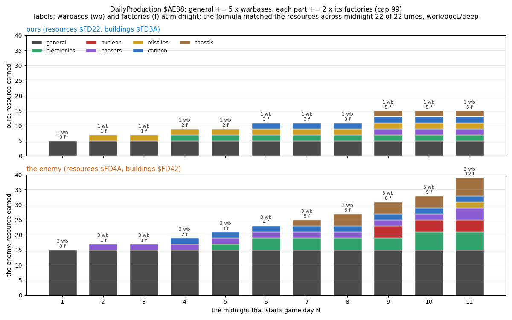

```sh
python3 tools/fig_events.py fig-production --cache work/docL/cache/deep10.npz --out docs/img/logic/production.png
```

How to read the figure:

- one bar per midnight and side: 5 × warbases + 2 × each factory kind, from `$FD3A` / `$FD42` in the last sample of
  the day;
- the colours are the resources; the label is the warbases (wb) and factories (f) the side held.

What it shows:

- The resources at `$FD22` / `$FD4A` in the first sample of the new day equal the old ones plus these gains (capped at
  99) at all 22 midnights of both sides.
- The enemy's 3 warbases earn 15 general to our 5 every day.
- Its factories took the lead from day 5 (4 to our 3) and more than doubled ours by day 11 (12 to 5).

## 10.4 Construction

The construction menu opens when the ship sinks onto the pad of our warbase. This takes three things:

- altitude 15;
- the door cell 4 rows below the pad free of map bit 6;
- the three cells of the row under the door free of bit 6.

The menu's keys are in [5.4](05-controls.md#54-the-construction-menu). Its rules, from `ConstructionMenuLoop` `$CA0F`,
`RefundPart` `$CAC1` and `StartRobot` `$CB52`, with the tables as the image holds them (`PartCosts` `$CAF0` =
`03 05 0A 02 04 04 14 03`, the resource paid from at `$CAF8` = `06 06 06 05 04 03 02 01`, `PartHeights` `$D7B4` =
`0B 07 08 06 06 07 07 07`):

| Part | Bit | Cost | Paid from | Height |
| --- | --- | --- | --- | --- |
| bipod | 0 | 3 | chassis | 11 |
| tracks | 1 | 5 | chassis | 7 |
| anti-grav | 2 | 10 | chassis | 8 |
| cannon | 3 | 2 | cannon | 6 |
| missiles | 4 | 4 | missiles | 6 |
| phasers | 5 | 4 | phasers | 7 |
| nuclear | 6 | 20 | nuclear | 7 |
| electronics | 7 | 3 | electronics | 7 |

- A part pays from its own resource. The rest comes out of general; if general cannot cover it, the part is refused.
- The menu works on a copy of the resources (`MenuResources` `$FD29`). The copy goes back into `Resources` only on
  START.
- Exactly one chassis: choosing one refunds the chosen one first.
- At most three of the four weapon bits 3-6 (`MenuParts` `$FD21` AND `$78` is never `$78`).
- START needs a chassis and a weapon; electronics count as neither.
- A side has 24 robot slots: ours are `$DA00` + 16 × n for n = 0-23, the enemy's `$DB80` + 16 × n.

Our new robot stands on the warbase's door, facing down: `+$05` 4, `+$06` 5, order 0, strength 100, `+$0F` 1, so it
moves at the next turn. Its height `+$09` is the sum of its parts' heights. `work/docL/deep` frame 360, the first
robot: `16 EF 16 00 09 00 00 09 04 11` (cell `$EF16`, column 22, row 9, bipod + cannon, height 17); the whole birth is
in [7.3](07-objects.md#73-robots). The bot built 7 robots: `$09` twice, `$1A`, `$89`, `$19`, `$B2` and `$BC`
(`work/docL/deep/play.log`).

## 10.5 A robot's turn and its orders

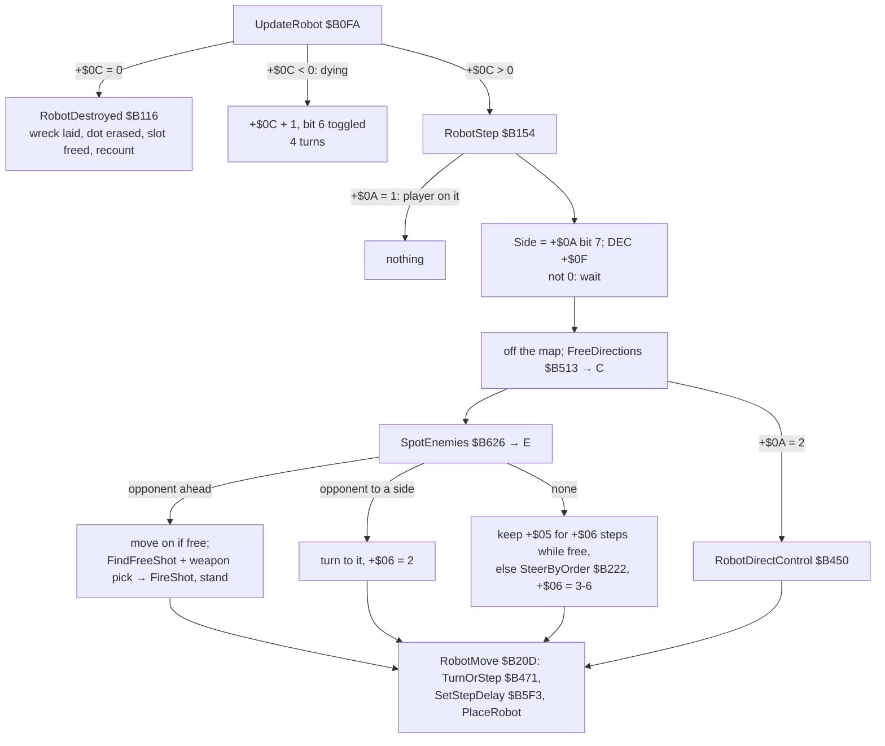

`WorldTurn` first calls `EnemyCommander` (10.8). It then calls `UpdateRobot` for each of the 48 records whose `+$01` is
not 0 (ours first), then `UpdateShot` for each live shot record. In `work/docL/deep` `UpdateRobot` ran 52 106 times and
`SteerByOrder` 2400 times.

<!-- snippet: RobotStep -->

From `src/game/world.asm`:

```asm
RobotStep:
  LD A,(IY+$0A)           ; A = the control byte +$0A: 0 AI, 1 the player on
                          ; it, 2 direct control, $80 the enemy's
  CP $01                  ; the player sits on it: frozen while the robot menu
                          ; is open
  RET Z                   ; frozen: no delay counted, nothing moves
  RLCA                    ; Side: 0 ours, 1 the enemy's
  AND $01                 ; (bit 7 of +$0A now in bit 0)
  LD (Side),A            ; Side = 0 / 1, read by the target searches
  DEC (IY+$0F)            ; the step delay
  RET NZ                  ; not yet: wait another turn
  ...
  CALL SpotEnemies        ; E = the directions with an opponent in sight
  POP BC                  ; C back
  LD A,E                  ; A = the directions with an opponent ...
  OR A                    ; ... none?
  JR Z,RobotNoEnemy       ; nobody in sight
  AND (IY+$08)            ; an opponent straight ahead?
  JR Z,RobotTurnToEnemy   ; no: only to a side
```

**Step delays.** `SetStepDelay` reloads `+$0F` from `StepDelays` `$B61D` (`06 04 03 08 06 03 09 07 04`), in turns per
step. The column is the locomotion: the lowest set bit of the parts `+$07`, so exactly one in every built robot. The
row is the ground height under the robot (`+$0D`):

| Ground | bipod | tracks | anti-grav |
| --- | --- | --- | --- |
| flat (0) | 6 | 4 | 3 |
| low (1-3) | 8 | 6 | 3 |
| high (4 and up) | 9 | 7 | 4 |

A turn of 90 degrees costs a step (`TurnOrStep`). A turn from right to left goes through down or up, so it costs two
steps: robot 0 at frame 18130 of `work/docL/deep` turned down → left → up in two steps of 6 turns each
([7.3](07-objects.md#73-robots)).

**Movement thresholds.** `FreeDirections` tests the 2 × 2 footprint's next cells against the terrain type. It also
tests for object anchors (bit 6), and for the ship's cell (bit 7) when the ship is lower than the robot's top.

| Locomotion | Blocks from type | Ground heights it climbs |
| --- | --- | --- |
| bipod | `$08` | 0, 2, 3 |
| tracks | `$0C` | also 6 |
| anti-grav | `$0F` | also the types `$0C`-`$0E` |

Types `$0F` and above (tall blocks, buildings) stop every robot. The heights are `TerrainHeights` `$D7BC`
([7.6](07-objects.md#76-the-map)).

**Vision.** `SpotEnemies` scans 8 cells in each direction, and in the facing direction 10 cells (12 with electronics)
on three parallel lanes. The first object on a lane ends it. Only an opponent (`+$0A` bit 7 differs) with strength
above 0 counts, so buildings, shots and friends hide what is behind them.

**An opponent ahead.** The robot moves on if it can. It fires if a shot record of its side is free (`FindFreeShot`
`$B6B8`: records 1-2 ours, 3-4 the enemy's) and it has a weapon:

1. `Random` AND `$38` AND the parts chooses each of cannon, missiles and phasers with a coin flip.
2. The highest chosen fires: phasers 3, missiles 2, cannon 1 (`RobotWeaponPick` `$B1B7`).
3. Firing makes the robot stand this step: `+$05` = 0, `+$06` = 1.

So a robot fires its best weapon on half its chances, and a lone cannon fires only on half the turns that see an
opponent.

### Orders

`SteerByOrder` `$B222` picks a direction among the free ones C by the order `+$0B`. It runs only when the robot has no
opponent in sight and its course `+$06` is used up or blocked. The new course lasts 3-6 steps. The orders' names on
the screen are in [5.5](05-controls.md#55-the-robot-menu-orders-and-targets).

| Order | Meaning | Steering |
| --- | --- | --- |
| 0 | stop and defend | stand; it still turns and fires at what it sees |
| 1 | advance n miles | lean right: the order's direction with chance 3/4 when free, else a random free one other than the opposite (`RobotLeanTo` `$B326`). `+$0E` = miles × 2 counts the columns down (`StepPosition` `$B4B9`: - 1 a column in the order's direction, + 1 against, at most 99); at 0 the order becomes 0 |
| 2 | retreat n miles | the same to the left |
| 3 | search and destroy robots | the opponent at slot `+$0E`, kept while it lives and is under 50 columns away; else the nearest live opponent by column (`FindNearestOpponent` `$B41D`); none: a random free direction |
| 4 | search and destroy factories | a building target (below); needs the nuclear part |
| 5 | search and destroy warbases | the same; needs the nuclear part |
| 6 | capture neutral factories | a building target |
| 7 | capture enemy factories | a building target |
| 8 | capture enemy warbases | a building target |

`SetOrder` `$ABC8` turns an order 4 or 5 for a robot without the nuclear part into 0. Any order whose search finds no
target becomes 0 too.

**Building targets.** `TargetBuildingTable` `$B3D5` gives the table (warbases `$FD70` for 5 and 8, factories `$FD84`
for the others) and the owner bits wanted:

- `$20` (the enemy's) for our robots;
- `$40` (ours) for the enemy's;
- 0 (neutral) for order 6.

The target is record `+$0E`, kept while it still has those owner bits. Else `FindTargetBuilding` `$B34D` takes the
nearest by column that no robot of the side with the same order is already after (`ConsiderBuilding` `$B36C`). With
none, our robot stands and an enemy robot switches to order 3.

**The aim** (`RobotAim` `$B2D5`):

- D = the directions toward the target. While the columns differ, the row aimed at is 3 below the building's row: its
  door.
- 8 or more columns away: lean horizontally, as an advance does.
- Closer: a random free direction among the wanted ones. A horizontal one is kept for \|dx\| - 1 steps.
- Arrived (D = 0): orders 4 and 5 detonate (`NuclearBlast` `$B99F`, 10.9); the others face down and stand. A robot that
  stands on a door captures it (10.7).

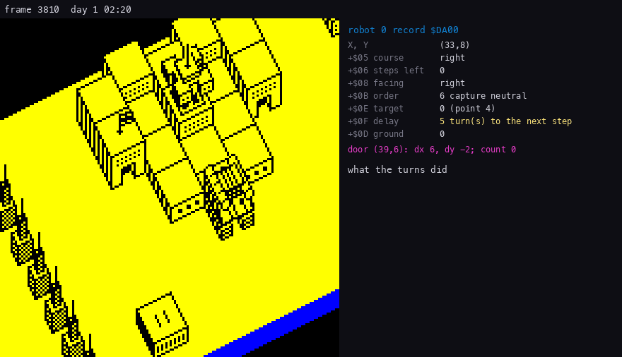

```sh
python3 tools/fig_events.py fig-ai --cache work/docL/cache/walk.npz --out docs/img/logic/robot-ai.gif --opt slot=0 from=1 to=76
```

How to read the figure:

- one picture every 10 frames of `work/docL/deep` (about a game turn), frames 3810-4560; the view is drawn around the
  robot from the memory of that frame;
- the magenta line runs from the robot to its target's door, point 4 (`+$0E` 0 indexes the factory table);
- the panel shows the record at `$DA00`; a field that changed this turn is yellow; the list is what the last turns
  did.

What it shows:

- Robot 0 (bipod + cannon) walks right along row 8 one step every 6 turns (`+$0F` reloaded to 6 on flat ground).
- At (39, 8), under the door, it turns up (the turn costs a step), `SteerByOrder` gives a new course up × 5, and it
  steps onto the door (39, 6) at frame 4400.
- From then it stands facing down, and the capture count of point 4 climbs (10.7).

## 10.6 Shooting and damage

`FireShot` `$B6D6` launches the shot from the robot's anchor in its facing direction:

- 5 steps of range, 7 for missiles, one more with electronics;
- each step moves 2 cells;
- the first step is taken at once (`MoveShot` `$B724`); when the shot survives it, `SoundFx` = 1.

Every turn `UpdateShot` `$B70D` moves each shot one step. The shot is gone off rows 0-15, when its steps run out, or
over ground of height 10 or more (types `$10` and `$12`). Then the 3 × 3 cells around its new cell are tested for an
object (bit 6):

- **Nothing:** the shot marks its cell and flies on.
- **A live robot of either side** takes the damage below; there is friendly fire.
- **Anything else** ends the shot: a building, another shot, a dying robot (`ShotGone` `$B7EA`, `SoundFx` `$FC`).

    damage = ((60 - (+`$09` + +`$0D`)) / 4) × (weapon + 1)        integer division, weapon 1 cannon, 2 missiles, 3 phasers

A tall robot on high ground takes less. For a robot of height 19 on flat ground: 10 per point, so a cannon does 20,
missiles 30 and phasers 40.

- Strength 0 or below: `+$0C` = `$FC`, dying, `SoundFx` `$C8`.
- Otherwise `SoundFx` `$FA`.

<!-- snippet: MoveShot -->

From `src/game/world.asm`:

```asm
MoveShotRows:
  LD A,B                  ; past the map's rows: the shot is gone
  CP $10                  ; (0-15?)
  JP NC,ShotGone          ; no: gone
MoveShotStore:
  LD (IY+$02),L           ; the new position
  LD (IY+$03),H           ; (column high)
  LD (IY+$04),B           ; (row)
  CALL GroundUnderFootprint ; the ground under it
  CP (IY+$08)             ; too high: it hits the wall
  JP NC,ShotGone          ; yes: gone
```

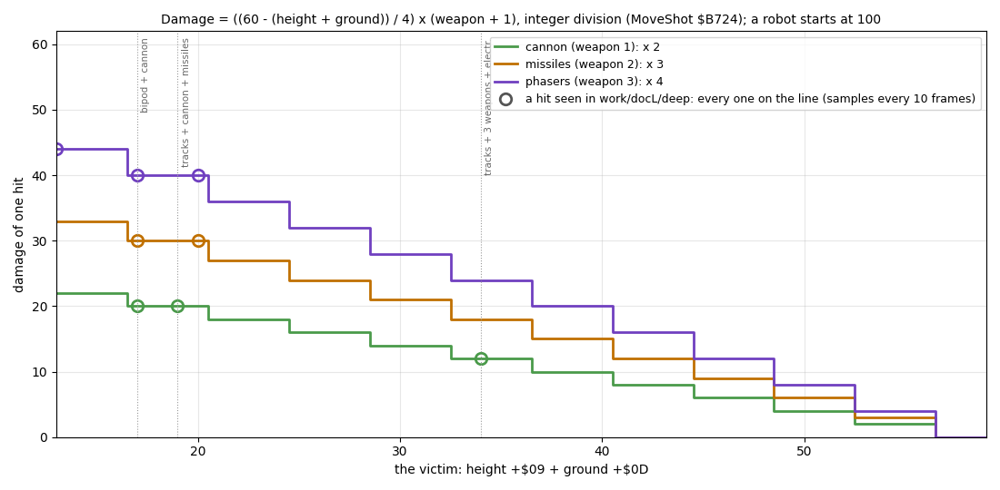

```sh
python3 tools/fig_events.py fig-damage-table --cache work/docL/cache/deep10.npz --out docs/img/logic/damage-table.png
```

How to read the figure:

- the three step lines are the formula for cannon, missiles and phasers, against the victim's height + ground;
- each circle is a distinct pair (height + ground, damage) of the hits in the `deep10.npz` samples, each a drop of a
  robot's `+$0C`;
- the dotted verticals name the robots behind the circles.

What it shows: the 8 pairs (13, 44), (17, 20), (17, 30), (17, 40), (19, 20), (20, 30), (20, 40) and (34, 12) all sit on
the formula. The hits came in six fights of `work/docL/deep` from frame 22345 on; the first shot of the game was fired
at frame 20513 (`FireShot`'s first run).

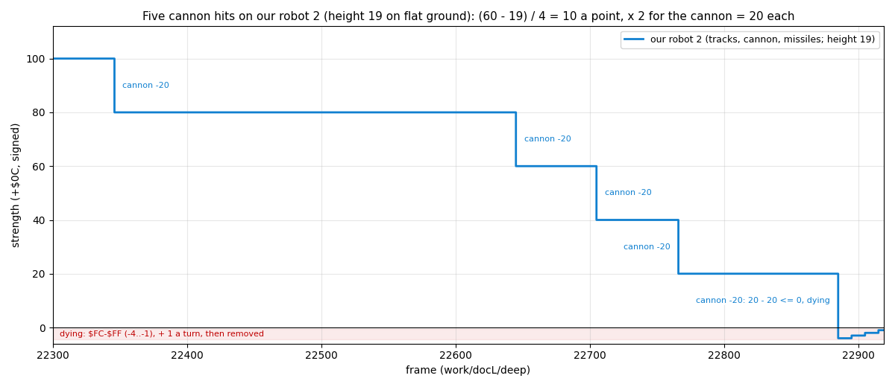

```sh
python3 tools/fig_events.py fig-strength --cache work/docL/cache/deep-fight.npz --out docs/img/logic/strength.png --opt slots=2 "title=Five cannon hits on our robot 2 (height 19 on flat ground): (60 - 19) / 4 = 10 a point, x 2 for the cannon = 20 each"
```

How to read the figure:

- the line is `+$0C` of our slot 2 (tracks, cannon, missiles: height 19) at every frame of `deep-fight.npz`;
- each step down is one hit, labelled with the weapon (inferred from the drop) and the damage;
- the red band is the dying count `$FC`-`$FF`.

What it shows:

- The enemy's cannon hits at frames 22345, 22645, 22705, 22766 and 22885: 100 → 80 → 60 → 40 → 20 → dying.
- The shooter stood at the same column (119) above it; its shot record (record 3 at frame 22345:
  `77 ED 77 00 08 04 05 01 0A`, cannon, down) lived one frame, because the first step already hit
  ([7.5](07-objects.md#75-shots)).
- After the fifth hit `+$0C` counts up from `$FC` one a turn; at 0 `RobotDestroyed` frees the slot. The bot built a new
  robot in slot 2 at frame 25222.

A dying robot counts `+$0C` up from `$FC` and toggles its cell's bit 6 for four turns, so shots and eyes see it only
every other turn. At 0 `RobotDestroyed` frees the slot, erases the dot and recounts. On bare ground it lays a 2 × 2
wreck of terrain types 6 / 7 (height 3), which every locomotion can climb.

COMBAT MODE in the robot menu fires shot record 0 (`$D7D3`) from the player's robot, or detonates its bomb
(`CombatMenuCode` `$AC7C`). Without the weapon chosen it refuses with a beep (`CombatRefused` `$ACCE`). The bomb is
10.9. A fire item ran in docP's scripted session `work/docP/tour`: at frame 3725 FIRE CANNON sent one shot from the
player's robot, which flew two cells a turn from frame 3764 to 3812 and ended
([5.6](05-controls.md#56-direct-control-and-combat), `menu-combat.gif`).

## 10.7 Capture

In each turn `GameTurnEnd` `$AD90` looks at the 28 capture points at `$FD70` (5 bytes each: column, row, owner and
type, a count; [7.7](07-objects.md#77-buildings-and-capture-points)). Points 0-3 are the warbases, 4-27 the factories.
The test cell is each point's door.

1. Map bit 6 on the door (a robot anchored there): the count `+4` goes up by 1.
2. At 144 (`$90`) turns, about 30 s of play, the count is reset and the robot there (`FindRobot` `$CDD8`) takes the
   point for its side (`+$0A` bit 7):
   - a warbase: `GiveWarbase` `$BB86`;
   - a factory: `GiveFactory` `$BB61`, point - 4.
3. An empty door resets the count to 0.
4. After any capture `CountBases` `$BB09` recounts both sides and the panel is reprinted.

<!-- snippet: GameTurnEnd -->

From `src/game/gameturn.asm`:

```asm
CaptureLoop:
  LD L,(IY+$00)           ; the point's door cell
  LD H,(IY+$01)           ; the door's column, high byte
  LD A,(IY+$02)           ; A = the door's row
  CALL MapCell            ; HL = the door's map cell
  BIT 6,(HL)              ; a robot on it?
  JR NZ,CaptureCount      ; an anchor on the door: count
  LD (IY+$04),$00         ; empty: the count starts again
  JR CaptureNext          ; on to the next point
CaptureCount:
  INC (IY+$04)            ; one more turn on the door
  LD A,(IY+$04)           ; the turns so far
  CP $90                  ; 144 turns: taken
  JR C,CaptureNext        ; not yet: next point
  LD (IY+$04),$00         ; the count starts again for the new owner
  PUSH BC                 ; keep the loop counter B and the captures C
  PUSH IY                 ; keep the point's record
  CALL FindRobot          ; the robot standing there
```

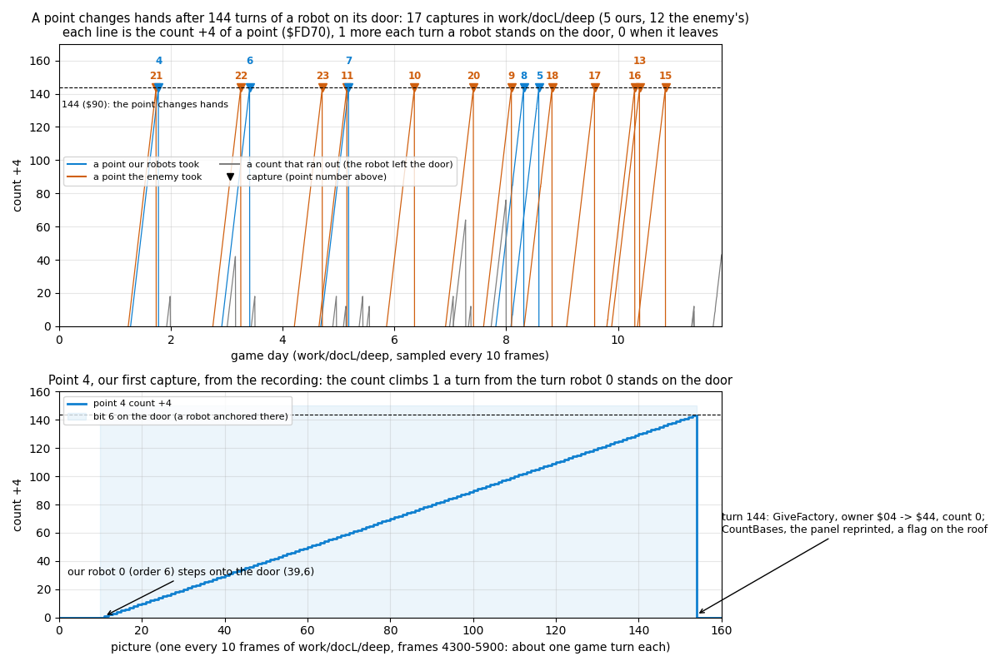

```sh
python3 tools/fig_events.py fig-capture-counts --cache work/docL/cache/deep10.npz work/docL/cache/capture4.npz --out docs/img/logic/capture-counts.png
```

How to read the figure:

- Top: each run of a non-zero count `+4` in `work/docL/deep` (drawn plus 4, so a count of 0 on a door shows),
  coloured by the side that took the point; grey runs ran out because the robot left first. The marks are the
  captures, labelled with the point.
- Bottom: point 4 in `capture4.npz` (frames 4300-5900, one picture every 10 frames). The count rises by 1 a turn from
  the turn robot 0 stands on the door. At 144 `GiveFactory` sets the owner `$04` → `$44` and resets the count.

What it shows:

- **17 captures, all of neutral factories.** Ours were 5: points 4, 6, 7, 8 and 5 (frames 5840, 11050, 16380, 25780,
  26570). The enemy took 12: points 21, 22, 23, 11, 10, 20, 9, 18, 17, 16, 13 and 15.
- No warbase and no owned factory changed hands.
- The highest count seen in the samples was 143: the next turn takes the point.

Any robot captures, whatever its order: an ADVANCE that stops on a door takes the building. A warbase the player
captures gets a pad, a second construction site. The robot has to stay on the door for 144 turns. An opponent ahead
makes it step on if it can (10.5), which takes it off the door and resets the count; this follows from the code and
was not singled out in a recording.

## 10.8 The enemy commander

`EnemyCommander` `$B7F4` runs first in every `WorldTurn`; there were 3416 calls in `work/docL/deep`. `Random` AND `$1F`
picks one of the enemy's slots 24-47; the values 24-31 do nothing, so it acts in 3 turns of 4.

**A free slot: maybe a new robot.**

1. Each of the 4 warbases in turn is taken with chance 1/2, but only if its owner byte is exactly `$20` (the enemy's,
   intact).
2. The door and the three cells of the row under it must be free of bit 6.
3. Parts: one random byte (the second of two `Random` calls). There is no second try: the slot stays free this turn
   unless the byte has
   - exactly one chassis (bit 0, 1 or 2);
   - weapons (bits 3-6) neither none nor all four;
   - at least `EnemyRobots` / 8 + 1 weapons: 1 below 8 robots, 2 from 8, 3 from 16.

   Electronics (bit 7) come with chance 1/2.
4. Payment on a copy in `MenuResources`, with `PartCosts` like the player's. The shortfall of the own resources must be
   at most max(general / 2, 11), and at most general. Otherwise nothing is spent and nothing built.
5. The new robot: `+$0A` `$80`, `+$05` 4 and `+$08` 4 (down), `+$06` 3, order 0, strength 100, `+$0E` `$FF`, `+$0F` 1,
   height the sum of `PartHeights`. Then the counts and the panel.

The enemy pays the same prices but can borrow up to half its general resource. Its robots grow better armed as its
army grows.

<!-- snippet: EnemyCommander -->

From `src/game/enemy.asm`:

```asm
EnemyCommander:
  CALL Random             ; a random slot ...
  AND $1F                 ; 0-31
  CP $18                  ; ... of the computer's 24, or none this turn
  ...
SpawnPickBase:
  CALL Random             ; each warbase in turn is taken with chance 1/2
  AND $01                 ; this warbase at all?
  JR Z,SpawnNextBase      ; not this time: the next one
  LD A,(HL)               ; and only if its +3 is $20 exactly: the enemy's, not
                          ; destroyed
  CP $20                  ; the enemy's and intact?
  JR Z,SpawnAtBase        ; yes: build here
```

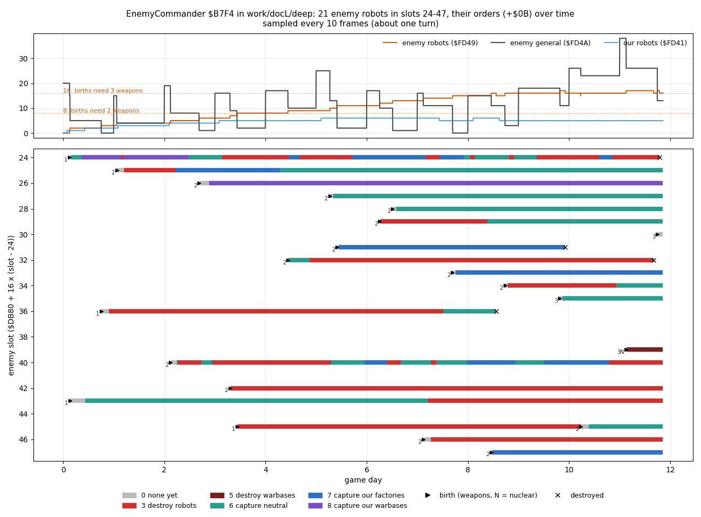

```sh
python3 tools/fig_events.py fig-commander --cache work/docL/cache/deep10.npz --out docs/img/logic/commander.png
```

How to read the figure:

- Top: the enemy's robots (`$FD49`), its general resource (`$FD4A`) and our robots. The dotted lines are the weapon
  thresholds of step 3.
- Bottom: one row per enemy slot. A bar is one robot's life, coloured by its order `+$0B`. A triangle marks the birth,
  with the number of weapons in its parts; a cross marks a death seen in the samples.

What it shows:

- New robots appear only when the general resource can pay. The resource drops at each birth and refills at each
  midnight.
- 21 enemy robots were born in the samples; the army reached 16 and 17 from day 9, so births from then needed 3
  weapons.
- Order 0 lasts a sample or two; it is replaced at once.
- Orders 6 (capture neutral) and 3 (hunt robots) dominate, with 7 and 8 between them.
- One robot had the nuclear part: slot 39 (parts `$EC`: anti-grav, cannon, phasers, nuclear, electronics), with order
  5 and target 0, our warbase. It moved from column 247 to 240 between frames 34410 and 35410 and was still 218
  columns from our warbase when the recording ended.

**A live robot: maybe a new order** (`EnemyReplan` `$B920`).

- Order 0 is replaced at once; any other order only with chance 1/32 a turn.
- Orders 1-3 are always chosen anew.
- For orders 4-8 the order is kept only if the target has changed owner *and* the robot stands on its door: the
  capture is under way. Otherwise the order is chosen anew, which usually gives the nearest target again.

`EnemyChooseOrder` `$B95D`:

| Parts | Order | Chance |
| --- | --- | --- |
| with nuclear | 5 destroy warbases | 3/4 |
| | 4 destroy factories | 1/4 |
| without | 6 capture neutral factories | 1/2 |
| | 7 capture the player's factories | 1/4 |
| | 8 capture the player's warbases | 1/4 |

The target is the nearest by column (`FindTargetBuilding`). If there is none, the order is 3: hunt robots. The
commander never gives ADVANCE or RETREAT.

## 10.9 The nuclear blast

`NuclearBlast` `$B99F` runs when a robot with order 4 or 5 reaches its target, or from COMBAT MODE's bomb.

1. The first intact base in reach is destroyed: its owner byte gets bit 7 (`$80`) and its blocks become debris.
   - Warbases: \|dy\| < 7, \|dx\| < 7 and dx + dy < 10, with dy measured from the robot's row + 5.
   - Factories: 5, 5 and 7, from the row + 1.
2. A round area of 9 × 9 cells around the robot (`BlastArea` `$BA02`: rows of 5, 7, 9, 9, 9, 9, 9, 7, 5 cells; map
   rows 1-15 only):
   - every robot there dies, of both sides;
   - blocks of the types `$11`-`$14` become debris (types 6 / 7).
3. The robot itself dies.
4. `NuclearFlash` `$BA87`: random paper colours on the view, with a fading rumble of ROM bytes (`NuclearRumble`
   `$BAEE`). The game stands still meanwhile.
5. The radar is rebuilt, the bases and robots are recounted, and the panel is reprinted.

No recording built a nuclear robot that reached its target. My instance replayed `work/docL/deep` from frame 3000
(`work/docL/snaps/deep-3000.szx`) with robot 0's parts and height poked:

- `$DA07` = `$49` (bipod, cannon, nuclear) and `$DA09` = 24 (`$18`);
- robot 0 had order 6 and walked onto the door (39, 6) of neutral factory point 4 at frame 4400, as in `work/docL/deep`;
- the ship landed on it at frame 4700 and chose COMBAT MODE, then the bomb.

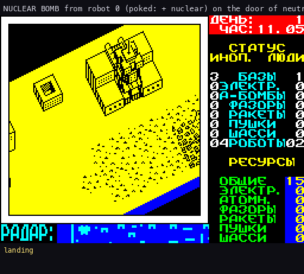

```sh
python3 tools/fig_events.py fig-screen --cache work/docL/cache/nuke.npz --out docs/img/logic/nuclear-blast.gif --opt from=180 to=640 dense=296-535:4 slots=0,1 "title=NUCLEAR BOMB from robot 0 (poked: + nuclear) on the door of neutral factory point 4" delay=120 lines=3 "notes=303-531:NuclearFlash: random paper colours and the rumble; the clock stands at day 1 11:55|532-640:after: the factory is debris, point 4 owner \$80, robot 0 gone"
```

How to read the figure:

- the whole screen, one picture a frame of the experiment (frames 4681-5141); inside the flash every 4th;
- the line under each picture is the step the bot was taking (the robot menu, COMBAT MODE, the bomb) or the note.

What it shows:

- Point 4's owner went `$04` → `$80` at frame 4796, and robot 0's slot was freed at 4797: no blink and no wreck.
- The flash's attributes changed from frame 4804 to 5032 (228 frames, 4.6 s). The clock stood at day 1 11:55 from
  frame 4790 to 5042.
- Our robot count `$FD41` went 2 → 1 at frame 5025, at the recount after the flash.

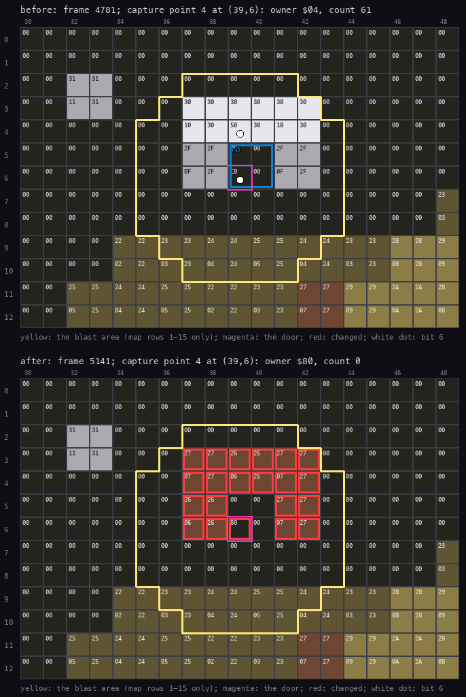

```sh
python3 tools/fig_events.py fig-blast-map --cache work/docL/cache/nuke.npz --out docs/img/logic/nuclear-map.png --opt before=280 after=640 x=39 y=6 point=4 cols=30-48 rows=0-12
```

How to read the figure:

- the map cells of columns 30-48, rows 0-12, with their bytes, coloured by terrain type; top before (frame 4781),
  bottom after (frame 5141);
- the yellow outline is `BlastArea`'s 5, 7, 9, 9, 9, 9, 9, 7, 5 cells around the robot at (39, 6);
- the magenta box is the door of point 4; red boxes are the cells that changed; a white dot is bit 6.

What it shows:

- Point 4's factory blocks (the `$10`, `$30`, `$0F`, `$2F` cells of rows 3-6) became debris: `$06`, `$26`, `$07`,
  `$27`, types 6 and 7.
- The door cell reads `$C0` before (robot 0's anchor, bit 6, with the landed ship, bit 7) and `$80` after (only the
  ship).
- Robot 0 was the only robot in the area.

**A destroyed base can be captured again, and then counts as a warbase.** `CountBases` and the target searches skip
bit 7, but the capture loop (10.7) does not test it: it counts any robot on the door. `GiveFactory` → `SetBaseOwner`
`$BBB9` then does AND `$1F` and ORs in the new owner, which clears bit 7 and keeps the type bits: 0 after the blast,
the warbase type.

My instance continued after the blast (frame 5141):

- it parked the ship over (44, 12) and poked our free slot 10 onto the door (39, 6): `$DAA0` =
  `27 E9 27 00 06 00 00 09 04 11 00 00 64 00 FF 05` (order 0, strength 100), and the door cell `$E927` = `$40`;
- point 4's count rose 1 a turn: 142 at frame 6620, 143 at 6630;
- at 144 (frame 6640) the owner went `$80` → `$40`, ours with type 0;
- `CountBases` made our warbases (`$FD3A`) 2, and the panel printed 2 warbases;
- the flag cell (37, 4) went `$07` → `$47`;
- the midnight before the capture (frame 6489) paid 15 → 20 general; the next one (frame 9370, day 3) paid 20 → 30:
  5 × 2 warbases.

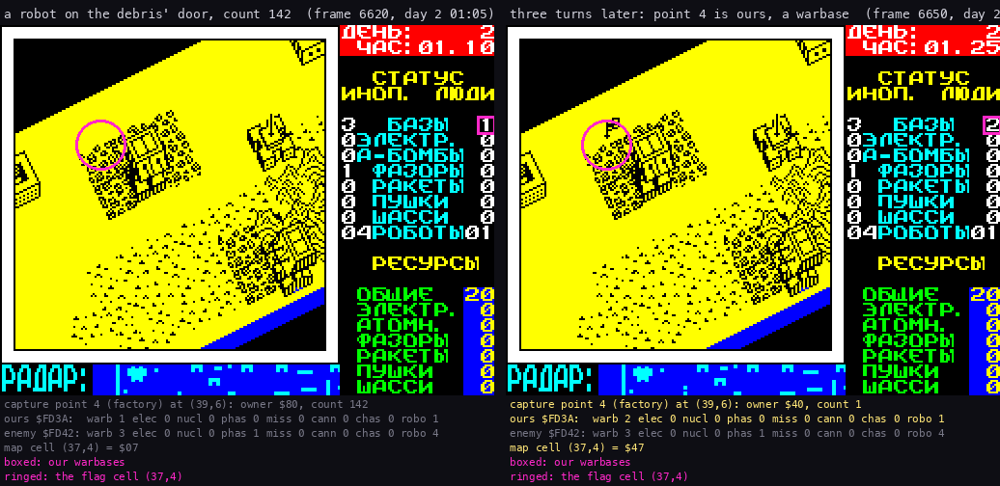

```sh
python3 tools/fig_events.py fig-pair --cache work/docL/cache/destroyed-capture.npz --out docs/img/logic/destroyed-recaptured.png --opt pics=142,145 "titles=a robot on the debris' door, count 142|three turns later: point 4 is ours, a warbase" state=point:4,counts,cell:37/4 "marks=6/31/1/boxed: our warbases" "rings=37/4/22/ringed: the flag cell (37,4)"
```

How to read the figure:

- two screens of the experiment, three turns apart; the state lines under each are read from memory, those that
  changed in yellow;
- the pink box marks our warbase count on the panel, the ring the flag cell (37, 4) in the view.

What it shows: the panel's warbases for our side go from 1 to 2, and a flag appears on the debris.

The robot stayed on the door and the count started again. Robots cannot be built at this "warbase": it has no pad, and
the construction menu needs the pad cells of a real warbase (10.4). This last point was not tested.

## 10.10 Load, save and the end of a game

**Save.** The save key in play (at `$A71A` in `PlayLoop`) jumps to `SaveGameStage` `$C2CC`:

1. `RadarDirty` = 1: the staging below overwrites the radar picture past `RadarEnemy`, so it is rebuilt afterwards.
2. The 45 bytes of `Shots` go to `SaveShots` `$D92B` and the 168 of `Buildings` to `$D958`.
3. Interrupts off and `JP GameSave` `$6905`:
   - the stack moves below `$A5ED`, IX = `$4033` (the disk module's save entry);
   - one `HALT` (a frame's start, so the music handler does not run during the switch), then bank 4 at `$C000`;
   - the ROM's `FLAGS` `$5C3B` = `$CC`, `LAST_K` `$5C08` = 13 (ENTER), CAPS LOCK off, as the module's key reading
     expects;
   - `JP $C000`: the module copies itself to `$4000`, asks for a name and writes the file `name.N`, CODE `$D92B`, 9941
     bytes (`$D92B`-`$FFFF`).
4. The module comes back to `SaveReturn` `$692B`: SP restored, I = `$68`, IM 2, one `HALT`, then `PlayLoop`'s
   `JP EnterPlay`: the play screen again.

In `r2` the save screen shows at frame 7652, "Saving..." at 7947 and play goes on at 8102 (day 0 05.00). The file is
the whole top of memory: the staged shots and buildings, the robots, the map, the variables page, `Buildings`
themselves at `$FF01` (a second copy) and the stack.

<!-- snippet: GameSave -->

From `src/game/im2.asm`:

```asm
GameSave:
  LD (SaveReturn+$0001),SP ; keep SP in SaveReturn's LD SP
  LD SP,GlueStack+$0049   ; GlueStack: bank 4 covers the game's stack
  LD IX,DiskSave          ; the module's save entry
  LD A,$14                ; bank 4: the disk module
  EI
  HALT                    ; a frame's start: the music handler has run before
                          ; the switch
  LD BC,$7FFD
  OUT (C),A
  LD A,$CC                ; FLAGS: the keyboard state the module's key reading
                          ; expects
  LD (ViewBuffer+315),A
  LD A,$0D                ; LAST_K = ENTER
  LD (ViewBuffer+264),A
  LD HL,ViewBuffer+362             ; FLAGS2 bit 3: CAPS LOCK off
  RES 3,(HL)
  JP DiskModule           ; the disk module; it comes back with JP SaveReturn

; SaveReturn
SaveReturn:
```

**Load.** Key 5 of the game menu jumps to `GameLoad` `$A56A`, the same bridge with IX = `$4000` (the module's load
entry). The module reads the file's sectors into `$D92B` on and leaves:

- loaded: to `LoadReturn` `$A590` with NZ. SP restored, I = `$68`, IM 2, one `HALT`, `$5B00` = `$FFFF`, then
  `JP NewGameSetup`, whose `JR NZ` skips the set-up into `EnterPlay`: the loaded game plays on;
- abandoned or failed: to `Restart`, the game menu again.

There is no checksum. The module checks nothing, and the game's only test (a 16-bit sum, kept at `$5B00`) is on the
tape path, which is no longer reached; `LoadReturn` even overwrites the word it would compare. So any file of that
name loads as it is:

- `r2`: `test` loads at frame 9202 (day 0 05.30, the saved position), and the disk's own `nether` at 10602: day 29
  10.35, general resource 99, a game the authors left on the disk;
- `r5`: a `nether.N` with two bytes changed (day 29 → 99, general 99 → 7, the SCL's own checksum recomputed) loads
  without a word; at frame 8200 `$FD22` = 7 and `$FD37` = 99.

<!-- snippet: LoadReturn -->

From `src/game/disk.asm`:

```asm
LoadReturn:
  LD SP,$0000             ; back from the disk module (bank 0 paged again), its
                          ; flags kept
  LD A,$68                ; IM 2 through ImTable again
  LD I,A
  IM 2
  EI
  HALT                    ; a frame's start
  LD HL,$FFFF             ; $FFFF into the view buffer's first word, which
                          ; nothing reads
  LD (ViewBuffer),HL
  JP NewGameSetup         ; with the module's flags: NZ a game was loaded
                          ; (NewGameSetup goes straight to EnterPlay), Z a new
                          ; game
```

The load does not put the staged shots back: nothing copies `SaveShots` to `Shots`. The game goes on with whatever
`Shots` held in the menu. In `r5`, loaded straight after the boot, `Shots` held text bytes left by the boot (such as
`72 00 69 72 61 6D 6C 69 2D`, "r", "iramli-") whose `+$01` were all 0 by chance, so no record was live. A game
abandoned with I while a shot flew would carry that live record into the loaded game; no recording did that.

**The end of a game.** `CheckGameEnd` `$AE6B` runs every turn:

- **we have no warbase** (`PlayerBuildings` `$FD3A` = 0): `Silence` `$AE94` (one `HALT`, interrupts off, AY registers
  0-14 to 0), I = `$3F` and IM 1 (the ROM's handler: no game handler from here on), interrupts on, bank 3 at `$C000`
  and `JP $D2EF`: Dead End;
- **the enemy has no warbase** (`EnemyBuildings` `$FD42` = 0): `GameWon` `$AEB1`: `Silence`, IM 1, bank 6 at `$C000`,
  its first `$3637` bytes copied to `$6060`, bank 0 again and `JP $6060`: Final Cut, which unpacks there and never
  returns.

Factories and robots do not count. There is no score.

<!-- snippet: CheckGameEnd -->

From `src/game/endings.asm`:

```asm
CheckGameEnd:
  LD A,(EnemyBuildings)            ; the enemy's warbases
  OR A
  JR Z,GameWon            ; none left: won
  LD A,(PlayerBuildings)            ; ours
  OR A
  RET NZ                  ; we still have one: play on
  CALL Silence            ; lost: the tune off
  LD A,$3F                ; the ROM's I and IM 1: no game handler from here on
  LD I,A
  IM 1
  EI
  LD A,$13                ; bank 3: Dead End
  LD BC,$7FFD
  OUT (C),A
  JP DeadEnd              ; Dead End's entry, never back
```

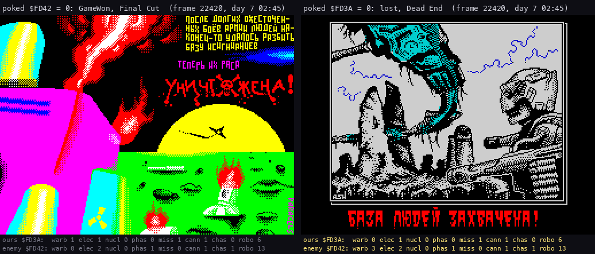

```sh
python3 tools/fig_events.py fig-pair --cache work/docL/cache/end-won.npz work/docL/cache/end-lost.npz --out docs/img/logic/game-end.png --opt pics=0:10,1:10 "titles=poked \$FD42 = 0: GameWon, Final Cut|poked \$FD3A = 0: lost, Dead End" state=counts scale=2
```

How to read the figure:

- two replays from `work/docL/deep` frame 22000, each with one count poked at frame 22003;
- each shows the screen at frame 22420; under it the building counts read from memory: `$FD42` = 0 on the left,
  `$FD3A` = 0 on the right.

What it shows:

- Won: Final Cut's first picture, the burning base and "После долгих ожесточённых боёв армии людей наконец-то удалось
  разбить базу исгинианцев. Теперь их раса уничтожена!".
- Lost: Dead End's picture and "БАЗА ЛЮДЕЙ ЗАХВАЧЕНА!" (the humans' base is taken).
- Both ends came at the first turn after the poke; the clock stopped at day 7 02:45.
- Only the count is tested: in the won replay the enemy's three warbases still stood on the map.

Stage 3 recorded both ends further:

- `r3` (Dead End, from `x0/deadend-start.szx`, frames from the snapshot): the picture and its tune to frame 800,
  SPACE, "GAME OVER" on a star field, SPACE, the game menu at 1500.
- `r4` (Final Cut, from `r4/finalcut-start.szx`): the picture, a scroller, "GAME OVER (C) 1998 ETERNITY INDUSTRY" at
  frame 4000 and "Victory is with U!!!" from 5000 to the end of the 16000 frames: it never returns.

Their screens are in [5.10](05-controls.md#510-the-intro-and-the-endings). No recording lost or won a game without a
poke. In `work/docL/deep` the enemy's nuclear robot (slot 39, order 5, 10.8) was still on its way to our warbase when
the recording ended.

## 10.11 Bugs

| Where | What | Witness |
| --- | --- | --- |
| `ConstructionMenu` `$C849`, `PlayLoop` at `$A6F3` | With all 24 of our slots taken, the menu returns at once with IY = `$DB80`, the enemy's slot 24. The play loop then writes the new-robot values there: that enemy robot gets strength 100 and order 0 back, every turn the ship sits on the pad | code reading; no recording filled our 24 slots |
| `SteerByOrder`, at `$B2B8` | After `FindTargetBuilding` finds a new target, HL is past the table (`$FDFF` for factories, `$FD87` for warbases). The aim reads the bytes below it as the target's row and column: `$FDFC`-`$FDFE`, 0 in every sample of `work/docL/deep` (row 0, column 0), or for a warbase target `$FD84`-`$FD86`, the door of factory point 4 (39, 6). One step of a wrong course, corrected at the next decision | code reading; the bytes from `deep10.npz` |
| `PrintTensUnits` `$D407` | A value above 99 prints a wrong tens digit (200 is "D0"); only poked resources get there | code reading |
| `ConstructionMenuLoop` `$CA0F` | A refused chassis swap leaves the old chassis refunded: the robot has no chassis until another is chosen | code reading |
| `PrintDigitColumn` `$D2E3` | A count of 10 or more would print `:` onwards; no count gets there | code reading |
| `GameTurnEnd` `$AD90` capture loop, `SetBaseOwner` `$BBB9` | The capture loop does not test bit 7 (destroyed) of a capture point. A robot that stands 144 turns on the door of a nuked base takes it. `SetBaseOwner`'s AND `$1F` clears bit 7, and the type bits the blast left are 0. So a destroyed factory or warbase comes back as a live warbase of the capturing side. It is counted in `$FD3A` / `$FD42`, pays 5 general a day, and keeps its side alive in `CheckGameEnd` | 10.9: my instance, point 4 `$80` → `$40`, our warbases 1 → 2, general + 10 at midnight (`destroyed-recaptured.png`) |
| `GameLoad` / `LoadReturn` `$A590` | The staged shots in the file are never copied back to `Shots`: a loaded game keeps the shot records of the menu | code reading; `r5` frame 8200: `Shots` holds the boot's text bytes, none live |
| `GameStop` `$AF00` | `LD HL,MusicInterrupt` / `LD ($6D6A),HL`: `$6D6A` is a typo for `ImHandler` `$696A`; it writes into the sprites and leaves the handler as it is. Harmless: nothing calls `GameStop` | code reading |
| `PlayMusic` `$67B1` | saves AF, BC, DE, HL, IX, IY but not AF'; the music player swaps AF' 10-12 times a frame. `FindTargetBuilding` `$B34D` keeps the order in A' for `ConsiderBuilding`, and one walk of the 24 buildings takes about 74 000 T, more than a frame, so an interrupt always lands inside it. After it the teammate check compares a wrong order: two robots of one side may go for the same building. New in this game: the 48K play interrupt touched no alternate register | trace `work/docR/d1/traces/14250_0-14375_0.uatr`: frame 14257 T 71 662 the interrupt at `$B395`, then records 21-23 read the order as 56 instead of 6 |

Never-run code:

- `UnusedTapeCode` `$AE29`: keys 6 and 7 held together jump into the ROM's SAVE code at `$04B0` with `Restart` as the
  return address. Nothing calls it.
- The tape path of the main menu: `LoadGame`'s prompt, `LoadGameBlocks` `$C21E` (its checksum test is NOPs),
  `LoadError` `$C282`, `SaveGame` `$C28D` and the key wait of `SaveGameBlocks` `$C2C9`. The menu's key 5 and the save
  key jump past them.
- `GameOverWait` `$AEEA`: the old end-of-game wait; both ends now leave the game before it.

## 10.12 The figure experiments

The caches behind the figures are in `work/docL/cache/`. `U` is the unreal-ng checkout `scratch/wt-ane-stage1` (read
only), `B` its `unreal-qt` binary.

| Cache or run | Command |
| --- | --- |
| `work/docL/deep` | `python3 tools/ane_bot.py play --unreal $U --binary $B --start work/docL/snaps/gamemenu.szx --work work/docL/deep --port-base 14710 --frames 36000 --record` (the snapshot is `work/stage3/x0/gamemenu.szx`) |
| `deep10.npz`, `deep-fight.npz` | `python3 tools/fig_events.py --unreal $U sample --work work/docL/deep --frames 0:36001:10 --out work/docL/cache/deep10.npz` (and `22300:22920:1` for `deep-fight.npz`) |
| `capture4.npz`, `walk.npz` | slices of `deep10.npz` (frames 4300-5900 and 3800-4560), written with `fig_events.Pictures` |
| snapshots | `python3 tools/fig_events.py --unreal $U snap --work work/docL/deep --frame F --out work/docL/snaps/deep-F.szx` for F = 3000, 22000, 25800, 36009 (`deep-end.szx`) |
| the live instance | `python3 tools/ane_bot.py launch --unreal $U --binary $B --start work/docL/snaps/deep-25800.szx --work work/docL/live --port-base 14710` |
| `nuke.npz` | `python3 tools/fig_events.py --unreal $U combat --work work/docL/live --load work/docL/snaps/deep-3000.szx --frame0 3000 --poke DA07=49 DA09=18 --fly 40,10 --cruise 40 --land-at 4500 --slot 0 --fire 1 --gap 40 --tail 300 --every-frame --out work/docL/cache/nuke.npz` |
| `destroyed-capture.npz` | right after `nuke.npz`, on the same instance: `python3 tools/fig_events.py --unreal $U turns --work work/docL/live --frame0 5141 --fly 44,12 --cruise 45 --poke DAA0=27e9270006000009041100006400ff05 E927=40 --turns 170 --out work/docL/cache/destroyed-capture.npz`, then `turns --frame0 6890 --turns 290` for `destroyed-day.npz` |
| `end-won.npz`, `end-lost.npz` | `python3 tools/fig_events.py --unreal $U turns --work work/docL/live --load work/docL/snaps/deep-22000.szx --frame0 22000 --turns 2 --poke FD42=00 --frames 80 --every 10 --out work/docL/cache/end-won.npz` (`FD3A=00` for `end-lost.npz`) |

## 10.13 What the deep recording showed

The bot builds a robot whenever it can afford its plan, and orders it to capture neutral or enemy factories or to
destroy robots (`PLAN` in `tools/ane_bot.py`). The table is read from `deep10.npz` (samples in play only):

| Day | Frame | Robots ours / enemy | Warbases | Factories | Neutral | General | Parts (sum) |
| --- | --- | --- | --- | --- | --- | --- | --- |
| 0.02 | 120 | 0 / 0 | 1 / 3 | 0 / 0 | 24 | 20 / 20 | 0 / 0 |
| 1.00 | 3360 | 2 / 3 | 1 / 3 | 0 / 0 | 24 | 15 / 15 | 0 / 0 |
| 2.00 | 6480 | 3 / 4 | 1 / 3 | 1 / 1 | 22 | 9 / 19 | 2 / 2 |
| 4.03 | 12840 | 5 / 8 | 1 / 3 | 2 / 2 | 20 | 6 / 17 | 4 / 4 |
| 6.01 | 18840 | 6 / 11 | 1 / 3 | 3 / 4 | 17 | 7 / 17 | 7 / 10 |
| 8.01 | 24600 | 5 / 15 | 1 / 3 | 3 / 6 | 15 | 17 / 15 | 19 / 16 |
| 10.02 | 30720 | 5 / 16 | 1 / 3 | 5 / 9 | 10 | 13 / 26 | 30 / 28 |
| 11.85 | 36000 | 5 / 16 | 1 / 3 | 5 / 12 | 7 | 18 / 13 | 40 / 12 |

What the game did:

- **17 captures, all of neutral factories** (10.7). No warbase and no owned factory changed hands.
- **The enemy outbuilt us** from its 3 warbases' 15 general a day: 21 robots born, ending with 16. Our side built 7
  (the bot's plan), peaked at 6 and ended with 5 ([7.8](07-objects.md#78-over-the-whole-game)).
- **Production shows in steps.** Our general rose by 5 a day with one warbase; each new factory added 2 a day to its
  resource (10.3).
- **The end state, frame 36000 (day 11 20:30).**
  - Our buildings `1 1 0 1 1 1 1` (warbases, electronics .. chassis) and resources `18 10 0 6 8 10 6`.
  - The enemy's buildings `3 3 2 2 1 1 3` and resources `13 12 0 0 0 0 0`.
- **The fighting began late.** The first shot was fired at frame 20513 (day 6.7). `FireShot` ran 294 times and
  `MoveShot` 352 times; 33 hits were seen in the samples.
- **One nuclear robot, no game end.** The enemy built slot 39 with the nuclear part and order 5 late on day 11; it had
  not reached our warbase by the end. Neither side lost a warbase.

## 10.14 Design notes

- **One rule set for both sides.** The enemy builds from the same parts at the same prices, steps with the same delays,
  captures by the same count and is hit by the same formula. Its edges are the start (3 warbases to 1) and the credit
  of half its general resource.
- **Orders, not control.** A robot's orders only matter when it sees no opponent. Seeing one always wins: turn, fire,
  stand. A capture order is fragile, since a single opponent in view stops the walk.
- **Time is the currency.** Production is daily and capture takes 144 turns. Step delays make a bipod on rough ground
  three times slower than an anti-grav: the long game rewards factories over robots, as `work/docL/deep` shows.
- **The disk trusts the file.** A save is the top 9941 bytes of memory and a load puts them back; nothing checks them,
  so a saved game is also an editor's file: the authors shipped one (`nether`, day 29) on the disk.
- **The ends leave the game.** Both ends hand the machine to another program (Dead End in bank 3, Final Cut copied to
  `$6060`) with the ROM's IM 1, so the game's IM 2 handler and its tune stop there.
