# 13. Differences from Nether Earth

What Advanced Nether Earth changed in Nether Earth, why, and what the player gets from it, with the code, the bytes
and the recordings behind each point.

## 13.0 The two games and the verdict

- **NE** is Nether Earth (Argus Press Software, 1987): a 48K tape game. Its case is
  [`../nether-earth`](../../nether-earth/README.md); a path after "NE" is in that case.
- **ANE** is Advanced Nether Earth (Eternity Industry, 1998): Pentagon 128 with TR-DOS, this case. Its paths are
  relative to this case.

The short answer:

- ANE is NE's 48K game, byte for byte at NE's addresses, with a 128K shell built around it.
- The whole play is NE's code: the robots' AI, movement, combat, the ship, the view, the radar and the turn's
  arithmetic. 90.7 % of the bytes NE's image declares are the same bytes at the same address in ANE, and nine of
  NE's modules are untouched (13.5).
- The graphics and the world are NE's too: all 89 sprite blocks, the 16 level files and the map built from them
  (13.6.4).
- What changed is how the game reaches memory (a disk, a protection, HRUM blocks over eight banks), what plays while
  it runs (AY music in every interrupt), the language (a Cyrillic font and every visible word translated), and what
  happens before and after play (an intro, a boot menu with a 28-page help, a disk save, two ending programs).
- The changes in the game code are a handful of patched instructions: one in the play interrupt, the IM 2 table's
  place, the menu, the save and load, the end of a game. They carry two side effects into play: the AY player
  clobbers A' in the middle of the robots' target search (13.10.2), and the old bug of the first aim after a new
  target now reads zeros instead of the IM 2 jump (13.10.1).

How it was compared:

- Both reverses are complete, and both cases rebuild their originals byte for byte from source. Both annotations use
  NE's names where the code is NE's.
- The game images were compared entry by entry and instruction by instruction (`tools/diff_game.py`), the resources
  sprite by sprite, glyph by glyph, string by string and cell by cell (`tools/diff_res.py`), and each game's own
  `BuildMap` was run over its own image to compare the maps (13.12).
- The interrupts, the beam and the bug of the target search were measured on the traces both cases already had. The
  menus and the panel come from the scripted tour both cases recorded in the same 61 steps. One new NE recording was
  made, of NE's save prompt (13.8).

Witnesses:

- "NE line N" is a line of NE `build/game.lst`; "ANE line N" is a line of `build/game/game.lst`. Both are line
  numbers of the whole file, as `grep -n` gives them.
- Module paths are the case's `src/game/<module>.asm`.
- Recordings: ANE `d1` (`work/docR/d1`), stage 3's `r1`-`r5` and stage 1's `s2` (its play image
  `work/images/scl-play-cpu.bin`), as described in [2](02-architecture.md), [3](03-build-and-load.md) and
  [4](04-game-loop.md); NE `deep` (`work/docA/deep`), `play` (`work/play`) and the tour (`work/ill3/tour`), as in NE's docs.
- An NE frame is 69 888 T (19.97 ms) and an ANE frame 71 680 T (20.48 ms) ([terms](README.md#terms)).
- The figures are in `docs/img/diff/`; every command is run from this case's root.

## The differences at a glance

| What | NE | ANE | Why | For the player | |
| --- | --- | --- | --- | --- | --- |
| medium | tape: BASIC, N1, one 48 361-byte block | SCL: BASIC + UltraXOR, a loader, 13 HRUM blocks | TR-DOS was the Russian scene's standard in 1998 | 26 s to play instead of 4.5 min | [13.1](#131-the-medium-the-load-and-the-protection) |
| protection | a hidden BASIC line only | UltraXOR v1.2, 78 layers, traps | the scene's custom | none: it hides the reader, it stops no copy | [13.1](#131-the-medium-the-load-and-the-protection) |
| memory | 48K, full to `$FFFF` | 8 banks, the game in banks 5 / 2 / 0 at NE's addresses | music, endings, help need room | AY music, more screens | [13.2](#132-the-memory) |
| font and menu tune | font at `$6780`, beeper tune at `$C4A7` | the IM 2 block at `$6780`, the font at `$C500` | the IM 2 table must stay below `$C000`; the AY made the beeper tune spare | nothing visible | [13.2](#132-the-memory) |
| interrupt | IM 2 at `$FDFD`, table `$FE00` | IM 2 at `$6969`, table `$6800` | bank 1 is paged over `$C000` in the interrupt | none directly | [13.3](#133-the-frame-and-the-interrupt) |
| play interrupt | radar, counter, shot sound | the same, then one frame of AY music: one instruction patched | 128K AY | music in play; the game keeps 97.6 % of its CPU | [13.3](#133-the-frame-and-the-interrupt) |
| frame | 69 888 T, paper 14 340 T after the INT | 71 680 T, paper 17 988 T after the INT | Pentagon timing | the same 10-frame turn, the tear moves | [13.3](#133-the-frame-and-the-interrupt) |
| before play | the menu | intro, title, boot menu, help, 3 title cards, the menu | the authors' additions | more to see; one key skips most | [13.4](#134-the-states-around-play) |
| game code | 563 entries | 431 the same, 10 with moved operands, 11 changed code, 30 new | a translation and an add-on, not a rewrite | the same game | [13.5](#135-the-game-code) |
| menu | the NETHER EARTH title, flashing, beeper tune | a picture from bank 3, AY tune; four calls NOPed | no title text, music from the interrupt | a picture and music | [13.5](#135-the-game-code) |
| font | 64 Latin glyphs | 61 of 64 redrawn, 30 Russian letters, no Й Ё Ъ | the translation | Russian text, И for Й | [13.6](#136-resources-font-strings-panel-sprites-and-map) |
| strings | English | 44 translated in place, 3 removed, 9 the same | the translation; new menu and endings | Russian menus and panel; three green titles, one typo | [13.6](#136-resources-font-strings-panel-sprites-and-map) |
| sprites, level, map | | the same bytes | translation and add-on only | the same look and world | [13.6](#136-resources-font-strings-panel-sprites-and-map) |
| music | beeper tune in the main menu only | AY tunes from the boot to the end, TAIGA in play | 128K AY | music all the time | [13.7](#137-sound) |
| effects | `Beep`, `SoundEffect` | the same code and values | nothing to change | the same, 2.6 % longer frames | [13.7](#137-sound) |
| save / load | tape, 2 blocks, checksum | disk file `name.N`, no checksum | TR-DOS; the checksum went with the tape code | named saves in seconds; a bad file loads silently, shots not restored | [13.8](#138-saving-and-loading) |
| end of game | 2 lines, a beep, back to the menu | Dead End (lost), Final Cut (won, never returns) | the authors' additions | real endings | [13.9](#139-the-ends-of-a-game) |
| NE's bugs | 10.12's list | all kept; MenuMusic's gone with the tune | the logic is NE's bytes | the same quirks | [13.10](#1310-bugs) |
| first aim after a new target | reads the IM 2 jump: stands or blows up | reads zeros: leans toward (0,0) | the IM 2 jump moved | no frozen first steps, no blasts on the spot | [13.10](#1310-bugs) |
| A' in the play interrupt | untouched | clobbered by the AY player | `PlayMusic` does not save AF' | two robots of a side may pick the same building | [13.10](#1310-bugs) |
| path finding | NE 13's rule | the same 31 routines, byte for byte | NE's code | the same steering | [13.11](#1311-path-finding) |

## 13.1 The medium, the load and the protection

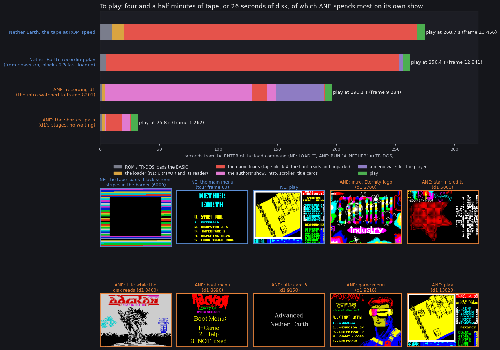

How to read it:

- **Top**: four rows, each a path from the load command's ENTER to play. Time in seconds runs across.
  - Colours are the stages. Grey: the ROM or TR-DOS loads the BASIC. Yellow: the loader. Red: the game loads.
    Pink: the authors' show. Purple: a menu waits for the player. Green: play.
  - Row 1: NE at ROM speed with the emulator's tape traps off.
  - Row 2: NE's `play` recording, from power-on, with blocks 0-3 fast-loaded.
  - Row 3: ANE's recording d1, where the intro is watched to frame 8201.
  - Row 4: ANE's shortest path. It is computed from d1's stages, with no wait for the player.
- **Bottom**: the screens on the way. A blue frame is NE and an orange frame is ANE. Each caption gives its frame.
- **The claim**: NE's tape takes 268.7 s to play. ANE's disk takes 25.8 s if every key is pressed at once. Of
  ANE's 25.8 s, 7.1 s are title cards nobody can skip.
- Drawn by `python3 tools/fig_diff_shell_load.py --out docs/img/diff/shell-load.png`.

### 13.1.1 The medium

| | NE | ANE |
| --- | --- | --- |
| medium | tape, 5 blocks | one SCL, 512 sectors, 4 files |
| boot program | BASIC with a hidden line, `LOAD "" CODE 64730`, `RANDOMIZE USR 64730` | `A_NETHER.B`: line 0 machine code, line 1 `CLOSE # USR Eternity` (`$5D97`) |
| loader | N1, 180 bytes at `$FCDA`: LD-BYTES copied into RAM | UltraXOR's sector reader `$5D3F`, then the loader at `$6060`-`$6221` with AY music |
| the game | one headerless block, 48 361 bytes, `$4000-$FCE8`, screen included, not packed | 13 self-extracting HRUM 3.5 blocks; 426 sectors read in two bursts; all eight banks filled |
| also on the medium | nothing | `nether.N`, a saved game (day 29); `NETHER+.W`, the authors' text in CP866 |

Witnesses: NE [3.1](../../nether-earth/docs/03-build-and-load.md#31-the-tape) (the tape table) and
[3.5](../../nether-earth/docs/03-build-and-load.md#35-n1-the-loader-block-3-fcda) (N1). ANE
[3.1](03-build-and-load.md#31-the-disk) (the disk table), [3.4](03-build-and-load.md#34-the-boot-chain) (the boot
chain) and [3.6](03-build-and-load.md#36-the-packed-blocks) (the blocks).

- **Why.** In 1998 the Russian scene worked on Pentagon clones with a Beta Disk interface and TR-DOS. A tape
  release was out of date by then. The disk can also be read by sector number, out of the catalogue's sight. That
  lets UltraXOR's reader take sectors past the catalogue's lengths (`A_NETHER.B`'s catalogue length is 11 sectors,
  its sector count 255; `a_nether.E` has zero catalogue words, so no command loads it by name).
- **For the player.** The disk loads in about 10 s of reads and unpacking. The tape takes 248 s of signal for the
  game block alone (NE 3.1: 247.6 s at ROM speed).

### 13.1.2 The time to play

All times start at the ENTER of the load command.

| Path | Frames | Seconds | Witness |
| --- | ---: | ---: | --- |
| NE, tape at ROM speed: the game starts | about 13 422 | 268.0 | NE `work/ill3/load/load.json` (IX `$FC9F` at 13 400, 74 bytes left) |
| NE, tape at ROM speed: play | about 13 456 | 268.7 | the same, plus the menu key and `EnterPlay` as in `play` |
| NE `play`, blocks 0-3 fast-loaded: `PlayLoop` | 12 841 from power-on | 256.4 | NE `work/play/l1.json`, first frame of `$A69A` |
| ANE d1, intro watched: `PlayLoop` | 9 284 | 190.1 | `work/docR/d1/l1.json` (ENTER 1943, `PlayLoop` 11 227) |
| ANE, the shortest path | 1 262 | 25.8 | computed from d1's stages (below) |

The shortest path is built from d1's own stages, with the waits for the player cut out:

| Stage | d1 frames | Frames | Seconds |
| --- | --- | ---: | ---: |
| TR-DOS loads the BASIC, to `USR $5D97` | 1943-2031 | 88 | 1.8 |
| UltraXOR (78 layers) and its reader, to `LoaderMain` `$6221` | 2031-2125 | 94 | 1.9 |
| the loader to its first interrupt `$6161`, where SPACE is first read | 2125-2183 | 58 | 1.2 |
| SPACE: the boot reads the disk and unpacks, title picture, boot menu | 8201-8701 | 500 | 10.2 |
| key 1: the game starter unpacks the game | 8701-8852 | 151 | 3.1 |
| `GameEntry` `$A5DA`: three title cards, no key read | 8852-9197 | 345 | 7.1 |
| key 0 in the game menu to `PlayLoop` | 11 201-11 227 | 26 | 0.5 |
| **total** | | **1 262** | **25.8** |

How the SPACE key cuts the intro short: `LoaderInterrupt` reads the half-row SPACE..B once a frame and jumps to
the end of the boot program. From `src/loader.asm`:

```asm
LoaderInterrupt:
    ...
    CALL PlayerFrame
    ...
    LD A,$7F                    ; half-row SPACE..B
    IN A,($FE)
    RRA
    JP NC,LoaderEnd             ; SPACE: skip to the end of the boot
```

- **Why.** The intro, the title picture and the title cards are the authors' show (Eternity Industry's logo,
  "Presents", the star and credits, the scroller). The title picture covers the disk reads. The title cards are the
  part of bank 1's start-up (`MusicStart` `$D8E1`) that `GameEntry` calls once. Interrupts are off and no key is read.
- **For the player.** A watched intro makes the disk version slower than its 26 s, but never as slow as the tape.
  A player who knows SPACE, 1 and 0 is playing in 26 s.

### 13.1.3 The protection

| | NE | ANE |
| --- | --- | --- |
| what | a hidden BASIC line (`POKE 23659,0` hides the "Bytes: N1" message) | UltraXOR v1.2 (c) PARACELS: 78 XOR layers keyed by the R register |
| traps | none | `$5D3F` (where `RANDOMIZE USR 23871` would enter) clears `$4000-$5BFF` and resets; "LAMERZ MUST DIE !!!" and a fake TR-DOS stub; 6 bytes at `$5D91` that throw a disassembly out of step; `ED` NOPs in the entry's copy |
| packer | none | HRUM 3.5 on all 13 blocks |

Witnesses: NE [3](../../nether-earth/docs/03-build-and-load.md), introduction ("no packer and no protection beyond
the hidden line") and [3.2](../../nether-earth/docs/03-build-and-load.md#32-the-basic-block-1). ANE
[3.2](03-build-and-load.md#32-the-basic-and-ultraxor-sectors-0-10) ("Traps in line 0", "The layers") and
`src/boot/a-nether.asm`, `Entry`.

- **Why.** The scene of 1998 wrapped its releases in its own envelopes. Hiding the reader from a disassembler
  was a point of pride, as the trap texts show.
- **For the player.** Nothing. The protection does not stop a copy of the disk. It only hides how the disk is read.

## 13.2 The memory

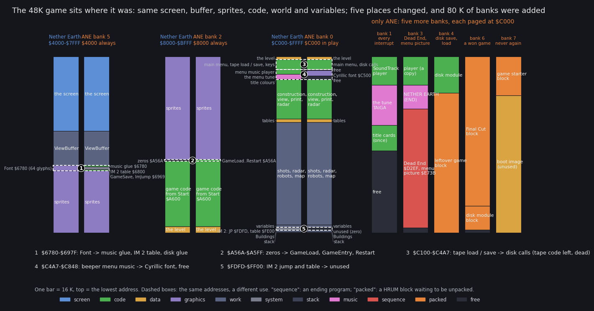

How to read it:

- One bar is 16 K. The top of a bar is its lowest address. The colour is the kind of content (legend at the bottom).
- **Three pairs on the left**: NE's `$4000`, `$8000` and `$C000` thirds next to the ANE bank at that address in
  play (banks 5, 2, 0).
- **Five bars on the right**: ANE's other banks, each paged at `$C000` only when its moment comes (the caption
  above each bar).
- Dashed boxes 1-5 mark the same addresses with a different use. They are listed under the bars and in the table
  below.
- Drawn by `python3 tools/fig_diff_shell_memory.py --out docs/img/diff/shell-memory.png`.

The game's screen, view buffer, sprites, code from `Start` `$A600`, level, world tables, robots, map, variables and
buildings are at the same addresses. Witnesses: NE `tools/memmap.txt` (stage `play`) and NE `src/game/game.ann`;
ANE `tools/fig_banks.txt` (stage `play`) and `src/game/game.ann`; ANE [2.2](02-architecture.md#22-the-memory-map)
and NE [2.2](../../nether-earth/docs/02-architecture.md#22-the-memory-map).

| Mark | Addresses | NE | ANE | Why |
| --- | --- | --- | --- | --- |
| 1 | `$6780-$697F` | `Font`, the 64 glyphs, 512 bytes | `MusicInterrupt` `$6780`, `PlayMusic` `$67B1`, `GameBank` `$67D9`, `SetGameBank`, `MenuPicture` `$67E5`, `ImTable` `$6800-$6900`, `GameSave` `$6905`, `ImJump` `$6969`, `ImHandler` `$696A` | the handler must stay mapped while bank 1 is paged at `$C000`; the Russian font moved to `$C500` |
| 2 | `$A56A-$A5FF` | `SpriteSpare`, 150 zero bytes | `GameLoad` `$A56A`, `LoadReturn` `$A590`, `GlueStack`, `GameEntry` `$A5DA`, the head of `Restart` `$A5EF` | free bytes just under `Start` |
| 3 | `$C100-$C4A7` | the menu, tape load and save | the menu, disk calls; the tape code left in place and never reached | the menu was patched, not rewritten |
| 4 | `$C4A7-$C848` | `MenuMusic` and the beeper player (`$C4A7-$C664`), the tune's 14 tracks (`music/menu/*.bin`, `$C665-$C81F`), `TitleColourCycle` (`$C820-$C848`) | `KeySpaceDone` `$C4A7` (the menu's RET, 13.6.2), `FontSpare1` `$C4A8-$C4FF` (88 bytes, unused), `GameFont` `$C500-$C6FF`, `FontSpare2` `$C700-$C848` (329 bytes, unused) | the AY music in bank 1 made the beeper tune spare |
| 5 | `$FDFD-$FF00` | the IM 2 jump and its 257-byte table | unused, zero in play | moved to mark 1 |

ANE's other banks:

| Bank | Holds | Paged at `$C000` |
| --- | --- | --- |
| 1 | the SoundTrack player, the tune TAIGA, the title cards `$D8E1` | in every interrupt (the music) |
| 3 | a copy of the player, NETHER EARTH (END), Dead End `$D2EF`, the menu picture `$E73B` | for the menu picture and Dead End |
| 4 | the disk module, and a leftover game block | for a disk save or load |
| 6 | the packed Final Cut, and the packed disk module | for a won game |
| 7 | the game starter block, the boot image | never again after the boot |

The font and the menu tune swapped places (marks 1 and 4):

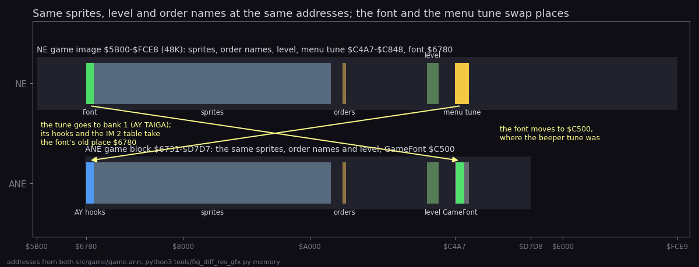

How to read it:

- Two bars, NE above (its game image `$5B00-$FCE8`), ANE below (its game block `$6731-$D7D7`), addresses along the
  bottom.
- The sprites, the order names and the level are at the same places in both.
- The arrows show what took whose place.
- Drawn by `python3 tools/fig_diff_res_gfx.py memory` (the addresses from both `src/game/game.ann`).

Witness: `python3 tools/diff_res.py --section tables` (the only-NE and only-ANE rows), both `src/game/game.ann`.

- **Why the IM 2 block went to the font's place.** The IM 2 table, the jump and the handlers must lie below `$C000`,
  where no paged bank can cover them (ANE's annotation at `$6800`; 13.3.2). NE's font area was a free, fixed place
  there once the font had moved.
- **Why the font went to the tune's place.** NE's beeper tune was no longer needed once the AY plays the music, so
  its 930 bytes (`$C4A7-$C848`) took the 512-byte font with room to spare.

The dead tape code under mark 3 still holds its Russian prompt. From `src/game/mainmenu.asm`:

```asm
LoadGame:
  JP GameLoad

; Code nothing reaches: the PlayTapeText prompt, then on into LoadGameBlocks
LoadTapePrompt:
  CALL PrintInline

; "ВКЛЮЧИТЕ МАГНИТОФОН" (start the tape) at (22,7), cyan, double height:
; LoadTapePrompt's, never printed
PlayTapeText:
  INCBIN "res/game/text/play-tape.bin",$0000,27
```

- **Why.** `PlayTapeText` is Russian, so the tape code was translated before the switch to disk (an inference from
  the bytes; no earlier tape release of ANE is known to this case). Then a `JP` was put in front of the tape code
  instead of removing it. Everything new went into free bytes (marks 2 and 4), into bytes the move to 128K freed
  (marks 1 and 5), or into the extra banks. No game address moved.
- **For the player.** Nothing in play: the game runs from the same addresses. The 80 K of extra banks are the music,
  the endings, the help and the pictures. The menu has a picture and AY music instead of NE's title and its beeper
  tune.

## 13.3 The frame and the interrupt

### 13.3.1 The two frames

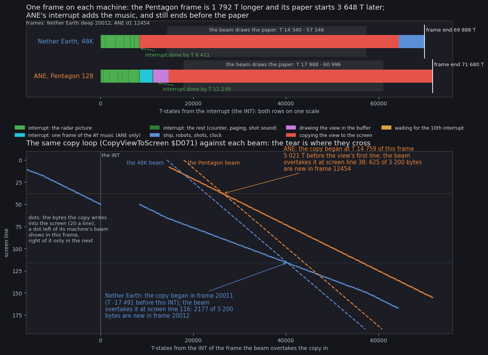

How to read it:

- **Top**: one frame of play on each machine. T-states from the interrupt run across, on one scale for both rows.
  - The coloured runs are what the CPU did, in the legend's colours. The white band is the time the beam draws the
    paper. The white tick is the frame's end.
  - Frames: NE `deep` 20012, ANE d1 12454.
- **Bottom**: the view copy (`CopyViewToScreen` `$D071`) against the beam. One dot is one byte written into the
  screen. A dashed line is a machine's beam.
  - A dot left of its machine's beam shows in this frame. A dot right of it shows only in the next frame.
  - The tear is the first line where the beam is ahead of the copy.
- Drawn by `python3 tools/fig_diff_shell_frame.py --out docs/img/diff/shell-frame.png`. It prints the interrupt ends
  and the tears of 13.3.5.

| | NE (48K) | ANE (Pentagon 128) |
| --- | --- | --- |
| frame | 69 888 T (312 lines of 224 T), 19.97 ms | 71 680 T (320 lines of 224 T), 20.48 ms |
| INT in the emulator's frame | frame T 1812 (intstart 1811) | frame T 71 636 of the frame before (intstart 71 635) |
| first paper pixel after the INT | 14 340 T | 17 988 T |
| the interrupt in play ends | T 8393-8411 after the INT (9 frames) | T 11 378-12 239 after the INT (10 frames) |
| what the interrupt does | the radar, the counter, the shot sound | the same, then one frame of AY music (`PlayMusic`) |

Witnesses: `core/src/emulator/config.cpp`, `ApplyModelTimingDefaults`, in unreal-ng for the timings. The
interrupt ends come from NE `work/docA/deep/traces/20004_0-20015_0.uatr` and ANE
`work/docR/d1/traces/12446_0-12458_0.uatr`, through `tools/fig_diff_shell_frame.py`.

A trace counts T from the emulator's frame start, not from the INT. On the 48K that is 1812 T before the INT. On
the Pentagon the INT comes 44 T before the frame start. The figure counts every time from the INT.

### 13.3.2 The IM 2 table moved to `$6800` (Start becomes Restart)

The bank switch of 13.3.3 is why the IM 2 table had to move. In 128K play bank 0 is paged at `$C000`, while banks 1,
3 and 4 are paged in during the interrupt, the menu picture and the disk save. NE's jump at `$FDFD` and its table at
`$FE00` would be paged out under them. ANE builds the table at `$6800`, in bank 5, which is always mapped, in NE's
old font area (13.2). Compare `Start` in NE `src/game/start.asm` with `Restart` in ANE `src/game/start.asm`:

```asm
; NE src/game/start.asm
Start:
  DI
  LD SP,$0000
  LD HL,$FE00             ; the IM 2 table: 257 bytes of $FD at $FE00-$FF00
  LD BC,$00FD
  ...
  LD A,$C3                ; JP at $FDFD: every vector lands on Handler
  LD ($FDFD),A
  LD HL,StartInterrupt
  LD (Handler),HL
  LD A,$FE
  LD I,A
  IM 2
```

```asm
; ANE src/game/start.asm
Restart:
  DI
  LD SP,$0000
  LD A,$11                ; bank 1
  LD BC,$7FFD
  OUT (C),A
  CALL PlayerInit         ; the player: the tune from its start
  LD A,$10                ; bank 0 again
  LD BC,$7FFD
  OUT (C),A
  LD HL,ImTable           ; the IM 2 table: 257 bytes of $69 at $6800-$6900
  LD BC,$0069
  ...
  LD A,$C3                ; the JP at $6969: every vector lands on ImHandler
  LD (ImJump),A
  LD HL,MusicInterrupt    ; MusicInterrupt: the tune plays while the menu runs
  LD (ImHandler),HL
  LD A,$68
  LD I,A
  IM 2
```

The tool's view of the same, cut to the changed lines (NE lines 2147-2160, ANE lines 1593-1611):

```
NE  Start $A600                       |  ANE Restart $A5EF
                                      |  1593 A5F3  LD A,$11          ; bank 1
                                      |  1594 A5F5  LD BC,$7FFD
                                      |  1595 A5F8  OUT (C),A
                                      |  1596 A5FA  CALL PlayerInit   ; the tune from its start
                                      |  1597 A5FD  LD A,$10          ; bank 0 again
                                      |  ...
2147 A604  LD HL,$FE00                |  1600 A604  LD HL,ImTable     ; $6800
2148 A607  LD BC,$00FD                |  1601 A607  LD BC,$0069
2156 A611  LD ($FDFD),A               |  1608 A611  LD (ImJump),A     ; $6969 = JP
2158 A614  LD HL,StartInterrupt       |  1609 A614  LD HL,MusicInterrupt
2159 A617  LD (Handler),HL            |  1610 A617  LD (ImHandler),HL ; $696A
2160 A61A  LD A,$FE                   |  1611 A61A  LD A,$68          ; I
```

- **What changed.**
  - NE builds the 257-byte vector table at `$FE00` filled with `$FD`, a `JP` at `$FDFD` and the handler word at
    `$FDFE`. I is `$FE`.
  - ANE builds it at `ImTable` `$6800`, filled with `$69`, with `ImJump` `$6969` and `ImHandler` `$696A`. I is `$68`.
  - The new block is `src/game/im2.asm`, ANE lines 251-331.
- **"Handler `$6969`".** `$6969` is the `JP` (`ImJump`). The handler word is `$696A` (`ImHandler`).
- **Restart also restarts the tune.** `Restart` (Start's place, from `$A5EF`, the same bytes as NE's `Start` from
  `$A604`) first calls `PlayerInit` in bank 1. It rebuilds the IM 2 table each time, so an abort or a Dead End goes
  back to the menu with its music from the start.
- **GameEntry.** `GameEntry` `$A5DA` (ANE lines 1568-1580) is the image's real entry, run once: `DI`, `SP = 0`,
  bank 1, `CALL MusicStart` `$D8E1` (the title cards), bank 0, then on into `Restart`.
- **For the player.** None of this is visible except that a tune now plays.

Every place where NE writes `Handler` writes `ImHandler` in ANE. They are all "relocated" in the tool (13.12):

| Address | Routine | ANE line |
|---|---|---|
| `$A697` | EnterPlay | |
| `$C861` | ConstructionMenu | 7155 |
| `$C290` | SaveGame | |
| `$CBA5` | StartRobot | |

Every `LD HL,StartInterrupt` became `LD HL,MusicInterrupt` ("retargeted" in the tool):

- ConstructionMenu `$C85E` (NE line 8623, ANE line 7152);
- SaveGame `$C28D`;
- GameStop `$AF0A`;
- Restart `$A614`.

So the menus and the construction screen run with music where NE ran the empty handler `StartInterrupt` (NE's
`EI; RET` at `$D59C`), or, in NE's main menu, its own `MenuInterrupt` while `MenuMusic` loops (13.7).

### 13.3.3 PlayInterrupt: one instruction

`src/game/interrupts.asm`, NE line 11487, ANE line 9818:

```
NE  11487 D582 CD 9E D5   CALL ShowRadar     |  ANE  9818 D582 C3 B1 67   JP PlayMusic
```

The rest of `PlayInterrupt` (`$D566`, 54 bytes) is NE's bytes. `PlayMusic` jumps back to `InterruptSound` `$D585`,
the instruction after NE's `CALL`. From `src/game/music.asm` (ANE lines 184-206):

```asm
PlayMusic:
  CALL ShowRadar          ; this frame's radar picture, as PlayInterrupt set it
                          ; up
  PUSH AF
  ...
  LD A,$11                ; bank 1
  LD BC,$7FFD
  OUT (C),A
  CALL PlayerFrame        ; one frame of the tune
  LD BC,$7FFD
  LD A,(GameBank)         ; the game's bank again
  OUT (C),A
  ...
  JP InterruptSound       ; on in PlayInterrupt: the sound effect, the exit
```

The pushes and pops are AF, BC, DE, HL, IX and IY; `PlayerFrame` is `$C005` in bank 1, one frame of TAIGA.

- **What and why.** NE's play interrupt draws the radar (`ShowRadar`) and plays the shot sound. ANE keeps both and
  adds one frame of the AY tune between them. A single instruction is patched, so NE's handler is not moved.
- **For the player.** The AY tune TAIGA plays during the game. The radar and the shot sound are NE's.

`MusicInterrupt` (`$6780`, from ANE line 141) is the handler for the menus and the construction screen. It saves all
the registers, including the alternate set (`EXX`, `EX AF,AF'` at `$6789` / `$678A`). `PlayMusic` does not save the
alternate set. This is a new bug (13.10.2).

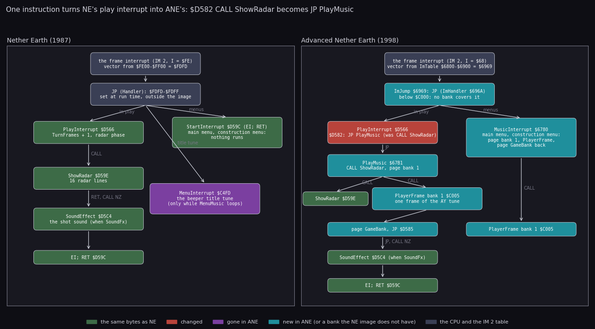

How to read it:

- The two handlers' call graphs, NE left, ANE right. Each box's colour is its `diff_game.py` status (legend at the
  bottom). Each edge's instruction is checked against the listing at the address given.
- Everything green in the ANE panel is NE's code. The red box is `PlayInterrupt` with its one changed instruction.
  The cyan boxes are new code.
- The right branch is the menu handler: NE's `EI; RET` (and the beeper `MenuInterrupt`, gone in ANE), against ANE's
  `MusicInterrupt`.
- Drawn by `python3 tools/fig_diff_frame.py`.

### 13.3.4 The cost per frame

Measured with `python3 tools/fig_diff_interrupt.py` on the existing traces:

- NE: `games/nether-earth/work/docA/deep/traces/20004_0-20015_0.uatr`, 48K, 69 888 T a frame;
- ANE: `work/docR/d1/traces/13005_0-13017_0.uatr`, Pentagon, 71 680 T a frame.

An interrupt is counted from the IM 2 jump until SP rises above its frame.

| | NE | ANE |
|---|---|---|
| interrupts measured | 9 | 10 |
| range, T | 8 371-8 383 | 11 373-12 228 |
| mean, T | 8 378 | 11 617 |
| share of a frame | 12.0 % | 16.2 % |
| radar (`ShowRadar`, `FillAttr16`) | 7 659 | 7 659 |
| `PlayInterrupt`'s own work and the jump | 719 | 711 |
| paging glue (`PlayMusic`) | | 250 |
| AY player (bank 1) | | 2 997 |
| CPU left for the game per frame | 61 510 | 60 063 |

- The radar cost is the same to the T-state, because it is the same code.
- ANE pays about 3 250 T a frame for the music, but the Pentagon frame is 1 792 T longer. The game loses only
  1 447 T a frame (2.4 %).
- A 10-frame turn takes 204.8 ms on the Pentagon against 199.7 ms on a 48K, both at 50 Hz frames of their own length.
- These numbers agree with the cases' own turn profiles:
  - ANE [4](04-game-loop.md): the interrupt without music takes 86 211 T a turn and the music 29 946 T;
  - NE [4](../../nether-earth/docs/04-game-loop.md): the interrupts take 83 770 T a turn.

**Two measures, both right.** The interrupt ends of 13.3.1 (NE T 8393-8411, ANE T 11 378-12 239) and the lengths
here (NE 8 371-8 383, ANE 11 373-12 228) were both re-run for this document. They measure different things: 13.3.1
counts from the INT to the last instruction of the handler, so it includes the wait for the interrupted
instruction to end and the IM 2 acknowledge; this table counts from the IM 2 jump to the return. The ANE rows also
come from different stretches of d1 (frames 12446-12458 and 13005-13017).

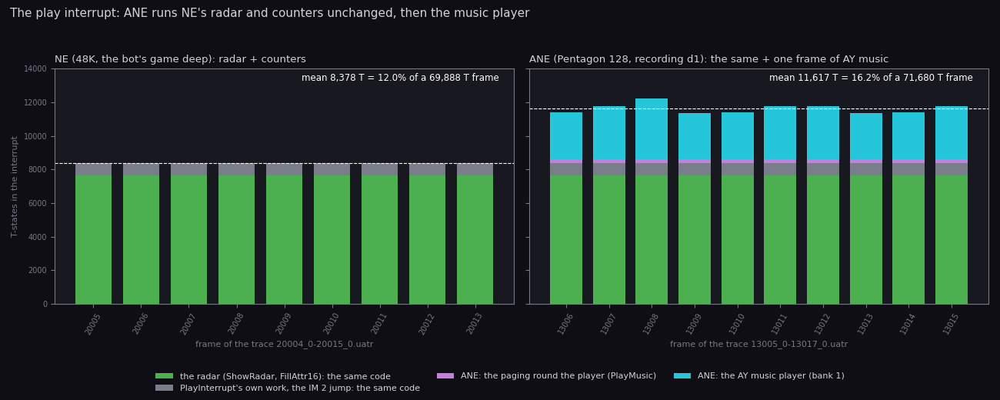

How to read it:

- One stacked bar per interrupt, split by the code running.
- The green radar and grey own-work parts are equally tall in both panels. The cyan music and violet glue parts are
  ANE's addition.
- The dashed line is the mean.
- Drawn by `python3 tools/fig_diff_interrupt.py`.

### 13.3.5 The beam and the tear

The same view copy (`CopyViewToScreen` `$D071`) meets a different beam (the bottom of the figure in 13.3.1):

| | NE `deep` 20012 | ANE d1 12454 |
| --- | --- | --- |
| the copy starts | in frame 20011, 17 491 T before this INT | 14 759 T after the INT, 5 021 T before the view's first line |
| the beam overtakes it at | screen line 116 (16 of 20 bytes new) | screen line 38 (19 of 20 bytes new) |
| bytes new in this frame | 2177 of 3200 | 625 of 3200 |

- **Why.** The turn is the same 10 frames on both machines, and the copy loop is the same code. But the Pentagon
  frame is 1792 T longer and its paper starts 3648 T later after the INT. ANE's interrupt also spends 3000-3800 T
  more on the music, and the turn's seven draw interrupts each play a music frame. So the copy's place against the
  beam differs from NE's in every turn. ANE [4.5](04-game-loop.md#45-the-turn) measures 24 tears in 45 copies and
  shows that the music moves the tears rather than causing them.
- **For the player.** Both games tear the view for one frame now and then. The other frames show either the old
  view or the new one whole. The two frames here are one example from each game, not an average. NE's side is in
  NE [4.5](../../nether-earth/docs/04-game-loop.md#45-time) and
  [6.2](../../nether-earth/docs/06-rendering.md#62-the-view-buffer-5b00-677f).

## 13.4 The states around play

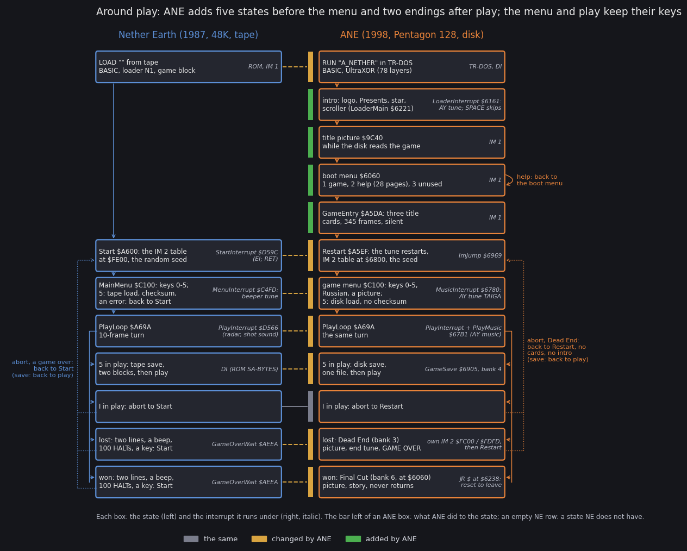

How to read it:

- One row per stage. NE is on the left (blue boxes) and ANE on the right (orange boxes).
- In each box, the state is on the left and the interrupt it runs under is on the right, in italics.
- The bar left of an ANE box says what ANE did to the state: grey the same, yellow changed, green added. An empty NE
  row is a state NE does not have.
- Solid arrows are the main path down. The inner bracket goes from play to its exits. The dotted lines go back to
  the menu's entry (NE `Start`, ANE `Restart`).
- Drawn by `python3 tools/fig_diff_shell_states.py --out docs/img/diff/shell-states.png`.

The same in text. NE (NE `src/game/start.asm`, `mainmenu.asm`, `gameturn.asm`; NE
[2](../../nether-earth/docs/02-architecture.md), [4.1](../../nether-earth/docs/04-game-loop.md#41-the-state-machine)):

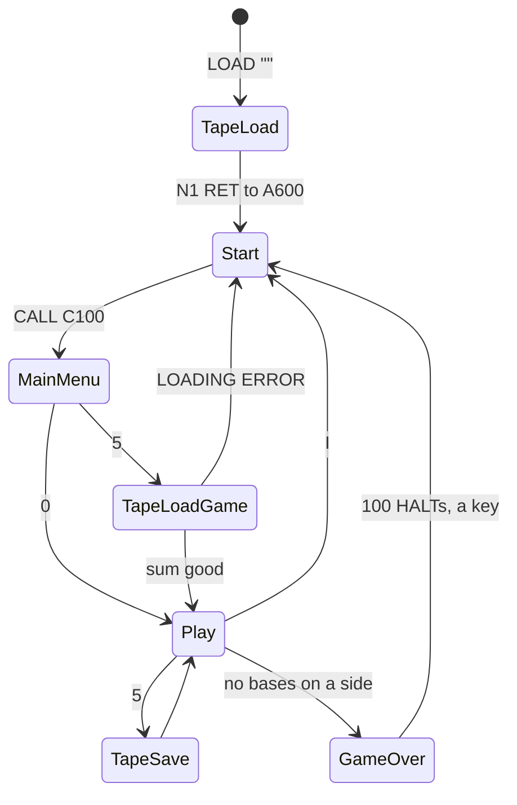

ANE (`src/loader.asm`, `src/game/start.asm`, `src/game/disk.asm`, `src/game/im2.asm`, `src/game/endings.asm`;
[2](02-architecture.md), [4.1](04-game-loop.md#41-the-state-machine), [5](05-controls.md)):

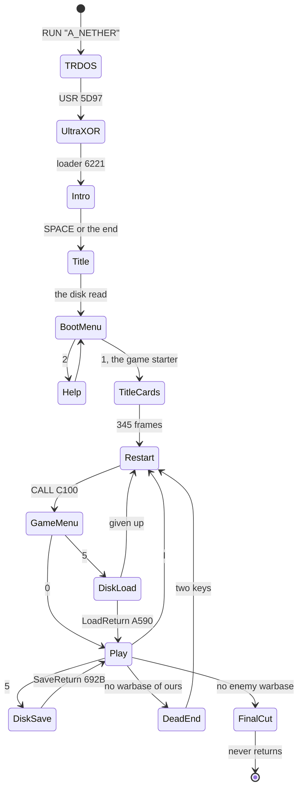

| State | NE | ANE | Witness |
| --- | --- | --- | --- |
| entry of the game | `Start` `$A600` from N1's `RET` | `GameEntry` `$A5DA` from the depacker's `JP`, then `Restart` `$A5EF` | NE [3.3](../../nether-earth/docs/03-build-and-load.md#33-the-load-step-by-step); ANE `src/game/start.asm` |
| menu interrupt | `MenuInterrupt` `$C4FD`, beeper tune | `MusicInterrupt` `$6780`, AY tune TAIGA from bank 1 | NE [2](../../nether-earth/docs/02-architecture.md); ANE `src/game/music.asm` |
| menu keys | 0 play, 1-3 controls, 4 redefine, 5 load, through ROM KEY-SCAN | the same keys and the same reader, Russian text, a picture | both `src/game/mainmenu.asm` |
| play interrupt | `PlayInterrupt` `$D566` | the same, with `PlayMusic` `$67B1` | 13.3.3 |
| abort (I) | `JP Start` | `JP Restart` (`$A712` in both) | ANE `src/game/start.asm`, comment of `Restart` |
| intro, title, boot menu, help, title cards | none | added | ANE [3.4](03-build-and-load.md#34-the-boot-chain), [5.9](05-controls.md); d1 |

- The boot menu has three items: 1 the game, 2 the help (six topics and an exit, 28 pages, a pointer that must touch
  a hit box), and 3 marked "NOT used". Witness: ANE [5](05-controls.md) 5.9 and r1. The help's text is in
  [8.7](08-hud-and-text.md#87-the-boot-menu-and-the-help-program).
- `Restart` restarts the tune and rebuilds the IM 2 table each time (13.3.2). It does not replay the cards or the
  intro.
- **Why.** The authors' additions: a scene release of 1998 came with an intro and a help program in Russian, and
  128K meant music on every screen.
- **For the player.** The game itself starts and stops the same way. More screens come before it, and SPACE skips
  most of them.

The screens of every state around play, side by side:

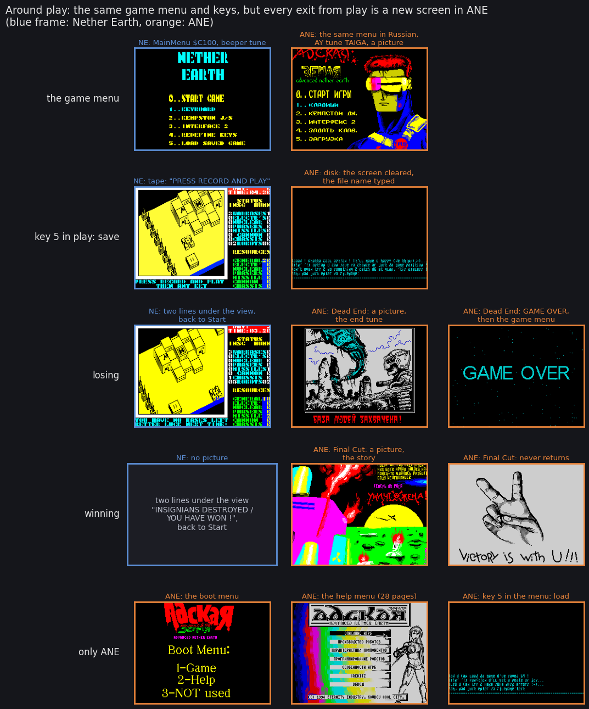

How to read it:

- One row per moment. NE is in the blue frame and ANE in the orange frames. The caption over each screen says what
  it is.
- Row 1, the game menu: NE `work/ill3/tour/state-menu.png` against ANE d1 `work/docR/shots2/menu.png`.
- Row 2, key 5 in play: NE `work/diff/rec-ne-save/save-prompt.png` (13.8) against ANE r2 frame 7652.
- Row 3, losing: NE `work/ill3/tour/state-gameover.png` against ANE r3 frames 100 and 900.
- Row 4, winning: NE has no recording (its message is quoted from the code). ANE is r4 frames 100 and 5000.
- Row 5, only in ANE: the boot menu (r1 8699), the help menu (r1 9079), the load prompt (r2 8932).
- Drawn by `python3 tools/fig_diff_shell_screens.py --out docs/img/diff/shell-screens.png`.

## 13.5 The game code

Scope: the game image in play only, ANE `$6731-$D7D7` (with the pieces it calls in banks 1, 3, 4 and 6) against NE
`$5B00-$FCE8`. `tools/diff_game.py` cuts both images into their annotations' entries, pairs them and compares each
pair instruction by instruction (the method in 13.12). A label operand that points to an entry's pair counts as
"relocated"; one that points to something else counts as "retargeted".

### 13.5.1 What is the same

There are 563 NE entries and 526 ANE entries. The status counts and the byte totals below are from the tool:

| Status | Entries | What it means |
|---|---|---|
| same | 431 | identical bytes |
| operands | 5 | only relocated label operands differ (EnterPlay, UnusedTapeCode, GameOverWait, LoadError, StartRobot) |
| retargeted | 5 | an operand now names something else (MainMenuTitle, SaveGame, ConstructionMenu, PrintChar, PrintBigChar) |
| changed | 55 | 44 of them are Russian texts at the same places (13.6.2) and 11 are code |
| ne-only | 57 | the beeper menu tune (48 entries), Font, SpriteSpare, the end texts, LostJump, TitleText, DefineKeyDone |
| runtime | 10 | buffers and tables the game fills (view buffer, world state, map) |
| ane-only | 30 | the music glue, the IM 2 block, the disk bridges, the endings' glue, spares |

The bytes NE's image declares (`$5B00-$FCE8` less the runtime areas, 28 839 bytes) split like this in
`tools/fig_diff_memmap.py`:

| Class | Bytes |
|---|---|
| same | 26 158 (90.7 %) |
| changed text | 1 008 |
| changed code | 140 |
| relocated / retargeted operands | 24 |
| NE only | 1 509 |

On the ANE side there are 1 009 new bytes of code and data and 500 bytes of new zero spares.

Nine modules have exactly the same bytes in both games:

| Module | Bytes |
|---|---|
| ship | 441 |
| world | 1 834 |
| enemy | 789 |
| bases | 672 |
| level | 855 |
| view | 1 020 |
| controls | 105 |
| tables | 299 |
| sprites | 15 338 |

The 150 sprite-module bytes that are not the same are NE's zero `SpriteSpare` at `$A56A`. ANE puts `GameLoad`,
`GlueStack` and `GameEntry` there (13.2, mark 2).

So the whole play (the robots' AI, movement, combat, the ship, the view, the radar and the turn's arithmetic) is NE's
code, byte for byte. It is also what runs. The CPU image of recording s2 at frame 11500
(`work/images/scl-play-cpu.bin`) differs from the build only in these places:

- ViewBufferTail;
- the self-modified SP operand of MenuPicture (`$67FA`);
- ImTable and ImJump, written by Restart;
- GlueStack;
- the self-modified operands of DrawSprite `$CF3F` and FillViewCorner `$D038` / `$D041`.

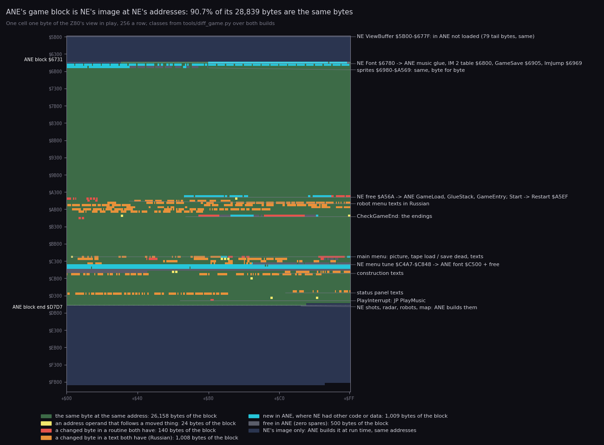

How to read it:

- One cell is one byte of `$5B00-$FFFF`, 256 bytes to a row, coloured by class: same, operand, code, text, new, free
  spare, runtime.
- The long same-coloured band from `$6980` to `$D7D7` is the play code and the sprites. The changes are islands:
  - the IM 2 block at `$6780-$697F`, in NE's old font;
  - the disk bridge at `$A56A`;
  - Restart;
  - the robot-menu texts;
  - the endings at `$AE6B-$AF10`;
  - the main menu and save at `$C103-$C350`;
  - the font at `$C4A8-$C848`, where NE's tune stood.
- Drawn by `python3 tools/fig_diff_memmap.py` (with `modules-diff.png`).

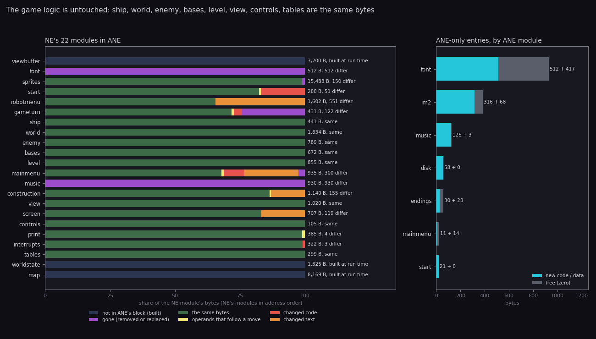

How to read it:

- One bar per NE module, split by class. Beside them are the ANE-only bytes, grouped by ANE module.
- Every bar that is all one colour is a module the authors did not touch. Only mainmenu, music, start, gameturn and
  interrupts have code changes. The music module is entirely "gone".
- Drawn by `python3 tools/fig_diff_memmap.py`, from the same run.

The changes in the play interrupt and in `Start` are in 13.3.2-13.3.3, the save and load in 13.8, the end of a game
in 13.9. The rest are the menu and the construction screen.

### 13.5.2 The title and the menu loop

`src/game/mainmenu.asm`.

**MainMenuTitle `$C103`** (NE line 7111, ANE line 6320):

```
NE  CALL PrintTitle      |  ANE  CALL MenuPicture    ; $67E5
```

`MenuPicture` (`src/game/music.asm`, ANE lines 233-244) does this:

- saves SP into its own `LD SP` operand;
- moves to `GlueStack`;
- pages bank 3;
- calls `MenuPictureCode` `$E73B`;
- pages bank 0 back;
- restores SP.

**PrintTitle `$C1E3`** becomes 25 `NOP`s and the old RET (ANE lines 6448-6473). NE's `TitleText` (the big "NETHER
EARTH") is gone. Nothing calls `PrintTitle` any more: a byte scan of the image finds no CALL or JP to `$C1E3`. In NE,
`LoadGame` also called it; ANE's `LoadGame` jumps to the disk instead (13.8).

**MainMenuKeys `$C192`** (NE lines 7195-7205, ANE lines 6388-6403):

```
NE  7195 C192 HALT                      |  ANE 6388 C192 NOP
    7196 C193 CALL TitleColourCycle     |      6389-6391 NOP NOP NOP
    7201 C19E CALL MenuMusic            |      6396-6398 NOP NOP NOP
    7205 C1A2 CALL TitleColourCycle     |      6401-6403 NOP NOP NOP
```

- **What and why.** NE's menu loop waits a frame, cycles the title's colours, plays the beeper tune and cycles again.
  ANE has no title text to colour and plays the AY tune from the interrupt, so the four calls are NOPed in place.
- **The removed HALT.** The release-wait loop no longer has a frame wait. `MenuOptionsEnd` (`$C18B`, new) has one HALT
  and runs once before the loop. It sits in the 7 bytes `MenuMoreText` gave up (13.6.2).
- **For the player.** The menu screen is a picture and the AY tune, with no flashing title. Key handling is NE's.

### 13.5.3 The beeper menu tune is gone

NE's music module `$C4A7-$C848` (930 bytes) is not in ANE. It has 48 entries, including `MenuMusic`, `MenuInterrupt`
`$C4FD`, the bass, lead and drum tracks, and `TitleColourCycle`. ANE puts `GameFont` `$C500` (512 bytes) there, with
zero spares around it (13.2, mark 4). NE's player and its tune are in NE
[9.1-9.4](../../nether-earth/docs/09-sound.md#91-the-menu-tune-at-a-glance); what plays instead is in 13.7.

The Russian "SPACE" name is a byte longer, so the menu's RET moved from `$C4A6` (NE `DefineKeyDone`) to `$C4A7` (ANE
`KeySpaceDone`), the first byte of NE's `MenuMusic` (13.6.2).

The font moved, so the print code follows it (`src/game/print.asm`):

| Routine | Address | NE | ANE | Lines (NE / ANE) |
|---|---|---|---|---|
| PrintChar | `$D4B7` | `LD DE,Font-$100` (`$6680`) | `LD DE,GameFont-$100` (`$C400`) | 11315 / 9650 |
| PrintBigChar | `$D4E0` | the same | the same | |

These are the only code changes in the print module. The NE 10.12 `MenuMusic` bug went away with the tune.

The shared variables `$FD00-$FDFB` are at the same addresses in both games. The exceptions are NE's music bytes,
which ANE never touches: `$FD33` TitleColourPhase, `$FD54` BassReturnPos and `$FD56` LeadReturnPos. NE's `Handler`
is at `$FDFE`. ANE's is `ImHandler` `$696A`. Witness: both `src/game/game.ann`, `@equ`.

### 13.5.4 The construction screen

`ConstructionMenu` `$C849` is retargeted only: the `MusicInterrupt` handler and `ImHandler` (13.3.2). Its texts are
Russian (13.6.2). NE's 24th-slot bug (NE 10.12) is kept: the logic is NE's bytes.

## 13.6 Resources: font, strings, panel, sprites and map

`tools/diff_res.py` compares NE's game image `build/game.bin` (`$5B00-$FCE8`) with ANE's game block
`build/game/game-6731.bin` (`$6731-$D7D7`) entry by entry of both `src/game/game.ann` (13.12). 205 resource entries
(`@res`) are common to both, all at the same addresses.

| Section | Same | Changed | Only NE | Only ANE |
| --- | ---: | ---: | ---: | ---: |
| sprites (89 blocks + the view edges) | 90 | 0 | 0 | 0 |
| font glyphs (codes `$20-$5F`) | 3 | 61 | 0 | 0 |
| level files | 16 | 0 | 0 | 0 |
| map, base records, radar (after `BuildMap`) | 3 | 0 | 0 | 0 |
| strings (kind t entries) | 9 | 44 | 3 | 0 |
| order names | 0 | 9 | 0 | 0 |
| other data tables (kinds b, w) | 20 | 0 | 29 | 6 |

In short: **the graphics and the world are NE's, byte for byte. The font is redrawn, every visible word is
translated, and NE's beeper menu tune gave way to the font** (13.2).

### 13.6.1 The font: redrawn for Russian

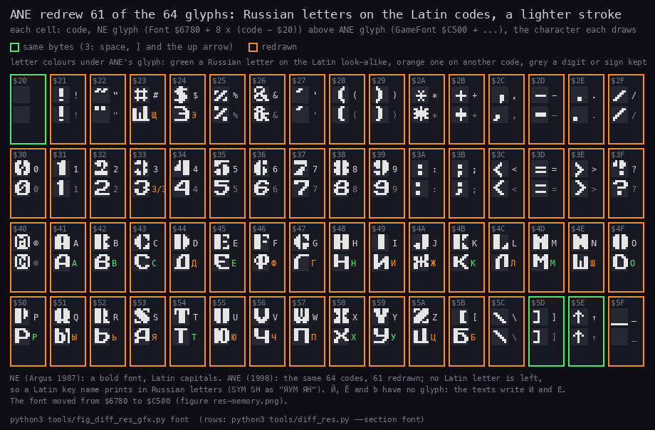

How to read it:

- One cell per code `$20-$5F`, NE's glyph above, ANE's below, at 4x, with the character each draws.
- A green frame: the same bytes. An orange frame: redrawn.
- The letter under ANE's glyph: green, a Russian letter on the Latin letter of the same shape; orange, a Russian
  letter on a code of another shape; grey, a digit or sign kept.
- Drawn by `python3 tools/fig_diff_res_gfx.py font` (rows: `python3 tools/diff_res.py --section font`).

- **What:**
  - **It moved.** NE's `Font` is at `$6780-$697F`; ANE's `GameFont` is at `$C500-$C6FF`. ANE prints from base
    `$C400` (`GameFont` - `$100`, 13.5.3).
  - **61 of 64 glyphs are redrawn.** Only the space, `]` and the up arrow (`$20`, `$5D`, `$5E`) are the same.
    Witness: `diff_res.py --all --section font`.
  - **The digits and signs are redrawn too,** with a few pixels moved each (2 to 22 pixels per glyph). NE's font
    shares 10 glyphs with the 48K ROM's font (`$3D00`); ANE's shares 3 (space, `]`, up arrow). Witness: the ROM
    font of `data/rom/48.rom` compared code by code.
  - **30 Russian letters, no Latin letters.**
    - 12 on the Latin letter of the same shape: А В С Е Н К М О Р Т Х У on A B C E H K M O P T X Y.
    - 18 on other codes: Д Ф Г И Ж Л on D F G I J L; Ш Ы Ь Я Ю Ч on N Q R S U V; П Ц Б on W Z `[`; Щ on `#`, Э
      on `$`, З on `3`.
    - © stays on `@`.
    - The digit 3 and the letter З share code `$33`.
    - Й, Ё and Ъ have no glyph. Й is written И (БОЕВОИ, ЗАДАИТЕ, ИНТЕРФЕИС, НЕИТР.), Ё as Е, and Ъ never occurs.
  - The letter map is ANE's `tools/game_text.py` `GLYPHS`; [8.2](08-hud-and-text.md#82-the-game-font) has the full
    table. NE's font is in NE [8.2](../../nether-earth/docs/08-hud-and-text.md#82-the-font).
- **Why:** the translation. The print routine is NE's, so the authors kept 64 codes and gave Russian letters the
  Latin codes Russian does not need. They kept a letter's code where the shapes match, so that much of the
  encoding is by shape.
- **For the player:** every text is Russian in a slightly bolder, rounder face. An English word in a key name comes
  out as Russian letters (SYM SH prints as ЯУМ ЯН, 13.6.2).

### 13.6.2 Strings: translated in place

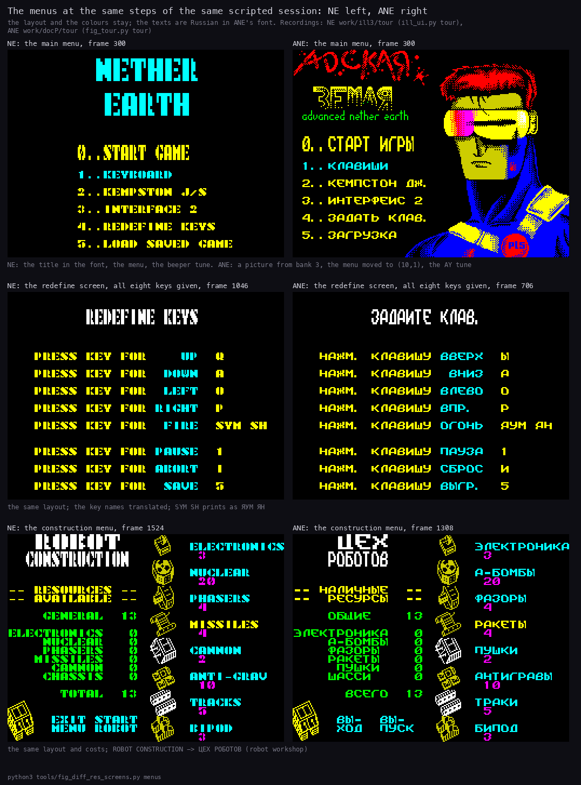

How to read it:

- Each pair is the same step of the scripted tour in both recordings (frame numbers in the titles): the main menu,
  the redefine screen with all eight keys given, the construction menu.
- Recordings: NE `work/ill3/tour` (`tools/ill_ui.py tour`), ANE `work/docP/tour` (`tools/fig_tour.py tour`). No new
  emulator run was needed.
- Drawn by `python3 tools/fig_diff_res_screens.py menus`.

- **What:**
  - 44 strings changed, 9 the same, 3 only in NE. Witness: `diff_res.py --section strings`.
  - **Every changed string keeps its address, its length and its layout codes** (positions, attributes, sizes), with
    two exceptions in length and four in layout (below).
  - The translator wrote over NE's bytes, padding with spaces or cutting words with a dot (УПРАВЛ., ЛИКВИД.,
    ВРАЖЕСК., ДИСТАН., ВПР., ВЫГР.) so each fits its slot.

The strings that changed, with the English. NE's text is the original; ANE's English is a back-translation (from
[8.3](08-hud-and-text.md#83-every-string-of-the-game)):

| Entry | NE address = ANE address | NE | ANE | ANE in English |
| --- | --- | --- | --- | --- |
| `MenuStartText` | `$C109` | 0..START GAME at (11,8) | 0..СТАРТ ИГРЫ at (10,1) | 0..START GAME |
| `MenuKeyboardText` | `$C128` | 1..KEYBOARD | 1..КЛАВИШИ | 1..KEYS |
| `MenuKempstonText` | `$C13F` | 2..KEMPSTON J/S | 2..КЕМПСТОН ДЖ. | 2..KEMPSTON J. |
| `MenuMoreText` | `$C159` | 3..INTERFACE 2 / 4..REDEFINE KEYS / 5..LOAD SAVED GAME | 3..ИНТЕРФЕИС 2 / 4..ЗАДАТЬ КЛАВ. / 5..ЗАГРУЗКА | 3..INTERFACE 2 / 4..DEFINE KEYS / 5..LOAD |
| `RedefineTitleText` | `$C350` | REDEFINE KEYS | ЗАДАИТЕ КЛАВ. | SET THE KEYS |
| `PressKeyForText` | `$C40F` | PRESS KEY FOR | НАЖМ. КЛАВИШУ | PRESS THE KEY |
| `KeyNameUp` ... `KeyNameSave` | `$C382-$C3F3` | UP, DOWN, LEFT, RIGHT, FIRE, PAUSE, ABORT, SAVE | ВВЕРХ, ВНИЗ, ВЛЕВО, ВПР., ОГОНЬ, ПАУЗА, СБРОС, ВЫГР. | UP, DOWN, LEFT, RIGHT, FIRE, PAUSE, RESET, UNLOAD |
| `KeyNameEnter` | `$C481` | ENTER | ЕНТЕР | ENTER (spelt in Russian letters) |
| `KeyNameCapsShift` | `$C48F` | CAPS SH | К. ШИФТ | C. SHIFT |
| `KeyNameSpace` | `$C4A0` | SPACE | ПРОБЕЛ | SPACE |
| `PlayTapeText` | `$C203` | PRESS PLAY ON TAPE | ВКЛЮЧИТЕ МАГНИТОФОН | SWITCH ON THE TAPE RECORDER |
| `LoadErrorText` | `$C26C` | LOADING ERROR! | ОШИБКА ВВОДА ! | INPUT ERROR! |
| `RecordText` | `$C296` | PRESS RECORD AND PLAY / THEN ANY KEY | ВКЛЮЧИТЕ МАГНИТОФОН / И НАЖМИТЕ ЛЮБУЮ КЛАВ. | SWITCH ON THE TAPE RECORDER AND PRESS ANY KEY |
| `ConstructionTitleText` | `$C8BE` | ROBOT / CONSTRUCTION | ЦЕХ / РОБОТОВ | ROBOTS' WORKSHOP |
| `PartNamesText` | `$C8DD` | ELECTRONICS, NUCLEAR, PHASERS, MISSILES, CANNON, ANTI-GRAV, TRACKS, BIPOD | ЭЛЕКТРОНИКА, А-БОМБЫ, ФАЗОРЫ, РАКЕТЫ, ПУШКИ, АНТИГРАВЫ, ТРАКИ, БИПОД | ELECTRONICS, A-BOMBS, PHASERS, MISSILES, CANNONS, ANTI-GRAVS, TRACKS, BIPOD |
| `ExitStartText` | `$C932` | EXIT START / MENU ROBOT | ВЫ- ВЫ- / ХОД ПУСК | EX-IT, LAUNCH |
| `ResourceNamesText` | `$C96E` | -- RESOURCES -- / -- AVAILABLE --, GENERAL, ..., CHASSIS, TOTAL | -- НАЛИЧНЫЕ -- / -- РЕСУРСЫ --, ОБЩИЕ, ..., ШАССИ, ВСЕГО | RESOURCES IN HAND, GENERAL, ..., CHASSIS, TOTAL |
| `PlayScreenText` | `$D1C5` | DAY: / TIME: / RADAR: | ДЕНЬ: / ЧАС: / РАДАР: | DAY: / HOUR: / RADAR: |
| `StatusPanelText` | `$D1EB` | STATUS, INSG HUMN, WARBASES ... ROBOTS, RESOURCES, GENERAL ... CHASSIS | СТАТУС, ИНОП. ЛЮДИ, БАЗЫ ... РОБОТЫ, РЕСУРСЫ, ОБЩИЕ ... ШАССИ | STATUS, ALIENS HUMANS, BASES ... ROBOTS, RESOURCES, GENERAL ... CHASSIS |
| `RobotMenuText` | `$A738` | DIRECT CONTROL, GIVE ORDERS, COMBAT MODE, LEAVE ROBOT, -ORDERS- | ПРЯМОЕ УПРАВЛ., ОТДАТЬ ПРИКАЗ, БОЕВОИ РЕЖИМ, ОСТАВИТЬ РОБОТА, ПРИКАЗ | DIRECT CONTROL, GIVE AN ORDER, COMBAT MODE, LEAVE THE ROBOT, ORDER |
| `StrengthText` | `$A820` | STRENGTH | СИЛА | STRENGTH |
| `OrdersMenuText` | `$A977` | SELECT ORDERS, STOP AND DEFEND, ADVANCE ?? MILES, RETREAT ?? MILES, SEARCH & DESTROY, SEARCH & CAPTURE | ОТДАТЬ ПРИКАЗ, ДЕРЖАТЫ ОБОРОНУ, ВПЕРЕД ?? МИЛЬ, НАЗАД ?? МИЛЬ, ПОИСК И ЛИКВИД., ПОИСК И ЗАХВАТ | GIVE AN ORDER, HOLD THE DEFENCE, FORWARD ?? MILES, BACK ?? MILES, SEARCH AND LIQUIDATE, SEARCH AND CAPTURE |
| `AdvanceTitle`, `RetreatTitleText` | `$AA1F`, `$AA32` | ADVANCE, RETREAT | ВПЕРЕД, НАЗАД | FORWARD, BACK |
| `DistanceText` | `$AA43` | ?? MILES, SELECT DISTANCE, 0 MILES | ?? МИЛЬ, ВЫБОР ДИСТАН., 0 МИЛЬ | ?? MILES, CHOICE OF DISTANCE, 0 MILES |
| `DestroyMenuText` | `$AAD8` | SEARCH & DESTROY, SELECT TARGET, ENEMY ROBOTS / FACTORYS / WARBASES | ПОИСК И ЛИКВИД., ВЫБОР ЦЕЛИ, ВРАЖЕСК. РОБОТЫ / ЗАВОДЫ / БАЗЫ | SEARCH AND LIQUIDATE, CHOICE OF TARGET, ENEMY ROBOTS / FACTORIES / BASES |
| `CaptureMenuText` | `$AB54` | SEARCH & CAPTURE, SELECT TARGET, NEUTRAL / ENEMY FACTORYS, ENEMY WARBASES | ПОИСК И ЗАХВАТ, ВЫБОР ЦЕЛИ, НЕИТР. / ВРАЖЕСК. ЗАВОДЫ, ВРАЖЕСК. БАЗЫ | SEARCH AND CAPTURE, CHOICE OF TARGET, NEUTRAL / ENEMY FACTORIES, ENEMY BASES |
| `CombatMenuText` | `$AC06` | NUCLEAR BOMB, FIRE PHASERS, FIRE MISSILES, FIRE CANNON, MOVE ROBOT, STOP COMBAT | АТОМНАЯ БОМБА, ОГОНЬ ФАЗОРОВ, ОГОНЬ РАКЕТ, ОГОНЬ ПУШЕК, ДВИЖЕНИЕ, ВЫХОД ИЗ МЕНЮ | ATOMIC BOMB, FIRE PHASERS, FIRE MISSILES, FIRE CANNONS, MOVEMENT, EXIT THE MENU |

The 9 that are the same: `OrderLineHead`, `MilesPos`, `DistanceAtText`, `ClockPos`, `DefineKeyBlank`,
`KeyNameSymShift`, `PartCostsText`, `TotalPosition`, `PanelBlankLine`. All but one hold only layout codes, digits
or blanks. The exception is `KeyNameSymShift`: its Latin "SYM SH" was left as it was and prints as ЯУМ ЯН in the
Russian font.

#### The order names

The nine 27-byte records at `$A848` (three rows of 8 characters and an end) keep their layout; all nine are
translated. Witness: `diff_res.py --section orders`.

| # | NE | ANE | ANE in English |
| ---: | --- | --- | --- |
| 0 | STOP AND DEFEND | СТОЯТЬ И ДЕРЖАТЬ ОБОРОНУ | STAND AND HOLD THE DEFENCE |
| 1 | ADVANCE n MILES | ВПЕРЕД n МИЛЬ | FORWARD n MILES |
| 2 | RETREAT n MILES | НАЗАД n МИЛЬ | BACK n MILES |
| 3 | DESTROY ENEMY ROBOTS | ЛИКВИД. ВРАЖЕСК. РОБОТОВ | LIQUIDATE ENEMY ROBOTS |
| 4 | DESTROY ENEMY FACTORYS | ЛИКВИД. ВРАЖЕСК. ЗАВОДЫ | LIQUIDATE ENEMY FACTORIES |
| 5 | DESTROY ENEMY WARBASES | ЛИКВИД. ВРАЖЕСК. БАЗЫ | LIQUIDATE ENEMY BASES |
| 6 | CAPTURE NEUTRAL FACTORYS | ЗАХВАТ НЕИТРАЛ. ЗАВОДОВ | CAPTURE OF NEUTRAL FACTORIES |
| 7 | CAPTURE ENEMY FACTORYS | ЗАХВАТ ВРАЖЕСК. ЗАВОДОВ | CAPTURE OF ENEMY FACTORIES |
| 8 | CAPTURE ENEMY WARBASES | ЗАХВАТ ВРАЖЕСК. БАЗ | CAPTURE OF ENEMY BASES |

NE's "FACTORYS" is NE's own spelling; the translation drops it.

Entries 6-8 use the genitive after the noun ЗАХВАТ ("capture of"). Entries 4 and 5 read as the accusative after
the verb ЛИКВИДИРОВАТЬ ("liquidate"), as in the destroy menu's target list. Both cases are right, as
[8.5](08-hud-and-text.md#85-slips-seen-on-the-screen) now says.

#### What changed beyond the words

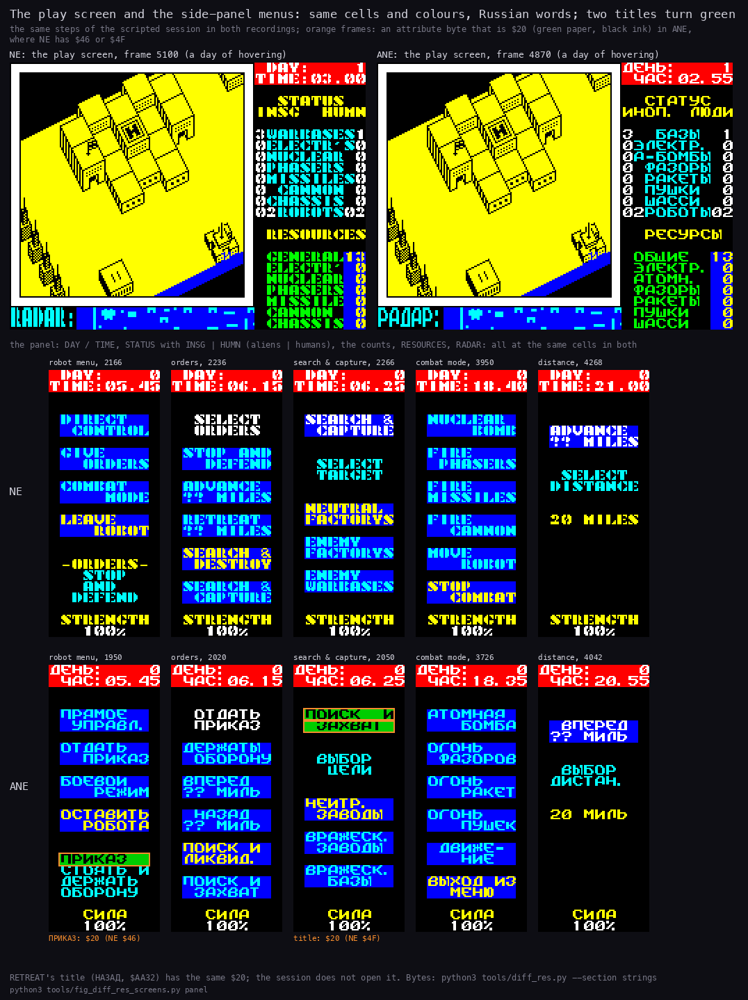

How to read it:

- Top: the play screen at the same step of both tours (NE frame 5100, ANE 4870). Below: the side-panel menus, NE row
  above, ANE row below, at the same steps (frame numbers over each).
- Orange frames on ANE mark an attribute that is `$20` (green paper, black ink) where NE has `$46` or `$4F`.
- Drawn by `python3 tools/fig_diff_res_screens.py panel`.

| Entry | What | Why | For the player |
| --- | --- | --- | --- |
| `MenuStartText` `$C109` | position (11,8) -> (10,1) | the menu now sits beside the picture of bank 3 instead of under NE's title (13.5.2) | the menu is on the left of the screen |
| `MenuMoreText` `$C159` | 57 -> 50 bytes: "5..LOAD SAVED GAME" -> "5..ЗАГРУЗКА"; ANE's code `MenuOptionsEnd` follows at `$C18B` | a shorter word, and the bytes went to code (13.5.2) | none |
| `KeyNameSpace` `$C4A0` | 6 -> 7 bytes: ПРОБЕЛ is one letter longer than SPACE | the translation. The 0 ends on `$C4A6`, where NE has `DefineKeyDone` (the RET after the text); ANE's RET (`KeySpaceDone`) moved to `$C4A7`, the first byte of NE's `MenuMusic`, which ANE no longer has | none: the key works as in NE |
| `RobotMenuText` `$A738` | ПРИКАЗ's attribute `$46` -> `$20` | most likely a slip: `$20` is the ASCII space, typed over the attribute byte while the text was entered in place | the ORDER caption under the robot menu is black on green instead of yellow |
| `RetreatTitleText` `$AA32` | attribute `$4F` -> `$20` | the same slip | the BACK title is black on green (not seen in the tour, which does not open RETREAT) |
| `CaptureMenuText` `$AB54` | attribute `$4F` -> `$20` | the same slip | SEARCH AND CAPTURE's title is black on green; tour 1990 shows it |
| `OrdersMenuText` `$A977` | "ДЕРЖАТЫ" with Ы for Ь | a typo, not a missing glyph: the font has Ь (on `R`), and the order names spell ДЕРЖАТЬ right | a visible misspelling in the orders menu |

The green titles in the figure have orange frames (rows 17 and 4-5). Bytes: `diff_res.py --section strings` (the
"text and layout" rows). ANE [8.5](08-hud-and-text.md#85-slips-seen-on-the-screen) lists the same slips.

#### The strings only NE has

| NE entry | NE text | What ANE has there |
| --- | --- | --- |
| `LostText` `$AE7C` | YOU HAVE NO BASES LEFT / BETTER LUCK NEXT TIME! | code `CheckGameEnd` |
| `WonText` `$AEB7` | INSIGNIANS DESTROYED / YOU HAVE WON ! | code `GameWon`, then `OldEndText` `$AEE1`: the last 9 bytes of an old text line, never read |
| `TitleText` `$C1E6` | NETHER / EARTH (the menu's title) | code `PrintTitle` (25 NOPs) |

- **Why:** ANE ends a game with the Dead End and Final Cut programs instead of a panel text (13.9), and its menu
  shows a picture instead of the title (13.5.2). The freed bytes hold the new code.
- **For the player:** no end-of-game line on the panel and no NETHER EARTH title in the menu.

### 13.6.3 The status panel: the same cells

The panel prints from `PlayScreenText` `$D1C5` and `StatusPanelText` `$D1EB`. Both keep every position and
attribute; only the words change (the play screen pair of `res-screens-panel.png`, tour step 57; ANE
[8.4](08-hud-and-text.md#84-the-play-screen-and-its-panel), NE
[8.4](../../nether-earth/docs/08-hud-and-text.md#84-the-status-panel)).

- DAY: / TIME: -> ДЕНЬ: / ЧАС: (DAY / HOUR). RADAR: -> РАДАР:.
- STATUS -> СТАТУС; INSG / HUMN (the Insignians / the humans) -> ИНОП. / ЛЮДИ (aliens / humans).
- WARBASES -> БАЗЫ (bases); ELECTR'S -> ЭЛЕКТР.; NUCLEAR -> А-БОМБЫ (A-bombs) in the status column but АТОМН.
  (nuclear) in the resources column; MISSILES -> РАКЕТЫ; CANNON -> ПУШКИ.
- **For the player:** the same panel. The enemy reads as "aliens" rather than NE's named Insignians.

### 13.6.4 Sprites, level and map: unchanged

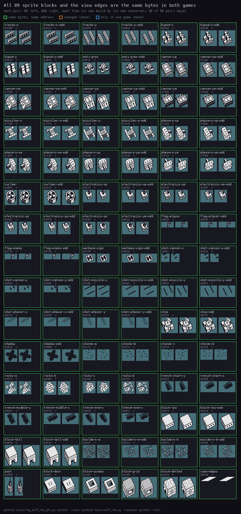

How to read it:

- Each pair is NE left, ANE right, each drawn from its own build by its own case's converter (NE's
  `tools/res_formats.py`, ANE's `tools/game_res.py`).
- A changed pair would be framed orange, a block in one game only blue; every frame is green.
- Drawn by `python3 tools/fig_diff_res_gfx.py sprites` (rows: `python3 tools/diff_res.py --section sprites --all`).

- **What:** all 89 sprite blocks (`$6980-$A569`, header and rows) and the view edges (`$D6A8`,
  `gfx/view-edges.bin`) are byte-identical, at the same addresses. Witness: `diff_res.py --section sprites` (90
  same).
- **Why:** ANE is a translation and an add-on around NE's game. Its authors did not touch the graphics.
- **For the player:** robots, buildings, the ship, the scenery and the explosions look exactly as in NE
  ([6.5](../../nether-earth/docs/06-rendering.md#65-sprites) in NE).

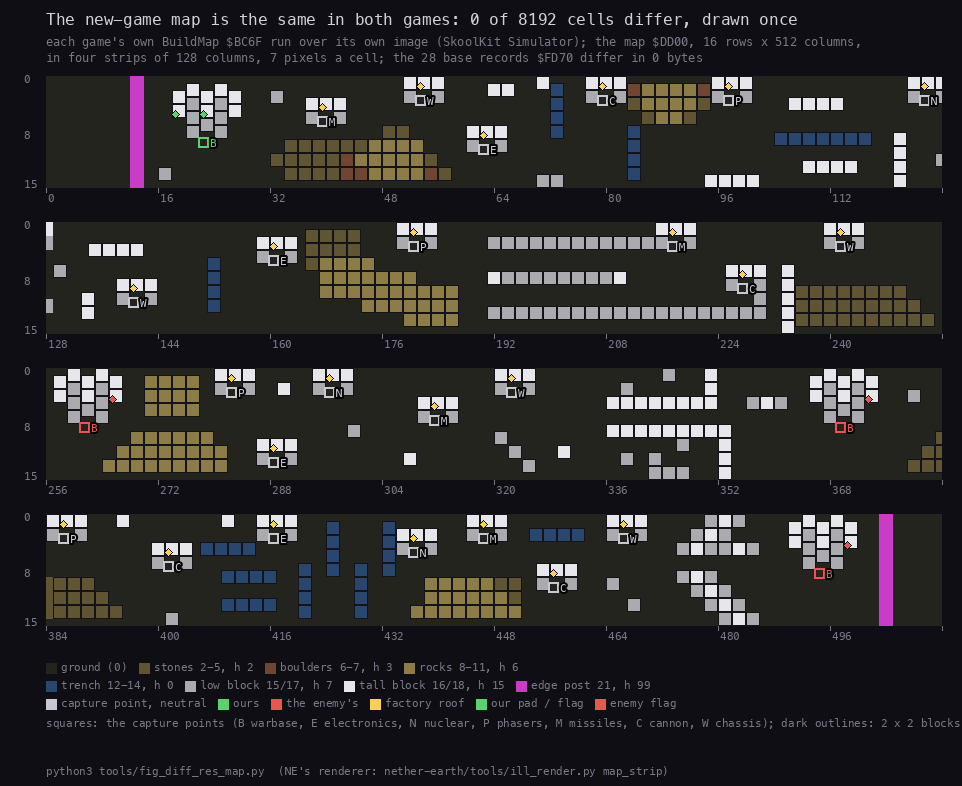

How to read it:

- The map `$DD00`, 16 rows by 512 columns, in four strips of 128 columns, drawn by NE's renderer
  (`games/nether-earth/tools/ill_render.py` `map_strip`).
- A changed cell would have a red frame; none has, so the map is drawn once.
- Drawn by `python3 tools/fig_diff_res_map.py`.

- **What:**
  - All 16 level files are byte-identical (the scenery and base lists, 3-byte records; the shape table and the
    shapes). Witness: `diff_res.py --section level`.
  - The map is not in either image; each game builds it at a new game. Each game's own `BuildMap` (`$BC6F`), run on
    SkoolKit's Simulator over its own image, builds the same map: 0 of 8192 cells differ (2365 non-zero). The 28
    base records `$FD70-$FDC3` and the radar `$D800-$D8FF` are the same too. Witness: `diff_res.py --section map`
    (`diff_res.py buildmap`; memories in `work/diff/buildmap/ne.bin`, `ane.bin`).
  - The other 20 data tables both games name are the same: the key table and controls, `PartCosts`, the building
    tops, heights and sprites, the step delays and lanes, the panel positions, the sprite tables, `PartHeights`
    and `TerrainHeights`. Witness: `diff_res.py --all --section tables`.
- **Why:** ANE keeps NE's game; its changes are in the shell and in the code.
- **For the player:** the same world: the same factories, warbases and terrain in the same places
  ([7.5](../../nether-earth/docs/07-objects.md#75-the-map) in NE, [7](07-objects.md) in ANE).

## 13.7 Sound

The sound effects are NE's, untouched; the music is new and runs on the AY.

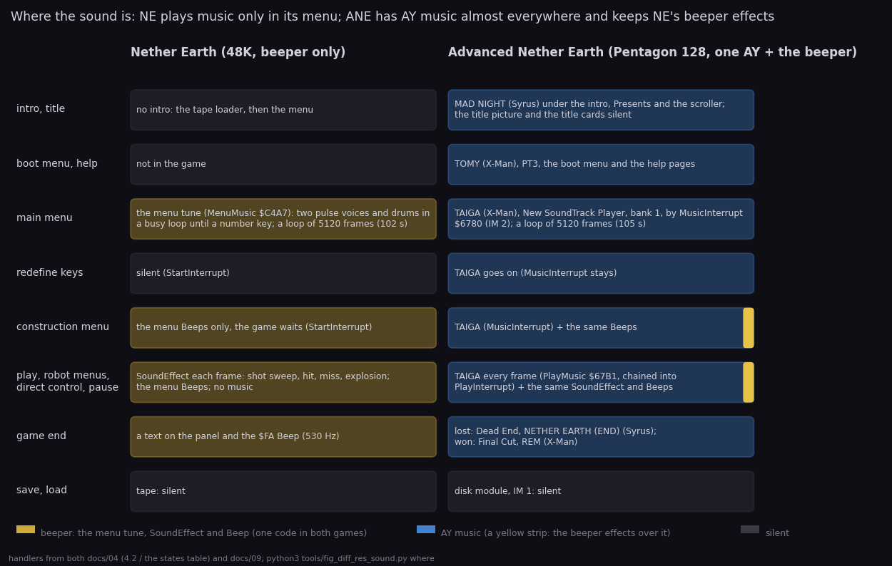

How to read it:

- One row per state; NE left, ANE right.
- Yellow: beeper (NE's menu tune, `SoundEffect` and `Beep`). Blue: AY music. A yellow strip on a blue box: NE's
  beeper effects play over the AY tune. Grey: silent.
- Drawn by `python3 tools/fig_diff_res_sound.py where` (the handlers from both docs/04 and docs/09).

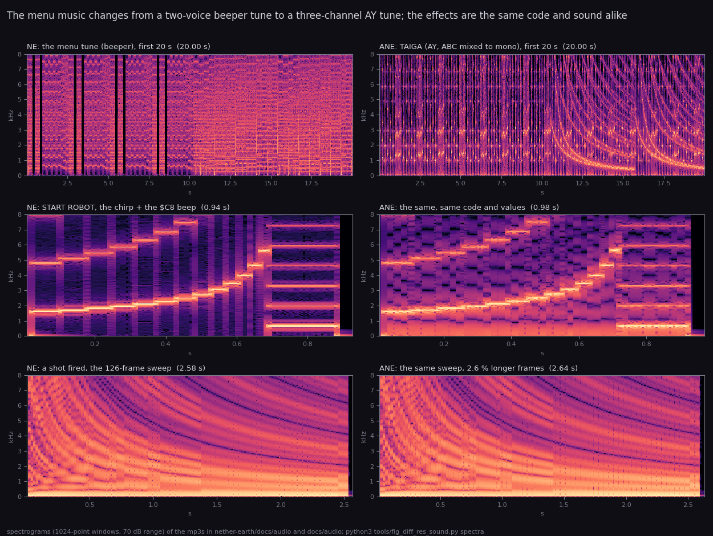

How to read it:

- Frequency up to 8 kHz against time, decoded from the mp3s of both cases' `docs/audio`.
- Top: the first 20 s of each menu tune. Middle and bottom: the same effect in both games.
- Drawn by `python3 tools/fig_diff_res_sound.py spectra`.

### 13.7.1 The effects: NE's, unchanged

- **What:** `Beep` (`$CCAC`) and `SoundEffect` (`$D5C4`) are byte-identical in both games. All 15 `Beep` call
  sites (`LD A,n` / `CALL $CCAC`) keep their values, from the `$14` cursor click to the `$FA` refusal.
  The table of the sites is in NE's [9.6](../../nether-earth/docs/09-sound.md#96-beep-ccac); ANE's
  [9.6](09-sound.md#96-the-beeper-effects) describes the same code. Witness: both `src/game/game.ann` and the bytes
  at each site in both images.
- `PlayInterrupt` differs in one instruction: `CALL $D59E` becomes `JP $67B1` (`PlayMusic`), which chains the AY
  tune after the radar and before the effects (13.3.3).
- **Why:** nothing needed changing. The Pentagon has the same beeper port.
- **For the player:** the effects sound the same. They run slightly longer (sfx-robot-start 0.94 s -> 0.98 s,
  sfx-fire-sweep 2.58 s -> 2.64 s): the Pentagon frame is 71 680 T against 69 888 T (48.8 Hz against 50.1 Hz, 2.6 %
  longer) and has no contended memory. The middle and bottom rows of the spectrogram show the same pitches.

### 13.7.2 The music: a beeper tune replaced by AY tunes

| State | NE | ANE |
| --- | --- | --- |
| Intro | none | MAD NIGHT (Syrus) |
| Boot menu, help | not in NE | TOMY (X-Man), PT3 |
| Main menu | the beeper menu tune: `MenuMusic` `$C4A7` in a busy loop until a number key; two voices and drums; 5120 steps (102.4 s at a step a frame), 5192 frames a pass in the machine (103.8 s) | TAIGA (X-Man), New SoundTrack Player in bank 1, from `MusicInterrupt` `$6780` under IM 2; a loop of 5120 frames (105 s) |
| Redefine keys | silent (`StartInterrupt`) | TAIGA goes on (`MusicInterrupt` stays) |
| Construction menu | silent apart from the menu beeps (`StartInterrupt`) | TAIGA (`MusicInterrupt`) and the same beeps |
| Play, robot menus, pause | the effects only (`PlayInterrupt`) | TAIGA every frame (`PlayInterrupt` -> `PlayMusic` `$67B1`) and the same effects |
| Game end | the `$FA` beep with the panel text | Dead End: NETHER EARTH (END) (Syrus); Final Cut: REM (X-Man) |
| Save, load | tape, silent | disk module, silent |

NE's loop is not simply "5120 frames": NE [9.4](../../nether-earth/docs/09-sound.md#94-the-tune) counts 5120
interrupt steps, but a pass takes 5192 frames in the machine (72 interrupts give no step), so both numbers are given
above. The figure's "102 s" is the step count.

Witness: the handlers each state installs. NE: `MenuMusic` writes `MenuInterrupt`; `StartInterrupt` is set at
construction.asm:68, mainmenu.asm:287, start.asm:49 and gameturn.asm:317; `PlayInterrupt` at construction.asm:524
and start.asm:133. ANE: `ImHandler` = `MusicInterrupt` at start.asm:76 (`Restart`) and construction.asm:67;
`PlayInterrupt` at construction.asm:481 and start.asm:158. Both docs/04 state tables and docs/09 agree. The tunes
are described in ANE [9.4](09-sound.md#94-the-tunes).

- **What:** NE's only music is the beeper menu tune (player `$C4A7`, tune data `$C665-$C81F`). It plays only in
  the main menu, because a beeper tune takes the whole CPU. ANE drops it (13.5.3) and plays AY tunes from the
  interrupt. The game's tune, TAIGA, plays from the main menu through the construction menu into play.
- **Why:** the 128K machine. The AY plays from a 50 Hz interrupt at a small cost per frame: at most 6.7 % of a frame
  for any tune ([9.5](09-sound.md#95-the-cost-of-a-frame-of-music)), and TAIGA in play 2 997 T, 4.2 % (13.3.4).
  Bank 1 holds the player and the tune out of the game's memory. The beeper tune's bytes went to the font (13.2).
- **For the player:** NE is silent in play apart from the effects. ANE has music all through the game, with NE's
  effects over it.

Listen:

| | NE | ANE |
| --- | --- | --- |
| Menu music | [menu-tune.mp3](../../nether-earth/docs/audio/menu-tune.mp3) | [taiga.mp3](audio/taiga.mp3) |
| Shell music | none | [mad-night.mp3](audio/mad-night.mp3), [tomy.mp3](audio/tomy.mp3), [nether-earth-end.mp3](audio/nether-earth-end.mp3), [rem.mp3](audio/rem.mp3), [sample.mp3](audio/sample.mp3) |
| Cursor click | [sfx-cursor-click.mp3](../../nether-earth/docs/audio/sfx-cursor-click.mp3) | [sfx-cursor-click.mp3](audio/sfx-cursor-click.mp3) |
| Robot start | [sfx-robot-start.mp3](../../nether-earth/docs/audio/sfx-robot-start.mp3) | [sfx-robot-start.mp3](audio/sfx-robot-start.mp3) |
| A shot's sweep | [sfx-fire-sweep.mp3](../../nether-earth/docs/audio/sfx-fire-sweep.mp3) | [sfx-fire-sweep.mp3](audio/sfx-fire-sweep.mp3) |
| Miss, hit, kill | [miss](../../nether-earth/docs/audio/sfx-miss.mp3), [hit](../../nether-earth/docs/audio/sfx-hit.mp3), [kill](../../nether-earth/docs/audio/sfx-kill.mp3) | [miss](audio/sfx-miss.mp3), [hit](audio/sfx-hit.mp3), [kill](audio/sfx-kill.mp3) |
| Part paid / accepted | [sfx-part-paid.mp3](../../nether-earth/docs/audio/sfx-part-paid.mp3) | [sfx-part-accepted.mp3](audio/sfx-part-accepted.mp3) |
| Play with music | none | [construction-menu-in-play.mp3](audio/construction-menu-in-play.mp3) |

The effects in both are rendered by unreal-ng from the machine state (each case's `docs/audio/README.md`).

## 13.8 Saving and loading

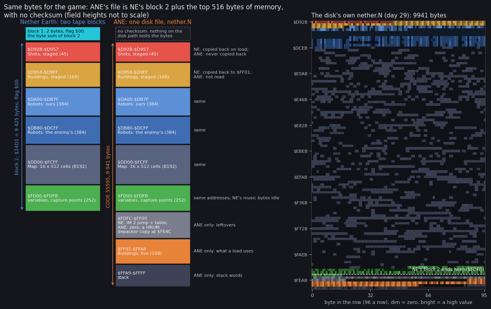

How to read it:

- **Left**: NE's two tape blocks next to ANE's one disk file, field by field, from `$D92B` down. Field heights are not
  to scale. The notes on the right say what each field means on a load.
- **Right**: the 9941 bytes of the disk's `nether.N`, 96 a row, coloured by field. Dim is zero and bright is a high
  value. The white dashed line is where NE's block 2 would end (`$FDFB`).
- **The claim**: ANE saves the same game bytes NE saves, plus the top 516 bytes of memory, without a checksum.
- Drawn by `python3 tools/fig_diff_shell_save.py --out docs/img/diff/shell-save.png`. It prints the check that the
  staged buildings equal the `$FF01` copy, and the sum NE would have saved.

| | NE | ANE |
| --- | --- | --- |
| medium | tape, two headerless blocks (flag `$00`, pilot `$0900`), ROM SA-BYTES `$04D0` | disk, one CODE file `name.N`, through the disk module in bank 4 (`GameSave` `$6905`, the module's save `$4033`) |
| block 1 | 2 bytes at `$5B00`: the byte sum of block 2 (`SaveChecksum` `$C30F`) | none |
| the game | `$D92B-$FDFB`, `$24D1` = 9425 bytes | `$D92B-$FFFF`, 9941 bytes, CODE 55595 |
| staging before the save | Shots (45 bytes) to `$D92B`, Buildings (168) to `$D958` | the same (`SaveGameStage` `$C2CC`) |
| on load | LD-BYTES `$0562`; sum compared; Shots and Buildings copied back | TR-DOS reads the file to `$D92B`; nothing compared; nothing copied back: the live Buildings come from the file's `$FF01-$FFA8` |
| a bad load | "LOADING ERROR!", a beep, a key, `Start` | plays on with the changed bytes (r5) |
| time, recorded or computed | about 44 s of tape for a save, computed from the ROM's bit times on `nether.N`'s bytes | save 450 frames (9.2 s) with the name typed, of which 155 frames (3.2 s) of writing; load 270 frames (5.5 s) with the name typed |
| the prompt | "PRESS RECORD AND PLAY / THEN ANY KEY" | "Wooow ! Whatta cool opt!on ! ..." "Yah, now just enter da filename:" |

Witnesses:

- NE `src/game/mainmenu.asm`, `SaveGameBlocks`, `SaveChecksum` and `LoadGameBlocks`; NE
  [3.6](../../nether-earth/docs/03-build-and-load.md#36-the-saved-game). NE has no recording of a save (its
  `LoadGameBlocks` comment: "Not run in any recording"). The prompt was recorded for this report:
  `work/diff/rec-ne-save/save-prompt.png`, from NE `work/ill3/tour/start.szx`, with key 5 held for 15 frames in play
  (`work/diff/rec-ne-save/inputs.txt`). The instance was on its own port base, muted, and stopped after.
- ANE `src/game/mainmenu.asm` (`SaveGameStage`, the dead `LoadGameBlocks` with 10 NOPs), `src/game/disk.asm`
  (`GameLoad`, `LoadReturn`), `src/game/im2.asm` (`GameSave`, `SaveReturn`).
  ANE [3.7](03-build-and-load.md#37-the-saved-game-nethern), [10.10](10-gameplay-logic.md#1010-load-save-and-the-end-of-a-game),
  the disk module's texts in [8.6](08-hud-and-text.md#86-the-disk-modules-texts). Recordings: r2 frames 7652
  (prompt), 7947 ("Saving..."), 8102 (play), 8932 (load prompt), 9202 (play), and r5 (a changed `nether.N` loads
  without a word).
- `src/res/disk/nether-n.bin`:
  - the staged buildings equal the `$FF01` copy;
  - `$FDFC-$FF00` is zero except the HRUM depacker copy, 114 non-zero bytes at `$FE4C-$FEBD`;
  - NE's sum of its first `$24D1` bytes would be `$4D6C`.

### 13.8.1 Saving

NE's save stages two lists and writes two blocks. From NE `src/game/mainmenu.asm`:

```asm
SaveGameBlocks:
  CALL WaitAnyKey         ; the player starts the tape and presses a key
  ...
  LD HL,Shots             ; stage the 5 records of 9 bytes at $D7D3 ...
  LD DE,SaveShots         ; to SaveShots ($D92B)
  LD BC,$002D
  LDIR
  LD HL,Buildings         ; ... and the buildings at $D958
  LD BC,$00A8
  LDIR
  DI
  CALL SaveChecksum       ; the checksum
  LD (ViewBuffer),DE      ; the sum at $5B00, the first tape block
  LD HL,$0900             ; a short pilot
  LD IX,ViewBuffer
  LD DE,$0002
  ...
  CALL $04D0              ; ROM SA-BYTES
  LD HL,$0900             ; the game block $D92B-$FDFB
  LD IX,SaveShots
  LD DE,$24D1
  ...
  CALL $04D0
```

In play, the save key enters through **PlayLoop `$A71A`** (NE lines 2332-2336, ANE lines 1781-1790):

```
NE  2332 A712 JP NZ,Start         |  ANE 1781 A712 JP NZ,Restart
    2335 A71A CALL SaveGame       |      1784 A71A JP SaveGameStage   ; $C2CC
    2336 A71D JP EnterPlay        |      1790 A71D JP EnterPlay       ; reached from SaveReturn
```

NE's `SaveGame` does three things in turn:

1. it prints "PRESS RECORD AND PLAY / THEN ANY KEY";
2. it waits for a key (`SaveGameBlocks` `$C2C9`, `CALL WaitAnyKey`, NE line 7409);
3. it stages the tables and saves them to tape.

ANE jumps past the prompt and the key wait straight to the staging, at a new label `SaveGameStage` `$C2CC` (ANE lines
6602-6615). The staging is NE's code: `RadarDirty = 1`; Shots `$D7D3` (45 bytes) are copied to `SaveShots` `$D92B`;
Buildings `$FF01` (168 bytes) are copied to `$D958`. From `src/game/mainmenu.asm`:

```asm
SaveGameBlocks:
  CALL WaitAnyKey         ; the tape's key wait (not reached)

SaveGameStage:
  LD A,$01                ; the save key in play (PlayLoop $A71A) enters here
  LD (RadarDirty),A
  LD HL,Shots
  LD DE,SaveShots
  LD BC,$002D
  LDIR
  LD HL,Buildings
  LD BC,$00A8
  LDIR
  DI
  JP GameSave             ; the disk save in bank 4
```

The one changed instruction in `SaveGameBlocks`:

```
NE  7422 C2E5 CALL SaveChecksum   |  ANE 6615 C2E5 JP GameSave        ; $6905
```

`GameSave` (`src/game/im2.asm`, ANE lines 282-309, with `SaveReturn`) prepares the disk module and jumps into it:

- saves SP into `SaveReturn`;
- moves to `GlueStack`;
- `IX = DiskSave` `$4033`;
- `EI; HALT`;
- pages bank 4;
- sets the system variables the module's key reading needs: `FLAGS = $CC`, `LAST_K = 13`, CAPS LOCK off;
- `JP DiskModule` `$C000`.

The module returns to `SaveReturn` `$692B`, which restores SP, sets `I = $68`, `IM 2`, `EI; HALT`, and jumps to
`JP $A71D`, PlayLoop's `JP EnterPlay`.

Dead code left behind:

- `SaveGame` `$C28D` (prompt and handler switch, retargeted to `MusicInterrupt`): no CALL or JP to `$C28D` anywhere
  in the image (byte scan).
- `SaveSpare` `$C2E8`: 14 zero bytes.
- `SaveTapeBlocks` `$C2F6`: NE's tape tail, never reached.

### 13.8.2 Loading

**LoadGame `$C1FD`** (menu key 5) is `JP GameLoad` `$A56A` (`src/game/disk.asm`, ANE lines 1490-1519). `GameLoad`
is the same bridge as `GameSave`, with `IX = DiskLoad` `$4000`. After a load, the game goes straight to play with no
check. From `src/game/disk.asm`:

```asm
LoadReturn:
  LD SP,$0000             ; back from the disk module (bank 0 paged again), its
                          ; flags kept
  LD A,$68                ; IM 2 through ImTable again
  LD I,A
  IM 2
  EI
  HALT                    ; a frame's start
  LD HL,$FFFF             ; $FFFF into the view buffer's first word, which
                          ; nothing reads
  LD (ViewBuffer),HL
  JP NewGameSetup         ; with the module's flags: NZ a game was loaded
                          ; (NewGameSetup goes straight to EnterPlay), Z a new
                          ; game
```

`NewGameSetup`'s first test is at `$A62D`, `JR NZ,EnterPlay` (ANE line 1640): NZ (a game was loaded) goes straight to
play.

NE's tape load, `LoadGameBlocks` `$C21E`, stays in the image unreached (no reference in a byte scan). Its checksum
comparison is NOPed at `$C248-$C251` (NE lines 7326-7331, ANE lines 6528-6537).

### 13.8.3 Why, and for the player

- **Why.** TR-DOS saves a named file in a few seconds, so ANE has no reason to keep a tape save. The disk module
  saves `$D92B-$FFFF`, so the live buildings at `$FF01` are in the file and the copy-back is not needed. The
  checksum went with the tape code: the old test is NOPed in the dead `LoadGameBlocks`, and the disk path never had
  one.
- **For the player.**
  - In play the save key writes to disk at once: there is no "press record" prompt and no key wait. Saves have
    names, several fit on one disk, and a save takes seconds. Menu key 5 loads from disk.
  - **No checksum on load.** The disk path never compares a sum. A damaged or edited file loads without a word
    (r5: day 99, general resources 7), where NE refuses it ("LOADING ERROR").
  - **Shots are not restored.** NE restores the staged copies with the copy at `$C252` (`LD HL,SaveShots`, ANE line
    6538), which is in the dead tape load. ANE's file covers `$D92B-$FFFF` (9 941 bytes), so Buildings `$FF01` come
    back in place from the file. Shots `$D7D3` lie below it, and nothing copies `SaveShots` back. A loaded game
    keeps the shot records that were in memory at load time ([10.11](10-gameplay-logic.md#1011-bugs) notes the
    same).

## 13.9 The ends of a game

The screens are rows 3 and 4 of the figure in 13.4.

| | NE | ANE |
| --- | --- | --- |
| test | `CheckGameEnd`, once a turn: no enemy warbase wins, none of ours loses | `CheckGameEnd` `$AE6B`, the same test, new paths |
| lost | `GameStop` `$AF00`: the status panel; "YOU HAVE NO BASES LEFT / BETTER LUCK NEXT TIME!"; `GameOverWait` `$AEEA`: a beep, 100 HALTs, a key, `Start` | `Silence` `$AE94`, IM 1, bank 3, `JP DeadEnd` `$D2EF`: picture "БАЗА ЛЮДЕЙ ЗАХВАЧЕНА!", the tune NETHER EARTH (END) under its own IM 2 (`$FC00`/`$FDFD`), a key, "GAME OVER" over stars, a key, `JP Restart` |
| won | the same `GameOverWait` after "INSIGNIANS DESTROYED / YOU HAVE WON !" | `GameWon` `$AEB1`: `Silence`, IM 1, bank 6's Final Cut copied to `$6060` and run: pictures, a PT3 tune, a scroller, the "Victory is with U" picture, then `JR $` at `$6238` |
| NE's end code in ANE | | `GameOverWait` and `GameStop` still in the image, never reached |

`src/game/endings.asm`, ANE lines 2779-2919; NE `src/game/gameturn.asm`, NE lines 3546-3632. **CheckGameEnd `$AE6B`**
keeps NE's win and loss tests. What follows them changes. The lost branch:

```
NE  3546 AE76 CALL GameStop        |  ANE 2808 AE76 CALL Silence      ; $AE94
    3547 AE79 CALL PrintInline     |      2809 AE79 LD A,$3F
    3551 AE7C "YOU HAVE ... LEFT"  |      2810 AE7B LD I,A
                                   |      2811 AE7D IM 1
                                   |      2812 AE7F EI
                                   |      2813-2815 bank 3 ($13)
                                   |      2816 AE87 JP DeadEnd       ; $D2EF in bank 3
```

The same in ANE's source:

```asm
CheckGameEnd:
  LD A,(EnemyBuildings)            ; the enemy's warbases
  OR A
  JR Z,GameWon            ; none left: won
  LD A,(PlayerBuildings)            ; ours
  OR A
  RET NZ                  ; we still have one: play on
  CALL Silence            ; lost: the tune off
  LD A,$3F                ; the ROM's I and IM 1: no game handler from here on
  LD I,A
  IM 1
  EI
  LD A,$13                ; bank 3: Dead End
  LD BC,$7FFD
  OUT (C),A
  JP DeadEnd              ; Dead End's entry, never back
```

The won branch, **GameWon `$AEB1`** (NE lines 3581-3595, ANE lines 2857-2872):

```
NE  CALL GameStop / CALL PrintInline / "INSIGNIANS DESTROYED / YOU HAVE WON !"
ANE CALL Silence; I = $3F; IM 1; EI; bank 6 ($16)
    LDIR $C000 -> $6060, $3637 bytes          ; FinalCutBlock -> FinalCut
    bank 0 ($10); JP FinalCut                 ; $6060
```

`Silence` (`$AE94`, ANE lines 2828-2843) does `XOR A`, `HALT`, `DI`, then writes 0 to AY registers 0-14.

NE's common end, which ANE leaves unreached. From NE `src/game/gameturn.asm`:

```asm
GameOverWait:
  LD A,$FA                ; a low tone
  CALL Beep
  LD B,$64                ; 100 frames, 2 s
GameOverPause:
  HALT
  DJNZ GameOverPause
  CALL WaitRelease
GameOverKey:
  CALL WaitKey
  OR A
  JR Z,GameOverKey
  JP Start                ; the title menu
```

Dead in ANE:

- NE's `LostText`, `WonText` and `LostJump` are gone (13.6.2).
- `GameOverWait` `$AEEA` (operands only; still `JP Restart`) and `GameStop` `$AF00` are kept, but nothing reaches
  them. A byte scan finds no CALL or JP to `$AEEA` or `$AF00`.

Witnesses: ANE [4.6](04-game-loop.md#46-the-ends-of-a-game) (the r3 and r4 tables), ANE `src/game/endings.asm`,
`src/endings/deadend/deadend.asm`; recordings r3 (Dead End, from play to the game menu at frame 1500) and r4 (Final
Cut from `work/stage3/r4/finalcut-start.szx`). The endings' texts are in [8.9](08-hud-and-text.md#89-the-endings).
NE: `src/game/gameturn.asm`, the tour's `state-gameover.png`, NE
[4.4](../../nether-earth/docs/04-game-loop.md#44-the-end-of-a-game) and
[10.10](../../nether-earth/docs/10-gameplay-logic.md#1010-winning-and-losing).

- **What and why.** NE prints a two-line verdict over the play screen and waits for a key (`GameOverWait`), then
  restarts. ANE silences the AY, goes back to the ROM's interrupt mode and hands over to the two ending programs.
  These are the authors' additions. Dead End reuses bank 3's player copy and the menu picture's bank. Final Cut
  overwrites the game itself at `$6060`. That is why it can never return: the game it would return to is gone.
  Both endings switch to IM 1 first, because the game's handler pages banks the endings replace.
- **For the player.** Losing shows a picture and a tune and then the menu. Winning ends the session: after Final Cut
  the machine has to be reset. ANE [4.6](04-game-loop.md#46-the-ends-of-a-game) has the frame-by-frame timing of
  both.

### 13.9.1 GameStop writes `$6D6A`

`GameStop`, ANE line 2916:

```
NE  3631 AF0D 22 FE FD   LD (Handler),HL      |  ANE 2916 AF0D 22 6A 6D   LD ($6D6A),HL
```

It is the same move as every other `LD (Handler),HL` (13.3.2), but written as a number, and mistyped: `$6D6A` for
`$696A`. The tool shows it as changed bytes, because hex literals are not masked (13.12).

- `$6D6A` is inside the sprites (a bipod sprite, ANE ann; the byte there is `$FF`), not in the view buffer.
- Since ANE calls `Silence` where NE called `GameStop`, the instruction never runs. No game state is damaged.
- Only the dead code is wrong.

## 13.10 Bugs

NE's list is NE [10.12](../../nether-earth/docs/10-gameplay-logic.md#1012-bugs); ANE's is
[10.11](10-gameplay-logic.md#1011-bugs).

| Bug (NE doc) | ANE | Witness |
|---|---|---|
| PrintTensUnits `$D407` | kept | same bytes |
| ConstructionMenuLoop `$CA0F` | kept | same bytes |
| PrintDigitColumn `$D2E3` | kept | same bytes |
| GameTurnEnd `$AD90` | kept | same bytes |
| SetBaseOwner `$BBB9` | kept | same bytes |
| DrawRobotPart | kept | same bytes |
| MoveShot | kept | same bytes |
| ConstructionMenu, the 24th slot | kept | retargeted only (13.3.2) |
| PlayLoop | kept | only the restart and save jumps changed (13.8.1) |
| UnusedTapeCode `$AE29` | kept | operands only |
| MenuMusic | gone with the tune | 13.5.3 |
| SteerByOrder `$B2BB`, the aim past the factory table | same bytes, different effect | 13.10.1 |
| new: PlayMusic does not save AF' | ANE only | 13.10.2 |
| new: the disk load does not restore Shots | ANE only | 13.8.3 |
| new: no checksum on the disk load | ANE only | 13.8.3 |
| new: GameStop `LD ($6D6A),HL` | dead code | 13.9.1 |

### 13.10.1 SteerByOrder: the same bug, aimed elsewhere

`SteerAtBuilding` (`$B2BB`, NE line 4467, ANE line 3723, `src/game/world.asm`) is the same bytes in both games.
`FindTargetBuilding` leaves HL just past the factory table. For a new target, `SteerAtBuilding` therefore reads the
"building" at `$FDFC-$FDFE` as row and column.

- **In NE**, those bytes are `00 C3 66`: the IM 2 jump `JP` at `$FDFD` and the low byte of `Handler` (PlayInterrupt
  `$D566`) at `$FDFE`. The aim is column `$C300`, row `$66`.
- **In ANE**, the jump moved to `$6969` and `$FDFC-$FDFE` are zero in play. The witnesses:
  - recording s2 frame 11500, `work/images/scl-play-cpu.bin`;
  - offset `$24D1` of the authors' saved game `nether.N`, which starts at `$D92B` (checked in the file: three zero
    bytes; offset 0 is the staged Shots, not these bytes);
  - `NewGameSetup` zeroes `$FD04-$FDFC`.

  The aim is column 0, row 0.

The warbase case (`$FD84-$FD86`) is the same in both.

NE's model of the world turn runs both cases: `games/nether-earth/tools/path_model.py`, checked byte for byte against
NE in that case ([13.3.1](../../nether-earth/docs/13-path-finding.md#1331-the-model-and-how-it-was-checked) in NE),
and driven by `tools/fig_diff_steerbug.py`. The robot code is the same bytes in both games, so the model holds for
ANE too. The setup: one robot (bipod and cannon) on a flat map, one target factory with its door at (311,7), every
start column 16..500 step 4, rows 1-15, 6 generator states per cell.

| | toward the door | away | stands | NuclearBlast where it stands |
|---|---|---|---|---|
| NE, order 6 (capture) | 26 % | 52 % | 23 % | |
| NE, order 4 (destroy, nuclear) | 26 % | 52 % | | 23 % |
| ANE, orders 6 and 4 | 47 % | 53 % | 0 | 0 |

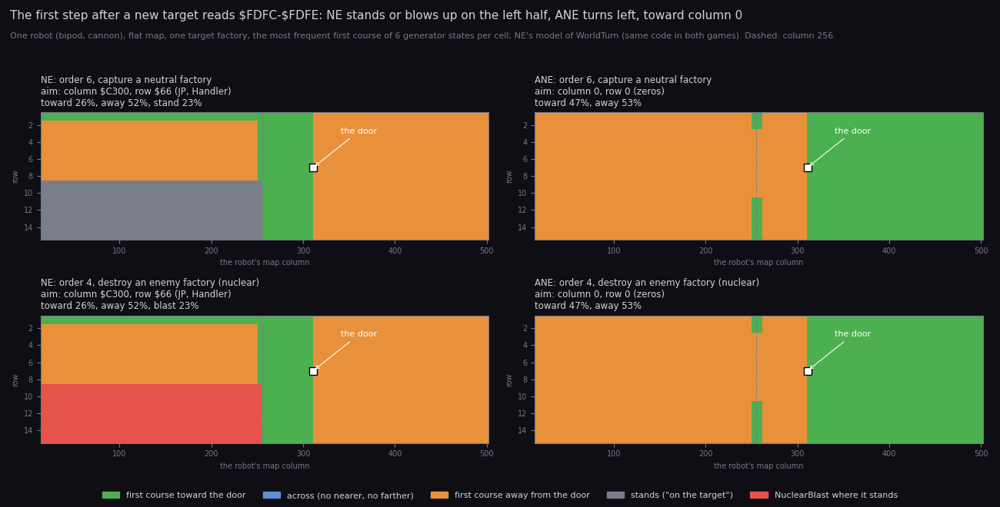

How to read it:

- The most frequent first step from every start cell. Rows: order 6, order 4. Columns: NE, ANE.
- The white square is the door. The dashed line is column 256.
- NE's grey (stand) and red (blast) cells cover the left half. ANE's are green (toward the door) or orange (away) in
  vertical bands set by the door's side.
- Drawn by `python3 tools/fig_diff_steerbug.py` (about 12 s).

- **For the player.** In NE about a quarter of the robots sent to capture freeze for a step on their first decision,
  and nuclear ones can blow up on the spot. In ANE those cases are gone. The first course leans left and up, toward
  (0,0): toward the door when the door is to the left, away from it when it is to the right. The near-rule columns
  249-263 are the exception.
- **Was it fixed?** By accident, not by a fix. Moving the IM 2 jump changed the bytes the bug reads.
- NE 10.12 understates this bug (stands and nuclear blasts, not just a wrong first course), as NE
  [13.3.6](../../nether-earth/docs/13-path-finding.md#1336-the-bug-of-1012-the-first-aim-after-a-new-target)
  already notes. The ANE side of it, the aim (0,0), is new here.

### 13.10.2 New: the music clobbers A' during the target search

As 13.3.3 shows, `PlayMusic` saves AF, BC, DE, HL, IX and IY, but not the alternate set. `MusicInterrupt` saves it.
NE's play interrupt never touched an alternate register: there is no `EXX` or `EX AF,AF'` between `$D566` and
`$D5F7` in NE's listing.

The player in bank 1 is the New SoundTrack Player, `src/music/stp-player.asm`, included by
`src/music/music-bank1.asm` line 9 with TAIGA ([9.2](09-sound.md#92-new-soundtrack-player)):

- It has no `EXX`, so play code that keeps values in BC', DE' and HL' (world `$B3B4`, `$B412`, `$B838`, `$B8D8`;
  print `$D427`, `$D42D`) is safe.
- It has 24 `EX AF,AF'` and uses A' to carry the row's parameters (ChASetNote, stp-player lines 723-727). In trace d1
  13005-13017 it executes 10-12 of them in every interrupt.

The only play code with a live A' is `FindTargetBuilding` (`$B34D`, NE line 4606, ANE line 3856,
`src/game/world.asm`). It keeps the order in A' for `ConsiderBuilding`, which reloads it on every record:

```
B352 PUSH AF
B353 EX AF,AF'          ; A' = the order, for ConsiderBuilding
...
B370 EX AF,AF'          ; ConsiderBuilding: A = the order (from A')
B371 LD E,A             ; E = the order: teammates with this order and this target skip the record
B372 EX AF,AF'
```

**The recording.** Witness `work/docR/d1/traces/14250_0-14375_0.uatr`, the only `FindTargetBuilding` call in all 20
ANE traces, for an enemy robot at IY `$DC40`:

| Moment | Event |
|---|---|
| frame 14257, T 15578 | enters with the order 6 |
| T 15904-70010 | ConsiderBuilding for records 0-20 reads E = 6 |
| frame 14257, T 71662 | the frame interrupt arrives (interrupted PC `$B395`); PlayFrame executes `EX AF,AF'` 10 times, the last at `$C29B` with A = 56 |
| frame 14258, T 12535-18059 | ConsiderBuilding for records 21-23 reads E = 56 (`$38`), a value no robot has as its order |
| | FindTargetBuilding returns D = 12 |

One call over the 24-record table takes about 74 000 T, more than a Pentagon frame (71 680 T). So every such call is
crossed by an interrupt, and the player rewrites A' in every interrupt.

- **What it does.** From the interrupt on, the teammate check is lost: a building another robot of the same side is
  already going for is offered again. In general A' could also land on another order's value and wrongly exclude a
  record.
- **The witnessed call.** The answer stayed 12: records 21-23 were offered without the check and were not nearer.
- **For the player.** Now and then two robots of one side (the player's own robots sent from the robot menu, `$ABE9`,
  or the computer's, `$B2A6` / `$B993`) pick the same building where NE would have spread them out.
- **Why it happened.** The author saved the alternates in the menu handler and not in the play one. NE never needed
  them saved.

## 13.11 Path finding

NE [13](../../nether-earth/docs/13-path-finding.md) names 32 routines for the path finding:

- 31 of them are the same bytes in ANE (`python3 tools/diff_game.py --summary`: none of them is in the changed list).
- The 32nd, `PlayInterrupt`, differs only at `$D582` (13.3.3), which has nothing to do with the steering.

So the rule is NE's, and NE 13 holds for ANE as written. Only two things differ in play: the aim the SteerByOrder bug
reads (13.10.1), and the lost teammate check after an interrupt (13.10.2).

## 13.12 Method and tools

### 13.12.1 The game code: `diff_game.py`

`tools/diff_game.py` loads both builds:

- ANE `build/game/game-6731.bin` at `$6731`, NE `build/game.bin` at `$5B00`;
- both `game.ann` files and both listings.

It cuts each image into the ann entries. An entry ends at the next entry or the next `@equ`. Its module is the listing
file its label is in; NE's ann section headers are not used, because some are wrong (for example, `StartRobot` sits
under "music" in NE's ann; the listing puts it in construction).

It then pairs the entries, trying these rules in order:

1. the same address, when the kind matches and the sizes are within 1:4;
2. the same name, or a known rename (`Start`/`Restart`, `Handler`/`ImHandler`);
3. the same bytes;
4. a leftover code entry that overlaps, with similarity of 0.3 or more.

Paired entries are compared instruction by instruction from the listings. A 16-bit operand that is a label on both
sides is masked. When the two labels resolve to entries that are each other's pairs, the operand counts as "relocated"
(`~`); when they resolve to different entries, it counts as "retargeted" (`>`). Hex literals are not masked: they count
as changed bytes. This is how `LD ($6D6A),HL` in `GameStop` shows up (13.9.1).

Marks in `--show`:

| Mark | Meaning |
|---|---|
| ` ` | the same bytes |
| `~` | relocated operand |
| `>` | retargeted operand |
| `*` | changed |
| `-` | NE only |
| `+` | ANE only |

```
python3 tools/diff_game.py --summary --tsv work/diff/entries.tsv --json work/diff/bytes.json
python3 tools/diff_game.py --show PlayInterrupt --context 0     # side by side, both listings' line numbers
python3 tools/diff_game.py --show NAME --context N
```

### 13.12.2 The resources: `diff_res.py`

- `tools/diff_res.py` compares NE's game image `build/game.bin` (`$5B00-$FCE8`) with ANE's game block
  `build/game/game-6731.bin` (`$6731-$D7D7`). It goes entry by entry of both `src/game/game.ann`: sprite by
  sprite, glyph by glyph, level record by record, map cell by cell, string by string. Each line gives the status
  (same, changed, only-NE, only-ANE), the addresses in both images and what differs.
- The map is not in either image; each game builds it at a new game. `diff_res.py buildmap` runs each game's own
  `BuildMap` (`$BC6F`) on SkoolKit's Simulator over its own image and compares the two memories.
- The menus and the panel come from the scripted tour both cases recorded: the same 61 steps in the same order.
  NE's is `games/nether-earth/work/ill3/tour` (`tools/ill_ui.py tour`) and ANE's is `work/docP/tour`
  (`tools/fig_tour.py tour`).

```
python3 tools/diff_res.py                      # all sections, a count of the same entries
python3 tools/diff_res.py --all --section font # every glyph
python3 tools/diff_res.py --json work/diff/res.json
```

### 13.12.3 The figures

| Figure | Section | Command |
| --- | --- | --- |
| `shell-load.png` | 13.1 | `python3 tools/fig_diff_shell_load.py` |
| `shell-memory.png` | 13.2 | `python3 tools/fig_diff_shell_memory.py` |
| `res-memory.png` | 13.2 | `python3 tools/fig_diff_res_gfx.py memory` |
| `shell-frame.png` | 13.3.1 | `python3 tools/fig_diff_shell_frame.py` |
| `interrupt-graph.png` | 13.3.3 | `python3 tools/fig_diff_frame.py` |
| `interrupt-cost.png` | 13.3.4 | `python3 tools/fig_diff_interrupt.py` |
| `shell-states.png`, `shell-screens.png` | 13.4 | `python3 tools/fig_diff_shell_states.py`, `python3 tools/fig_diff_shell_screens.py` |
| `memmap-diff.png`, `modules-diff.png` | 13.5 | `python3 tools/fig_diff_memmap.py` |
| `res-font.png` | 13.6.1 | `python3 tools/fig_diff_res_gfx.py font` |
| `res-screens-menus.png`, `res-screens-panel.png` | 13.6.2 | `python3 tools/fig_diff_res_screens.py all` |
| `res-sprites.png` | 13.6.4 | `python3 tools/fig_diff_res_gfx.py sprites` |
| `res-map.png` | 13.6.4 | `python3 tools/fig_diff_res_map.py` |
| `res-sound-where.png`, `res-sound-spectra.png` | 13.7 | `python3 tools/fig_diff_res_sound.py all` |
| `shell-save.png` | 13.8 | `python3 tools/fig_diff_shell_save.py` |
| `steer-bug.png` | 13.10.1 | `python3 tools/fig_diff_steerbug.py` |

The `fig_diff_shell_*.py` scripts share `tools/fig_diff_shell_common.py`; `fig_diff_res_gfx.py all` draws its three
figures at once. All of them read the existing builds and recordings; none starts an emulator.

## 13.13 Corrections made to both cases from this comparison

Comparing the two cases side by side found these errors; all are fixed in the cases' docs, figures and tools:

- **The beam origin.** NE's beam was counted 1816 T early (the paper at 14 336 T from the frame start; the real
  paper start is frame T 16 152, 14 340 T after the INT at frame T 1812). Both cases now count the beam from
  unreal-ng's INT position (`kit/beam_timeline.py --machine`, NE `PAPER_T` 16 152, ANE `tools/ane_trace.py`
  `PAPER_T` 17 944 = -44 + 17 988), and the figures were redrawn:
  - NE [4.5](../../nether-earth/docs/04-game-loop.md#45-time), `docs/img/beam-turn.png`: the tear in frame 20012
    is at line 116 (16 of 20 bytes new, 2177 bytes in the frame), not line 110 (11/20, 2051);
  - NE [6.2](../../nether-earth/docs/06-rendering.md#62-the-view-buffer-5b00-677f), `tear.png`, `tear-beam.png`:
    frame 25082 tears at view line 94 (screen 102; 6/20 new, 1886 bytes), not view line 87 (screen 95; 17/20,
    1757);
  - ANE [4.5](04-game-loop.md#45-the-turn), `docs/img/loop/tear-tv.png`: line 38 (19/20 new), not 39 (9/20); and
    `tear-band.png`: tears at lines 15-42 with the model (20 976 - T) / 155, not lines 16-42 and (21 020 - T) / 155.
- **GameStop.** ANE [10.11](10-gameplay-logic.md#1011-bugs) said `LD ($6D6A),HL` writes into the view buffer; it
  now says the address is in the sprites and the instruction never runs (13.9.1).
- **The AF' bug.** The clobbered A' in `FindTargetBuilding` (13.10.2) is documented in ANE
  [10.11](10-gameplay-logic.md#1011-bugs).
- **A grammar note.** ANE [8.5](08-hud-and-text.md#85-slips-seen-on-the-screen) read order name 4's ЗАВОДЫ as a slip
  against entry 7's ЗАВОДОВ; it now reads both as right (13.6.2).
