# ATV Simulator: walkthrough

How the reverse was done, step by step, and which unreal-ng call answered each question. Terms:
[docs/README.md](docs/README.md). Recipes: `../recipes/`.

Every recording is named with its load (ROM speed or the fast LD-BYTES trap) beside every frame number.

## 0. The medium

**What was looked for.** ZXDB (`zxdb.sqlite` v1.0.242, entry 9306), the collection index
`/Volumes/TB4-4Tb/Data/zx-spectrum/index/zx-image-locations.tsv` (`grep -i atv`), TOSEC 2023-09, zxart, the
collection's World of Spectrum mirror and the owner's archive. Every copy found is in `work/candidates/<source>/`
unchanged (git-ignored); the README lists them with what differs.

**The original.** ZXDB's release 0 is Code Masters' 1987 tape; ZXDB denies its file. The collection's World of
Spectrum mirror holds `ATVSimulator.tzx.zip` (25 601 bytes, another zip than ZXDB's 25 525): it is the case's
`orig/`, unchanged. Its TZX (47 124 bytes, md5 `ca7bb7957f69915fc965e81d49eb99a4`) is byte for byte TOSEC's `[a]`
dump and zxart's `[p 1987 Code Masters Ltd]` dump.

**The blocks** (`python3 ../../kit/tapblocks.py list "work/media/ATV Simulator.tzx"`; `work/media/` holds the TZX
from the zip): eight standard-speed blocks, a BASIC loader, a 34-byte machine-code loader at `$FFDC`, a 6912-byte
screen and a 40000-byte game at `$6338`, the last two without the headers that sit before them on the tape (the
loader asks LD-BYTES for flag `$FF` and reads each header as a failed block). 281.9 s, 14 096 frames, at signal
speed. The table and the loader: [doc 3, 3.1-3.2](docs/03-build-and-load.md#31-the-tape-block-by-block).

**The copies compared** (`python3 tools/media_compare.py "work/media/ATV Simulator.tzx" <copy>...`, the flagged
blocks byte for byte): TOSEC's main dump, `[a2]` and the `.tap` hold the same loader, screen and game (one header
byte differs in `[a2]` and the `.tap`, LINE 0); `[h Raf]` replaces the BASIC; zxart's `[p]` has 6 bytes of the game
changed (the POKEs). Nothing on the tape is protected or packed: the image at the jump to `$D6B0` equals blocks 5 and
7 byte for byte (`work/stage1/images.py`, recording c1 frame 14 100 T 17 980 against `work/stage1/media/tape64.bin`:
no byte differs from `$4000` to `$5AFF` and from `$6338` to `$FF77`).

**48K or 128K.** ZXDB: 48K. The image has no paging write (no `$7FFD`) and no AY register select (`LD BC,$FFFD`
occurs once, at `$572E`, inside the loading screen's pixels); the sound is `OUT ($FE),A` (15 sites). The case runs
the 48K.

**Other sources.** The ZXDB POKEs (`ATVSimulator.pok`): 60250,0 "Infinite Lives", 49433,81 "Infinite Fuel",
57318,201 "Infinite Time", 57276,201 "Infinite fuel"; checked by recordings fuel and pokes (6.0). No RZX run could
be fetched (ZXDB and World of Spectrum answer 404; rzxarchive marks Pavel Plíva's run "Distribution Denied"). An AY
rip of the title tune exists (`work/candidates/ay/`). A public disassembly: see `work/stage1/NOTES.md`.

**The binary.** `work/env.sh` points at the `wt-nezs-stage1` build (unreal-ng `e3d341d38`), which lacks f13cee7da;
`kit/rs.py open` warns. This tape does not need the fix: its last block is the game, and the game's entry runs
before the tape ends (c1: entry at frame 14 100, the tape stops at 14 182).

## 1. One recording from power-on

Recording c1 (`python3 tools/record.py c1 --work work/stage1/rec/c1`): a 48K from power-on, the tape inserted,
`LOAD ""` typed, PLAY once at signal speed (fast and turbo tape off). The ROM loads the BASIC and the loader
(frame 1 017: the loader at `$FFDC` runs, `kit/rs.py stages`), the loader reads the screen and the game by LD-BYTES;
the game's entry `$D6B0` runs at frame 14 100 T 17 980. The title and credits, the menu (frame 14 657), START with
the power-on controls (one player, Kempston), trail 1 from frame 14 821 with a jump every 66 frames: the ATV
crashed and tumbled at distance 381 (frame 15 580) and stood at 373 (`$0175`, speed 0, frames 15 600-19 300) until
TIME OUT (clock 60, near frame 20 897), then the menu. 22 397 frames;
the L1 replay checked 896 frames, diverged 0.

`kit/rs.py stages` on c1 (code arrivals): `$FFDC` (the loader, frame 1 017), `$8080` (the IM 2 vector `JP $D9D2`,
14 114), `$D9D2` (the handler), `$F852` (the tune player, 14 639, after `$6E04` copies it from `$5B00` back to
`$F850`), `$FDFD` (the tune's own IM 2 vector, 14 640), `$7340` and `$F977` (the tune's handler and its hook).

### Interrupts and timing (first look)

- **Entry.** `$D6B0` `JP $D7D6`: `DI`, two copies (`$F850-$FDFA` to `$5B00`, 1 451 bytes; `$F230-$F4B9` to
  `$60AC`, 650 bytes; the L1's `dataflow.copies`, sites `$D7E0` and `$D7EB`), the old SP kept at `$D6BA`, its own
  stack (`LD SP,$FFDC`, under the loader), then `$D8ED`: `IM 2` with `I` = `$FE` and the table `$FE00-$FF00` filled
  with `$80` (`LDIR` at `$D90E`), so every vector is `$8080`, which holds `JP $D9D2`.
- **The outer loop** at `$D7FB`: the menu (`$69A6`), the game (`$D80D`), `$69F4` (after the game: the high-score entry when a score qualifies, recordings kb and warp), round again.
- **The handler** `$D9D2` (`kit/rs.py interrupts`: 6 766 entries in c1, exactly one a frame from frame 14 114 except
  the 1 517 frames of the title tune): it saves the registers; on the menu (`$D6BC` = `$FF`) it reads both players'
  controls (`$D911`, `$D942`) into `$8113` / `$8114`; in play it counts the frame (`INC ($D6BC)`) and calls `$8310`
  and `$D97C`; `EI`, `RET` at `$DA1D`. Its length in play: 2 555 T an entry, every entry the same
  (`kit/handler_time.py --work work/stage1/c1x --window 16000:0-16050:0`, 50 entries; 80 % in `$8500-$85FF`).
- **The title tune** runs with its own table: vector `$FDFD` to `$F961`, which calls `$7340` (1 517 entries in c1,
  4 760 T an entry by L1).
- **DI / EI.** `DI` at the entry (`$D7D6`); `EI` at `$D850` when a trail starts, at `$ED06` in the trail end (after
  the tune's call at `$ED00`) and at the handler's end; the other `DI` sites are for stage 2.
- **The game pass** `$D851-$D888`: clear `$D6BC`, read the controls (`$D911`, `$D942`), `$830D`, the clock's tick
  (`$EB53`), `$EC7F`, then wait `LD A,($D6BC)` / `CP $07` / `JR C` (`$D86B-$D870`) until 7 frames have passed. So a
  pass is at least 7 frames. Measured: the wait loop ran 600 times in c1 between frames 15 059 and 19 255 (its
  branch's first and last frame in the L1), (19 255 − 15 059) / 599 = 7.005 frames a pass: in c1's play every pass
  was exactly 7 frames, the work never overran.
- **The heaviest pass.** The wait spins 32 T a turn (13 + 7 + 12); the L1's loop record for `$D86B` gives 1 168 turns
  at the least and 10 351 at the most over the 600 passes. A pass is 7 × 69 888 = 489 216 T, so the work (handler
  entries included) took from about 158 000 T (2.3 frames) to about 452 000 T (6.5 frames) a pass: the game uses up
  to 92 % of its 7-frame budget. Integration named it from `c1`'s traces (`tools/pass_trace.py`): the pass at frame
  15 412, 446 565 T, 91.3 % ([doc 4, 4.7](docs/04-game-loop.md#47-the-heaviest-pass)).
- **The clock.** `$EB53` adds 1 to the tenths digit at `$D6CB` once a pass (ASCII digits `$D6C9-$D6CB`): one clock
  tenth is 7 frames, one clock unit 70 frames (1.4 s). A trail's 60 is 4 200 frames.

## 2. Static pass over the medium

## 3. The stages and the packers

## 4. The medium from source

## 5. Tool gaps found and fixed in unreal-ng

| Gap | Fix | unreal-ng commit |
| --- | --- | --- |

## 6. The game

### 6.0 The recordings

All on unreal-ng's TTD (`analysis start record=true`), muted, port base 37780 or 37785, each folder
`work/stage1/rec/<name>/` with `session.ttd`, `l1.json`, `record.json` (the moments, the POKEs, the frames) and
`screens/`; the input script is `tests/inputs/<name>.txt` (keys by frame, POKEs as `POKE address bytes`). Each was
made by `python3 tools/record.py <name> --work work/stage1/rec/<name>`, with `--start <Start>` where the start is a
state. 48K; the original TZX; the L1 of each built (`kit/rs.py` through record.py). Kempston keys are `KL KR KU KD KF`.

| Name | Start | Frames | How | What it reached |
| --- | --- | ---: | --- | --- |
| c1 | power-on | 22 397 | `LOAD ""`, the tape at signal speed; START; right with a jump every 66 frames | the BASIC (582), the loading screen, the entry (14 100), the title tune and credits, the menu (14 657), trail 1 (14 821), mounting (14 897), a crash at distance 381 (frame 15 580), standing at 373 to TIME OUT, the menu |
| menu | c1 `menu.szx` (14 657) | 3 340 | ENTER moves, SPACE picks: TWO PLAYERS; CHOOSE CONTROL, PLAYER ONE, KEYBOARD, the key table redefined Q A O P M, EXIT; PLAYER TWO, KEYBOARD, H J K M B, EXIT (state `menu-two-kb.szx`); then player 1 KEMPSTON, player 2 SINCLAIR; 2 500 frames idle | every menu screen and control method; the key tables of both players; the idle menu stays (no attract mode) |
| kb | menu `menu-two-kb.szx` | 9 160 | two players on the keyboard; both right, jump on, the wheel keys and jumps | the split screen of two players, both through trail 1 into trail 2; TIME OUT; player 2's high-score name entry (3 260) |
| trail1 | c1 `menu.szx` | 9 970 | `ride_smart` (record.py): the pattern right / wheelie / wheel down / jump; on foot back to the ATV | a crash, the rider thrown and walking back; stuck behind a dune (on foot, the walk-back rule fails, 6.2); TIME OUT; the title |
| trails | c1 `menu.szx` | 7 441 | `tools/autoride.py` (a search bot on clones: per crash it tries jumps, wheelies, braking at distances before it) found a plan; replayed segment for segment | trail 1 ridden to its finish with no POKE (two jumps: at distance 766 and a wheelie at 1 148) and trail 2's start, then the bot's last crash on trail 2 (distance 898) |
| warp | c1 `menu.szx` | 17 756 | on each trail, mounted, 150 frames ridden, then POKE: the distance (`$D78A`, `$D726`) set to the finish less 40 (14 POKEs, in `record.json`) | all six trails (SAND DUNING, GRASSTRAKIN, ICEBERGS, PYRAMIDS, TROPICANA, SWAMP), each finish (EXTENDED PLAY, LAP TIME) and the trail-end tune; the loop back to trail 1 with max 30; TIME OUT; the high-score name entry (33 350, "BC") and the new table |
| fuel | c1 `menu.szx` | 9 175 | POKE 60250,0 (the clock stopped); ride_smart, the fuel's high byte `$D77D` watched | fuel from 32 down to 13 while riding; it stays when the rider is on foot |
| pokes | c1 `menu.szx` | 4 275 | the four ZXDB POKEs at START | the clock frozen at 00.0 (60250,0); the FUEL bar not redrawn (57276,201 and 57318,201, `RET` at `$DFBC` and `$DFE6`) while `$D77D` falls as in fuel; 49433,81: no change seen |

| turn | c1 `menu.szx` | 1 650 | `python3 tools/rec_controls.py turn --work work/stage1/rec/turn --start work/stage1/rec/c1/menu.szx --port-base 37782` (doc 5's writer; moved here from `work/docs/atB/rec/turn`): CHOOSE CONTROL, SINCLAIR, START, walk, jump on, throttle 252 frames, wheel up, jump, left 315, right 245; `log.json` the record every 7 frames | the ATV braked, turned round and ridden facing left (DrawAtv's mirrored path, AtvMirrorReturn 45 runs); the SINCLAIR line changes nothing |
| empty | c1 `menu.szx` | 2 269 | `python3 tools/record.py empty --work work/stage1/rec/empty --start work/stage1/rec/c1/menu.szx --port-base 37785` (stage 2; moved here from `work/stage2/rec/empty`): POKE 60250,0 at frame 14 (the clock stopped), the fuel's high byte `$D77D` POKEd to 5 at 567; ride_smart | the tank empty in the pass of frame 732 (OutOfFuel first there), OUT OF FUEL blinking from 736, the ATV crawling with the throttle held; OutOfFuel 83 runs |
| throwoff | c1 `menu.szx` | 850 | `python3 tools/rec_crashes.py throwoff --work work/stage1/rec/throwoff --start work/stage1/rec/c1/menu.szx --port-base 37780` (integration; no POKE): mount, right 42 frames, then right + wheel up held 140 frames | AtvFrame `$44` at frame 612, ThrowOff `$E2E2` once, Mounted 0 at 619; FallRider `$E991` 35 runs (FallPhase 1-5) |
| speedcrash | c1 `menu.szx` | 1 432 | `python3 tools/rec_crashes.py speedcrash --work work/stage1/rec/speedcrash --start work/stage1/rec/c1/menu.szx --port-base 37780` (integration; no POKE): mount, right 140 frames, then nothing held | trail 1's step at TrackPos 614 at speed 15: the step test's Crash (`$E6EB`), 13 after the -2: Stop and Throw (`$E96E`), frames 1 025-1 032 |
| wallcrash | c1 `menu.szx` | 2 083 | `python3 tools/rec_crashes.py wallcrash --work work/stage1/rec/wallcrash --start work/stage1/rec/c1/menu.szx --port-base 37780` (integration): the distance POKEd to 1 568 at frame 521 (`$D78A`, `$D726`: trail 1's finish less 40), trail 2 mounted at about 1 396, right 140 frames, then nothing held | the nose test's Crash (`$E771`) at TrackPos 296, speed 21: the tumble (`$E974`) and Throw, frames 1 676-1 683; the nose's ground 7 below the wheels' (unsigned `$F9`) |
| itemlow | c1 `menu.szx` | 714 | `python3 tools/rec_crashes.py itemlow --work work/stage1/rec/itemlow --start work/stage1/rec/c1/menu.szx --port-base 37790` (review round 1): POKE at the menu, trail 1's list A item 2 (`$C9`, 7 lines) y 23 to 1; START | ItemTooLow `$8EB2` in the first pass (frame 398): the red border, Restart `$D7ED`, the credits again |
| overhang | c1 `menu.szx` | 1 060 | `python3 tools/rec_crashes.py overhang --work work/stage1/rec/overhang --start work/stage1/rec/c1/menu.szx --port-base 37790` (review round 1): POKE at the menu, trail 1's list A item 3 (the dune `$67`, 12 lines) y 0 to 30, a floating piece; START, mount, right held, no wheel key | RiderMounted's overhang test: ThrowOff `$E2E2` at frame 756, speed 21, AtvFrame `$38`; FallPhase 1 |
| dropout | menu `menu-two-kb.szx` | 7 830 | `python3 tools/rec_crashes.py dropout --work work/stage1/rec/dropout --start work/stage1/rec/menu/menu-two-kb.szx --port-base 37790` (review round 1): two players on the keyboard; player 1 mounts, his distance POKEd to the finish less 40 (`$D726`), crosses the line and stops; player 2 stands | TIME OUT at 6 783 with player 1 finished: TrailEnd at once, Riding 3 to 1, trail 2 for player 1 alone (PassP2's last call 6 783) |

Each folder holds `session.ttd`, `l1.json`, `record.json`, `screens/` (and `log.json` for turn, throwoff, speedcrash,
wallcrash, overhang, dropout); every recording of this table is in case.json's `read_builds`. CrashIfAir needed no recording of its own:
`c1`'s tumble at 15 574 is a CrashIfAir crash (doc 10, 10.6). Integration's traces of `c1` (the heaviest pass, doc 4 4.7)
are in `work/docs/integrate/c1/traces/`, opened with `python3 ../../kit/rs.py open --work work/docs/integrate/c1
--ttd work/stage1/rec/c1/session.ttd --port-base 37780`.

Not reached: trail 2 onwards ridden without a POKE beyond distance 898 (the bot's actions all failed there); a fuel
tank emptied without the POKE; a nose crash on a real wall. ItemTooLow and ThrowOff from an overhang only with a POKE
that changes an item of trail 1 (itemlow, overhang).

### 6.1 The screens

From the recordings above, named `<recording>-<frame>-<moment>.png` in `docs/img/play/`.

**The load and the menu (c1, 48K, signal speed).**

| | |
| --- | --- |
| 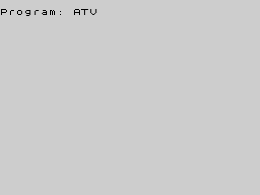 | 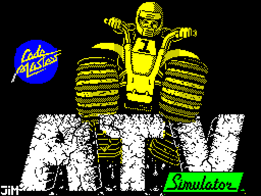 |
| 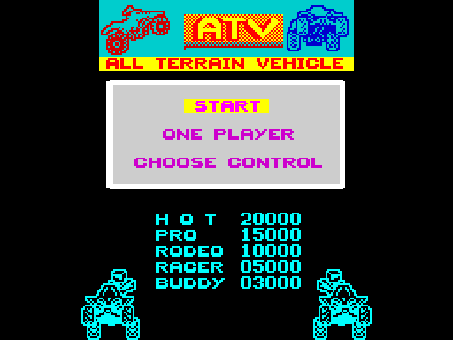 | 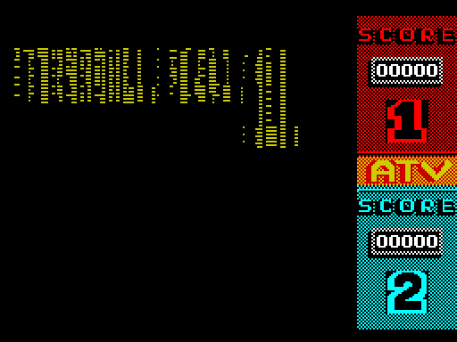 |
| 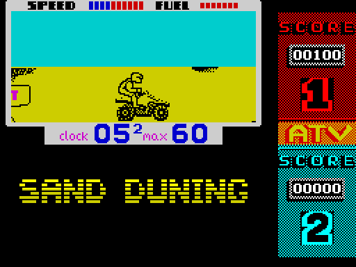 | 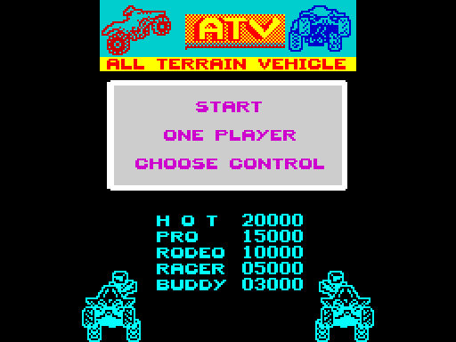 |

**The menu and the controls (menu).**

| | |
| --- | --- |
| 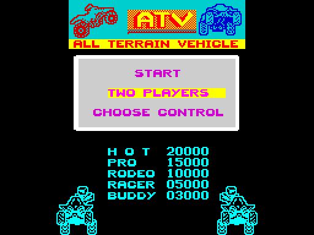 | 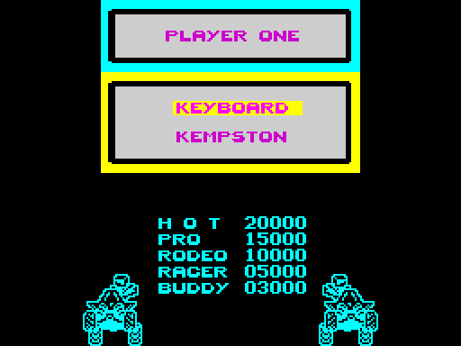 |
| 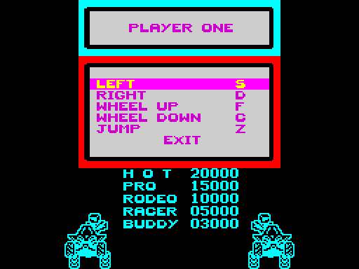 |  |
| 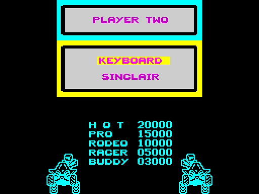 | 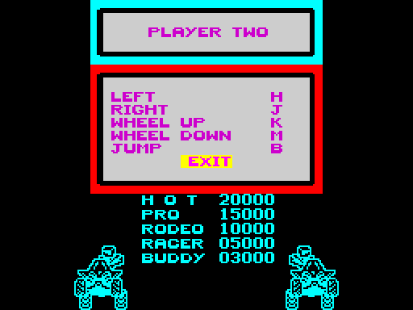 |

**Two players (kb).**

| | |
| --- | --- |
|  | 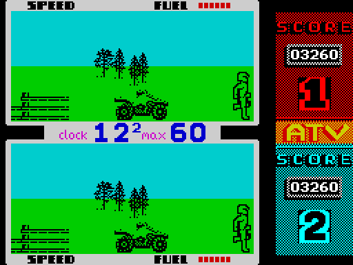 |
| 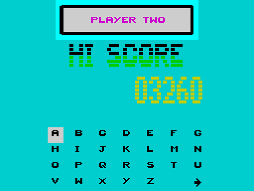 | 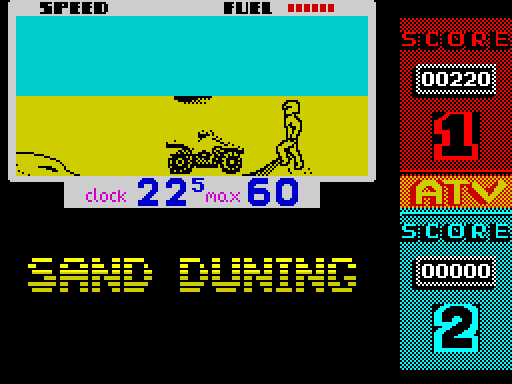 |

**The six trails (warp, the distance POKEd near each finish).**

| | |
| --- | --- |
| 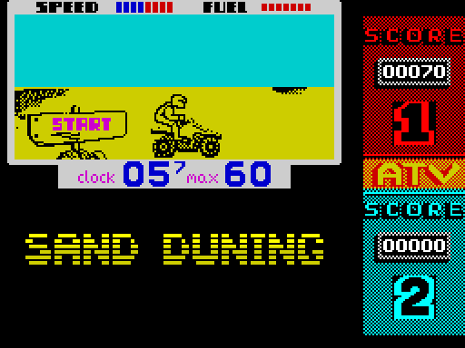 | 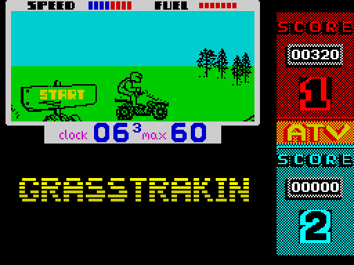 |
| 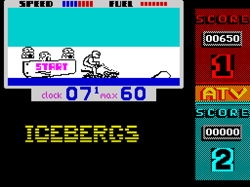 | 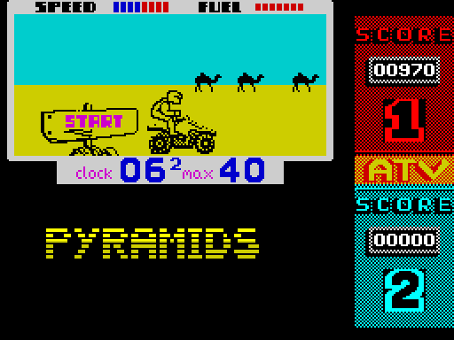 |
| 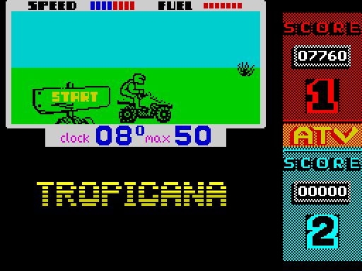 | 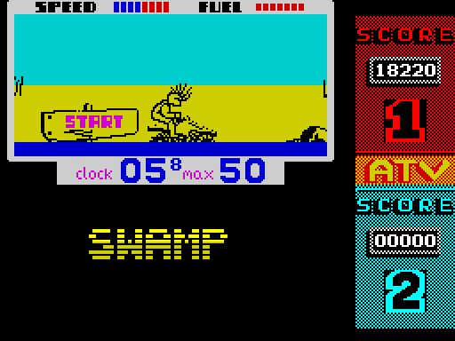 |
| 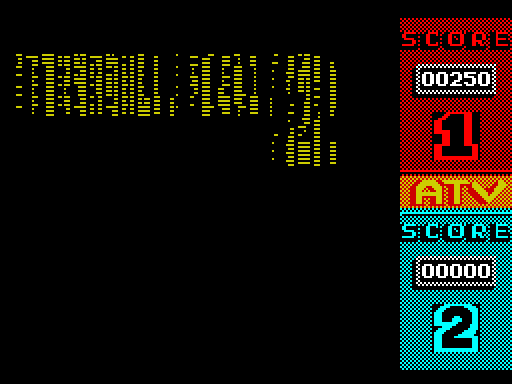 | 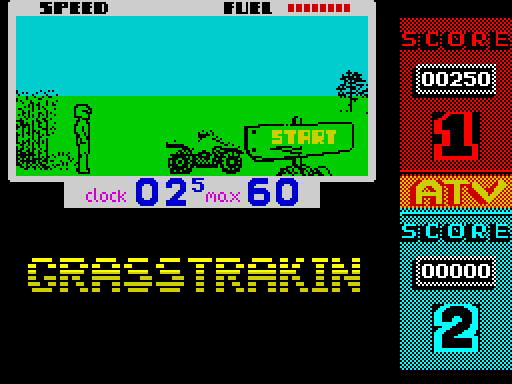 |
| 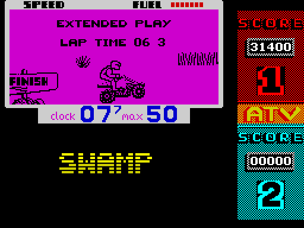 |  |
| 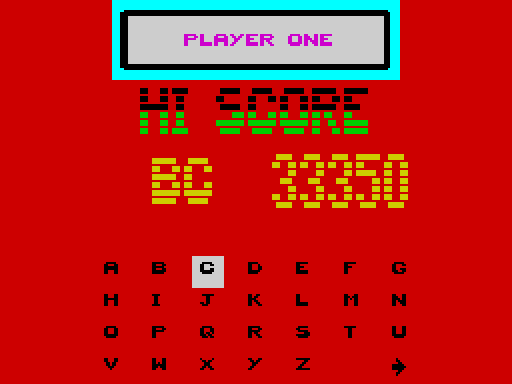 | 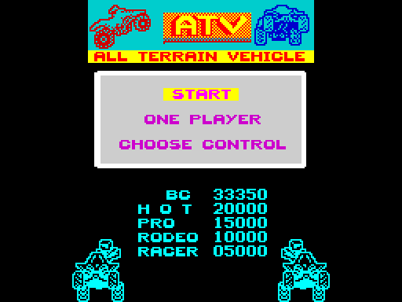 |

**The POKEs (fuel and pokes, both frame 2 310, fuel 13).**

| | |
| --- | --- |
| 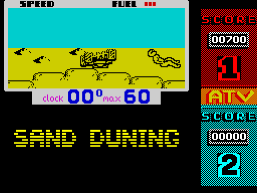 | 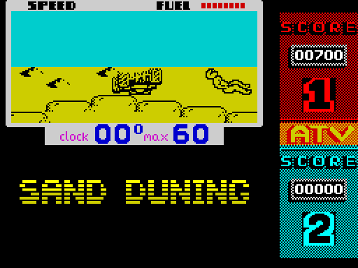 |

**More screens, taken for the documents** (the recording, the moment and the frame in each name).

| | |
| --- | --- |
| 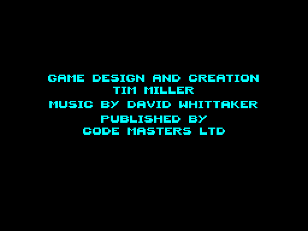 | 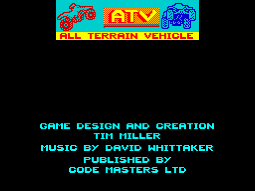 |
|  | 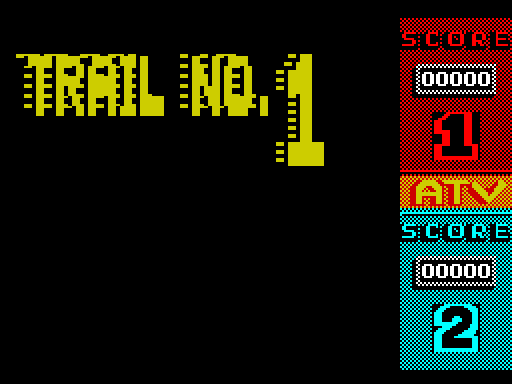 |
| 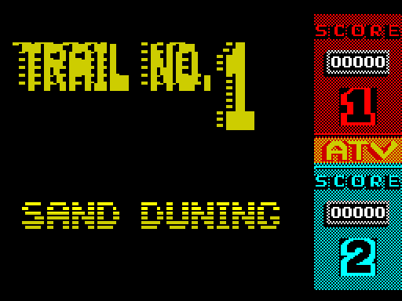 | 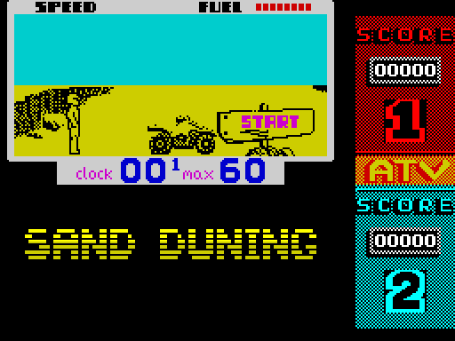 |
| 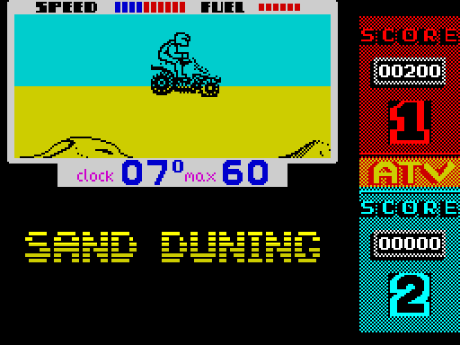 | 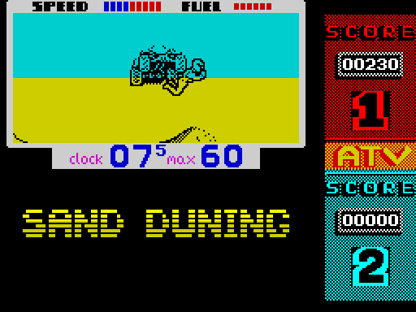 |
| 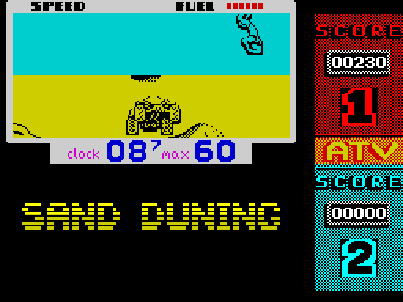 | 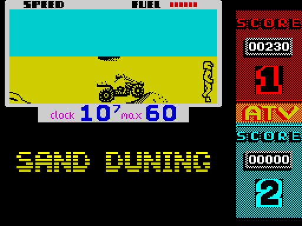 |
| 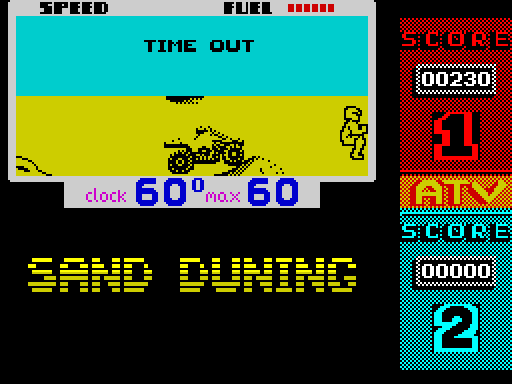 | 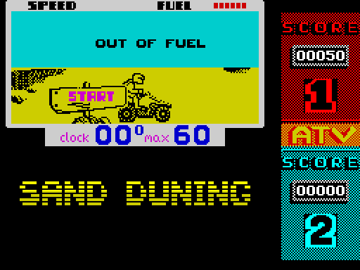 |
| 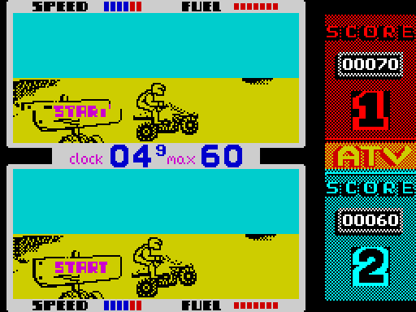 | 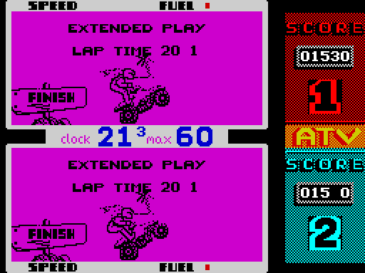 |
| 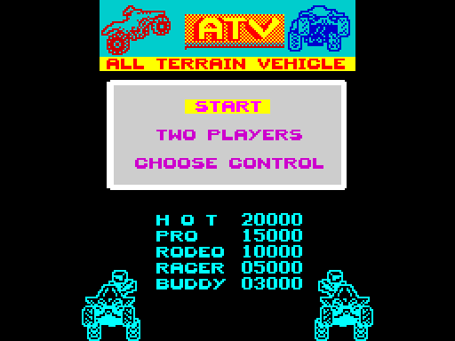 | 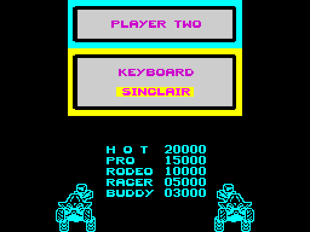 |
| 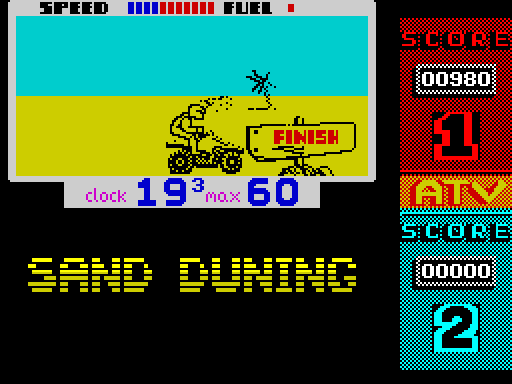 | 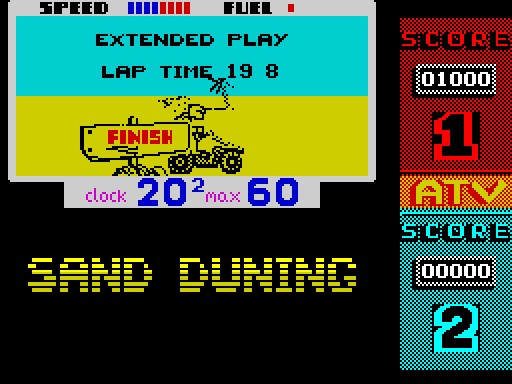 |
| 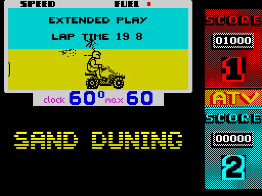 | 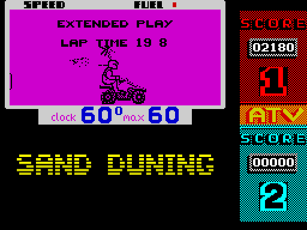 |
| 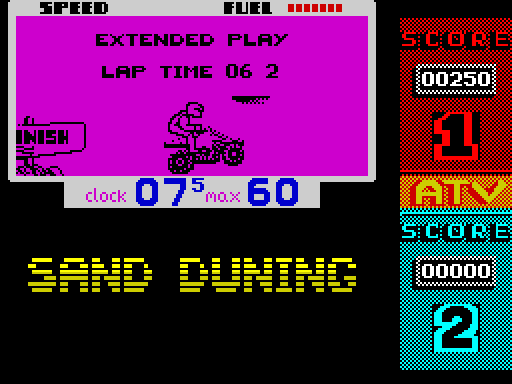 | 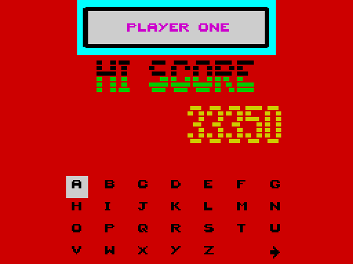 |
|  |  |

### 6.2 Found while recording

- A crash throws the rider off; he gets up and walks; fire next to the ATV jumps him on (`work/stage1/mount.py`:
  from `x/crash1.szx` he mounts from x `$30` to `$48` and not from further right). On a dune he cannot walk up, and
  the walk-back rule of `ride_smart` (left while x > `$46`) leaves him stuck (trail1 from frame 1 967).
- Two players ride at once, not in turn: the screen is split (kb). How a pass serves both records is stage 3.
- ZXDB's POKE names do not match what the bytes do: 60250,0 ("Infinite Lives") stops the clock: it is the `$01`
  of `ADD A,$01` at `$EB59` in the tick `$EB53`; 57276,201 ("Infinite fuel") puts a `RET` at `$DFBC`, just after
  `LD A,($D77D)` (the fuel's high byte) at `$DFB9`, and 57318,201 ("Infinite Time") a `RET` at `$DFE6`, the first instruction of
  the routine after it; with both, the FUEL bar is no longer redrawn and stays full while the fuel's high byte `$D77D` still falls
  (recording pokes against fuel at frame 2 310). 49433,81 writes `$C119`, inside a buffer the game writes in play
  (`$BDEF-$C190`, 2.1): no effect was seen.

### 6.3 The animations

Every animation the documents show, with its recording and frames; the caption under each gives its command.

| File | Document | Recording | Frames |
| --- | --- | --- | --- |
| `docs/img/load/load-c1.gif` | [3](docs/03-build-and-load.md) | c1 | 0-14110 |
| `docs/img/play/atv-keys.gif` | [5](docs/05-controls.md) | turn | 1093-1534 |
| `docs/img/play/atv-throttle.gif` | [5](docs/05-controls.md) | turn | 684-1076 |
| `docs/img/play/c1-crash.gif` | [1](docs/01-game-design.md) | c1 | 15480-15830 |
| `docs/img/play/c1-heaviest-pass.gif` | [4](docs/04-game-loop.md) | c1 | 15412-15418 |
| `docs/img/play/empty-out-of-fuel.gif` | [10](docs/10-gameplay-logic.md) | empty | 700-980 |
| `docs/img/play/finish.gif` | [8](docs/08-hud-and-text.md) | warp | 818-1300 |
| `docs/img/play/fuel-bar.gif` | [8](docs/08-hud-and-text.md) | fuel | 600-2384 |
| `docs/img/play/menu-tour.gif` | [5](docs/05-controls.md) | menu | 0-850 |
| `docs/img/play/name-entry.gif` | [8](docs/08-hud-and-text.md) | warp | 16470-16766 |
| `docs/img/play/out-of-fuel.gif` | [8](docs/08-hud-and-text.md) | empty | 740-950 |
| `docs/img/play/start-sign.gif` | [6](docs/06-rendering.md) | c1 | 15230-15475 |
| `docs/img/play/trail-intro.gif` | [8](docs/08-hud-and-text.md) | warp | 1295-1703 |
| `docs/img/play/trail-scroll.gif` | [6](docs/06-rendering.md) | c1 | 15475-15790 |
| `docs/img/play/trails-crash-tumble.gif` | [10](docs/10-gameplay-logic.md) | trails | 5826-6040 |
| `docs/img/play/trails-finish.gif` | [10](docs/10-gameplay-logic.md) | trails | 1590-1722 |
| `docs/img/play/trails-jump-dune.gif` | [10](docs/10-gameplay-logic.md) | trails | 1280-1446 |
| `docs/img/play/two-players.gif` | [5](docs/05-controls.md) | kb | 300-720 |
| `docs/img/play/walk-back.gif` | [10](docs/10-gameplay-logic.md), [5](docs/05-controls.md) | trail1 | 880-1200 |
| `docs/img/routines/AtvPhysics.gif` | [10](docs/10-gameplay-logic.md) | trails | 815-822 |
| `docs/img/routines/ClockTick.gif` | [8](docs/08-hud-and-text.md) | c1 | 15356 |
| `docs/img/routines/ControlRight.gif` | [5](docs/05-controls.md) | turn | 744 |
| `docs/img/routines/CopyLines.gif` | [6](docs/06-rendering.md) | c1 | 15361 |
| `docs/img/routines/CountBonus.gif` | [9](docs/09-sound.md) | trails | 4712-4714 |
| `docs/img/routines/Crash.gif` | [10](docs/10-gameplay-logic.md) | trails | 5850-5854 |
| `docs/img/routines/DrawAtv.gif` | [6](docs/06-rendering.md) | turn | 1304-1305 |
| `docs/img/routines/FinishCheck.gif` | [10](docs/10-gameplay-logic.md), [8](docs/08-hud-and-text.md) | warp | 830-832 |
| `docs/img/routines/GameEntry.gif` | [3](docs/03-build-and-load.md) | c1 | 14100-14101 |
| `docs/img/routines/JumpControl.gif` | [10](docs/10-gameplay-logic.md) | trails | 1103-1104 |
| `docs/img/routines/Landing.gif` | [9](docs/09-sound.md) | trails | 815-822 |
| `docs/img/routines/MountCheck.gif` | [10](docs/10-gameplay-logic.md) | trails | 5416-5417 |
| `docs/img/routines/NameSelect.gif` | [8](docs/08-hud-and-text.md) | warp | 16522-16526 |
| `docs/img/routines/OutOfFuel.gif` | [10](docs/10-gameplay-logic.md) | empty | 732-733 |
| `docs/img/routines/Pass.gif` | [4](docs/04-game-loop.md) | c1 | 15055-15061 |
| `docs/img/routines/PrintShadow.gif` | [8](docs/08-hud-and-text.md) | empty | 765-767 |
| `docs/img/routines/ReadP1Controls.gif` | [5](docs/05-controls.md) | turn | 743 |
| `docs/img/routines/RedefineKey.gif` | [5](docs/05-controls.md) | menu | 159-160 |
| `docs/img/routines/RiderOnFoot.gif` | [5](docs/05-controls.md) | trail1 | 1106 |
| `docs/img/routines/RotateSpriteLeft.gif` | [6](docs/06-rendering.md) | c1 | 15357-15358 |
| `docs/img/routines/ScanKeys.gif` | [5](docs/05-controls.md) | turn | 743 |
| `docs/img/routines/ShowScore.gif` | [8](docs/08-hud-and-text.md) | c1 | 15361 |
| `docs/img/routines/Thrown.gif` | [10](docs/10-gameplay-logic.md) | trails | 5970-5971 |
| `docs/img/routines/Tumble.gif` | [10](docs/10-gameplay-logic.md) | trails | 5914-5915 |
| `docs/img/routines/TunePlay.gif` | [9](docs/09-sound.md) | trails | 4492-4494 |
| `docs/img/routines/Update.gif` | [6](docs/06-rendering.md) | c1 | 15356-15361 |
| `docs/img/routines/UseFuel.gif` | [8](docs/08-hud-and-text.md) | fuel | 882 |
| `docs/img/routines/WaitFrames.gif` | [10](docs/10-gameplay-logic.md) | trails | 4490-4491 |
| `docs/img/routines/WalkList.gif` | [7](docs/07-objects.md) | trails | 1263-1271 |

## 7. Review
