# 1. Game design

What this covers:

- the premise and the goal (1.1);
- the controls (1.2);
- every screen, in the order a player meets it (1.3);
- the HUD: speed, fuel, the clock, the scores (1.4);
- the six trails, drawn from `src/res/trails` (1.5);
- the rules as the game plays them: the clock, the score, the finish, the bonus, EXTENDED PLAY, the second round (1.6);
- a crash and the walk back (1.7);
- fuel and OUT OF FUEL (1.8);
- two players on the split screen (1.9);
- TIME OUT, the end of the game, the high score table and the name entry (1.10);
- what is known only from the code (1.11).

The recordings it rests on ([WALKTHROUGH](../WALKTHROUGH.md), 6.0), each started as the WALKTHROUGH says:

- `c1`: a 48K from power-on, the original TZX at signal speed, the title, the menu, trail 1 with a crash, TIME OUT;
- `menu`: every menu option, the control methods, redefine for both players;
- `kb`: two players on the split screen to trail 2, player 2's name entry;
- `trail1`: a crash, walking back, stuck behind a dune, TIME OUT;
- `trails`: trail 1 to the finish with no POKE, trail 2 to distance 898;
- `warp`: all six trails, the finishes, EXTENDED PLAY, LAP TIME, the second round, name entry; 14 distance POKEs put
  the ATV near each finish (said where it matters);
- `empty`: the clock stopped by POKE 60250,0 at frame 14 and the fuel's high byte POKEd to 5 at frame 567, the
  tank empty at frame 732.

A value sampled with `time_travel memory_at` is the state at T 0 of the frame named. A screenshot named
`<recording>-<frame>` is the screen at the end of that frame.

## 1.1 The premise and the goal

ATV Simulator (Code Masters, 1987, £1.99; design Tim Miller, music David Whittaker) is a side-on trials race on an
all-terrain vehicle, a four-wheeled quad bike. The player rides it left to right over six trails of dunes, logs, ice,
pyramids, totems and swamp, against a time limit.

The goal is to reach the finish of each trail before the clock reaches the trail's maximum. A rider who finishes rides
the next trail; after trail 6 the six trails come round again with 30 as every maximum. There are no lives. The game
ends at the first TIME OUT at which no player has finished. The score counts the distance ridden and a bonus for the
time left at each finish.

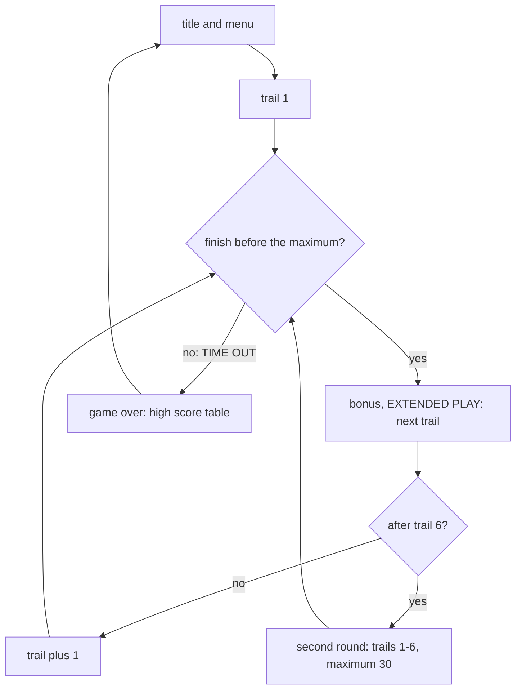

**Worked example.** In `trails` the bot reaches the finish of trail 1 with the clock at 19.8, well under the maximum of
60. The game prints EXTENDED PLAY and LAP TIME 19 8 and, at TIME OUT, counts the bonus into the score and goes on to
trail 2. In `c1` the rider crashes, walks on to the right, away from the ATV, and never rides again: TIME OUT at 60.0, the game is
over.

**Witness.** `docs/img/play/trails-001700-extended-play.png`, `c1-019260-time-out.png` (1.3).

**The point.** A race against the clock alone: no opponents, no lives, one rule that ends the game.

## 1.2 The controls

Each player has five controls: left, right, wheel up, wheel down and jump. The menu sets the method:

| Player | Keyboard (default keys) | Joystick |
| --- | --- | --- |
| 1 | S left, D right, F wheel up, C wheel down, Z jump; redefinable | Kempston |
| 2 | H left, J right, K wheel up, M wheel down, B jump; redefinable | Sinclair (keys 6-0) |

Left and right are the throttle in the direction the ATV faces, and the brake against it. At a standstill the brake
turns the ATV round. Wheel up lifts the front wheel (a wheelie); wheel down brings it down. Jump gives the ATV extra
lift on a ramp; on foot it makes the rider jump. In the menu any key moves the highlight to the next item, and SPACE, 0 or
the Kempston's fire chooses it; ENTER only moves.

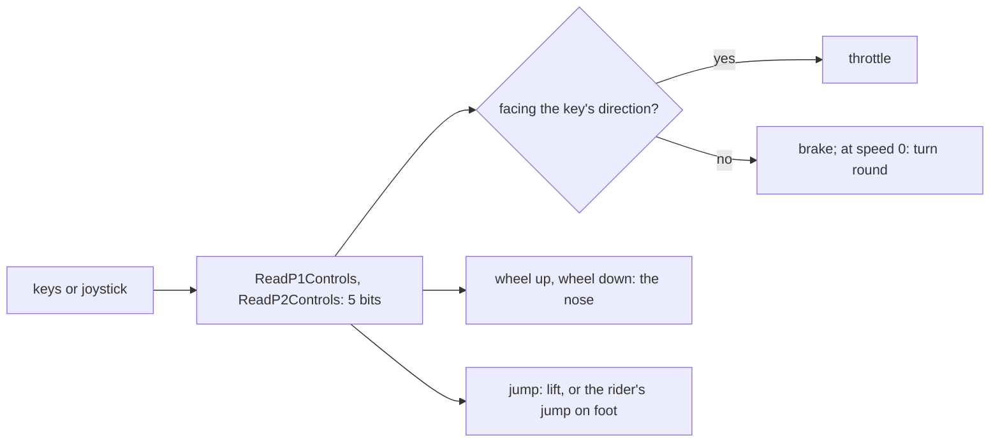

**Worked example.** In `menu` player 1 redefines the keys to Q A O P M (frame 305) and player 2 chooses SINCLAIR
(frame 776). [Doc 05](05-controls.md) decodes the keys, the ports and the controls bit by bit.

**Witness.** `docs/img/play/menu-000160-keyboard-table.png`, `menu-000305-table-M.png`,
`menu-000776-p2-control.png`.

**The point.** Five controls, two of them for the nose: the game is about balance over obstacles more than speed.

## 1.3 Every screen

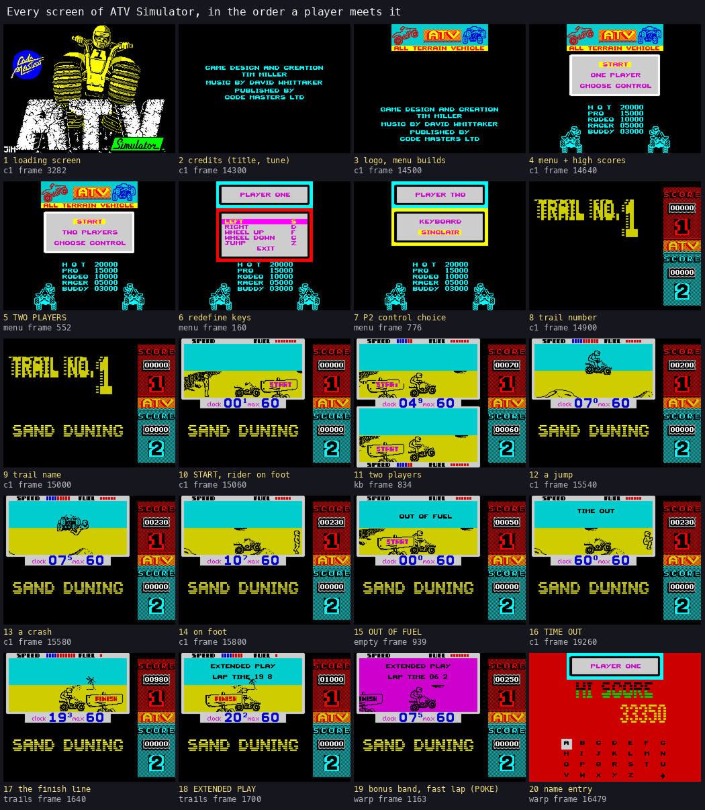

*How to read: twenty screenshots in the order of play, each captioned with what it shows and the recording and
frame it was taken from (the end of that frame). The atlas holds 19 of the table's 23 rows and the redefine-keys page
(`menu` 160); it leaves out "thrown" (`c1` 15 660), "finished, TIME OUT" (`trails` 4 510), "bonus" (`trails` 4 780)
and "both finished" (`kb` 2 418), shown in the table only. Its panel 19 is the bonus band of a fast lap after a
distance POKE (`warp` 1 163). The point: the game has one play screen, the two halves with the HUD
panels on the right, and every other moment is text over it or a front-end page. Drawn by `python3
tools/fig_screens.py docs/img/play/screens.png` from the screenshots below.*

| Screen | What it shows | Shot |
| --- | --- | --- |
| loading | the Code Masters picture, loaded from tape block 5 | 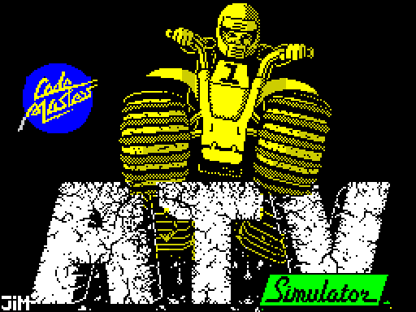 |
| credits | GAME DESIGN AND CREATION TIM MILLER, MUSIC BY DAVID WHITTAKER, PUBLISHED BY CODE MASTERS LTD | 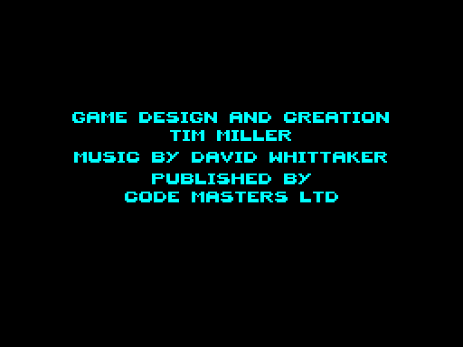 |
| title | the ATV logo, ALL TERRAIN VEHICLE, the menu building | 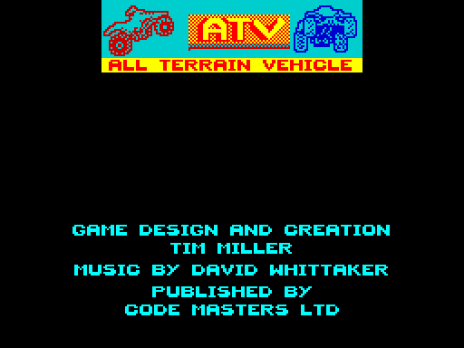 |
| menu | START, ONE PLAYER, CHOOSE CONTROL; the high score table under it; the title tune plays | 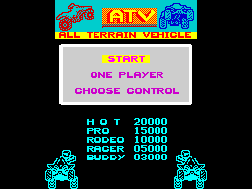 |
| players | TWO PLAYERS chosen | 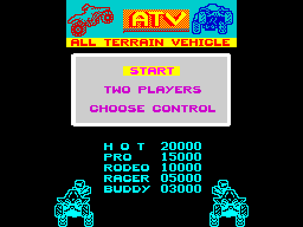 |
| controls | player two: KEYBOARD or SINCLAIR | 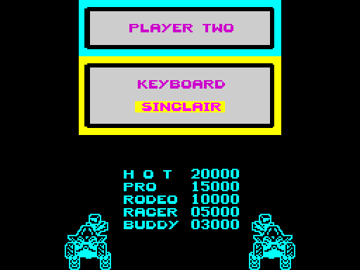 |
| trail intro | TRAIL NO. 1 in big letters, the score panels | 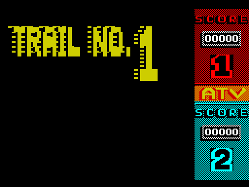 |
| trail name | SAND DUNING under the trail number | 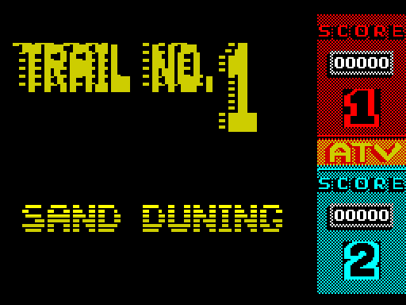 |
| start | the rider on foot beside the ATV, the START sign, clock 00.1 | 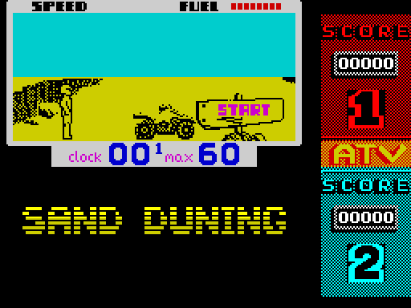 |
| split screen | two players, two halves, two HUDs | 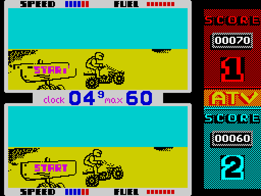 |
| a jump | the ATV in the air over a dune | 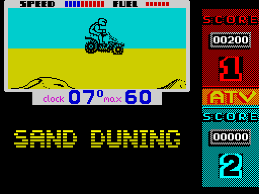 |
| a crash | the ATV tumbling | 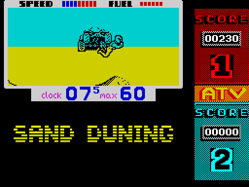 |
| thrown | the rider thrown off | 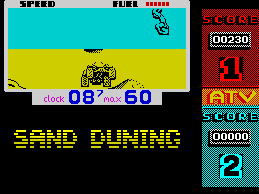 |
| on foot | the rider on foot; in `c1` he has walked right, away from the ATV, to the window's edge | 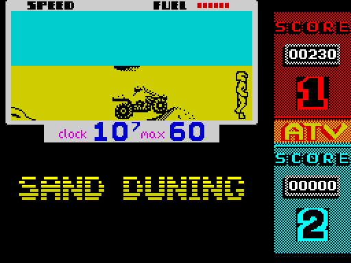 |
| OUT OF FUEL | the text in the half; the ATV crawls | 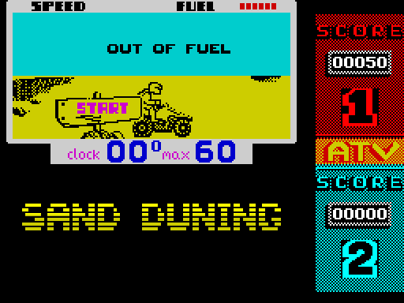 |
| TIME OUT | the clock at 60.0, the text in the half | 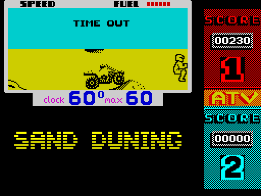 |
| finish line | the FINISH sign | 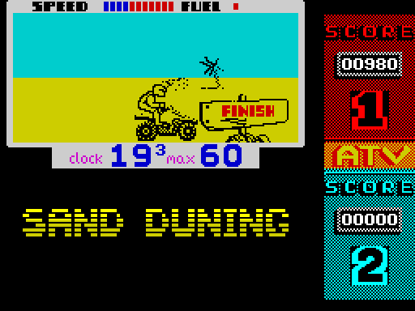 |
| EXTENDED PLAY | EXTENDED PLAY and LAP TIME 19 8 | 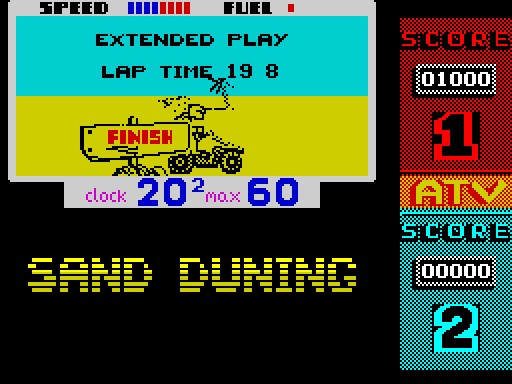 |
| finished, TIME OUT | the clock at 60.0, no TIME OUT text in a finished half | 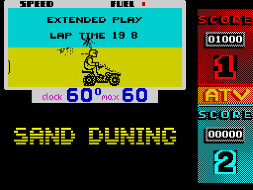 |
| bonus | the half in a magenta band, the bonus counted into the score | 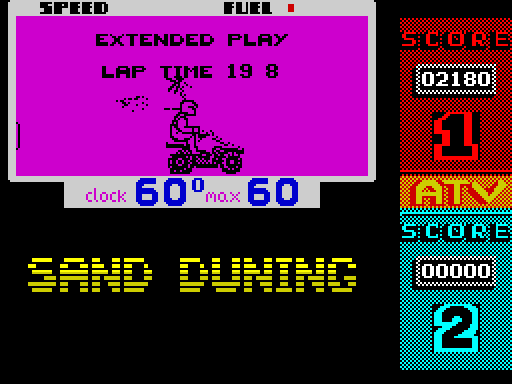 |
| bonus, a fast lap | LAP TIME 06 2 after a distance POKE | 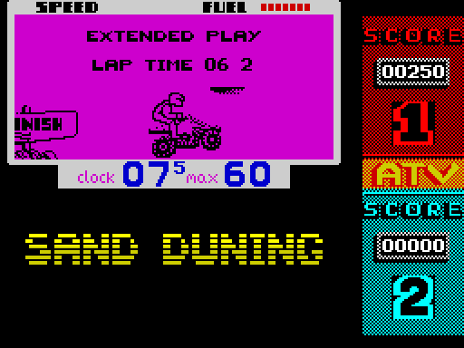 |
| both finished | two halves with EXTENDED PLAY | 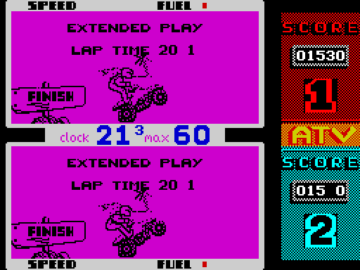 |
| name entry | PLAYER ONE, HI SCORE 33350, a grid of letters and an arrow | 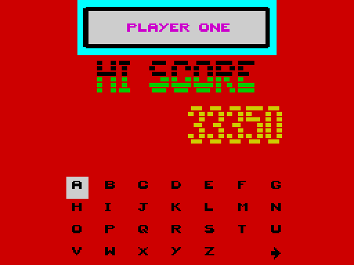 |

The WALKTHROUGH's 6.1 has more: the BASIC, the start line, the redefine tables, each of the six trails, the second
round and the new high score table.

**The point.** Every moment of play happens in one layout: one or two play halves at the top left, the score panels on
the right, the trail's name in big letters at the bottom.

## 1.4 The HUD

Each half carries its own HUD. Over the half: the SPEED bar on the left and the FUEL bar on the right. Under it: the
clock in big digits, "clock XX x max NN", the tenths as a small digit. On the right of the screen: SCORE 1 and
SCORE 2, five digits each, and the ATV logo. Under the halves: the trail's name in big letters (with one player).

| Item | Where in memory | How it changes |
| --- | --- | --- |
| SPEED bar | Record's SpeedBarLen `$D77E` | with Speed `$D77B`, 0-21 |
| FUEL bar | FuelBar `$D77F` | 4 pixels fewer for each `$400` of fuel used |
| clock | Clock `$D6C9-$D6CB`, three ASCII digits | one tenth a pass (7 frames) |
| max | MaxTime `$D6CC` | the trail's: 60 60 60 40 50 50, 30 in round 2 |
| score | Scores `$6948`, five ASCII digits a player | 10 a step of distance, the bonus at the end |

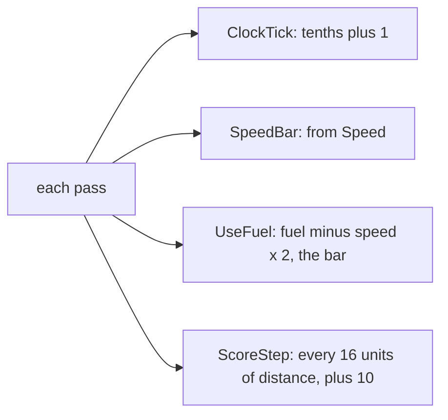

**Worked example.** At `c1` frame 15 060, the first pass of trail 1, the clock reads 00 1 with "max 60", both scores
00000, the SPEED bar empty (the rider is on foot) and the FUEL bar full. [Doc 08](08-hud-and-text.md) draws the HUD
digit by digit.

**Witness.** `docs/img/play/c1-015060-first-pass.png`.

**The point.** The clock is the only thing that can end the game, and it is the largest thing on the HUD.

## 1.5 The six trails

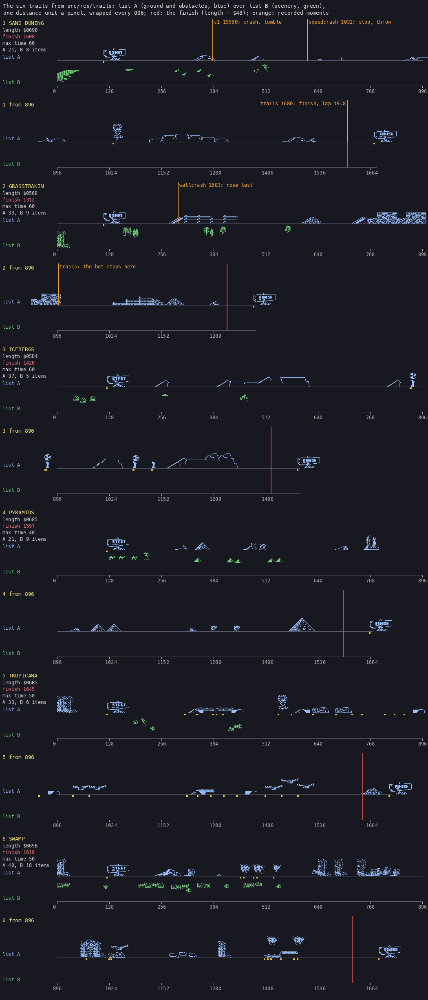

*How to read: each trail is drawn from its resource file, one distance unit a pixel, wrapped every 896 units: list A
(the ground pieces and obstacles the ATV meets, blue) on a line, list B (the scenery behind, green) under it, the
items' sprites from `src/res/sprites/game.png`. The red line is the finish, the trail's length less `$48`; the left
column gives the length, the finish, the maximum time and the item counts. The orange lines mark recorded moments.
The point: the trails differ in their obstacles more than their length; trail 2 has the high log stacks that stop the
bot, trail 6 the most items (58), then trail 2 (48). Drawn by `python3 tools/fig_trails.py`; the marks are `c1` frame 15 580,
`trails` frame 1 680, `trails`' stop at distance 898, `speedcrash` frame 1 032 and `wallcrash` frame 1 683.*

| Trail | Name | Length | Finish | Maximum | List A, list B |
| ---: | --- | ---: | ---: | ---: | --- |
| 1 | SAND DUNING | 1 680 | 1 608 | 60 | 21, 8 |
| 2 | GRASSTRAKIN | 1 384 | 1 312 | 60 | 39, 9 |
| 3 | ICEBERGS | 1 492 | 1 420 | 60 | 37, 5 |
| 4 | PYRAMIDS | 1 669 | 1 597 | 40 | 21, 9 |
| 5 | TROPICANA | 1 717 | 1 645 | 50 | 33, 6 |
| 6 | SWAMP | 1 691 | 1 619 | 50 | 40, 18 |

*The lengths and counts from `tools/trail_map.py`'s reading of `src/res/trails`; the maximums from MaxTimes `$D6CF`.
[Doc 07](07-objects.md) decodes the format.*

**Worked example.** Trail 1's finish is at 1 608. The distance is a 24-bit number whose whole part is TrackPos; the
ATV adds speed × 128 to it each pass, half a unit a pass for each speed level. At the top speed of 21 that is 10.5
units a pass, so the finish is at least 154 passes, 15.4 on the clock, from the start; the bot's 19.8 includes its
start on foot and its slow climbs.

**Witness.** `trails`: the finish at about frame 1 680 with the clock at 19.8 (1.6).

**The point.** Six trails of about the same length; the maximums make trail 4 the hardest, 40 against the others' 50
and 60.

## 1.6 The rules: the clock, the score, the finish and the bonus

**The clock.** The clock counts tenths, and a tenth is one pass of the game, 7 frames when the work fits
([doc 04, 4.6](04-game-loop.md#46-the-fixed-7-frame-pass-and-the-wait-on-d6bc)). TIME OUT comes when the clock's first
digit reaches the maximum's: "60" ends at 60.0, 600 passes, 84 s with one player. With two players a pass often takes
longer, so the same 60.0 takes longer in real time.

**The score.** A point shows as 10: the score's tens digit counts the points. A rider gains a point for every 16
units of distance forward and loses one for every 16 back, and stops scoring once past the finish. Trail 1's finish at
1 608 is worth about 100 points, 1 000 on the screen.

**The finish.** When a rider's TrackPos passes the finish, the game stores the clock as the lap time and computes the
bonus, then prints LAP TIME and EXTENDED PLAY in the rider's half. The rider can ride on; the trail ends when every
rider still in has finished and stopped, or at the maximum.

**The bonus.** Bonus = ((max − lap) / 2 + 1) × trail + 1, with the times in tenths and the trail counted from 1. The
game multiplies 8 bits by 8 bits, so only the low byte of the first part counts. At the trail's end the bonus is
counted into the score one point at a time, each with a tone.

**The second round.** After trail 6 the trails start again from 1 with every maximum 30, and the bonus goes on
multiplying by the trail number, 1-6.

**How it works.**

```text
at the finish (the first time):
    LapTime = Clock
    first = ((MaxTime x 10 - LapTime as tenths) / 2 + 1) AND $FF    ; 8 bits
    Bonus = first x (Trail + 1) + 1
    print "LAP TIME", "EXTENDED PLAY"
at the trail's end:
    for each point of Bonus: score + 10 on the screen, a tone
```

```asm
FinishCheck:                ; $DB34
  LD DE,(FinishDistance)
  LD HL,(TrackPos)
  XOR A
  SBC HL,DE
  RET C                   ; not there yet
  ...
  LD IX,Clock
  CALL DigitsValue        ; the clock in tenths
  PUSH HL
  LD IX,MaxTime
  CALL DigitsValue
  POP DE
  XOR A
  SBC HL,DE               ; max - lap
  SRL H
  RR L                    ; / 2
  INC L                   ; + 1 (8 bits)
  LD E,L
  LD A,(Trail)
  ADD A,$01
  CALL JpMultiply         ; E x A
  INC HL
  LD (Bonus),HL
```

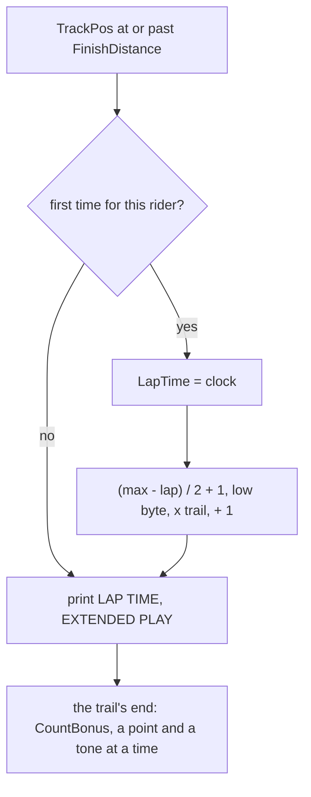

**Worked example.** In `trails` the lap is 19.8, 198 tenths, on trail 1 with the maximum 60, 600 tenths. (600 − 198)
/ 2 + 1 = 202, which fits in a byte; × 1 + 1 = 203, `$CB` in Bonus. The score at the finish is 01000; CountBonus adds
203 points, 2 030 on the screen, and the score reads 03030. In `warp` the distance POKE puts the ATV at the finish
after 6.8 on trail 2: (600 − 68) / 2 + 1 = 267, whose low byte is 11; × 2 + 1 = 23, and the score grows by 230 only
(350 to 580). A lap wraps only when (max × 10 − lap) / 2 + 1 passes 255, that is a lap of 09.0 or less on a "60" trail.
On a "50", "40" or "30" trail the first part is at most 251, 201 or 151, so it never wraps.

| Recording | Trail | Max | Lap | Bonus | Score |
| --- | ---: | ---: | ---: | ---: | --- |
| `trails` | 1 | 60 | 19.8 | 203 | 1 000 to 3 030 |
| `warp` | 1 | 60 | 06.2 | 15 | 100 to 250 |
| `warp` | 2 | 60 | 06.8 | 23 | 350 to 580 |
| `warp` | 3 | 60 | 07.6 | 22 | 680 to 900 |
| `warp` | 4 | 40 | 06.7 | 669 | 1 000 to 7 690 |
| `warp` | 6 | 50 | 06.3 | 1 315 | 18 250 to 31 400 |
| `warp`, round 2 | 1 | 30 | 06.8 | 118 | 31 500 to 32 680 |

*The laps and scores read from the screens and Bonus `$D79B` at T 0 of the frames after each finish. The `warp`
laps are short because a POKE moved the ATV near the finish. They show the wrap on the "60" trails 1-3; trails 4 and 6
and the second round cannot wrap.*

**Witness.** `trails` frames 1 640-4 780 (the screenshots in 1.3); `warp`'s finishes (WALKTHROUGH 6.1). Bonus 203 is
`$CB` at `$D79B` after the finish in `trails`.

**The point.** Time left becomes score, multiplied by the trail number. The 8-bit middle step caps the bonus of a
very fast lap, but no ridden lap is fast enough to meet it.

## 1.7 A crash and the walk back

A landing or a step that is too hard ends in a crash. What happens depends on the speed: under 10 the ATV stops; from
10 to 14 it stops and the rider is thrown; from 15 up it tumbles for 24 passes and then throws the rider. Thrown, the
rider flies, lies on the ground, gets up and walks, 3 units a pass, with a jump of his own. He must walk back to the
ATV, face the right way and press jump to mount. The clock runs all the time.

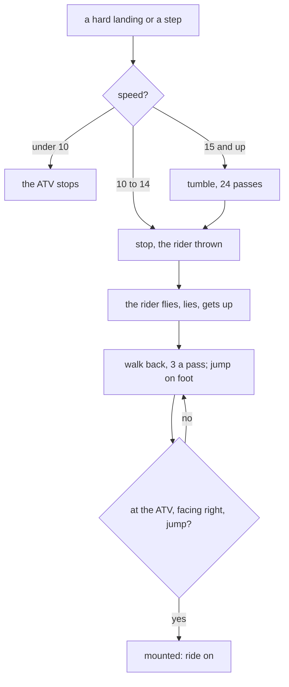

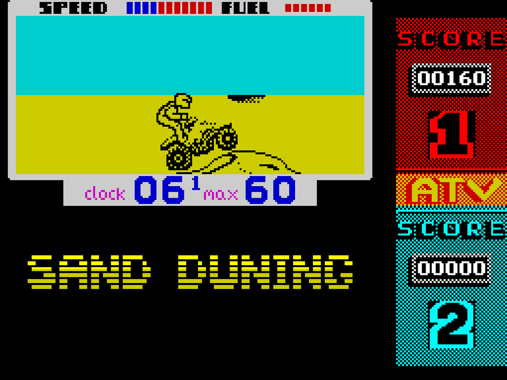

*`c1`, frames 15 480-15 830, one picture every 7 frames (a pass), 51 pictures. How to read: the whole screen at the
end of each pass; the top half is player 1. The ATV jumps a dune at about 15 475, lands, tumbles from 15 580, throws
the rider (15 620-15 700), and the rider lies, stands and walks (15 800). The point: a crash costs about 30 passes, 3
seconds on the clock, before the walk back even starts. Drawn with `python3 ../../kit/screen_anim.py --work
work/docs/atA/c1 --from 15480 --to 15830 --step 7 --width 1050 --delay 140 --hold 1500 docs/img/play/c1-crash.gif`.*

**Worked example.** Sampled at T 0 of the frames of `c1`: at 15 580 TrackPos is 381 (`$017D`) and Speed 17 (`$11`),
down from 21 after the landing. 17 is over 15, so the ATV tumbles; TumbleCount counts up to 24. Then the rider is
thrown (ThrowSpeed `$F7`, up), lands, and lies with RiderFrame `$77` at 15 727. He walks and jumps (`$18`). In `c1` he
never rides again: sampled every 100 frames from 15 600 to 19 300, TrackPos stays at 373 (`$0175`) and Speed
at 0 until TIME OUT at 60.0.

**Witness.** `work/docs/atA/sample.py` over `c1` (`work/docs/atA-NOTES.md`); the screenshots at 15 540, 15 580, 15 660
and 15 800 (1.3). [Doc 10](10-gameplay-logic.md) gives the code of the crash and the walk.

**The point.** A crash is paid in time, not in lives. The game punishes speed: the faster the crash, the longer it
lasts.

## 1.8 Fuel and OUT OF FUEL

Each trail starts with a full tank, the word `$2000`. Each pass that moves takes speed × 2 from it, and the FUEL bar
loses 4 pixels for each `$400` used. When the high byte falls under 4, the tank is empty: the game prints OUT OF FUEL
in the half and brakes the ATV twice a pass. The rider can still crawl forward with the throttle held, but only the
clock can end the run.

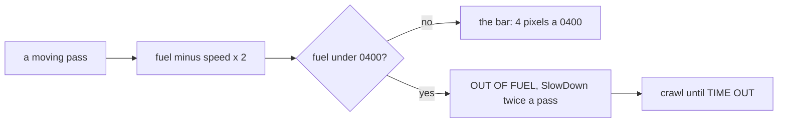

**Worked example.** In `empty` the clock is stopped by POKE 60250,0 at frame 14 (it reads 00.0 throughout), and the
fuel's high byte is POKEd to 5 at frame 567, just above empty. It falls under `$400`
in the pass of frame 732 (OutOfFuel runs there; Fuel reads `$03F6` from 733). OUT OF FUEL blinks from frame 736 on
(drawn in the passes that move; [doc 10](10-gameplay-logic.md)), and the score crawls from 50 at frame 939 to 90 by
frame 2 269 while the throttle is held. A full tank of `$2000` at speed 21 lasts (`$2000` − `$400`) / 42 = 171 moving passes: the tank is
empty under `$400` (FuelEmptyTest `$DFBC`, the high byte AND `$FC`). That is still more than a trail's finish needs
at that speed (about 154 passes, 1.5).

**Witness.** `work/stage1/rec/empty`: OutOfFuel ran 83 times (its L1), first in frame 732 (the trace
`work/docs/atC/empty/traces/732_0-733_0.uatr`); `docs/img/play/empty-000939-out-of-fuel.png`.

**The point.** Fuel is a soft limit: a rider who keeps moving finishes before it runs out; a rider who wastes it
crawls to TIME OUT.

## 1.9 Two players on the split screen

With TWO PLAYERS each player rides in a half: player 1 on top, player 2 below, each with its own SPEED and FUEL bars and
score. Both ride the same trail at the same time on one shared clock. Each pass runs both players one after the other;
when their work does not fit in 7 frames the pass is longer, and the clock runs slower in real time.

A player who finishes waits, the ATV slowing to a stop. The trail ends when both have finished and stopped, or at
TIME OUT. A player who has not finished at TIME OUT drops out: only the finished players ride the next trail.

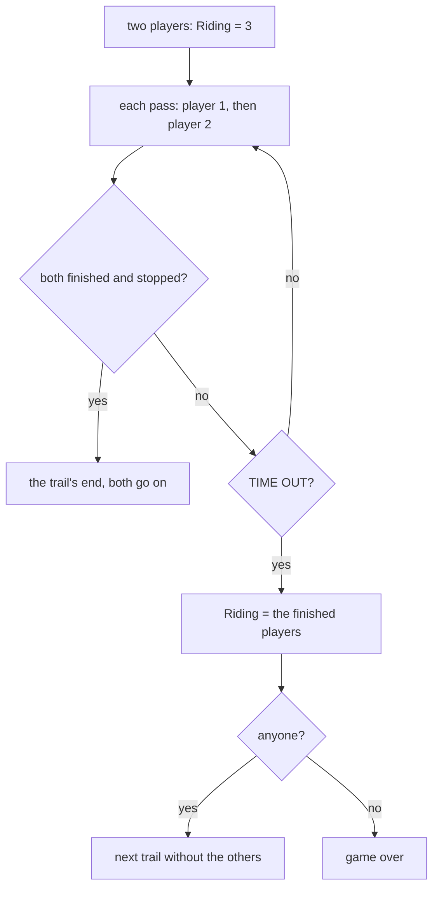

**Worked example.** In `kb` both players finish trail 1 at about frame 2 000 with the clock at 20.2. The trail ends
when both have stopped, with the clock at 21.3 (frame 2 150): 213 passes since 00.1 at frame 402, (2 150 − 402) / 212
= 8.2 frames each on average instead of 7. Both ride trail 2. At the end player 2's score enters the table, and
the name entry says PLAYER TWO (`kb` frame 8 260).

**Witness.** `docs/img/play/kb-000834-split-screen.png`, `kb-002418-both-finished.png`; the clock samples in
`work/docs/atA-kb-clock.txt`; [doc 04, 4.6](04-game-loop.md#46-the-fixed-7-frame-pass-and-the-wait-on-d6bc).

**The point.** A race of two on one clock. The rules are the same for both; the machine's speed is what changes.

## 1.10 TIME OUT, the end of the game and the high score table

At the maximum the game sets both speeds to 0 and prints TIME OUT in each half whose rider has not finished. If any
rider finished, the trail ends normally. If none did, the screen stays for 250 frames (5 s) and the game is over.

Then the high score table: five names and scores, in the image HOT 20000, PRO 15000, RODEO 10000, RACER 05000 and
BUDDY 03000. A score that beats one of them gets the name entry: PLAYER ONE or PLAYER TWO, HI SCORE and the score, and
a grid of the letters A-Z and an arrow. The player moves round the grid and picks letters; the arrow ends the name.
The title follows.

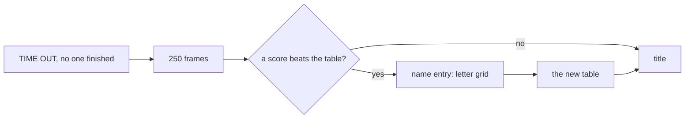

**Worked example.** In `warp` player 1 ends with 33 350 (the second round's trail 1 at 32 680 and on); it beats HOT's
20 000, so the name entry comes at frame 16 479 with HI SCORE 33350, and "BC" is entered by 16 589. In `c1` the score
of 230 beats nothing and the title comes back.

**Witness.** `docs/img/play/warp-016479-name-entry.png`, `warp-016589-name-abc.png`, `warp-017756-after.png`
(WALKTHROUGH 6.1); `c1-014640-menu-hiscores.png` for the table.

**The point.** One game, one score: the table rewards distance and fast laps across both rounds.

## 1.11 Known only from the code

These rules are in the code, and no recording shows them:

- the menu, left alone, goes back to the title after about 10.5 minutes (TuneTimer reaching `$8000`, counted on by
  MenuLoop's HALT loop after the tune stopped at `$0A00`; [doc 04, 4.10](04-game-loop.md#410-the-timers-and-every-delay));
- more than 30 animated objects in one pass turn the border blue and hang the game (ListOverflow `$8A90`);
- key 1 would restart the game from the interrupt (AbortKey `$DA01`, KeyStates+15), but no jump reaches that code;
- the bonus wraps for a lap of 09.0 or less on a "60" trail: shown only with the distance POKEs of `warp` (1.6).

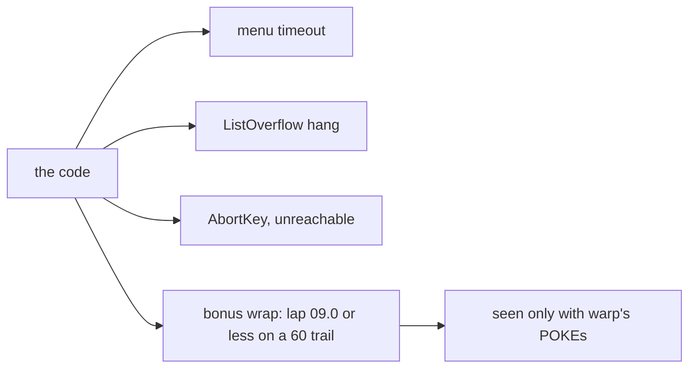

Full nose-up throwing the rider off (ThrowOff, then FallRider) was known only from the code until the recording
`throwoff` (frames 612-619; [doc 10, 10.8](10-gameplay-logic.md#108-the-rider-thrown)); so were the speed crash and the
nose test's crash (`speedcrash`, `wallcrash`, [doc 10, 10.6](10-gameplay-logic.md#106-the-crash)).

**The point.** The recordings cover the game as it is played; what is left is a timeout, an overflow guard, an
unreachable key and a wrap.
