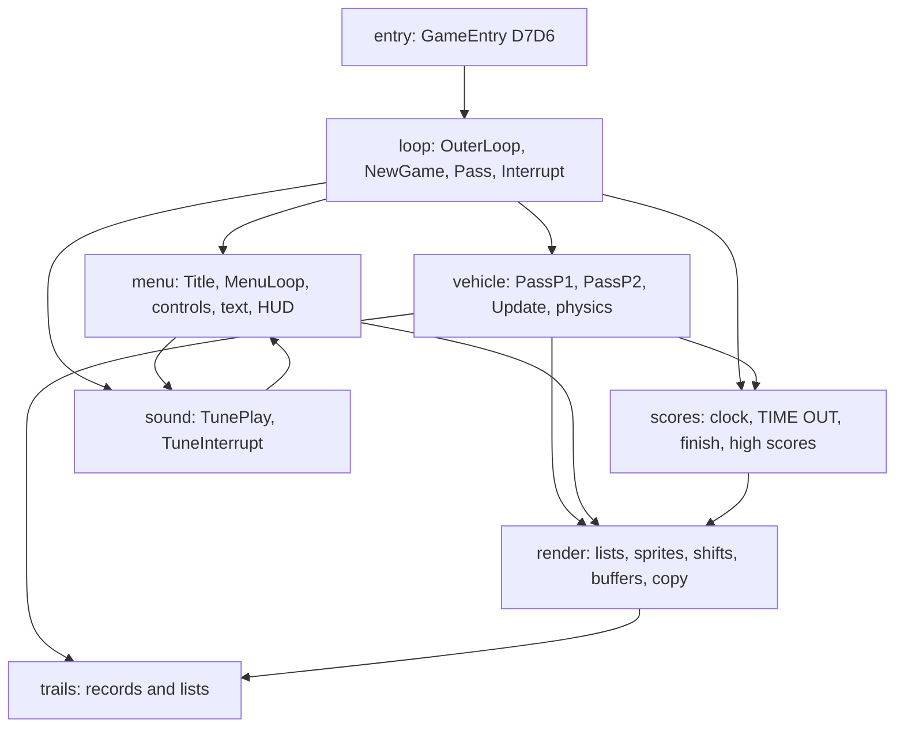
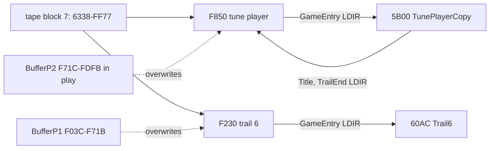
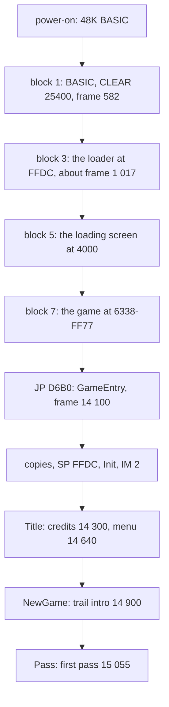
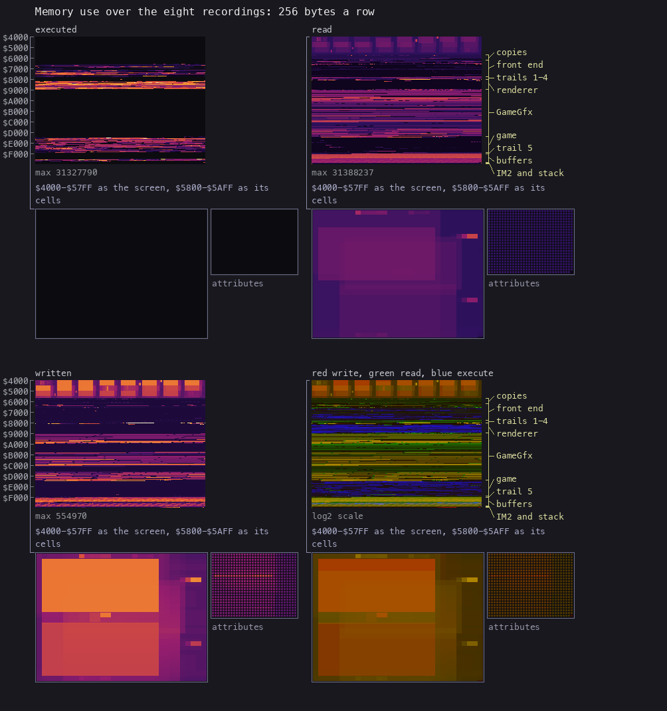
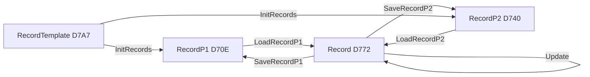
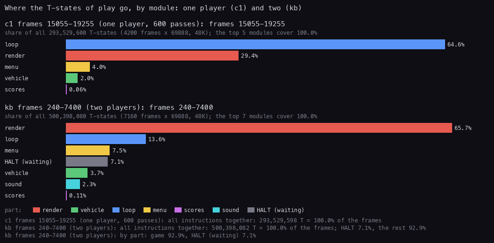
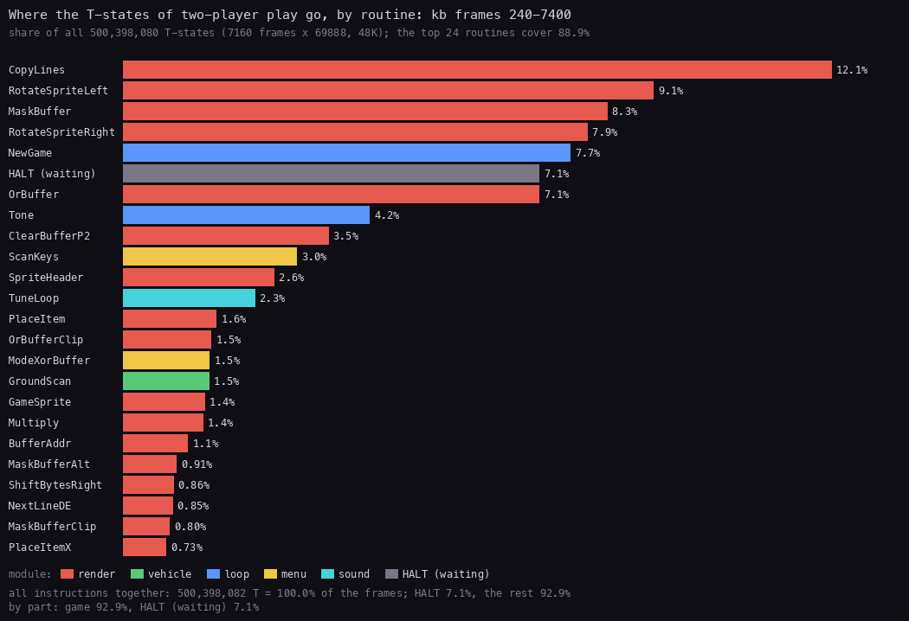
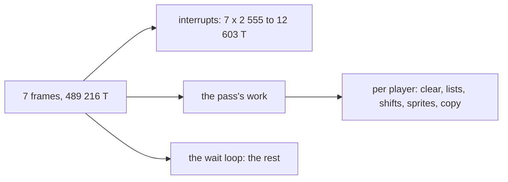
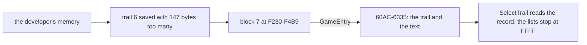

# 2. Architecture

What this covers:

- the eight modules and how they call each other (2.1);
- the memory map as stage 2 corrected it: code in two blocks, the graphics, the two play buffers, the copies to
  `$5B00` and `$60AC` (2.2);
- the stages from the tape to play (2.3);
- memory use over the recordings, and the stack (2.4);
- the state variables and the player records (2.5);
- the frame budget: where the T-states of play go, one player and two (2.6);
- the leftovers, among them the assembler source text in trail 6's tail (2.7).

The machine is a 48K Spectrum. The game uses no 128K memory or sound: the image, the buffers and the stack fit in
the 48K, and the beeper makes every sound ([doc 09](09-sound.md)).

The recordings it rests on ([WALKTHROUGH](../WALKTHROUGH.md), 6.0): `c1` (power-on, the load, trail 1, TIME OUT),
`menu`, `kb` (two players), `trail1`, `trails`, `warp` (all six trails), `fuel` and `empty`. The L1 builds of these
recordings are merged in `work/docs/atA/l1-all.json`; the play windows `c1play` (`c1` frames 15 055-19 255) and
`kbplay` (`kb` frames 240-7 400) give the budget. The commands are in
[`work/docs/atA-NOTES.md`](../work/docs/atA-NOTES.md).

## 2.1 The modules

The source (`src/game/game.ann`, 466 entries) is split into eight modules by what the code does. Each module is one
`.asm` file in `src/game`, and its pieces lie in several places of the image: the code was not laid out by module.

| Module | Entries (code) | Bytes (code) | What it holds | Main ranges |
| --- | ---: | ---: | --- | --- |
| entry | 1 (1) | 55 (55) | GameEntry: the two copies, SP, Init, IM 2, OuterLoop | `$D7D6-$D80C` |
| loop | 43 (42) | 939 (902) | the jump table, the game's variables, NewGame, Pass, the wait, the interrupt, TrailEnd | `$D6B0-$D70B`, `$D80D-$DA1D`, `$EC7F-$EDB1` |
| menu | 155 (136) | 6 280 (3 805) | the title, the menus, the controls, the text printer, the trail intro, the HUD frame | `$6338-$69F6`, `$6A09-$79F0`, `$83F9-$859C` |
| render | 111 (99) | 24 361 (3 305) | the draw modes, the sprite bank, the shifters, the buffers and their copy, the trail lists | `$8080-$8F5B`, `$8F5C-$D6AF` (GameGfx), `$DBD1-$DD96`, `$F03C-$FDFB` |
| vehicle | 71 (60) | 3 809 (3 430) | the records, the ATV and the rider, the ground, crashes, fuel | `$D70E-$D7A7`, `$DA1E-$DB34`, `$DE2A-$EAAE` |
| scores | 32 (29) | 1 288 (1 172) | the high score table, the name entry, the clock, the finish, the score | `$7A3E-$7C90`, `$EABF-$EC71`, `$EDBB-$EE4C` |
| trails | 13 (0) | 1 436 (0) | the six trails' records and lists | `$7C9C-$807A`, `$EE84-$F03B` |
| sound | 40 (31) | 1 832 (797) | the tune player and its tunes, the IM 2 table | `$F850-$FF18` |

*The bytes are counted from each entry to the next one in game.ann; render's count holds the sprite bank (18 260
bytes) and the two play buffers (3 520 bytes). The engine's tone (EngineSound, Tone) lives in loop beside the
interrupt that plays it.*

The modules call each other in one direction from the loop down, with two exceptions: the menu's interrupt hook in
the sound module, and the renderer's jump tables, which the menu and the game both use.



**Worked example.** One pass of player 1 crosses five modules: Pass (loop) calls ClockTick (scores) and PassP1
(vehicle); PassP1's Update calls WalkList (render) over trail 1's list A (trails), and FinishCheck (vehicle) prints
LAP TIME with the text printer (scores, PrintShadow `$EC26`, which draws through render). The interrupt (loop) plays
the engine with Tone, also in loop.

**Witness.** The module lines of `src/game/game.ann` (`@module`); mkgame's build prints "assembled: identical to the
original image" for the eight modules together (WALKTHROUGH, stage 2).

**The point.** The image is one program in eight parts. The game's core (entry, loop, vehicle, scores) sits together
at `$D6B0-$EE4C`; the front end, the renderer and the sprites fill the space below it, and the tune player and the
buffers the space above.

## 2.2 The memory map

The tape loads two blocks: the loading screen to `$4000` and the game, 40 000 bytes, to `$6338-$FF77`. Nothing else is
ever loaded. GameEntry then makes two copies, and from then on the map does not change.


*How to read: three columns of the RAM from `$4000` (top) to `$FFFF` (bottom): as the loader leaves it (`c1` frame
14 100), after GameEntry's copies (frame 14 101), and in play (from frame 15 055). The lines show the two copies. The
point: the tune player and trail 6 are loaded where the play buffers will be, and moved down into the BASIC area the
game no longer needs. Drawn from game.ann's entries by `python3 tools/fig_memmap.py docs/img/arch/memmap.png`.*

| Range | Bytes | What it holds | Witness |
| --- | ---: | --- | --- |
| `$4000-$5AFF` | 6 912 | the screen; the loading screen until the title | tape block 5 |
| `$5B00-$60AA` | 1 451 | TunePlayerCopy: the tune player `$F850-$FDFA`, copied down by GameEntry, copied back before each tune (by Title and TrailEnd) | L1 copies (`c1`) |
| `$60AC-$6335` | 650 | Trail6: trail 6's record and lists, copied from `$F230` by GameEntry | SelectTrail `$EC9C` picks `$60AC` |
| `$6338-$66FC` | 965 | MenuGfx: the front end's 14 pictures | `src/res/sprites/menu.png` |
| `$6720-$69A5` | 646 | the menu's variables, RowAddrs (192 screen lines), BufferRows (80 buffer lines), PlayerCount `$6947`, Scores `$6948` | built by Init |
| `$69A6-$7C90` | 4 843 | code: the menu's jump table, the front end, the text printer, the high scores | `c1` executed |
| `$7C9C-$807A` | 991 | trails 1-4: four records of 6 bytes and their lists | `src/res/trails/trails14.txt` |
| `$8080-$82FD` | 638 | the render variables: Im2Jump `$8080`, the deferred lists, Controls1 `$8113`, Controls2 `$8114`, the key states | written in play |
| `$82FE-$8F25` | 3 112 | code: the draw modes, the sprite entry `$865F`, the shifters, CopyLines, the lists | `c1` executed |
| `$8F5C-$D6AF` | 18 260 | GameGfx: 203 sprites with 4-byte headers (the ATV, the rider, the ground, the scenery, the font, the digits) | `src/res/sprites/game.png` |
| `$D6B0-$D7D5` | 294 | EntryJumps, GameTable, the game's variables, RecordP1 `$D70E`, RecordP2 `$D740`, Record `$D772`, RecordTemplate `$D7A7` | 2.5 |
| `$D7D6-$EE4B` | 5 750 | code: the entry, the loop, the vehicle, the clock, the finish, the trail end | `c1` executed |
| `$EE84-$F03B` | 440 | Trail5: trail 5's record and lists | `src/res/trails/trail5.txt` |
| `$F03C-$F71B` | 1 760 | BufferP1: player 1's buffer, 22 × 80 bytes, over trail 6's load place `$F230-$F4B9`; the front end draws there too | written each pass |
| `$F71C-$FDFB` | 1 760 | BufferP2: player 2's buffer, over the tune player `$F850-$FDFA` | written in `kb` |
| `$FDFD-$FDFF` | 3 | TuneVector: `JP TuneInterrupt` while a tune plays | 4.4 of [doc 04](04-game-loop.md#44-the-title-tunes-vector-fdfd-and-the-menu-inside-it) |
| `$FE00-$FF00` | 257 | Im2Table: `$80` (the game) or `$FD` (a tune) | SetupIm2, TunePlay |
| `$FF01-$FFDB` | 219 | the stack: SP = `$FFDC` at the entry | 2.4 |
| `$FFDC-$FFFD` | 34 | the tape loader, left where it ran | tape block 3 |


*How to read: the 88 sprite headers that the sprite entry `$865F` was given in the play recordings (its L1 `patterns`,
HL's bases), each drawn from the image as loaded with its header address: the HUD's words and digits, the font, the
rider and his masks, the ATV, the scenery and START / FINISH. The point: the 18 K between the two code blocks is
almost all pictures. Drawn by `python3 tools/sprite_sheet.py work/stage1/media/tape64.bin
docs/img/sprites/sprites-stage1.png work/stage1/rec/{warp,kb,trail1,trails,menu,fuel}/l1.json` (stage 1); the whole
bank of 203 is `src/res/sprites/game.png`.*

The code lies in two blocks: `$69A6-$8F25` (the front end and the renderer, 7 956 bytes of code in a 9 600-byte span,
with the trails 1-4 between them) and `$D6B0-$EE4B` (the game, 6 044 bytes). The sprite bank fills the 18 K between them.

**How it works.** The copies are the whole of the relocation:

```text
GameEntry:
    copy $F850-$FDFA to $5B00   ; 1 451 bytes: the tune player under the image
    copy $F230-$F4B9 to $60AC   ; 650 bytes: trail 6, whose addresses point at $60AC
Title, TrailEnd (before each tune):
    copy $5B00-$60AA to $F850   ; the tune player back where its code runs
```

```asm
GameEntry:                  ; $D7D6
  DI
  LD HL,TunePlay0         ; $F850
  LD DE,TunePlayerCopy    ; $5B00
  LD BC,$05AB
  LDIR
  LD HL,Trail6Image       ; $F230
  LD DE,Trail6            ; $60AC
  LD BC,$028A
  LDIR
```



**Worked example.** The tune player is written at `$F850`, and its code uses absolute addresses there. In play,
BufferP2 `$F71C-$FDFB` covers `$F850-$FDFA` with player 2's picture. So Title and TrailEnd copy
`$5B00` back to `$F850` before every tune, 1 451 bytes, and the tune runs at its own address. Trail 6 is different:
its lists hold addresses in `$60AC-$6335`, so it is used at the copy and never copied back; its load place
`$F230-$F4B9` lies inside BufferP1 `$F03C-$F71B` and is free for the buffer once the copy is done.

**Witness.** The L1 of `c1` lists the copy `$F850` → `$5B00` (`LDIR` at `$D7E0`) and `$F230` → `$60AC` (at `$D7EB`);
[GameEntry.gif](03-build-and-load.md#34-the-entry-two-copies-out-of-the-buffers-way) shows both.

**The point.** The map is one load and two copies. The game is built to use every byte from `$5B00`: the BASIC area
holds the tune player and a trail, and the space above the code holds the buffers.

## 2.3 The stages from the tape to play



*The frames are `c1`'s: the BASIC listing on screen at 582 (`docs/img/play/c1-000582-basic.png`), the loader's run
after block 3, the entry at 14 100 T 17 980, the title and menu screenshots. [Doc 03](03-build-and-load.md) follows
the load block by block.*

**How it works.**

```text
ROM: LOAD ""                 ; block 1, the BASIC: CLEAR 25400; LOAD ""CODE; RANDOMIZE USR 65500
ROM: LOAD ""CODE             ; block 3 to $FFDC, then USR 65500 runs it
Loader ($FFDC):              ; skips the headers 4 and 6 by their flag
    LD-BYTES($4000, 6912)    ; block 5, the loading screen
    LD-BYTES($6338, 40000)   ; block 7, the game
    JP $D6B0                 ; EntryJumps: JP GameEntry
GameEntry ($D7D6):
    copy the tune player to $5B00, trail 6 to $60AC; SP = $FFDC; Init; IM 2 on $FE00
    OuterLoop: Title (credits, menu), NewGame, the trails' passes
```

**Worked example.** In `c1` the loader's code first runs at frame 1 017. The game's entry follows at 14 100 T 17 980,
282 s after power-on; the emulator's tape stops later, at 14 182. The IM 2
vector's `JP $D9D2` at `$8080` first runs at 14 114, 14 frames after the entry.
The credits are on screen at 14 300, the menu at 14 640, and SPACE at 14 657 starts the game: the trail intro at
14 900 and the first pass at 15 055, 955 frames (19 s) after the entry.

**Witness.** `kit/rs.py stages` on `c1` (code arrivals: `$FFDC` at 1 017, `$8080` at 14 114, the tune player at
14 639; WALKTHROUGH 1); the screenshots `c1-000582-basic.png`, `c1-014300-credits.png`, `c1-014640-menu-hiscores.png`,
`c1-014900-trail-intro.png` and `c1-015060-first-pass.png` in `docs/img/play`.

**The point.** One load, no packer and no second stage: the game is in place 282 s after power-on, and the
only work before the title is the two copies and Init.

## 2.4 Memory use over the recordings, and the stack

The eight recordings' L1 builds are merged into one count of execution, reads and writes for every byte.



*How to read: four maps of `$4000-$FFFF`, 256 bytes a row: executed, read, written, and the three together (red
write, green read, blue execute); the brighter, the more. Under each, the screen `$4000-$57FF` is laid out as the
screen and its attributes as cells. The labels on the right name the regions of 2.2. The point: the code runs in two
bands (the front end and renderer at `$6A00-$8F00`, the game at `$D6B0-$EE4B`); the sprite bank between them is read
all over and written in places (the in-place shifts); the buffers at `$F03C-$FDFB` are written hardest after the
screen; the screen's two halves are the two players. Drawn with `python3 ../../kit/merge_l1.py
work/docs/atA/l1-all.json work/stage1/rec/{c1,menu,kb,trail1,trails,warp,fuel}/l1.json work/stage1/rec/empty/l1.json
--stack FE00-FFDB` and `python3 ../../kit/heatmap.py work/docs/atA/l1-all.json docs/img/arch/heatmap.png --from 4000
--to FFFF --cell 1 --columns 2 --title "Memory use over the eight recordings: 256 bytes a row" --regions "..."`; the
recordings whole, all frames.*

**The stack.** SP is `$FFDC` from GameEntry on, under the loader. merge_l1's `--stack FE00-FFDB` reports the lowest SP
each recording reached:

| Recording | Lowest SP | Bytes used |
| --- | --- | ---: |
| `c1` | `$FF18` | the ROM's own stack at power-on, under RAMTOP `$FF57`, before `CLEAR 25400` moves it (not the game's) |
| `menu` | `$FFAC` | 48 |
| `kb`, `trail1`, `trails`, `fuel`, `empty` | `$FFA8` | 52 |
| `warp` | `$FFA6` | 54 |

So the game's stack uses at most 54 bytes of the 219 between the IM 2 table and the loader. The lowest write of all,
`$FE00`, is SetupIm2's `LDIR`, not the stack.

**Worked example.** The deepest stack in `warp` is 54 bytes, 27 words. An interrupt alone pushes 14 bytes of them, 7 words:
its return address and six register pairs (4.3 of [doc 04](04-game-loop.md#43-the-interrupt-handler-d9d2)). The other
40 bytes are the calls and pushes of the main program at that moment, OuterLoop's call to NewGame being the first.

**Witness.** `work/docs/atA/l1-all.json`; merge_l1's printout (`work/docs/atA-NOTES.md`).

**The point.** The stack is shallow and lives in a quiet corner. The 219 bytes under the loader are four times what the
game needs.

## 2.5 The state variables and the player records

The game keeps its state in three places: the game's variables at `$D6B6-$D6DA`, the two players' records, and a few
front-end bytes. The names are game.ann's.

| Address | Name | What | Witness |
| --- | --- | --- | --- |
| `$6947` | PlayerCount | 0 one player, 1 two players | `kb` |
| `$6948-$6951` | Scores | five ASCII digits each player; "00000" at NewGame | `c1`, `kb` |
| `$6724` | TuneTimer | the menu's word, counted by MenuTick | `c1` |
| `$8113`, `$8114` | Controls1, Controls2 | the five control bits of each player this pass | `c1`, `kb` |
| `$D6B6`, `$D6B8` | TrailListA, TrailListB | the trail's two lists | SelectTrail |
| `$D6BC` | FrameCount | frames since the pass began; `$FF` in the front end | [doc 04, 4.6](04-game-loop.md#46-the-fixed-7-frame-pass-and-the-wait-on-d6bc) |
| `$D6BE` | Riding | the players still in: bit 0 player 1, bit 1 player 2 | `kb` |
| `$D6BF` | Trail | the trail, 0-5 | `warp` |
| `$D6C0` | FinishDistance | the trail's length − `$48` | SelectTrail |
| `$D6C9-$D6CB` | Clock | three ASCII digits: tens, units, tenths (passes) | `c1` |
| `$D6CC` | MaxTime | the trail's maximum, two digits | `warp` |
| `$D6CF` | MaxTimes | "60" "60" "60" "40" "50" "50"; "30" in the second round | `warp` |
| `$D7A5` | Finished | the players past the finish, bits as Riding | `trails` |
| `$D7A6` | SecondRound | 1 after trail 6 | `warp` |

A player's state is a 50-byte record. RecordP1 `$D70E` and RecordP2 `$D740` are copied to Record `$D772` before the
player's pass and back after it (LoadRecordP1, SaveRecordP1), so the vehicle code reads one place. InitRecords
`$E4CA` fills both from RecordTemplate `$D7A7` at each trail's start.

| Address in Record | Name | What |
| --- | --- | --- |
| `$D774` | Mounted | 1 on the ATV, 0 on foot |
| `$D775` | AtvFrame | the ATV's sprite: `$38` level, `$3A-$44` nose up, `$46-$4C` nose down, `$5C` turning round (head-on, drawn without the rider), `$7D-$87` tumbling |
| `$D776` | Facing | 0 right, 1 left |
| `$D77B` | Speed | the speed level, 0-21 |
| `$D77C` | Fuel | a word, `$2000` full, empty under `$400` |
| `$D783` | RiderFrame | 0-8 walking, `$18` jumping, `$59` riding, `$5E-$64` thrown, `$77` lying |
| `$D785`, `$D786` | RiderX, RiderHeight | the rider on foot |
| `$D789-$D78B` | Distance | 24 bits; TrackPos `$D78A` is its whole part |
| `$D795` | WheelieTimer | passes the nose stays up |
| `$D797` | TumbleCount | passes of tumbling |
| `$D79B` | Bonus | the time bonus at the finish |
| `$D79D` | LapTime | the clock at the finish |

Stage 1's draft named `$D77E` the speed and `$D77D` the fuel; `$D77E` is the SPEED bar's drawn length and the fuel is
the word at `$D77C`. [Doc 07](07-objects.md) and [doc 10](10-gameplay-logic.md) use these fields.



**Worked example.** At `c1` frame 15 580 the ATV tumbles. Sampled at T 0: TrackPos `$D78A` = `$017D` (381), Speed
`$D77B` = 17 (`$11`), down from 21 after the landing slowed it, and TumbleCount `$D797` counts up to 24. Then the
rider is thrown (ThrowSpeed `$F7` up) and lies with RiderFrame `$77` at 15 727.

**Witness.** `work/docs/atA/sample.py` over `c1` (`time_travel memory_at` at T 0 of each frame; the commands in
`work/docs/atA-NOTES.md`).

**The point.** Two copies of one record and one shared code path: everything a player is lives in 50 bytes, and the
second player costs a copy, not a second program.

## 2.6 The frame budget

Where the T-states go depends on the number of players. With one player most of the pass is the wait loop; with two,
most of it is drawing.



*How to read: one bar a module, the share of all T-states in the window; the window's line names the recording and
frames. The point: one player leaves 64.6 % in loop, which is almost all the wait loop of NewGame; two players spend
65.7 % in render and only 13.6 % in loop, plus 7.1 % in HALT (the trail ends). Drawn with `python3
../../kit/fig_budget.py work/docs/atA/c1play/l1.json docs/img/arch/budget-modules.png --by module --label "c1 frames
15055-19255 (one player, 600 passes)" --state "kb frames 240-7400 (two players)=work/docs/atA/kbplay/l1.json"
--colour-order render,vehicle,loop,menu,scores,sound,trails,entry`; `c1` frames 15 055-19 255 and `kb` frames
240-7 400, all T-states of each frame.*



*How to read: the 24 routines that take the most of `kb`'s play, coloured by module. The point: the copy to the
screen (CopyLines 12.1 %) and the in-place shifts (RotateSpriteLeft 9.1 %, RotateSpriteRight 7.9 %) cost more than
any drawing mode; the wait loop is down to 7.7 % (NewGame) and the engines' Tone takes 4.2 %. Drawn with `python3
../../kit/fig_budget.py work/docs/atA/kbplay/l1.json docs/img/arch/budget-routines.png --top 24 --title "Where the
T-states of two-player play go, by routine: kb frames 240-7400" --colour-order
render,vehicle,loop,menu,scores,sound,trails,entry`; `kb` frames 240-7 400.*

| Routine | `c1`, one player | `kb`, two players |
| --- | ---: | ---: |
| the wait loop (in NewGame) | 63.1 % | 7.7 % |
| CopyLines | 7.4 % | 12.1 % |
| MaskBuffer | 5.4 % | 8.3 % |
| RotateSpriteRight | 3.4 % | 7.9 % |
| RotateSpriteLeft | 3.3 % | 9.1 % |
| ScanKeys | 2.9 % | 3.0 % |
| HALT | 0 | 7.1 % |



**Worked example.** In `c1` the 600 passes take 4 200 frames, 293 529 600 T. The wait loop (`$D86B`, counted under
NewGame's root `$D84D`) takes 185 276 967 T of them, 63.1 %: the pass's work is the other 37 %, the mean that
pass_time measured (37.7 %, [doc 04, 4.6](04-game-loop.md#46-the-fixed-7-frame-pass-and-the-wait-on-d6bc)).

**Witness.** `fig_budget.py`'s printout for both windows (`work/docs/atA-NOTES.md`): "the top 12 cover 92.0 %" for
`c1`, "the top 24 cover 88.9 %" for `kb`.

**The point.** One player uses a third of the machine. The second player triples the drawing and the copy, and then
the 7-frame pass no longer holds ([doc 04, 4.6](04-game-loop.md#46-the-fixed-7-frame-pass-and-the-wait-on-d6bc)).

## 2.7 The leftovers

The image holds bytes no code reads, left by the developer's tools or earlier builds. Each is kept in the source as it
is (game.ann names them).

| Address | Bytes | Name | What it is |
| --- | ---: | --- | --- |
| `$66FD-$671F` | 35 | MenuGfxEnd | zeros after the menu bank |
| `$7C91-$7C9B` | 11 | TrailsLeftover | `E1 79 C9 E1 79 C9 C9 79 C9 F6 E1`: code-like bytes before the trails' records |
| `$807B-$8083` | 9 | TrailsTextLeftover | "REGROUND\|": the end of "FOREGROUND" or "BACKGROUND"; `$8080` is overwritten by Im2Jump |
| `$8F26-$8F5B` | 54 | GfxLeftover | code of an earlier build (it calls `$9475`, `$9523` and reads `$63F3`) |
| `$D67A-$D6AF` | 54 | the sprite bank's tail | bytes after the last sprite |
| `$EE4C-$EE83` | 56 | ScoreLeftover | an older copy of ShowScore and the code after it, assembled one byte lower |
| `$F018-$F03B` | 36 | Trail5Tail | animation records no item points at |
| `$F427-$F4B9` | 147 | trail 6's tail | assembler source text (below) |
| `$FF18-$FF77` | 96 | TopLeftover | system variables, stack bytes and four glyphs of the ROM font (A, B, C, D) from the developer's memory |

Trail 6's tail is the most telling. The trail's record and lists end at `$F426`; the 147 bytes after them, copied along
to `$62A3-$6335`, are lines of Z80 source separated by carriage returns:

```text
ET Z
LD A,1
LD (RF),A
JR MRIGHT
RIGHT2:LD A,(BDIR)
CP 0
JR Z,RIGHT3
XOR A
LD (BDIR),A
JR RRET
RIGHT3:LD A,(BOBNO)
ADD 1
CP BOB+8
JR C,RIGHT4
LD
```

*Printed with `python3 -c "d=open('work/stage1/media/tape64.bin','rb').read(); print(d[0xF427:0xF4BA])"`. The labels
(BDIR, BOBNO, BOB, MRIGHT) name no routine of this game: it is the text of another program that was in the
developer's memory when the trail was saved.*



The code holds pieces no path reaches as well. The game's two jump tables have slots no one calls (eight in GameTable
`$D6DB`, six in the renderer's at `$8307-$8367`, ten in the menu's at `$69AC-$69D9`). AbortKey `$DA01` sits between
the interrupt's two paths ([doc 04, 4.3](04-game-loop.md#43-the-interrupt-handler-d9d2)). ListOverflow `$8A90` (a blue
border and a hang when more than 30 animated objects appear in a pass) never runs in the recordings. The tune player
has commands no tune uses (`$F9BA`, `$FA17`, `$FA3E-$FA6C`). game.ann marks each "Known only from the code".

**Worked example.** ScoreLeftover `$EE4C` begins `32 DA 80 21 FD 69 22 F7 82`: `LD ($80DA),A`, `LD HL,$69FD`,
`LD ($82F7),HL`. ShowScore in the running code does the same work one byte higher. The leftover is the tail of an
earlier assembly, never overwritten because the new code ended before it.

**Witness.** game.ann's entries; the bytes from `work/stage1/media/tape64.bin`. No recording reads any of them (the
heatmap, 2.4).

**The point.** The tape is a memory dump, not a clean build: the developer saved ranges of memory, and whatever lay in
them came along. The source text in trail 6 shows the game was assembled on the Spectrum itself, beside other work.
