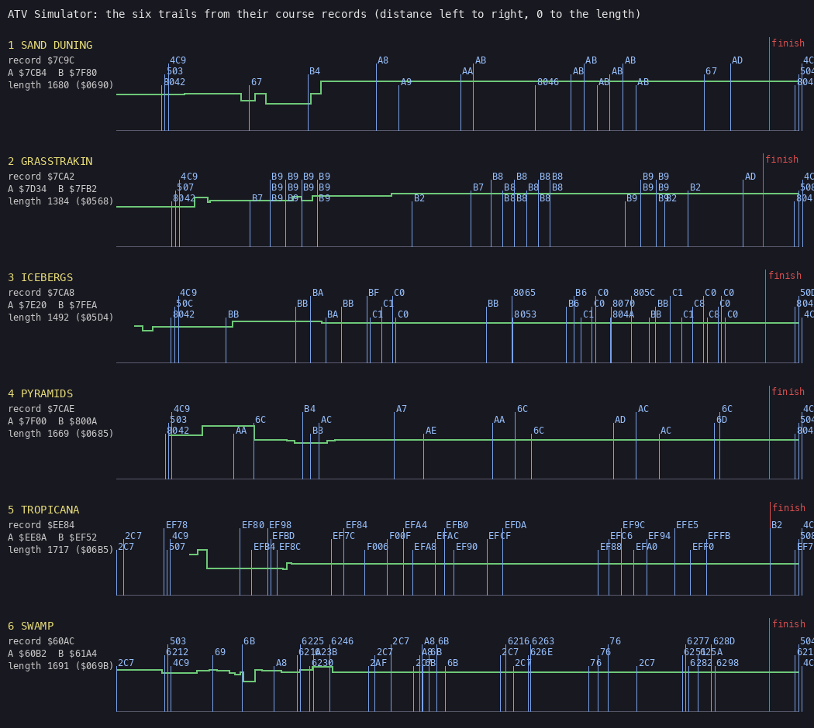

# 2. Architecture

What this covers: the machine budget, the memory map (a figure), stages from the medium to play, the frame, the main loop's call graph, the module map. The recordings it rests on: (name each, with its load).

<!-- Figures this document needs (GUIDE.md 4.2), remove each line when it is in: -->
<!-- - the stages from power-on to play (mermaid) -->

## 2.1 The memory map

A first map from stage 1 (to be refined in stage 3). The classes come from the L1 builds of the play recordings
(menu, kb, trail1, warp, trails, fuel, pokes; all started from a state, so the ROM's RAM test at power-on is not in
them) merged by `kit/merge_l1.py`, and the executed bytes of c1 as well (`work/stage1/classmap.py`): "code" ran,
"written" was written in play, "read only" was read and never written, "untouched" none of these.

| Range | Bytes | Class | What it holds | Witness |
| --- | ---: | --- | --- | --- |
| `$4000-$5AFF` | 6 912 | screen | the screen; the loading screen at the entry | tape block 5 |
| `$5B00-$60AA` | 1 451 | read only | a copy of the tune player `$F850-$FDFA`, made at the entry (`LDIR` at `$D7E0`); copied back to `$F850` before each tune (`$6E04` on the title, `$ECE6` at a trail's end) | L1 `dataflow.copies` (c1) |
| `$60AC-$6335` | 650 | read only | trail 6's course record and lists, copied from `$F230` at the entry (`LDIR` at `$D7EB`) | L1 copies; `$EC9C` picks `$60AC` for trail 6 |
| `$6338-$68A6` | 1 391 | data | read and written data: the menu and text data (the score digits at `$6948`); stage 3 | classmap |
| `$68A7-$8F25` | 9 855 | code | the menu (`$69A6`), the drawing and sprite code (`$7340`, `$830D`, `$8310`, `$8500-$85FF`), with small tables between (`$8084-$8160` written: `$8084` the attribute pointer, `$8113` / `$8114` the two players' control bits) | c1 executed; `kit/rs.py interrupts` |
| `$8F26-$D6AF` | 18 314 | data | graphics and buffers: read-only runs (`$9F77-$A8B8`, `$C191-$CB3F`, among others: the graphics) between written runs (`$90F9-$9F76`, `$AC8F-$C190`, `$CB40-$D679`: the scenery and sprite buffers) | classmap |
| `$D6B0-$D7D5` | 294 | variables | the entry jump `$D6B0`, the game's variables (2.2), the two player records `$D70E` / `$D740`, the current-player copy `$D772`, the record template `$D7A7` | code `$D80D-$D851`, `$E4CA` |
| `$D7D6-$EE4B` | 5 750 | code | the entry and setup (`$D7D6`), IM 2 setup (`$D8ED`), the game (`$D80D`), the pass (`$D851`), the handler (`$D9D2`), the clock (`$EB53`), the course select (`$EC9C`), the trail end (`$ECE0`) | c1 executed |
| `$EE4C-$F84F` | 2 564 | data | trail 5's course record and lists (`$EE84`), and from `$F03C` the play buffer (`$8CF2` copies it to the screen; it holds trail 6's course at the load, `$F230-$F4B9`, before the entry's copy) | `$EC9C`; classmap |
| `$F850-$FDFA` | 1 451 | code | the tune player (`$F852`) and its tunes; written over in play (its copy at `$5B00` brings it back) | c1 arrivals `$F852` (frame 14 639, written by `$6E04`) |
| `$FDFD-$FDFF` | 3 | code | the tune's IM 2 vector (`$FDFD` to `$F961`) | c1 interrupts |
| `$FE00-$FF00` | 257 | written | the IM 2 table, all `$80` (vector `$8080`, `JP $D9D2`) | `LDIR` at `$D90E` |
| `$FF01-$FFDB` | 219 | stack | the game's stack (`LD SP,$FFDC` at `$D7ED`); the lowest SP in the play recordings is `$FFA6` (warp), so 54 bytes are used | `kit/merge_l1.py --stack FE00-FFDB` |
| `$FFDC-$FFFD` | 34 | code | the tape's loader, left in place | tape block 3 |

The figure: `python3 ../../kit/merge_l1.py work/stage1/l1-all.json work/stage1/rec/{menu,kb,trail1,warp,trails,fuel,pokes}/l1.json --stack FE00-FFDB`,
then `python3 ../../kit/heatmap.py work/stage1/l1-all.json docs/img/memory/heatmap-stage1.png --from 4000 --to FFFF`
with the regions of the table. The code runs in two blocks, `$6A00-$8F25` and `$D7D6-$EE4B`; the graphics and
buffers between them are read and written all over; `$F03C-$FDFA` is written in play as well.

**The stack's low mark.** The lowest SP in each play recording (`merge_l1.py --stack FE00-FFDB`, the L1's stack
writes): `$FFAC` (menu), `$FFA8` (kb, trail1, trails, fuel, pokes), `$FFA6` (warp): 54 bytes below `$FFDC` at most;
the 219 bytes from `$FF01` are never reached. ("Lowest write" `$FE00` is the IM 2 table's own `LDIR`, not the
stack.)

The map is one load: no part of memory is loaded again, the trails are all in memory from the start (trails 1-4 at
`$7C9C` + 6 n, 5 at `$EE84`, 6 at `$60AC`).

**The images.** Three 64 K images in `work/stage1/images/` (`work/stage1/entryimg.py`, `work/stage1/images.py`):

- *As loaded*: `tools/image.py` (blocks 5 and 7 from `orig/`; `case.json`'s image), or
  `work/stage1/media/tape64.bin` with the loader at `$FFDC` as well.
- *At the entry*: `entry.bin`, recording c1 at frame 14 100 T 17 980, the first instruction at `$D6B0`. It equals
  the loaded image byte for byte at `$4000-$5AFF` and `$6338-$FF77`; it differs only in the system variables and the
  BASIC (`$5C00-$6337`) and in the ROM's stack under the loader (`$FF79-$FFDB`).
- *In play*: `play.bin`, c1's `play.szx` (frame 14 821, trail 1's start line). Against the entry image: the tune
  copied down and trail 6 copied (`$5B00-$6335`, 1 918 bytes differ), data at `$6720-$6968` (513: the menu's and
  the scores' text), small changes in the code area's tables (`$70AA-$7191`, `$7CB6-$7D2F`, `$8080-$80B2`: the
  vector `$8080` and the drawing's variables), the graphics shifted in place (`$9DD0-$9F4C`, `$C04A-$C184`,
  `$CA20-$CBEC`, 2.4), the variables (`$D6B6-$D6C1`, the player records `$D711-$D771`), the play buffer
  (`$F03C-$F4C7`, 952 bytes), the tune's work bytes in `$F8C5-$FB69`, the IM 2 table (`$FDFD-$FF00`) and the
  stack (`$FFB0-$FFDB`).

## 2.2 The state variables

Located in stage 1 by the code and by writing them on clones (`work/stage1/`), each confirmed by a recording.

| Address | What | Witness |
| --- | --- | --- |
| `$6947` | one or two players (0, 1); START sets `$D6BE` = `$6947` × 2 + 1 | code `$D822-$D829`; recording kb (two players) |
| `$6948-$6951` | ten ASCII digits, all `'0'` at START (the scores of the two players) | `LDIR` at `$D820` |
| `$D6BC` | the frame counter of a pass: `$FF` on the menu, cleared at a pass's start, counted by the handler; the pass waits for 7 | `$D851`, `$D86B`, handler `$D9D2` |
| `$D6BE` | the mask of the players riding (bit 0 player 1, bit 1 player 2) | `$D829` |
| `$D6BF` | the trail, 0-5; cleared at START, counted up at a trail's end | `$D80E`, `$ECE0`; recording warp (0 to 5, then 0) |
| `$D6C0` | the finish: the course record's word + 4 less `$48` | `$EC9C` |
| `$D6C9-$D6CB` | the clock, three ASCII digits (tens, units, tenths); the tick adds 1 to the tenths each pass | `$EB53`; POKE 60250,0 stops it (recording fuel) |
| `$D7A5` | the players that finished the trail (bits as `$D6BE`) | `$D880-$D885` |
| `$D7A6` | set after the sixth trail: the next round's maximum is 30 (`$EAD6`) | `$ECE0`; recording warp (max 30 on the second trail 1) |
| `$D70E`, `$D740` | the records of player 1 and player 2, 50 bytes each, set from the template `$D7A7` at START | `LDIR` at `$E4D3`, `$E4DE` |
| `$D772-$D7A3` | the current player's record: copied from `$D70E` and back each pass (`$E4EA`, `$E4F6`: 601 times each in c1) | L1 copies |
| `$D77D` | its fuel (32 at the start, down as the ATV runs) | the FUEL bar; recordings trail1, fuel |
| `$D77E` | its speed (64 standing, 104 at the top on trail 1) | clones of `work/stage1/x/a5.szx` |
| `$D783` | the rider's sprite frame: 0-7 walking, `$18` jumping on foot, `$40` and above on the ATV | the same clones |
| `$D784` | the facing (1 left) | the same |
| `$D785`, `$D786` | the rider's x and height | the same |
| `$D78A` | the distance along the trail, a word | the same; recording warp (set to the finish less 40, the trail ends) |

## 2.3 A first map of the trails

The trail's setup `$EC9C` takes the course record of trail `$D6BF` (0-3: `$7C9C` + 6 × trail; 4: `$EE84`; 5:
`$60AC`) and puts its three words in `$D6B6` (list A), `$D6B8` (list B) and, less 72, `$D6C0` (the finish). Both
lists are 6-byte entries in order of distance, closed by `$FFFF`; list A is read by the object code (`$8A49`, `$8DA3`,
`$8E3C`, `$787C` read the trail-5 list `$EE8A-$EF63` in recording warp). A first drawing of the six, list A's
entries as ticks with their third word, list B's first word as the green line (`python3 tools/trail_map.py
work/stage1/images/a5.bin docs/img/maps/trails-stage1.png`; the fields are a first reading, stage 3 confirms them):

Trail 1's list A (`$7CB4`) has entries at distances 112, 120, 128, 328, 472, 640, 696, 848, 880, 1 032, 1 120,
1 152 to 1 280 (every 32), 1 448, 1 512, 1 672, 1 680 and 1 688; the bot's crashes on trail 1 (876 and 1 268,
WALKTHROUGH 6.0, trails) are at the entries 880 and 1 248-1 280.

## 2.4 The graphics

Every graphic goes through `$865F` with HL at its header: +0 the width in bytes, +1 the height in lines, +2 a byte
for `$80F6`, +3 the pixel shift the data is in, +4 the lines. `$8759` / `$8777` shift the data in place to the
shift the drawing needs (so these bytes are written in play, 2.1), and `$8D53` ORs it into the play buffer, 22 bytes
a line. The first sheet holds the 88 headers `$865F` was given in the play recordings (the L1 `patterns` of `$865F`,
HL's bases), drawn from the image as loaded (`python3 tools/sprite_sheet.py work/stage1/media/tape64.bin
docs/img/sprites/sprites-stage1.png work/stage1/rec/{warp,kb,trail1,trails,menu,fuel}/l1.json`): the HUD's words and
digits, the font, the rider walking and his masks, the ATV, the scenery (palm, totem, rocks, the tyre wall) and
START / FINISH.

