# 3. Build and load

What this covers:

- the tape block by block, as a picture (3.1);
- the BASIC, and the 34-byte loader at `$FFDC` that skips the two headers (3.2);
- the load as it happens, at signal speed (3.3);
- the entry: two copies out of the buffers' way (3.4);
- the graphics shifted in place: why a snapshot of play is not the tape's image (3.5);
- the build from the sources, identical to the original (3.6);
- the releases and re-issues (3.7);
- the ZXDB POKEs and what they really do (3.8).

The recordings it rests on ([WALKTHROUGH](../WALKTHROUGH.md), 6.0):

- `c1`: a 48K from power-on, the original TZX at signal speed: `LOAD ""`, the BASIC, the loader, the screen, the
  game, the entry at frame 14 100;
- `fuel` and `pokes`: the same ride with only the clock POKE (60250,0), and with all four ZXDB POKEs.

The commands are in [`work/docs/atA-NOTES.md`](../work/docs/atA-NOTES.md). There is no packer and no protection: the
image at the entry is blocks 5 and 7 as they are on the tape.

## 3.1 The tape block by block

`orig/ATVSimulator.tzx.zip` holds one file, `ATV Simulator.tzx`: a TZX of version 1.10 (`src/tape/tape.txt`, `version
1 10`), 47 124 bytes. Stage 1's draft said 1.20; the file's header says 1.10. It has eight standard-speed blocks (TZX
id `10`), all at the ROM's timings: pilot 2 168 T, sync 667 and 735 T, bits 855 and 1 710 T. `python3
../../kit/tapblocks.py list "work/media/ATV Simulator.tzx"` lists them. The times are at signal speed; "Ends at" adds
the pauses.

| # | Kind | Bytes (with flag and checksum) | Flag | Time (s) | Pause (ms) | Ends at (s) | Loads to |
| ---: | --- | ---: | --- | ---: | ---: | ---: | --- |
| 0 | ROM header, Program "ATV", LINE 10 | 19 | `00` | 5.08 | 1007 | 6.09 | |
| 1 | ROM data: the BASIC loader | 46 | `FF` | 2.24 | 1885 | 10.21 | PROG `$5CCB` |
| 2 | ROM header, Bytes "", 34 at 65500 | 19 | `00` | 5.08 | 1003 | 16.30 | |
| 3 | ROM data: the machine-code loader | 36 | `FF` | 2.21 | 1777 | 20.29 | `$FFDC-$FFFD` |
| 4 | ROM header, Bytes "", 6912 at 50000 | 19 | `00` | 5.08 | 1008 | 26.38 | read by no one |
| 5 | headerless: the loading screen | 6914 | `FF` | 37.63 | 2197 | 66.20 | `$4000-$5AFF` |
| 6 | ROM header, Bytes "", 40000 at 25400 | 19 | `00` | 5.08 | 1009 | 72.29 | read by no one |
| 7 | headerless: the game | 40002 | `FF` | 209.62 | 0 | 281.91 | `$6338-$FF77` |

The blocks alone play 272.0 s, 13 601 frames; with the pauses, 281.9 s and 14 096 frames.

**Worked example.** Block 7, the game. A data block (flag `$FF`, 128 or more) has a pilot of 3 223 pulses, a header
(flag `$00`) 8 063; each pulse is 2 168 T, so the pilot takes 6 987 464 T. The two sync pulses add 1 402 T. The
40 002 bytes are 320 016 bits; 104 948 of them are 1 (32.8 %). A 0 costs two pulses of 855 T, a 1 two of 1 710 T:
215 068 × 1 710 + 104 948 × 3 420 = 726 688 440 T. In all 733 677 306 T, 209.62 s at 3.5 MHz, the table's time. The
same sum gives 37.63 s for the 6 914 bytes of the screen (17 618 ones) and 5.08 s for each 19-byte header.

**Witness.** The bit counts are read from `work/media/ATV Simulator.tzx` itself (each block's bytes after its TZX
id `10` header); `tapblocks.py list` prints the same times.

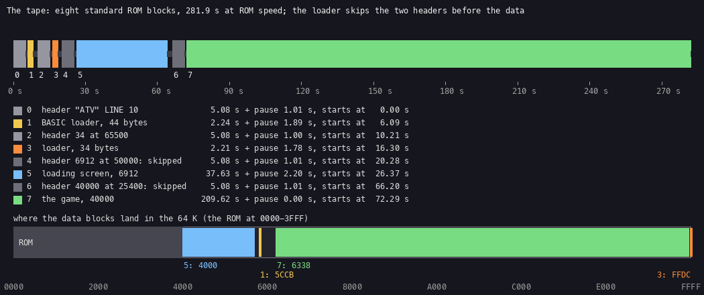

*How to read: the top bar is the tape in time, one coloured box a block's signal and a grey line its pause; the
list gives each block's length, pause and start; the bottom bar is the 64 K with each data block where it lands
(the BASIC at `$5CCB`, the loader at `$FFDC`, the screen at `$4000`, the game at `$6338`). The point: the game is 74 %
of the tape and loads in one 210-second block; blocks 4 and 6 are headers whose fields no one reads. Drawn by
`python3 tools/fig_tape.py "work/media/ATV Simulator.tzx" docs/img/load/tape.png` from the file itself; no recording.*

**The point.** A plain tape: four ROM headers, four ROM data blocks, no turbo, no custom loader timings. Anything that
loads a standard tape loads this one.

## 3.2 The BASIC and the loader at `$FFDC`

Block 1 is three lines of BASIC (`src/tape/basic.asm`):

```basic
10 CLEAR 25400
20 LOAD ""CODE
30 RANDOMIZE USR 65500
```

`CLEAR 25400` puts RAMTOP at `$6338`, the first byte of the game, and the machine stack under it. `LOAD ""CODE`
loads block 3 to its header's address, `$FFDC`. `RANDOMIZE USR 65500` calls it.

The loader is 34 bytes (`src/loader/loader.asm`). It drops the return address into BASIC and calls the ROM's
LD-BYTES `$0556` twice, for two headerless blocks with flag `$FF`.

**How it works.**

```text
Loader ($FFDC):
    drop the return address
    repeat: LD-BYTES(IX = $4000, DE = 6912, flag $FF) until it succeeds   ; skips block 4, loads block 5
    repeat: LD-BYTES(IX = $6338, DE = 40000, flag $FF) until it succeeds  ; skips block 6, loads block 7
    jump to $D6B0
```

```z80
FFDC  POP AF            ; drop the return address into BASIC
FFDD  LD IX,$4000       ; the screen
      LD DE,$1B00
      LD A,$FF          ; flag $FF: a data block
      SCF               ; load, not verify
      CALL $0556        ; LD-BYTES
      JR NC,$FFDD       ; a block that fails (the header of block 4) is read again
FFEC  LD IX,$6338       ; the game, 40000 bytes
      LD DE,$9C40
      LD A,$FF
      SCF
      CALL $0556
      JR NC,$FFEC       ; the header of block 6 fails the same way
FFFB  JP $D6B0          ; the game's entry
```

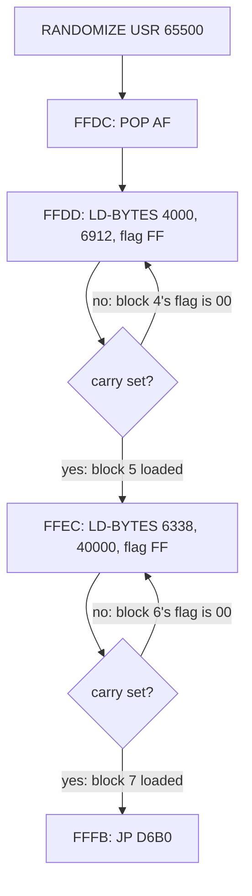

Blocks 4 and 6 are standard headers that no one reads. LD-BYTES compares the block's first byte, the flag, with the
one asked for. A header's flag is `$00`, so LD-BYTES returns with carry clear after that byte, and the loader asks
again. LD-BYTES then waits for the next pilot tone, which is the data block's.

**Worked example.** Block 4 starts at 20.28 s of the tape, about frame 1 018 of `c1`. The loader at `$FFDD` is already waiting in
LD-BYTES. The header's pilot and sync pass, the flag byte `$00` arrives and does not match `$FF`: LD-BYTES returns
with carry clear, and `JR NC,$FFDD` calls it again. The rest of the header and its pause go by unread. Block 5's pilot
starts at 26.37 s, and its 6 912 bytes go to `$4000`: the loading picture appears line by line. Block 6 fails the same
way at `$FFEC`, and block 7 loads to `$6338-$FF77`. The game ends at `$FF77`, below the loader at `$FFDC`, so the
loader is not overwritten while it runs.

**Witness.** `c1`: the BASIC listing at frame 582 (`docs/img/play/c1-000582-basic.png`), the loading screen complete
at 3 282 (`c1-003282-screen-loading.png`), the jump to `$D6B0` at 14 100 T 17 980. Only header 6 names the game's
real address (40000 bytes at 25400 = `$6338`). Header 4 says 6912 bytes at 50000 (`$C350`), not the screen's 16384:
a loader that obeyed it would put the picture in the middle of the game's space. The copies without these headers
load the same (3.7).

**The point.** The two headers are decoys or leftovers of a standard save: the loader never reads them, and the
ROM's own flag test is what skips them.

## 3.3 The load as it happens

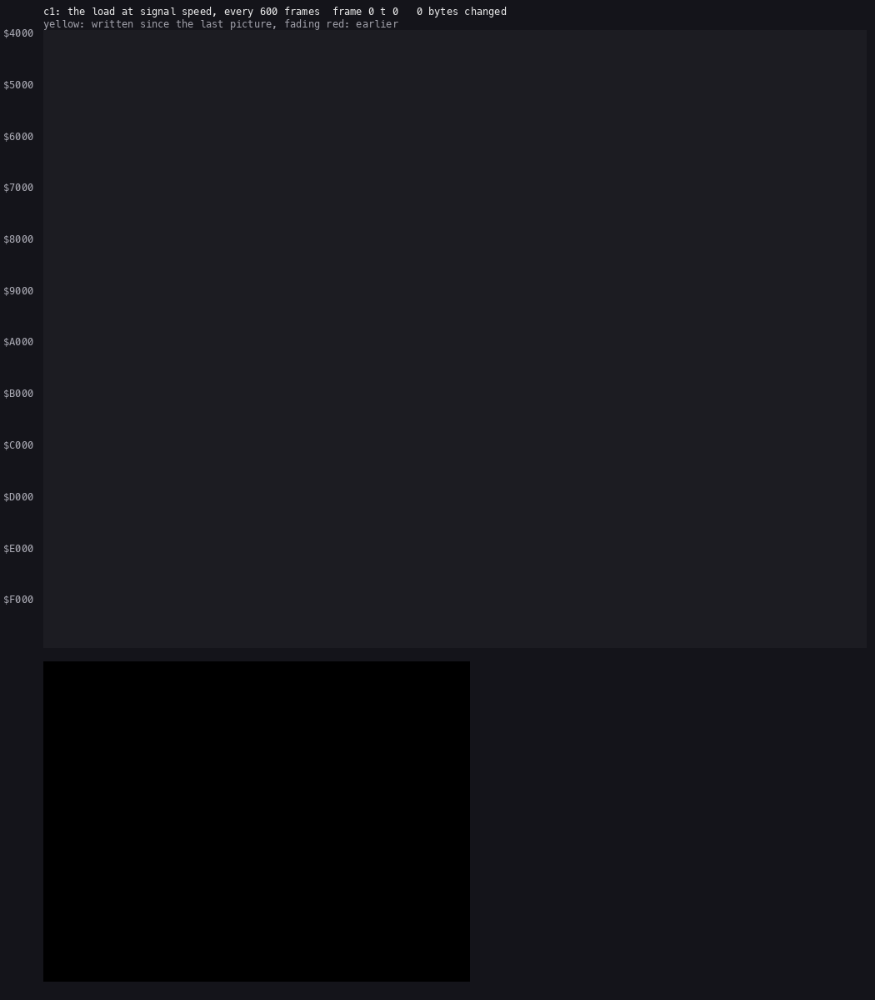

*`c1`, frames 0-14 110, one picture every 600 frames (41 932 800 T), 25 pictures. How to read: the left is the
screen; the right is the memory `$4000-$FFFF` as a map, one pixel a byte, the brightness its value. The loading
picture fills the screen's thirds from about frame 1 320 to 3 200; then block 7 fills the memory from `$6338` upwards
at signal speed, about 190 bytes a second, from about frame 3 620 until 14 100. The point: one long block, no unpacking, the image
growing in place. Drawn with `python3 ../../kit/memanim.py --work work/docs/integrate/c1 --from 0 --to 14110 --step
41932800 --from-address 4000 --to-address FFFF --screen --cell fit --label "c1: the load at signal speed, every 600
frames" docs/img/load/load-c1.gif` (`c1` opened by `rs.py open --work work/docs/integrate/c1 --ttd
work/stage1/rec/c1/session.ttd`).*

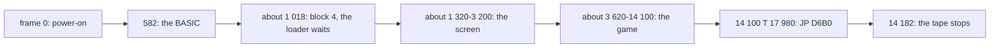

| Stage | Frame of `c1` | What runs | Seen as |
| --- | --- | --- | --- |
| power-on, `LOAD ""` | 0 | the ROM | |
| blocks 0-1: the BASIC | to about 515 | the ROM's loader | the listing at 582 |
| blocks 2-3: the loader | to 1 017 | the BASIC's `LOAD ""CODE`, `RANDOMIZE USR 65500` | Loader `$FFDC` runs at 1 017 (`rs.py stages`) |
| block 4: an unread header | about 1 018 | LD-BYTES fails the flag, `JR NC` | nothing |
| block 5: the screen | about 1 320-3 200 | LD-BYTES to `$4000` | the picture line by line |
| block 6: an unread header | about 3 314 | the same | nothing |
| block 7: the game | about 3 620-14 100 | LD-BYTES to `$6338` | memory filling upwards |
| the entry | 14 100 T 17 980 | `JP $D6B0`, GameEntry `$D7D6` | the first Interrupt at 14 114 |
| the tape stops | 14 182 | the emulator, after the last edge | |

*The stages of the load; [2.3 of doc 02](02-architecture.md#23-the-stages-from-the-tape-to-play) goes on to play.*

The static decode of the tape against the recording:

| Decoded from the TZX and the code | Predicted | Recorded in `c1` |
| --- | --- | --- |
| the loader's address (header 2, `RANDOMIZE USR 65500`) | `$FFDC` | the code arrives at `$FFDC`, frame 1 017 |
| block 7's start, counted back from its 209.62 s | about frame 3 619 | the memory starts filling at about 3 620 (the animation) |
| the screen block, 37.63 s | about 1 323-3 205 | the picture from about 1 320 to 3 200 |
| the entry | `JP $D6B0` (`$FFFB`) | frame 14 100 T 17 980 |
| the image at the entry | the TZX's bytes at `$4000-$5AFF` and `$6338-$FF77` | equal (`work/stage1/images/entry.bin`) |

**Worked example.** Block 7 starts at 72.29 s of the tape and takes 209.62 s, 10 481 frames, for 40 002 bytes. Counted
back from the loader's `JP $D6B0` at frame 14 100 T 17 980, it starts at about frame 3 619, so the tape started at
about frame 4 of `c1`; block 5 then ran from about 1 323 to 3 205. The emulator stops the tape at frame 14 182, after
the block's last edge.

**Witness.** The animation; `c1`'s frames from `rs.py` (`work/docs/atA-NOTES.md`). The case's emulator binary lacks
the fix that holds a tape's last edge (README, "Recorded from"); this tape does not need it, because the game's entry
runs before the tape ends.

**The point.** 282 seconds of tape and no tricks: the screen first, so the player has something to look at, then the
game in one piece.

## 3.4 The entry: two copies out of the buffers' way

The game is loaded to `$6338-$FF77`, but two of its parts lie where the play buffers will be. The tune player is at
`$F850-$FDFA`, inside BufferP2 `$F71C-$FDFB`. Trail 6 is at `$F230-$F4B9`, inside BufferP1 `$F03C-$F71B`. GameEntry
`$D7D6` moves both down into the BASIC area, which the game no longer needs. Then it sets SP and calls Init and
SetupIm2 ([doc 04, 4.1](04-game-loop.md#41-the-program-as-a-state-machine)).

**How it works.**

```text
GameEntry:
    disable interrupts
    copy $F850-$FDFA to $5B00    ; 1 451 bytes: the tune player
    copy $F230-$F4B9 to $60AC    ; 650 bytes: trail 6, built for $60AC
    SavedSp0 = SP; SP = $FFDC
    Init; SetupIm2; OuterLoop
```

```asm
GameEntry:                  ; $D7D6
  DI
  LD HL,TunePlay0         ; $F850
  LD DE,TunePlayerCopy    ; $5B00
  LD BC,$05AB
  LDIR                    ; $D7E0
  LD HL,Trail6Image       ; $F230
  LD DE,Trail6            ; $60AC
  LD BC,$028A
  LDIR                    ; $D7EB
Restart:
  DI
  LD (SavedSp0),SP
  LD SP,StackTop          ; $FFDC
  CALL Init
  CALL SetupIm2
```

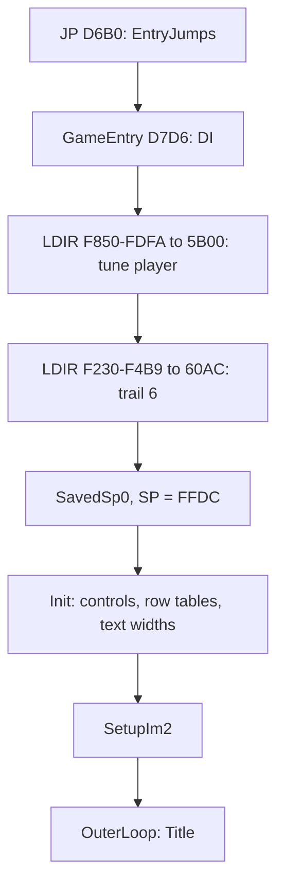

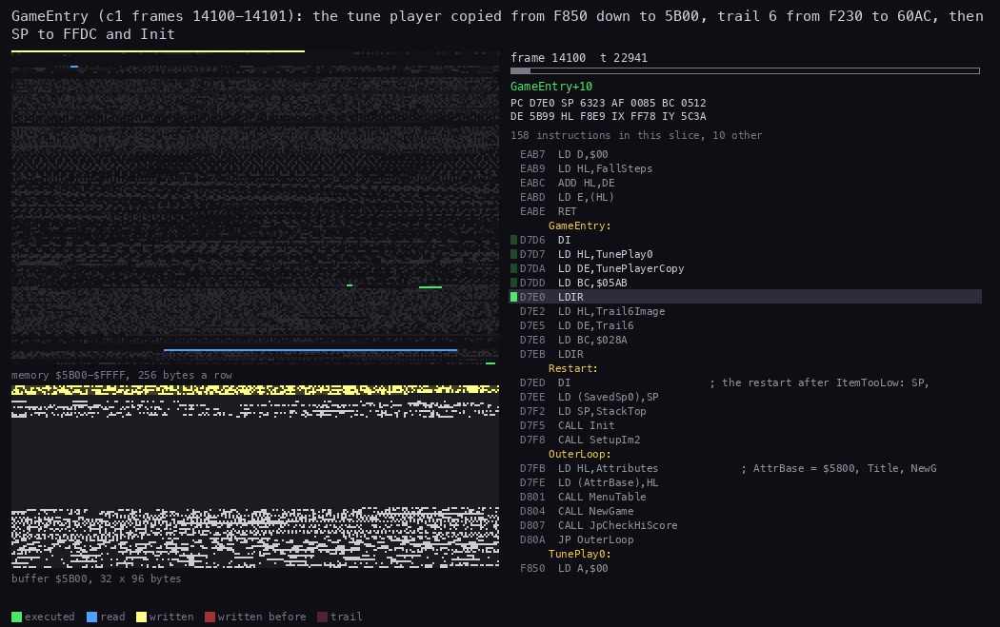

*GameEntry (`c1` frames 14 100 T 17 900 to 14 101 T 69 000), 24 pictures. How to read: the top left is the memory
`$5B00-$FFFF`; the bottom left is `$5B00` on, 32 bytes a row, where the copies land; the right is the listing at the
PC. The point: two `LDIR`s fill the BASIC area with the tune player and trail 6 before anything else runs. Drawn with
`python3 ../../kit/routine_anim.py --work work/docs/atA/c1 --window 14100:17900-14101:69000 --listing build/game.lst
--auto-labels owner --view buffer:5B00:32x96:rows --range 5B00-FFFF --pc D7D6-D80C --pictures 24 --title "..." --out
docs/img/routines/GameEntry.gif`.*

**Worked example.** At the entry SP is `$6323`, the ROM's stack under RAMTOP `$6338` (the trace at `$D6B0` and
`$D7D6`). The first `LDIR` copies 1 451 bytes in 44 571 T, from 14 100 T 18 033: 21 × 1 451 − 5 = 30 466 T
uncontended, the rest the contention of its writes to `$5B00-$60AA` during the paper (T 14 336-57 344). The second
copies 650 bytes from T 62 634, in the bottom border, in 13 645 T as written (21 × 650 − 5). The trail's
lists hold addresses in `$60AC-$6335`, so its data only works after the copy. The tune player is copied back to
`$F850` before each tune, because its code runs at `$F850`. The stack's new top `$FFDC` is the loader's first byte:
the loader is no longer needed.

**Witness.** The L1 of `c1` lists both copies (`LDIR` at `$D7E0` and `$D7EB`); `c1`'s trace of 14 100-14 101 shows SP
`$6323` at `$D7D6`; `python3 work/docs/atA/ldir.py work/docs/atA/c1/traces/14100_17900-14101_69000.uatr` times the
two `LDIR`s (44 571 T and 13 645 T).

**The point.** The game uses the BASIC area for code and data. The CLEAR 25400 protects the image from BASIC's
stack only until the entry; after it, every byte from `$5B00` is the game's.

## 3.5 The graphics shifted in place

The sprites in GameGfx `$8F5C` are re-shifted in place as the scroll moves them ([doc 04, 4.7](04-game-loop.md#47-the-heaviest-pass)).
So the image in memory during play is not the tape's image: the shifted sprites' bytes differ. A snapshot of play
holds the sprites at whatever offsets they had last. The source holds them as loaded.

Stage 1 compared three images: as loaded, at the entry (`c1` frame 14 100 T 17 980) and after the trail intro was
drawn (`c1`'s `play.szx`, frame 14 821, before the first pass at 15 055). The entry image equals the loaded one at
`$4000-$5AFF` and `$6338-$FF77`. The play image differs in the copies, the variables, the buffers and the tables, and
in three ranges of the sprite bank: `$9DD0-$9F4C`, `$C04A-$C184` and `$CA20-$CBEC`. Mapped through
`src/res/sprites/game.csv`, the first and last are glyphs: the letters (sprites 30-53) and the big and small digits
(141-158), which the text printer shifts to each character's x ([doc 08](08-hud-and-text.md)) while the title, the
menu, the trail intro and the score panels are printed. The middle range is sprites 125-126; which front-end routine
shifted them was not traced.

**How it works.**

```text
PlaceItem(item):
    if item x AND 7 != the sprite's stored offset (header +3):
        rotate the sprite's bytes one bit at a time until it matches   ; written into GameGfx
```

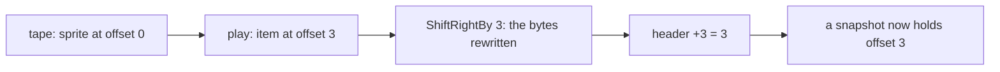

**Worked example.** The START sign, sprite 123 at `$BE11`, is rotated in place in `c1`'s heavy pass of frames
15 356-15 362 (and again in the heaviest, 15 412-15 418): `$BE14-$BF2B` and its mask's `$BF2F-$C046` are written, with nine smaller sprites ([doc 04, 4.7](04-game-loop.md#47-the-heaviest-pass)).
A snapshot taken after it holds the sign at its new offset, with header byte +3 saying which.

**Witness.** `work/stage1/images/` (`entry.bin`, `play.bin`); the trace `c1/traces/15356_0-15363_0.uatr`. The
sprite sheets in `src/res/sprites` are drawn from the image as loaded.

**The point.** A rebuild must start from the tape, not from a snapshot: the game writes over its own graphics.

## 3.6 The build

The source rebuilds the tape byte for byte. `tools/build.sh` assembles three programs with sjasmplus, writes the
resources from their editable forms, and lets `tools/mktape.py` write the eight blocks from `src/tape/tape.txt`.

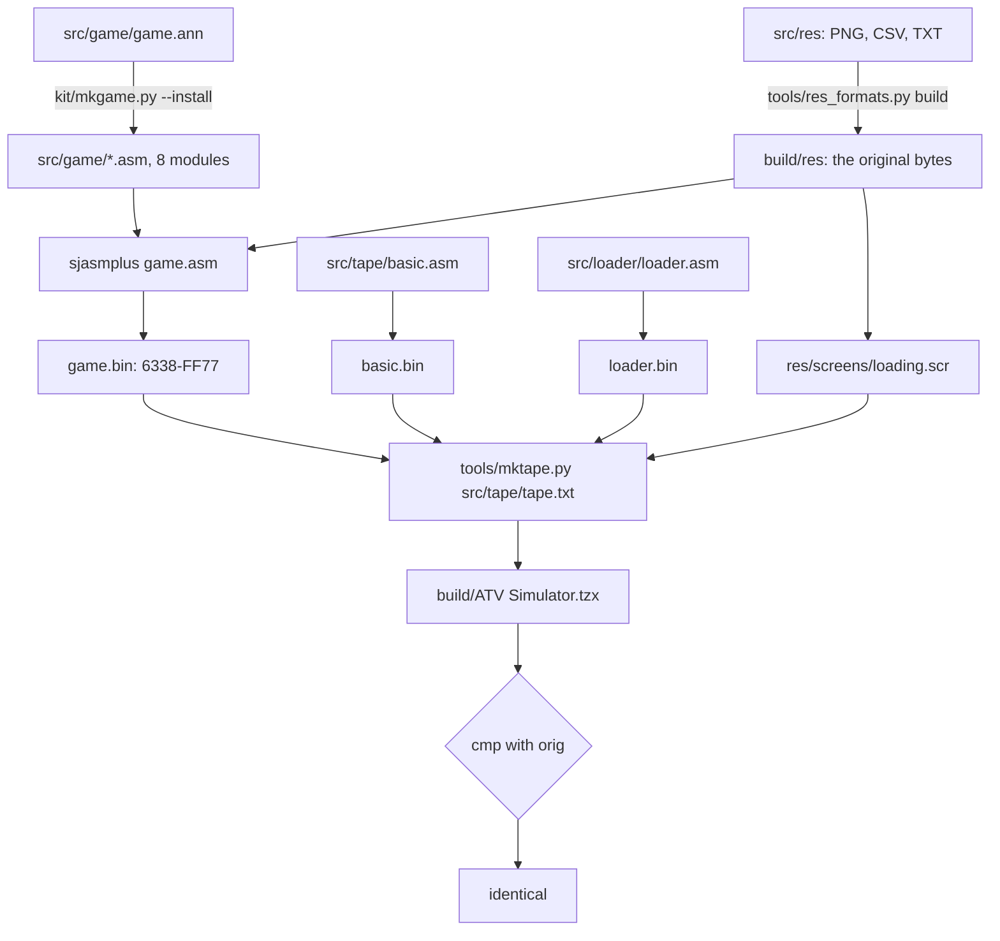

**How it works.**

```text
tools/build.sh:
    res_formats.py build --out build/res        ; 24 resources to their original bytes
    sjasmplus game.asm, basic.asm, loader.asm   ; with listings
    mktape.py tape.txt                          ; headers, data blocks, pauses
    cmp with the original TZX
```

```text
version 1 10
header 1007 program ATV basic.bin 10 44
rom 1885 basic.bin
header 1003 bytes - 34 65500 32768
rom 1777 loader.bin
header 1008 bytes - 6912 50000 32800
rom 2197 res/screens/loading.scr
header 1009 bytes - 40000 25400 32768
rom 0 game.bin
```

*`src/tape/tape.txt` without its comments: one line a block, the pause in ms first.*

The build's inputs:

| Input | Files | Tool | Becomes |
| --- | --- | --- | --- |
| the annotated disassembly | `src/game/game.ann` | `kit/mkgame.py --install` | `src/game/*.asm`, 8 modules, then `game.bin` (`$6338-$FF77`) by sjasmplus |
| the BASIC | `src/tape/basic.asm` | sjasmplus | `basic.bin`, block 2 |
| the loader | `src/loader/loader.asm` (from `loader.ann`) | sjasmplus | `loader.bin`, block 3 (`$FFDC`) |
| the loading screen | `src/res/screens/loading.scr` (`loading.png` to view) | `tools/res_formats.py` (screen) | block 5 |
| two sprite banks | `src/res/sprites/game.png` + `game.csv`, `menu.png` + `menu.csv` | `res_formats.py` (sprites) | GameGfx `$8F5C`, MenuGfx `$6338` |
| three trail files | `src/res/trails/trails14.txt`, `trail5.txt`, `trail6.txt` | `res_formats.py` (trail) | TrailRecords `$7C9C` and the lists, Trail5 `$EE84`, Trail6Image `$F230` |
| eleven tables | `src/res/tables/*.csv`, `*.txt` | `res_formats.py` (lists, menus, table) | the panels' and intros' boxes, the menus, the frame, jump, slope, tumble and ink tables |
| six texts | `src/res/texts/*.txt` | `res_formats.py` (text) | every text the game prints |
| the tunes | `src/res/sound/tunes.txt` | `res_formats.py` (tunes) | NoteTable `$FB72` to `$FDFA` |
| the tape's layout | `src/tape/tape.txt` | `tools/mktape.py` | the eight blocks, headers and pauses |

*24 resources in all (1 screen, 2 banks, 3 trail files, 11 tables, 6 texts, 1 tune file), listed by
`res_formats.resources()`; [src/res/README.md](../src/res/README.md) gives each folder's entries.*

**Worked example.** `sh tools/build.sh $SJASMPLUS` (after `. work/env.sh`) prints "build: ATV Simulator.tzx
identical to orig/ATVSimulator.tzx.zip's ATV Simulator.tzx". Change one byte of a sprite in
`src/res/sprites/game.png` and the build's `cmp` names the first differing byte in block 7.

**Witness.** WALKTHROUGH, stage 2: the build line; `python3 tools/res_formats.py check` prints `res: 24 resources, 0 bad`.

**The point.** Everything on the tape comes from the sources: the code, the graphics, the trails, the texts, the
tunes and even the two unread headers.

## 3.7 Releases and re-issues

Code Masters published ATV Simulator in 1987 at £1.99 (ZXDB 9306; design Tim Miller, music David Whittaker). Serma
Software re-issued it in Spain (EDOS, 1987); it appeared in the compilations Quattro Power, Quattro Power Vol. 5,
Quattro Racers, The CD Games Pack, Christmas Megapack, Mega-Hot and Poke City, and on the covertape Load 'n' Run 46 as
"Dune Buggy". Only standard Spectrum copies are compared here.

| Copy | Source | What differs from the original |
| --- | --- | --- |
| `ATV Simulator.tzx` (the original) | World of Spectrum, ZXDB release 0 | byte for byte TOSEC's "[a]" and zxart's "[p 1987 Code Masters Ltd]" |
| `ATV Simulator (1987)(Code Masters).tzx` | TOSEC 2023-09 | the same BASIC, loader, screen and code; no headers before the screen and the code; other pauses |
| `[a2].tzx` and its `.tap` | TOSEC 2023-09 | the BASIC header says LINE 0; the same data; no headers before the screen and the code |
| `[h Raf].tap` | TOSEC 2023-09 | a 2 148-byte BASIC ("RAF'90") in place of the loader; the same screen and code |
| `(EN)[p].tap` | zxart | a 103-byte BASIC, a 4 039-byte block at 40000, and the code with 6 bytes changed: `$6338`, three bytes of the text at `$696B-$696E`, and two ZXDB POKEs, 57318 (`$DFE6`) and 60250 (`$EB5A`) |

*From the README's "Other releases and copies" (`tools/media_compare.py` against the original); the TR-DOS
conversions, the snapshots and the +3 disk are not standard tapes and are not used.*

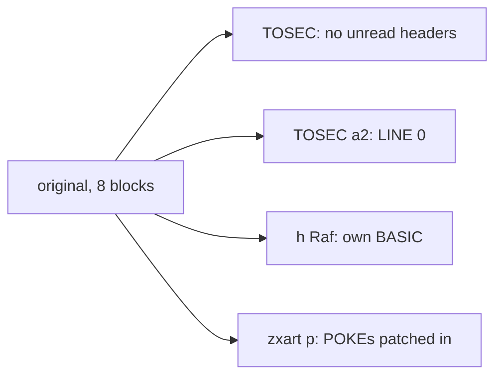

**Worked example.** The TOSEC copy without blocks 4 and 6 loads the same way: the loader at `$FFDC` asks for two
`$FF` blocks, and the first block after the loader is now the screen itself. This is the proof that the headers are
never read.

**Witness.** `work/candidates/` (git-ignored) and the comparison in the README.

**The point.** Every standard copy carries the same game; the differences are in the headers, the BASIC and, in one
copy, the POKEs applied.

## 3.8 The ZXDB POKEs

ZXDB's `.pok` lists four POKEs. Their names do not match what they do:

| POKE | ZXDB's name | Address | What it changes | The real effect |
| --- | --- | --- | --- | --- |
| 60250,0 | Infinite Lives | `$EB5A` | ClockAdd's operand: `ADD A,1` becomes `ADD A,0` | the clock never moves: infinite time |
| 57276,201 | Infinite fuel | `$DFBC` | FuelEmptyTest becomes `RET` | UseFuel still takes the fuel, but the bar is never redrawn and OutOfFuel never runs |
| 57318,201 | Infinite Time | `$DFE6` | OutOfFuel becomes `RET` | an empty tank no longer brakes: infinite fuel in effect |
| 49433,81 | Infinite Fuel | `$C119` | byte 46 (line 7) of game sprite 126 becomes `$51` | one pixel byte of a sprite: no effect on play |

**How it works.**

```text
ClockTick:
    ClockUnits += 1            ; POKE 60250,0: += 0
UseFuel:
    Fuel -= Speed x 2
    if Fuel high byte AND $FC == 0: OutOfFuel     ; POKE 57276,201: RET before the test
    redraw the bar
OutOfFuel:                     ; POKE 57318,201: RET at once
    the bar empty; SlowDown twice; "OUT OF FUEL"
```

```asm
ClockTick:                  ; $EB53
  CALL ClockPlace
  LD A,(ClockUnits)
ClockAdd:                   ; $EB59
  ADD A,$01               ; POKE 60250,0: ADD A,0
FuelEmptyTest:              ; $DFBC
  AND $FC                 ; POKE 57276,201: RET
  CP $00
  JP Z,OutOfFuel
OutOfFuel:                  ; $DFE6
  LD A,$90                ; POKE 57318,201: RET
```

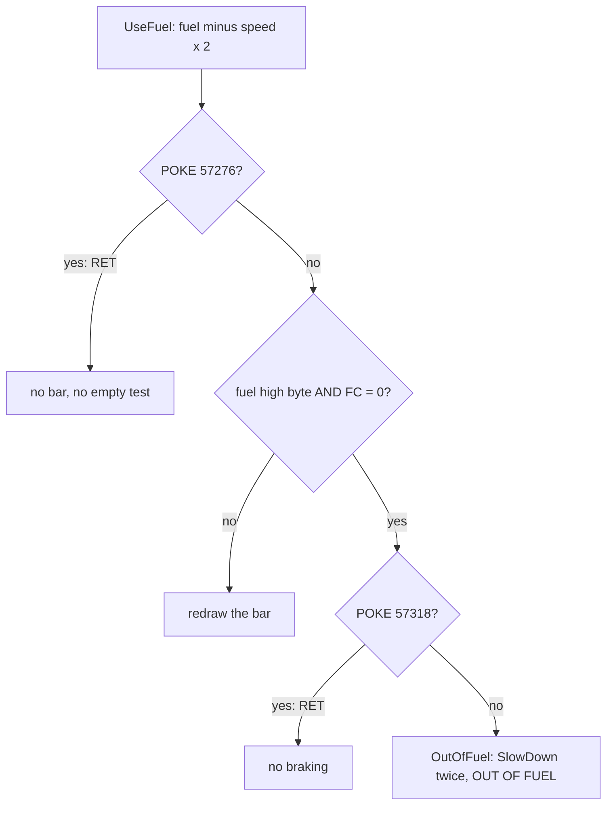

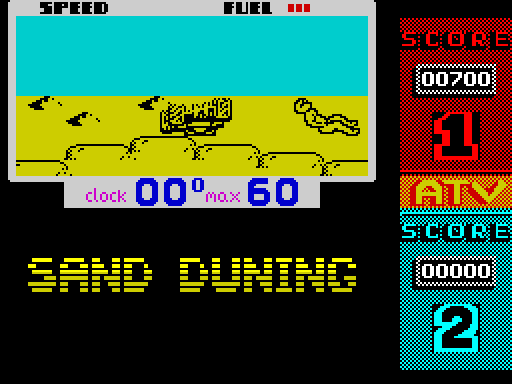

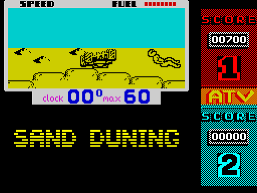

*Recordings `fuel` (the clock POKE only) and `pokes` (all four), frame 2 310, the end of the frame. How to read: the
FUEL bar at the top right of the half; the clock under the half reads 00.0 in both. The point: without the fuel
POKEs the bar has fallen; with 57276,201 it is never redrawn, so it stays full, although the
fuel word still falls. Taken by the recording scripts (WALKTHROUGH 6.1).*

**Worked example.** With 60250,0 the clock in `pokes` stays at 00.0 for the whole ride: ClockTick still runs each
pass, adds 0 and prints the same digits. The "Infinite Lives" of the `.pok` is this: the game has no lives, and a
stopped clock means TIME OUT never comes.

**Witness.** Recording `pokes` (the four POKEs) against `fuel`; game.ann's comments at `$EB59`, `$DFBC` and `$DFE6`;
the empty tank in `work/stage1/rec/empty` (the clock POKE 60250,0 at frame 14, the fuel high byte POKEd to 5 at
frame 567, OutOfFuel 83 times, first at frame 732,
"OUT OF FUEL" from frame 736).

**The point.** Three POKEs do what a cheat wants, under each other's names; the fourth changes one byte of a picture
and does nothing.
