# 4. Game loop

What this covers:

- the program as a state machine, from the loader's jump to the high score table and back to the title (4.1);
- the IM 2 vector: `I` = `$FE`, a table of `$80`, `JP Interrupt` at `$8080` (4.2);
- the interrupt handler `$D9D2`: two paths, and what each entry costs (4.3);
- the title tune's own vector `$FDFD`, and the menu that runs inside the tune's interrupt (4.4);
- one pass: its order of work, one or two players (4.5);
- the fixed 7-frame pass: the wait on FrameCount `$D6BC`, and what happens when the work does not fit (4.6);
- the heaviest pass: the START sign's sprites shifted in place (4.7);
- a pass against the beam: when the copy to the screen tears (4.8);
- the end of a pass: the finish, TIME OUT, the end of the game (4.9);
- the timers and every delay (4.10).

The recordings it rests on ([WALKTHROUGH](../WALKTHROUGH.md), 6.0):

- `c1`: a 48K from power-on, the original TZX at signal speed, the title, the menu, trail 1 with a crash, TIME OUT,
  the title again;
- `kb`: two players on the split screen, both to the end of trail 1 and into trail 2;
- `trails`: trail 1 ridden to the finish by the bot (no POKE), the finish, the bonus count;
- `warp`: all six trails with distance POKEs, the second round, name entry.

The windows built for this document are in `work/docs/atA/`. The commands are in
[`work/docs/atA-NOTES.md`](../work/docs/atA-NOTES.md).

| Window | From | Frames | What it gives |
| --- | --- | --- | --- |
| `c1/traces/15055_0-15062_0.uatr` | `c1` | 15 055-15 061 | a full trace of the first pass of trail 1 and its 7 interrupts |
| `c1/traces/15356_0-15363_0.uatr` | `c1` | 15 356-15 362 | a full trace of a heavy pass (81.1 %) |
| `work/docs/integrate/c1/traces/15412_0-15419_0.uatr` | `c1` | 15 412-15 418 | the recording's heaviest pass (91.3 %), found by `tools/pass_trace.py` over 15 150-15 450 and 15 400-15 800 |
| `c1/traces/14700_0-14712_0.uatr` | `c1` | 14 700-14 711 | the front end: the handler with FrameCount `$FF` |
| `c1/traces/14645_0-14648_0.uatr` | `c1` | 14 645-14 647 | the title tune's handler |
| `kb/traces/3118_0-3134_0.uatr` | `kb` | 3 118-3 133 | two players: a 12-frame pass |
| `c1play/l1.json`, `kbplay/l1.json` | `c1`, `kb` | 15 055-19 255, 240-7 400 | the routine counts and T-states of play, one and two players |
| `atA-kb-clock.txt` | `kb` | 240-7 400, every frame | the clock `$D6C9-$D6CB` at T 0 of each frame |

A value read by `time_travel memory_at` at frame N is the state at T 0 of frame N, before that frame's interrupt. On
the 48K the interrupt comes at about T 1 841-1 856 of the recorder's frame (the traces). The paper starts at
T 16 152.

## 4.1 The program as a state machine

ATV Simulator has one outer loop and one pass loop. The loader at `$FFDC` jumps to EntryJumps `$D6B0`, which jumps to
GameEntry `$D7D6`. GameEntry moves two blocks out of the play buffers' way ([doc 03, 3.4](03-build-and-load.md#34-the-entry-two-copies-out-of-the-buffers-way)).
It sets SP to `$FFDC`, calls Init and SetupIm2, and falls into OuterLoop `$D7FB`.

OuterLoop is the hub. It calls three things in turn and starts again:

1. MenuTable `$69A6`, a `JP Title`: the trail list, the credits, the menu with the title tune. It returns when START
   is chosen.
2. NewGame `$D80D`: the trails, one after the other, until no riding player has finished one. It returns at game over.
3. JpCheckHiScore `$69F4`: the high score table and the name entry.

Title never returns by itself. Its menu loop either goes back to Title (about ten minutes without a key) or runs
START's action, ClearScreen `$6DD1`. ClearScreen ends in a plain `RET`. The word on the stack is still the one
OuterLoop's `CALL MenuTable` pushed. That `RET` therefore returns to OuterLoop, and NewGame starts.

NewGame clears the scores, sets Riding from PlayerCount and enters NextTrail `$D82F`. NextTrail picks the trail,
draws its intro and HUD and enters Pass `$D851`. The pass repeats until one of these ends:

- every riding player has finished and both speeds are 0: TrailEnd `$ECE0`, the bonus, the next trail;
- the clock reaches the trail's maximum: TIME OUT, then TrailEnd if anyone finished, else game over.

After trail 6 TrailEnd sets SecondRound and starts trail 1 again, with 30 as every maximum.

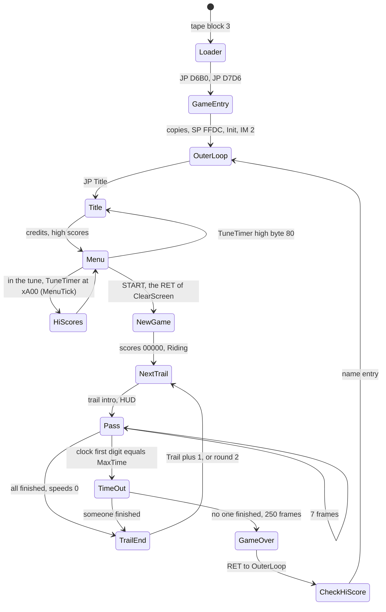

*The states with the frames of `c1` where each was first seen: the loader's jump at 14 100 (T 17 980), the credits at
14 300, the menu with the high scores at 14 640, SPACE on START at 14 657, the trail intro at 14 900, the first pass
at 15 055, TIME OUT at about 19 255, the menu again at 19 700. The frames come from the screenshots in
`docs/img/play` and the samples of the clock (`work/docs/atA-NOTES.md`).*

**How it works.**

```text
GameEntry:
    copy the tune player F850 -> 5B00, trail 6 F230 -> 60AC
    SP = FFDC; Init; SetupIm2
OuterLoop:
    Title                    ; returns through ClearScreen's RET when START is chosen
    NewGame                  ; returns at game over
    CheckHiScore
    repeat
```

```asm
GameEntry:                  ; $D7D6
  DI
  LD HL,TunePlay0         ; $F850
  LD DE,TunePlayerCopy    ; $5B00
  LD BC,$05AB
  LDIR
  LD HL,Trail6Image       ; $F230
  LD DE,Trail6            ; $60AC
  LD BC,$028A
  LDIR
Restart:
  DI
  LD (SavedSp0),SP
  LD SP,StackTop          ; $FFDC
  CALL Init
  CALL SetupIm2
OuterLoop:                  ; $D7FB
  LD HL,Attributes
  LD (AttrBase),HL
  CALL MenuTable          ; JP Title
  CALL NewGame
  CALL JpCheckHiScore
  JP OuterLoop
```

**Worked example.** In `c1` the player presses SPACE at frame 14 657 with START highlighted. MenuDispatch `$7489`
runs START's action, ClearScreen `$6DD1`. Its `RET` pops the word that OuterLoop's `CALL MenuTable` pushed. The CPU
goes on at `$D804`, `CALL NewGame`. NewGame sets Trail to 0, the scores to "00000" and Riding to PlayerCount × 2 + 1
= 1 (one player). The trail intro "TRAIL NO. 1, SAND DUNING" shows at 14 900; the first pass starts at 15 055. The
clock reads 60.0 at about 19 255. No one has finished, so the game runs TIME OUT, 250 HALTs and the `RET` to
OuterLoop. CheckHiScore finds no new score, and the title starts again.

**Witness.** The L1 of `c1` counts GameEntry once, Init once, NewGame once and TrailEnd never; Pass runs 600 times
in `c1`, one trail of 600 passes (L1: PassP1 `$DA4F` 600 entries). The screens are `docs/img/play/c1-014640-menu-hiscores.png`, `c1-015060-first-pass.png` and
`c1-019260-time-out.png` ([doc 01, 1.3](01-game-design.md#13-every-screen)).

**The point.** The program is a hub of three calls. The menu leaves through a `RET` that is not its own, and the game
ends through NewGame's `RET` after TIME OUT. Every way out of a game passes CheckHiScore and comes back to the title.

## 4.2 The IM 2 vector: `I` = `$FE`, a table of `$80`

The game runs in interrupt mode 2. In IM 2 the CPU makes an address from `I` (the high byte) and the byte on the
data bus (the low byte). It reads a word there and jumps to it. On a plain Spectrum the bus usually reads `$FF`, but
nothing guarantees it.

SetupIm2 `$D8ED` sets `I` to `$FE` and fills `$FE00-$FF00`, 257 bytes, with `$80`. Every word the CPU can read there
is `$8080`, whatever the bus says. SetupIm2 then writes `JP Interrupt` (`C3 D2 D9`) at Im2Jump `$8080`, the first
three bytes of the renderer's variables. The CPU jumps to `$8080`, and the `JP` takes it to Interrupt `$D9D2`.

**How it works.**

```text
SetupIm2:
    disable interrupts
    BeeperByte = 0
    I = $FE; interrupt mode 2
    memory[$8080..$8082] = JP Interrupt
    memory[$FE00..$FF00] = $80          ; 257 bytes
on each interrupt (the hardware):
    push PC
    PC = word at ($FE00 + bus byte)     ; always $8080
    $8080: JP $D9D2
```

```asm
SetupIm2:                   ; $D8ED
  DI
  XOR A
  LD (BeeperByte),A
  LD A,$FE
  LD I,A
  IM 2
  LD A,$C3
  LD (Im2Jump),A          ; $8080: JP
  LD HL,Interrupt
  LD (RenderVars+$0001),HL ; $8081: $D9D2
  LD HL,Im2Table          ; $FE00
  LD DE,Im2Table+$0001
  LD (HL),$80
  LD BC,$0100
  LDIR                    ; $FE00-$FF00
  RET
```

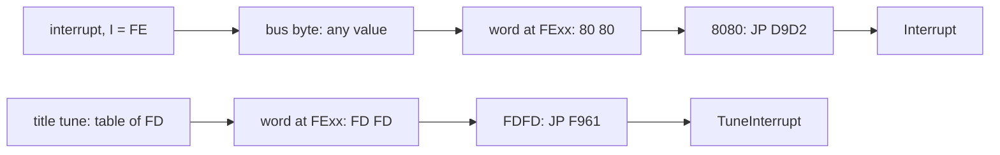

SetupIm2 is the only routine that sets this vector, and three places call it: GameEntry once, MenuLoop after the
title tune stops, and TrailEnd after the finish tune. The tune player overwrites the table with `$FD` (4.4); each of
these calls puts `$80` back.

**Worked example.** In `c1` at frame 15 055 the interrupt arrives at T 1 845 while the CPU waits in WaitFrames. With
`$FF` on the bus the CPU reads the word at `$FEFF`: `$80` from `$FEFF` and `$80` from `$FF00`, the 257th byte. The
word is `$8080`. The trace shows the reads of `$FEFF` and `$FF00`, the fetch of `C3` at `$8080` and the next
instruction at `$D9D2`.

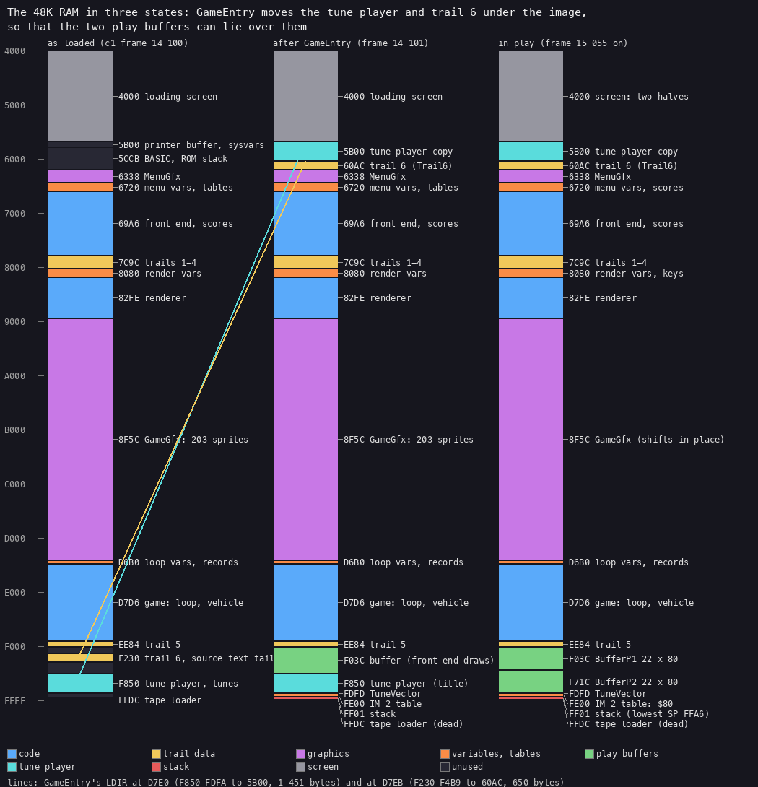

*How to read: three columns of the RAM from `$4000` (top) to `$FFFF` (bottom): as the loader leaves it, after
GameEntry, and in play. The IM 2 table is the thin band at `$FE00-$FF00`; the vector's `JP` at `$8080` sits at the
start of the render variables; the stack lies under the loader. The point: the table, the stack and both vectors share
the last 512 bytes above the second play buffer. Drawn from game.ann's entries by `python3 tools/fig_memmap.py
docs/img/arch/memmap.png`; the stages are `c1` frames 14 100, 14 101 and 15 055 on.*

**Witness.** `c1/traces/15055_0-15062_0.uatr`: 7 interrupts in 7 frames, each entering `$D9D2` at T 1 841-1 856.
game.ann counts SetupIm2 20 times over all recordings; the L1 of `c1` counts Interrupt 6 766 times (58 177 over
the seven recordings).

**The point.** A table of one repeated byte makes the vector independent of the bus. The `$80` table points into the
middle of the image, at a `JP` the game writes itself. The tune player's `$FD` table points at a `JP` just under the
table. One `I`, two tables in the same 257 bytes, two handlers.

## 4.3 The interrupt handler `$D9D2`

Interrupt saves every register the game uses and looks at FrameCount `$D6BC`. FrameCount is `$FF` in the front end:
Init and NextTrail set it before a trail starts. In play, Pass sets it to 0 at the start of every pass.

- FrameCount `$FF` (the front end and the trail intro): Controls1 and Controls2 are cleared, ScanKeys `$859C` reads
  the keyboard, and ReadP1Controls and ReadP2Controls make the five control bits of each player. FrameCount stays
  `$FF`.
- FrameCount below `$FF` (play): FrameCount + 1, ScanKeys, then EngineSound `$D97C`. EngineSound plays the engine tone
  of each mounted player with a speed, inside the interrupt.

Both paths jump to InterruptEnd `$DA14`, which pops the registers, enables interrupts and returns. Between them sits
AbortKey `$DA01`. It would restart the game when key 1 (KeyStates+15) is down, but both paths jump over it and no jump reaches it.

**How it works.**

```text
Interrupt:
    disable interrupts; push AF BC DE HL IX IY
    if FrameCount == $FF:               ; the front end
        Controls1 = Controls2 = 0
        ScanKeys; ReadP1Controls; ReadP2Controls
    else:                               ; play
        FrameCount += 1
        ScanKeys
        EngineSound                     ; for each record: mounted and speed > 0 -> 3 bursts of Tone
    pop IY IX HL DE BC AF; enable interrupts; return
```

```asm
Interrupt:                  ; $D9D2
  DI
  PUSH AF
  PUSH BC
  PUSH DE
  PUSH HL
  PUSH IX
  PUSH IY
  LD A,(FrameCount)
  CP $FF
  JR C,l_D9F4             ; below $FF: play
  XOR A
  LD (Controls1),A
  LD (Controls2),A
  CALL JpScanKeys
  CALL ReadP1Controls
  CALL ReadP2Controls
  JR InterruptEnd
l_D9F4:
  ADD A,$01
  LD (FrameCount),A
  CALL JpScanKeys
  CALL EngineSound
  JR InterruptEnd
AbortKey:                   ; $DA01: no jump reaches it
  LD A,(KeyStates+$000F)
  CP $00
  JR Z,InterruptEnd
  LD A,$FF
  LD (FrameCount),A
  LD SP,StackRestart
  EI
  JP NewGame
InterruptEnd:               ; $DA14
  POP IY
  POP IX
  POP HL
  POP DE
  POP BC
  POP AF
  EI
  RET
```

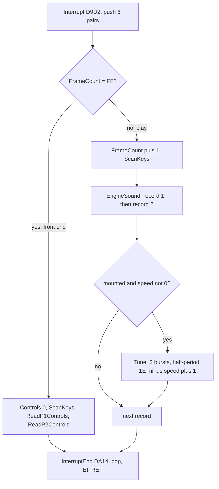

The cost of one entry depends on the engines, because Tone is a delay loop and it runs inside the interrupt:

| State | Window | Entries | T an entry |
| --- | --- | ---: | ---: |
| play, rider on foot (no engine) | `c1` 15 055-15 061 | 7 | 2 555 least, 3 630 most, mean 2 709 |
| play, one engine | `c1` 15 356-15 362 | 7 | 5 747 least, 5 918 most, mean 5 771 |
| play, two engines | `kb` 3 118-3 133 | 16 | 12 499 least, 12 806 most, mean 12 603 |
| front end (menu, FrameCount `$FF`) | `c1` 14 700-14 711 | 12 | 3 585, every entry |

**Worked example.** At T 0 of `c1` frame 15 356, player 1's record holds +2 = 1 (mounted) and +9 = 15 (the speed).
EngineOne computes C = `$1E` − (15 − 1) = 16; the trace shows Tone entered from `$D99C` with C = 16. Tone runs
B = 3 bursts. Each burst is a Click (the speaker bit toggled) and C × 3 turns of a `DJNZ` loop. Player 2's record
holds 0 at +2, so EngineOne returns at once. The entry takes 5 747 T, 8.2 % of the frame. With two players at speed
the `kb` window measures 12 603 T, 18 %.

**Witness.** `python3 ../../kit/handler_time.py --work work/docs/atA/kb --window 3118:0-3134:0 --ann
src/game/game.ann` prints "16 entries (0 cut by the window), mean 12603 T, least 12499, most 12806". The same tool
over the three `c1` windows gives the other rows (`work/docs/atA-NOTES.md`). AbortKey has no witness: no recording
runs `$DA01`.

**The point.** The interrupt is the game's clock and its engine noise. Its cost grows with the number of engines
running, from 3.7 % of a frame on foot to 18 % with two ATVs. Every T-state of it is taken from the pass.

## 4.4 The title tune's vector `$FDFD` and the menu inside it

The title and finish tunes play on their own interrupt. TunePlay `$F852` fills the same table `$FE00-$FF00` with
`$FD`, sets `I` to `$FE` and writes `JP TuneInterrupt` at TuneVector `$FDFD`. Every interrupt then goes to
TuneInterrupt `$F961`. TuneInterrupt counts the two channels' note timers (kept in the registers B, C and C'), runs
the drums when C' reaches 0, and calls the hook at TuneHook `$F96C`.

MenuLoop `$737C` patches the hook to `CALL MenuTick` before it starts tune 0. The menu's timer and keys therefore
run inside the tune's interrupt. MenuTick `$7340` adds 1 to TuneTimer `$6724`. When the timer's low byte wraps and its
high byte AND `$0F` is `$0A`, MenuTick shows the high score page and stops the tune. Any Kempston direction or fire
(port `$1F` AND `$1F`, when KempstonOn is set), or any key through TuneKeyCheck `$F977`, stops it too.

TuneStop `$F97E` writes the ROM's `JP $0038` into TuneVector, puts SP back as TunePlay saved it and returns to
MenuLoop. MenuLoop calls SetupIm2 at once: the game's vector is back for the menu's keys.

TrailEnd plays tune 1 the same way with the hook set to three zero bytes: nothing stops the finish tune.

**How it works.**

```text
TunePlay(A):
    disable interrupts; save SP and HL'
    the three sequences of tune A
    memory[$FE00..$FF00] = $FD; I = $FE; IM 2
    memory[$FDFD..$FDFF] = JP TuneInterrupt
    TuneLoop                             ; plays notes until the tune ends
    TuneStop
TuneInterrupt:
    count the note timers (B, C, C'); C' at 0: Drums
    TuneHook                             ; CALL MenuTick, CALL TuneKeyCheck or nothing
    enable interrupts; return
MenuTick:
    TuneTimer += 1
    if TuneTimer low byte == 0 and (high byte AND $0F) == $0A: HiScoreScreen; TuneStop
    if KempstonOn and (in($1F) AND $1F) != 0: TuneStop     ; any direction or fire
    TuneKeyCheck                         ; any key: TuneStop
```

```asm
TuneInterrupt:              ; $F961
  PUSH AF
  PUSH HL
  PUSH DE
  DEC C
  DEC B
  EXX
  DEC C
  CALL Z,Drums
  PUSH BC
TuneHook:                   ; $F96C
  CALL TuneKeyCheck       ; patched: CALL MenuTick, or three zeros
  POP BC
  EXX
  POP DE
  POP HL
  POP AF
  SCF
  EI
  RET

MenuTick:                   ; $7340
  CALL MenuTimer          ; TuneTimer + 1, Z when the low byte wraps
  JR NZ,l_7353
  LD A,H
  AND $0F
  CP $0A
  JP NZ,l_7353
  CALL HiScoreScreen
  JP TuneStop
```

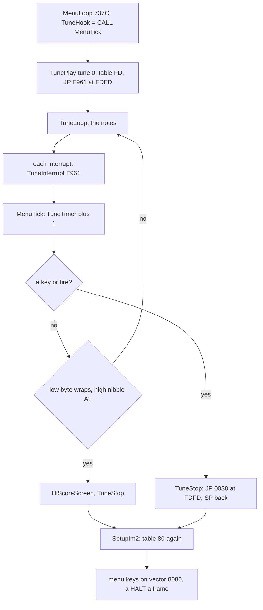

The tune's handler is light. One entry measures 353 T in `c1`: TuneInterrupt 149, MenuTick 98, MenuTimer 59,
TuneKeyCheck 37. The game's handler takes 3 585 T in the front end. The tune itself is not light: TuneLoop runs in the
main program and fills the frame with the beeper's notes.

**Worked example.** In `c1` the tune starts at frame 14 639, when the menu is drawn. SPACE is pressed at 14 657, so
the tune plays for about 18 frames. MenuTick sees the key, TuneStop writes `$0038` into `$FDFE`, MenuLoop calls
SetupIm2, and the table is `$80` again from the next frame. After the game over the title runs again, but the
recording's keys are still held. The menu waits in WaitNoKey on vector `$8080` from about 19 600 to 20 500. The tune
plays again from about 20 898 to 22 397. The L1 counts 1 517 entries of TuneInterrupt in the whole recording, about
18 of them in the first play, so about 1 499 in the second.

**Witness.** The L1 of `c1` counts MenuTick 1 517 runs (5 388 over the seven recordings); TunePlay is called with A = 0 from `$7391` (`c1`: twice)
and with A = 1 from `$ED00` (`warp`: 7 times). The 353 T come from `c1/traces/14645_0-14648_0.uatr`.

**The point.** The front end is driven by music. The menu's timer and its keys live in the tune's interrupt hook, so
the menu cannot react until the tune stops. The tune paces the first high score page (TuneTimer at `$0A00`); after
the tune has stopped, MenuLoop's own HALT loop counts TuneTimer on to `$8000` and the fall-back to the title.

## 4.5 One pass: the order of work

Pass `$D851` is one step of the game for both players. It clears FrameCount, reads both players' controls, ticks the
clock and runs Players `$EC7F`. Players calls PassP1 `$DA4F` and PassP2 `$DA8F` for the players whose bit is set in
Riding `$D6BE`. Then the pass waits (4.6).

Each player's pass works on its own half of the screen:

| | Player 1 (PassP1) | Player 2 (PassP2) |
| --- | --- | --- |
| ScreenBase | `$4021` (top half) | `$48A1` (bottom half) |
| BufferBase | BufferP1 `$F03C` | BufferP2 `$F71C` |
| AttrBase | `$5821` | `$59A1` |
| HudY | `$BE` | 6 |
| Controls | Controls1 | Controls2 |

The player's 50-byte record (RecordP1 `$D70E` or RecordP2 `$D740`) is copied to Record `$D772` and back, so one copy
of Update `$DACC` serves both. Update works in this order:

1. WalkList `$8DA3` draws list A (the ground) at TrackPos.
2. EngineSound, AtvPhysics `$E676` and Controls `$E105` move the ATV.
3. JumpControl, RiderUpdate and Tumble run unless the ATV is turning round (AtvFrame `$5C`, the head-on frame,
   set by TurnLeft and TurnRight).
4. WalkList draws list B (the scenery) at SceneryPos.
5. FlushDeferredB, DrawAtvAndRider `$DC82` and FlushDeferredA draw the sprites around the ATV.
6. FinishCheck `$DB34` tests the finish.

PassP1 then calls Advance `$E011`, copies the buffer to its half of the screen (CopyBufferP1 `$8CDA`) and flushes the
attributes.

**How it works.**

```text
Pass:
    FrameCount = 0
    Controls1 = Controls2 = 0; ReadP1Controls; ReadP2Controls; ClearKeys
    ClockTick                            ; one tenth a pass
    for each player in Riding:
        ScreenBase, BufferBase, AttrBase, HudY of the half
        ClearBuffer (by PUSH)
        Record = player's record
        if the player finished: SlowDown
        PassControls = the player's controls
        EngineTimer; Update; Advance
        CopyBuffer to the screen; FlushAttrs
        player's record = Record
    WaitFrames
```

```asm
Pass:                       ; $D851
  XOR A
  LD (FrameCount),A
  XOR A
  LD (Controls1),A
  LD (Controls2),A
  CALL ReadP1Controls
  CALL ReadP2Controls
  CALL JpClearKeys
  CALL ClockTick
  CALL Players

Players:                    ; $EC7F
  XOR A
  LD (SeenCount),A
  LD (PlayerIndex),A
  LD A,(Riding)
  AND $01
  CALL NZ,PassP1
  LD A,$01
  LD (PlayerIndex),A
  LD A,(Riding)
  AND $02
  CALL NZ,PassP2
  RET
```

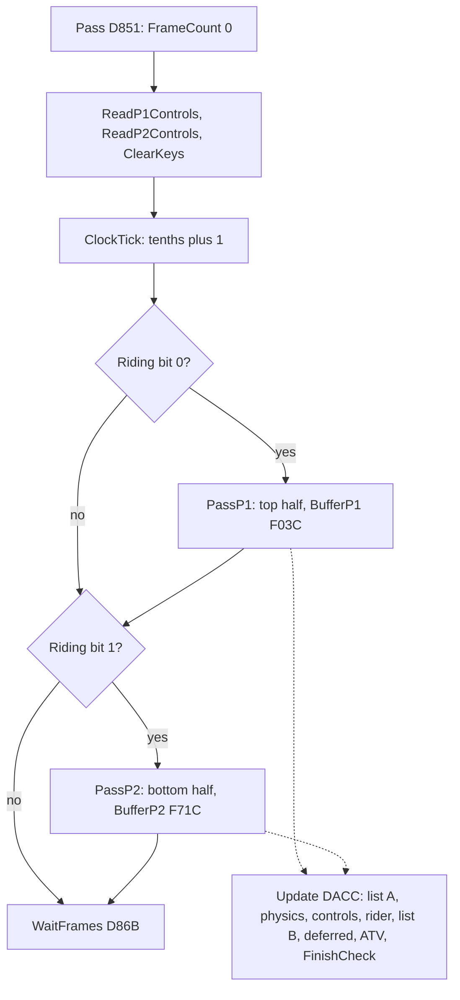

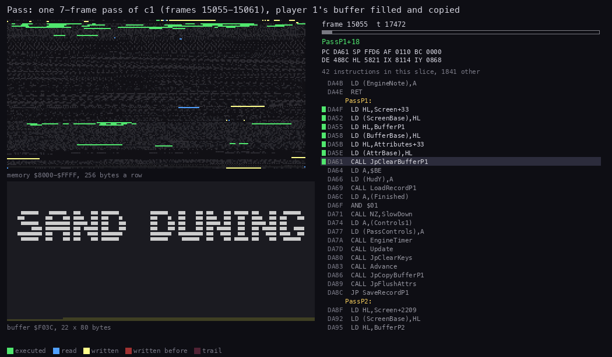

*Pass: one 7-frame pass of `c1` (frames 15 055-15 061, T 0 to T 0), 28 pictures. How to read: the top left is the
memory `$8000-$FFFF`; the bottom left is player 1's buffer `$F03C`, 22 × 80 bytes; the right is the listing at the
current PC. The buffer is cleared by PUSH, filled by list A (the dunes), the rider, list B and the START sign, then
copied; the wait loop takes the rest. The point: the whole half is drawn from nothing every pass, in a buffer, and
copied once. Drawn with `python3 ../../kit/routine_anim.py --trace work/docs/atA/c1/traces/15055_0-15062_0.uatr
--listing build/game.lst --auto-labels owner --view buffer:F03C:22x80:rows --range 8000-FFFF --pc
D851-D8BF,D9D2-DA1D,DA4F-DACB,DACC-DB9F --pictures 28 --title "..." --out docs/img/routines/Pass.gif`.*

**Worked example.** The first pass of trail 1 in `c1` starts at frame 15 055 T 12 253. The rider stands on foot left
of the ATV, and the START sign is on the right. ReadP1Controls makes Controls1 from the held key. ClockTick turns the
clock from 00.0 to 00.1; the screenshot at 15 060 shows "00.1". Players calls PassP1 only (Riding = 1). The work ends
at 15 059 T 1 652: 268 951 T, 55.0 % of 7 frames. WaitFrames then loops until the interrupt of frame 15 062 makes
FrameCount 7, and the next pass starts.

**Witness.** The L1 of `c1` counts PassP1 600 times (5 081 over the seven recordings); PassP2 runs 813 times in `kb` and never in `c1`. `python3
work/docs/atA/passwin.py work/docs/atA/c1/traces/15055_0-15062_0.uatr` lists Pass at 15 055 T 12 253 and the next
WaitFrames exit.

**The point.** A pass is the game's tick for both players. The two players share one Update and one clock, and each
draws its half from scratch into its own buffer.

## 4.6 The fixed 7-frame pass and the wait on `$D6BC`

After Players, WaitFrames `$D86B` reads FrameCount and loops while it is below 7. Pass set FrameCount to 0 at its
start, and the interrupt adds 1 each frame. A pass therefore lasts 7 frames whenever its work fits in them: 489 216 T,
7 × 69 888. A tenth on the clock is one pass, 0.14 s of real time. A "60" trail lasts 600 passes, 84 s.

When the work does not fit, FrameCount is already 7 or more when WaitFrames first reads it. The loop exits at once and
the next pass starts late. Nothing catches up: the lost frames are gone. The clock counts passes, so it runs slower
than real time.

**How it works.**

```text
WaitFrames:
    while FrameCount < 7: loop          ; the interrupt adds 1 each frame
    ... the end tests (4.9)
    next Pass                           ; FrameCount = 0 again
```

```asm
WaitFrames:                 ; $D86B
  LD A,(FrameCount)       ; $D6BC
  CP $07
  JR C,WaitFrames
```

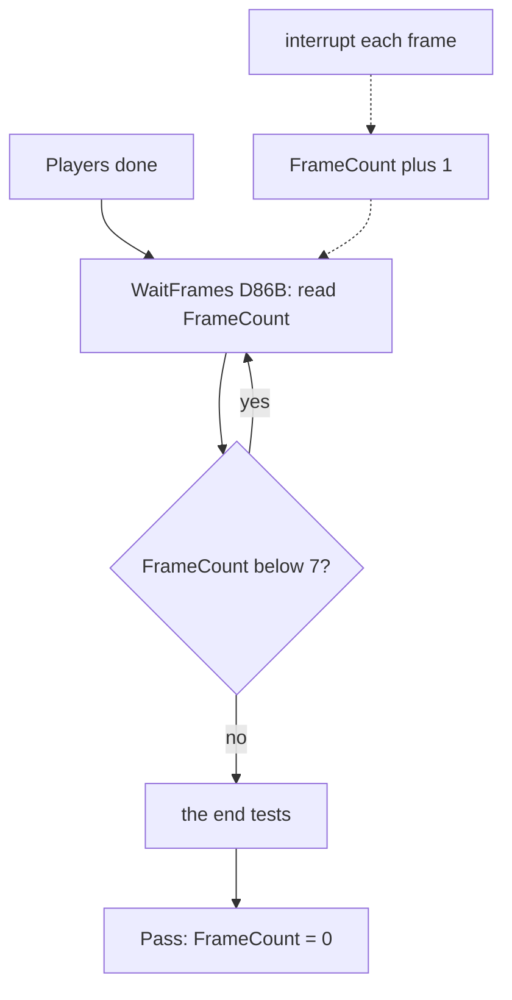

With one player the work always fits. `tools/pass_time.py` measured 600 passes of a replay of `c1`'s play between
30.6 % and 89.7 % of the 7 frames, mean 37.7 %; the recording itself peaks at 91.3 % (4.7). With two players it often does not: in `kb` 640 of 811 passes took 7 frames,
and the others took 8 to 15.

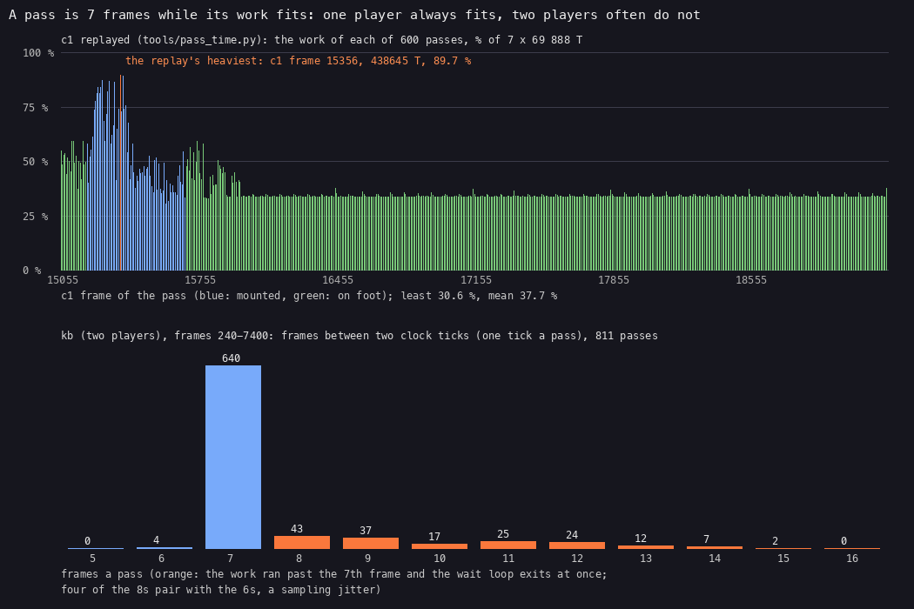

*How to read: the top panel is the work of each of 600 passes of `c1`'s play as a share of 7 frames, one bar a pass
(blue: mounted, green: on foot). It was measured by `tools/pass_time.py` from Pass to the first WaitFrames, on a
replay of `play.szx` with the keys set at each pass's start, so its passes are not exactly the recording's (4.7);
the replay's heaviest pass is orange. The bottom panel counts the
frames between two changes of the clock in recording `kb` (two players), frames 240-7 400, sampled at T 0 of every
frame. The point: one player leaves half the pass or more to the wait loop; two players overrun about one pass in
five, and then the clock slows. Drawn by `python3 tools/fig_passes.py docs/img/loop/passes.png`.*

**Worked example.** In `kb` the clock turns from 02.7 to 02.8 at frame 3 108, to 02.9 at 3 120 and to 03.0 at 3 132:
passes of 12 frames. The trace of 3 118-3 133 shows Pass at 3 119 T 22 776 and the next at 3 131 T 39 672: 12 frames
and 16 896 T. The work of PassP1 and PassP2 together took 855 313 T, 174.8 % of the 7-frame budget. The largest
shares were the two engines' Tone 15.9 %, RotateSpriteLeft 14.4 % and RotateSpriteRight 14.0 %. Over trail 1 of `kb`
the 213 passes (00.1 at frame 402, 21.3 at 2 150) averaged 8.2 frames; on trail 2 the 598 passes averaged 7.43.

**Witness.** `work/docs/atA-kb-clock.txt` (the clock at T 0 of each frame); `kb/traces/3118_0-3134_0.uatr` read by
`work/docs/atA/passwin.py`; `work/stage2/pass/passes.json`. The histogram counts 4 passes at 6 frames, 640 at 7, 43
at 8, 37 at 9, 17 at 10, 25 at 11, 24 at 12, 12 at 13, 7 at 14 and 2 at 15. The four 6s pair with four of the 8s.
The clock is written at a different point of each pass, so a 7-frame pass can read as 6 and then 8 at T 0.

**The point.** Game time is passes, not frames. The time limits and lap times are exact for one player and slower in
real time with two; nothing in the code adjusts for it.

## 4.7 The heaviest pass

The heaviest pass of `c1` starts at frame 15 412: 446 565 T, **91.3 %** of 7 frames, from Pass at 15 412 T 7 142 to
WaitFrames at 15 418 T 34 379. It was measured on the recording itself:
`python3 tools/pass_trace.py --work W --window 15150:0-15450:0` (and `15400:0-15800:0`) traces the window and times
every pass from Pass `$D851` to its first WaitFrames `$D86B`, the interrupt entries inside included. The window holds the first stretch of trail 1, where the START sign scrolls
past; after it the rider crashes (15 580) and stands, and the light passes before it stay under 60 %. The L1's least
count of wait-loop turns over the whole play (1 168, WALKTHROUGH 1) leaves room for about the same work. This is the
one figure the documents give for the heaviest pass. `tools/pass_time.py`'s replay (keys set at each pass's start,
a few frames off the recording) found 89.7 % at 15 356; the recording's pass at 15 356 is 396 674 T, 81.1 %.

The cost is the in-place shift. A sprite in GameGfx is stored at one bit offset. When the scroll moves an item to
another pixel offset in its byte, PlaceItem `$8E3C` calls ShiftLeftBy `$8759` or ShiftRightBy `$8777`. These rotate
the whole sprite one bit a turn with RotateSpriteLeft `$871E` or RotateSpriteRight `$8742`. When the stored offset
wraps through 0, ShiftBytesLeft `$86F7` or ShiftBytesRight `$86C4` moves the bytes back by one.

In this pass the shifters rewrite eleven sprites. The costly ones are three:

- 123 (`$7B`), the START sign, 9 × 31 bytes at `$BE11` (writes `$BE14-$BF2B`);
- 124, its mask, 9 × 31 bytes at `$BF2C` (writes `$BF2F-$C046`);
- 27, a dune slope, 8 × 29 bytes at `$9C58` (writes `$9C5B-$9D43`).

The others are small: 22, 23, 103, 153, 154, 180, 201 and the menu bank's sprite 3 (`$650B-$6513`). The pass at
15 356 rewrites 22, 23, 27, 80, 81, 103, 123, 124, 201 and menu sprite 3 (stage 2 had named sprite `$A5`, a totem
with an arrow, wrongly).

**How it works.**

```text
PlaceItem(item):
    offset = item x AND 7
    if offset != the sprite's stored offset:
        ShiftRightBy(count) or ShiftLeftBy(count)
    draw the sprite (masked) into the buffer
ShiftRightBy(count):
    repeat count times:
        stored offset = (stored offset + 1) AND 7
        RotateSpriteRight                ; every byte of the sprite, one bit
        if stored offset == 0: ShiftBytesLeft
```

```asm
ShiftRightBy:               ; $8777
  LD (ShiftCount),A
l_877A:
  LD HL,(ShiftPtr)
  LD A,(HL)
  INC A
  AND $07
  LD (HL),A
  JP NZ,l_878E
  CALL RotateSpriteRight
  CALL ShiftBytesLeft
  JP l_8791
l_878E:
  CALL RotateSpriteRight
l_8791:
  LD HL,ShiftCount
  DEC (HL)
  JP NZ,l_877A
  RET
```

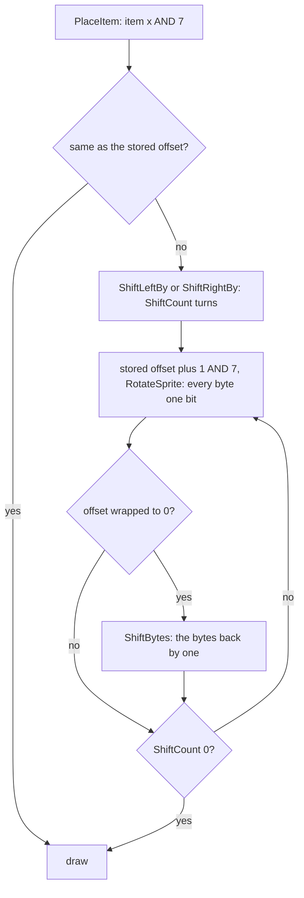

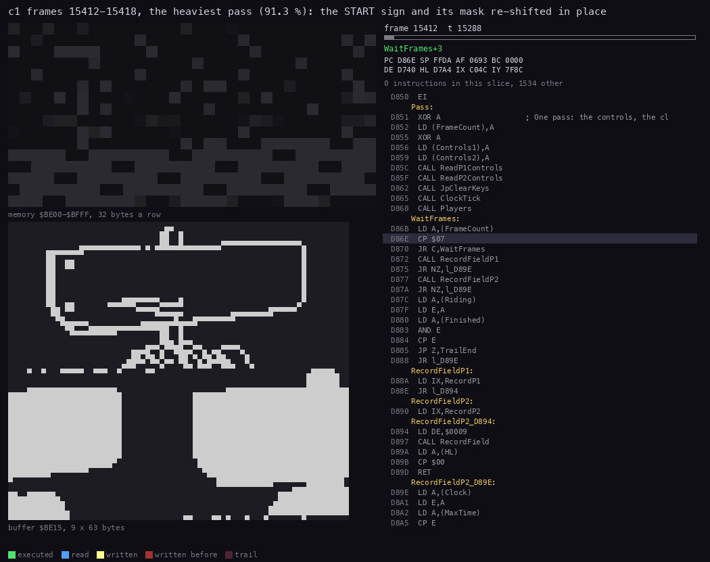

*The heaviest pass of `c1` (frames 15 412-15 418, T 0 to T 0), 32 pictures of 15 288 T each; a picture is taken only
in the instructions of `$86C4-$8798`, the shifters. How to read: the top left is `$BE00-$BFFF`; the bottom left shows
the bytes from `$BE15`, 9 a row: the START sign's pixels on top and its mask below. Yellow is written in the current
slice. The point: each change of the sign's pixel offset rewrites all 558 bytes of the sign and its mask, one bit a
call. Drawn with `python3 ../../kit/routine_anim.py --trace work/docs/integrate/c1/traces/15412_0-15419_0.uatr
--listing build/game.lst --auto-labels owner --view buffer:BE15:9x63:rows --range BE00-BFFF --pc 86C4-8798 --pictures
32 --title "..." --out docs/img/play/c1-heaviest-pass.gif`. [Doc 06](06-rendering.md) shows the rotation of sprite 27
one call at a time.*

**Worked example.** The routines of the heaviest pass as a share of its 446 565 T of work, from `passwin.py`:
RotateSpriteLeft 118 472 T (26.5 %), RotateSpriteRight 92 910 T (20.8 %), CopyLines 7.9 %, MaskBuffer 5.4 %, Tone
3.4 %, MaskBufferClip 3.3 %, OrBufferClip 2.8 %, ScanKeys 2.7 %. With ShiftBytesRight, ShiftBytesLeft, ShiftLeftBy and
ShiftRightBy the shifters take 233 324 T, 52 % of the work: more than the drawing and the copy together. The pass at
15 356 (81.1 %) has the same shape with less right rotation.

**Witness.** `work/docs/integrate/c1/traces/15412_0-15419_0.uatr` and `15150_0-15450_0.uatr` (`tools/pass_trace.py`:
42 passes, 6 over 400 000 T, from 15 251 to 15 412); `c1/traces/15356_0-15363_0.uatr`. `work/docs/atA/rotw.py` lists
the write ranges of `$86C4-$8798` (`python3 work/review/rvA/rotw.py <trace>`): at 15 412 `9B33-9B53 9B57-9B67
9C5B-9D43 B6FE-B776 BE14-BF2B BF2F-C046 CB84-CB92 CB96-CBA4 D171-D1AD D62F-D652` and `650B-6513`, besides the stack.
`work/stage2/pass/passes.json` holds the replay's 600 passes.

**The point.** The game keeps one copy of each sprite and re-shifts it whenever its offset changes. Where the scroll
moves a big sprite, the shift costs more than the drawing. One player still fits in the 7 frames.

## 4.8 A pass against the beam

The beam draws the paper from T 16 152 of a frame, 224 T a line. CopyLines `$8CF2` copies the buffer, 22 bytes a
line, at about 436-560 T a line: slower than the beam. Whether a frame shows a torn half depends on where in the frame
the copy starts.

**How it works.**

```text
CopyBufferP1:
    for each of the 80 buffer lines:
        CopyLines: 22 bytes to the screen line under ScreenBase
    nothing waits for the beam
```

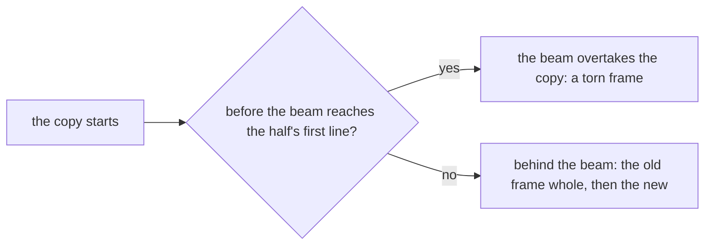

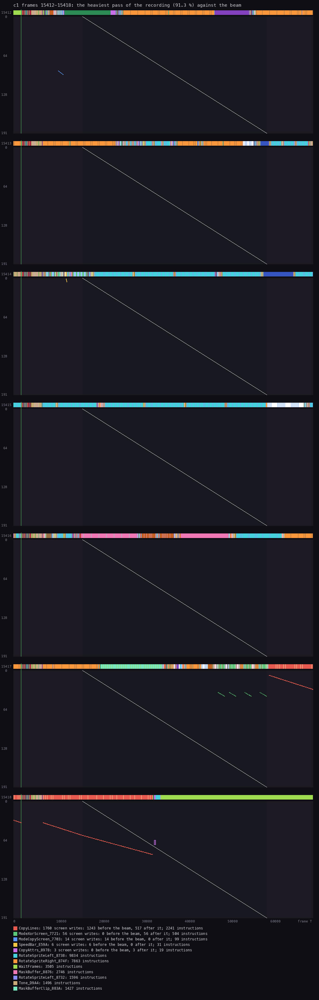

*How to read: one panel a frame, T across (0-69 888), screen lines down (0-191). The coloured band on top is the
routine running at each moment; the white diagonal is the beam; each dot is a screen write at its line and moment.
The point: CopyLines (red) starts at frame 15 417 T 59 591, below the paper's end, and runs into frame 15 418, where
the beam overtakes it. 1 243 of its 1 760 writes land before the beam reaches their line and 517 after, so frame
15 418 shows the new top of the half and the old rest: a tear. In the pass at 15 356 (81.1 %) the copy starts at
15 361 T 12 189 and the split is 474 before, 1 286 after. Drawn with `python3 ../../kit/beam_timeline.py --work
work/docs/integrate/c1 --window 15412:0-15419:0 --listing build/game.lst --auto-labels owner --frames 15412-15418
--title "c1 frames 15412-15418: the heaviest pass of the recording (91.3 %) against the beam" --out
docs/img/loop/beam-heaviest-c1.png`; recording `c1`, frames 15 412-15 418, T 0 to T 0.*

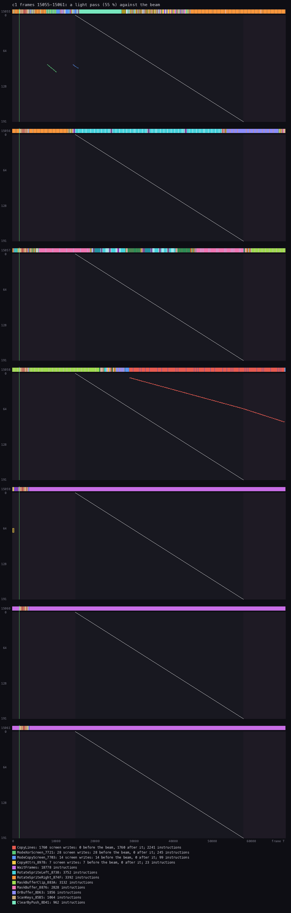

*How to read: as above. The point: in this pass CopyLines starts at frame 15 058 T 29 973, behind the beam, so every
write lands after the beam has passed its line. The frame shows the old picture whole, and the next one shows the new
picture whole. Drawn with `python3 ../../kit/beam_timeline.py --work work/docs/atA/c1 --window 15055:0-15062:0
--listing build/game.lst --auto-labels owner --frames 15055-15061 --title "c1 frames 15055-15061: a light pass (55 %)
against the beam" --out docs/img/loop/beam-light-c1.png`; recording `c1`, frames 15 055-15 061, T 0 to T 0.*

**Worked example.** At frame 15 361 the copy starts at T 12 189. The beam reaches the half's first line, screen line
8 at `$4021`, at T 16 152 + 8 × 224 = 17 944. By then CopyLines has written about 10 lines. The beam gains about
250 T a line and catches the copy at T 22 684, on screen line 29 (buffer line 21): 474 writes land before it, 1 286
after. The lines above it show the new pass; the lines below show the old one until the next frame.

**Witness.** The two traces. `python3 work/review/rvA/beam.py work/docs/atA/c1/traces/15356_0-15363_0.uatr 15361`
prints the first write after the beam at 15 361 T 22 684, line 29. beam_timeline prints "CopyLines: 1760 screen writes: 474 before the beam, 1286 after
it" for the heavy pass and no write before the beam for the light one.

**The point.** The game does not synchronise its copy with the beam. A tear shows only when a pass's work ends early
in a frame, so it depends on the pass's length, not on a plan.

## 4.9 The end of a pass: the finish, TIME OUT, game over

After the wait the pass tests three things. RecordFieldP1 and RecordFieldP2 read each record's speed (+9). If both
are 0 and every riding player has finished (Finished `$D7A5` AND Riding = Riding), the trail is over: TrailEnd.

Otherwise the clock is compared. When the clock's first digit equals MaxTime's first digit (`$D6CC`), both speeds are
set to 0. TimeOut `$EBE3` prints "TIME OUT" in each riding half that has not finished. Then TrailEnd runs if any
player finished; else the game ends after 250 HALTs.

TrailEnd sets Riding to Finished: only the players who finished ride the next trail.

**How it works.**

```text
after WaitFrames:
    if speed1 == 0 and speed2 == 0 and (Finished AND Riding) == Riding: TrailEnd
    if Clock[0] != MaxTime[0]: next Pass
    speed1 = speed2 = 0
    TimeOut
    if Finished AND 3: TrailEnd
    250 x HALT; return                 ; to OuterLoop: CheckHiScore
TrailEnd:
    Riding = Finished
    tune 1 (nothing stops it); SetupIm2
    50 x HALT; the finished halves' bands; CountBonus; 100 x HALT
    Trail += 1; after trail 6: SecondRound = 1, Trail = 0
    NextTrail
```

```asm
  CALL RecordFieldP1      ; speed, Z when 0
  JR NZ,l_D89E
  CALL RecordFieldP2
  JR NZ,l_D89E
  LD A,(Riding)
  LD E,A
  LD A,(Finished)
  AND E
  CP E
  JP Z,TrailEnd
  JR l_D89E
l_D89E:
  LD A,(Clock)
  LD E,A
  LD A,(MaxTime)
  CP E
  JR NZ,Pass
  CALL RecordFieldP1
  LD (HL),$00
  CALL RecordFieldP2
  LD (HL),$00
  CALL TimeOut
  LD A,(Finished)
  AND $03
  JP NZ,TrailEnd
  LD B,$FA
l_D8BF:
  HALT
  DJNZ l_D8BF
  RET
```

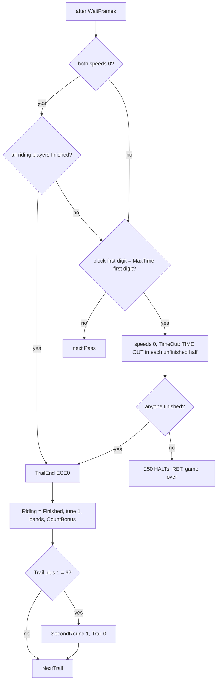

The test compares only the first digit, so "60" ends when the clock reaches 60.0: 600 passes. A finished player's
pass calls SlowDown each pass, so the ATV stops a few passes after the finish unless the throttle is held.

**Worked example.** In `trails` the bot crosses the finish line of trail 1 at about frame 1 680, with a lap of 19.8
(`docs/img/play/trails-001640-finish-line.png`). It keeps the throttle on, so its speed never stays 0 at the test and
TrailEnd does not run. The pass loop goes on to clock 60.0 at about frame 4 500. Then the TIME OUT branch sets the
speeds to 0, finds Finished bit 0 set and jumps to TrailEnd. No "TIME OUT" text is printed, because player 1 has
finished (`trails-004510-time-out-finished.png`). The bonus count follows (`trails-004780-bonus-count.png`). In `c1`
the rider never finishes: TIME OUT at about 19 255, then 250 HALTs, then the title.

**Witness.** TrailEnd runs 9 times over `kb`, `trails` and `warp` (game.ann) and never in `c1`. TimeOut runs in
`c1`, `kb`, `trail1`, `trails` and `warp`. The screenshots above.

**The point.** The trail ends when every rider still in has finished and stopped, or at the time limit. A player who
has not finished at TIME OUT drops out at TrailEnd. The game ends only when no one finished.

## 4.10 The timers and every delay

The game has one frame counter, FrameCount. It counts everything else in passes or in HALTs.

| Timer | Where | Length | Unit |
| --- | --- | --- | --- |
| a pass | WaitFrames `$D86B` | 7 frames (more when the work overruns) | frames |
| the clock | ClockTick `$EB53` | one tenth a pass; 60.0 = 600 passes | passes |
| WaitKey60 | `$6E4A` | 60 HALTs, or a key | frames |
| the title tune's timer | MenuTimer `$7368`, TuneTimer `$6724` | from `$04C8`, + 1 a tune interrupt (MenuTick) and + 1 a HALT of MenuLoop's loop (`$73BD`); the high scores at `$0A00` (MenuTick), the title at `$8000` (tested only in MenuLoop's loop, `$73CD`) | tune interrupts, then frames |
| TrailEnd | `$ECE0` | tune 1, 50 HALTs, CountBonus, 100 HALTs | frames |
| game over | `$D8BF` | 250 HALTs | frames |
| a tumble | Tumble `$E89C` | TumbleCount up to 24 | passes |
| a wheelie | WheelieTimer | 10 | passes |

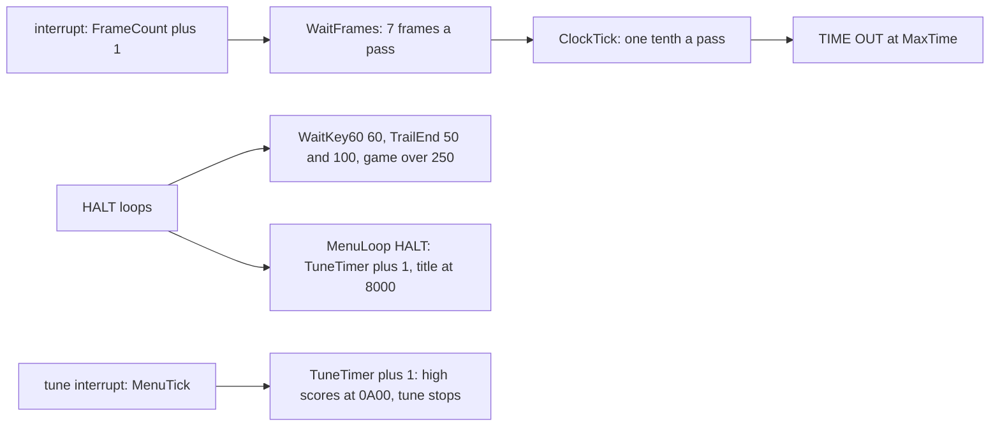

**Worked example.** TuneTimer starts at `$04C8`, and MenuTick adds 1 each tune interrupt. At `$0A00`, after
`$0A00` − `$04C8` = 1 336 interrupts (about 27 s), MenuTick shows the high scores and stops the tune. MenuLoop's
HALT loop then adds 1 a frame; its high byte reaches `$80` after `$8000` − `$0A00` = 30 208 more frames, 31 544 in
all, about 10.5 minutes at 50 Hz, if no key is pressed. The menu then goes back to Title. MenuLoop's other test,
TuneTimer = `$0400` (`$73C2`), is never met: the timer starts above it and Title resets it at `$8000` before it could
wrap round. The clock: in `c1` the first pass shows 00.1 at frame 15 060, and 60.0 comes at about 19 255. That is
4 200 frames for 600 passes, exactly 7 frames each.

**Witness.** `c1play/l1.json` (frames 15 055-19 255) counts ClockTick `$EB53`, Players and PassP1 600 times each,
and Interrupt 4 200 times. The fall-back to the title at TuneTimer
`$8000` is known only from the code: no recording waits ten minutes in the menu.

**The point.** One frame counter makes the game's time; everything else counts its passes or HALTs. Only the title
tune's timer runs on the tune's interrupts while the tune plays, and on MenuLoop's HALTs after it.
