# 5. Controls

What this covers:

- the control methods: player 1 on the keyboard, a Kempston joystick or (in two-player games) the Sinclair keys,
  player 2 on the keyboard or the Sinclair keys (5.1);
- ScanKeys `$859C` and the 40-byte KeyStates table, the Kempston port (5.2);
- the key latch: keys are collected over the frames of a pass and cleared twice a pass (5.3);
- ReadP1Controls `$D911` / ReadP2Controls `$D942` and the choice of the device (5.4);
- what an emulator must decode (5.5);
- the menu, MenuLoop `$737C` and SelectKey `$741F` (5.6);
- CHOOSE CONTROL for one and for two players, and the SINCLAIR line that does nothing (5.7);
- redefining the keys: ReadNewKey `$7542` and RedefineKey `$751F` (5.8);
- throttle, brake and the turn round (5.9);
- wheel up, wheel down and the jump; getting on the ATV (5.10);
- on foot: the walk and the walk back (5.11);
- two players: both controls read on one pass (5.12);
- the key no path reads: AbortKey `$DA01` (5.13).

The recordings it rests on ([WALKTHROUGH](../WALKTHROUGH.md) 6.0):

| Recording | Load | Used for |
| --- | --- | --- |
| `turn` (new for this document) | `work/stage1/rec/c1/menu.szx` (one player, the Kempston detected at power-on), `tests/inputs/turn.txt`, made by `tools/rec_controls.py turn` into `work/stage1/rec/turn` | CHOOSE CONTROL and SINCLAIR for one player; START; the walk to the ATV, the jump on; the throttle to full speed, wheel up, a jump with wheel down; the brake, the turn round, the throttle to the left, the turn back (1 650 frames) |
| `menu` | `work/stage1/rec/c1/menu.szx`, `tests/inputs/menu.txt` | TWO PLAYERS; both players' key tables redefined; Kempston for player 1, Sinclair for player 2 |
| `kb` | `work/stage1/rec/menu/menu-two-kb.szx`, `tests/inputs/kb.txt` | two players on the keyboard: both controls in one pass |
| `trail1` | `work/stage1/rec/c1/menu.szx`, `tests/inputs/trail1.txt` | a crash, the rider thrown, the walk back blocked by a dune |

The instances for this document ran in `work/docs/atB/` (one at a time, port base 37782). The commands are in
[`work/docs/atB-NOTES.md`](../work/docs/atB-NOTES.md).

Conventions:

- A value read with `time_travel memory_at` at frame N is the memory at T 0 of frame N. The `turn` samples
  (`work/stage1/rec/turn/log.json`) are read between run calls, at T 0 of the frame named, at no fixed point of a
  pass.
- A **pass** is one turn of the main loop: Pass `$D851`, the players' updates, then WaitFrames until the interrupt
  has counted 7 frames ([doc 4](04-game-loop.md), 4.6). With two players the work often takes longer than 7 frames
  (5.12).
- The record fields (Speed `$D77B`, Facing, AtvFrame, RiderX ...) are those of the current player's copy at
  `$D772` ([doc 7](07-objects.md)); `$D70E` and `$D740` are the players' own records.
- The **controls byte** (Controls1 `$8113`, Controls2 `$8114`, PassControls `$D6C3` during an update): bit 4 left,
  bit 3 right, bit 2 wheel up, bit 1 wheel down, bit 0 jump.

## 5.1 The control methods

Each player has a device. The menu sets three flags and two key tables:

| Variable | Address | Set by | Meaning |
| --- | --- | --- | --- |
| KempstonOn | `$8086` | DetectKempston `$77EA` at the start; KEMPSTON (ChooseKempston `$75A7`) sets it, KEYBOARD (MenuKeys1Select `$74EA`) clears it | player 1 reads port 31 |
| Keyboard1Alt | `$8087` | the one-player SINCLAIR line (ChooseKeys1 `$75AD`) sets it, KEYBOARD clears it | player 1 reads the Sinclair keys, two-player games only (5.7) |
| SinclairOn | `$8088` | Init sets it; player 2's SINCLAIR (ChooseSinclair `$75B3`) sets it, player 2's KEYBOARD (MenuKeys2Select `$74F7`) clears it | player 2 reads the Sinclair keys |
| KeyIndexes1 | `$8109` | RedefineKey | player 1's five keys: KeyStates indexes for left, right, up, down, jump; 6 7 8 3 1 = S D F C Z |
| KeyIndexes2 | `$810E` | RedefineKey | player 2's: 34 33 32 37 39 = H J K M B |
| PlayerCount | `$6947` | ONE PLAYER / TWO PLAYERS (MenuPlayers `$7583`) | 0 one player, 1 two players (2 while player 1's control window is open) |

So the methods are:

| Player | Method | Read by |
| --- | --- | --- |
| 1 | keyboard, five keys of its own (S D F C Z by default) | KeyStates at KeyIndexes1 |
| 1 | Kempston | JoyBits `$8089`: bit 0 right, 1 left, 2 down, 3 up, 4 fire |
| 1 | Sinclair keys 6 7 9 8 0, two-player games only | KeyStates at fixed indexes |
| 2 | keyboard, five keys of its own (H J K M B by default) | KeyStates at KeyIndexes2 |
| 2 | Sinclair keys 6 7 9 8 0 (the default) | KeyStates at fixed indexes |

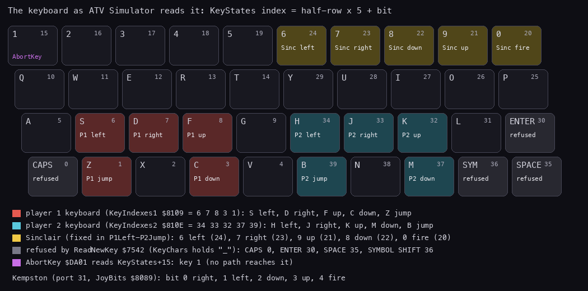

*Figure 5.1: the keyboard as ATV Simulator reads it. Each key with its KeyStates index, the default keys of both
players, the Sinclair keys, the four keys a redefinition refuses and the key AbortKey reads. Drawn from the code
(ScanKeys, KeyChars `$80B3`, KeyIndexes1/2, P1Left-P2Jump); no recording, no T-states. Command: `python3
tools/fig_controls.py docs/img/controls`.*

How to read it:

- the small number on each key is its KeyStates index (5.2);
- red keys are player 1's defaults, blue player 2's, yellow the Sinclair keys;
- grey keys are refused by a redefinition: their KeyChars entry is `_`;
- the Kempston bits are under the keys.

Witness: the defaults are the bytes at `$8109` and `$810E` in every recording before a redefinition (`turn` frame
743: `06 07 08 03 01 22 21 20 25 27`, Animation 5.2); the `menu` recording redefines both tables (5.8).

The point: player 2 starts on the Sinclair keys, not on H J K M B. A two-player game started without CHOOSE
CONTROL has player 2 on 6 7 9 8 0.

## 5.2 ScanKeys and KeyStates

ScanKeys `$859C` reads the keyboard into KeyStates `$808B`, 40 bytes, one a key. It reads the eight half rows
`$FEFE`, `$FDFE`, ..., `$7FFE`. For each it takes the five low bits, inverted, and walks them from bit 0. A key down
sets its byte to 1. A key up leaves its byte alone. Then it ORs the Kempston port's five bits into JoyBits `$8089`.

```text
ScanKeys():
    DE = KeyStates
    for B in FE, FD, FB, F7, EF, DF, BF, 7F:       # RLC B until no carry
        bits = NOT IN(B * 256 + FE) AND 1F
        repeat 5:
            if bits bit 0: (DE) = 1                  # only ever sets
            bits >>= 1; DE += 1
    JoyBits = JoyBits OR (IN($001F) AND 1F)
```

```asm
ScanKeys:
  859C  LD L,$2F              ; counted down a row, never read
  859E  LD BC,$FEFE
  85A1  LD DE,KeyStates
l_85A4:
  85A4  IN A,(C)
  85A6  CPL
  85A7  AND $1F
  85A9  LD H,$05
l_85AB:
  85AB  SRL A
  85AD  JP NC,l_85B5
  85B0  PUSH AF
  85B1  LD A,$01
  85B3  LD (DE),A
  85B4  POP AF
l_85B5:
  85B5  INC DE
  85B6  DEC H
  85B7  JP NZ,l_85AB
  85BA  DEC L
  85BB  RLC B
  85BD  JP C,l_85A4
  85C0  LD A,(JoyBits)
  85C3  LD E,A
  85C4  LD BC,$001F
  85C7  IN A,(C)
  85C9  AND $1F
  85CB  OR E
  85CC  LD (JoyBits),A
  85CF  RET
```

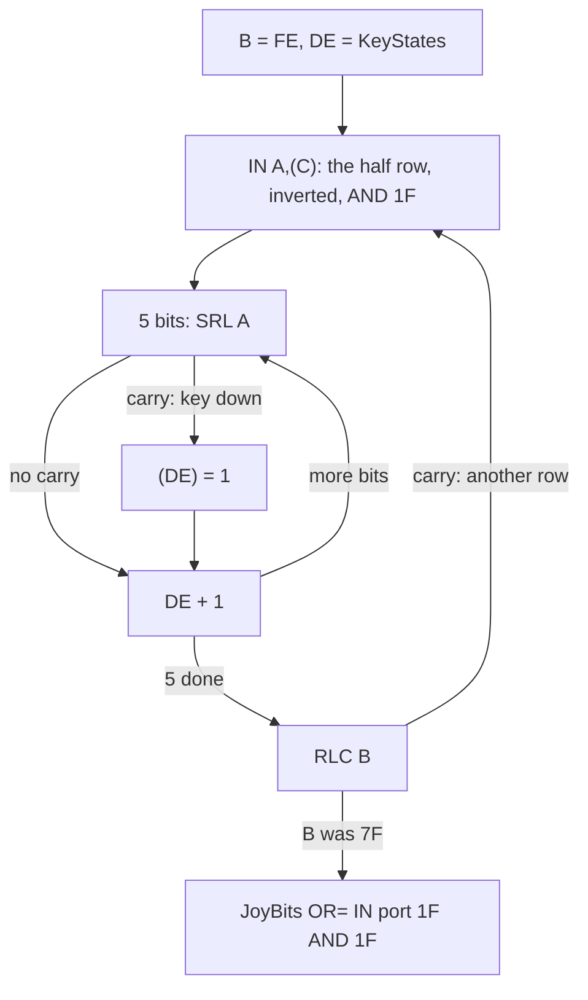

The index of a key is half row x 5 + bit: CAPS SHIFT 0, Z 1, ..., A 5, Q 10, 1 15, 0 20, P 25, ENTER 30, SPACE 35,
B 39. KeyChars `$80B3` is the same table as text, `_ZXCVASDFGQWERT1234509876POIUY_LKJH__MNB`: RedefineKey shows a
key by it, and `_` marks the keys it refuses.

ClearKeys `$858A` zeroes the 40 bytes and JoyBits. Nothing else clears a key. So KeyStates says "this key was down
in at least one scan since the last ClearKeys".

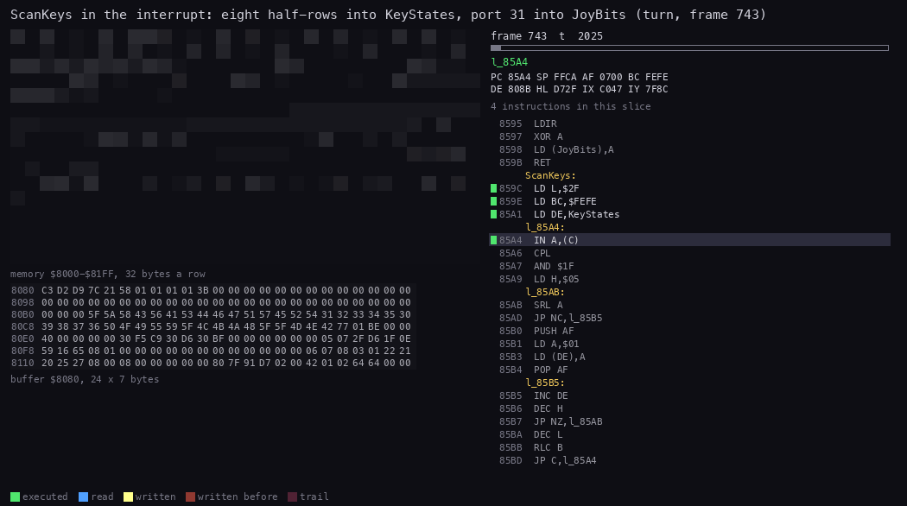

*Animation 5.1: ScanKeys in the interrupt of frame 743 of `turn`, player 1 holding right on the Kempston. T
743:1 990 to 743:3 400 (1 410 T), 40 pictures. Command: `python3 ../../kit/routine_anim.py --work
work/stage1/rec/turn --window 743:1990-743:3400 --listing build/game.lst --view buffer:8080:24x7:hex --range
8000-81FF --pc 859C-85CF --pictures 40 --title "..." --out docs/img/routines/ScanKeys.gif`.*

What to watch:

- the eight rows read: the loop's code lit eight times, no KeyStates byte written (no key is down);
- the last read, port `$001F`, and the write of JoyBits `$8089`: `$01`, right.

Witness: `turn` frame 743, above; ScanKeys runs in every interrupt of every recording (L1 entries: `c1` 23 340,
`turn` 1 921; the menu's AnyKey calls it in a loop).

The point: the table only collects. Whether a key counts depends on when it is cleared (5.3).

## 5.3 The key latch

The interrupt `$D9D2` runs ScanKeys in every frame. The main loop reads and clears:

- Pass `$D851` (frame count 0) builds Controls1 and Controls2 from KeyStates and JoyBits, then calls ClearKeys;
- PassP1 `$DA4F` calls ClearKeys again after player 1's Update;
- PassP2 does not.

So a key held only between PassP1's ClearKeys and the next Pass counts; a key held only between Pass and PassP1's
ClearKeys is lost.

```text
Interrupt (in play, FrameCount < FF):        Pass:
    FrameCount += 1                              FrameCount = 0
    ScanKeys()       # sets bits                 Controls1 = Controls2 = 0
    EngineSound()                                ReadP1Controls(); ReadP2Controls()
                                                 ClearKeys()
                                                 ClockTick()
                                                 PassP1: Update(Controls1) ... ClearKeys() ...
                                                 PassP2: Update(Controls2) ...
                                                 wait until FrameCount >= 7
```

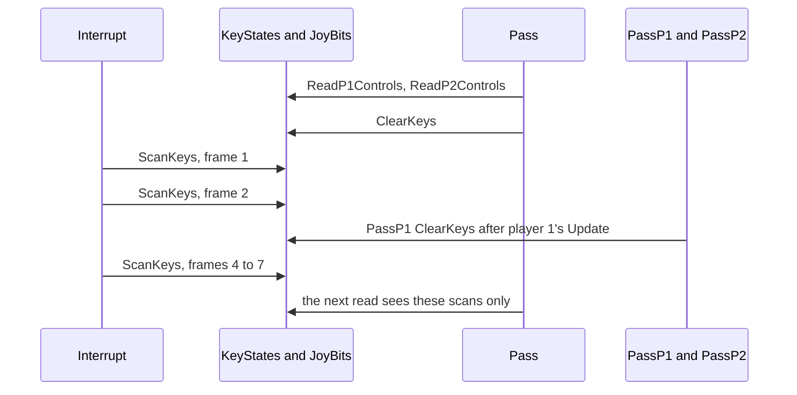

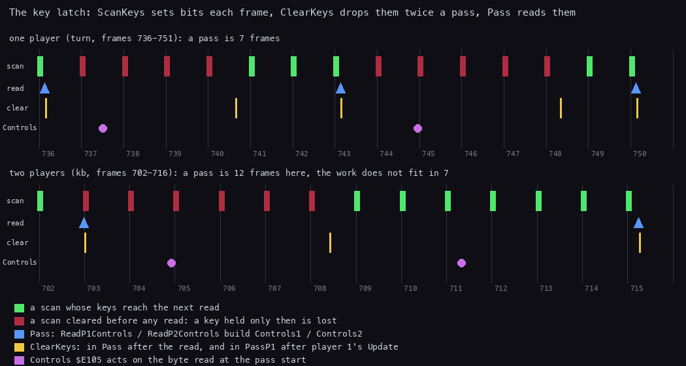

*Figure 5.2: the scans, reads and clears of three passes of `turn` (frames 736-751, one player) and one pass of
`kb` (frames 702-716, two players), with the moment Controls acts. Times from traces: the Pass, ClearKeys and
Controls entries (`work/docs/atB/tr.py`), ScanKeys at T 2 000 of each frame. Command: `python3
tools/fig_controls.py docs/img/controls`.*

How to read it:

- each column is a frame; a green bar is a scan whose keys reach the next read, a red one a scan cleared first;
- blue triangles: Pass reads; yellow lines: ClearKeys; violet dots: Controls `$E105` acting on the byte;
- one player: of the 7 scans of a pass, 3 count (frames 741-743 for the read at 743);
- two players: 7 of 12 count (frames 709-715 for the read at 715).

Worked example, `turn` pass 736-743 (from the trace `work/stage1/rec/turn/traces/701_0-771_0.uatr`):

| Event | Frame:T |
| --- | --- |
| Pass reads the keys | 736:9 550 |
| Pass's ClearKeys | 736:10 925 |
| Controls acts (right held: Accelerate) | 737:35 974 |
| PassP1's ClearKeys | 740:46 121 |
| ScanKeys | 741:2 000, 742:2 000, 743:2 000 |
| the next Pass reads | 743:9 356 |

The scans of frames 737-740 were cleared at 740:46 121. A key pressed at frame 737 and let go at frame 740 is
never seen.

Witness: the trace above; the right key held throughout `turn` gives Controls1 = `$08` at every pass.

The point: a pass reads the keys of its last three frames only. A tap of up to four frames can vanish. A key
held for a whole pass always counts.

## 5.4 ReadP1Controls, ReadP2Controls and the device

ReadP1Controls `$D911` sets the bits of Controls1 from five tests reached through a jump table (JpP1Left `$8322`
...). Each test returns carry for "pressed". The test first asks P1UsesJoystick `$83F9` which device to use.

```text
P1UsesJoystick():                     # C: Kempston; NC and Z: keyboard; NC and NZ: Sinclair keys
    if KempstonOn: return C
    if PlayerCount == 0: return Z     # one player: always the keyboard
    return Keyboard1Alt != 0          # two players: Sinclair keys when set

P1Left():
    if P1UsesJoystick() is C: return JoyBits AND 2     # Kempston left
    if NZ: return KeyStates[24]                        # key 6
    return KeyStates[KeyIndexes1[0]]

ReadP1Controls():
    IX = Controls1
    if P1Left():  SET 4
    if P1Right(): SET 3
    if P1Up():    SET 2
    if P1Down():  SET 1
    if P1Jump():  SET 0
```

```asm
P1UsesJoystick:
  83F9  LD A,(KempstonOn)
  83FC  SUB $01
  83FE  CCF                   ; KempstonOn = 1: carry
  83FF  RET C
  8400  LD A,(PlayerCount)
  8403  CP $00
  8405  RET Z                 ; one player: the keyboard
  8406  LD A,(Keyboard1Alt)
  8409  CP $00
  840B  RET
P1Left:
  840C  CALL P1UsesJoystick
  840F  JP C,l_8424
  8412  JP NZ,SinclairLeft
  8415  LD A,(KeyIndexes1)
  8418  LD E,A
  8419  LD D,$00
  841B  LD HL,KeyStates
  841E  ADD HL,DE
  841F  LD A,(HL)
  8420  CP $01
  8422  CCF                   ; byte 1: carry
  8423  RET
l_8424:
  8424  LD A,(JoyBits)
  8427  AND $02
  8429  CP $02
  842B  CCF
  842C  RET
```

Player 2's tests (P2Left `$84B1` ...) only ask SinclairOn: set, the Sinclair keys; clear, KeyIndexes2. Player 2
never reads the Kempston port.

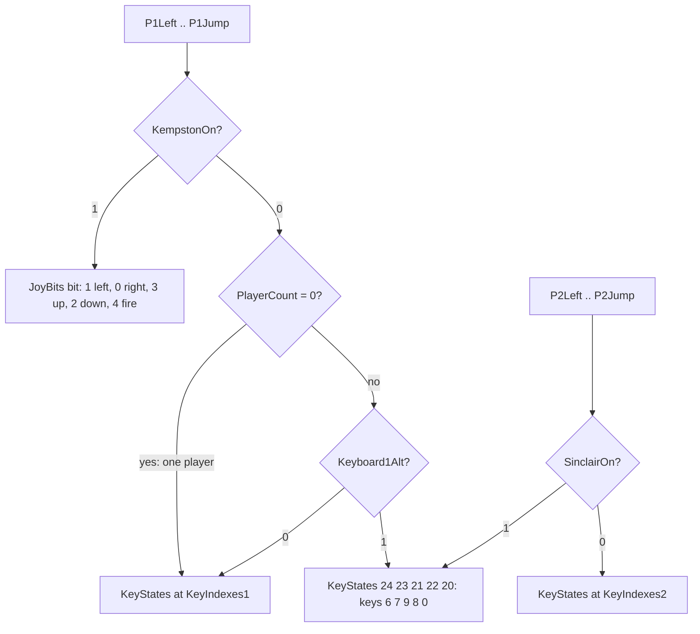

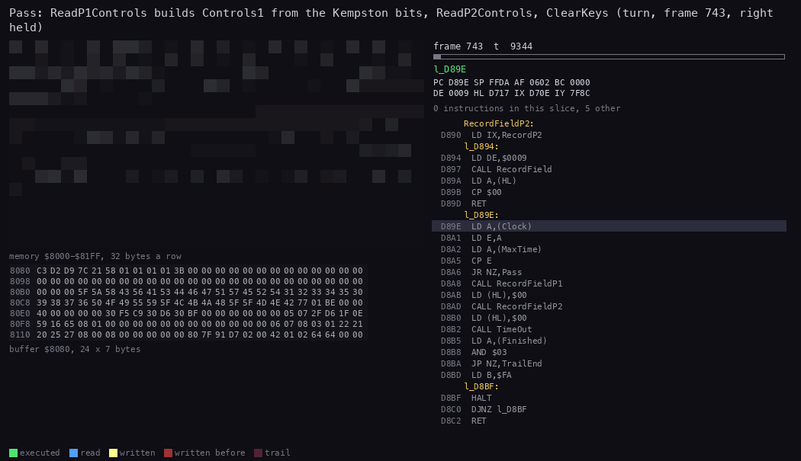

*Animation 5.2: Pass at frame 743 of `turn`: ReadP1Controls, ReadP2Controls and ClearKeys; player 1 on the
Kempston holding right. T 743:9 300 to 743:11 500 (2 200 T), 50 pictures. Command: `python3
../../kit/routine_anim.py --work work/stage1/rec/turn --window 743:9300-743:11500 --listing build/game.lst --view
buffer:8080:24x7:hex --range 8000-81FF --pc 8322-8546,858A-859B,D851-D86A,D911-D97B --pictures 50 --title "..."
--out docs/img/routines/ReadP1Controls.gif`.*

What to watch:

- KempstonOn `$8086` read five times, JoyBits `$8089` tested with `$02`, `$01`, `$08`, `$04`, `$10`;
- Controls1 `$8113` written `$08` (right);
- player 2's tests reading SinclairOn `$8088` (1) and KeyStates 24, 23, 21, 22, 20;
- ClearKeys zeroing `$808B-$80B2` and JoyBits.

Worked example (frame 743): JoyBits = `$01`. P1Left: `$01 AND $02` = 0, no carry. P1Right: `$01 AND $01` = 1,
carry, SET 3. Up, down and fire: 0. Controls1 = `$08`. Player 2: SinclairOn = 1, keys 6 7 9 8 0 up: Controls2 =
`$00`.

Witness: `turn` frame 743 (the animation); log.json gives Controls1 = `$08` at every sample with right held,
`$10` with left, `$0C` with right and up, `$0B` / `$0A` with right and down (`$0B` while fire is still latched).

The point: one byte a player, five bits, whatever the device. Everything after Pass reads only that byte.

## 5.5 What an emulator must decode

- **The keyboard**: `IN A,(C)` with B = `$FE`, `$FD`, `$FB`, `$F7`, `$EF`, `$DF`, `$BF`, `$7F` and C = `$FE`, one
  half row at a time, low five bits, 0 = down. The game never reads two rows at once.
- **The Kempston**: `IN A,(C)` with BC = `$001F`, the five low bits, 1 = pressed: bit 0 right, 1 left, 2 down, 3
  up, 4 fire. The high byte is 0.
- **The detection**: DetectKempston `$77EA` reads port 31 up to 255 times at start-up. One read of `$1F` in the low
  five bits (all set, the floating bus `$FF` of a Spectrum with no interface) turns the Kempston off. An emulator
  with no Kempston must return `$FF` (or any value with bits 0-4 set) on port 31; one whose interface idles at 0
  turns it on.
- **The Sinclair joystick**: nothing of its own: it is keys 6 7 8 9 0 on the half row `$EFFE`.

```asm
DetectKempston:
  77EA  LD E,$00
  77EC  LD A,$01
  77EE  LD (KempstonOn),A
l_77F1:
  77F1  DEC E
  77F2  RET Z                 ; 255 reads, none $1F: on
  77F3  LD BC,$001F
  77F6  IN A,(C)
  77F8  AND $1F
  77FA  CP $1F
  77FC  JR NZ,l_77F1
  77FE  XOR A
  77FF  LD (KempstonOn),A     ; floating bus: off
  7802  RET
```

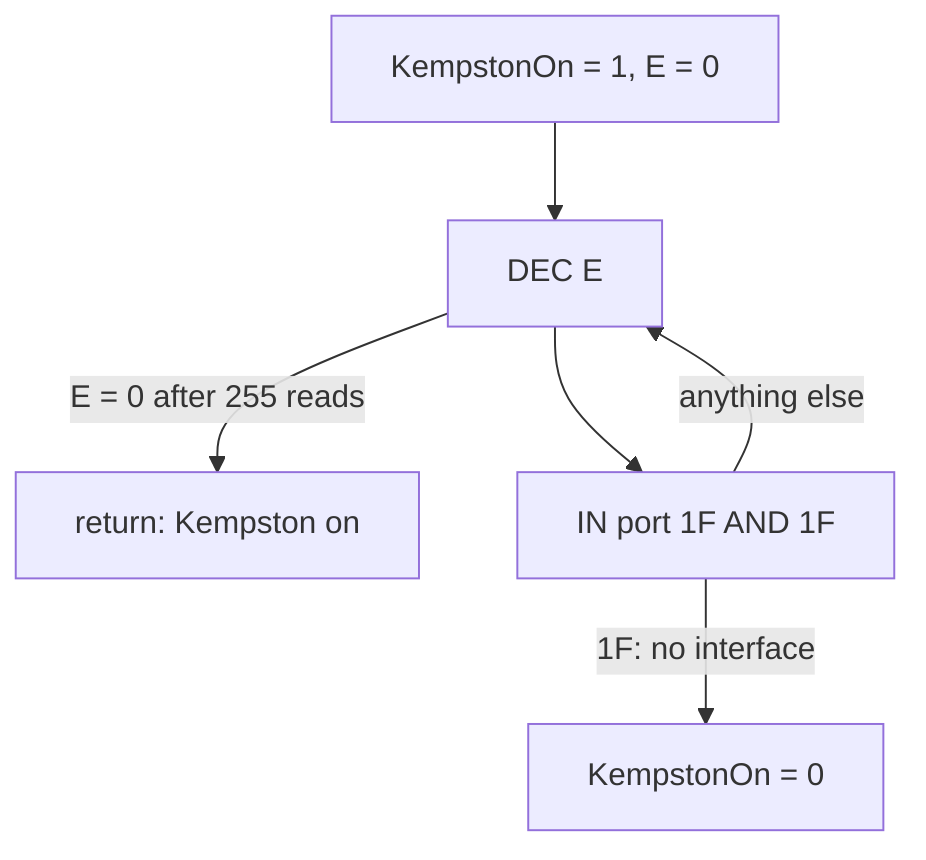

Worked example: `c1` was made on an emulator with the Kempston interface idle at 0. KempstonOn = 1 at frame 14 657
(menu.szx), so `turn`, made from that state, rides on the Kempston (KR, KF, KU and KD are the Kempston's
directions in its input script).

Witness: KempstonOn = 1 in `c1`'s menu.szx and in `turn`'s log.json; DetectKempston's L1 count is 1 in `c1`.

The point: the joystick choice is made for the player by the hardware. Player 1 rides on the Kempston as soon as
one answers, until the menu's KEYBOARD.

## 5.6 The menu: MenuLoop and SelectKey

The front end runs with FrameCount = `$FF`. In that state the interrupt does not count frames. It zeroes Controls1
and Controls2, runs ScanKeys and both readers, every frame.

MenuLoop `$737C` highlights the current item (attribute `$5E`), plays the title tune while no key is down and
waits. Any key that is not a select key moves the highlight down, wrapping. SelectKey `$741F` is SPACE (index 35),
key 0 (index 20) or the Kempston's fire when KempstonOn. ENTER only moves. In the main menu a timer (MenuTimer)
shows the high-score table after a while and goes back to the title later; the key menus (MenuCount 6) have no
timer.

```text
MenuLoop():
    wait for no key; highlight item ($5E); TunePlay(0) with hook MenuTick
    loop:
        HALT
        if MenuCount < 6:
            if timer high byte == 4: HiScoreScreen(); restart MenuLoop
            if timer high byte == 80: Title()
        if no key: continue
        if SelectKey(): MenuDispatch(item)          # SPACE, 0 or fire
        unhighlight ($1F); 3 HALTs; item = (item + 1) mod MenuCount
        wait for no key; ClearKeys
```

```asm
SelectKey:
  741F  LD A,(KeyStates+$0023)  ; SPACE
  7422  ADD A,$FF
  7424  RET C
  7425  LD A,(KeyStates+$0014)  ; key 0
  7428  ADD A,$FF
  742A  RET C
  742B  LD A,(KempstonOn)
  742E  CP $00
  7430  RET Z
  7431  LD A,(JoyBits)
  7434  AND $10                 ; fire
  7436  ADD A,$FF
  7438  RET
```

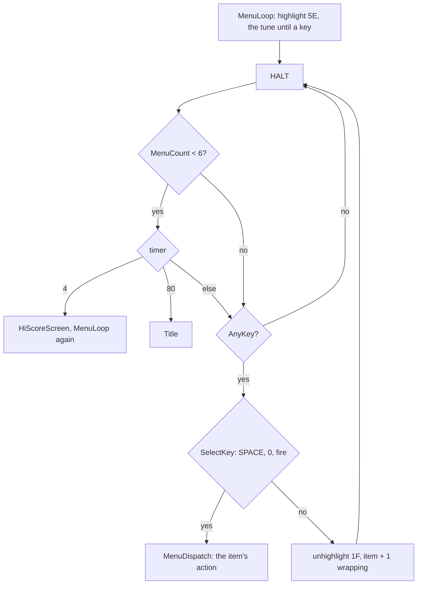

The menus are blocks of MenuDefs (src/res/tables/menus.csv): a count, x, y, height, then a text and an action a
line.

| Menu | Address | Lines (action) |
| --- | --- | --- |
| main | MenuDefs `$702A` | START (`$6DD1`), ONE PLAYER / TWO PLAYERS (MenuPlayers `$7583`), CHOOSE CONTROL (MenuControl `$74A4`) |
| one player's method | MenuControls1 `$703A` | KEYBOARD (`$74EA`), KEMPSTON (`$75A7`), SINCLAIR (ChooseKeys1 `$75AD`) |
| player 1 of two | MenuControls2a `$704A` | KEYBOARD (`$74EA`), KEMPSTON (`$75A7`) |
| player 2 | MenuControls2 `$7056` | KEYBOARD (`$74F7`), SINCLAIR (`$75B3`) |
| player 1's keys | MenuKeys1 `$7062` | LEFT, RIGHT, WHEEL UP, WHEEL DOWN, JUMP (the redefinition `$7501`), EXIT (`$75B8`, a RET) |
| player 2's keys | MenuKeys2 `$707E` | the same for player 2 |

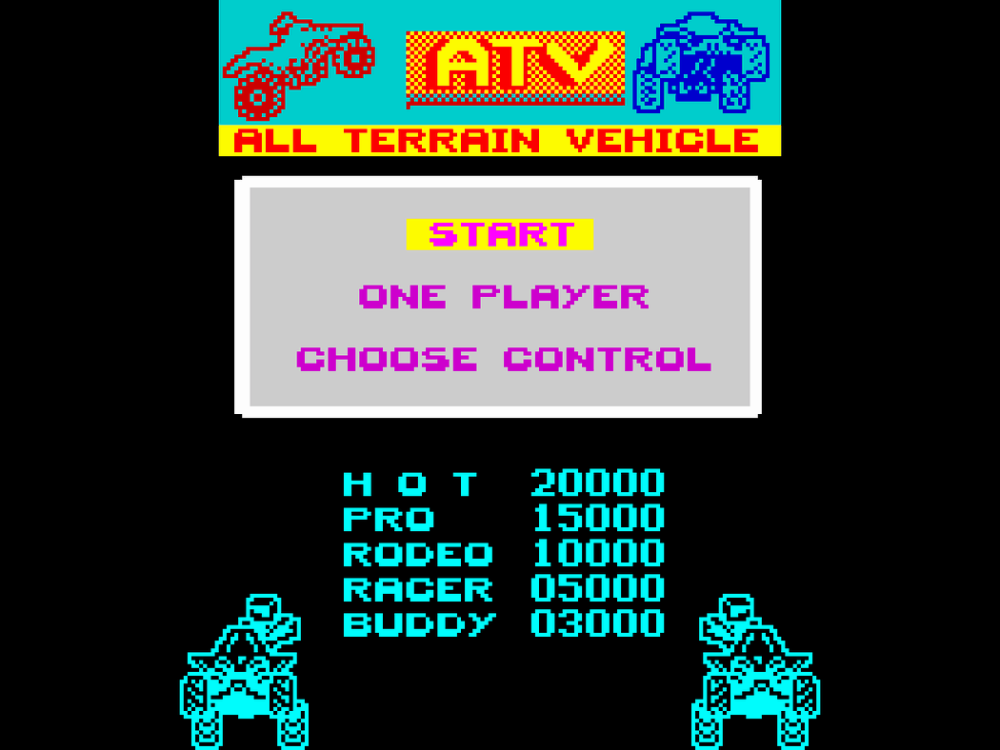

*Animation 5.3: `menu` frames 0-850, every 10th frame: TWO PLAYERS, CHOOSE CONTROL, player 1's keyboard and its
table redefined Q A O P M, player 2's table, then Kempston and Sinclair. Command: `python3 ../../kit/screen_anim.py
--work work/docs/atB/menu --from 0 --to 850 --step 10 --width 1050 --delay 150 docs/img/play/menu-tour.gif`.*

What to watch:

- ENTER (frames 0, 63) moving the highlight; SPACE (29, 92, 126) picking;
- the method window, then the key table with the line being redefined in `$F3`;
- the key letters after `]` changing to Q, A, O, P, M one by one.

Witness: `menu`'s script and the stills [two players](img/play/menu-000063-two-players.png),
[player one](img/play/menu-000126-player-one.png), [the table](img/play/menu-000160-keyboard-table.png).

The point: the menu runs on any key and two select keys. ENTER, the obvious key, only moves the highlight. A
Kempston player can do everything with the stick and fire.

## 5.7 CHOOSE CONTROL and the SINCLAIR line that does nothing

MenuControl `$74A4` opens one window with one player and two with two:

```text
MenuControl():
    if PlayerCount == 0:                    # one player
        MenuOpen(MenuControls1)             # KEYBOARD, KEMPSTON, SINCLAIR
        MenuMain()
    PlayerCount = 2; title PLAYER ONE; MenuOpen(MenuControls2a)    # KEYBOARD, KEMPSTON
    PlayerCount = 1; title PLAYER TWO; MenuOpen(MenuControls2)     # KEYBOARD, SINCLAIR
    Credits(); MenuMain()
```

PlayerCount is 2 while player 1's window is open and 1 while player 2's is. KeySlot `$7563` picks the key table
from it: `((PlayerCount - 1) AND 1) XOR 1` x 5, so 0 (KeyIndexes1) for 0 and 2, 5 (KeyIndexes2) for 1.

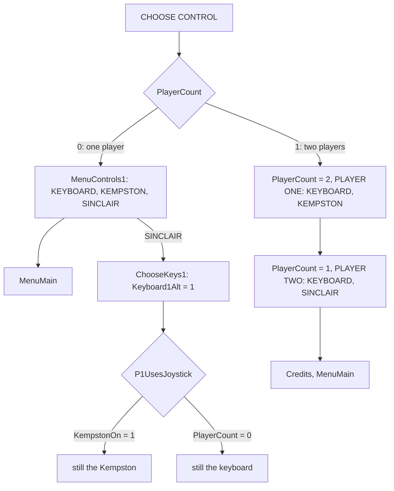

The one-player SINCLAIR line runs ChooseKeys1 `$75AD`, which only sets Keyboard1Alt. P1UsesJoystick tests the
Kempston first, then returns "keyboard" for PlayerCount 0 before it reads Keyboard1Alt. So with one player the
line changes nothing. It does not clear KempstonOn either. The flag only acts later, if the players are switched to
two and player 1 is not on the Kempston: then player 1 reads keys 6 7 9 8 0, the keys player 2 uses by default.

```asm
ChooseKeys1:
  75AD  LD A,$01
  75AF  LD (Keyboard1Alt),A
  75B2  RET
ChooseSinclair:
  75B3  LD A,$01
  75B5  LD (SinclairOn),A
  75B8  RET                   ; also EXIT's action in the key menus
```

Worked example (`turn`): the one-player SINCLAIR is picked at frame 150. log.json at frame 184: KempstonOn = 1,
Keyboard1Alt = 1. The rider then walks, mounts and rides on the Kempston's right and fire for the whole recording:
Controls1 is `$08` with KR held.

Witness: recording `turn` (the bug: ChooseKeys1 in its L1); `menu` frames 708-810 (player 1 KEMPSTON, player 2
SINCLAIR in a two-player game).

The point: the menu offers a Sinclair joystick for one player and ignores it. A one-player game on a Sinclair
interface cannot be had; the keyboard with keys redefined to 6 7 9 8 0 can.

## 5.8 Redefining the keys

KEYBOARD (MenuKeys1Select `$74EA` for player 1, MenuKeys2Select `$74F7` for player 2) clears the player's other
methods, draws the key table and redefines all five keys in a row, then leaves the table open with EXIT.

```text
MenuKeys1Select(): KempstonOn = 0; Keyboard1Alt = 0; table = MenuKeys1; redefine
MenuKeys2Select(): SinclairOn = 0; table = MenuKeys2; redefine
redefine: draw; for item in 0..4: RedefineKey(); back to MenuLoop on the table (EXIT is a RET)

RedefineKey():
    highlight the line $F3
    index, char = ReadNewKey()
    the char goes before the line's "|"; KeyIndexes[KeySlot + item] = index
    redraw the table

ReadNewKey():
    loop:
        ClearKeys; wait while AnyKey          # all keys up
        wait until AnyKey                     # B counts down from 40 to the key found
        index = 40 - B
        if index == 40: continue              # nothing found (a Kempston bit only)
        if KeyChars[index] == "_": continue   # CAPS, ENTER, SYMBOL SHIFT, SPACE
        return index, KeyChars[index]
```

```asm
ReadNewKey:
  7542  CALL JpClearKeys
  7545  CALL AnyKey
  7548  JR C,ReadNewKey
l_754A:
  754A  CALL AnyKey
  754D  JR NC,l_754A
  754F  LD A,$28
  7551  SUB B
  7552  CP $28
  7554  JR Z,ReadNewKey
  7556  LD E,A
  7557  LD D,$00
  7559  LD HL,KeyChars
  755C  ADD HL,DE
  755D  LD A,(HL)
  755E  CP $5F
  7560  JR Z,ReadNewKey       ; "_": refused
  7562  RET
```

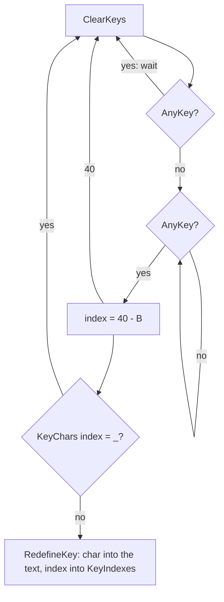

ReadNewKey does not refuse a key already in use. Two controls, or both players, can share a key.

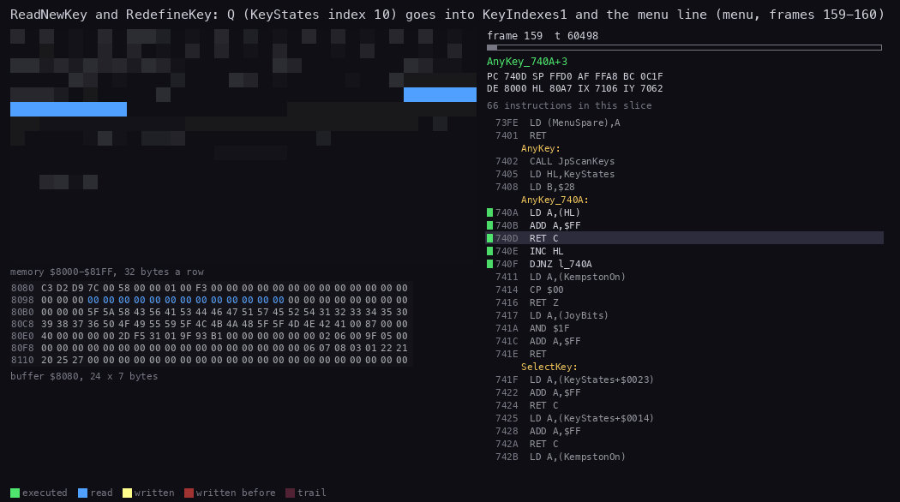

*Animation 5.4: `menu` frames 159-160: Q pressed for player 1's LEFT. T 159:60 000 to 160:10 000 (19 888 T), 40
pictures. Command: `python3 ../../kit/routine_anim.py --work work/docs/atB/menu --window 159:60000-160:10000
--listing build/game.lst --auto-labels owner --view buffer:8080:24x7:hex --range 8000-81FF --pc
7400-75FF,858A-85FF,83E8-83F8 --pictures 40 --title "..." --out docs/img/routines/RedefineKey.gif`.*

What to watch:

- AnyKey's ScanKeys setting KeyStates byte 10 (`$8095`);
- KeyChars read at `$80BD` (`Q`);
- KeyIndexes1 `$8109` written `$0A`; the text byte before `|` in the menu line written `Q`.

Worked example: Q is half row `$FBFE` (row 2), bit 0: index 2 x 5 + 0 = 10. KeyChars[10] = `Q`, not `_`.
KeySlot: PlayerCount = 2, `((2 - 1) AND 1) XOR 1` = 0, item 0: `$8109`. After the five presses of `menu` (Q A O
P M) KeyIndexes1 = `0A 05 1A 19 25`.

Witness: `menu` frames 160-305 (the five keys) and 373-518 (player 2's H J K M B), stills
[table M](img/play/menu-000305-table-M.png), [player 2 done](img/play/menu-000518-p2-table-done.png).

The point: any of 36 keys, chosen by pressing it; the four shift and edit keys are kept out, duplicates are not.

## 5.9 Throttle, brake and the turn round

Left and right are not steering. The ATV rides a side view: left and right are the throttle in the direction it
faces and the brake against it. Controls `$E105` runs ControlLeft `$E120`, ControlRight `$E1F0`, ControlUp
`$E2BC` and MountCheck each pass, unless the rider is falling or thrown.

```text
ControlRight():                       # ControlLeft is the mirror image
    if Mounted and AtvFrame == $5C and TurnRight:      # the turn in progress
        if Facing != 0: Facing = RiderFacing = 0; return    # 2nd pass
        AtvFrame = $38; return                               # 3rd pass
    if not right held: (on foot: the standing frame); return
    if not Mounted: walk (5.11); return
    if Speed != 0 and not OnGround(): return             # no grip in the air
    if Facing == 0 (right): Accelerate()                 # Speed + 1, at most 21
    elif Speed >= 1: SlowDown()                          # Speed - 2, at least 0
    else: TurnRight = 1; AtvFrame = $5C                  # 1st pass of the turn
```

```asm
l_E26D:                         ; ControlRight, mounted, right held
  E26D  LD A,(Speed)
  E270  CP $00
  E272  JR Z,l_E278
  E274  CALL OnGround           ; AtvHeight - GroundY < 4
  E277  RET NC
l_E278:
  E278  LD A,(Facing)
  E27B  CP $01
  E27D  JR Z,l_E282
  E27F  JP Accelerate
l_E282:
  E282  LD A,(Speed)
  E285  SUB $01
  E287  JR C,l_E28C
  E289  JP SlowDown
l_E28C:
  E28C  LD A,$01
  E28E  LD (TurnRight),A
  E291  LD A,$5C                ; the ATV seen head-on
  E293  LD (AtvFrame),A
  E296  RET
Accelerate:
  E54C  LD A,(Speed)
  E54F  ADD A,$01
  E551  CP $15
  E553  JR C,l_E557
  E555  LD A,$15
l_E557:
  E557  LD (Speed),A
  E55A  JP SpeedBar
SlowDown:
  E53E  LD A,(Speed)
  E541  SUB $02
  E543  JR NC,l_E546
  E545  XOR A
l_E546:
  E546  LD (Speed),A
  E549  JP SpeedBar
```

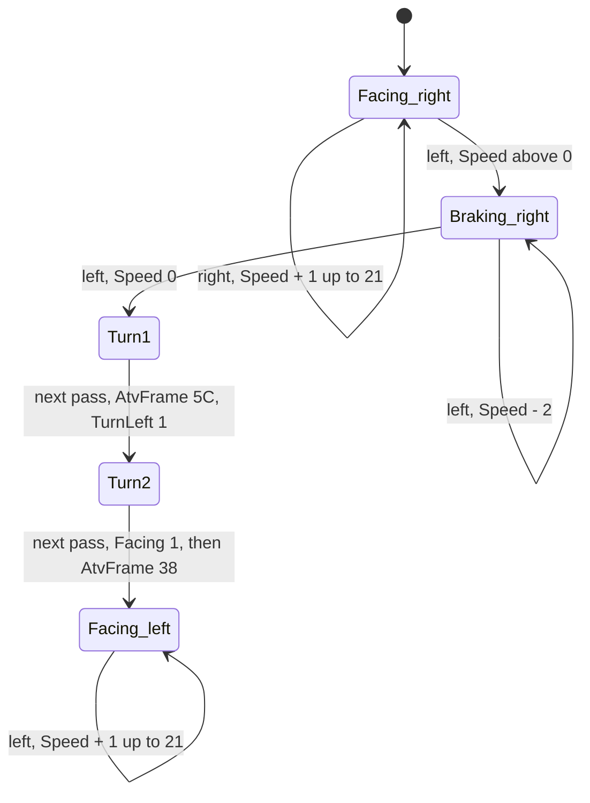

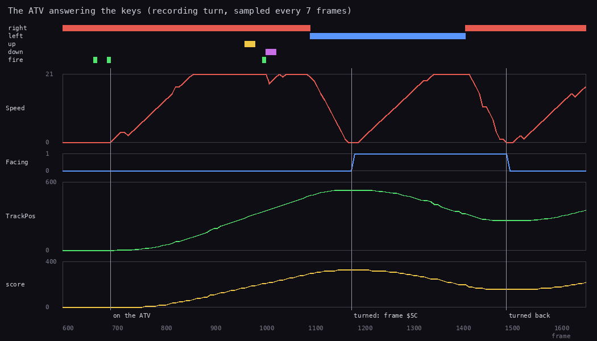

*Figure 5.3: `turn` frames 580-1 650: the keys held, Speed, Facing, TrackPos and the score, sampled at T 0 every 7
frames (log.json). Command: `python3 tools/fig_controls.py docs/img/controls`.*

How to read it:

- the top strip is the input script: right, left, up, down, fire;
- Speed climbs 1 a pass to 21 (`$15`), drops 2 a pass while braking;
- Facing flips three passes after Speed reaches 0;
- TrackPos rises while the ATV rides right and falls while it rides left; the score follows TrackPos.

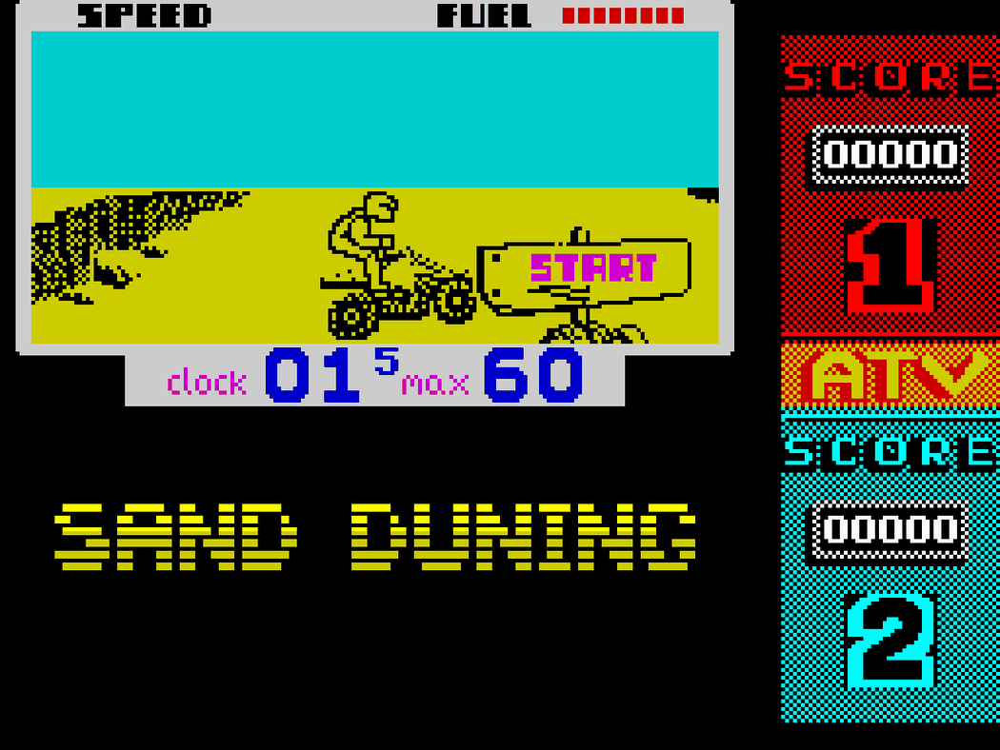

*Animation 5.5: `turn` frames 684-1 076, every 7th frame: on the ATV, the throttle to full speed, wheel up, a jump
with wheel down. Command: `python3 ../../kit/screen_anim.py --work work/stage1/rec/turn --from 684 --to 1076
--step 7 --width 1050 --delay 100 docs/img/play/atv-throttle.gif`.*

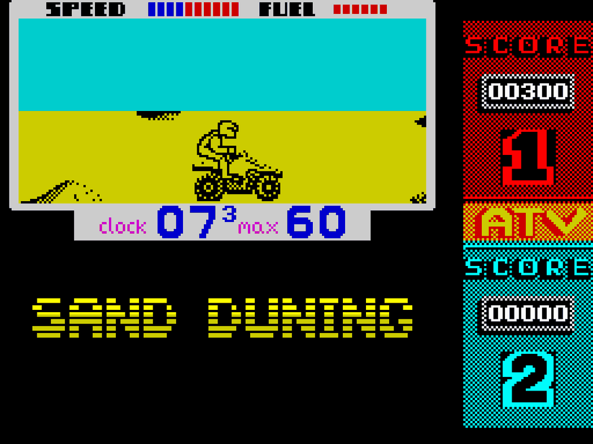

*Animation 5.6: `turn` frames 1 093-1 534, every 7th frame: left held from 1 097 (the brake, the head-on frame
`$5C` at 1 174, the ride to the left with the scenery scrolling back and the score falling), right held from 1 412
(the brake, the turn back at 1 489, the throttle). Command: `python3 ../../kit/screen_anim.py --work
work/stage1/rec/turn --from 1093 --to 1534 --step 7 --width 1050 --delay 100 docs/img/play/atv-keys.gif`.*

What to watch:

- the SPEED bar under the top border growing and shrinking a block a pass;
- the ATV head-on for one pass, then the other way round;
- the score going down while the ATV rides left.

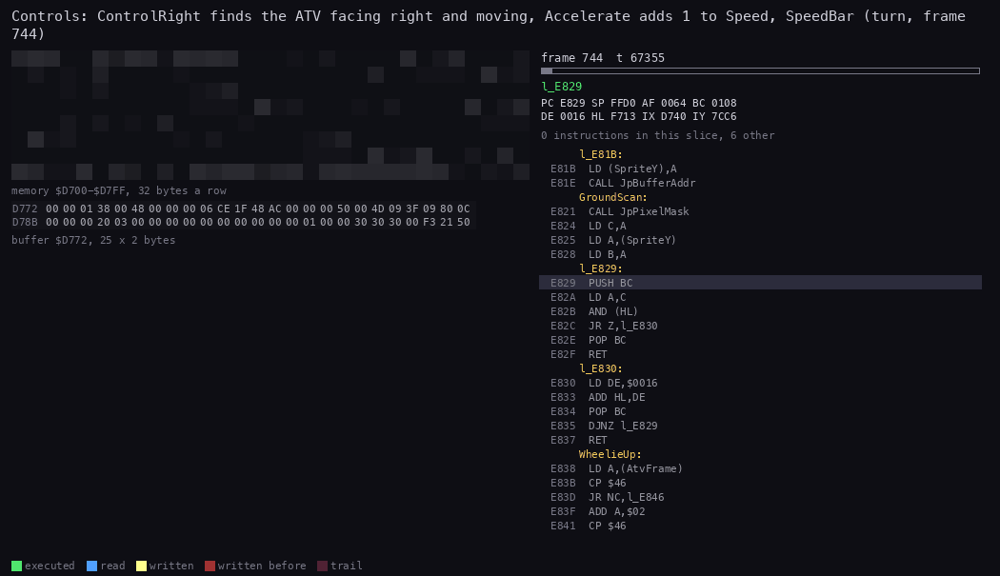

*Animation 5.7: Controls at frame 744 of `turn`: ControlLeft (not held), ControlRight (held, facing right, moving,
on the ground) calls Accelerate and SpeedBar. T 744:67 300 to 744:69 500 (2 200 T), 40 pictures; the view is the
current record `$D772`. Command: `python3 ../../kit/routine_anim.py --work work/stage1/rec/turn --window
744:67300-744:69500 --listing build/game.lst --view buffer:D772:25x2:hex --range D700-D7FF --pc E105-E5B9
--pictures 40 --title "..." --out docs/img/routines/ControlRight.gif`.*

Worked example (`turn`, log.json):

| Frame | Keys | Speed | Facing | AtvFrame | TrackPos | What |
| --- | --- | --- | --- | --- | --- | --- |
| 740 | right | 5 | 0 | `$38` | 9 | Accelerate at 737 |
| 747 | right | 6 | 0 | `$38` | 12 | Accelerate at 744: 5 + 1 |
| 859 | right | 21 | 0 | `$38` | 128 | the cap `$15` |
| 1 111 | left | 15 | 0 | `$38` | 506 | SlowDown: 2 a pass |
| 1 153 | left | 3 | 0 | `$38` | 530 | |
| 1 174 | left | 0 | 0 | `$5C` | 530 | turn, 1st pass |
| 1 195 | left | 1 | 1 | `$38` | 530 | Facing 1, now Accelerate |
| 1 405 | left | 21 | 1 | `$38` | 321 | full speed to the left |
| 1 489 | right | 0 | 1 | `$5C` | 261 | the turn back |

Witness: `turn` (the figure and the animations); Accelerate's L1 entries: `c1` 43, `turn` 102.

The point: two keys do the work of four. The same key is the throttle or the brake depending on where the ATV
points, and holding the brake to a stop turns the ATV round. The ATV can ride the trail backwards.

## 5.10 Wheel up, wheel down, the jump and getting on

**Wheel up** (bit 2): ControlUp `$E2BC` sets WheelieTimer `$D795` = 10 and lifts the front a frame (WheelieUp
`$E838`). At the last frame of the lift (AtvFrame `$44`) holding up throws the rider off.

**Wheel down** (bit 1) is read only in AtvPhysics, at `$E756`: when the front is 3 or more above the ground and the
wheelie timer runs, WheelieDown `$E852` lowers the front.

**Jump** (bit 0): JumpControl `$E34B`. A press gives one jump (JumpLatch `$D780`): VSpeed = `$FD` less the climb
of the last pass (at most 5), the front up, WheelieTimer = 3 and a SlowDown. On foot the same bit is the rider's
jump (RiderJumpStart `$E3DD`).

**Getting on**: MountCheck `$E46E` puts the rider on the ATV when, at once:

- RiderX (less 8 when he faces left) lies from AtvX - 12 to AtvX + 17;
- RiderHeight lies from AtvHeight + 4 to AtvHeight + 24;
- he faces the way the ATV faces;
- he is falling (RiderJump 5 or more: the jump's second half);
- the ATV stands upright (AtvFrame `$38`-`$4D`).

```text
JumpControl():
    if falling or thrown: GetUp(); return
    if not jump held: JumpLatch = 0; continue a jump in progress; return
    if RiderJump: continue it; return
    if VSpeed != 0 or JumpLatch or AtvFrame == $5C: return
    JumpLatch = 1
    if not Mounted: RiderJumpStart(); return
    VSpeed = $FD - min(AtvHeight - PrevHeight, 5)     # a climb makes a higher jump
    WheelieUp(); WheelieTimer = 3; SlowDown()
```

```asm
l_E36E:                          ; JumpControl, fire held
  E36E  LD A,(RiderJump)
  E371  CP $00
  E373  JR NZ,RiderJumpStep
  E375  LD A,(VSpeed)
  E378  CP $00
  E37A  RET NZ
  E37B  LD A,(JumpLatch)
  E37E  CP $01
  E380  RET Z                    ; one jump a press
  E381  LD A,$01
  E383  LD (JumpLatch),A
  E386  LD A,(AtvFrame)
  E389  CP $5C
  E38B  RET Z
  E38C  LD A,(Mounted)
  E38F  CP $00
  E391  JR Z,RiderJumpStart
  E393  LD A,$FD
  E395  LD (VSpeed),A
  E398  LD A,(PrevHeight)
  E39B  LD E,A
  E39C  LD A,(AtvHeight)
  E39F  SUB E
  E3A0  JR C,l_E3B0
  E3A2  CP $05
  E3A4  JR C,l_E3A8
  E3A6  LD A,$05
l_E3A8:
  E3A8  LD E,A
  E3A9  LD A,(VSpeed)
  E3AC  SUB E
  E3AD  LD (VSpeed),A
l_E3B0:
  E3B0  CALL WheelieUp
  E3B3  LD A,$03
  E3B5  LD (WheelieTimer),A
  E3B8  JP SlowDown
```

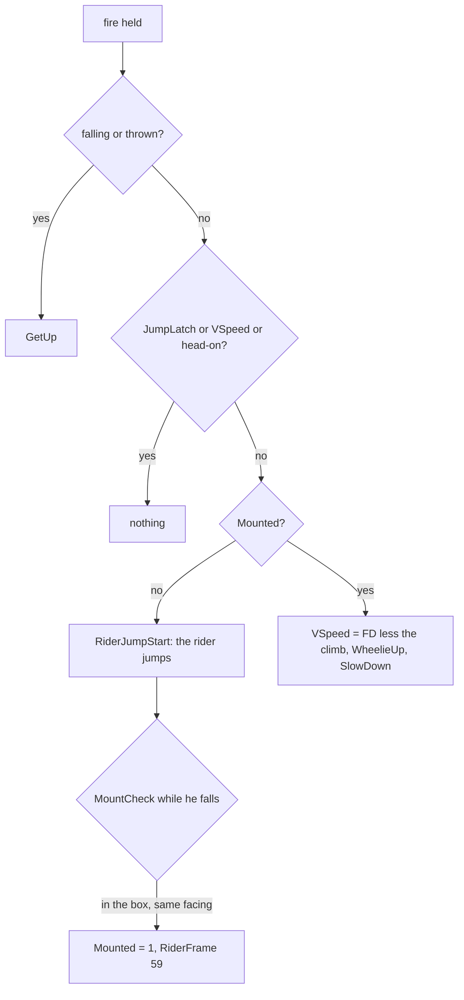

Worked example (`turn`): the rider walks right from x 24 to 48 (frames 593-649, 3 a pass); fire at 656; RiderJump
2, 4, 5 at 656, 670, 677; at 684 Mounted = 1 with RiderX 76 and AtvX 72: 76 lies in 60-89, RiderJump was 5.
Wheel up at 950-971: AtvFrame `$3A`, `$40`. The jump at 990 cuts Speed 21 to 19. Wheel down held in the air
(1 001-1 015) brings AtvFrame back from `$40` to `$3C`.

Witness: `turn` frames 656-1 076 (log.json, Animation 5.5); ThrowOff at AtvFrame `$44`: `work/stage1/rec/throwoff`
(AtvFrame `$44` at frame 612, Mounted 0 at 619; [doc 10, 10.8](10-gameplay-logic.md#108-the-rider-thrown)).

The point: the jump is a press, not a hold, and the rider gets on only by jumping onto the seat, facing the same
way.

## 5.11 On foot: the walk and the walk back

Off the ATV, left and right walk the rider 3 pixels a pass (RiderX at most `$9F`, at least 0) with the walking
frames 1-7. Turning on foot costs one pass: the first press only flips RiderFacing. RiderOnFoot `$DF37` then
compares the ground under the new place with his height: a step of 3 or more up puts RiderX back (RiderSavedX). A
dune in the way stops the walk back to the ATV for good.

```text
ControlLeft (on foot, left held):
    if RiderJump: if TurnLeft: RiderX -= 3; return        # in the air: keep drifting
    if RiderFacing == 0: RiderFacing = 1; return          # turn on the spot
    RiderFrame = RiderFrame + 1, 1..7
    if RiderX >= 3: RiderX -= 3
RiderOnFoot():
    step = GroundBelowRider - RiderHeight
    if step up >= 3: RiderX = RiderSavedX                 # blocked
    if step down >= 3: start a fall (RiderJump = 5)
```

```asm
l_E183:                         ; ControlLeft, on foot, facing left already
  E183  LD A,$01
  E185  LD (RiderFacing),A
  E188  LD A,(RiderFrame)
  E18B  ADD A,$01
  E18D  CP $08
  E18F  JR C,l_E193
  E191  LD A,$01
l_E193:
  E193  LD (RiderFrame),A
l_E196:
  E196  LD A,(RiderX)
  E199  SUB $03
  E19B  RET C
  E19C  LD (RiderX),A
  E19F  RET
```

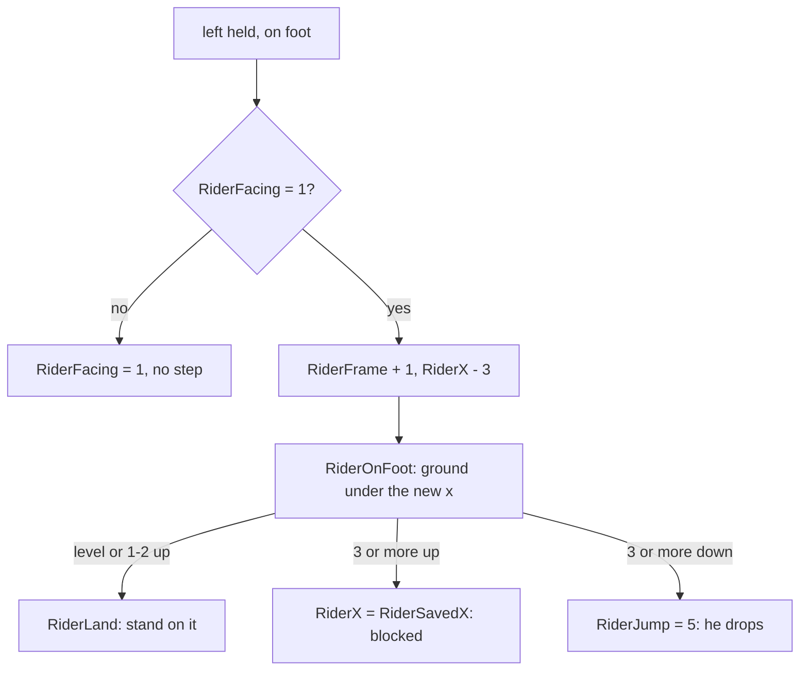

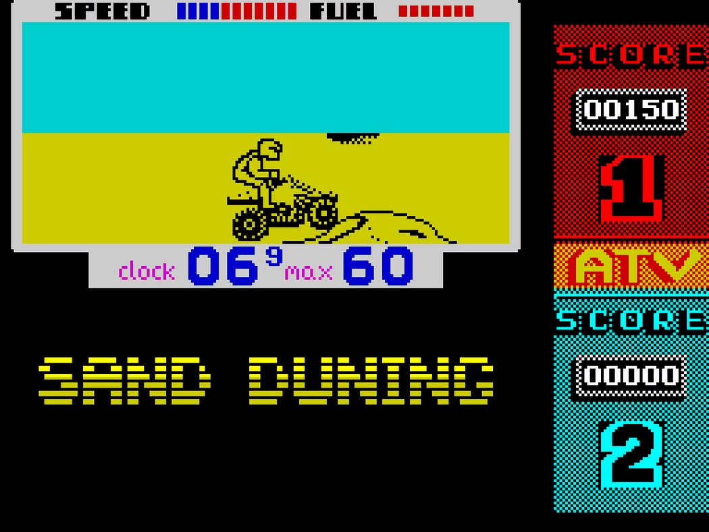

*Animation 5.8: `trail1` frames 880-1 200, every 6th frame: the crash at speed 20, the tumble, the rider thrown to
x `$88`, left held from 1 057: he turns and walks on the spot behind a dune. Command: `python3
../../kit/screen_anim.py --work work/docs/atB/trail1 --from 880 --to 1200 --step 6 --width 1050 --delay 100
docs/img/play/walk-back.gif`.*

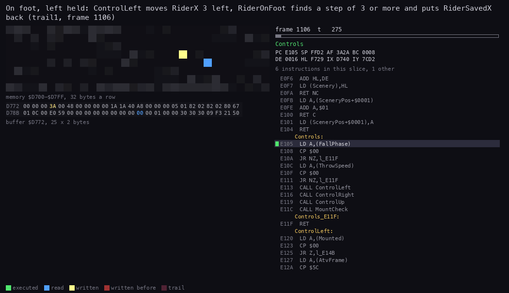

*Animation 5.9: `trail1` frame 1 106, left held: ControlLeft takes 3 off RiderX, RiderOnFoot puts it back. T
1 106:200 to 1 106:3 200 (3 000 T), 40 pictures; the view is the record `$D772`. Command: `python3
../../kit/routine_anim.py --work work/docs/atB/trail1 --window 1106:200-1106:3200 --listing build/game.lst
--auto-labels owner --view buffer:D772:25x2:hex --range D700-D7FF --pc E105-E5B9,DE38-DFFF,E7F0-E8FF --pictures 40
--title "..." --out docs/img/routines/RiderOnFoot.gif`.*

Worked example (`trail1`): from 1 088 to the end of the recording the record holds RiderX `$82` (130), RiderFacing
1, RiderFrame cycling 1-7. Each pass ControlLeft writes 127 and RiderOnFoot writes 130 back: the ground under x
127 is 3 or more above his feet.

Witness: `trail1` frames 1 057-9 970 (the rider never reaches the ATV at x `$48`); the free walk is `turn` frames
593-649 (right, on level sand, 24 to 48).

The point: on foot the rider cannot climb a step of 3 pixels and has no way round but a jump (fire). The
recording's plan never jumped on foot, so it stayed stuck until TIME OUT.

## 5.12 Two players: both controls on one pass

Pass reads both players' bytes at its start. PassP1 copies Controls1 into PassControls and runs player 1's whole
update on the top half; PassP2 copies Controls2 and runs player 2's on the bottom half. The two updates run one
after the other in the same pass, not in turns.

```text
Players():                              # $EC7F, called by Pass
    PlayerIndex = 0
    if Riding bit 0: PassP1()           # PassControls = Controls1, Update, ClearKeys, Advance, copy, save
    PlayerIndex = 1
    if Riding bit 1: PassP2()           # PassControls = Controls2, Update, Advance, copy, save
```

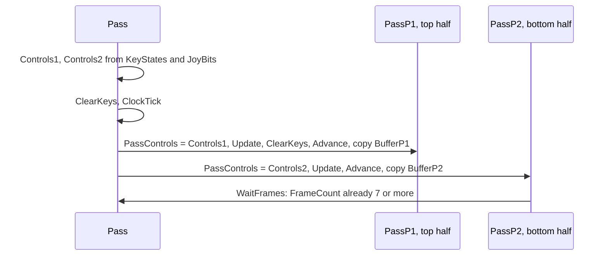

Two updates rarely fit in 7 frames. In `kb` frames 684-758 the passes start at 684, 692, 702, 715, 725, 736, 747,
758: 8 to 13 frames each, about 10.5 on average. WaitFrames finds FrameCount already past 7 and goes on at once.
The clock counts passes ([8.5](08-hud-and-text.md#85-the-clock)), so a two-player trail lasts longer in seconds,
with the same number of passes.

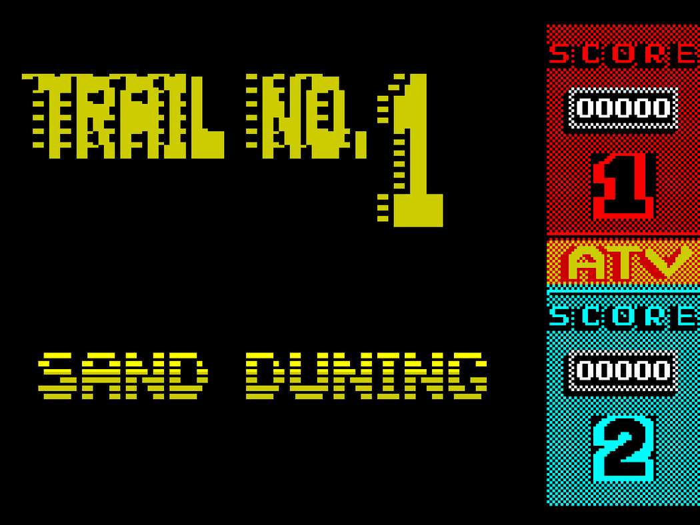

*Animation 5.10: `kb` frames 300-720, every 6th frame: two players on the keyboard (A and J right, M and B jump, O
and K wheel up), each on his half of the screen. Command: `python3 ../../kit/screen_anim.py --work work/docs/atB/kb
--from 300 --to 720 --step 6 --width 1050 --delay 100 docs/img/play/two-players.gif`.*

Worked example (`kb` pass 702-715, figure 5.2): Pass reads at 702:68 897, its ClearKeys runs at 703:1 124,
player 1's Controls at 704:64 325, PassP1's ClearKeys at 708:30 009, player 2's Controls at 711:23 139, the next
Pass at 715:17 191. Player 2's byte was read at 702:68 897, 8.5 frames before it acts. Both players' keys pressed
only between 703 and 708 are lost.

Witness: `kb` (traces in `work/docs/atB/kb/traces`).

The point: both players share one latch and one clock. Player 2 acts on keys a pass older than his update, and a
two-player game runs about two thirds as fast.

## 5.13 The key no path reads

AbortKey `$DA01` sits after the interrupt's two branches. It tests KeyStates + 15, key 1, and restarts the game
(FrameCount = `$FF`, a fresh stack, NewGame `$D80D`). Both branches of the interrupt end with `JR InterruptEnd`
before it, and no jump reaches `$DA01`.

```asm
AbortKey:
  DA01  LD A,(KeyStates+$000F)  ; key 1
  DA04  CP $00
  DA06  JR Z,InterruptEnd
  DA08  LD A,$FF
  DA0A  LD (FrameCount),A
  DA0D  LD SP,StackRestart
  DA10  EI
  DA11  JP NewGame
```

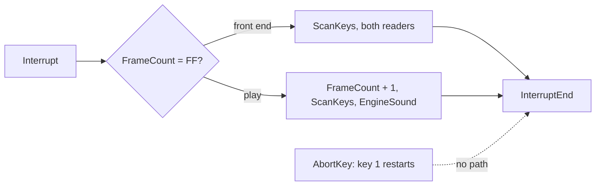

Witness: none. Known only from the code: AbortKey is in no recording's L1.

The point: the game once had a quit key, 1. The release cut the jump to it; the only way out of a trail is the
clock.

## 5.14 Summary

| Mechanism | Address | Witness |
| --- | --- | --- |
| ScanKeys: 8 half rows and port 31, set-only | `$859C` | every recording |
| the latch: ClearKeys in Pass and PassP1 | `$858A`, `$D862`, `$DA80` | `turn`, `kb` traces |
| P1UsesJoystick: Kempston, else keyboard (one player), else Keyboard1Alt | `$83F9` | `turn` |
| DetectKempston: off on a read of `$1F` | `$77EA` | `c1` |
| MenuLoop, SelectKey SPACE / 0 / fire | `$737C`, `$741F` | `menu` |
| one-player SINCLAIR without effect | `$75AD` | `turn` |
| ReadNewKey refuses CAPS, ENTER, SYMBOL, SPACE, not duplicates | `$7542` | `menu` |
| throttle / brake / turn round in three passes | `$E120`, `$E1F0` | `turn` |
| jump a press; mount by landing on the seat | `$E34B`, `$E46E` | `turn` |
| on foot: 3 px a pass, blocked by a 3-px step | `$DF37` | `trail1` |
| both players' bytes read at the pass start | `$D851` | `kb` |
| AbortKey on key 1, unreachable | `$DA01` | known only from the code |
