# 6. Rendering

What this covers:

- the screen in play: two windows drawn through buffers, the rest drawn on the screen (6.1);
- the sprite format: the bank, the 4-byte header, GameSprite `$8616` and SpriteHeader `$865F` (6.2);
- the shift kept in the sprite: ShiftLeftBy / ShiftRightBy, RotateSpriteLeft `$871E` / RotateSpriteRight `$8742`
  (6.3);
- the playfield buffer `$F03C`: its lines, ClearByPush and the draw modes (6.4);
- the trail drawn from lists A and B: WalkList `$8DA3`, PlaceItem `$8E3C`, the clip codes, the scroll (6.5);
- the order of one picture and the deferred sprites: the START sign leaving (6.6);
- the measuring call: why most rotations are wasted (6.7);
- the ATV and the rider: DrawAtv `$DC88`, DrawRider `$DD96` (6.8);
- the copy to the screen and the beam: CopyLines `$8CF2` (6.9);
- two players: the split screen (6.10);
- the code against the screen on a real pass (6.11).

The recordings it rests on ([WALKTHROUGH](../WALKTHROUGH.md) 6.0):

| Recording | Load | Used for |
| --- | --- | --- |
| `c1` | power-on, the tape, `tests/inputs/c1.txt` | one player on trail 1: the START sign leaving, the scroll, a heavy pass (frames 15356-15362), the copy against the beam |
| `turn` | `work/stage1/rec/c1/menu.szx`, `tests/inputs/turn.txt` (made for [doc 5](05-controls.md)) | the ATV facing left (DrawAtv's mirrored path) |
| `kb` | `work/stage1/rec/menu/menu-two-kb.szx`, `tests/inputs/kb.txt` | two players: both windows in one pass |

The instances ran in `work/docs/atB/` (one at a time, port base 37782). The commands are in
[`work/docs/atB-NOTES.md`](../work/docs/atB-NOTES.md).

Conventions:

- **x** counts pixels from the window's left edge (0-175). **y** counts lines up from the window's bottom: SpriteY
  `$80DD` is the line of the sprite's top, counted from the bottom (`$4F` = the window's top line).
- A **pass** is one turn of the main loop, 7 frames with one player ([doc 4](04-game-loop.md)).
- Times are frame:T in the recording's trace, T counted from the frame's interrupt (69 888 T a frame).
- The **heavy pass** is `c1` Pass 15356:7 833 to WaitFrames 15361:55 067 (81.1 % of 7 frames), a pass where the
  START sign is rotated. The recording's heaviest pass, at 15 412 (91.3 %), does the same work with more right
  rotation ([doc 4, 4.7](04-game-loop.md#47-the-heaviest-pass)).

## 6.1 The screen in play

A pass draws a player's view into a buffer of 22 x 80 bytes, then copies the buffer into a window on the screen.
The window is 176 x 80 pixels at column 1. Everything else is drawn on the screen itself, and only when it
changes.

| Area | Lines | Drawn by | How |
| --- | --- | --- | --- |
| player 1's window | 8-87 (`$4021`) | BufferP1 `$F03C-$F71B`, CopyBufferP1 `$8CDA` | rebuilt and copied every pass |
| player 2's window | 104-183 (`$48A1`) | BufferP2 `$F71C-$FDFB`, CopyBufferP2 `$8CE6` | two players only |
| player 1's HUD | 0-7 | SpeedBar `$E59A`, FuelBarStep `$DFCD` | on the screen, a step at a time ([doc 8](08-hud-and-text.md)) |
| player 2's HUD | 184-191 | the same at HudY 6 | two players only |
| the clock band | 88-103 | ClockTick: BigDigit, ClockDigit | ModeCopyScreen, once a pass |
| the side panel | 0-191, columns 25-31 | ShowScore | ModeXorScreen, the digits that change |
| the attributes | the windows | FlushAttrs `$8995` | only for items that carry attributes (the START sign) |

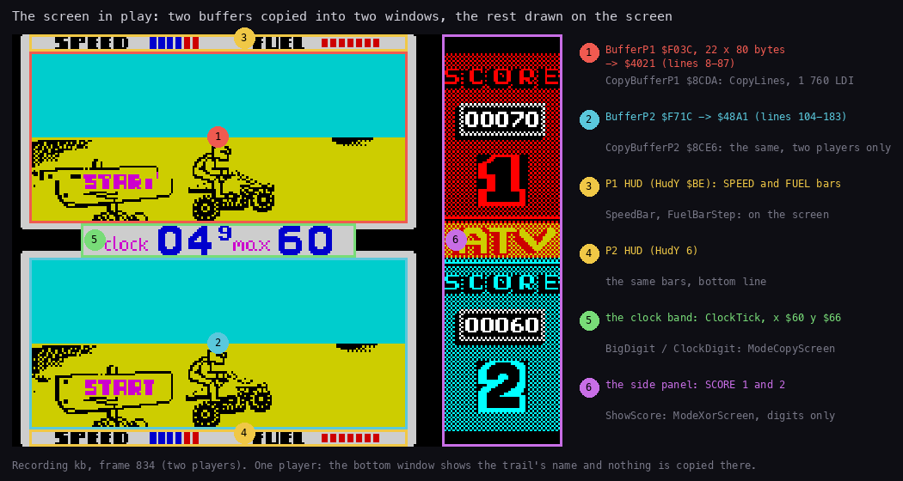

*Figure 6.1: recording `kb`, frame 834 (two players), the areas the renderer writes. Drawn from the code
(CopyBufferP1/P2, HudY, ClockPlace, ShowScore) on a screenshot. Command: `python3 tools/fig_render.py
docs/img/render`.*

How to read it:

- 1 and 2 are the two windows: the only areas rebuilt each pass;
- 3 and 4 are the HUD strips, 5 the clock band, 6 the side panel: written on the screen, never through a buffer;
- with one player area 2 holds the trail's name, written once ([doc 8](08-hud-and-text.md)).

Witness: [writers-screen](img/render/writers-screen.png) (6.11) shows the writers of each screen byte in a `c1` pass;
[writers-split](img/render/writers-split.png) (6.10) in a `kb` pass.

The point: the screen is not a frame buffer the game redraws. Only two windows are; the HUD and the panel are
patched in place. That is why the panel never flickers and a window can tear at most once a pass (6.9).

## 6.2 The sprite format

All the game's graphics sit in one bank, GameGfx `$8F5C` (203 sprites, src/res/sprites/game.png and game.csv).
The bank starts with a count and a table of word offsets. A sprite is a 4-byte header and its bytes:

| Offset | Field | Copied to |
| --- | --- | --- |
| +0 | width in bytes | SpriteWidth `$80F2` |
| +1 | height in lines | SpriteHeight `$80F3` |
| +2 | advance: the pixels to the next character in Print, the item's width in the trail lists | SpriteAdvance `$80F6` |
| +3 | the shift the bytes lie at now, 0-7 | ShiftPtr `$80F4` points at it |
| +4 | width x height bytes, a line at a time, bit 7 left | SpriteData `$80E8` |

GameSprite finds the header; SpriteHeader reads it, shifts the bytes in place to SpriteX's bit offset (6.3), then
jumps to the draw mode picked by ModeVector `$82F8`.

```text
GameSprite():
    if SpriteNum >= GameGfx[0]: return            # past the count
    header = GameGfx + word(GameGfx + 4 + 2 * SpriteNum)
    SpriteHeader(header)

SpriteHeader(h):
    SpriteWidth, SpriteHeight, SpriteAdvance = h[0], h[1], h[2]
    ShiftPtr = h + 3; SpriteData = h + 4
    if SpriteWidth != 1:                          # one-byte sprites (the font) are never shifted
        diff = h[3] - (SpriteX AND 7)
        if diff > 0: if diff < 5: ShiftLeftBy(diff) else ShiftRightBy(8 - diff)
        if diff < 0: if -diff < 5: ShiftRightBy(-diff) else ShiftLeftBy(8 + diff)
    JP (ModeVector)                               # the draw mode
```

```asm
GameSprite:
  8616  LD HL,GameGfx
  8619  LD A,(SpriteNum)
  861C  CP (HL)
  861D  RET NC
  861E  LD HL,GameGfx
  8621  LD E,A
  8622  LD D,$00
  8624  SLA E
  8626  RL D
  8628  ADD HL,DE
  8629  LD DE,$0004
  862C  ADD HL,DE
  862D  LD E,(HL)
  862E  INC HL
  862F  LD D,(HL)
  8630  LD HL,GameGfx
  8633  ADD HL,DE
  8634  JP SpriteHeader
SpriteHeader:
  865F  LD A,(HL)
  8660  LD (SpriteWidth),A
  8663  INC HL
  8664  LD A,(HL)
  8665  LD (SpriteHeight),A
  8668  INC HL
  8669  LD A,(HL)
  866A  LD (SpriteAdvance),A
  866D  INC HL
  866E  LD (ShiftPtr),HL
  8671  INC HL
  8672  LD (SpriteData),HL
  8675  JP l_8678
l_8678:
  8678  LD A,(SpriteWidth)
  867B  CP $01
  867D  JP Z,l_86BC
  8680  LD A,(SpriteX)
  8683  AND $07
  8685  LD E,A
  8686  LD HL,(ShiftPtr)
  8689  LD A,(HL)
  868A  SUB E
  868B  JP Z,l_86BC
  868E  JP C,l_86A6
  8691  CP $05
  8693  JP P,l_869C
  8696  CALL ShiftLeftBy
  8699  JP l_86BC
l_869C:
  869C  LD D,A
  869D  LD A,$08
  869F  SUB D
  86A0  CALL ShiftRightBy
  86A3  JP l_86BC
l_86A6:
  86A6  XOR $FF
  86A8  ADD A,$01
  86AA  CP $05
  86AC  JP NC,l_86B5
  86AF  CALL ShiftRightBy
  86B2  JP l_86BC
l_86B5:
  86B5  LD D,A
  86B6  LD A,$08
  86B8  SUB D
  86B9  CALL ShiftLeftBy
l_86BC:
  86BC  LD HL,(ModeVector)
  86BF  LD E,(HL)
  86C0  INC HL
  86C1  LD D,(HL)
  86C2  EX DE,HL
  86C3  JP (HL)
```

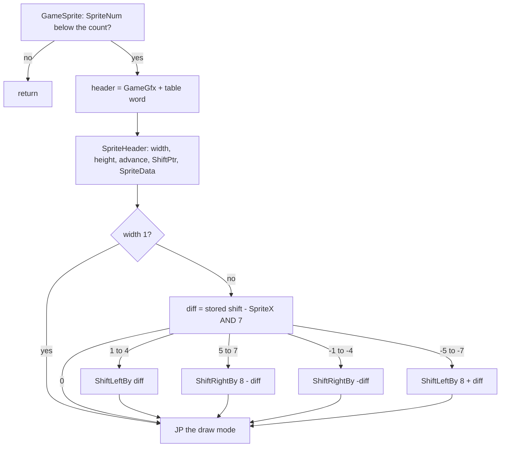

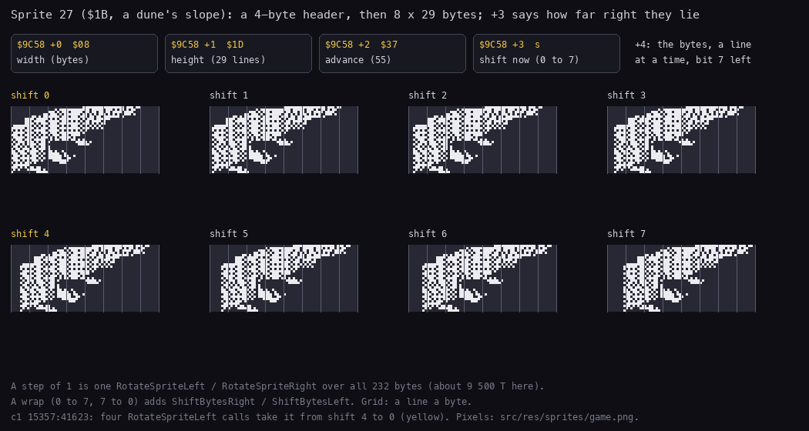

*Figure 6.2: sprite 27 (`$1B`, a dune's slope), its header at `$9C58` and its bytes at each of the eight shifts.
The pixels are those of src/res/sprites/game.png, shifted the way ShiftLeftBy and ShiftRightBy move them; no
recording. Command: `python3 tools/fig_render.py docs/img/render`.*

How to read it:

- the header's four boxes are the bytes at `$9C58-$9C5B`; +3 is the one a draw changes;
- each picture is the same 232 bytes at another shift; the grid marks the byte columns;
- the right byte column is the room the shift moves into.

Worked example: `c1` 15357:41 623. PlaceItem's measuring call (6.7) asks for sprite 27 with SpriteX AND 7 = 0. The
byte at `$9C5B` is 4. diff = 4 - 0 = 4, below 5: ShiftLeftBy(4), four RotateSpriteLeft calls, no wrap. The +3
byte goes 4, 3, 2, 1, 0.

Witness: Animation 6.1; the four calls from 15357:41 623 in the `c1` trace.

The point: the header holds the sprite's state, not only its shape. A sprite in this game is drawn from where the
last draw left it.

## 6.3 The shift kept in the sprite

The game has no pre-shifted copies. It moves a sprite's own bytes one bit at a time until the shift in its header
matches the pixel offset it is drawn at. Going one way or the other, it never takes more than 4 steps.

```text
ShiftLeftBy(n):                     # the bytes one bit left, n times
    repeat n:
        shift = (shift - 1) AND 7
        if shift == 7: ShiftBytesRight()      # wrapped: a byte right first (LDDR a line, a zero in)
        RotateSpriteLeft()                    # RL (HL) from each line's last byte to its first

ShiftRightBy(n):
    repeat n:
        shift = (shift + 1) AND 7
        RotateSpriteRight()                   # RR (HL) from each line's first byte to its last
        if shift == 0: ShiftBytesLeft()       # wrapped: a byte left after
```

```asm
ShiftLeftBy:
  8759  LD (ShiftCount),A
l_875C:
  875C  LD HL,(ShiftPtr)
  875F  LD A,(HL)
  8760  DEC A
  8761  AND $07
  8763  LD (HL),A
  8764  CP $07
  8766  JP NZ,l_876C
  8769  CALL ShiftBytesRight
l_876C:
  876C  CALL RotateSpriteLeft
  876F  LD HL,ShiftCount
  8772  DEC (HL)
  8773  JP NZ,l_875C
  8776  RET
RotateSpriteLeft:
  871E  LD A,(SpriteHeight)
  8721  LD E,A
  8722  LD A,(SpriteWidth)
  8725  CALL Multiply
  8728  LD DE,(SpriteData)
  872C  ADD HL,DE
  872D  DEC HL
  872E  LD A,(SpriteHeight)
  8731  LD C,A
l_8732:
  8732  LD A,(SpriteWidth)
  8735  LD B,A
  8736  XOR A
  8737  RRA
l_8738:
  8738  RL (HL)
  873A  DEC HL
  873B  DJNZ l_8738
  873D  DEC C
  873E  JP NZ,l_8732
  8741  RET
```

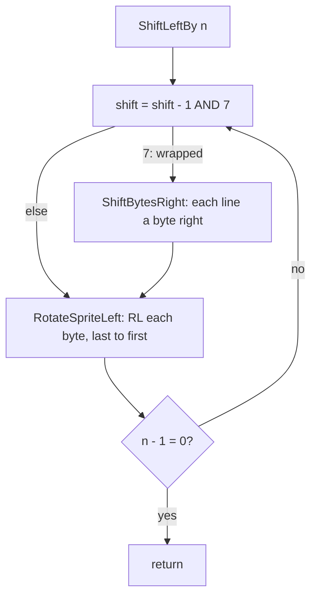

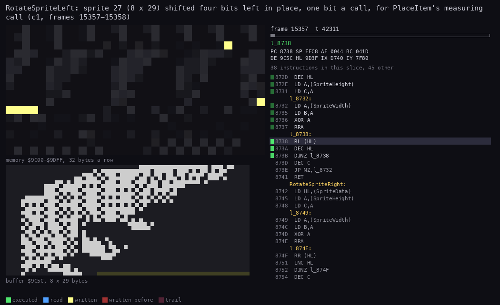

*Animation 6.1: `c1` frames 15357-15358: ShiftLeftBy(4) on sprite 27 for PlaceItem's measuring call. T 15357:41 500
to 15358:10 500 (38 888 T), 48 pictures; the view is the sprite's 8 x 29 bytes at `$9C5C`. Command: `python3
../../kit/routine_anim.py --work work/docs/atB/c1 --window 15357:41500-15358:10500 --listing build/game.lst --view
buffer:9C5C:8x29 --range 9C00-9DFF --pc 865F-8798 --pictures 48 --title "..." --out
docs/img/routines/RotateSpriteLeft.gif`.*

What to watch:

- the dune's bytes sliding left a bit each sweep, the sweep running from the last byte up to the first;
- the header byte `$9C5B` counting down before each sweep;
- four sweeps, then the jump to the draw mode, here ModeNone: nothing is drawn.

Worked example: one RotateSpriteLeft over sprite 27 is 232 steps of RL (HL), DEC HL and DJNZ, 34 T each (7 888 T),
plus 29 line starts and the Multiply: about 9 500 T. ShiftLeftBy(4) costs about 38 000 T, more than half a frame,
for one sprite.

Witness: `c1` L1: RotateSpriteLeft 3 716 calls, RotateSpriteRight 3 568, ShiftBytesRight 208, ShiftBytesLeft 152;
the two rotations take 23.4 million T in all, about 39 000 T a pass.

The point: the game trades time for memory. Eight shifted copies of the bank would not fit; one copy shifted in
place does, at a few thousand T for each bit a sprite moves between draws.

## 6.4 The buffer and the draw modes

The buffer has 80 lines of 22 bytes. BufferAddr `$87C4` turns SpriteX and SpriteY into an address through
BufferRows `$68A7`, 80 offsets 22 apart. ClearBufferP1 `$8D28` zeroes BufferP1 by pushing: SP at the buffer's end,
880 pushes of `$0000`.

```text
BufferAddr():                      # the sprite's top line in the buffer
    line = $4F - SpriteY             # the clamp to 0 for y above $4F is dead: E is overwritten at $87D0
    return BufferBase + BufferRows[line] + SpriteX / 8      # BufferRows[k] = 22 * (k + 1)

ClearBufferP1():
    SavedSp = SP; SP = BufferP1 + $06E0
    repeat 80: PUSH 0 eleven times    # 22 bytes a line
    SP = SavedSp
```

```asm
ClearBufferP1:
  8D28  LD (SavedSp),SP
  8D2C  LD SP,BufferP1+$06E0
  8D2F  JP ClearByPush
ClearByPush:
  8D3C  LD HL,$0000
  8D3F  LD B,$50
l_8D41:
  8D41  PUSH HL
  8D42  PUSH HL
  8D43  PUSH HL
  8D44  PUSH HL
  8D45  PUSH HL
  8D46  PUSH HL
  8D47  PUSH HL
  8D48  PUSH HL
  8D49  PUSH HL
  8D4A  PUSH HL
  8D4B  PUSH HL
  8D4C  DJNZ l_8D41
  8D4E  LD SP,(SavedSp)
  8D52  RET
```

The draw modes are two tables of routine addresses. ModeVector points at the word in use:

| Table | +0 | +2 | +4 | +6 | +8 | +10 |
| --- | --- | --- | --- | --- | --- | --- |
| DrawModes `$69F7` | ModeNone (RET: measure only) | ModeCopyScreen | ModeOrScreen | ModeXorScreen | ModeCopyBuffer | ModeXorBuffer |
| ListModes `$836D` | OrBuffer | OrBufferClip | MaskBuffer | MaskMirror | MaskBufferAlt | MaskBufferClip |

The buffer modes, byte by byte (B the buffer, S the sprite, M the mask):

| Mode | Result | Used for |
| --- | --- | --- |
| OrBuffer `$8D53` | B OR S | ground and scenery pieces |
| MaskBuffer `$8862` | (B OR M) XOR S | the ATV and the rider: the mask inks a solid shape, the sprite's set bits cut the paper back in |
| MaskMirror `$8891` | the same, bytes and bits reversed | the ATV and the rider facing left |
| MaskBufferAlt `$87F1` | (B AND NOT M) XOR S | masked items of the lists (the START sign): the mask clears, the sprite inks |
| ModeXorBuffer `$7837` | B XOR S | the wheels |

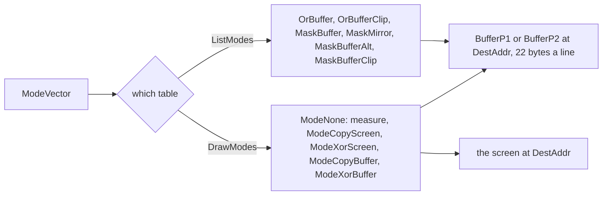

Worked example: ClearByPush is 880 PUSH HL of 11 T and 80 DJNZ of 13 T: 9 680 + 1 040 = 10 720 T. A plain loop of
1 760 LD (HL) would cost more than that before its loop overhead. In the heavy pass ClearBufferP1 to Update takes
12 195 T, ClearByPush included.

Witness: [writers-buffer](img/render/writers-buffer.png) (6.6): ClearByPush wrote all 1 760 bytes of BufferP1 in the
heavy pass, and is the last writer of 1 251 of them (the empty sky and sand).

The point: the buffer starts empty each pass and is built by OR, AND and XOR. Nothing is saved and restored, so no
sprite leaves a trail; the cost is a full clear and a full copy every pass.

## 6.5 The trail: lists A and B and the scroll

A trail is two lists of 6-byte items in order of distance ([doc 7](07-objects.md)): +0 the distance word, +2 y, +3
the advance, +4 the sprite, +5 the flags. List A is the ground and the obstacles. List B is the scenery behind.
Each pass Update `$DACC` walks list A with ListScroll = TrackPos `$D78A`, and list B with ListScroll = SceneryPos
`$D78F`. Advance moves TrackPos by speed x 128 / 256 pixels a pass and SceneryPos by speed x 32 / 256: list B
scrolls at a quarter of list A's speed.

WalkList `$8DA3` keeps an index into its list (DistanceIndex or ScenIndex). It backs the index up until the item
at it lies before the window's left edge, then draws from there until an item lies beyond the right edge.
PlaceItem `$8E3C` sets up one item and PlaceItemX `$8EC2` gives it a clip code:

| ClipCode | x = distance - ListScroll | Drawn |
| --- | --- | --- |
| 0 | inside: x + advance + 8 within 175 | whole: OrBuffer, or MaskBufferAlt with a mask |
| 1 | x above `$AF` | no, and the walk stops |
| 2 | x negative and the advance does not reach 0 | no, and the index moves on |
| 3 | cut at the right edge | OrBufferClip / MaskBufferClip, ClipWidth bytes a line |
| 4 | cut at the left edge | the clipped modes from x AND 7, skipping bytes |

The flags at +5: bit 0 draws the item from the menu bank with its attributes (MenuSprite, DeferAttrs); bits 1-3 go
to ItemFlags bits 5-7: bit 1 defers it to DeferredB, bit 2 to DeferredA, bit 3 draws it masked (LoadMask: the mask
is the sprite at SpriteNum + the flags' offset). Bits 4-7 set make +4/+5 an animation record (AnimObject).

```text
WalkList(list, index, scroll):
    item = list + index
    if PlaceItem(item) != 2:                 # the first item is not left of the window:
        if index >= 6: index -= 6; restart   # back up one item
    else: item += 6
    loop:
        code = PlaceItem(item)                # sets SpriteX, the clip code
        if code == 2: index = item - list     # NextIndex: the walk starts later next pass
        if code == 1: return                  # beyond the right edge: done
        if code != 2:
            if deferred to A: DeferA() elif deferred to B: DeferB() else PlaceClipped()
        item += 6
        if item's +1 == $FF: return           # the list's end
```

```asm
WalkList:
  8DA3  LD HL,(ListIndexPtr)
  8DA6  LD C,(HL)
  8DA7  INC HL
  8DA8  LD B,(HL)
  8DA9  LD HL,(ListBase)
  8DAC  ADD HL,BC
  8DAD  PUSH HL
  8DAE  POP IY
  8DB0  LD A,(IY+$01)
  8DB3  CP $FF
  8DB5  JP Z,l_8E10
  8DB8  CALL PlaceItem
  8DBB  CP $02
  8DBD  JP Z,l_8DC3
  8DC0  JP l_8E10
l_8DC3:
  8DC3  LD DE,$0006
  8DC6  ADD IY,DE
l_8DC8:
  8DC8  LD A,(IY+$01)
  8DCB  CP $FF
  8DCD  RET Z
  8DCE  CALL PlaceItem
  8DD1  CP $02
  8DD3  PUSH AF
  8DD4  CALL Z,NextIndex
  8DD7  POP AF
  8DD8  CP $01
  8DDA  RET Z
l_8DDB:
  8DDB  CP $02
  8DDD  JP Z,l_8DFC
  8DE0  LD A,(ItemFlags)
  8DE3  BIT 6,A
  8DE5  JP NZ,l_8DF3
  8DE8  BIT 5,A
  8DEA  JP NZ,l_8DF9
  8DED  CALL PlaceClipped
  8DF0  JP l_8DFC
l_8DF3:
  8DF3  CALL DeferA
  8DF6  JP l_8DFC
l_8DF9:
  8DF9  CALL DeferB
l_8DFC:
  8DFC  LD DE,$0006
  8DFF  ADD IY,DE
  8E01  LD A,(IY+$01)
  8E04  CP $FF
  8E06  RET Z
  8E07  CALL PlaceItem
  8E0A  CP $01
  8E0C  JP NZ,l_8DDB
  8E0F  RET
```

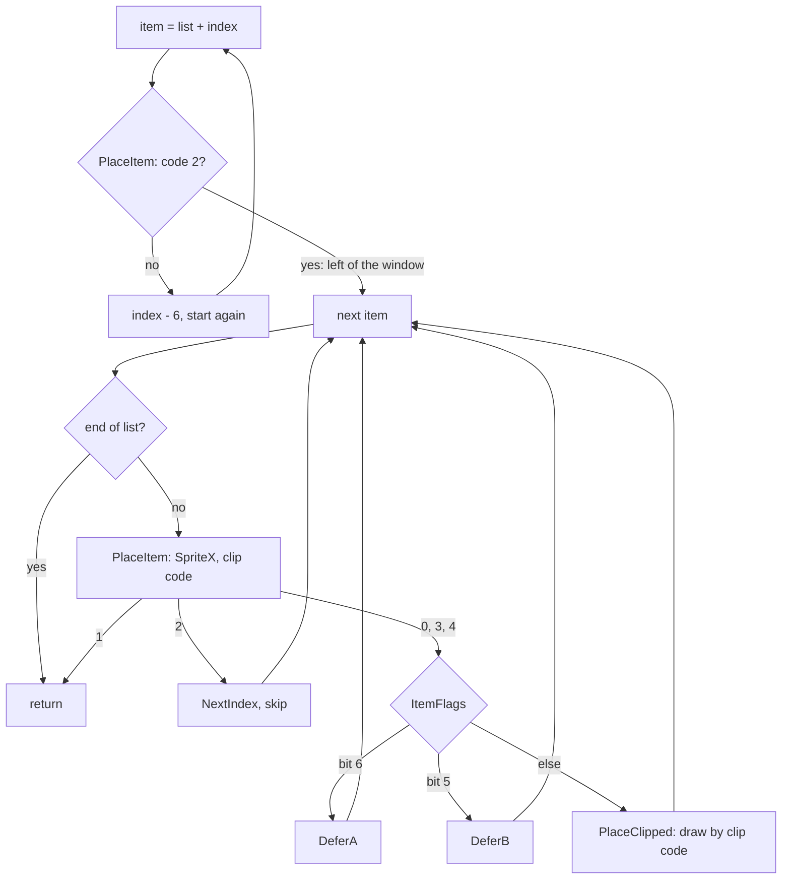

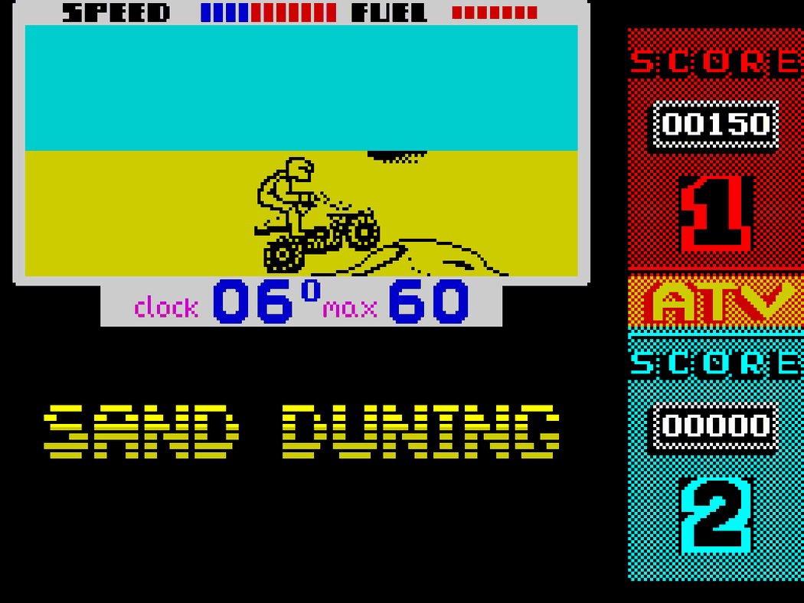

*Animation 6.2: `c1` frames 15 475-15 790, every 7th frame (a pass): the ATV at speed on trail 1. The ground (list
A) moves at the speed; the dune line on the horizon (list B) creeps at a quarter of it. Command: `python3
../../kit/screen_anim.py --work work/docs/atB/c1 --from 15475 --to 15790 --step 7 --width 1050 --delay 120
docs/img/play/trail-scroll.gif`.*

What to watch:

- the ATV stays at the same x: only the lists move;
- a ground piece entering at the right, cut (clip code 3), then whole (0), then cut at the left (4), then gone;
- the far scenery barely moving.

Worked example: at speed 21 (`$15`) ForwardList adds 21 x 128 = 2 688 to Distance: TrackPos gains 10.5 pixels a
pass. ForwardScenery adds 21 x 32 = 672 to Scenery: SceneryPos gains 2.6 pixels a pass. An item at distance 600
with TrackPos 520 lies at x = 80, inside (code 0) if its advance + 8 is at most 175 - 80 = 95.

Witness: `c1` L1: WalkList 1 200 calls (two a pass for 600 passes), PlaceItem 4 306, PlaceClipped 1 901;
`turn`'s log.json: TrackPos 128 at speed 21 after 859 frames ([doc 5](05-controls.md), 5.9).

The point: the trail is not a map in screen form. It is two sorted lists the renderer walks from a moving index,
and the scroll is one subtraction per item. The second list at a quarter of the speed is the game's parallax.

## 6.6 The order of one picture and the deferred sprites

Update builds the picture in this order:

1. ClearBufferP1 (in PassP1, before Update);
2. list A, the ground: drawn first, because AtvPhysics then reads the buffer's pixels as the ground
   (GroundUnder, [doc 10](10-gameplay-logic.md));
3. the physics, the controls, the jump, the rider's moves;
4. list B, the scenery: after the ground test, so it never stops the ATV;
5. FlushDeferredB `$8913`: items flagged for B, behind the ATV;
6. DrawAtvAndRider `$DC82`;
7. FlushDeferredA `$8906`: items flagged for A, in front of the ATV.

DeferA and DeferB store 8 bytes per item (x, y, advance, sprite, the routine, the clip code, the flags); the flush
restores them and calls PlaceClipped.

```text
Update():
    DeferredA = DeferredB = DeferredAttrs = empty
    WalkList(TrailListA, DistanceIndex, TrackPos)      # ground, obstacles
    EngineSound(); AtvPhysics(); Controls()
    if AtvFrame != $5C: JumpControl(); RiderUpdate(); Tumble()
    WalkList(TrailListB, ScenIndex, SceneryPos)        # scenery
    FlushDeferredB()                                   # behind the ATV
    DrawAtvAndRider()
    FlushDeferredA()                                   # in front of the ATV
    FinishCheck()
```

```asm
Update:
  DACC  XOR A
  DACD  LD (DeferredA+$0002),A
  DAD0  LD (DeferredB+$0002),A
  DAD3  LD (DeferredAttrs+$0002),A
  DAD6  LD HL,$0000
  DAD9  LD (DeferredA),HL
  DADC  LD (DeferredB),HL
  DADF  LD (DeferredAttrs),HL
  DAE2  LD HL,(TrailListA)
  DAE5  LD (ListBase),HL
  DAE8  LD HL,DistanceIndex
  DAEB  LD (ListIndexPtr),HL
  DAEE  LD HL,(TrackPos)
  DAF1  LD (ListScroll),HL
  DAF4  CALL JpWalkList
  DAF7  CALL EngineSound
  DAFA  LD A,(RiderSavedHeight)
  DAFD  LD (RiderHeight),A
  DB00  CALL AtvPhysics
  DB03  CALL Controls
  DB06  LD A,(AtvFrame)
  DB09  CP $5C
  DB0B  JR Z,l_DB16
  DB0D  CALL JumpControl
  DB10  CALL RiderUpdate
  DB13  CALL Tumble
l_DB16:
  DB16  LD HL,(TrailListB)
  DB19  LD (ListBase),HL
  DB1C  LD HL,ScenIndex
  DB1F  LD (ListIndexPtr),HL
  DB22  LD HL,(SceneryPos)
  DB25  LD (ListScroll),HL
  DB28  CALL JpWalkList
  DB2B  CALL JpFlushDeferredB
  DB2E  CALL DrawAtvAndRider
  DB31  CALL JpFlushDeferredA
```

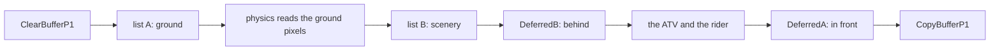

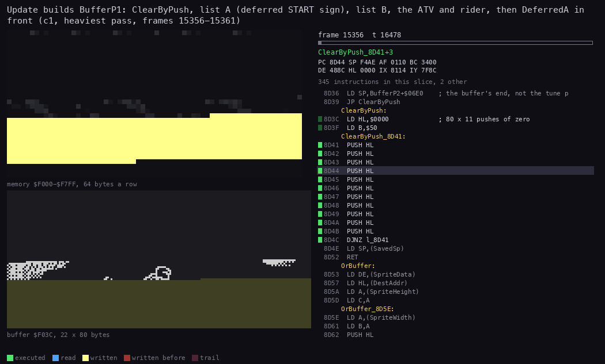

*Animation 6.3: `c1`, the heavy pass: Update builds BufferP1. T 15356:12 600 to 15361:12 149 (5 frames), 90
pictures; the view is BufferP1, 22 x 80 bytes. Command: `python3 ../../kit/routine_anim.py --work work/docs/atB/c1
--window 15356:12600-15361:12149 --listing build/game.lst --auto-labels owner --view buffer:F03C:22x80 --range
F000-F7FF --pc 8580-8FFF,DACC-DDFF --pictures 90 --title "..." --out docs/img/routines/Update.gif`.*

What to watch:

- the buffer cleared to black, then the ground of list A ORed in;
- the long stretch of rotations with nothing drawn: the measuring calls (6.7);
- the ATV and the rider (MaskBuffer), the wheels (XOR), then the START sign laid over the front of the ATV.

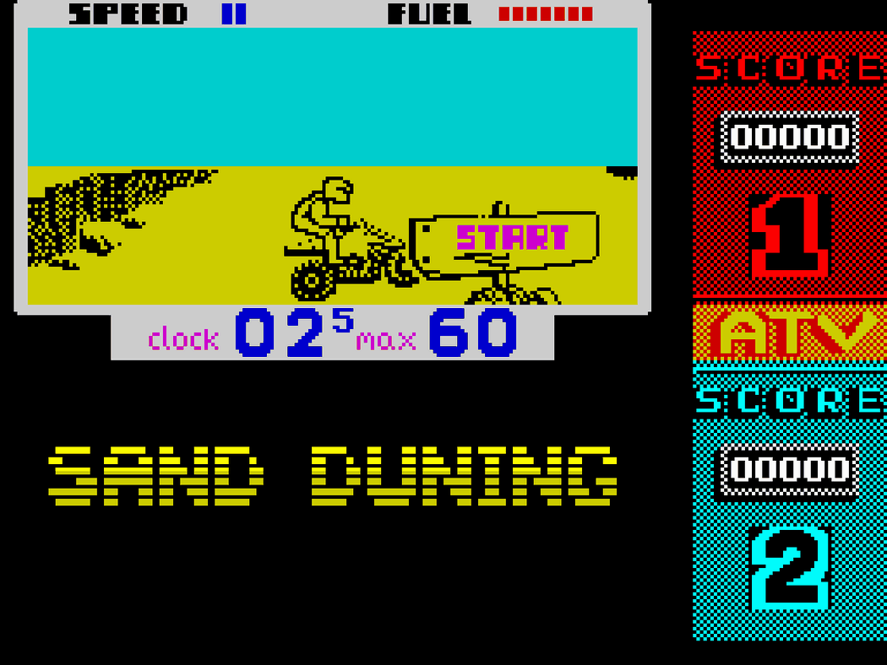

*Animation 6.4: `c1` frames 15 230-15 475, every 7th frame: the START sign at the trail's start, in front of the ATV,
scrolling off to the left with its magenta attributes. Command: `python3 ../../kit/screen_anim.py --work
work/docs/atB/c1 --from 15230 --to 15475 --step 7 --width 1050 --delay 120 docs/img/play/start-sign.gif`.*

What to watch:

- the sign drawn over the ATV's front wheel while they overlap: it is a deferred-A item;
- its magenta attribute cells moving with it in steps of 8 pixels (DeferAttrs, FlushAttrs);
- the sign cut at the left edge, then gone.

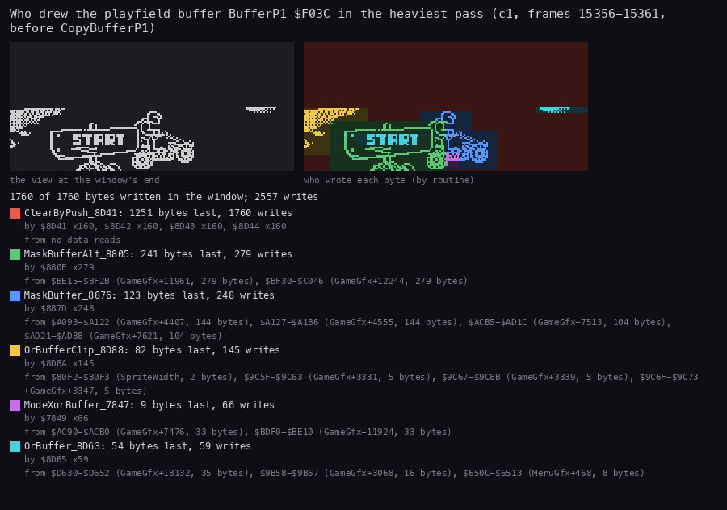

*Figure 6.3: `c1`, the heavy pass, frames 15356-15361 before CopyBufferP1: the last writer of each byte of
BufferP1. Command: `python3 ../../kit/writers_map.py --work work/docs/atB/c1 --window 15356:7833-15361:12149
--listing build/game.lst --auto-labels owner --view buffer:F03C:22x80 --sources --scale 3 --title "..." --out
docs/img/render/writers-buffer.png`.*

How to read it:

- left, the buffer as copied; right, each byte coloured by its last writer;
- green MaskBufferAlt: the START sign (sprite `$7B` from `$BE15`, mask `$7C` from `$BF30`), over the ATV;
- blue MaskBuffer: the ATV's body and the rider; violet ModeXorBuffer: the wheels (`$7A`, then `$4F`);
- yellow OrBufferClip: the dune at the left edge (sprite 27, clip code 4); cyan OrBuffer: the whole pieces.

Worked example: in the heavy pass the START sign is a deferred-A item. FlushDeferredA runs at 15360:23 378 and
takes 46 839 T to 15361:329: the sign is 9 x 31 bytes, rotated to its new x AND 7 and drawn masked, after the ATV.

Witness: the trace times above; [writers-buffer](img/render/writers-buffer.png); the `c1` stills
[first pass](img/play/c1-015060-first-pass.png) and [the ride](img/play/c1-015419-c1.png).

The point: the order is the game's depth. The ground goes first because the physics reads it; the scenery comes after
the physics so it cannot stop the ATV; a flag in an item puts it behind or in front of the vehicle.

## 6.7 The measuring call: rotations twice

PlaceItem must know the sprite's height before it can test the item's y. It gets it by calling the sprite with
ModeVector = DrawModes, whose first mode, ModeNone, is a RET. But SpriteHeader shifts the bytes before it jumps to
the mode, and PlaceItem makes this call before PlaceItemX has set SpriteX. So the sprite is shifted to the
previous item's x AND 7, then shifted again by PlaceClipped to its own. Every item the walk visits pays the first
shift, even one beyond the edges.

```text
PlaceItem(item):
    SpriteNum, flags, SpriteY, SpriteAdvance = item ...
    ModeVector = DrawModes                   # ModeNone
    SpriteGo()                               # header read AND bytes shifted to the OLD SpriteX AND 7
    if SpriteY < SpriteHeight: ItemTooLow()  # red border, restart
    PlaceItemX()                             # only now: SpriteX = distance - ListScroll, the clip code
PlaceClipped():
    SpriteGo() with ListModes                # shifted again to the NEW SpriteX AND 7, then drawn
```

```asm
l_8E8C:
  8E8C  PUSH IY
  8E8E  POP HL
  8E8F  LD E,(HL)
  8E90  INC HL
  8E91  LD D,(HL)
  8E92  INC HL
  8E93  LD A,(HL)
  8E94  LD (SpriteY),A
  8E97  INC HL
  8E98  LD A,(HL)
  8E99  LD (SpriteAdvance),A
  8E9C  EX DE,HL
  8E9D  PUSH HL
  8E9E  LD HL,DrawModes
  8EA1  LD (ModeVector),HL
  8EA4  CALL SpriteGo           ; shifts to the previous item's SpriteX
  8EA7  LD A,(SpriteHeight)
  8EAA  LD E,A
  8EAB  LD A,(SpriteY)
  8EAE  CP E
  8EAF  JP NC,PlaceItemX
PlaceItemX:
  8EC2  POP HL
  8EC3  LD DE,(ListScroll)
  8EC7  XOR A
  8EC8  RRA
  8EC9  SBC HL,DE
  8ECB  LD (SpriteX),HL          ; SpriteX set only here
```

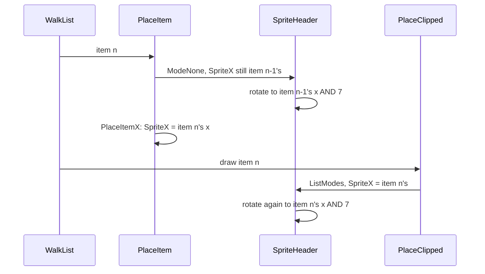

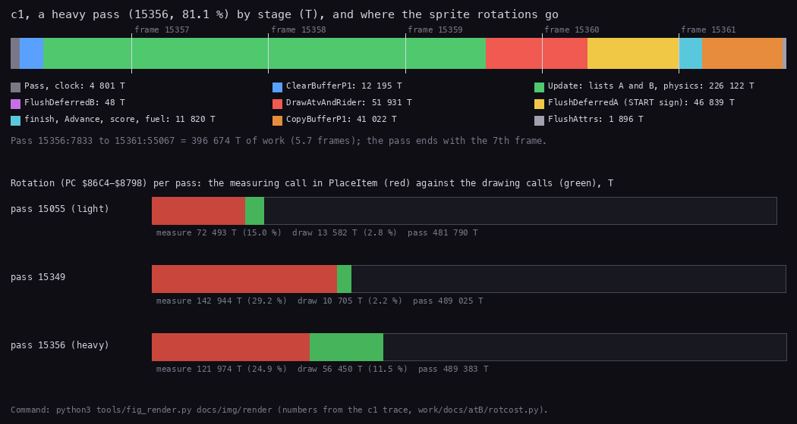

*Figure 6.4: `c1`: the heavy pass (15 356) by stage, from the entry times of its routines in the trace, and the rotation
work (PCs `$86C4-$8798`) of three passes split into the measuring call and the drawing calls
(`work/docs/atB/rotcost.py` over the trace). Command: `python3 tools/fig_render.py docs/img/render`.*

How to read it:

- the top bar is the pass from Pass to WaitFrames, frame lines marked; Update (green) is most of it;
- in the bars below, red is rotation inside PlaceItem's measuring call, green inside the drawing calls, grey the rest
  of the pass.

Worked example (from the trace):

| Pass | Pass T | Rotation in the measuring call | Rotation drawing |
| --- | --- | --- | --- |
| 15055 (light) | 481 790 | 72 493 T (15.0 %) | 13 582 T (2.8 %) |
| 15349 | 489 025 | 142 944 T (29.2 %) | 10 705 T (2.2 %) |
| 15356 (heavy) | 489 383 | 121 974 T (24.9 %) | 56 450 T (11.5 %) |

In pass 15349 the measuring call does 13 times the rotation work of the drawing. Setting SpriteX before the call,
or reading the height from the header without SpriteHeader, would save it.

Witness: the `c1` trace, `work/docs/atB/rotcost.py`; Animation 6.1 is one of these measuring calls (ShiftLeftBy(4)
on sprite 27, ModeNone).

The point: the heavy passes are heavy by accident. A quarter of a pass goes on shifting sprites to a position no
one draws them at.

## 6.8 The ATV and the rider

DrawAtv `$DC88` draws the body with its mask (sprite AtvFrame + 1), then the wheels. DrawRider `$DD96` does the
same with RiderFrame and its mask (RiderFrame + 9 below 9, + 1 from 9). Both are measured with ModeNone, which
shifts them (6.3), then drawn by jumping into a ListModes routine with a return address pushed.

```text
DrawAtv():
    if Facing == 0:
        SpriteX = AtvX
        mask = sprite AtvFrame + 1 (ModeNone); body = sprite AtvFrame (ModeNone); AtvY()
        body from its second line; MaskBuffer; then x + 5, sprite $7A, Wheels
    else:
        SpriteX = AtvX AND F8            # the XOR 7 of the mirrored offset is computed, then dropped
        the same; DestAddr + 2; MaskMirror; then (AtvMirrorReturn) x + 8, sprite $79, Wheels
Wheels():
    if AtvFrame in $38..$4F and EngineNote bit 7 clear:
        XOR sprite (the $7A or $79), then sprite - $2B ($4F or $4E)
```

```asm
l_DCEC:                         ; DrawAtv, facing left
  DCEC  LD HL,DrawModes
  DCEF  LD (ModeVector),HL
  DCF2  LD A,(AtvX)
  DCF5  AND $F8
  DCF7  LD E,A
  DCF8  LD A,(AtvX)
  DCFB  AND $07
  DCFD  XOR $07
  DCFF  LD A,E                  ; the mirrored offset is lost
  DD00  LD (SpriteX),A
  DD03  LD A,(AtvFrame)
  DD06  ADD A,$01
  DD08  LD (SpriteNum),A
  DD0B  CALL JpGameSprite
  DD0E  LD HL,(SpriteData)
  DD11  LD (MaskData),HL
  DD14  LD A,(AtvFrame)
  DD17  LD (SpriteNum),A
  DD1A  CALL JpGameSprite
  DD1D  CALL AtvY
  DD20  LD HL,(DestAddr)
  DD23  INC HL
  DD24  INC HL
  DD25  LD (DestAddr),HL
  DD28  LD HL,(SpriteData)
  DD2B  LD BC,(SpriteWidth)
  DD2F  LD B,$00
  DD31  ADD HL,BC
  DD32  LD (SpriteData),HL
  DD35  LD A,(SpriteHeight)
  DD38  SUB $01
  DD3A  LD (SpriteHeight),A
  DD3D  LD DE,AtvMirrorReturn
  DD40  PUSH DE                 ; MaskMirror returns here
  DD41  LD HL,(ListModes+$0006)
  DD44  JP (HL)
AtvMirrorReturn:
  DD45  LD A,(SpriteX)
  DD48  ADD A,$08
  DD4A  LD (SpriteX),A
  DD4D  LD A,$79
  DD4F  LD (SpriteNum),A
  DD52  JP Wheels
```

DrawRider's left path keeps the offset (`OR E` at `$DDF3`); DrawAtv's drops it (`LD A,E` at `$DCFF`). A left-facing
ATV is drawn on a byte boundary, up to 7 pixels left of AtvX, while its rider is not.

AtvMirrorReturn (once named DrawAtvUnused) is not dead code: it is the return address DrawAtv pushes before it jumps
into MaskMirror.

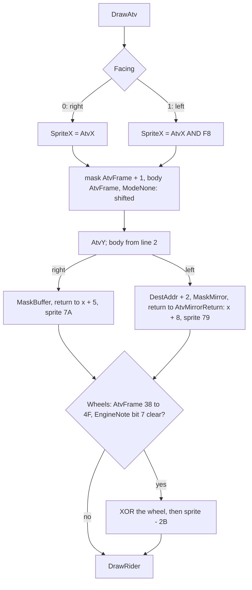

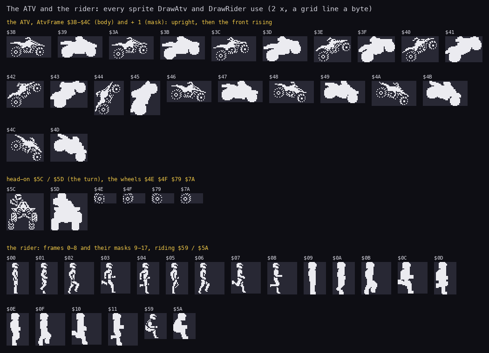

*Figure 6.5: every sprite DrawAtv and DrawRider use, from src/res/sprites/game.png at 2 x; no recording. Command:
`python3 tools/fig_render.py docs/img/render`.*

How to read it:

- the ATV rows: even numbers are bodies, the next odd number the mask; `$38` upright to `$4C` the front highest;
- `$5C` is the head-on ATV of the turn ([doc 5](05-controls.md), 5.9), with its rider drawn in;
- the rider rows: 0-8 the poses, 9-17 their masks, `$59` / `$5A` sitting on the ATV;
- the stored bits are where the paper shows: MaskBuffer inks the mask's shape, the sprite cuts the paper back in.

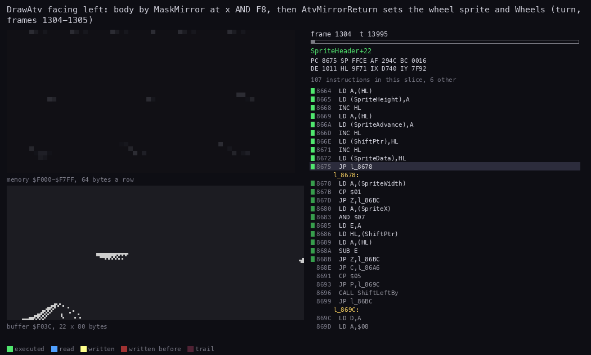

*Animation 6.5: `turn` frames 1 304-1 305, the ATV facing left after the turn: the mask and the body by MaskMirror
at x AND `$F8`, the return into AtvMirrorReturn, then the wheels and the rider. T 1 304:12 900 to 1 305:8 700
(65 688 T), 60 pictures; the view is BufferP1. Command: `python3 ../../kit/routine_anim.py --work
work/stage1/rec/turn --window 1304:12900-1305:8700 --listing build/game.lst --view buffer:F03C:22x80 --range
F000-F7FF --pc 8600-8FFF,DC82-DD95 --pictures 60 --title "DrawAtv facing left: body by MaskMirror at x AND F8, then AtvMirrorReturn sets the wheel
sprite and Wheels (turn, frames 1304-1305)" --out docs/img/routines/DrawAtv.gif`.*

What to watch:

- the PC in DrawAtv's left path, MaskMirror reversing each byte;
- the PC at `$DD45` right after MaskMirror's RET;
- the wheels XORed in.

Worked example (`turn` 1 304): Facing 1, MaskMirror at 1 304:14 766, AtvMirrorReturn at 1 304:65 933, Wheels at
1 304:65 996, DrawRider at 1 305:8 655. With AtvX = `$48` the offset is 0 and nothing is lost; at another x the body
would sit up to 7 pixels left.

Witness: `turn` L1: AtvMirrorReturn 45 entries (the left-facing passes); `c1` L1 (always facing right): none.

The point: the vehicle is two masked sprites and two XORed wheels. The left-facing ATV snaps to bytes because one
instruction keeps the wrong register.

## 6.9 The copy to the screen and the beam

CopyBufferP1 copies BufferP1 to `$4021` with CopyLines `$8CF2`: 22 LDI a line, then NextLineDE steps the screen
address, 80 times. CopyBufferP2 does the same from BufferP2 to `$48A1`.

```text
CopyBufferP1(): CopyLines(src = BufferP1, dst = $4021, count = $06E0)
CopyLines(src, dst, count):
    repeat:
        save dst; 22 x LDI (src, dst += 1, count -= 1); restore dst
        dst = NextLineDE(dst)            # the Spectrum's line order
    until count == 0
```

```asm
CopyBufferP1:
  8CDA  LD HL,BufferP1
  8CDD  LD DE,Screen+33
  8CE0  LD BC,$06E0
  8CE3  JP CopyLines
CopyLines:
  8CF2  PUSH DE
  8CF3  LDI                     ; 22 LDIs, $8CF3-$8D1D
  8D1F  POP DE
  8D20  CALL NextLineDE
  8D23  LD A,B
  8D24  OR C
  8D25  JR NZ,CopyLines
  8D27  RET
```

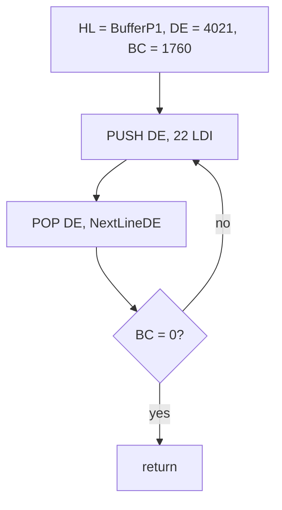

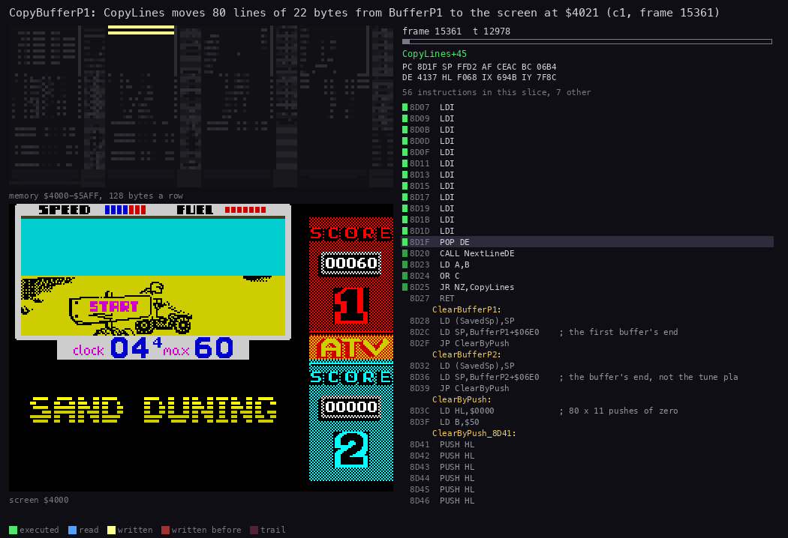

*Animation 6.6: `c1` frame 15 361: CopyBufferP1 moves the 80 lines to the screen. T 15361:12 100 to 15361:56 000
(43 900 T), 50 pictures; the view is the screen. Command: `python3 ../../kit/routine_anim.py --work work/docs/atB/c1
--window 15361:12100-15361:56000 --listing build/game.lst --auto-labels owner --view screen --range 4000-5AFF --pc
8CDA-8D3B --pictures 50 --title "..." --out docs/img/routines/CopyLines.gif`.*

What to watch:

- the window filling from the top, a line at a time;
- the old picture below the copied lines: the scroll of a pass shows as a step between them.

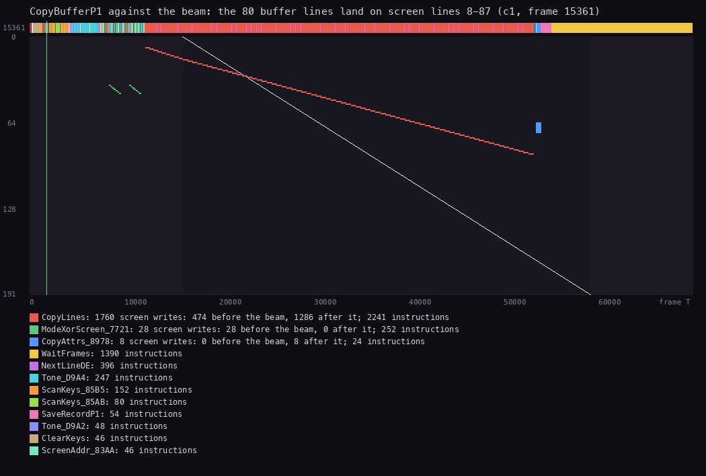

*Figure 6.6: `c1` frame 15 361: the screen writes against the beam. T 0 to 69 888. Command: `python3
../../kit/beam_timeline.py --work work/docs/atB/c1 --window 15361:0-15362:0 --listing build/game.lst --auto-labels
owner --machine 48k --title "..." --width 1050 --out docs/img/render/beam-copy.png`.*

How to read it:

- x is the T-state in the frame, y the screen line; the white diagonal is the beam;
- red is CopyLines, one step a line, from line 8 at about T 11 000 to line 87 at about T 52 000;
- the red crosses the beam near line 30: 474 bytes are written before the beam reaches them, 1 286 after.

Worked example: 1 760 LDI of 16 T are 28 160 T. Each line adds PUSH, POP, CALL NextLineDE, the test and the jump,
about 84 T: 6 720 T. The 34 880 T counted grow to 41 022 T measured (CopyBufferP1 to FlushAttrs), the rest being
contention on the screen writes. The copy takes about 513 T a line, the beam 224: the beam overtakes it after
about 22 lines (474 / 22 bytes).

Witness: `c1` L1: CopyBufferP1 601 calls; the beam timeline above.

The point: the copy is the one place the game meets the beam, and it does not wait for it. The top 22 lines of the
window show the new pass in that frame, the rest one frame later; the window can tear once a pass near line 30.

## 6.10 Two players: the split screen

With two players PassP1 and PassP2 run in one pass ([doc 5](05-controls.md), 5.12). Each sets its own ScreenBase,
BufferBase, AttrBase and HudY, then clears, builds and copies its own buffer. The renderer is the same code; only
these four variables change.

| Variable | Player 1 (PassP1 `$DA4F`) | Player 2 (PassP2 `$DA8F`) |
| --- | --- | --- |
| ScreenBase `$80DF` | `$4021` | `$48A1` |
| BufferBase `$8144` | `$F03C` | `$F71C` |
| AttrBase `$8084` | `$5821` | `$59A1` |
| HudY `$D6C2` | `$BE` (top) | 6 (bottom) |

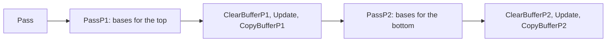

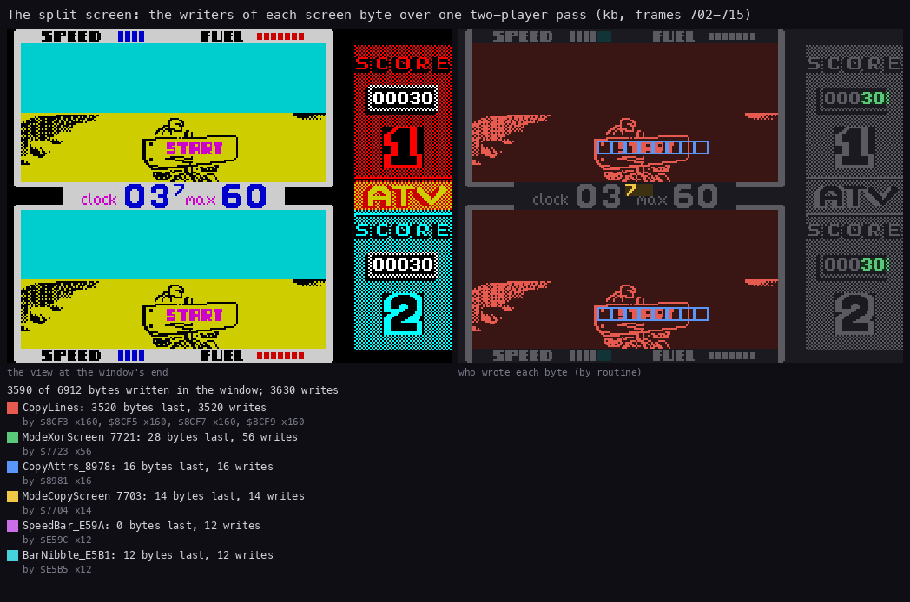

*Figure 6.7: `kb`, one two-player pass (Pass 702:68 897 to 715:17 191): the last writer of each screen byte.
Command: `python3 ../../kit/writers_map.py --work work/docs/atB/kb --window 702:68897-715:17191 --listing
build/game.lst --auto-labels owner --view screen --sources --scale 3 --title "..." --out
docs/img/render/writers-split.png`.*

How to read it:

- both windows red: CopyLines wrote 3 520 bytes, two copies of 1 760;
- the two START signs' attributes (blue, CopyAttrs, 16 bytes);
- two SPEED bars (BarNibble, 12 bytes), the scores' tens digits (ModeXorScreen, 28 bytes), the clock (14 bytes).

Worked example: this `kb` pass ran from 702 to 715, 13 frames, nearly twice the 7 of a one-player pass: two
ClearByPush, two walks, two copies.

Witness: `kb`, the figure above; [two players](img/play/two-players.gif) in doc 5.

The point: two players cost two whole renders. The split screen is a second call of the same renderer with
other bases, so the game slows down instead of drawing less.

## 6.11 The code against the screen

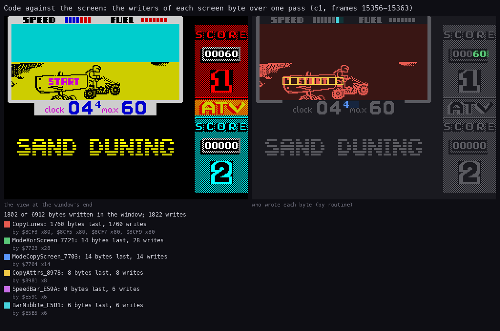

*Figure 6.8: `c1`, one pass from Pass 15356:7 833 to 15363:8 012: the last writer of each screen byte. Command:
`python3 ../../kit/writers_map.py --work work/docs/atB/c1 --window 15356:7833-15363:8012 --listing build/game.lst
--auto-labels owner --view screen --sources --scale 3 --title "..." --out docs/img/render/writers-screen.png`.*

How to read it:

- 1 802 of the screen's 6 912 bytes change in a pass;
- red, CopyLines: the window, 1 760 bytes;
- green, ModeXorScreen: the score's tens digit in the panel (14 bytes, 28 writes: off and on);
- blue, ModeCopyScreen: the clock's units digit (14 bytes); yellow, CopyAttrs: the START sign's 8 attribute bytes;
- violet and cyan: SpeedBar and BarNibble, the SPEED bar's last cell (6 bytes).

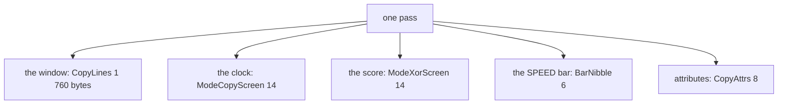

Worked example: of the 1 802 bytes written, 1 760 (97.7 %) are the window copy. The rest is 42 bytes: the HUD costs
nearly nothing.

Witness: the `c1` trace of the pass; the same writers in [writers-split](img/render/writers-split.png) doubled.

The point: one routine owns the screen. Every other screen write is a few bytes that change only when a number
does.

## 6.12 Summary

| Mechanism | Address | Witness |
| --- | --- | --- |
| one bank, 4-byte headers, the shift kept at +3 | `$8F5C`, `$865F` | every recording |
| shifting in place, at most 4 bit steps | `$8759`, `$8777`, `$871E`, `$8742` | `c1` 15357 |
| buffer cleared by 880 pushes | `$8D3C` | `c1` |
| draw modes: OR, masked, mirrored, XOR | `$836D`, `$69F7` | writers-buffer |
| two lists walked from a moving index; parallax at 1/4 | `$8DA3`, `$E0A3`, `$E0E1` | `c1` |
| ground, physics, scenery, deferred B, ATV, deferred A | `$DACC` | `c1` 15356 |
| the measuring call rotates to the previous x: up to 29 % of a pass | `$8EA4` | `c1` trace |
| left-facing ATV drawn at x AND `$F8` | `$DCFF` | `turn` |
| AtvMirrorReturn is MaskMirror's return | `$DD45` | `turn` L1 |
| the copy against the beam: 22 lines ahead | `$8CF2` | `c1` 15361 |
| two players: the same renderer twice | `$DA4F`, `$DA8F` | `kb` |
