# 7. Objects

What this covers:

- what an object is in ATV Simulator: items of a trail's two lists, the animation records some items point at, and
  the two players' records;
- the trail record, its list A and list B, and the six bytes of an item;
- the kinds of item, set by the item's flags: the ground, the things behind the ATV, the things in front, the
  banners, the scenery and the animated objects;
- WalkList and PlaceItem, which find and place the items of a list in a 176-pixel window every pass;
- the draw order, which decides what the wheels can touch;
- AnimObject, its motions and the list of ids that keeps an object from moving twice;
- the two scrolls, TrackPos and SceneryPos;
- the player's 50-byte record;
- the limits, and what is known only from the code.

There are no enemies, no other vehicles and no object slots. The trail is a fixed list of sprites at fixed distances.
A few of them swing back and forth. The only collision is the ATV's wheels against the pixels list A has drawn
([doc 10](10-gameplay-logic.md)).

The recordings and tools it rests on ([WALKTHROUGH 6.0](../WALKTHROUGH.md)):

- `trails`: from `c1`'s menu, trail 1 ridden to its finish without a POKE, then trail 2 to a crash. It was opened on
  an own instance, after `. work/env.sh`: `python3 ../../kit/rs.py open --work work/docs/atC/trails --ttd
  work/stage1/rec/trails/session.ttd --model 48K --port-base 37790`.
- `work/docs/atC/trails-vars.jsonl`: every frame 0-7 441 of `trails`, sampled by `python3 work/docs/atC/sample.py work/docs/atC/trails 0 7441 1 work/docs/atC/trails-vars.jsonl` (the main loop's variables `$D6B6-$D6DA`, the
  records `$D70E-$D7A7`, the score).
- `work/docs/atC/stretch.jsonl`: frames 1 264-1 271 of `trails` with the buffer, list A1 and list B1 as they are in
  memory, the walk's variables and the deferred lists (`python3 work/docs/atC/sample.py work/docs/atC/trails 1264
  1271 1 work/docs/atC/stretch.jsonl F03C-F71B D6B6-D6DA D70E-D7A7 7CB4-7D33 7F80-7FB1 8040-807A 8123-8145
  8146-828B`).
- The trace of `trails` frames 1 263-1 270 (one pass), made by `routine_anim.py` for WalkList.gif below.
- `tools/fig_objects.py`: the data sheets, the decoded stretch, the motions and the scroll chart. The trail bytes come
  from the build (`src/res/trails/*.txt` through `tools/res_formats.py`).

A sample of frame N is the memory at the start of frame N. A pass is one turn of the main loop: 7 frames
([doc 4](04-game-loop.md)). "x" is a pixel column of the 176-pixel play window; "y" counts lines up from the
window's bottom line.

## 7.1 The object map

| Object | Where | How many | Moves by | Drawn by |
| --- | --- | --- | --- | --- |
| a trail record | TrailRecords `$7C9C` (trails 1-4), Trail5 `$EE84`, Trail6 `$60AC` | 6 | nothing | nothing: SelectTrail copies its words |
| a list A item: the ground, the bumps, the signs | list A of the trail | 21-40 a trail | TrackPos (the ATV's distance) | WalkList `$8DA3` and PlaceItem `$8E3C` |
| a list B item: the scenery | list B of the trail | 5-18 a trail | SceneryPos, a quarter of TrackPos | the same walk |
| an animation record | after the lists | 1-25 a trail (2-26 items use them) | AnimObject `$8A49`, once a pass | the item that points at it |
| a player record | RecordP1 `$D70E`, RecordP2 `$D740`, the working copy Record `$D772` | 2 | the player's controls and the physics | DrawAtvAndRider `$DC82` |

*The objects. The point: everything on the trail is data in two sorted lists; only the ATV and its rider have state
of their own.*

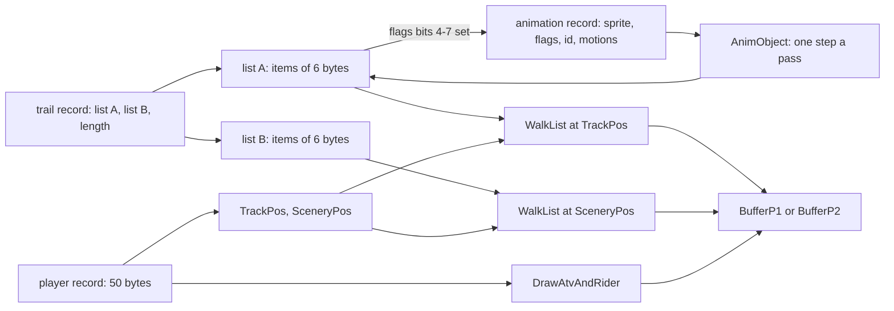

*How the objects meet. How to read: a box is data or a routine, an arrow means "is read by" or "writes". The point:
the record's two scrolls select what is drawn; an animated item writes its motion back into its own list.*

## 7.2 The trail record and its two lists

### In short

SelectTrail reads the trail's record: three words. The first is list A, the second list B, the third the length.
FinishDistance is the length less `$48` ([doc 10](10-gameplay-logic.md)). A list is items of six bytes in order of
distance. A byte `$FF` at an item's +1 ends the list.

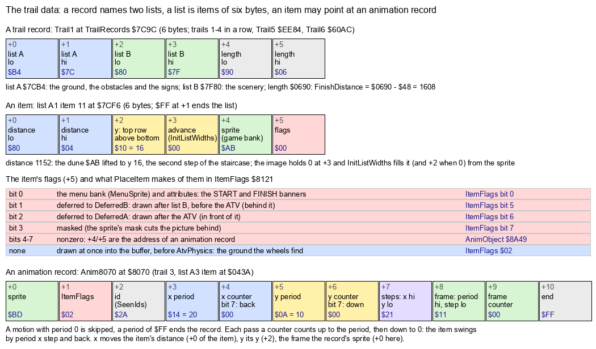

*The trail data as it is in the build. How to read: each box is a byte, its offset above, its meaning in the middle,
its value from the image below; the band in the middle maps the item's flags to the bits PlaceItem sets. The point:
three small formats describe every trail; the y and the advance of an item are not in the file but computed from its
sprite at the start of each trail. Command: `python3 tools/fig_objects.py fig-sheets docs/img/objects/sheets.png`.*

| Trail | Record | Length | FinishDistance | List A items | of them animated | List B items | Animation records |
| --- | --- | --- | --- | --- | --- | --- | --- |
| 1 SAND DUNING | `$7C9C` | `$0690` | 1 608 | 21 | 3 | 8 | the START banner and the sign |
| 2 GRASSTRAKIN | `$7CA2` | `$0568` | 1 312 | 39 | 2 | 9 | the START banner |
| 3 ICEBERGS | `$7CA8` | `$05D4` | 1 420 | 37 | 7 | 5 | 6: the START banner, 5 with motion |
| 4 PYRAMIDS | `$7CAE` | `$0685` | 1 597 | 21 | 2 | 9 | the START banner |
| 5 TROPICANA | `$EE84` | `$06B5` | 1 645 | 33 | 26 | 6 | 25: 15 still, 10 with motion |
| 6 SWAMP | `$60AC` | `$069B` | 1 619 | 40 | 16 | 18 | 15: 2 still, 13 with motion |

*The six trails (from `src/res/trails/trails14.txt`, `trail5.txt`, `trail6.txt`). The point: the trails grow
busier, and trails 5 and 6 are made mostly of animation records.*

Every list A carries the same two banners:

1. near its start, an animated item with sprite `$7B` (Anim8042 in trails 1-4), then two banner sprites of the menu
   bank with flags `$05` and `$04`: the START banner;
2. the same three items past the finish line: the FINISH banner (sprites `$04` and `$CA` in trail 1).

Trails 1-4 share their records and lists in one resource. Trail 5 lies in the image at `$EE84`. Trail 6 is loaded at
`$F230` and copied by GameEntry to `$60AC`, just under the image, because BufferP1 later covers `$F230`
([doc 2](02-architecture.md)).

Witness: `python3 tools/res_formats.py` round-trips the three resources byte for byte ([doc 3](03-build-and-load.md));
in the sample of frame 1 264, ListBase holds `$7CB4`, list A1 of the record at `$7C9C`.

## 7.3 An item and its kinds

### In short

An item is six bytes:

- +0 the distance along the trail, a word, in pixels;
- +2 y, the height of the sprite's top line above the window's bottom line (0 in the file means "the sprite's
  height": the sprite stands on the bottom);
- +3 the advance, the width PlaceItem clips with (0 in the file);
- +4 the sprite number;
- +5 the flags.

When the flags' high nibble is nonzero, +4/+5 is instead the address of an animation record (7.7).

PlaceItem turns the flags into ItemFlags `$8121`. It starts from `$02` and ORs in bits 1-3 of the flags, moved up
four places. Bit 0 picks the menu sprite bank, whose sprites carry attributes.

| Kind | Flags | ItemFlags | Drawn | Solid? | Example |
| --- | --- | --- | --- | --- | --- |
| the ground: dunes, bumps, walls, logs | `$00` | `$02` | at once into the buffer, during the list A walk | yes: drawn before AtvPhysics | trail 1's dunes `$AB` |
| behind the ATV | `$02` (bit 1) | `$22` | DeferredB, after list B, before the ATV | no | Anim804A, trail 3 |
| in front of the ATV | `$04` (bit 2) | `$42` | DeferredA, after the ATV | no | the START banner's `$C9` |
| a banner with attributes | `$05` | `$43` | DeferredA, with its attributes through DeferredAttrs | no | the START banner's `$03` |
| animated | high nibble set | the record's +1 | as its record's flags say | as its record's flags say | Anim8070 (`$02`: solid) |
| the scenery | list B, `$00` | `$02` | at once, during the list B walk, after AtvPhysics | no | trail 1's bird-like `$16` |

*The kinds of item. The point: an item is solid only if it is in list A and drawn at once; "solid" is not a flag but a
consequence of the draw order (7.5).*

Bit 0 is not a mirror: it selects MenuSprite `$863D` (PlaceItem `$8E66`). Bit 1 becomes ItemFlags bit 5, DeferB's
test (`$8DE8`), so flags bit 1 (2) goes to DeferredB and bit 2 (4) to DeferredA.

### InitListWidths: the y and the advance

At the start of each trail NextTrail calls InitListWidths `$7873`. It walks both lists. For each item it sets up the
sprite (SpriteGo, through the animation record if there is one), then:

- writes the sprite's height into +2 if +2 is 0;
- writes SpriteAdvance into +3.

```text
InitList(list):
    for item in list until item[+1] == $FF:
        sprite = item.sprite, or the animation record's sprite
        SpriteGo(sprite)                      # reads its header: width, height, advance
        if item.y == 0: item.y = SpriteHeight
        item.advance = SpriteAdvance
```

```text
InitList: 787C  PUSH HL
          787D  POP IY                ; IY = the list
l_7885:   ...
          78C0  CALL JpSpriteGo       ; the sprite's header
          78C3  LD A,(IY+$02)
          78C6  CP $00
          78C8  JR NZ,l_78D0
          78CA  LD A,(SpriteHeight)
          78CD  LD (IY+$02),A         ; y = the height: the sprite stands on the bottom
l_78D0:   78D0  LD A,(SpriteAdvance)
          78D3  LD (IY+$03),A         ; the advance
          78D6  LD DE,$0006
          78D9  ADD IY,DE
          78DB  LD A,(IY+$01)
          78DE  CP $FF                ; the end of the list
          78E0  JR NZ,l_7885
```

Worked example: list A1 item 11 at `$7CF6` holds `80 04 10 00 AB 00` in the file. In the sample of frame 1 264 it
holds `80 04 10 24 AB 00`: the advance is now `$24` = 36. Item 10 (`$0460`) had y 0 in the file and holds 8, the
height of the dune `$AB`. So item 11, with y 16, is the same dune lifted 8 lines: the second step of the staircase
(7.4).

The point: the file holds only what a designer chooses (distance, lift, sprite, kind); the sizes come from the sprites.

## 7.4 The walk: WalkList and PlaceItem

### In short

Each pass, Update `$DACC` walks list A at TrackPos, then list B at SceneryPos ([doc 4](04-game-loop.md)). One routine
does both. It reads three variables: ListBase `$811B` (the list), ListIndexPtr `$811D` (the address of the list's
index in the record: DistanceIndex `$D78C` or ScenIndex `$D791`) and ListScroll `$811F` (the scroll).

The index is the byte offset of the last item wholly behind the window's left edge. WalkList:

1. checks the item at the index; while that item is not behind the left edge, it steps the index back one item and
   starts again (riding backwards needs this);
2. walks forward from the next item, placing each one;
3. moves the index on by one item when the first item it places is behind the left edge too (NextIndex, from
   `$8DD4` only); a later item behind the edge is skipped and the index kept, so the walk's start advances by at most
   one item a pass;
4. stops at the first item beyond the right edge, or at the list's end.

PlaceItem sets up one item:

- its sprite and ItemFlags (from the animation record, after one AnimObject step, if there is one);
- SpriteY and SpriteAdvance from +2 and +3;
- SpriteX = distance - ListScroll;
- a clip code.

| ClipCode | When | WalkList then |
| --- | --- | --- |
| 0 | the whole sprite fits: 0 <= x and x + advance + 8 < 176 | draws it, or defers it |
| 1 | beyond the right edge: x > 175 | stops the walk |
| 2 | behind the left edge: x + advance < 0 | draws nothing; the first item placed moves the index on by one |
| 3 | cut at the right: SpriteAdvance becomes 175 - x | draws the left part |
| 4 | cut at the left: x < 0 <= x + advance | draws the right part |

*The clip codes (PlaceItemX `$8EC2`). The point: one subtraction per item decides everything; the 8-pixel margin on
the right keeps a shifted sprite inside the buffer's 22 bytes.*

### Pseudocode

```text
WalkList(list, index, scroll):
    loop:
        item = list + index
        if item is the end or PlaceItem(item) != 2:   # the index item is visible: step back
            if index < 6: go to the forward walk from item
            index -= 6; continue
        break
    for each item after it, until the end:
        code = PlaceItem(item)
        if code == 2:                                 # gone behind the left edge
            if this is the first item placed here: index += 6   # NextIndex, $8DD4 only
            continue                                  # a later one: skipped, the index kept
        if code == 1: return                          # beyond the right edge
        if ItemFlags bit 6: DeferA()                  # in front of the ATV
        elif ItemFlags bit 5: DeferB()                # behind the ATV
        else: PlaceClipped()                          # into the buffer now

PlaceItem(item):
    SpriteCall = GameSprite; ItemFlags = $02; SpriteNum = item.sprite
    if item.flags AND $F0: AnimObject(item)           # sprite, flags, one motion step
    else:
        if item.flags bit 0: SpriteCall = MenuSprite; ItemFlags |= 1
        ItemFlags |= (item.flags AND $0E) << 4
    SpriteY = item.y; SpriteAdvance = item.advance
    SpriteGo()                                        # the header; may re-shift the sprite
    if SpriteY < SpriteHeight: red border, restart    # ItemTooLow
    SpriteX = item.distance - ListScroll
    return the clip code
```

### Assembly

```text
WalkList: 8DA3  LD HL,(ListIndexPtr)
          8DA6  LD C,(HL)
          8DA7  INC HL
          8DA8  LD B,(HL)              ; BC = the index
          8DA9  LD HL,(ListBase)
          8DAC  ADD HL,BC
          8DAD  PUSH HL
          8DAE  POP IY                 ; IY = the index item
          8DB0  LD A,(IY+$01)
          8DB3  CP $FF
          8DB5  JP Z,l_8E10            ; the end: step back
          8DB8  CALL PlaceItem
          8DBB  CP $02
          8DBD  JP Z,l_8DC3            ; behind the left edge: walk on from here
          8DC0  JP l_8E10              ; visible: step back
l_8DC3:   8DC3  LD DE,$0006
          8DC6  ADD IY,DE
l_8DC8:   8DC8  LD A,(IY+$01)
          8DCB  CP $FF
          8DCD  RET Z
          8DCE  CALL PlaceItem
          8DD1  CP $02
          8DD3  PUSH AF
          8DD4  CALL Z,NextIndex       ; index + 6
          8DD7  POP AF
          8DD8  CP $01
          8DDA  RET Z                  ; beyond the right edge
l_8DDB:   8DDB  CP $02
          8DDD  JP Z,l_8DFC
          8DE0  LD A,(ItemFlags)
          8DE3  BIT 6,A
          8DE5  JP NZ,l_8DF3           ; DeferA: in front
          8DE8  BIT 5,A
          8DEA  JP NZ,l_8DF9           ; DeferB: behind
          8DED  CALL PlaceClipped      ; into the buffer now
          ...
l_8E10:   8E10  LD HL,(ListIndexPtr)
          8E13  LD E,(HL)
          8E14  INC HL
          8E15  LD D,(HL)
          8E16  EX DE,HL
          8E17  LD DE,$0006
          8E1A  XOR A
          8E1B  RRA
          8E1C  SBC HL,DE
          8E1E  JP C,l_8DC8            ; index 0: walk from here
          8E21  EX DE,HL
          8E22  LD HL,(ListIndexPtr)
          8E25  LD (HL),E
          8E26  INC HL
          8E27  LD (HL),D              ; index - 6
          8E28  JP WalkList
PlaceItemX: 8EC2 POP HL                ; the distance
          8EC3  LD DE,(ListScroll)
          8EC7  XOR A
          8EC8  RRA
          8EC9  SBC HL,DE
          8ECB  LD (SpriteX),HL        ; x = distance - scroll
          8ECE  JP C,l_8EEE            ; left of the window
          8ED1  LD A,H
          8ED2  CP $00
          8ED4  JP NZ,l_8F0E           ; 1: far right
          8ED7  LD A,$AF
          8ED9  SUB L
          8EDA  JP C,l_8F0E            ; 1: x > 175
          8EDD  LD E,A                 ; E = 175 - x
          8EDE  LD A,(SpriteAdvance)
          8EE1  ADD A,$08
          8EE3  SUB E
          8EE4  JP C,l_8F09            ; 0: fits
          8EE7  LD A,E
          8EE8  LD (SpriteAdvance),A   ; 3: cut at the right
          8EEB  JP l_8F1A
```

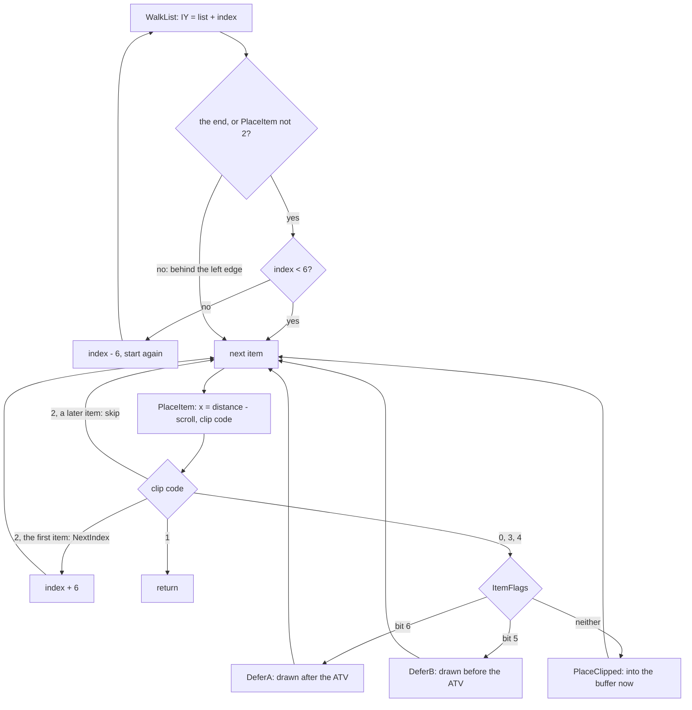

*WalkList. How to read: the top loop finds the index, the bottom loop places items until one is beyond the right
edge. The point: the walk costs a PlaceItem for each visible item plus two, whatever the trail's length.*

### Worked example: trail 1 at TrackPos 1 007

The pass that starts at frame 1 263 T 6 804 in `trails` walks list A1 at ListScroll 1 007 and list B1 at 251. The
sample of frame 1 264 holds DistanceIndex 48 (item 8) and ScenIndex 6 (item 1). The trace shows each PlaceItem and its
clip code (`l_8F09` is code 0, `l_8F0E` 1, `l_8F14` 2, `l_8F1A` 3):

| Item | Distance | x | Advance | Code | Then |
| --- | --- | --- | --- | --- | --- |
| A8 `$AB` dune | 880 | -127 | 36 | 2 | the walk starts after it |
| A9 Anim8046, the sign `$A5` | 1 032 | 25 | 27 | 0 | AnimObject, then DeferA (in front) |
| A10 `$AB` dune, y 8 | 1 120 | 113 | 36 | 0 | PlaceClipped: ground |
| A11 `$AB` dune, y 16 | 1 152 | 145 | 36 | 3 | cut to 30 pixels: ground |
| A12 `$AB` dune, y 20 | 1 184 | 177 | 36 | 1 | the walk ends |
| B1 `$17` | 168 | -83 | | 2 | the walk starts after it |
| B2-B5 `$16` | 288-368 | 37-117 | 16 | 0 | PlaceClipped: scenery |
| B6 `$12` | 480 | 229 | | 1 | the walk ends |

*The walk of one pass. The point: 11 PlaceItem calls draw the whole view; 18 of the trail's 29 items are never
looked at.*

1. The list A walk runs from 1 263 T 27 502 to 1 264 T 13 497: 55 883 T.
2. PlaceItem for the sign takes 29 316 T of that, most of it the measuring call shifting the sprite `$A5` to the previous
   item's offset: for clip code 2 PlaceItemX stores the magnitude (`$8EEE` negates x), so SpriteX holds 127 and the
   measuring call shifts by 127 AND 7 = 7; the real draw then shifts it back to its own 25 AND 7 = 1
   ([doc 6, 6.7](06-rendering.md#67-the-measuring-call-rotations-twice)).
3. The list B walk runs from 1 264 T 26 764 to 1 265 T 9 910.

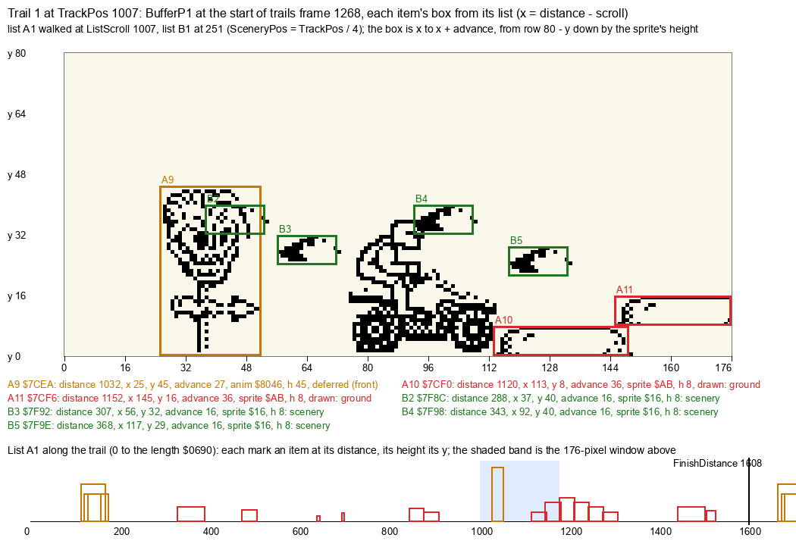

*The stretch, decoded. How to read: the top is BufferP1 at the start of `trails` frame 1 268, after the pass drew it,
a cell a pixel; each box is an item's place by the formula above: red list A drawn at once (the ground), orange list A
deferred (the sign), green list B. The text below lists each item. The strip at the bottom is all of list A1 along the
trail, the box height the item's y, the blue band the window. The point: the formula puts every box on its picture,
so the lists alone describe the screen; the dune "staircase" at 1 120-1 280 is one sprite at six lifts. Command:
`python3 tools/fig_objects.py fig-stretch work/docs/atC/stretch.jsonl 1268 docs/img/objects/stretch.png --scroll
1007,251`.*

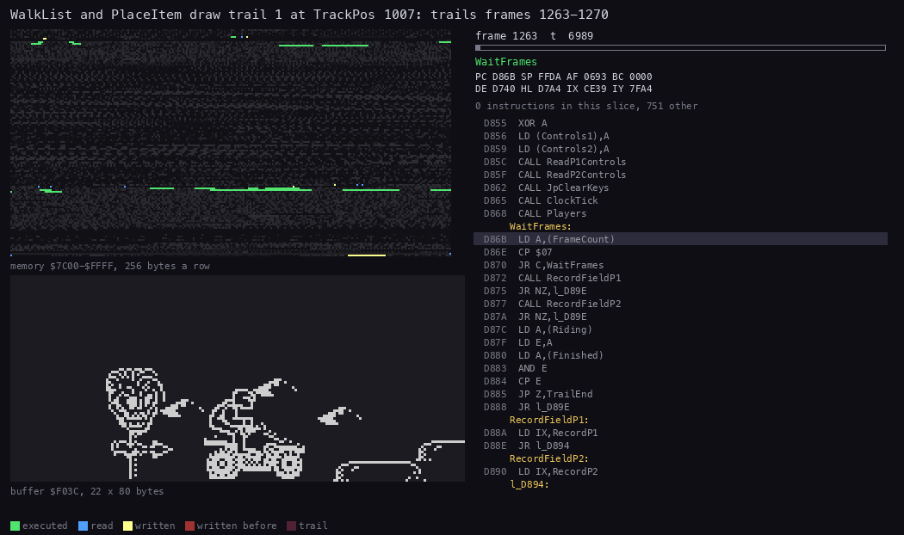

*WalkList at work, `trails` frames 1 263-1 270: one pass from Pass to the copy, 80 pictures. How to read: the left is
the memory `$7C00-$FFFF` with the code that runs; the bottom left is BufferP1 `$F03C`, 22 x 80 bytes, filling up;
the right is the listing at the current PC. The buffer is cleared, the dunes appear (list A), then the birds (list
B), the ATV and rider, and last the sign in front of them (DeferredA). The point: the view is built from nothing every
pass, item by item, in list order. Command: `python3 ../../kit/routine_anim.py --work work/docs/atC/trails --listing
build/game.lst --window 1263:0-1271:0 --pc 8A0F-8F25,DACC-DB33 --view buffer:F03C:22x80 --range 7C00-FFFF
--pictures 80 --title "WalkList and PlaceItem draw trail 1 at TrackPos 1007: trails frames 1263-1270" --out
docs/img/routines/WalkList.gif`.*

Witness: the trace of frames 1 263-1 270 (`work/docs/atC/trails/traces/1263_0-1271_0.uatr`) runs PlaceItem 11 times
in the pass that starts at 1 263, with the codes above, and DeferA once.

## 7.5 The draw order: what the wheels can touch

### In short

Update draws in this order ([doc 4](04-game-loop.md)):

1. WalkList over list A: the ground goes into the buffer, DeferA and DeferB collect the rest;
2. AtvPhysics `$E676`: GroundUnder reads the buffer's pixels under the wheels ([doc 10](10-gameplay-logic.md));
3. WalkList over list B: the scenery goes into the buffer;
4. FlushDeferredB `$8913`: the items behind the ATV;
5. DrawAtvAndRider `$DC82`;
6. FlushDeferredA `$8906`: the items in front of the ATV.

So only list A's at-once items exist when the physics looks. A deferred item and all of list B are pictures only.
The ATV rides through the START banner, the sign and every bird.

The names suggest A before B; Update's code draws B first:

```text
l_DB16:   DB16  LD HL,(TrailListB)
          DB19  LD (ListBase),HL
          DB1C  LD HL,ScenIndex
          DB1F  LD (ListIndexPtr),HL
          DB22  LD HL,(SceneryPos)
          DB25  LD (ListScroll),HL
          DB28  CALL JpWalkList
          DB2B  CALL JpFlushDeferredB    ; behind the ATV
          DB2E  CALL DrawAtvAndRider
          DB31  CALL JpFlushDeferredA    ; in front of the ATV
```

A deferred entry is eight bytes: SpriteX (one byte), SpriteY, SpriteAdvance, SpriteNum, SpriteCall (a word),
ClipCode and ItemFlags. DeferA and DeferB (`$89F8`, `$8A0F`) copy them in; the flush copies them back and calls
PlaceClipped. Both lists are emptied at the start of Update.

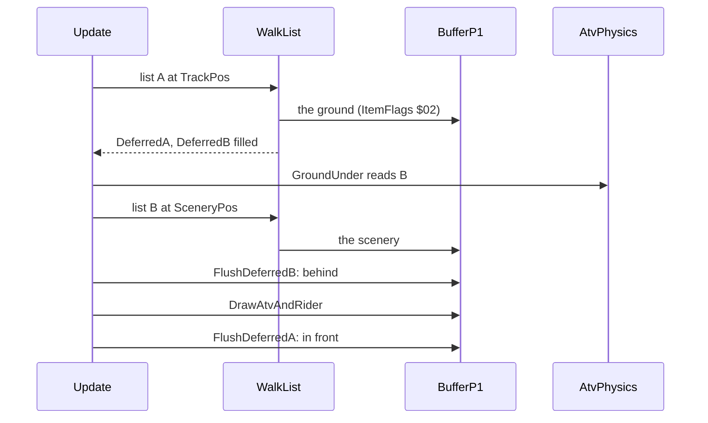

*The draw order. How to read: time runs down; an arrow into BufferP1 is a draw. The point: the physics sees the buffer
between the first walk and the second, so the order of drawing is the collision rule.*

Worked example, from the trace of the pass at frame 1 263:

| Step | Starts |
| --- | --- |
| Pass | 1 263 T 6 804 |
| WalkList, list A | 1 263 T 27 502 |
| WalkList, list B | 1 264 T 26 764 |
| FlushDeferredB (empty) | 1 265 T 9 994 |
| DrawAtvAndRider | 1 265 T 10 042 |
| FlushDeferredA: the sign | 1 265 T 46 149 |
| FinishCheck | 1 266 T 63 634 |
| Advance | 1 266 T 64 625 |
| CopyBufferP1 | 1 266 T 69 688 |

*One pass's drawing, from the trace. The point: the ATV and rider take 36 000 T, between the scenery and the sign.*

The point: designers made an item solid or not by its draw mode; a deferred dune would be a picture the ATV passes
through.

## 7.6 The two scrolls

### In short

The record holds two 24-bit positions:

- Distance `$D789-$D78B`: a fraction byte and TrackPos `$D78A`, a word in pixels. It is list A's scroll.
- Scenery `$D78E-$D790`: a fraction byte and SceneryPos `$D78F`. It is list B's scroll.

Advance `$E011` runs once a pass after Update, if Speed is 2 or more. Facing right, it adds Speed x 128 to Distance
(Speed / 2 pixels) and Speed x 32 to Scenery (Speed / 8 pixels). Facing left, it subtracts them. So the scenery moves
at a quarter of the ground's speed: a two-layer parallax.

The code shifts Speed x 256 right three times, which is Speed x 32: a quarter (ForwardScenery `$E0E1`).

```text
ForwardList: E0A3 LD A,(Speed)
          E0A6  LD D,A
          E0A7  LD E,$00
          E0A9  SRL D
          E0AB  RR E                 ; DE = Speed x 128
          E0AD  LD HL,(Distance)     ; the fraction and TrackPos' low byte
          E0B0  LD A,H
          E0B1  AND $10
          E0B3  LD C,A               ; bit 4 of TrackPos before
          E0B4  ADD HL,DE
          E0B5  LD (Distance),HL
          E0B8  PUSH AF
          E0B9  LD A,H
          E0BA  AND $10
          E0BC  CP C
          E0BD  CALL NZ,ScoreStep    ; every 16 pixels: a point
          E0C0  POP AF
          E0C1  RET NC
          E0C2  LD A,(TrackPos+$0001)
          E0C5  ADD A,$01            ; the carry into the high byte
ForwardScenery: E0E1 LD A,(Speed)
          E0E4  LD D,A
          E0E5  LD E,$00
          E0E7  SRL D
          E0E9  RR E
          E0EB  SRL D
          E0ED  RR E
          E0EF  SRL D
          E0F1  RR E                 ; DE = Speed x 32
          E0F3  LD HL,(Scenery)
          E0F6  ADD HL,DE
```

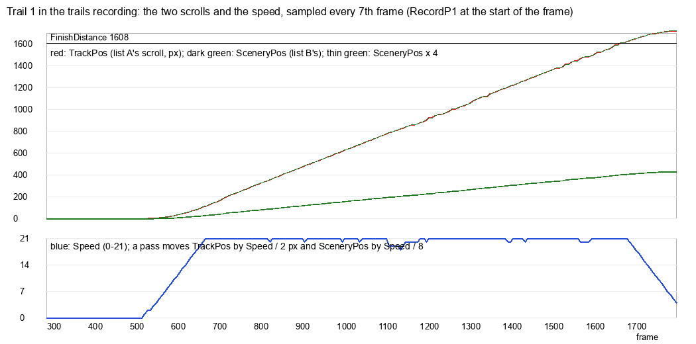

*The two scrolls in `trails`, every pass of trail 1. How to read: top, TrackPos (red) and SceneryPos (dark green),
with SceneryPos x 4 (thin green) lying on TrackPos; bottom, Speed. The point: the scenery is exactly a quarter of the
ground at every moment, and both are the sum of the speeds. Command: `python3 tools/fig_objects.py fig-scroll
work/docs/atC/trails-vars.jsonl docs/img/objects/scroll.png`.*

Worked example: the pass at frame 1 263, Speed 21.

1. Before: Distance `$03EF00` (TrackPos 1 007), Scenery `$00FBC0` (SceneryPos 251).
2. Advance adds 21 x 128 = `$0A80` and 21 x 32 = `$02A0`.
3. After (the sample of frame 1 267): Distance `$03F980` (TrackPos 1 017.5), Scenery `$00FE60` (SceneryPos 254.4).
4. TrackPos' low byte went from `$EF` to `$F9`: bit 4 changed, so ScoreStep added a point. The score reads `00620` at
   frame 1 264 and `00630` at 1 267 (one point shows as 10).

Backwards, BackList `$E030` subtracts and calls ScoreDown at each bit-4 change: riding back loses the points. Under 0
it gives the point back (ScoreStep, `$E05A`), puts both scrolls at 0 and stops the ATV.

Witness: the scroll chart; in `trails-vars.jsonl` SceneryPos x 4 stays within 4 of TrackPos at every sample of
trail 1.

## 7.7 Animated objects

### In short

An item whose flags' high nibble is set points at an animation record. PlaceItem calls AnimObject `$8A49` for it.
AnimObject:

1. takes the sprite (+0) and ItemFlags (+1) from the record;
2. checks the id (+2) against SeenIds `$8124`, so that an object moves at most once a pass (below);
3. steps up to three motions, each a (period, counter) pair:
   - the distance: +3 the period, +4 the counter, the step in +7's high nibble; it changes the item's +0;
   - y: +5 and +6, the step in +7's low nibble; it changes the item's +2;
   - the sprite: +8 (the period in the high nibble, the step in the low), +9 the counter; it changes the record's +0.

A motion's counter counts up to the period, then (bit 7 set) down to 0, then up again. The step is added on the way
up and subtracted on the way down. So each motion is a triangle wave of period x 2 passes and amplitude period x step.
A period of 0 skips a motion; `$FF` ends the record. The START banner's records (Anim8042, Anim8046 and their copies)
end at +3: they never move.

The motion is written into the list itself. An object therefore keeps its place when it leaves the window, and moves
only while it is walked: once a pass while it is on screen, or is the item just past either edge.

### Pseudocode

```text
AnimObject(item, rec):
    SpriteNum = rec[0]; ItemFlags = rec[1]
    if PlayerIndex != 0:
        if rec.id in SeenIds[0:SeenCount]: return     # player 1 moved it: draw it where it is
    else:
        SeenCount += 1
        if SeenCount == 30: blue border, hang         # ListOverflow: the 30th new id; 29 are stored
        SeenIds[SeenCount - 1] = rec.id
    swing(rec[3], rec[4], step = rec[7] >> 4)  -> item.distance
    swing(rec[5], rec[6], step = rec[7] & 15)  -> item.y
    swing(rec[8] >> 4, rec[9], step = rec[8] & 15) -> rec[0], the sprite

swing(period, counter, step) -> value:
    if period == $FF: stop;  if period == 0: skip
    if counter bit 7 clear:
        counter += 1; if counter == period: counter |= $80
        value += step
    else:
        counter = (counter AND $7F) - 1; if counter != 0: counter |= $80
        value -= step
```

### Assembly

```text
AnimObject: 8A49 LD B,(IY+$05)
          8A4C  PUSH BC
          8A4D  POP IX                 ; IX = the record (B = +5, C = +4)
          8A4F  LD A,(BC)
          8A50  LD (SpriteNum),A
          8A53  INC BC
          8A54  LD A,(BC)
          8A55  LD (ItemFlags),A
          ...
          8A63  LD A,(PlayerIndex)
          8A66  CP $00
          8A68  JP Z,l_8A82            ; player 1: register the id
          8A6B  LD A,(SeenCount)
          ...
l_8A77:   8A77  LD A,(HL)
          8A78  CP (IX+$02)
          8A7B  RET Z                  ; seen this pass: no step
          ...
l_8A82:   8A82  LD A,(SeenCount)
          8A85  LD E,A
          8A86  ADD A,$01
          8A88  LD (SeenCount),A
          8A8B  CP $1E
          8A8D  JP C,AnimNewId
ListOverflow: 8A90 LD A,$01
          8A92  OUT ($FE),A            ; blue border
l_8A94:   8A94  JP l_8A94              ; and hang
          ...
l_8AA1:   8AA1  LD A,(IX+$03)          ; the distance motion
          8AA4  CP $FF
          8AA6  RET Z
          8AA7  CP $00
          8AA9  JP Z,l_8B0C
          8AAC  LD E,A                 ; E = the period
          8AAD  LD A,(IX+$04)
          8AB0  BIT 7,A
          8AB2  JP NZ,l_8AE0           ; on the way back
          8AB5  ADD A,$01
          8AB7  CP E
          8AB8  JP NZ,l_8ABD
          8ABB  SET 7,A                ; the turn
l_8ABD:   8ABD  LD (IX+$04),A
          8AC0  LD A,(IX+$07)
          8AC3  AND $F0
          ...                          ; E = the high nibble
          8AD0  LD L,(IY+$00)
          8AD3  LD H,(IY+$01)
          8AD6  ADD HL,DE
          8AD7  LD (IY+$00),L
          8ADA  LD (IY+$01),H          ; the item's distance + step
```

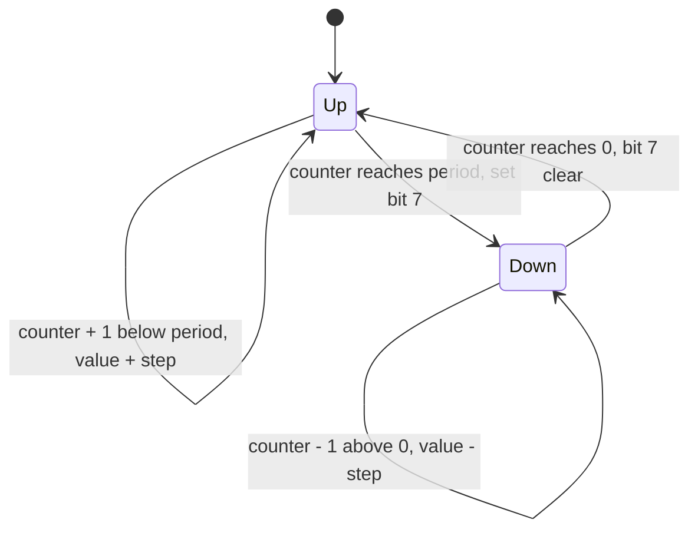

*One motion. How to read: each arrow is one pass. The point: a motion is two numbers and a bit; three of them make a
bouncing, swinging, flapping object.*

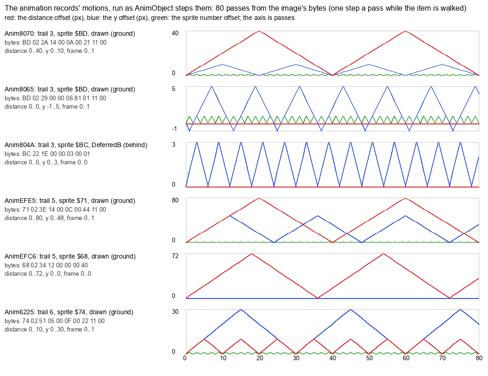

*Six animation records run by `tools/fig_objects.py`, a Python copy of `$8AA1-$8B9F`, from the image's bytes. How to
read: each row is one record, its bytes on the left; the lines are the offset of the item's distance (red), its y
(blue) and the record's sprite number (green) over 80 passes. The point: trail 3's Anim8070 swings 40 pixels along
the trail and 10 up while it flaps its sprite every pass; trail 5's AnimEFE5 jumps 48 lines; Anim804A only bobs, and
being in DeferredB it is a picture the ATV rides through. Command: `python3 tools/fig_objects.py fig-motion
docs/img/objects/motion.png`.*

Worked example: Anim8070 at `$8070`, pointed at by list A3's item at `$043A`, y 32. Its bytes are `BD 02 2A 14 00 0A
00 21 11 00 FF`.

1. Sprite `$BD`, ItemFlags `$02`: drawn at once, so solid.
2. Id `$2A`.
3. Distance: period `$14` = 20, step 2 (`$21` high nibble). Over 20 passes the item moves from 1 082 to 1 122, then
   back over 20 passes: one swing every 40 passes, 5.6 s.
4. y: period 10, step 1 (`$21` low nibble): 32 to 42 and back every 20 passes.
5. The sprite: `$11`, period 1, step 1: `$BD`, `$BE`, `$BD`, ... a flap every pass.

Because the object is solid and moves, the ground under the ATV moves with it: the ATV can be lifted, or hit by a
step, by an object that comes to it.

### SeenIds: one step a pass

Players `$EC7F` clears SeenCount `$8123` before player 1's pass. Player 1's walk registers every id it steps. Player
2's walk steps only the objects player 1 did not see. In a two-player game the object is thus at one place for both
halves of the screen, and moves at one speed whatever the number of players.

Player 1's walk does not check the list before appending. When the walk steps the index back (7.4), the index item
goes through PlaceItem twice in one walk; an animated item there moves twice and takes two places in SeenIds.

Witness: in the sample of frame 1 277 of `trails` SeenCount is 1 and SeenIds starts `$65` (Anim8046, the sign), the
only animated item in view; the trace of the pass at 1 263 runs AnimObject once. `trails` and `trail1` stop in trail
2, and `warp` jumps each trail to 40 pixels before its finish, so none of them rides past a moving object. The
recording `anim` does (WALKTHROUGH 6.0): trails 1 and 2 as in `warp`, then trail 3 with its distance POKEd to 700 at
frame 3 043, before the seal and its ball (list A3 `$0363` Anim8053, sprite `$BC`, and `$0361` Anim8065, sprites
`$BD` / `$BE`, y 34). Its L1 has AnimObject 800 times (frames 398-4 360).

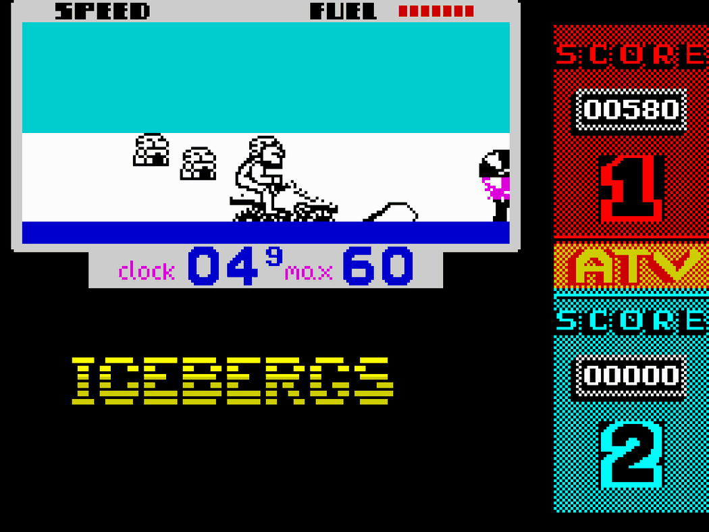

*The seal and its ball, `anim` frames 3 060 to 3 240, every 3rd frame: trail 3 ICEBERGS at distance 700 onwards. Command:
`python3 ../../kit/screen_anim.py --work work/review/fixB/anim --from 3060 --to 3240 --step 3 --width 1050 --delay 80
docs/img/play/anim-seal.gif`.*

What to watch:

- the ball rising and falling over the seal, a step a pass, its sprite changing every pass (Anim8065's `$11`);
- the pair drifting left only with the scroll: neither record has an x motion (period 0);
- the ATV meeting the ball: the ball is drawn at once (flags `$02`), so it is ground for the wheels (7.5).

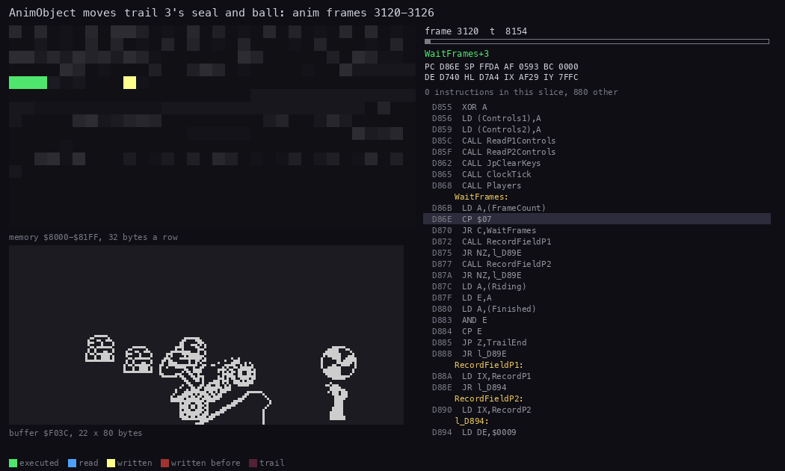

*AnimObject at work: `$8A49` in one pass of `anim`, frames 3 120-3 126, 60 pictures. How to read: the top left
is the memory `$8000-$81FF`, the animation records of trails 1-4 at `$8042-$807A` lit as they are read and written,
SeenIds at `$8124`; the bottom left is BufferP1, where the seal and the ball are drawn; the right is the listing at the
current PC. Command: `python3 ../../kit/routine_anim.py --work work/review/fixB/anim --listing build/game.lst --window
3120:0-3127:0 --pc 8A49-8BA0 --view buffer:F03C:22x80 --range 8000-81FF --pictures 60 --title "AnimObject moves trail
3's seal and ball: anim frames 3120-3126" --out docs/img/routines/AnimObject.gif`.*

What to watch:

- the records' bytes written in place each pass (the record is its own state): over this pass `$8059`, `$8065`,
  `$806B` and `$806E` change (Anim8053's y counter; Anim8065's sprite, y counter and frame counter), and below the
  range the two items' own bytes in list A3, `$7E76` and `$7E7C`;
- SeenIds `$8124` holding the two ids, `$29` and `$1F` (SeenCount 2 at the samples of 3 121 and 3 126);
- the two sprites ORed into the buffer after AnimObject has chosen their frame and offset.

The motions of the other records are known only from the code.

## 7.8 The player record

### In short

Each player has a record of 50 bytes: RecordP1 `$D70E` and RecordP2 `$D740`. The pass copies the player's record to
Record `$D772` (LoadRecordP1 `$E4E1`, 50 bytes by LDIR), runs Update and Advance on it, and copies it back
(SaveRecordP1 `$E4ED`). So one copy of the code serves both players, at a cost of 100 bytes of LDIR (2 100 T) a
player a pass. InitRecords `$E4CA` copies RecordTemplate `$D7A7` into both records before each trail.

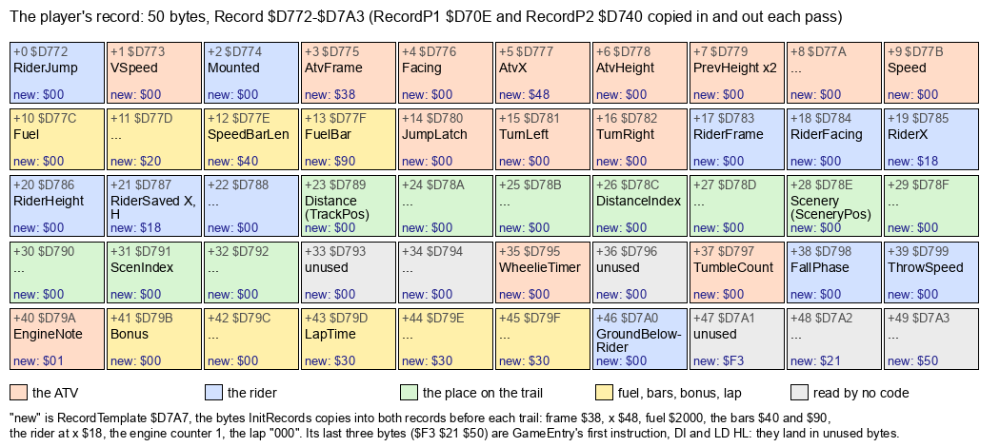

*The record. How to read: one box a byte, `+offset $address` at the top, the name in the middle, the template's
value at the bottom; the colour is the group. The point: the ATV, the rider, the place on the trail and the HUD's
numbers are all here, and six bytes are read by no code. Command: `python3 tools/fig_objects.py fig-record
docs/img/objects/record.png`.*

Notes on the fields:

- AtvX (+5) is `$48` in every sample of `trails` with the rider mounted: the ATV stays at x 72 and the trail scrolls
  under it. The rider has his own x (+19), because he walks.
- EngineNote (+40) is the wheels' flicker counter, not a sound ([doc 9](09-sound.md)).
- Bonus (+41) is filled at the finish and counted into the score by TrailEnd ([doc 10](10-gameplay-logic.md)).
- `$D793-$D794`, `$D796` and `$D7A1-$D7A3` are read by no instruction. The template's last three bytes, `$F3 $21 $50`,
  are the first bytes of GameEntry, which follows RecordTemplate: the copy of 50 bytes takes three bytes of code into
  `$D7A1-$D7A3`, harmlessly.

Worked example: at the sample of frame 1 264 of `trails`, RecordP1 holds Speed 21, AtvFrame `$38`, AtvX `$48`,
Mounted 1, RiderX 77, Fuel `$1044`, Distance `$03EF00`, DistanceIndex 48 and ScenIndex 6.

## 7.9 Limits, quirks and what is known only from the code

- **29 animated objects a pass.** Player 1's walk appends every animated item it steps to SeenIds. The 30th hangs the
  game with a blue border (ListOverflow `$8A90`). The busiest view in the data holds far fewer; no recording reaches
  it.
- **An item placed too low.** PlaceItem compares SpriteY with the sprite's height. If y is below the height, part of
  the sprite would fall under the window: ItemTooLow `$8EB2` sets a red border and restarts the game. No trail's data
  has such an item; `work/stage1/rec/itemlow` (714 frames from `c1`'s menu snapshot, `tools/rec_crashes.py itemlow`)
  makes one with a POKE at the menu: trail 1's list A item 2 (the START banner's `$C9`, 7 lines high) gets y 1
  instead of 23. After START the first pass (frame 398) runs Update and WalkList once and PlaceItem 4 times; the
  fourth finds y 1 under the height 7: ItemTooLow (`$8EB2`, the `OUT` at `$8EB4`, `JP RestartJump` at `$8EB9`),
  Restart `$D7ED`, and the credits come back (its screens to frame 714). Witness: its L1 (Update 1, WalkList 1,
  PlaceItem 4, all at frame 398; ItemTooLow is reached by falling through, so it has no L1 entry) and the trace
  `work/review/fixB/itemlow/traces/397_0-400_0.uatr`: `$8EB2`, `$8EB4`, `$8EB9` and `$D7ED` once each, in frame 398.
- **A double step.** An animated item at the walk's index can be stepped twice in one walk (7.7).
- **Objects that freeze.** An animated item moves only while walked; one left behind keeps its place. Nothing in the
  code puts the distances back, so a second round of trails (after trail 6) finds the objects where the first round
  left them.
- **Item flags.** Bit 0 is the menu bank, not a mirror; flags bit 1 (2) defers to DeferredB, drawn before the
  ATV, and bit 2 (4) to DeferredA, drawn after it; list B scrolls at a quarter of list A.
- Known only from the code: AnimObject's motions other than trail 3's seal and ball (recording `anim`), SeenIds'
  effect in a two-player game, ListOverflow and the double step. ItemTooLow only with the POKE above.
