# 8. HUD and text

What this covers:

- the text printer: Print `$7608`, PrintAt `$7600`, and how a character becomes a sprite (8.1);
- the font: the letters, the two digit sets, the glyphs, the HUD's words (8.2);
- the texts: the menus' table with its measured widths, the game's four messages, the trail names (8.3);
- the HUD's fields and how a trail's panels are set up: ShowHud `$6C6F`, ShowBars `$EBA5` (8.4);
- the clock: ClockTick `$EB53`, one digit a pass, and the TIME OUT test (8.5);
- the score: ScoreUpP1 `$EDBB`, a point every 16 distance units, drawn by XOR (8.6);
- the SPEED bar: SpeedBar `$E55D`, one 4-pixel cell a pass (8.7);
- fuel: UseFuel `$DF91`, the FUEL bar falling, OUT OF FUEL (8.8);
- text on the trail: PrintShadow `$EC26` and TIME OUT `$EBE3` (8.9);
- the finish: FinishCheck `$DB34`, LAP TIME, EXTENDED PLAY, the time bonus and its lost byte (8.10);
- the trail intro, the credits and the high score table on the front end (8.11);
- the high scores and the name entry: CheckHiScore `$7A3E`, NameEntry `$7A7E`, NameSelect `$7BC6` (8.12).

The recordings it rests on ([WALKTHROUGH](../WALKTHROUGH.md) 6.0):

| Recording | Load | Used for |
| --- | --- | --- |
| `c1` | power-on, the tape, `tests/inputs/c1.txt` | one player on trail 1: the clock, the score, the credits and the table on the front end, TIME OUT |
| `fuel` | `work/stage1/rec/c1/menu.szx`, `tests/inputs/fuel.txt` (the clock stopped by POKE 60250,0) | the FUEL bar falling cell by cell |
| `empty` | `work/stage1/rec/c1/menu.szx`, `tests/inputs/empty.txt` (the fuel POKEd near empty) | OUT OF FUEL and PrintShadow |
| `warp` | `work/stage1/rec/c1/menu.szx`, `tests/inputs/warp.txt` (the distance POKEd near each finish) | the finish, the bonus, the trail intro, the name entry |
| `trails` | `work/stage1/rec/c1/menu.szx`, `tests/inputs/trails.txt` (no POKE) | a finish reached by riding: the bonus by the intended formula |
| `kb` | `work/stage1/rec/menu/menu-two-kb.szx`, `tests/inputs/kb.txt` | two players: two scores, player 2's name entry |

The instances ran in `work/docs/atB/` (one at a time, port base 37782). The commands are in
[`work/docs/atB-NOTES.md`](../work/docs/atB-NOTES.md).

Conventions:

- **x** counts pixels from the left edge of whatever is drawn into: the screen, or the 176-pixel window buffer.
- **y** counts lines up from the bottom. On the screen `$BF` is the top line, so a field at y `$66` starts on line
  191 − 102 = 89 from the top. In the window buffer `$4F` is the top line
  ([doc 6](06-rendering.md#64-the-buffer-and-the-draw-modes)).
- A **pass** is one turn of the main loop, 7 frames with one player ([doc 4](04-game-loop.md)).
- Times are frame:T in the recording's trace, T counted from the frame's interrupt.
- **Shown** numbers are what the screen reads. The score's last digit is always 0, so one point shows as 10.

## 8.1 Print

Every text in the game goes through one routine. Print `$7608` walks a string at IX. It turns each character into a
sprite number and draws that sprite with the current draw mode at SpriteX, SpriteY. Then it moves SpriteX on by the
sprite's advance plus 2. PrintAt `$7600` first sets the place from H (x) and L (y).

The string ends with `|`. Three codes draw nothing: `|` ends, `]` jumps x to `$78` (the menus' key column), a space
adds 6 to x. Every other code draws one sprite.

```text
Print(IX):                                  # SpriteX, SpriteY, ModeVector set by the caller
    loop:
        c = [IX]
        if c == '|': return
        if c == ']': SpriteX = $78
        elif c == ' ': SpriteX += 6
        else:
            if   c == '"': n = $5B
            elif c == '!': n = $56
            elif c == '.': n = $6F
            elif c < ':':  n = c + $69; DestAddr = BufferAddr() - 22     # '0'-'9': small digits, a line higher
            elif 'a' <= c <= 'j': n = c + $2C                          # the big digits
            elif c >= 'k': n = c                                       # a raw sprite number ($70 the arrow)
            else:          n = c - $23                                 # 'A'-'Z'
            SpriteNum = n; DestAddr = BufferAddr() unless set above
            GameSprite()                                             # the draw mode in ModeVector
            SpriteX += SpriteAdvance + 2
        IX += 1
```

```asm
PrintAt:
  7600  LD A,H
  7601  LD (SpriteX),A
  7604  LD A,L
  7605  LD (SpriteY),A
Print:
  7608  LD A,(IX+$00)
  760B  CP $7C
  760D  RET Z
  760E  CP $5D
  7610  JR NZ,l_7619
  7612  LD A,$78
  7614  LD (SpriteX),A
  7617  JR l_7679
l_7619:
  7619  CP $20
  761B  JR NZ,l_7627
  761D  LD A,(SpriteX)
  7620  ADD A,$06
  7622  LD (SpriteX),A
  7625  JR l_7679
l_7627:
  7627  LD E,$5B
  7629  CP $22
  762B  JR Z,l_765F
  762D  LD E,$56
  762F  CP $21
  7631  JR Z,l_765F
  7633  LD E,$6F
  7635  CP $2E
  7637  JR Z,l_765F
  7639  CP $3A
  763B  JR NC,l_7650
  763D  ADD A,$69
  763F  LD (SpriteNum),A
  7642  CALL JpBufferAddr
  7645  LD DE,$0016
  7648  XOR A
  7649  SBC HL,DE
  764B  LD (DestAddr),HL
  764E  JR l_7669
l_7650:
  7650  CP $61
  7652  JR C,l_765C
  7654  CP $6B
  7656  JR NC,l_7660
  7658  ADD A,$2C
  765A  JR l_7660
l_765C:
  765C  SUB $23
  765E  LD E,A
l_765F:
  765F  LD A,E
l_7660:
  7660  LD (SpriteNum),A
  7663  CALL JpBufferAddr
  7666  LD (DestAddr),HL
l_7669:
  7669  CALL JpGameSprite
  766C  LD A,(SpriteAdvance)
  766F  LD E,A
  7670  LD A,(SpriteX)
  7673  ADD A,E
  7674  ADD A,$02
  7676  LD (SpriteX),A
l_7679:
  7679  INC IX
  767B  JR Print
```

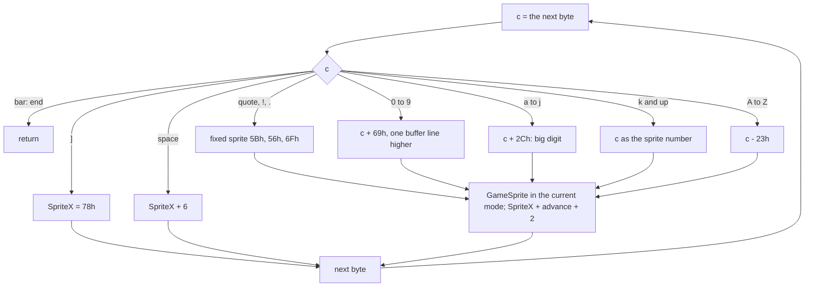

Print never decides how pixels land: the caller does. BufferAddr places the glyph in the buffer at BufferBase, or on
the screen when ScreenBase is used. The draw mode decides the rest: OR, copy, XOR, scaled. The same Print draws the
menus (OR into a buffer), the HUD digits (copy or XOR on the screen), the trail messages (8.9) and the big titles
(BigPrint, mode `$10`, 8.11).

Worked example: OUT OF FUEL at x `$3C` (60). The letters' advances are 6, except E, F, L and T (5) and I (3). O
draws at 60, U at 68, T at 76; the space takes x from 83 to 89; O at 89, F at 97; the space takes 104 to 110; F at
110, U at 117, E at 125, L at 132. SpriteX ends at 139: the text is 79 pixels wide.

Witness: Print `$7608` has 35 677 calls in the L1 profiles (all recordings). `empty` frame 766 shows OUT OF FUEL
drawn letter by letter (Animation 8.5).

The point: one printer and one font serve the whole game. A character is only an index into the sprite bank. So a
text can mix letters, digits and any picture: the end arrow in the name grid is code `$70`.

## 8.2 The font

The font is part of the game's sprite bank ([doc 6](06-rendering.md#62-the-sprite-format)). Each glyph has the
4-byte header of any sprite: width in bytes, height, advance, shift. Letters are 2 bytes wide and mostly 6 lines
high. The small digits are 7 lines high, the big ones 14. The HUD's words SPEED, FUEL, clock and max are single
sprites.

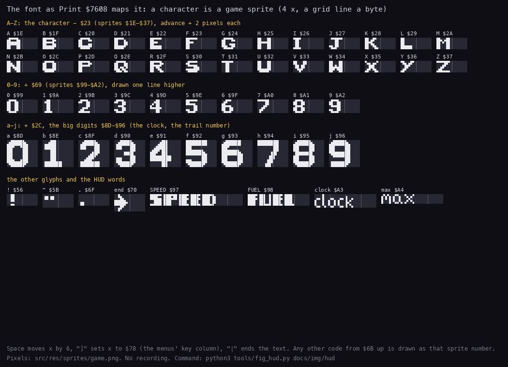

*Figure 8.1: the glyphs Print can reach, at 4 x, read from `src/res/sprites/game.png` with Print's mapping. No
recording. Command: `python3 tools/fig_hud.py docs/img/hud`.*

How to read it:

- each cell is one sprite: its label is the character, then the sprite number;
- the faint vertical line marks the byte boundary: every glyph is two bytes wide, the right byte mostly empty;
- the big digits (`a`-`j`) are what the clock and the trail number use;
- the small digits (`0`-`9`) are what the score, LAP TIME and the clock's last digit use.

```text
sprite(c) =  c - $23        for 'A'..'Z'     ($1E..$37)
             c + $69        for '0'..'9'     ($99..$A2, 7 lines)
             c + $2C        for 'a'..'j'     ($8D..$96, 14 lines)
             $56, $5B, $6F  for '!', '"', '.'
             c              for $6B and up
```

```asm
l_7650:
  7650  CP $61
  7652  JR C,l_765C
  7654  CP $6B
  7656  JR NC,l_7660
  7658  ADD A,$2C
  765A  JR l_7660
l_765C:
  765C  SUB $23
  765E  LD E,A
```

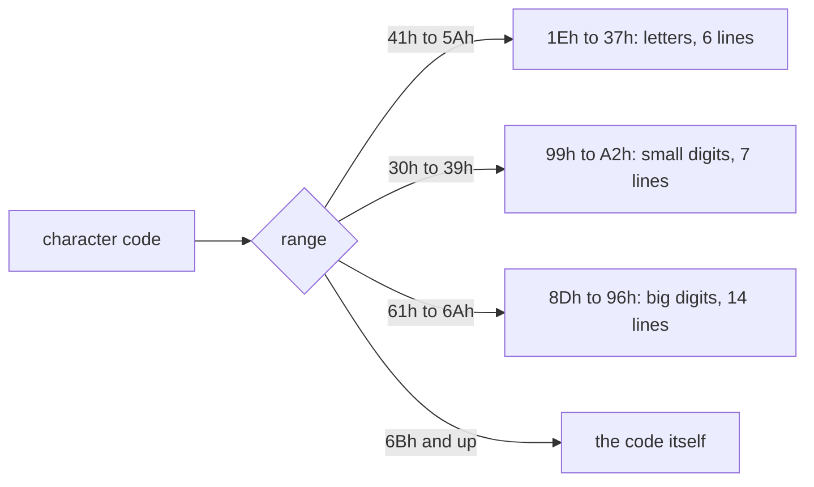

Worked example: `A` is `$41`. `$41` − `$23` = `$1E`, sprite 30: 2 bytes x 6 lines, advance 6. The next letter
starts 6 + 2 = 8 pixels to the right. `3` is `$33`; `$33` + `$69` = `$9C`, sprite 156: 7 lines, advance 5.

Witness: `src/res/sprites/game.csv` gives each sprite's width, height and advance. The screens of every recording
show these glyphs (Figure 8.2).

The point: the font costs no table of its own. The letters reuse the sprite format and the sprite drawer, so text
can be drawn in any of the renderer's modes.

## 8.3 The texts

The texts live in four places. All end with `|`.

| Table | Address | Contents | Source |
| --- | --- | --- | --- |
| MenuTexts | `$70AA` | EXIT, START, CHOOSE CONTROL, ONE / TWO PLAYERS, KEYBOARD, KEMPSTON, SINCLAIR, the ten key lines, PLAYER ONE / TWO, the credits' lines | `src/res/texts/menu.txt` |
| GameTexts | `$EC4E` | TIME OUT, OUT OF FUEL, EXTENDED PLAY, `LAP TIME     ` (the clock's digits go in its spaces) | `src/res/texts/game.txt` |
| TrailTexts | `$79E6` | TRAIL NO., then the six names: SAND DUNING, GRASSTRAKIN, ICEBERGS, PYRAMIDS, TROPICANA, SWAMP | `src/res/texts/trails.txt` |
| HiScoreTitle, HiNames, HiScores | `$695F`, `$696A`, `$6988` | HI SCORE; five names (H O T, PRO, RODEO, RACER, BUDDY) and five scores (20000 down to 03000), 6 bytes each | `src/res/texts/hiscore.txt`, `hinames.txt`, `hiscores.txt` |

Each menu text starts with two bytes that are zero on the tape. InitTextWidths `$75C0` fills them once, at the
start. It prints every text in mode 0, which draws nothing, and reads how far SpriteX went. The first byte becomes the
x that centres the text in 255 pixels. The second becomes the width in attribute cells, for the menu's highlight.

```text
InitTextWidths():
    ModeVector = DrawModes + 0                # the "none" mode: only SpriteX moves
    for each text T in MenuTexts until $FF:
        SpriteX = 0; Print(T + 2)
        T[0] = (255 - SpriteX) / 2            # the centring x
        T[1] = CellCount(SpriteX + (T[0] AND 7) + 2)   # the cells the text covers once centred
```

```asm
InitTextWidths:
  75C0  LD HL,DrawModes
  75C3  LD (ModeVector),HL
  75C6  LD A,$4F
  75C8  LD (SpriteY),A
  75CB  LD IX,MenuTexts
l_75CF:
  75CF  LD A,(IX+$00)
  75D2  CP $FF
  75D4  RET Z
  75D5  XOR A
  75D6  LD (SpriteX),A
  75D9  PUSH IX
  75DB  INC IX
  75DD  INC IX
  75DF  CALL Print
  75E2  POP HL
  75E3  LD A,(SpriteX)
  75E6  LD E,A
  75E7  LD A,$FF
  75E9  SUB E
  75EA  SRL A
  75EC  LD (HL),A
  75ED  INC HL
  75EE  AND $07
  75F0  LD E,A
  75F1  LD A,(SpriteX)
  75F4  ADD A,E
  75F5  ADD A,$02
  75F7  CALL CellCount
  75FA  LD (HL),A
  75FB  INC IX
  75FD  JP l_75CF
```

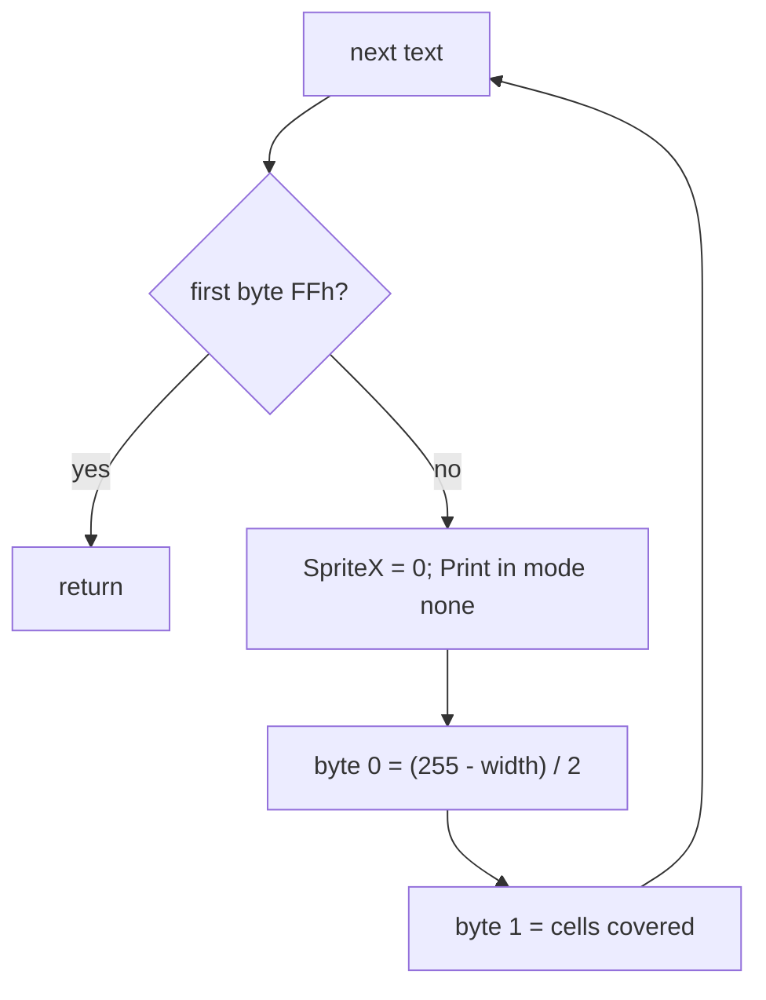

Worked example: START is S, T, A, R, T: advances 6, 5, 6, 6, 5, plus 2 each, 38 pixels. Byte 0 becomes
(255 − 38) / 2 = 108. Byte 1 is CellCount(38 + (108 AND 7) + 2) = CellCount(44) = 44 / 8 + 1 = 6 cells.

Witness: InitTextWidths has 1 call, in `c1` (the start of the game). The other recordings start from `menu.szx`, made
after it ran.

The point: the game measures its texts by drawing them invisibly. Nobody had to count pixels for a centred menu. The
same trick sizes the trail's items in the renderer
([doc 6](06-rendering.md#67-the-measuring-call-rotations-twice)).

## 8.4 The HUD's fields

The HUD is drawn straight onto the screen, not into a buffer. Each field has a fixed place and its own routine. A
field is redrawn only when its value changes, and only the part that changed.

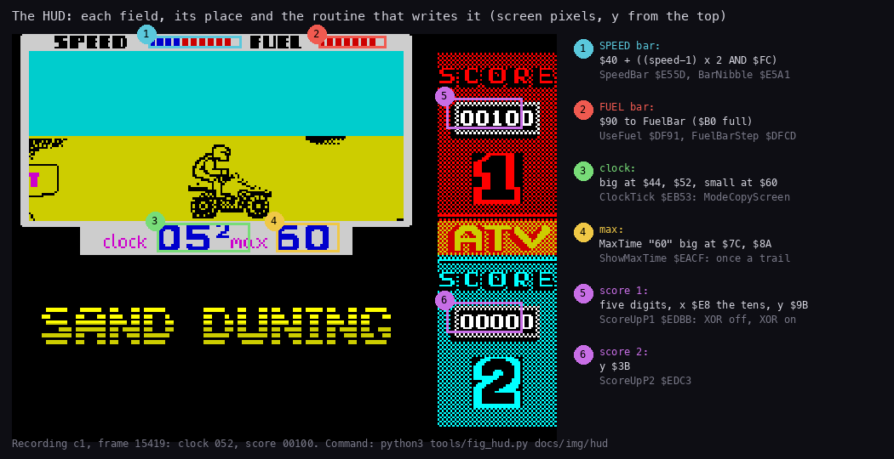

*Figure 8.2: recording `c1`, frame 15 419, one player on trail 1, the clock at 052 and the score at 00100. The boxes
are the places the code gives each field. Command: `python3 tools/fig_hud.py docs/img/hud`.*

How to read it:

- 1, the SPEED bar: from x `$40`, one 4-pixel cell per two speed units (8.7);
- 2, the FUEL bar: from x `$90` to FuelBar, `$B0` when full (8.8);
- 3, the clock: two big digits at x `$44` and `$52`, the last digit small at `$60`, all at y `$66` (8.5);
- 4, max: the trail's limit, two big digits drawn once (ShowMaxTime `$EACF`);
- 5 and 6, the scores: five small digits, the tens at x `$E8`, at y `$9B` (player 1) and `$3B` (player 2) (8.6).

A trail's setup draws the fields once. ShowHud `$6C6F` zeroes the clock and draws the HUD's word sprites (clock, max)
and boxes. PanelP1 `$6B8C` and PanelP2 `$6B42` draw each player's frame and set HudY: `$BE` for player 1, 6 for
player 2. They call ShowBars `$EBA5`, which fills the tank and draws the full FUEL bar.

```text
ShowBars():
    Fuel = $2000; FuelBar = $90 + $20                # full: the bar spans x $90-$AF
    at (x $90, y HudY - 1), four bytes in a row: each gets
        $E0 ORed into 4 lines (ScaleLeft), then $0E ORed into 4 lines (ScaleRight)   # two 3-pixel cells
```

```asm
ShowBars:
  EBA5  LD HL,$2000
  EBA8  LD (Fuel),HL
  EBAB  LD A,$90
  EBAD  LD (SpriteX),A
  EBB0  ADD A,$20
  EBB2  LD (FuelBar),A
  EBB5  LD A,(HudY)
  EBB8  SUB $01
  EBBA  LD (SpriteY),A
  EBBD  CALL GfxTable
  EBC0  LD C,$04
l_EBC2:
  EBC2  CALL ScaleLeft
  EBC5  CALL ScaleRight
  EBC8  INC HL
  EBC9  DEC C
  EBCA  JR NZ,l_EBC2
  EBCC  RET
ShowHud:
  6C6F  LD HL,$3030
  6C72  LD (Clock),HL
  6C75  LD (ClockTens),HL
  6C78  LD HL,Screen
  6C7B  LD (ScreenBase),HL
  6C7E  LD HL,DrawModes+$0002
  6C81  LD (ModeVector),HL
  6C84  LD HL,JpGameSpriteAt
  6C87  LD (SpriteListCall+$0001),HL
  6C8A  LD IX,HudSprites
  6C8E  CALL SpriteList
  6C91  LD IX,HudBoxes
  6C95  CALL AttrBoxes
  6C98  CALL JpShowClock
  6C9B  JP JpShowMaxTime
```

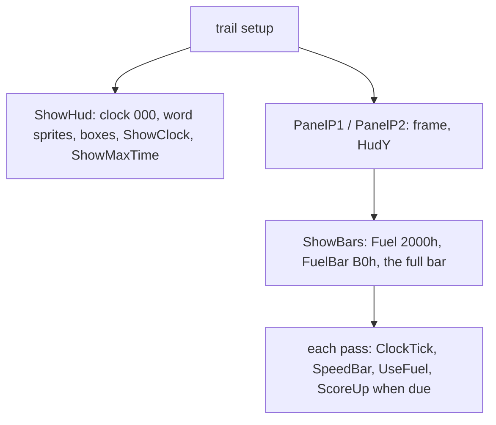

Worked example: player 1's HudY is `$BE`, line 1 from the top. The bars take lines 1 to 6. ShowBars draws from y
`$BD`, so its 3-pixel cells fill lines 2 to 5. Four bytes from x `$90` give eight cells, x `$90` to `$AF`.

Witness: ShowHud 16 calls and ShowBars 18 in the L1 profiles: one ShowHud per trail, one ShowBars per riding player.

The point: the HUD lives on the screen, outside the window the renderer copies. The renderer's 1 760-byte copy never
touches it, so it needs no redrawing each pass: the fields cost a few bytes a pass
([doc 6](06-rendering.md#611-the-code-against-the-screen)).

## 8.5 The clock

The clock counts passes, not seconds. ClockTick `$EB53` runs once a pass in the main loop. It adds 1 to the units
digit and draws it at x `$60` in ModeCopyScreen, which overwrites the old digit's bytes. Only when the units roll
over does it touch the tens, at x `$52`. Only when the tens roll over does it touch the hundreds, at `$44`. The
digits are ASCII bytes: Clock `$D6C9` (hundreds), ClockTens `$D6CA`, ClockUnits `$D6CB`.

The screen reads the clock as seconds and tenths: the last digit is small. A pass is 7 frames, so one shown second
(10 passes) is 1.4 real seconds.

```text
ClockTick():                       # once a pass
    place: x $60, y $66, ModeCopyScreen, ScreenBase $4000
    units += 1
    if units <= '9': draw units small; return
    units = '0'; draw it; x -= 14
    tens += 1
    if tens <= '9': draw tens big; return
    tens = '0'; draw it; x -= 14
    hundreds += 1 (back to '0' after '9'); draw it big

main loop, at the end of a pass:   # TIME OUT
    if Clock (the hundreds) == MaxTime[0]: TimeOut()
```

```asm
ClockPlace:
  EB3C  LD A,$60
  EB3E  LD (SpriteX),A
  EB41  LD A,$66
  EB43  LD (SpriteY),A
  EB46  LD HL,DrawModes+$0002
  EB49  LD (ModeVector),HL
  EB4C  LD HL,Screen
  EB4F  LD (ScreenBase),HL
  EB52  RET
ClockTick:
  EB53  CALL ClockPlace
  EB56  LD A,(ClockUnits)
ClockAdd:
  EB59  ADD A,$01
  EB5B  LD (ClockUnits),A
  EB5E  CP $3A
  EB60  JP C,ClockDigit
  EB63  LD A,$30
  EB65  LD (ClockUnits),A
  EB68  CALL ClockDigit
  EB6B  LD A,(SpriteX)
  EB6E  SUB $0E
  EB70  LD (SpriteX),A
  EB73  LD A,(ClockTens)
  EB76  ADD A,$01
  EB78  LD (ClockTens),A
  EB7B  CP $3A
  EB7D  JP C,BigDigit
ClockDigit:
  EABF  PUSH AF
  EAC0  SUB $97
  EAC2  JR l_EAC7
BigDigit:
  EAC4  PUSH AF
  EAC5  SUB $A3
l_EAC7:
  EAC7  LD (SpriteNum),A
  EACA  CALL JpGameSpriteAt
  EACD  POP AF
  EACE  RET
l_D89E:
  D89E  LD A,(Clock)
  D8A1  LD E,A
  D8A2  LD A,(MaxTime)
  D8A5  CP E
  D8A6  JR NZ,Pass
  D8A8  CALL RecordFieldP1
  D8AB  LD (HL),$00
  D8AD  CALL RecordFieldP2
  D8B0  LD (HL),$00
  D8B2  CALL TimeOut
```

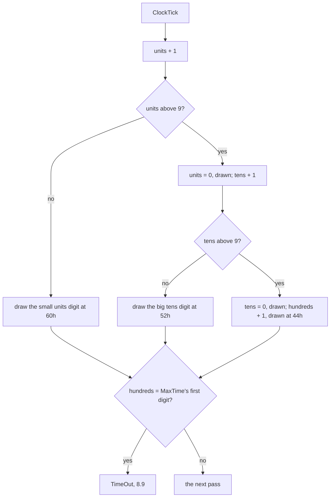

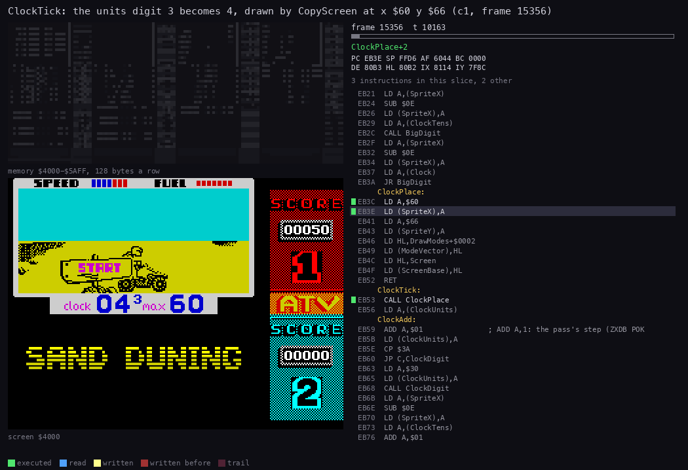

*Animation 8.1: `c1` frame 15 356, T 10 100 to 12 600: ClockTick turns the units 3 into 4 and copies the small
digit onto the screen at x `$60`, y `$66`. 40 pictures; the view is the screen, the changed bytes in yellow.
Command: `python3 ../../kit/routine_anim.py --work work/docs/atB/c1 --window 15356:10100-15356:12600 --listing
build/game.lst --auto-labels owner --view screen --range 4000-5AFF --pc EB3C-EBA4,7600-79FF,8600-87FF --pictures 40
--title "..." --out docs/img/routines/ClockTick.gif`.*

What to watch:

- ClockPlace setting x `$60`, y `$66` and the copy mode;
- ClockAdd's `ADD A,$01` taking `3` to `4`, then `JP C,ClockDigit`;
- the 7 lines of the digit written over the old ones: the old digit is gone without being erased first.

Worked example: TIME OUT on trail 1. MaxTime is "60"; the table MaxTimes `$D6CF` gives 60, 60, 60, 40, 50, 50, and
"30" in the second round. The test compares only the hundreds: the clock reaches `6`, `0`, `0` after 600 passes,
4 200 frames, 84 real seconds, while the screen reads 60.0. In `c1` the first pass is at frame 15 060; 15 060 +
4 200 = 19 260, the frame of Figure 8.5.

Witness: ClockTick 5 349 calls in the L1 profiles; in `c1` 600 calls, one per pass of trail 1. The ZXDB POKE
60250,0 writes 0 into ClockAdd's operand `$EB5A`: `ADD A,$00`, and the clock stops. `fuel` and `empty` use it.

The point: the cheapest clock is the frame loop itself. One ASCII digit a pass, copied over the old one, costs 14
bytes of screen. The test against MaxTime looks at one byte only, so a limit like 45 could not be written.

## 8.6 The score

A player scores a point each time the distance crosses a multiple of 16 units going forwards, and loses one going
backwards. ScoreStep `$E0CB` gives nothing once the player has finished. A score is five ASCII digits: Scores `$6948`
for player 1, ScoreP2 `$694D` for player 2. The last digit is never touched, so a point shows as 10.

ScoreUpP1 `$EDBB` starts at the tens digit (IX = Scores + 3). It draws in ModeXorScreen, where drawing a digit twice
removes it. So it XORs the old digit off, adds 1, and XORs the new digit on. A carry sets the digit to 0, draws it,
moves one digit left and repeats, at most four times.

```text
ScoreUp(IX = score + 3, y):                  # y $9B player 1, $3B player 2
    x = $E8; ModeXorScreen; ScreenBase $4000
    repeat 4:
        draw digit [IX]                      # XOR: the old digit off
        [IX] += 1
        if [IX] <= '9': draw digit [IX]; return  # XOR: the new digit on
        [IX] = '0'; draw it                  # on
        IX -= 1; x -= 7                      # the next digit to the left
```

```asm
ScoreUpP1:
  EDBB  LD IX,Scores+$0003
  EDBF  LD A,$9B
  EDC1  JR l_EDDB
l_EDDB:
  EDDB  CALL ShowScore
  EDDE  LD B,$04
l_EDE0:
  EDE0  CALL ScoreDigit
  EDE3  LD A,(IX+$00)
  EDE6  INC A
  EDE7  LD (IX+$00),A
  EDEA  CP $3A
  EDEC  JR C,ScoreDigit
  EDEE  LD A,$30
  EDF0  LD (IX+$00),A
  EDF3  CALL ScoreDigit
  EDF6  CALL ScoreDigitLeft
  EDF9  DJNZ l_EDE0
  EDFB  RET
ScoreDigit:
  EE1E  LD A,(IX+$00)
  EE21  ADD A,$69
  EE23  LD (SpriteNum),A
  EE26  PUSH BC
  EE27  CALL JpGameSpriteAt
  EE2A  POP BC
  EE2B  RET
ScoreDigitLeft:
  EE2C  DEC IX
  EE2E  LD A,(SpriteX)
  EE31  SUB $07
  EE33  LD (SpriteX),A
  EE36  RET
ShowScore:
  EE37  LD (SpriteY),A
  EE3A  LD A,$E8
  EE3C  LD (SpriteX),A
  EE3F  LD HL,DrawModes+$0006
  EE42  LD (ModeVector),HL
  EE45  LD HL,Screen
  EE48  LD (ScreenBase),HL
  EE4B  RET
ScoreStep:
  E0CB  LD A,(Finished)
  E0CE  LD E,A
  E0CF  LD A,(PlayerIndex)
  E0D2  ADD A,$01
  E0D4  AND E
  E0D5  RET NZ
  E0D6  LD A,(PlayerIndex)
  E0D9  CP $00
  E0DB  JP Z,ScoreUpP1
  E0DE  JP ScoreUpP2
```

ScoreDigit and ScoreDigitLeft (named ShowScoreP1 and ShowScoreP2 before) serve both players: the first draws the
digit at IX; the second steps one digit left.

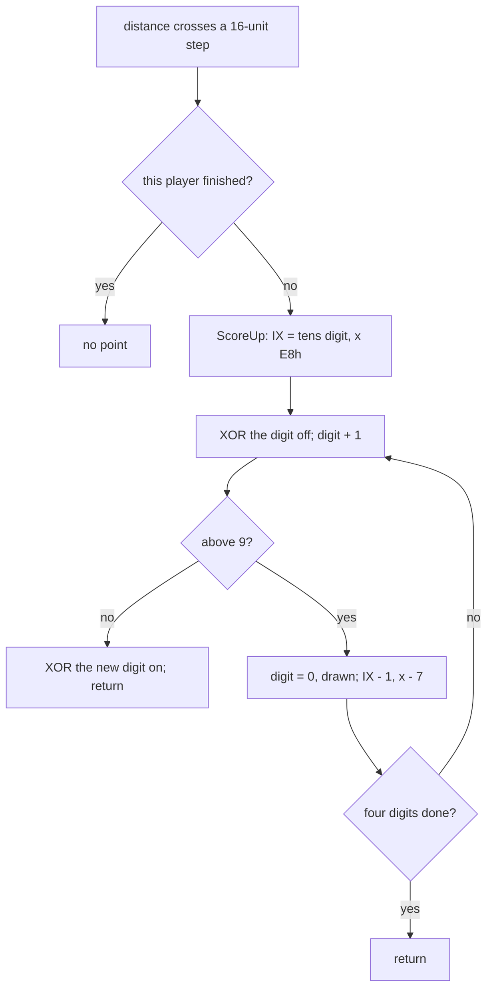

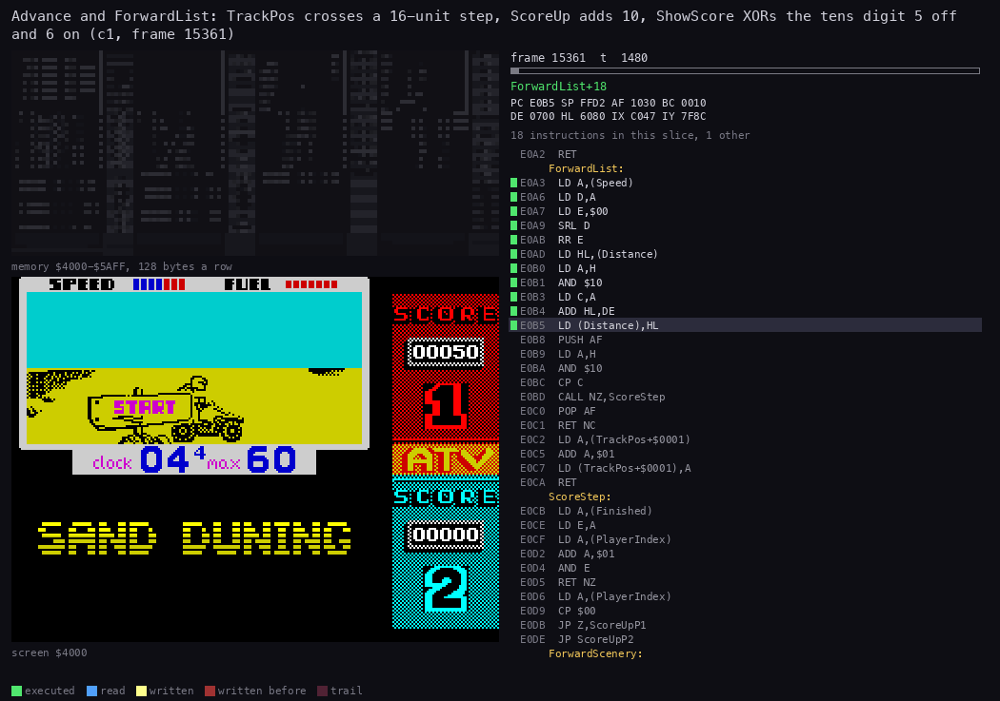

*Animation 8.2: `c1` frame 15 361, T 1 300 to 12 100: Advance adds to the distance, its bit 12 flips, ScoreUpP1 XORs
the tens digit 5 off and 6 on. 60 pictures; the view is the screen. Command: `python3 ../../kit/routine_anim.py
--work work/docs/atB/c1 --window 15361:1300-15361:12100 --listing build/game.lst --auto-labels owner --view screen
--range 4000-5AFF --pc E011-E0FF,EDBB-EE4B,DF91-DFE5,7600-79FF,8600-87FF --pictures 60 --title "..." --out
docs/img/routines/ShowScore.gif`.*

What to watch:

- the bytes of the digit 5 written once and vanishing (XOR);
- the same bytes written again with the 6;
- UseFuel running in the same pass just after (its range is in `--pc`).

Worked example: the score 00090 plus a point. IX points at the tens `9`. It is XORed off and becomes `:`, so it is
set to `0` and drawn. IX moves to the hundreds `0`, x to `$E1`. That `0` is XORed off, becomes `1`, and is XORed on.
The screen reads 00100. Two digits changed: 4 sprite draws.

Witness: ScoreUpP1 4 132 calls and ShowScore 4 466 in the L1 profiles. In `kb` ScoreUpP2 has 327 calls, at y `$3B`.
`trails` reaches trail 1's finish with the score 01000: 100 points over the trail's first 1 600 units.

The point: XOR lets the score change without knowing what is under it and without a clear. A digit is removed by
drawing it again.

## 8.7 The SPEED bar

SpeedBar `$E55D` runs every pass. It turns the speed into a bar length: `$40` + ((speed − 1) × 2 AND `$FC`), one
cell of 4 pixels per two speed units. Then it changes one cell, the one at the old length. If the bar got shorter,
or the speed is down to 1 or 0, BarNibble `$E5A1` clears that cell. Otherwise SpeedBar ORs 3 pixels of it in (`$E0`
or `$0E`), which leaves a gap between cells.

```text
SpeedBar():                                    # once a pass, on the screen at HudY
    old = SpeedBarLen; x = old
    new = $40 + ((max(Speed - 1, 0) * 2) AND $FC)
    SpeedBarLen = new
    if new < old or new == $40: clear the 4-pixel cell at x, 6 lines   # BarNibble
    else:                       OR 3 pixels of the cell at x, 6 lines  # $E0 left half, $0E right half
```

```asm
SpeedBar:
  E55D  LD HL,Screen
  E560  LD (ScreenBase),HL
  E563  LD A,(HudY)
  E566  LD (SpriteY),A
  E569  LD A,(SpeedBarLen)
  E56C  LD (SpriteX),A
  E56F  LD E,A
  E570  LD A,(Speed)
  E573  SUB $01
  E575  JR NC,l_E578
  E577  XOR A
l_E578:
  E578  SLA A
  E57A  AND $FC
  E57C  ADD A,$40
  E57E  CP E
  E57F  LD (SpeedBarLen),A
  E582  JP C,BarNibble
  E585  CP $40
  E587  JP Z,BarNibble
  E58A  LD A,(SpriteX)
  E58D  LD C,$0E
  E58F  AND $04
  E591  JR NZ,l_E595
  E593  LD C,$E0
l_E595:
  E595  CALL GfxTable
  E598  LD B,$06
l_E59A:
  E59A  LD A,C
  E59B  OR (HL)
  E59C  LD (HL),A
  E59D  INC H
  E59E  DJNZ l_E59A
  E5A0  RET
BarNibble:
  E5A1  LD A,(SpriteX)
  E5A4  LD C,$0F
  E5A6  AND $04
  E5A8  JR NZ,l_E5AC
  E5AA  LD C,$F0
l_E5AC:
  E5AC  CALL GfxTable
  E5AF  LD B,$06
l_E5B1:
  E5B1  LD A,C
  E5B2  XOR $FF
  E5B4  AND (HL)
  E5B5  LD (HL),A
  E5B6  INC H
  E5B7  DJNZ l_E5B1
  E5B9  RET
```

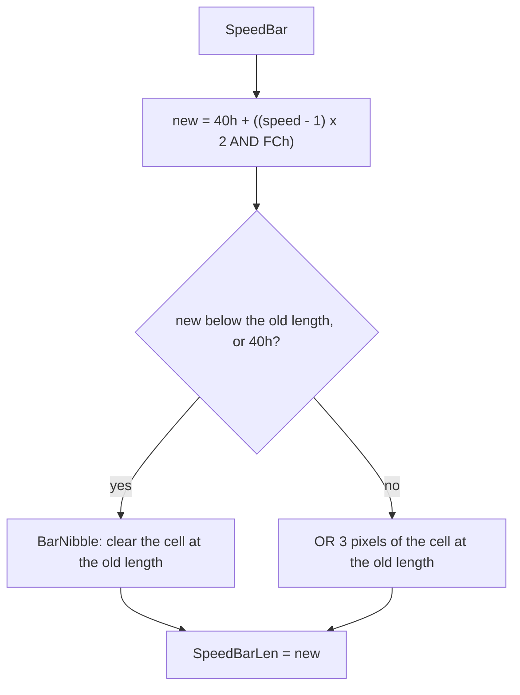

The bar is the one HUD field drawn whether or not its value changed: one cell, 6 bytes, every pass. It never moves
more than one cell a pass, so it trails the speed by a pass or two.

Worked example: the ATV speeds up from 10 to 11. At 10 the length is `$40` + (18 AND `$FC`) = `$50`. At 11 it is
`$40` + (20 AND `$FC`) = `$54`. The pass ORs `$E0` into the cell at the old x `$50`: bit 2 is clear, so the left
half of byte 10. The next pass, the length still `$54`, ORs `$0E` at `$54`.

Witness: SpeedBar 3 339 calls and BarNibble 2 205 in the L1 profiles. The throttle in
[doc 5, Animation 5.5](05-controls.md#59-throttle-brake-and-the-turn-round) shows the bar growing cell by cell.

The point: one cell a pass is enough for a bar that a player only glances at, and it costs 6 screen bytes.

## 8.8 Fuel and the FUEL bar

The tank holds `$2000` at the start of a trail. UseFuel `$DF91` runs each pass while the player rides. It takes
twice the speed from Fuel and stops at 0. The bar shows the high byte AND `$FC`: one 4-pixel cell per `$400`. When
that level differs from the bar, FuelBarStep `$DFCD` clears one cell. Below `$400` the player is out of fuel.

```text
UseFuel():                                    # each riding pass
    Fuel = max(Fuel - Speed * 2, 0)
    level = high(Fuel) AND $FC                # $1C, $18 ... $04, 0
    if level == 0: OutOfFuel(); return
    if level == FuelBar - $90: return
    FuelBar = $90 + level
    clear the cell at x FuelBar, 6 lines      # FuelBarStep

OutOfFuel():
    FuelBar = $90; clear the cell at $90
    SlowDown(); SlowDown()
    unless this player has finished: PrintShadow "OUT OF FUEL" at $3C, $3C     # every pass, 8.9
```

```asm
UseFuel:
  DF91  LD HL,(Fuel)
  DF94  LD A,(Speed)
  DF97  SLA A
  DF99  LD E,A
  DF9A  LD D,$00
  DF9C  XOR A
  DF9D  SBC HL,DE
  DF9F  JR NC,l_DFA4
  DFA1  LD HL,$0000
l_DFA4:
  DFA4  LD (Fuel),HL
  DFA7  LD HL,Screen
  DFAA  LD (ScreenBase),HL
  DFAD  LD A,(HudY)
  DFB0  LD (SpriteY),A
  DFB3  LD A,(FuelBar)
  DFB6  SUB $90
  DFB8  LD E,A
  DFB9  LD A,(Fuel+$0001)
FuelEmptyTest:
  DFBC  AND $FC
  DFBE  CP $00
  DFC0  JP Z,OutOfFuel
  DFC3  CP E
  DFC4  RET Z
  DFC5  ADD A,$90
  DFC7  LD (FuelBar),A
  DFCA  LD (SpriteX),A
FuelBarStep:
  DFCD  LD A,(SpriteX)
  DFD0  LD C,$0F
  DFD2  AND $04
  DFD4  JR NZ,l_DFD8
  DFD6  LD C,$F0
l_DFD8:
  DFD8  CALL GfxTable
  DFDB  LD B,$06
l_DFDD:
  DFDD  LD A,C
  DFDE  XOR $FF
  DFE0  AND (HL)
  DFE1  LD (HL),A
  DFE2  INC H
  DFE3  DJNZ l_DFDD
  DFE5  RET
OutOfFuel:
  DFE6  LD A,$90
  DFE8  LD (FuelBar),A
  DFEB  LD (SpriteX),A
  DFEE  CALL FuelBarStep
  DFF1  CALL SlowDown
  DFF4  CALL SlowDown
  DFF7  LD A,(Finished)
  DFFA  LD E,A
  DFFB  LD A,(PlayerIndex)
  DFFE  ADD A,$01
  E000  AND E
  E001  RET NZ
  E002  LD A,$3C
  E004  LD (SpriteX),A
  E007  LD (SpriteY),A
  E00A  LD IX,OutOfFuelText
  E00E  JP PrintShadow
```

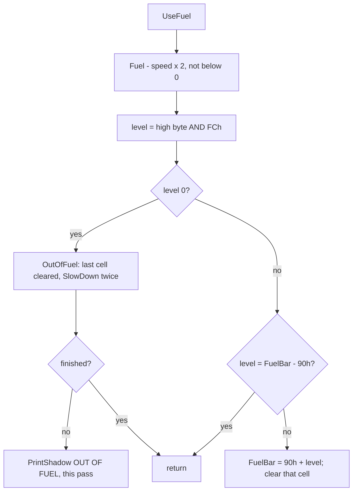

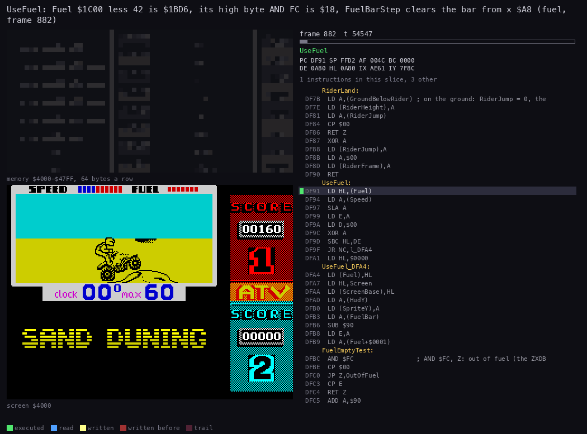

*Animation 8.3: `fuel` frame 882, T 54 500 to 56 200: Fuel `$1C00` less 42 (speed 21) is `$1BD6`; its high byte AND
`$FC` is `$18`, so FuelBarStep clears the cell at x `$A8`. 36 pictures; the view is the screen's top third. Command:
`python3 ../../kit/routine_anim.py --work work/docs/atB/fuel --window 882:54500-882:56200 --listing build/game.lst
--auto-labels owner --view screen --range 4000-47FF --pc DF91-DFE5,8380-83FF,E578-E5B9 --pictures 36 --title "..."
--out docs/img/routines/UseFuel.gif`.*

What to watch:

- `SBC HL,DE` and the new Fuel written into the record;
- `CP E` failing: the level `$18` is not the bar's `$1C`;
- six bytes cleared down the screen lines (`INC H`): the bar is one cell shorter.

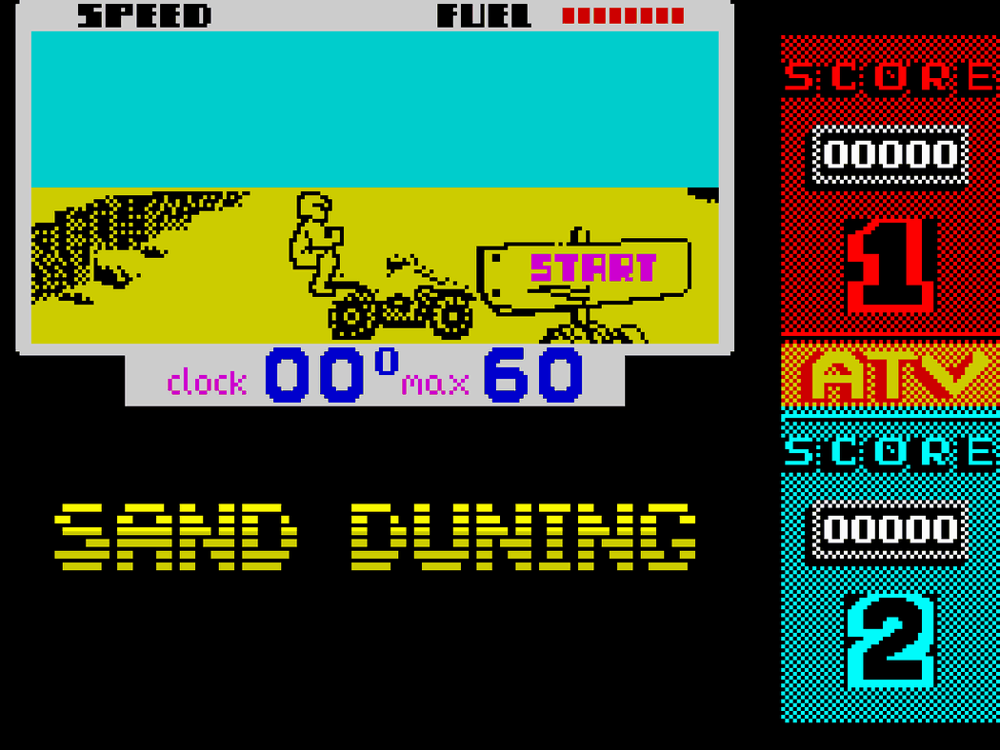

*Animation 8.4: `fuel` frames 600 to 2 384, every 28th frame (4 passes): the ride from the start line, the FUEL bar
losing a cell about every 25 passes at full speed, the clock stopped by the POKE. Command: `python3
../../kit/screen_anim.py --work work/docs/atB/fuel --from 600 --to 2384 --step 28 --width 1050 --delay 100
docs/img/play/fuel-bar.gif`.*

What to watch:

- the first cell gone as soon as the ATV moves;
- the next cells going at a steady rate while the ATV is at speed;
- the bar standing still while the rider is thrown and walks: UseFuel runs only when he rides.

Worked example: why the first cell goes at once. ShowBars sets `$2000` and FuelBar `$B0`, level `$20`. The first
moving pass takes at least 2: `$1FFE`, level `$1C`, not `$20`, so the cell at `$AC` is cleared. The tank really holds
`$2000` − `$400` = `$1C00` before OutOfFuel: 7 168 units. At speed 21, 42 a pass, that is 171 passes, 1 195 frames,
less than a third of trail 1's 600-pass limit. Rides last longer only because of crashes, walks and braking.

Witness: in `fuel` Fuel is `$1C00` at frame 881 and `$1BD6` at frame 882, the cell at `$A8` cleared at T 54 795.
Figure 8.3 shows the bar after 2 310 frames. UseFuel has 1 582 calls in the L1 profiles.

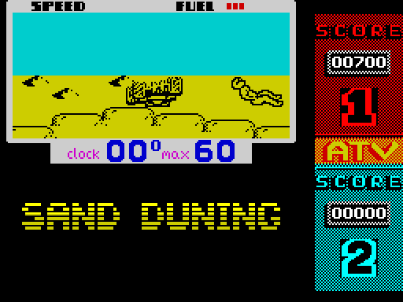

*Figure 8.3: `fuel` frame 2 310, Fuel's high byte `$0D` (level `$0C`): three cells left. A screen kept by
`tools/record.py fuel` (WALKTHROUGH 6.0).*

The point: the bar is a coarse view of a 16-bit tank. Drawing only when the level changes makes it nearly free,
and the same AND `$FC` gives the out-of-fuel test.

## 8.9 PrintShadow, OUT OF FUEL and TIME OUT

Messages on the trail are drawn into the window's buffer before the copy, by PrintShadow `$EC26`. It prints the text
twice at the same place. The first time it uses ModeCopyBuffer (DrawModes + 8): each glyph's whole box replaces the
buffer bytes, clearing the trail behind it. A box is 2 bytes wide, but the next glyph starts 6 to 8 pixels on, so
each box also chops the right edge of the letter before it. The second time it uses OR (ListModes + 0): every letter
is drawn whole on the cleared band.

```text
PrintShadow(IX, x, y):
    ModeVector = ModeCopyBuffer; Print(IX)        # boxes: a cleared band, letters cut
    SpriteX, SpriteY = x, y
    ModeVector = OR;            Print(IX)        # letters whole

TimeOut():                                        # the clock reached MaxTime
    for each player riding and not finished:
        BufferBase = that player's buffer
        PrintShadow("TIME OUT", $40, $44)
        copy that buffer to its window
```

```asm
TimeOut:
  EBE3  LD A,(Finished)
  EBE6  AND $01
  EBE8  JR NZ,l_EBFD
  EBEA  LD A,(Riding)
  EBED  AND $01
  EBEF  JR Z,l_EBFD
  EBF1  LD HL,BufferP1
  EBF4  LD (BufferBase),HL
  EBF7  CALL TimeOutText
  EBFA  CALL JpCopyBufferP1
l_EBFD:
  EBFD  LD A,(Riding)
  EC00  AND $02
  EC02  RET Z
  EC03  LD A,(Finished)
  EC06  AND $02
  EC08  RET NZ
  EC09  LD HL,BufferP2
  EC0C  LD (BufferBase),HL
  EC0F  CALL TimeOutText
  EC12  JP JpCopyBufferP2
TimeOutText:
  EC15  LD A,$40
  EC17  LD (SpriteX),A
  EC1A  LD A,$44
  EC1C  LD (SpriteY),A
  EC1F  LD IX,GameTexts
  EC23  JP PrintShadow
PrintShadow:
  EC26  PUSH IX
  EC28  LD A,(SpriteX)
  EC2B  LD E,A
  EC2C  LD A,(SpriteY)
  EC2F  LD D,A
  EC30  PUSH DE
  EC31  LD HL,DrawModes+$0008
  EC34  LD (ModeVector),HL
  EC37  CALL JpPrint
  EC3A  POP DE
  EC3B  LD A,D
  EC3C  LD (SpriteY),A
  EC3F  LD A,E
  EC40  LD (SpriteX),A
  EC43  LD HL,ListModes
  EC46  LD (ModeVector),HL
  EC49  POP IX
  EC4B  JP JpPrint
```

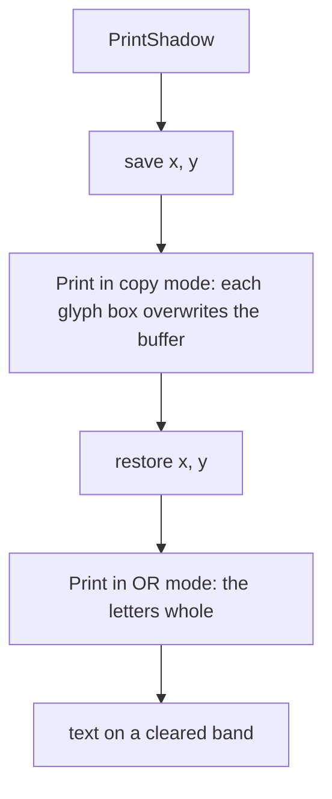

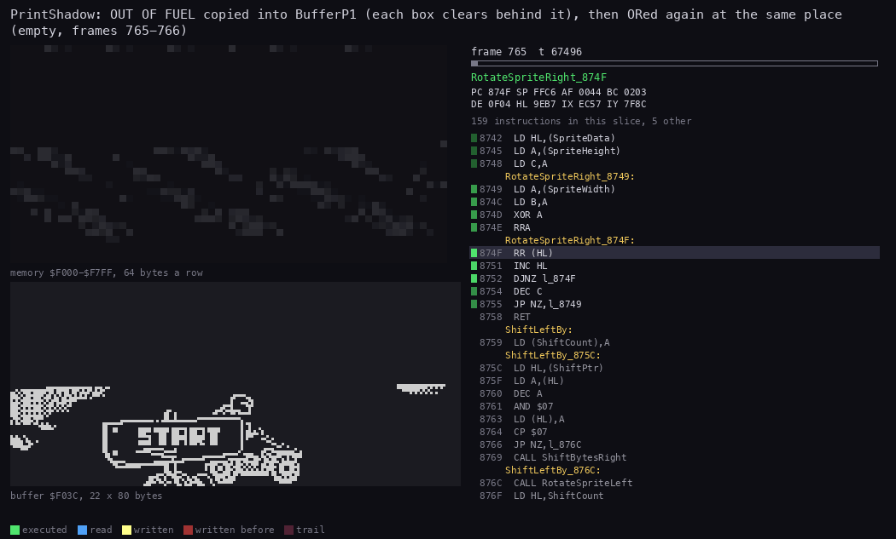

*Animation 8.5: `empty` frames 765 to 767, T 765:66 000 to 767:16 000: OutOfFuel's PrintShadow in the window
buffer. 60 pictures; the view is the buffer `$F03C`, 22 x 80 bytes. Command: `python3 ../../kit/routine_anim.py
--work work/docs/atB/empty --window 765:66000-767:16000 --listing build/game.lst --auto-labels owner --view
buffer:F03C:22x80 --range F000-F7FF --pc 7600-79FF,EC26-EC4D,8600-87FF --pictures 60 --title "..." --out
docs/img/routines/PrintShadow.gif`.*

What to watch:

- the first Print: the band cleared box by box, the letters cut on their right ("CLT OF");
- the second Print going over the same x: each letter completed;
- RotateSpriteLeft running for each letter: Print uses the general sprite drawer, shifts and all.

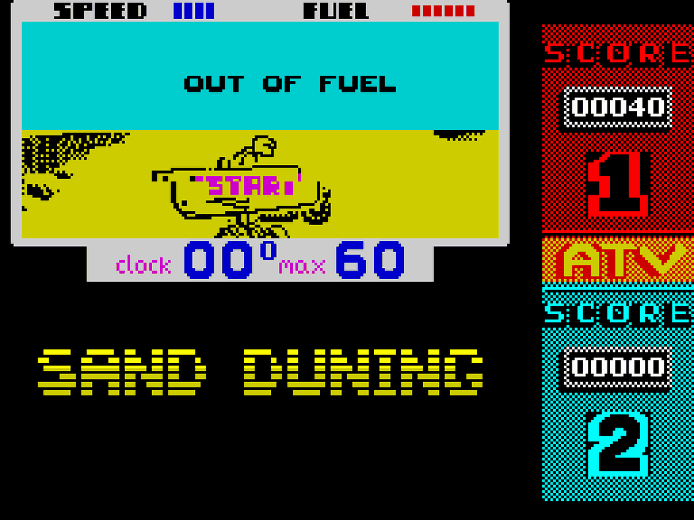

*Animation 8.6: `empty` frames 740 to 950, every 7th frame (a pass): the tank runs dry at about frame 765; from then
on OUT OF FUEL is printed every pass while the ATV slows to a stop. Command: `python3 ../../kit/screen_anim.py
--work work/docs/atB/empty --from 740 --to 950 --step 7 --width 1050 --delay 120 docs/img/play/out-of-fuel.gif`.*

What to watch:

- the last cell of the FUEL bar going (OutOfFuel clears the cell at `$90`);
- the message on its band, redrawn each pass over the moving trail;
- the speed falling: SlowDown twice a pass.

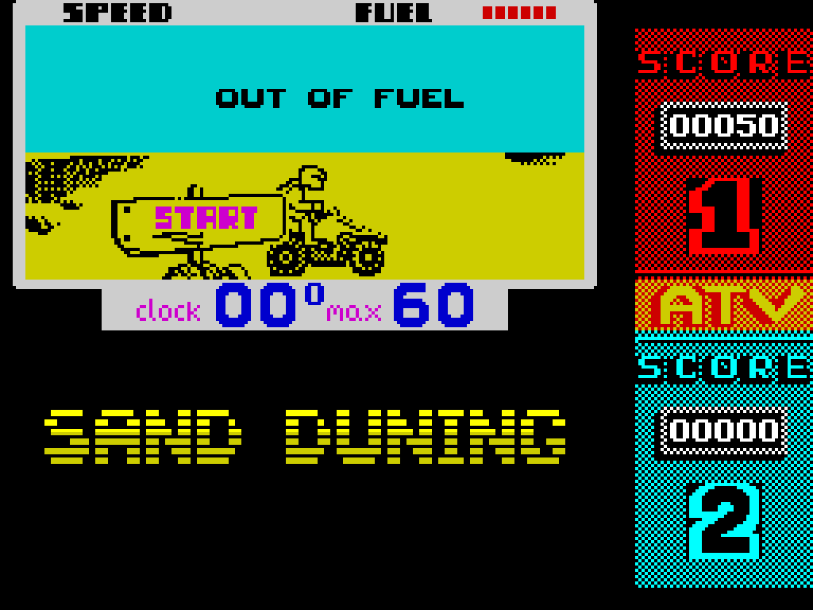

*Figure 8.4: `empty` frame 939: the ATV stopped, the FUEL bar empty, the message on its band. Command: `python3
../../kit/screen_shot.py --work work/docs/atB/empty --out-dir docs/img/hud --scale 4 empty-000939-out-of-fuel=939`.*

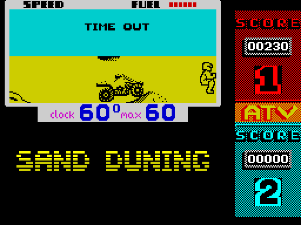

*Figure 8.5: `c1` frame 19 260: TIME OUT at the clock's 60.0 on trail 1. A screen kept by `tools/record.py c1`
(WALKTHROUGH 6.0).*

Worked example: TIME OUT's place. x `$40` = 64 in the 176-pixel window, y `$44` = 11 lines below the window's top.
TIME takes 7 + 5 + 8 + 7 = 27 pixels, the space 6, OUT 8 + 8 + 7 = 23: 56 pixels, from x 64 to 120. The main loop
then waits 250 frames (`LD B,$FA` and HALT). Unless a player has finished, the game ends
([doc 4](04-game-loop.md#49-the-end-of-a-pass-the-finish-time-out-game-over)).

Witness: PrintShadow 1 162 calls in the L1 profiles (OUT OF FUEL, LAP TIME and EXTENDED PLAY, every pass they show);
TimeOut 5 calls (`c1`, `kb`, `trail1`, `trails`, `warp`). Figures 8.4 and 8.5 are the two messages on screen.

The point: a cleared band makes text readable on any background, at the cost of a second Print. The game gets it from
the draw modes it already has, without a routine for text.

## 8.10 The finish: LAP TIME, EXTENDED PLAY and the bonus

FinishCheck `$DB34` runs every pass for each riding player. Once TrackPos reaches FinishDistance `$D6C0`, it sets the
player's bit in Finished `$D7A5`. The first time, it keeps the clock in LapTime `$D79D` and computes the time bonus.
Every pass after, it writes the lap's digits into LapText and prints LAP TIME and EXTENDED PLAY with PrintShadow.

The bonus is meant to be half the time left, plus 1, times the trail number, plus 1. The code keeps only the low
byte of the first part: `INC L` then `LD E,L` drop H.

```text
FinishCheck():                                    # each pass, each riding player
    if TrackPos < FinishDistance: return
    first = not (Finished AND (PlayerIndex + 1))
    Finished |= PlayerIndex + 1
    if first:
        LapTime = Clock (3 digits)
        half = (DigitsValue(MaxTime) - DigitsValue(Clock)) / 2
        Bonus = (((half AND $FF) + 1) AND $FF) * (Trail + 1) + 1      # the game: the high byte lost
    LapText[9..10] = LapTime[0..1]; LapText[12] = LapTime[2]            # "LAP TIME 06 2"
    PrintShadow(LapText, $2B, $37)
    PrintShadow("EXTENDED PLAY", $28, $47)

DigitsValue(IX) = ([IX] - '0') * 100 + ([IX+1] - '0') * 10 + ([IX+2] - '0')
```

```asm
FinishCheck:
  DB34  LD DE,(FinishDistance)
  DB38  LD HL,(TrackPos)
  DB3B  XOR A
  DB3C  SBC HL,DE
  DB3E  RET C
  DB3F  LD A,(Finished)
  DB42  LD E,A
  DB43  LD A,(PlayerIndex)
  DB46  ADD A,$01
  DB48  LD D,A
  DB49  OR E
  DB4A  LD (Finished),A
  DB4D  LD A,E
  DB4E  AND D
  DB4F  JR NZ,l_DB82
  DB51  LD HL,(Clock)
  DB54  LD (LapTime),HL
  DB57  LD A,(ClockUnits)
  DB5A  LD (LapTime+$0002),A
  DB5D  LD IX,Clock
  DB61  CALL DigitsValue
  DB64  PUSH HL
  DB65  LD IX,MaxTime
  DB69  CALL DigitsValue
  DB6C  POP DE
  DB6D  XOR A
  DB6E  SBC HL,DE
  DB70  SRL H
  DB72  RR L
  DB74  INC L
  DB75  LD E,L
  DB76  LD A,(Trail)
  DB79  ADD A,$01
  DB7B  CALL JpMultiply
  DB7E  INC HL
  DB7F  LD (Bonus),HL
l_DB82:
  DB82  LD HL,(LapTime)
  DB85  LD (LapText+$0009),HL
  DB88  LD A,(LapTime+$0002)
  DB8B  LD (LapText+$000C),A
  DB8E  LD A,$2B
  DB90  LD (SpriteX),A
  DB93  LD A,$37
  DB95  LD (SpriteY),A
  DB98  LD IX,LapText
  DB9C  CALL PrintShadow
  DB9F  LD A,$28
  DBA1  LD (SpriteX),A
  DBA4  LD A,$47
  DBA6  LD (SpriteY),A
  DBA9  LD IX,ExtendedText
  DBAD  JP PrintShadow
DigitsValue:
  DBB0  LD A,(IX+$00)
  DBB3  SUB $30
  DBB5  LD E,$64
  DBB7  CALL JpMultiply
  DBBA  PUSH HL
  DBBB  LD A,(IX+$01)
  DBBE  SUB $30
  DBC0  LD E,$0A
  DBC2  CALL JpMultiply
  DBC5  LD A,(IX+$02)
  DBC8  SUB $30
  DBCA  LD E,A
  DBCB  LD D,$00
  DBCD  ADD HL,DE
  DBCE  POP DE
  DBCF  ADD HL,DE
  DBD0  RET
```

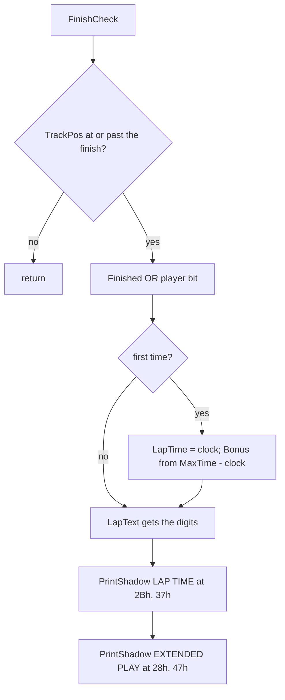

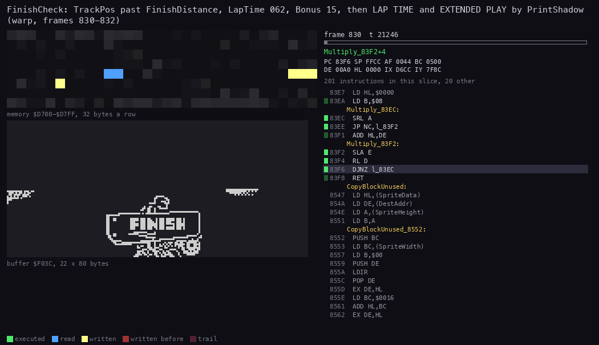

*Animation 8.7: `warp` frames 830 to 832, T 830:19 100 to 832:51 000: TrackPos passes FinishDistance, LapTime 062,
Bonus 15, then LAP TIME and EXTENDED PLAY by PrintShadow. 80 pictures; the view is the buffer `$F03C` and the memory
strip `$D700-$D7FF` (Finished, Bonus, LapTime). Command: `python3 ../../kit/routine_anim.py --work
work/docs/atB/warp --window 830:19100-832:51000 --listing build/game.lst --auto-labels owner --view
buffer:F03C:22x80 --range D700-D7FF --pc DB34-DBDF,EC26-EC4D,7600-79FF,8600-87FF,83E8-83F8 --pictures 80 --title
"..." --out docs/img/routines/FinishCheck.gif`.*

What to watch:

- the writes into `$D79B-$D79F` (Bonus and LapTime) on the first pass only;
- LAP TIME 06 2: the ASCII digits in LapText print as small digits, and the space at +11 stays;
- EXTENDED PLAY drawn above it the same way, band first, letters after.

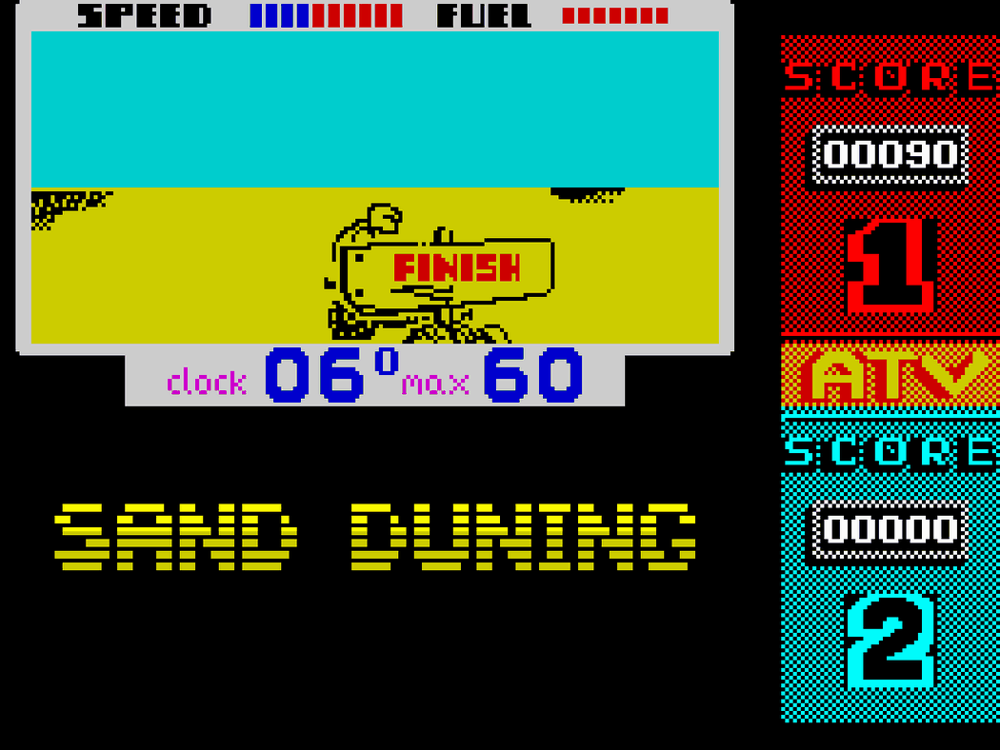

*Animation 8.8: `warp` frames 818 to 1 300, every 8th frame: the ATV crosses the finish on trail 1, the texts
appear, the trail ends, the window turns into a colour band and CountBonus adds the bonus point by point. Command:
`python3 ../../kit/screen_anim.py --work work/docs/atB/warp --from 818 --to 1300 --step 8 --width 1050 --delay 100
docs/img/play/finish.gif`.*

What to watch:

- EXTENDED PLAY and LAP TIME 06 2 over the moving trail;
- TrailEnd's band (BandP1 `$EDA7`, 22 x 10 cells);
- the score climbing by 10 at each tone, 15 times: 00100 to 00250.

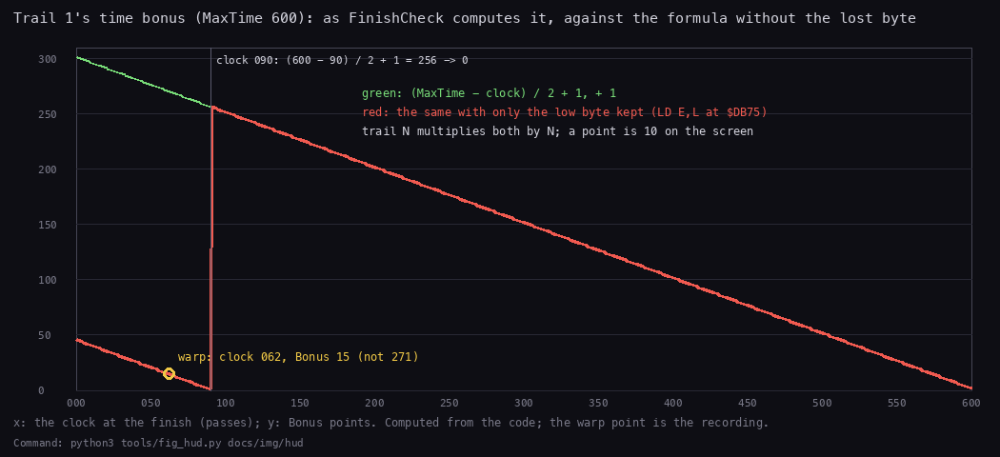

*Figure 8.6: the bonus of trail 1 (MaxTime 600) against the clock at the finish, as computed by FinishCheck (red)
and without the lost byte (green); the `warp` finish marked. Computed from the code. Command: `python3
tools/fig_hud.py docs/img/hud`.*

How to read it:

- left of clock 090 the half plus 1 is 256 or more, and only its low byte survives;
- the red line drops to the bottom there: the fastest laps earn the least;
- from 091 on the two lines agree.

Worked example: `warp`, trail 1, clock 062. DigitsValue(MaxTime) is 600: "6", "0" and the third byte `$D6CE`, "0".
600 − 62 = 538, halved 269 = `$010D`. `INC L` gives `$0E`, so E = 14. Times (Trail + 1) = 1, plus 1: Bonus 15. The
intended value is 271. CountBonus `$ED52` adds 15 points: the score goes from 00100 to 00250.

Witness: in `warp` Bonus at `$D79B` is `$000F` at frame 831 (Animation 8.7). [Doc 1](01-game-design.md) lists every
finish: laps of 09.0 or less on the "60" trails 1-3 lose 256; trails 4-6 and the second round cannot. In `trails`
(no POKE) the lap is 19.8 and Bonus 203: (600 − 198) / 2 + 1 = 202, plus 1.

The point: the bonus code was written for times a real ride gives. It holds for any lap over 9 shown seconds on the
longest limit. Only a lap no rider can make (the POKE) shows the bug.

## 8.11 The trail intro and the front end

Large text uses BigPrint `$78E3`, draw mode `$10`. It draws each pixel of a sprite as a block BigScaleX wide and
BigScaleY high, ORed in or cleared (BigClear). The trail intro prints "TRAIL NO." three times: ORed at (0, `$4F`),
cleared at (2, `$4E`), ORed again at (3, `$4E`). What stays of the first print is an edge up and to the left of the
last: a shadow. The trail's big digit gets the same three prints. Then Dissolve `$6D88` brings the buffer onto the
screen, its bits rotating in from the sides over eight passes.

```text
TrailIntro():
    clear the screen; ModeVector = BigPrint; BigScaleX 2, BigScaleY 5
    PrintAt "TRAIL NO." at (0, $4F) OR, (2, $4E) clear, (3, $4E) OR       # the shadow, then the face
    PrintAt Trail + 'b' (a big digit) at ($40, $4F), ($42, $4F), ($43, $4F), scale 2 x 4
    Dissolve the buffer to (x 8, y $A5); wait 50 frames
    CopyTrailName; PrintAt the name at (3, $3F), scale 2 x 3; the boxes; ShowBufferPlace (8, $4F)
    wait 150 frames
    PanelP1 if player 1 rides; PanelP2 if player 2 rides; TrailAttrs
```

```asm
TrailIntro:
  6A38  LD HL,Attributes
  6A3B  LD (AttrBase),HL
  6A3E  XOR A
  6A3F  CALL FillAllAttrs
  6A42  CALL ClearTopHalf
  6A45  CALL ClearBottomHalf
  6A48  LD A,$06
  6A4A  CALL FillAllAttrs
  6A4D  CALL JpClearBufferP1
  6A50  LD HL,BufferP1
  6A53  LD (BufferBase),HL
  6A56  XOR A
  6A57  LD (BigClear),A
  6A5A  LD HL,DrawModes+$0010
  6A5D  LD (ModeVector),HL
  6A60  LD IX,TrailTexts
  6A64  LD A,$02
  6A66  LD (BigScaleX),A
  6A69  LD HL,$0205
  6A6C  LD (BigScaleY),HL
  6A6F  LD HL,$004F
  6A72  CALL PrintAt
  6A75  LD A,$01
  6A77  LD (BigClear),A
  6A7A  LD IX,TrailTexts
  6A7E  LD A,$05
  6A80  LD (BigRepeat),A
  6A83  LD HL,$024E
  6A86  CALL PrintAt
  6A89  XOR A
  6A8A  LD (BigClear),A
  6A8D  LD IX,TrailTexts
  6A91  LD HL,$034E
  6A94  CALL PrintAt
  6AA2  LD A,(Trail)
  6AA5  ADD A,$62
  6AA7  LD IX,BigChar
  6AAB  LD (IX+$00),A
  6AAE  LD HL,$404F
  6AB1  CALL PrintAt
  6AD6  LD H,$08
  6AD8  LD L,$A5
  6ADA  CALL ScreenAddrHL
  6ADD  EX DE,HL
  6ADE  LD HL,BufferP1
  6AE1  CALL Dissolve
  6AE4  LD B,$32
HiScoreLines:
  6FEA  LD HL,ListModes
  6FED  LD (ModeVector),HL
  6FF0  LD HL,HiNames
  6FF3  LD IY,HiScores
  6FF7  LD A,$47
  6FF9  LD (SpriteY),A
  6FFC  LD B,$05
l_6FFE:
  6FFE  PUSH BC
  6FFF  PUSH HL
  7000  LD A,$30
  7002  LD (SpriteX),A
  7005  PUSH HL
  7006  POP IX
  7008  CALL Print
  700B  LD A,$60
  700D  LD (SpriteX),A
  7010  PUSH IY
  7012  POP IX
  7014  CALL Print
  7017  LD A,(SpriteY)
  701A  SUB $09
  701C  LD (SpriteY),A
  701F  LD DE,$0006
  7022  POP HL
  7023  ADD HL,DE
  7024  ADD IY,DE
  7026  POP BC
  7027  DJNZ l_6FFE
  7029  RET
```

The trail's digit is Trail + `$62`: trail 0 gives `b`, Print's big `1`. On the front end, HiScoreScreen `$6F0E`
switches between the table and the trail list each time it is called (HiScorePage XOR 1). HiScoreLines prints the
five rows: names at x `$30`, scores at `$60`, 9 lines apart. Credits `$6E81` draws the ATV picture from sprite and
box lists (`src/res/tables/credits.csv`) and the credit lines of MenuTexts, centred by their measured widths (8.3).

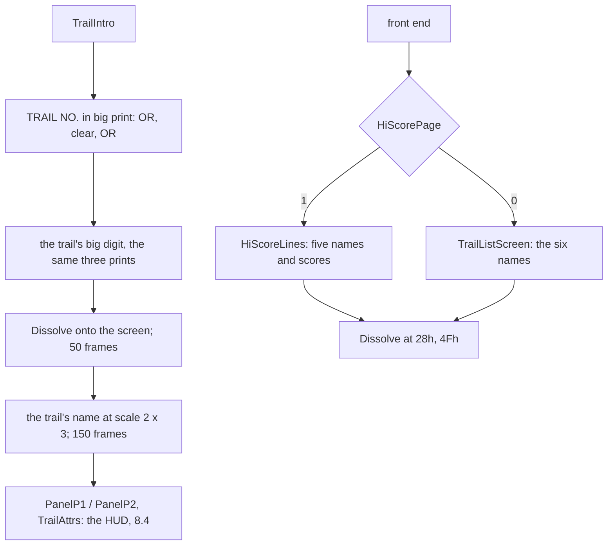

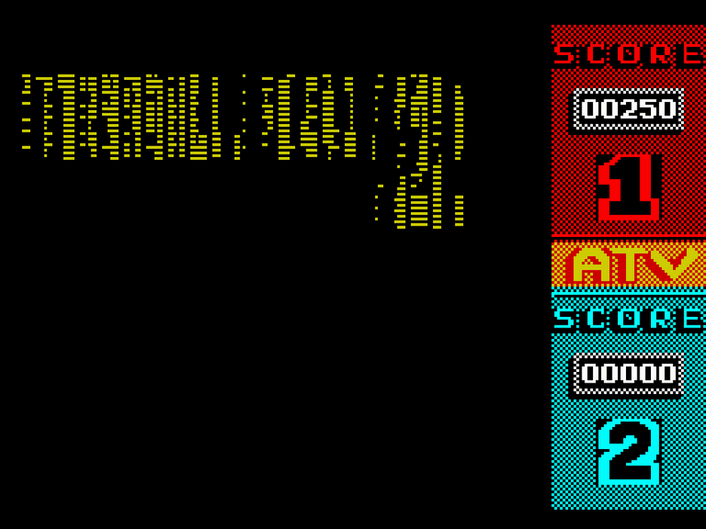

*Animation 8.9: `warp` frames 1 295 to 1 703, every 8th frame: the intro of trail 2. TRAIL NO. 2 dissolves in, then
GRASSTRAKIN, then the HUD and the start line. Command: `python3 ../../kit/screen_anim.py --work work/docs/atB/warp
--from 1295 --to 1703 --step 8 --width 1050 --delay 100 docs/img/play/trail-intro.gif`.*

What to watch:

- the big letters' shadow on their upper left;
- the dissolve, bits sliding in from both sides;
- the HUD's fields appearing at once when the panels are drawn: clock 000, max, full bars.

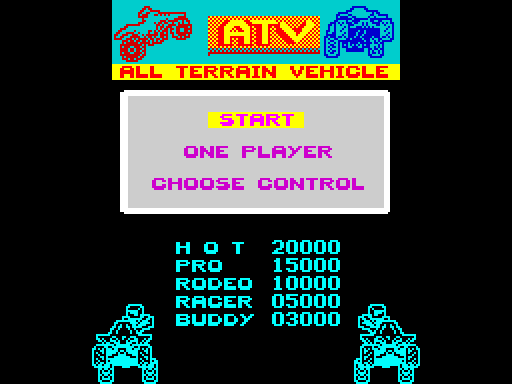

*Figure 8.7: `c1` frame 14 640: the menu and, below it, the table from HiScoreLines. A screen kept by
`tools/record.py c1` (WALKTHROUGH 6.0).*

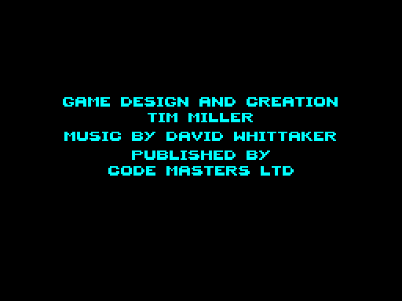

*Figure 8.8: `c1` frame 14 300: the credits from Credits `$6E81`. A screen kept by `tools/record.py c1` (WALKTHROUGH
6.0).*

Worked example: the table's rows. SpriteY starts at `$47` and drops by 9: `$47`, `$3E`, `$35`, `$2C`, `$23`. The
names go at x `$30`, the scores at `$60`. A row is 6 bytes: "H O T|" (the spaces are part of the name), and in
HiScores "20000|".

Witness: TrailIntro 16 calls (one per trail started) and BigPrint 637 in the L1 profiles; HiScoreScreen 5, Credits 6.
In `warp` trail 2's intro starts at frame 1 295.

The point: the front end and the intro reuse the game's own Print with other draw modes. A scale and a shadow pass
turn the 6-line font into a title.

## 8.12 The high scores and the name entry

After a game, CheckHiScore `$7A3E` compares each score with the table. HiCompare `$7C71` looks at the first four
digits of each row, top down, and stops at the first row the score beats. A tie does not beat. It returns 5 − the
row, or Z for none. Player 1 goes first; player 2 then always gets a turn. If player 1 only reaches the last row, he
is skipped unless he beat player 2: player 2 would push him out anyway.

NameEntry `$7A7E` moves the rows below down by LDDR, scores and names, and copies the score in. The new row's name
is set to five spaces. The screen shows the score, the name and HI SCORE in big print, and a grid of 4 rows by 7
cells: A to Z, a space, and the end arrow (sprite `$70`). The border and paper are the player's colour: red (`$10`)
for player 1, cyan (`$28`) for player 2. A cursor of 2 x 2 white cells moves by the player's own controls.

```text
NameEntry(score, reader):
    ReadControlJump = reader                            # ReadP1 or ReadP2: Controls1 / Controls2
    row = HiCompare(score); if none: return
    move the rows below `row` down one (LDDR, 6 bytes a row); copy the score into `row`
    name = HiNames + row * 6; name[0..4] = "     "
    border = colour >> 3; the grid A..Z, " ", arrow at x 4 + 24 * col, y $3D, $2D, $1D, $0D
    cursor = (x $30, y $39)
    loop:
        colour the cursor $38; ReadControl()            # wait for a release, then a press
        colour it back
        right: x + $18; left: x - $18                   # kept within $30..$D7
        up:    y + $10; down: y - $10                   # kept within $08..$39
        fire:  NameSelect()

NameSelect():
    c = col + 7 * CellCount(($39 - y) / 2) + $3A        # 'A' + 7 * row + col
    if c == '[': c = ' '
    if c == '\': return from NameEntry                  # the arrow cell
    name[0..3] = name[1..4]; name[4] = c                # the name scrolls left
    NameScreen()
```

```asm
NameSelect:
  7BC6  POP AF
  7BC7  LD A,(CursorPos)
  7BCA  LD E,A
  7BCB  LD A,$39
  7BCD  SUB E
  7BCE  SRL A
  7BD0  CALL CellCount
  7BD3  LD E,$07
  7BD5  CALL JpMultiply
  7BD8  LD A,(BigChar)
  7BDB  ADD A,L
  7BDC  ADD A,$3A
  7BDE  CP $5B
  7BE0  JR NZ,l_7BE4
  7BE2  LD A,$20
l_7BE4:
  7BE4  CP $5C
  7BE6  JR NZ,l_7BE9
  7BE8  RET
l_7BE9:
  7BE9  LD HL,(NameTextPtr)
  7BEC  INC HL
  7BED  LD DE,(NameTextPtr)
  7BF1  LD BC,$0004
  7BF4  LDIR
  7BF6  DEC HL
  7BF7  LD (HL),A
  7BF8  CALL NameScreen
  7BFB  JP l_7B4F
HiCompare:
  7C71  LD C,$05
l_7C73:
  7C73  PUSH HL
  7C74  PUSH DE
  7C75  LD B,$04
l_7C77:
  7C77  LD A,(DE)
  7C78  CP (HL)
  7C79  JR C,l_7C8D
  7C7B  JR NZ,l_7C81
  7C7D  INC HL
  7C7E  INC DE
  7C7F  DJNZ l_7C77
l_7C81:
  7C81  POP HL
  7C82  LD DE,$0006
  7C85  ADD HL,DE
  7C86  EX DE,HL
  7C87  POP HL
  7C88  DEC C
  7C89  JR NZ,l_7C73
  7C8B  XOR A
  7C8C  RET
l_7C8D:
  7C8D  POP DE
  7C8E  POP HL
  7C8F  LD A,C
  7C90  RET
```

NameSelect is entered by a jump from ReadControl `$7BA2`, which was called. Its `POP AF` drops that return address,
so its `RET` on the arrow leaves NameEntry itself. The cursor keeps its column in BigChar, reused and set to 0 after
the grid is drawn.

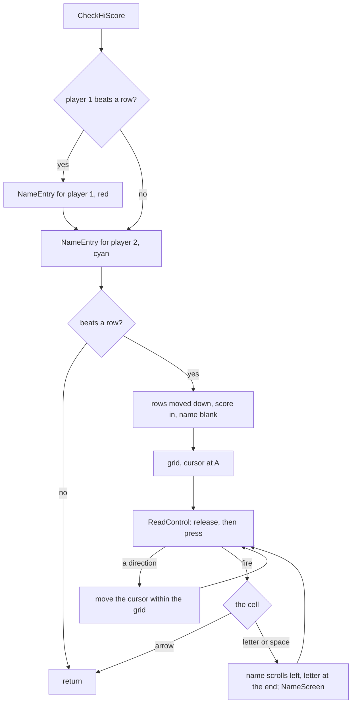

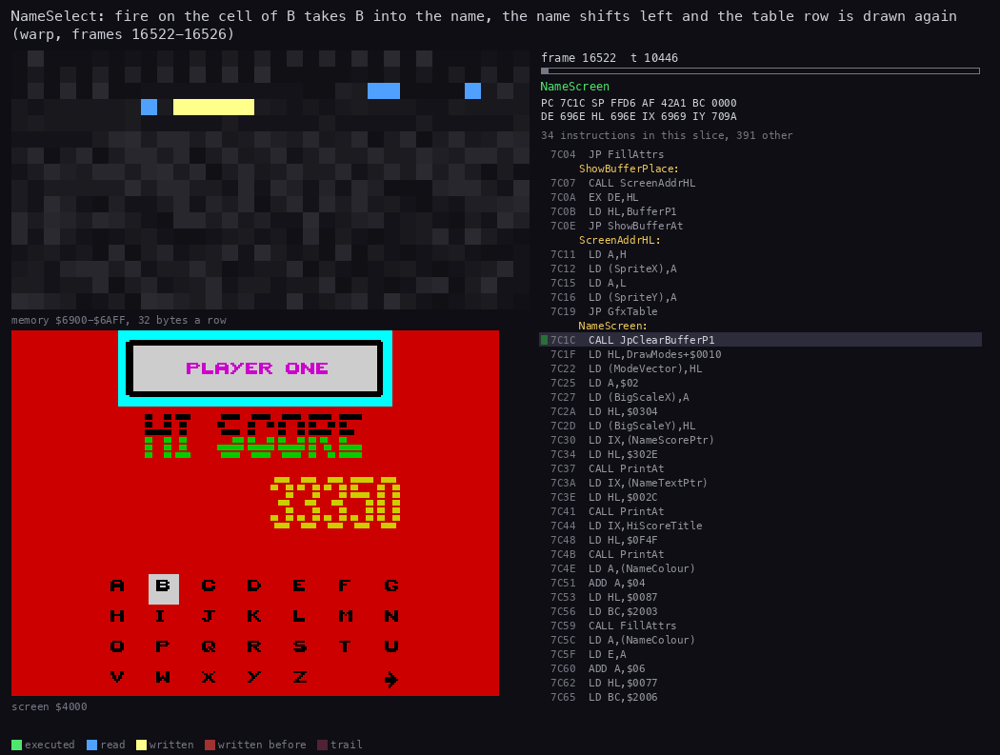

*Animation 8.10: `warp` frames 16 522 to 16 526: fire on the cell of B; the name shifts left, B goes at its end and
NameScreen draws the row again. 60 pictures; the view is the screen and the memory strip `$6900-$6AFF` (the names
and scores). Command: `python3 ../../kit/routine_anim.py --work work/docs/atB/warp --window 16522:5800-16526:5000
--listing build/game.lst --auto-labels owner --view screen --range 6900-6AFF --pc 7A3E-7C70,7600-79FF,8600-87FF
--pictures 60 --title "..." --out docs/img/routines/NameSelect.gif`.*

What to watch:

- the cell number: CellCount of 0 is 1, times 7, plus the column 1, plus `$3A`: `$42`, B;
- the LDIR moving four bytes of the name left, and the B written at its end;
- NameScreen's big print of the name and the score.

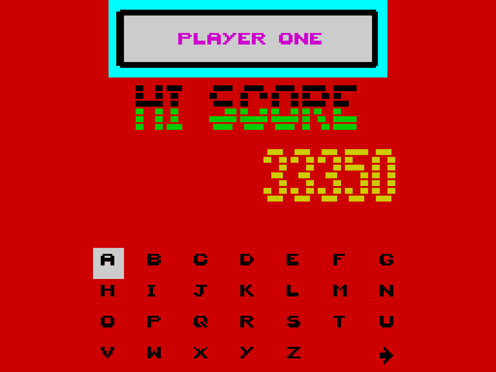

*Animation 8.11: `warp` frames 16 470 to 16 766, every 4th frame: the end of the game, a new high score, the grid,
the cursor moving and letters taken, the arrow, the table. Command: `python3 ../../kit/screen_anim.py --work
work/docs/atB/warp --from 16470 --to 16766 --step 4 --width 1050 --delay 90 docs/img/play/name-entry.gif`.*

What to watch:

- the red border and paper: player 1's colour;
- the white cursor moving one cell per press (ReadControl waits for a release);
- the name growing from the right.

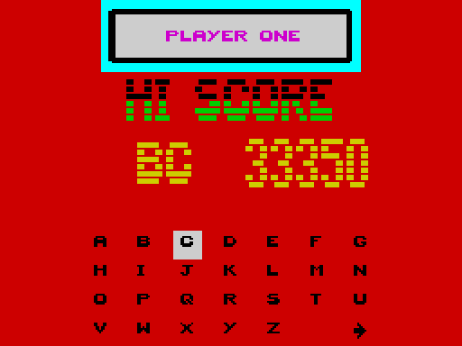

*Figure 8.9: `warp` frame 16 589: the name so far, the cursor on C. A screen kept by `tools/record.py warp`
(WALKTHROUGH 6.0).*

Worked example: the score 33350 against the table 20000, 15000, 10000, 05000, 03000. On the first row `2` is less
than `3`: carry, found with C = 5. NameRow = 5; 5 − 1 = 4 rows of 6 bytes (24) move down, in HiScores and in
HiNames. The score goes into row 0, and the name at HiNames + 0 becomes five spaces. Fire on B, then on C: the name
is "    B", then "   BC".

Witness: CheckHiScore 4 calls, NameEntry 5 and NameScreen 4 in the L1 profiles (`kb`, `warp`). `warp` frames 16 479
to 16 756 enter a name; in `kb` player 2 enters one at frame 3 260, in cyan.

The point: the whole entry is driven by the ATV's own controls, through one patched jump. There is no delete: a name
is fixed by typing five more letters, since it scrolls.

## 8.13 Summary

| Mechanism | Address | Witness |
| --- | --- | --- |
| one printer, characters mapped to sprites | `$7608` | every recording |
| menu texts measured by an invisible print | `$75C0` | `c1` |
| HUD on the screen, fields redrawn only on change | `$6C6F`, `$EBA5` | `c1` 15 419 |
| the clock counts passes, one digit copied a pass; TIME OUT on the hundreds | `$EB53`, `$D89E` | `c1` 15 356, 19 260 |
| the score by XOR, a point per 16 units, shown x 10 | `$EDBB`, `$E0CB` | `c1` 15 361 |
| SPEED bar: one cell a pass | `$E55D` | every ride |
| fuel: 8 cells of `$400`, the first lost at once; OUT OF FUEL every pass | `$DF91`, `$DFE6` | `fuel` 882, `empty` |
| text on a cleared band: copy mode, then OR | `$EC26` | `empty` 766 |
| the bonus keeps the low byte of the half time left | `$DB74` | `warp` 831 |
| big print and dissolve for titles | `$78E3`, `$6D88` | `warp` 1 295 |
| high scores: 4 digits compared, names scrolled in from a grid | `$7C71`, `$7A7E`, `$7BC6` | `warp` 16 479 |
