# 9. Sound

What this covers:

- the sound map: every sound, the event that plays it, where it runs and what it costs;
- the three beeper primitives Click, Tone and Noise, and the random bytes Noise reads;
- the engine, played from the interrupt once a frame;
- the landing thump and the bonus count, played from the main loop, which waits for them;
- the tune data, byte by byte, and the tune player with its own interrupt;
- the two tunes, the title and the finish, decoded and rendered;
- the cost of each sound, and the events that are silent;
- the quirks, and what is known only from the code.

ATV Simulator is a 48K game. It has one sound device, the beeper: bit 4 of port `$FE`. There is no AY code.

The recordings and tools it rests on ([WALKTHROUGH 6.0](../WALKTHROUGH.md)):

- `trails`: from `c1`'s menu, trail 1 ridden to its finish without a POKE, TIME OUT, the finish tune, the bonus
  count, then trail 2 to a crash. It was opened on an own instance, after `. work/env.sh`: `python3 ../../kit/rs.py
  open --work work/docs/atC/trails --ttd work/stage1/rec/trails/session.ttd --model 48K --port-base 37790`. Every
  frame 0-7441 was sampled by `python3 work/docs/atC/sample.py work/docs/atC/trails 0 7441 1 work/docs/atC/trails-vars.jsonl` (the main loop's variables `$D6B6-$D6DA`, the records `$D70E-$D7A7`, the score
  `$6947-$6951`).
- `c1` and `warp`: their L1 call counts (the `.ann`), quoted from stage 2's notes.
- `tools/fig_sound.py`: the game's own sound code run in SkoolKit's Z80 simulator from the case's build
  (`build/game.bin` at `$6338`, the 48K ROM under it for the bytes Random and the drums read). The engine is called
  once a frame, as the interrupt calls it. The tunes run under IM 2 with an interrupt every 69 888 T. It writes the
  audio into `docs/audio`, the charts into `docs/img/sound` and the numbers of this document into
  `work/docs/atC/sound/sound.json` (`python3 tools/fig_sound.py audio docs/audio`). The audio is written to files,
  never played.

A sample of frame N is the memory at the start of frame N. A trace shows an instruction in the frame in which it ran.
A pass is one turn of the main loop: 7 frames while its work fits, always with one player; with two players 640 of
`kb`'s 811 passes, the others 8 to 15 ([doc 4, 4.6](04-game-loop.md#46-the-fixed-7-frame-pass-and-the-wait-on-d6bc)). The simulator's T-states are
uncontended. The sound code lies above `$8000` and never reads the screen, so the real machine runs it at the same
speed.

## 9.1 The sound map

The game makes sound in three places:

- the interrupt plays the engine once a frame while a trail is ridden, and Update plays it once more in each
  player's turn of the pass;
- the main loop plays the landing and the bonus count, and waits for them;
- the tune player takes the machine over for the two tunes, with its own interrupt table.

| Sound | Plays it | Event | Where it runs | Length | Audio |
| --- | --- | --- | --- | --- | --- |
| the engine | EngineSound `$D97C`, EngineOne `$D987`, Tone `$D99E` | every frame of a ride, for each rider who is mounted and moving | the interrupt `$D9D2` (`$D9FC`), and Update (`$DAF7`) once a player a pass | 2 407-5 827 T a call for one rider | [engine.mp3](audio/engine.mp3) |
| the landing thump | Landing `$E663`: Tone, then Noise `$D9AF` | the ATV meets the ground after a jump or a fall (VSpeed nonzero) | the main loop, in AtvPhysics | 19 169 T | [landing.wav](audio/landing.wav) |
| the bonus count | CountBonus `$ED52`, BonusTone `$ED5D`: Tone | each bonus point moved into the score, after the finish tune | TrailEnd `$ECE0` | about 39 700 T a point | [bonus-count.wav](audio/bonus-count.wav) (25 points) |
| the title tune | TunePlay `$F852` with A = 0 | the menu (MenuLoop `$737C`) until a key, a Kempston input or 26.7 s (TuneTimer starts at `$04C8`, the stop is at `$0A00`) | the tune player, its own IM 2 | one pass of its lists: 46.0 s | [tune-title.mp3](audio/tune-title.mp3) |
| the finish tune | TunePlay with A = 1 | the end of a trail (TrailEnd) | the tune player | 3.37 s (169 frames) | [tune-finish.wav](audio/tune-finish.wav) |

*Every sound of the game. The point: four routines make all the sound; only the tunes stop the game.*

Silent events: a crash, the tumble, the throw, walking, mounting, OUT OF FUEL, TIME OUT, crossing the finish line,
EXTENDED PLAY, the menus' keys and the name entry. The image has 15 `OUT ($FE)` instructions. Two are the speaker
primitives (SpeakerOff `$D9C2`, Click `$D9CF`). Nine are the tune player's. Four set the border: ClearScreen
`$6DD3`, `$7AE0`, ListOverflow `$8A92` and ItemTooLow `$8EB4`.

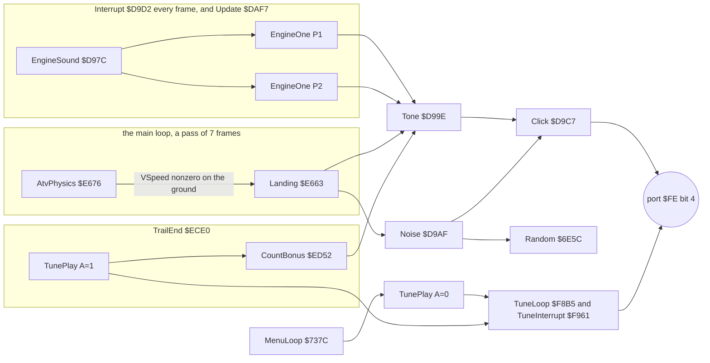

*The sound map. How to read: a box is a routine, an arrow a call; the three groups are where the code runs. The
point: every effect is a Tone or a Noise built on one Click; only the tunes have their own player.*

Witness (L1 call counts, stage 2): EngineOne's Tone from `$D99C` ran 433 times in `c1`. Landing ran 5 times in `c1`
and 33 times in `warp`. BonusTone's Tone from `$ED64` ran 3 198 times in `warp`. TunePlay ran twice in `c1` with
A = 0 (from `$7391`) and 7 times in `warp` with A = 1 (from `$ED00`).

## 9.2 Click, Tone, Noise and Random

### In short

All the effects are made of one primitive. Click `$D9C7` flips bit 4 of BeeperByte `$D7A4` and writes the byte to
port `$FE`. Tone `$D99E` plays B Clicks with C turns of a short delay between them. Noise `$D9AF` plays C Clicks with
a random delay between them. Both end in SpeakerOff `$D9C1`, which writes 0 to the port.

BeeperByte keeps its own copy of the speaker bit, and SpeakerOff does not change it. So the next Click starts from
the level the last Click left in BeeperByte, not from the real speaker. After a Tone with an odd number of Clicks,
the first Click of the next Tone writes 0 over a speaker that is already 0: that Click makes no sound. The engine
plays three Clicks a frame, so its bursts alternate between two pulses and one pulse (9.3).

The border bits of BeeperByte are 0, so the border stays black while the effects play.

### Pseudocode

```text
Click():
    BeeperByte ^= $10
    out($FE, BeeperByte)

Tone(B clicks, C delay):
    repeat B times:
        Click()
        repeat C times: wait 3 turns of DJNZ        # 57 T a turn of C
    SpeakerOff()                                    # out($FE, 0); A = $FF

Noise(C clicks):
    repeat C times:
        Click()
        wait (Random() AND $7F) turns of DJNZ        # 13 T a turn; 0 means 256
        wait 30 turns of DJNZ
    SpeakerOff()

Random():                                           # its only caller is Noise
    A = high(RandomSeed)
    RandomSeed.high = A AND $1B                     # the INC H before it is lost
    RandomSeed.low += 3
    return ROM[RandomSeed]
```

### Assembly

```text
Tone:     D99E  PUSH BC
          D99F  CALL Click
l_D9A2:   D9A2  LD B,$03          ; 3 turns of DJNZ: 41 T
l_D9A4:   D9A4  DJNZ l_D9A4
          D9A6  DEC C             ; DEC C + JR NZ: 16 T, so 57 T a turn of C
          D9A7  JR NZ,l_D9A2
          D9A9  POP BC
          D9AA  DJNZ Tone         ; the next Click
          D9AC  JP SpeakerOff
Noise:    D9AF  CALL Click
          D9B2  CALL JpRandom     ; a ROM byte
          D9B5  AND $7F
          D9B7  LD B,A
l_D9B8:   D9B8  DJNZ l_D9B8       ; 0-127 turns (0 is 256)
          D9BA  LD B,$1E
l_D9BC:   D9BC  DJNZ l_D9BC       ; then 30 more
          D9BE  DEC C
          D9BF  JR NZ,Noise
SpeakerOff: D9C1 XOR A
          D9C2  OUT ($FE),A       ; the speaker off, the border black
          D9C4  SUB $01           ; A = $FF
          D9C6  RET
Click:    D9C7  LD A,(BeeperByte)
          D9CA  XOR $10           ; bit 4: the speaker
          D9CC  LD (BeeperByte),A
          D9CF  OUT ($FE),A
          D9D1  RET
Random:   6E5C  LD HL,(RandomSeed)
          6E5F  LD A,H
          6E60  INC H             ; lost: the next lines overwrite H
          6E61  AND $1B
          6E63  LD H,A
          6E64  INC L
          6E65  INC L
          6E66  INC L
          6E67  LD (RandomSeed),HL
          6E6A  LD A,(HL)
          6E6B  RET
```

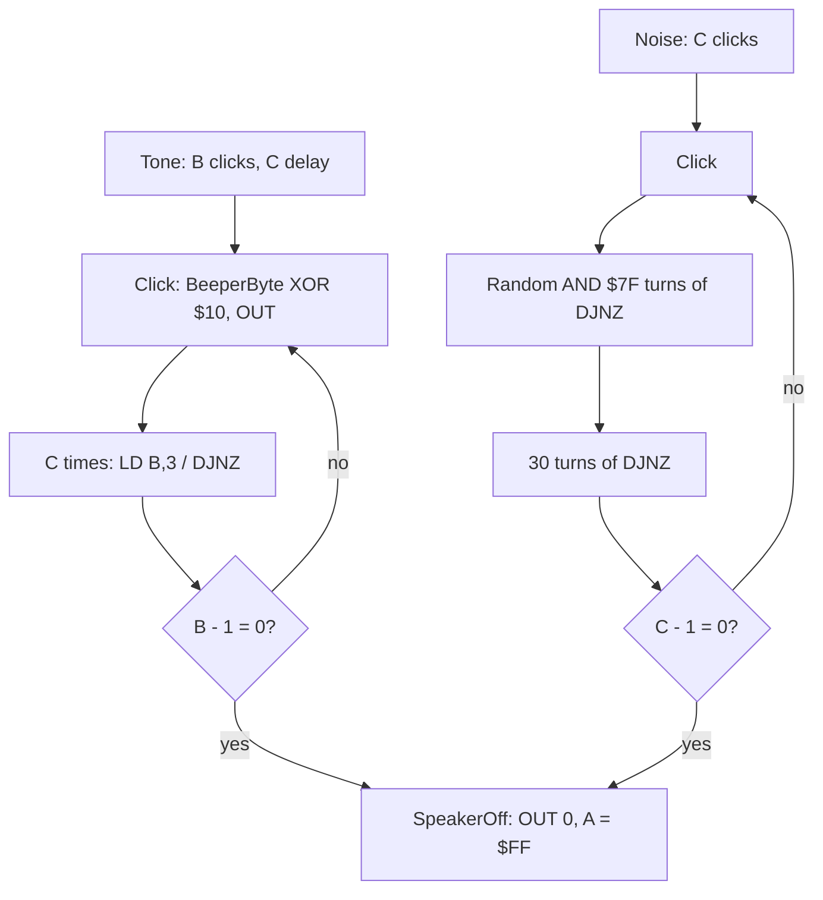

*Tone and Noise. How to read: the left loop is Tone, the right loop Noise; both end in SpeakerOff. The point: a
Tone's pitch is set by C alone, a Noise's gaps by bytes of the ROM.*

### The pitch of a Tone

A Tone's half-period is the time from one Click to the next. Counted from the listing:

- the C loop: 57 T a turn, less 5 for the last JR that falls through;
- the rest: PUSH BC 11, CALL Click 17, Click's body 54, POP BC 10, DJNZ 13.

That gives a half-period of 57 C + 100 T. The simulator measures the same: 1 810 T for C = 30, 670 T for C = 10.

| Who | B (Clicks) | C | Half-period | Pitch |
| --- | --- | --- | --- | --- |
| the engine at speed s | 3 | 31 - s | 57 (31 - s) + 100 T | 967 Hz (s = 1) to 2 612 Hz (s = 21) |
| the landing | 5 | 10 | 670 T | 2 612 Hz |
| a bonus point | 30 | 15 | 955 T | 1 833 Hz |

*The Tones of the game. The point: three numbers in the code make every pitch the game has.*

### Random: a walk that stops

Random looks like a pointer that walks the ROM from `$0000` to `$1BFF`. It does not:

- the second line increments H;
- the fourth line overwrites H with the old value AND `$1B`;
- RandomSeed is `$0C00` in the image;
- the first call keeps `$0C` AND `$1B` = `$08` and steps L by 3;
- every later call keeps H = `$08`.

So Random reads only the ROM page `$0800-$08FF`: 256 bytes in a fixed cycle (3 and 256 have no common factor).

Worked example, from the image and the 48K ROM: the first calls read `$0803`, `$0806`, `$0809`, ... and return
`$56`, `$CF`, `$5E`, `$56`, `$7C`, `$06`. Noise uses them AND `$7F`: delays of 86, 79, 94, 86, 124 and 6 turns of
DJNZ. The landing's Noise plays 10 Clicks, so each landing uses the next ten bytes of the cycle.

The point: the noise of a landing is a fixed stretch of the ROM's bytes, and the same stretch comes back every 25.6
landings.

Witness: Random has one caller, Noise (`$D9B2`); the simulator's landing (9.4) reads `$0803` onwards.

## 9.3 The engine

### In short

The interrupt calls EngineSound `$D97C` in every frame of a ride (`$D9FC`). Update `$DACC` calls it once more in
each player's turn of the pass (`$DAF7`), between walking list A and AtvPhysics. EngineSound calls EngineOne `$D987` for RecordP1
`$D70E`, then for RecordP2 `$D740`. EngineOne returns at once unless the record's Mounted (+2) and Speed (+9) are
both nonzero. Otherwise it plays a Tone of three Clicks with C = `$1E` - (Speed - 1) = 31 - Speed. So the engine is a
short burst, 50 times a second, whose pitch rises with the speed.

The interrupt plays the engine only while FrameCount `$D6BC` is under `$FF`. NextTrail sets `$FF` while it builds a
trail, and the menus keep it there; then the interrupt reads the controls and plays nothing.

EngineNote `$D79A` is not the engine's note. Its only reader is Wheels `$DD55`: bit 7 hides the wheels on every
second change, the spokes' flicker. EngineTimer `$DA1E` steps it once a pass (9.10).

### Pseudocode

```text
interrupt (every frame):
    if FrameCount < $FF:
        FrameCount += 1
        ScanKeys()
        EngineSound()

Update(player) (once a player a pass):
    walk list A
    EngineSound()                                 # one burst more: an EngineSound each frame of the pass
                                                  # (7, more when a two-player pass overruns) plus one per Update
    AtvPhysics(); ...

EngineSound():
    for record in (RecordP1, RecordP2):           # the saved records, not the current copy $D772
        if record.Mounted == 0: continue
        if record.Speed == 0: continue
        Tone(B = 3, C = 31 - record.Speed)
```

### Assembly

```text
EngineSound: D97C LD IX,RecordP1
          D980  CALL EngineOne
          D983  LD IX,RecordP2      ; and falls into EngineOne
EngineOne: D987 LD DE,$0002
          D98A  CALL RecordField    ; A = Mounted
          D98D  RET Z
          D98E  LD DE,$0009
          D991  CALL RecordField    ; A = Speed, 1-21
          D994  RET Z
          D995  SUB $01
          D997  LD E,A
          D998  LD A,$1E
          D99A  SUB E               ; C = 31 - Speed
          D99B  LD C,A
          D99C  LD B,$03            ; three Clicks, then Tone
```

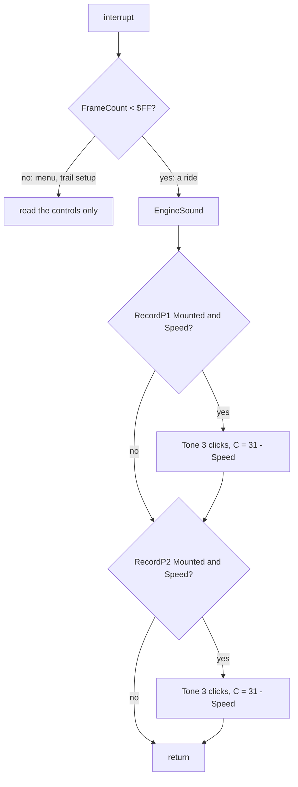

*The engine's decisions. How to read: each diamond is one test of the code above. The point: a rider on foot and a
stopped ATV are silent, and so is a tumbling ATV whose rider was thrown; two riders make two bursts a frame.*

### The sound against the speed

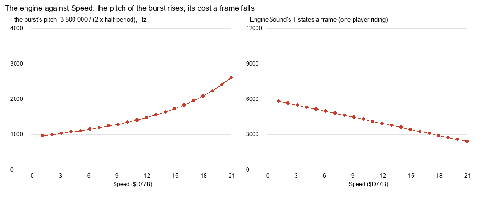

*The engine against Speed, from `tools/fig_sound.py` (EngineSound run once at each speed with RecordP1 mounted).
How to read: left, the burst's pitch, 3 500 000 / (2 x half-period); right, EngineSound's T-states for one rider.
The point: from speed 1 to 21 the pitch rises from 967 to 2 612 Hz and the cost falls from 5 827 to 2 407 T: a fast
ATV is cheaper to hear. Command: `python3 tools/fig_sound.py fig-engine docs/img/sound/engine.png`.*

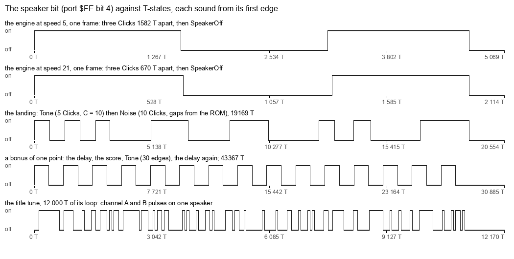

*The speaker against T-states, from the simulator. How to read: each row is one sound from its first write to port
`$FE`; the trace is high while bit 4 is set; the axis is T-states from that write. The point: the engine is one or
two pulses a frame, the landing a short tone then irregular clicks, a bonus point fifteen periods of one tone, the
tune a stream of narrow pulses of two widths. Command: `python3 tools/fig_sound.py fig-beeper
docs/img/sound/beeper.png`.*

Worked example: speed 5.

1. C = 31 - 5 = 26, so the half-period is 57 x 26 + 100 = 1 582 T, as the figure shows.
2. The simulator's four writes in one frame are at +0, +1 582, +3 164 and +4 694 T: on, off, on, and off by
   SpeakerOff.
3. The next frame starts from BeeperByte's bit 4 = 1, so its writes are off (silent), on, off, off: one pulse.
4. The engine therefore alternates a frame of two pulses with a frame of one, at 50 Hz. The ear hears a buzz at the
   frame rate, coloured by the burst's pitch.

[engine.mp3](audio/engine.mp3) is the engine over 6 s: the speed rising from 1 to 21 by one a pass, held for ten
passes, then falling by 2 a pass, as Accelerate and SlowDown move it.

Witness: the trace of `trails` frames 815-821 (one pass, one player) runs EngineSound 8 times: 7 from `$D9FC`, one
in each frame, and once from `$DAF7` in frame 816. In `trails` the speed rises from 2 to 21 between the samples of
frames 526 and 666 while the engine plays; EngineOne's Tone from `$D99C` ran 433 times in `c1` (L1).

So a pass of one player holds eight bursts, not seven. The extra burst comes inside the main loop's work, a few
thousand T after the frame's own; it adds a ninth of irregularity to the 50 Hz buzz.

## 9.4 The landing thump

### In short

AtvPhysics `$E676` calls Landing `$E663` when the ATV is on or under the ground and VSpeed `$D773` is nonzero: the
first pass on the ground after a jump or a fall ([doc 10](10-gameplay-logic.md)). Landing:

1. clears VSpeed;
2. plays a Tone of 5 Clicks at C = 10;
3. plays a Noise of 10 Clicks;
4. jumps to SlowDown (the speed less 2).

The main loop waits for it: 19 169 T, 27 % of a frame.

### Pseudocode

```text
Landing():
    VSpeed = 0
    Tone(B = 5, C = 10)          # 2.5 periods at 2 612 Hz
    Noise(C = 10)                # 10 clicks, gaps from the ROM
    SlowDown()
```

### Assembly

```text
Landing:  E663  XOR A
          E664  LD (VSpeed),A
          E667  LD C,$0A
          E669  LD B,$05
          E66B  CALL Tone
          E66E  LD C,$0A
          E670  CALL Noise
          E673  JP SlowDown
```

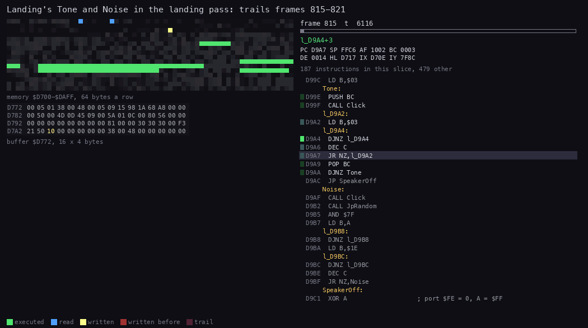

*Landing's Tone and Noise in the pass that lands the ATV after the jump near trail 1's distance 300, `trails` frames
815-821, with the current record `$D772-$D7B1` under the memory map (VSpeed at `$D773` cleared). How to read: green
lines run in the slice; the hex view shows the record's bytes as they are written. The point: the sound is a short
block in the middle of the pass, inside AtvPhysics, before the ATV is drawn. Command: `python3
../../kit/routine_anim.py --work work/docs/atC/trails --listing build/game.lst --window 815:0-822:0 --pc
D99E-D9D1,E663-E675 --view buffer:D772:16x4:hex --range D700-DAFF --pictures 80 --title "Landing's Tone and Noise in
the landing pass: trails frames 815-821" --out docs/img/routines/Landing.gif`.*

Worked example: the simulator's landing writes the port 17 times:

1. five Clicks 670 T apart, then SpeakerOff;
2. ten Noise Clicks; the first gap is (`ROM[$0803]` AND `$7F`) = 86 turns plus 30, 13 T a turn;
3. SpeakerOff.

The whole thump lasts 19 169 T ([landing.wav](audio/landing.wav)).

Witness: in `trails` VSpeed is 4 at the sample of frame 806 and 0 at frame 819, the ATV back at height 0 and the
speed 21 to 20; Landing ran 5 times in `c1` and 33 in `warp` (L1). The heavy pass of `c1` at frame 15 356 holds a
landing: its Tone is 4.7 % of that pass (stage 2's budget, [doc 4](04-game-loop.md)).

## 9.5 The bonus count

### In short

After the finish tune, TrailEnd `$ECE0` calls CountBonus `$ED52`. CountBonus moves each finished player's Bonus
(record +`$29`, a word) into the score one point at a time. Each point is a short delay, ScoreUpP1 or ScoreUpP2 (10
on the screen) and a Tone of 30 Clicks at C = 15. The routine returns when both bonuses are 0.

It is written as a chain of jumps. A bonus routine drops its own return address and pushes BonusTone's, so the Tone
follows the score update without a loop counter.

### Pseudocode

```text
CountBonus():
    loop:
        wait 256 turns of DJNZ                   # 3 328 T
        if Finished bit 0 and RecordP1.Bonus > 0:
            RecordP1.Bonus -= 1; ScoreUpP1()
            BonusP2()                            # P2's point in the same turn, if any
            Tone(30, 15); continue
        if Finished bit 1 and RecordP2.Bonus > 0:
            RecordP2.Bonus -= 1; ScoreUpP2()
            Tone(30, 15); continue
        return
```

### Assembly

```text
CountBonus: ED52 LD B,$00
l_ED54:   ED54  DJNZ l_ED54          ; 256 turns
          ED56  CALL BonusP1
          ED59  CALL BonusP2
          ED5C  RET                  ; both bonuses 0
BonusTone: ED5D CALL BonusP2
          ED60  LD C,$0F
          ED62  LD B,$1E
          ED64  CALL Tone            ; 30 clicks at C = 15
          ED67  JP CountBonus
BonusP1:  ED6A  LD A,(Finished)
          ED6D  AND $01
          ED6F  RET Z
          ED70  CALL LoadRecordP1
          ED73  CALL BonusDec        ; Bonus - 1, Z if it was 0
          ED76  RET Z
          ED77  CALL SaveRecordP1
          ED7A  POP DE               ; drop the return to CountBonus
          ED7B  LD DE,BonusTone
          ED7E  PUSH DE              ; return to BonusTone instead
          ED7F  JP ScoreUpP1
```

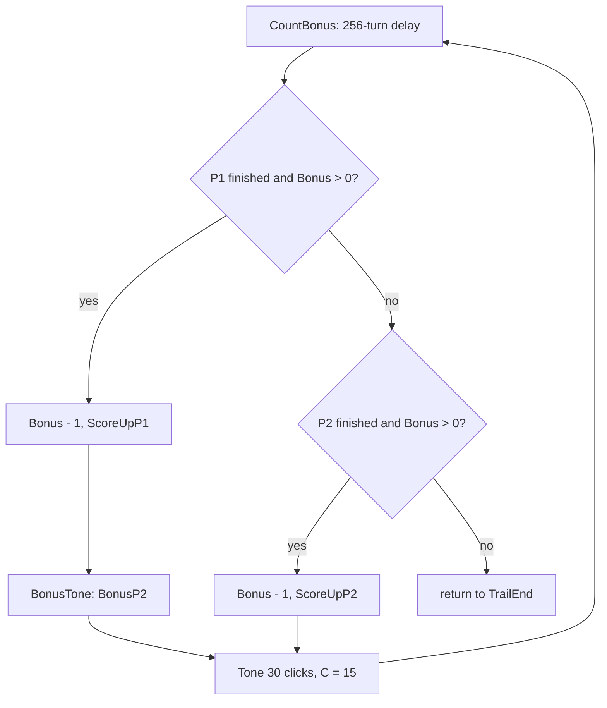

*The bonus count. How to read: one turn of the loop is one point for each player who has bonus left. The point: the
count's speed is set by the Tone, not by the frame; two players count side by side.*

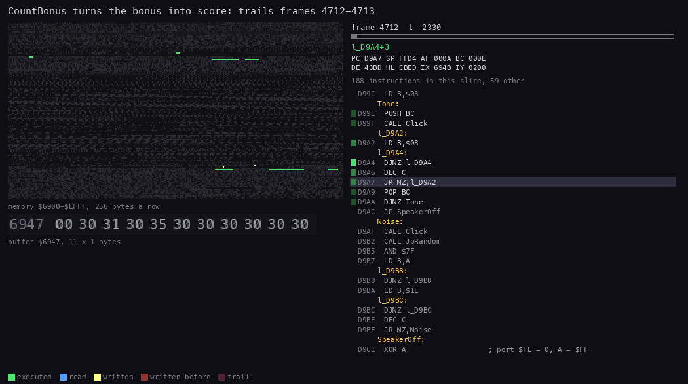

*CountBonus at work, `trails` frames 4 712-4 713, with the score `$6947-$6951` under the memory map. How to read: the
score's ASCII digits change as each point lands; the code panel shows the delay loop, the bonus chain and Tone. The
point: a point and a half a frame, each a Tone. Command: `python3 ../../kit/routine_anim.py --work
work/docs/atC/trails --listing build/game.lst --window 4712:0-4714:0 --pc ED52-EDD0,D99E-D9D1 --view
buffer:6947:11x1:hex --range 6900-EFFF --pictures 60 --title "CountBonus turns the bonus into score: trails frames
4712-4713" --out docs/img/routines/CountBonus.gif`.*

Worked example: in `trails`, trail 1's bonus is 203 points ([doc 10](10-gameplay-logic.md) derives it).

1. The sample of frame 4 710 shows Bonus 201 and score `01020`.
2. The sample of frame 4 832 shows Bonus 0 and score `03030`.
3. 201 points (of 203) took about 122 frames: 1.66 a frame, about 42 000 T a point.
4. The simulator counts 25 points in 991 789 T (39 672 T a point, uncontended) and leaves the score at `00250`.

Each point is 10 on the screen: the score's last digit never moves.

Witness: the `trails` samples above; BonusTone's Tone ran 3 198 times in `warp` (L1).

## 9.6 The tune data, byte by byte

### In short

The tunes live in the tune player's block `$F850-$FDFA` (`src/res/sound/tunes.txt`). A tune is three sequence lists:
channel A, channel B and the drums. A sequence list is a list of pattern addresses, ended by a 0 word. A pattern is a
stream of notes and commands. Both channels are square-wave voices on the one speaker. The drums are noise and a
falling click, played from the interrupt.

| Table | Address | Format |
| --- | --- | --- |
| NoteTable | `$FB72` | 60 bytes: a note's period in turns of the player's loop, note 0 the lowest |
| TuneTable | `$FBAE` | 6 bytes a tune: the addresses of its lists A, B and D |
| a sequence list | e.g. `$FBBA` | pattern addresses, a word each; `$0000` ends the list and the player starts it again |
| a channel pattern | e.g. `$FC0E` | a byte under `$80` is a note (an index into NoteTable plus the transposition); `$80` + n is command n |
| a drum pattern | e.g. `$FD62` | one byte every C' interrupts; the byte AND `$7F` is command n |

*The tables. The point: the format has three levels, tune, list and pattern, as in a tracker.*

The channel commands (CommandJump `$FABC`: a table of `JP` three bytes apart, indexed by n):

| Byte | Name in tunes.txt | Channel A | Channel B |
| --- | --- | --- | --- |
| `$80` | next | the next pattern of list A (NextSequenceA `$FAF9`) | the same for B (`$FB16`) |
| `$81` | mute | a rest of the current length: the speaker byte loses bits 3 and 4 (`$F9DD`) | the same (`$F9D1`) |
| `$82 n` | env n | the envelope's rate: a step every n calls (`$F9C8`) | the same for B (CommandsB `$F9BF`) |
| `$83 n` | len n | the note length: 3 n interrupts (`$F9E9`) | the same (`$F9F9`) |
| `$84 n` | tr n | the transposition (SetTransposeA `$FA17`, no tune uses it) | the transposition (SetTransposeB `$FA20`) |
| `$85` | (end) | the end of the tune: CommandEnd `$F9BD`, `POP HL; RET` | the same at `$F9A4` |

*The channel commands. The point: a note carries no length; the length is a state set by `len`, as in a sequencer.*

The drum commands (Drums `$FA29`):

| Byte | Name | What it does |
| --- | --- | --- |
| `$80` | next | the next drum pattern (DrumNext `$FA7C`) |
| `$81` | rest | nothing (a `RET` in the table) |
| `$82` | d2 | DrumUnused2 `$FA6C`: 32 bytes of memory to the speaker, with a delay (no tune uses it) |
| `$83 n` | speed n | the drum step: 3 n interrupts; read at once, it takes no step (DrumSpeed `$FAA9`) |
| `$84` | d4 | DrumUnused `$FA50`: 128 bytes of memory to the speaker (no tune uses it) |
| `$85` | d5 | nothing |
| `$86` | noise | DrumNoise `$FA5D`: the ROM's bytes from `$005C` to the first zero, AND `$18`, to the port |
| `$87 n` | hit n | DrumHit `$FA81`: 30 short pulses whose gap shrinks from n; a falling click |

*The drum commands. The point: the two drums the tunes use are a burst of ROM bytes and a falling click.*

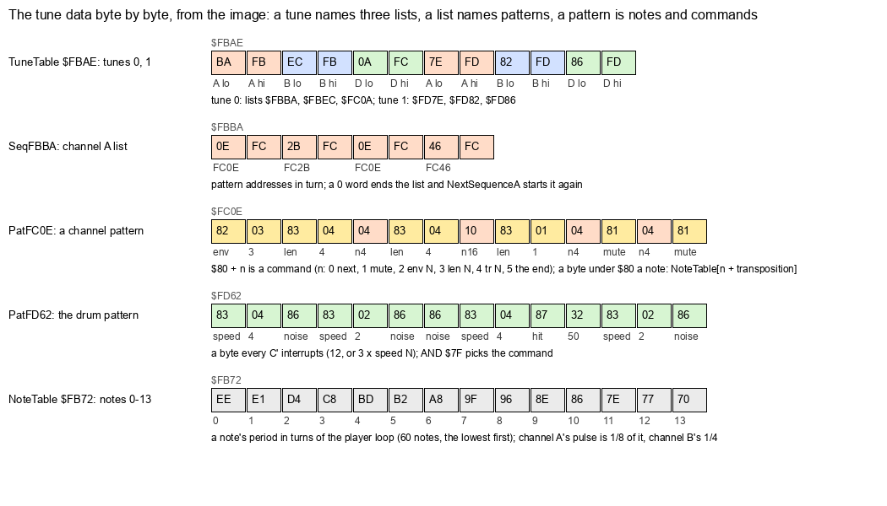

*The tune data as stored in the image. How to read: each box is a byte, the row's first address above it; under each
box, what the player takes it for. Colours: orange channel A, blue channel B, green the drums, yellow a command and
its operand. The point: a pattern is a byte stream a tracker would write, notes and short commands, with no length per
note. Command: `python3 tools/fig_sound.py fig-format docs/img/sound/format.png`.*

### The notes

A note's period is NoteTable's byte, counted in turns of the player's main loop. One turn takes 180 T (the
simulator, the median over the finish tune). So a note's pitch is 3 500 000 / (180 x period) Hz:

- note 0 (period 238) is 82 Hz, an E;
- each note is a semitone above the one before (238 / 225 = 1.058);
- note 59 (period 7) is 2 778 Hz;
- the table spans five octaves; its high notes are coarse (periods 14, 11, 9 and 8 each appear twice).

Channel A's pulse is the period / 8 (`AND $1F`), channel B's the period / 4 (`AND $3F`): two duty cycles, two
timbres on one speaker.

Worked example: the finish tune's first notes.

1. Channel A's pattern PatFD8C starts `82 03 83 04 02`.
2. `$82 03`: env 3.
3. `$83 04`: len 4, so a note lasts 12 interrupts (0.24 s).
4. `$02`: note 2. NoteTable[2] = `$D4` = 212 turns: 92 Hz, a pulse of 212 / 8 = 26 turns.
5. Channel B's PatFDBA starts `82 03 83 01 15 81`: env 3, len 1 (3 interrupts), note 21 (period 71, 274 Hz, a
   pulse of 17), then a rest of 3 interrupts.

The piano roll of 9.8 shows these notes at 0-0.25 s.

Witness: the bytes are the image's (`build/game.bin`); the notes are those the simulator saw played at `$F8CC` and
`$F91B`.

## 9.7 The tune player

### In short

TunePlay `$F852` takes the machine over until the tune ends or a key is pressed:

1. it stores the tune number into TuneEntry's `LD A,n`, clears the transposition, and saves SP and HL';
2. it reads the tune's three list addresses from TuneTable by pointing SP at them and popping;
3. it fills `$FE00-$FF00` with `$FD`, sets I = `$FE` and IM 2, and puts `JP TuneInterrupt` at TuneVector `$FDFD`;
4. it starts the three lists and runs TuneLoop `$F8B5`, with SP = 0;
5. when a pattern's `$85` is read, or the hook stops the tune, TuneStop `$F97E` puts back the ROM's vector and the
   saved SP, and returns.

TuneLoop is one tight loop. Each turn steps both channels:

- channel A: DEC D; when D reaches 0 it reloads D with the note's period and writes a pulse: the start byte `$18`
  (speaker and MIC), a delay of the pulse width, then 0;
- channel B: the same with E and its own width;
- when channel A's note timer B is 0, the loop reads A's pattern up to its next note; the same for B with C.

The interrupt, TuneInterrupt `$F961`, only counts. It decrements B and C (the two note timers) and C' (the drum
timer, which runs Drums when it reaches 0). It calls TuneHook `$F96C` and returns with the carry flag set. Back in
the loop, `CALL C,Envelope` at `$F8BD` sees the carry and steps the envelope.

The envelope is a duty-cycle decay. Every n-th call (n from `env`: 3 or 4 in these tunes) it shrinks channel A's
pulse by one turn and moves that turn into the delay before the pulse, so the loop keeps its length. The pulse never
falls under 1. Channel B's pulse decays the same way with its own counter. A note thus starts loud and thins.

The hook is the menu's or the finish's:

- the title: MenuLoop puts MenuTick `$7340` in the hook. MenuTick counts TuneTimer once an interrupt and stops the
  tune for the high score screen when TuneTimer's low byte wraps to 0 with the high byte's low nibble `$0A`: Title
  `$6E06` starts it at `$04C8`, so the first stop is at `$0A00`, 1 336 interrupts (26.7 s). After the high score
  screen the menu stays silent: MenuLoop's HALT loop (`$73B5`) waits for a key, or until TuneTimer reaches `$8000`
  (`$73CD`, 31 544 counts from `$04C8`, about 10.5 minutes), which restarts the title and its tune. The tune plays
  again only when a menu action re-enters MenuLoop (Title `$6E47`, MenuMain `$74A1`); it then stops at the next
  `$xA00`, at most `$1000` counts (81.9 s) later. A key (TuneKeyCheck `$F977`) or any Kempston input stops it at
  once;
- the finish: TrailEnd puts three NOPs over the hook. Nothing stops the finish tune but its own `$85`.

### Pseudocode

```text
TunePlay(tune):
    TuneEntry.tune = tune; transposition = 0
    save SP, HL'
    listA, listB, listD = TuneTable[tune]
    fill $FE00-$FF00 with $FD; I = $FE; IM 2; TuneVector = JP TuneInterrupt
    next pattern of A, B and D
    TuneLoop()                       # returns at $85
    TuneStop()                       # the ROM's vector back, the saved SP, return

TuneLoop():
    noteTimerA = noteTimerB = 1; drumTimer = 1; EI
    HALT
    loop:                            # one turn: 180 T
        if carry: Envelope()         # the carry an interrupt left
        if noteTimerA == 0: read channel A's pattern up to its next note
        D -= 1
        if D == 0: D = periodA; pulse(widthA)
        if noteTimerB == 0: read channel B's pattern up to its next note
        E -= 1
        if E == 0: E = periodB; pulse(widthB)

TuneInterrupt():
    noteTimerA -= 1; noteTimerB -= 1
    drumTimer -= 1
    if drumTimer == 0: Drums()       # sets drumTimer to 12 or 3 n
    TuneHook()                       # MenuTick, TuneKeyCheck or nothing
    set carry; EI; return
```

### Assembly

```text
TuneLoop: F8B5  LD C,$01             ; the drum timer C' = 1
          F8B7  EXX
          F8B8  EI
          F8B9  LD BC,$0101          ; note timers B (channel A) and C (channel B)
          F8BC  HALT
l_F8BD:   F8BD  CALL C,Envelope      ; carry: an interrupt came since the last AND
          F8C0  LD A,B
          F8C1  AND A                ; clears the carry
          F8C2  JR NZ,l_F8F3         ; note A still playing
ChannelAPtr: F8C4 LD HL,stream       ; operand: channel A's stream pointer
l_F8C7:   F8C7  LD A,(HL)
          F8C8  OR A
          F8C9  JP M,ChannelACommand ; $80-$FF: a command
          F8CC  CALL NoteLookup      ; A = NoteTable[A + transposition]
          F8CF  LD (l_F8F8+$0004),A  ; the period, into LD D,n
          F8D2  LD D,A
          F8D3  RRCA
          F8D4  RRCA
          F8D5  RRCA
          F8D6  AND $1F
          F8D8  LD (ChannelAOn+$0005),A ; the pulse width: period / 8
          ...
l_F8F8:   F8F8  DEC D
          F8F9  JR NZ,l_F90F
          F8FB  LD D,$A8             ; operand: the period
          F8FD  LD A,$02             ; operand: the pre-delay (Envelope moves the width here)
l_F8FF:   F8FF  DEC A
          F900  JR NZ,l_F8FF
ChannelAOn: F902 LD A,$18            ; speaker and MIC on
          F904  OUT ($FE),A
          F906  LD A,$14             ; operand: the pulse width
l_F908:   F908  DEC A
          F909  JR NZ,l_F908
ChannelAOff: F90B LD A,$00
          F90D  OUT ($FE),A
TuneInterrupt: F961 PUSH AF
          F962  PUSH HL
          F963  PUSH DE
          F964  DEC C                ; channel B's note timer
          F965  DEC B                ; channel A's note timer
          F966  EXX
          F967  DEC C                ; the drum timer
          F968  CALL Z,Drums
          F96B  PUSH BC
TuneHook: F96C  CALL TuneKeyCheck    ; patched: MenuTick, TuneKeyCheck, or NOP NOP NOP
          F96F  POP BC
          F970  EXX
          F971  POP DE
          F972  POP HL
          F973  POP AF
          F974  SCF                  ; the signal to the loop
          F975  EI
          F976  RET
TuneStop: F97E  DI
          F97F  LD HL,$0038          ; TuneVector = JP $0038 again
          F982  LD (TuneVector+$0001),HL
          F985  LD SP,$F838          ; operand: TunePlay's saved SP
          F988  LD HL,$2758          ; operand: the saved HL'
          F98B  EXX
          F98C  NOP
          F98D  RET
```

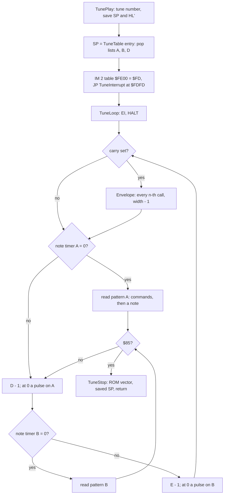

*TuneLoop. How to read: one turn of the loop is the path from the carry test back to it; the interrupt (below) runs
between any two instructions. The point: the loop never waits; a note is a count of turns, so every pitch is a
multiple of 180 T.*

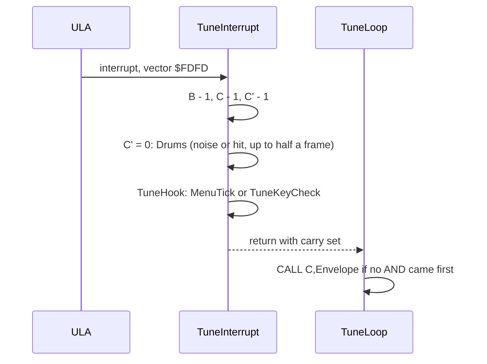

*The interrupt and the loop. The point: the interrupt counts time and the loop makes the sound; the carry flag is
the only message between them.*

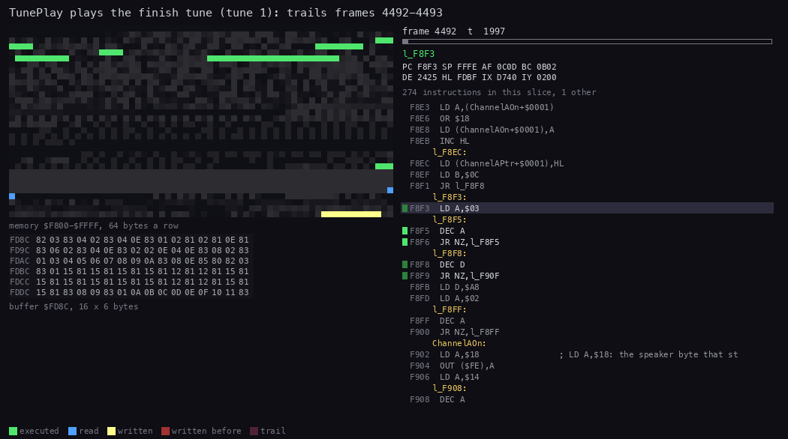

*TunePlay at work, `trails` frames 4 492-4 493 (the finish tune, after trail 1's TIME OUT), with the finish tune's
channel A pattern `$FD8C-$FDEB` under the memory map. How to read: the loop at `$F8B5-$F960` runs in every slice;
the reads of the pattern show when a note starts. The point: the player is one loop of a few dozen instructions,
run about 390 times a frame. Command: `python3 ../../kit/routine_anim.py --work work/docs/atC/trails --listing
build/game.lst --window 4492:0-4494:0 --pc F850-FB71 --view buffer:FD8C:16x6:hex --range F800-FFFF --pictures 70
--title "TunePlay plays the finish tune (tune 1): trails frames 4492-4493" --out docs/img/routines/TunePlay.gif`.*

### The carry: an envelope that skips

The interrupt's `SCF` reaches the envelope only if the loop does not clear the carry first. The loop clears it at
`$F8C1` (`AND A`), `$F8C8` (`OR A`) and `$F910` (`AND A`). An interrupt that returns between `$F8BD` and one of those
is lost to the envelope. The simulator counts it:

- the finish tune takes 169 interrupts and calls Envelope 74 times (44 %);
- the title tune takes 2 305 interrupts and calls Envelope 1 073 times (47 %).

The decay is therefore uneven: with env 3, a step every six or seven interrupts on average, not every third.

### Drums

The drums run inside the interrupt. DrumNoise sends the ROM's bytes from `$005C` to the first zero (`$02AD`, 593
bytes) to the port, about 59 T a byte: some 35 000 T, half a frame. The channels are silent while it runs, and their
note timers wait. That gap is part of the drum's sound. DrumHit is shorter: 30 pulses.

### Worked example: the finish tune against the recording

The model and the recording agree on the timing:

1. in `trails` the clock reaches `600` (TIME OUT) at the sample of frame 4 484;
2. FrameCount stays at 7 from frame 4 490 to 4 660: the tune player has replaced the interrupt, so FrameCount stops;
3. at frame 4 670 FrameCount counts again: TrailEnd's 50 HALTs;
4. the simulator plays tune 1 in 169.0 frames (11 811 973 T, 3.37 s) and stops at CommandEnd `$F9BD`, channel A's
   `$85`; the recordings never run `$F9BD`: the tunes in them end at channel B's `$85` at `$F9A4` (L1: trails 1,
   warp 7, kb 1). Both are right: PatFD8C (A) and PatFDBA (B) last exactly 168 interrupts each (3 x len an event,
   from `tunes.txt`), so both note timers run out in the 169th interrupt. The loop tests A's timer at `$F8C0` and B's
   at `$F90F`; when the interrupt lands between `$F8C1` and `$F90F`, B's `$85` is read first, elsewhere A's. It is a
   race inside one turn of the ~180 T loop, not a fixed order, and either ends the tune in the same interrupt.

The point: the finish tune is as long in the model as in the recording; which channel's end mark stops it depends
only on where in the player's loop the 169th interrupt lands.

## 9.8 The two tunes and when each plays

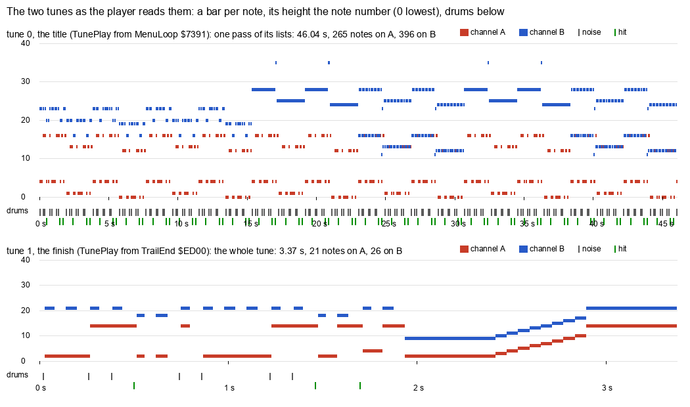

*The two tunes as the simulator played them. How to read: a bar is a note on channel A (red) or B (blue), its height
the pattern's note number, its length until the next note or rest; the ticks below are the drums (grey noise, green
hit); the axis is seconds. The point: the title is a bass riff on A (notes 0-16) under a two-part figure on B, the
patterns repeated with a transposition; the finish is the same riff once, then a rising run on both channels to a held
note. Command: `python3 tools/fig_sound.py fig-tunes docs/img/sound/tunes.png`.*

**Tune 0, the title.** Its lists:

- A = SeqFBBA: 24 patterns, FC0E FC2B FC0E FC46 six times;
- B = SeqFBEC: 14 patterns;
- D = SeqFC0A: PatFD62, the drum loop.

A's 24 patterns and B's 14 take the same 2 304 interrupts (46.0 s): the two lists start again together (the
simulator: both restart at interrupt 2 305). The lists repeat until the hook stops the tune. MenuTick stops it after
26.7 s for the high score screen, before the lists end once (TuneTimer starts at `$04C8`, the stop is at `$0A00`).
Only a tune restarted by a menu action (9.7) can play up to `$1000` counts and so repeat the lists. Channel B's
PatFDF7 and PatFDF4 set the transposition to 2 and back to 0. There is only one transposition (9.10), so they shift
channel A as well.

**Tune 1, the finish.** Its lists:

- A = SeqFD7E (PatFD8C) and B = SeqFD82 (PatFDBA); both patterns end with `$85`;
- D = SeqFD86: PatFD62, then PatFDF0, a step of 3 x 255 (253 as a byte) interrupts with nothing: the drums stop.

Both channels reach their `$85` in the 169th interrupt; whichever the loop reads first ends the tune: B (`$F9A4`)
in every recording, A (`$F9BD`) in the simulator, because the interrupt lands at a different point of the loop (9.7).

When each plays:

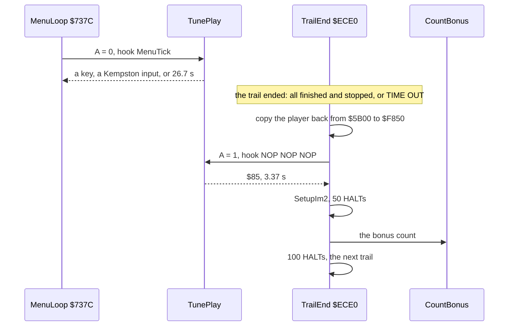

*The tunes in the game's cycle. The point: both tunes block everything else; the finish tune is a pause the player
cannot skip.*

The player rewrites its own operands as it plays, so it is kept in a copy. GameEntry `$D7D6` copies `$F850-$FDFA`
(`$05AB` bytes) to `$5B00`. TrailEnd copies it back before the finish tune. The title tune leaves the block changed;
the copy makes every finish tune start from the same bytes. RestoreTunePlayer `$6DEF` does the same copy and has no
caller.

Witness: TunePlay A = 0 from `$7391` twice in `c1`, A = 1 from `$ED00` 7 times in `warp` (L1); the finish timing in
9.7. [tune-title.mp3](audio/tune-title.mp3) (46 s, one pass of B's list) and [tune-finish.wav](audio/tune-finish.wav)
(3.4 s) are the simulator's renders.

## 9.9 The cost, and what the sound takes from the game

| Sound | Cost | When | What the game loses |
| --- | --- | --- | --- |
| the engine | 2 407-5 827 T a call for each moving rider; 8 calls a pass with one player | every frame of a ride | up to 8.3 % of each frame; two riders twice that; the call from Update is part of the pass's work |
| the landing | 19 169 T | once a landing | 3.9 % of a pass (489 216 T); a landing's Tone is 4.7 % of `c1`'s heavy pass at 15 356 |
| the bonus count | about 40 000 T a point | between trails | nothing: the game waits |
| the tunes | the whole machine | the menu, the end of a trail | the interrupt and FrameCount stop; only the hook reads the keys |

*The cost of each sound. The point: the engine is the only sound that runs all through play, and it costs less the
faster the ATV goes.*

The engine runs in the interrupt, so its time is taken from whatever the main loop is doing. A pass is a fixed 7
frames, and the pass's work in `c1` is at most 91.3 % of it ([doc 4, 4.7](04-game-loop.md#47-the-heaviest-pass)). So the engine's 2-8 % never makes a pass
late, even the heaviest.

## 9.10 Notes, quirks and what is known only from the code

- **One transposition for two channels.** NoteLookup `$FB64` adds TransposeB's operand to every note, channel A's
  too. Channel A's command 4, SetTransposeA `$FA17`, writes the same operand (`LD (TransposeB+$0001),A`), through
  UnusedCommandA4 `$F9BA`; no tune uses it.
- **The carry signal** (9.7): the envelope sees only the interrupts the loop does not clear first.
- **Random is stuck on one page** (9.2): the lost `INC H` keeps the pointer in page `$08`, not `$0000-$1BFF`.
- **Which end mark stops a tune.** Both channels of the finish tune end in the same, 169th interrupt; the simulator
  reads channel A's `$85` first (CommandEnd `$F9BD`), the recordings channel B's (`$F9A4`: trails 1, warp 7, kb 1).
  A race inside one turn of the loop (9.7), not a fixed order.
- **EngineNote is not a sound.** EngineNote `$D79A` drives the wheels' flicker (Wheels `$DD55`), not the engine's
  tone.
- **Odd Clicks.** The engine's three Clicks a frame leave BeeperByte flipped, so every second burst loses its first
  edge (9.3).
- **MIC.** The tune player writes `$18`, setting MIC (bit 3) with the speaker; the drums write the ROM's bits 3 and
  4. On a real 48K, MIC leaks into the speaker a little, so the tunes sound a touch louder than the effects.
- Known only from the code: DrumUnused `$FA50` and DrumUnused2 `$FA6C` (no drum pattern uses `$84` or `$82`);
  SetTransposeA (no `$84` on channel A); MenuTick's 26.7 s stop (no recording waits that long in the menu); AbortKey
  `$DA01` in the interrupt, unreachable.
