# 10. Gameplay logic

What this covers:

- the rules as code: one pass of one player, and the order in which Update applies the rules;
- the ground: how the wheels find it in the pixels of the buffer, the rise, the fall and the landing;
- the jump, the slopes and the wheelies: the ATV's nose;
- the crash rule, the crash by speed, the tumble, the throw and the rider on foot;
- getting on the ATV (MountCheck), the throttle and the brake, the fuel;
- the clock, the score, the finish, the bonus, TIME OUT and the end of a trail;
- the game: six trails, a second round, the players who drop out, the game over;
- the course of the bot game `trails`, the expected techniques, the quirks and what is known only from the code.

There are no enemies. The opponent is the trail: a fixed list of sprites ([doc 7](07-objects.md)) whose pixels the
ATV's wheels feel, and a clock. Two players race on one clock, each in a half of the screen, and never touch.

The recordings and tools it rests on ([WALKTHROUGH 6.0](../WALKTHROUGH.md)):

- `trails`: from `c1`'s menu, the autoride bot's plan without a POKE: trail 1 ridden to its finish, the finish tune and
  the bonus, then trail 2 to a crash, a tumble and a rider who walks the wrong way. Its inputs are
  `tests/inputs/trails.txt`. It was opened on an own instance, after `. work/env.sh`: `python3 ../../kit/rs.py open
  --work work/docs/atC/trails --ttd work/stage1/rec/trails/session.ttd --model 48K --port-base 37790`.
- `work/docs/atC/trails-vars.jsonl`: every frame 0-7 441 of `trails`, sampled by `python3 work/docs/atC/sample.py work/docs/atC/trails 0 7441 1 work/docs/atC/trails-vars.jsonl` (the main loop's variables `$D6B6-$D6DA`, the
  records `$D70E-$D7A7`, the score). `python3 work/docs/atC/tab.py A B STEP` prints its fields as a table; the tables
  below are its output.
- The traces of `trails` that `routine_anim.py` made for the animations below (`work/docs/atC/anims1.sh`,
  `anims4.sh`), in `work/docs/atC/trails/traces/`, counted with `work/docs/atC/pcs.py`.
- `empty`, `kb`, `c1` and `warp` for the rules `trails` does not reach ([doc 1](01-game-design.md) has their
  numbers).
- `tools/fig_gameplay.py`: the course chart, trail 1's ground against the ATV's height, and the physics tables run as
  the code runs them.

A sample of frame N is the memory at the start of frame N. A pass is one turn of the main loop, 7 frames when its work
fits ([doc 4](04-game-loop.md#46-the-fixed-7-frame-pass-and-the-wait-on-d6bc)). "Height" counts lines up from the
bottom of the play window; "x" is a pixel column of the 176-pixel window. The record fields (Speed `$D77B`, AtvHeight
`$D778` and the rest) are the current player's copy at `$D772` ([doc 7, 7.8](07-objects.md#78-the-player-record)).

## 10.1 The rules map

### In short

A trail is a race against a clock along a fixed line of sprites. The rider starts on foot behind the ATV, jumps on,
and rides right with the throttle. The ATV keeps to the ground the wheels see in the buffer; a step it cannot climb is
a crash. Distance costs fuel. Past the finish the clock is kept as the lap time and turned into a bonus. The trail
ends when every rider still in has finished and stopped, or at the trail's maximum time; a rider who has not finished
then drops out, and with nobody left the game is over.

| Rule | Routine | Address | Section |
| --- | --- | --- | --- |
| the ground under the wheels | GroundUnder, GroundScan | `$E810`, `$E821` | 10.2 |
| rise, fall, landing | Rise, Fall, Landing | `$E5BA`, `$E5E9`, `$E663` | 10.3 |
| the jump | JumpControl | `$E34B` | 10.4 |
| the nose: slopes, wheelies | AtvPhysics `$E6F8-$E796`, WheelieUp, WheelieDown | `$E838`, `$E852` | 10.5 |
| the crash | AtvPhysics `$E6E6`, Crash | `$E94C` | 10.6 |
| the tumble | Tumble | `$E89C` | 10.7 |
| the rider thrown | Throw, Thrown, FallRider, ThrowOff | `$E9FA`, `$EA21`, `$E991`, `$E2E2` | 10.8 |
| on foot, getting on | RiderOnFoot, MountCheck | `$DF37`, `$E46E` | 10.9 |
| throttle, brake, turn | ControlLeft, ControlRight, Accelerate, SlowDown, Stop | `$E120`, `$E1F0`, `$E54C`, `$E53E`, `$E511` | 10.10 |
| fuel | UseFuel, OutOfFuel | `$DF91`, `$DFE6` | 10.11 |
| the score | ScoreStep, ScoreDown | `$E0CB` | 10.12 |
| the clock | ClockTick, ShowMaxTime | `$EB53`, `$EACF` | 10.13 |
| the finish and the bonus | FinishCheck | `$DB34` | 10.14 |
| the end of a trail | WaitFrames, TimeOut, TrailEnd | `$D86B`, `$EBE3`, `$ECE0` | 10.15 |
| the game | NewGame, SelectTrail | `$D80D`, `$EC9C` | 10.16 |

### Pseudocode

```text
Pass():                                   # $D851, once per pass
    FrameCount = 0; read both players' controls
    ClockTick()                           # a tenth on the shared clock
    for each player still Riding: PassP1 / PassP2
    WaitFrames()                          # 7 frames, then the end-of-trail tests (10.15)

PassP1():                                 # $DA4F; PassP2 $DA8F is the same for the lower half
    load the record; if this player has Finished: SlowDown()
    PassControls = Controls1; EngineTimer()
    Update()                              # the rules below
    Advance()                             # the distance, the scenery, the fuel, the score
    copy the buffer to the screen; save the record

Update():                                 # $DACC
    walk list A (the ground) into the buffer
    EngineSound(); RiderHeight = RiderSavedHeight
    AtvPhysics()                          # ground, rise, fall, landing, crash, nose
    Controls()                            # throttle, brake, turn, wheelie, MountCheck
    if AtvFrame != $5C (not turning): JumpControl(); RiderUpdate(); Tumble()
    walk list B (the scenery); the deferred items, the ATV and the rider
    FinishCheck()
```

### Assembly

```asm
Update:                         ; $DACC (the list walks cut out, doc 7.4)
  DAF4  CALL JpWalkList          ; list A: the ground, into the buffer
  DAF7  CALL EngineSound
  DAFA  LD A,(RiderSavedHeight)
  DAFD  LD (RiderHeight),A
  DB00  CALL AtvPhysics
  DB03  CALL Controls
  DB06  LD A,(AtvFrame)
  DB09  CP $5C                   ; the turn-round frame: no jump, no rider, no tumble
  DB0B  JR Z,l_DB16
  DB0D  CALL JumpControl
  DB10  CALL RiderUpdate
  DB13  CALL Tumble
l_DB16:
  ...                           ; list B, the deferred items, DrawAtvAndRider
FinishCheck:                    ; $DB34 falls in from Update
```

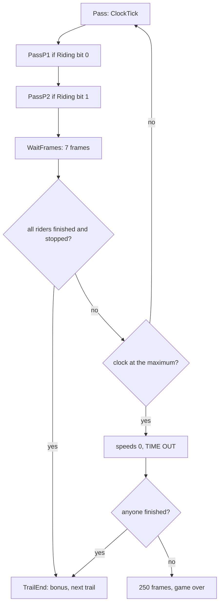

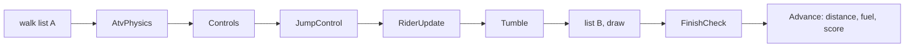

**Worked example.** In `trails` one pass of trail 1 at full speed runs ClockTick, PassP1 (list A, AtvPhysics,
Controls, JumpControl, RiderUpdate, Tumble, list B, the draws, FinishCheck, Advance, the copy), then WaitFrames. The
pass of frames 1 263-1 269 ([doc 7, 7.5](07-objects.md#75-the-draw-order-what-the-wheels-can-touch)) starts at 1 263
T 6 804, reaches FinishCheck at 1 266 T 63 634 and Advance at 1 266 T 64 625, and waits from there to the end of
1 269. Every rule below runs once per pass per player, so every speed, fall and timer in this document is per pass, a
tenth on the clock.

**Witness.** `pcs.py` over `work/docs/atC/trails/traces/1263_0-1271_0.uatr` finds `$DB00` (the call of AtvPhysics) and
`$DB03` (Controls) in frames 1 264 and 1 270 (the next pass), `$DB34` (FinishCheck) in 1 266.

**The point.** All the game's rules are one call chain per player per pass; there is no event queue and no timer for
the game, and nothing runs between the passes but the interrupt's engine sound and frame counter.

## 10.2 The ground: what the wheels feel

### In short

The ATV has no map of the ground. The ground is whatever list A has drawn in the player's buffer when AtvPhysics
runs: the dunes, the ramps, the rocks. GroundUnder looks straight down a pixel column for the first set pixel, from 8
lines above the ATV's height. It does it at two points 6 pixels apart, both under the rear wheel (x 79 and 85 with
the ATV at AtvX 72 facing right, where the wheel's ink spans 77-86; the front wheel is near 105), and takes the
higher; that is GroundY `$D6C4`. A third scan, under the nose, gives the slope (10.5).

### Pseudocode

```text
GroundUnder(x):                       # $E810: SpriteX = x
    y = min(AtvHeight + 8, $4F)       # the scan starts 8 lines above the wheels
    return GroundScan(x, y)

GroundScan(x, y):                     # $E821
    for line = y down to 1:
        if the buffer pixel at (x, line) is set: return line
    return 0                          # nothing: the window's floor

AtvPhysics, the ground part:          # $E68B-$E6AC
    rear  = GroundUnder(RearX)        # AtvX + 7 (facing left: AtvX + 9)
    ahead = GroundUnder(RearX + 6)    # still under the rear wheel
    GroundY = max(rear, ahead)        # $D6C5 = rear, $D6C6 = ahead
```

### Assembly

```asm
  E68B  CALL RearX               ; SpriteX = AtvX + 7
  E68E  CALL GroundUnder
  E691  LD A,B
  E692  LD (GroundY+$0001),A     ; the rear wheel's ground
  E695  PUSH AF
  E696  LD A,(SpriteX)
  E699  ADD A,$06
  E69B  LD (SpriteX),A
  E69E  CALL GroundUnder
  E6A1  LD A,B
  E6A2  LD (GroundY),A
  E6A5  LD (GroundY+$0002),A     ; the ground 6 pixels ahead
  E6A8  POP AF
  E6A9  CP B
  E6AA  JR C,l_E6AF
  E6AC  LD (GroundY),A           ; the higher of the two
GroundScan:
  E821  CALL JpPixelMask
  E824  LD C,A
  E825  LD A,(SpriteY)
  E828  LD B,A
l_E829:
  E829  PUSH BC
  E82A  LD A,C
  E82B  AND (HL)                 ; a set pixel: B is the ground's line
  E82C  JR Z,l_E830
  E82E  POP BC
  E82F  RET
l_E830:
  E830  LD DE,$0016              ; 22 bytes: the next line down
  E833  ADD HL,DE
  E834  POP BC
  E835  DJNZ l_E829
  E837  RET
```

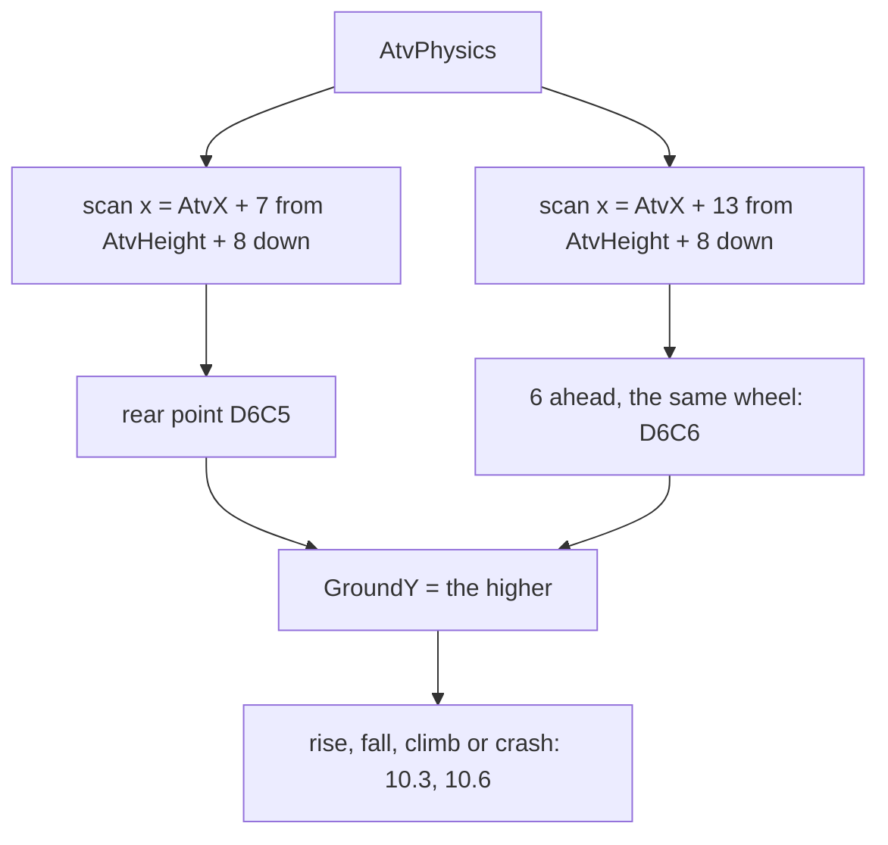

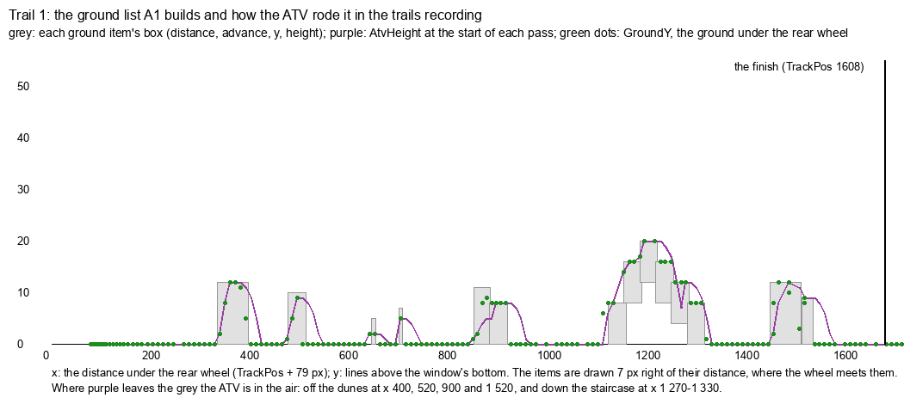

*Figure 10.1: trail 1 as the wheels meet it. How to read: grey, each ground item of list A1 (its sprite's box at its
distance, from `src/res/trails` through `tools/res_formats.py`); purple, AtvHeight at each pass of `trails`; green
dots, GroundY of that pass; x is the distance under the rear wheel (TrackPos + 79). The point: the ATV is a point
that follows the tops of the boxes, climbs steps of up to 6, and leaves them over each crest, landing a few passes
later. Command: `python3 tools/fig_gameplay.py fig-profile work/docs/atC/trails-vars.jsonl
docs/img/gameplay/profile.png`.*

**Worked example.** The staircase of trail 1 (the dune at frames 1 285-1 341 of `trails`), from `tab.py 1278 1341 7`:

| Frame | TrackPos | `$D6C5` (x + 7) | `$D6C6` (x + 13) | GroundY | AtvHeight |
| --- | --- | --- | --- | --- | --- |
| 1 285 | 1 038 | 0 | 0 | 0 | 0 |
| 1 292 | 1 049 | 0 | 6 | 6 | 6 |
| 1 299 | 1 059 | 8 | 8 | 8 | 8 |
| 1 313 | 1 080 | 8 | 14 | 14 | 14 |
| 1 320 | 1 091 | 16 | 16 | 16 | 16 |
| 1 341 | 1 122 | 20 | 20 | 20 | 20 |

The point 6 pixels ahead meets each step first (1 292: 6 there, 0 at the back) and GroundY takes it, so the ATV
climbs as soon as the front half of its rear wheel is on the step. Each step is 6 or less (0 → 6, 8 → 14), under
the crash limit of 7 (10.6).

**Witness.** `work/docs/atC/trails-vars.jsonl`, the rows above; the dune in
[trails-jump-dune.gif](img/play/trails-jump-dune.gif) (10.4).

**The point.** The physics reads the picture. Anything list A draws before AtvPhysics is ground, at its exact pixel
shape; list B, drawn later, never is ([doc 7, 7.5](07-objects.md#75-the-draw-order-what-the-wheels-can-touch)). The
scan starts only 8 lines above the wheels, so the ground scans never see anything higher; the nose scan (10.5) is what
meets a wall.

## 10.3 Rise, fall and landing

### In short

VSpeed `$D773` is the ATV's vertical state: negative while it rises, 0 on the ground, 1 to 5 while it falls. A rise
or a fall moves the ATV by FallSteps `$E319` = 0, 1, 2, 4, 6, 6 lines a pass, picked by the size of VSpeed. When the
ground is lower than the ATV, it falls; when the ground is at or above it, the fall ends (Landing: a thud and a
SlowDown) and the ATV is lifted onto the ground, unless the step is a crash.

### Pseudocode

```text
AtvPhysics():                                 # $E676
    PrevHeight2 = PrevHeight; PrevHeight = AtvHeight
    if AtvFrame == $5C: return                # turning round
    Rise()
    (GroundY, 10.2)
    if VSpeed < 0: goto nose                  # still rising
    if GroundY < AtvHeight: Fall(); goto nose
    if VSpeed != 0: Landing()                 # VSpeed = 0, Tone + Noise, SlowDown
    VSpeed = 0
    if GroundY == AtvHeight: goto nose
    step = (GroundY - AtvHeight) - max(0, PrevHeight - PrevHeight2)
    if step >= 7: Crash()                     # 10.6
    else: AtvHeight = GroundY                 # climb onto the ground
  nose: (10.5)

Rise():                                       # $E5BA
    if VSpeed >= 0: return
    VSpeed += 1
    if VSpeed == 0: VSpeed = 1; return        # the top: the fall starts next pass
    AtvHeight += FallSteps[min(-VSpeed, 5) - 1]

Fall():                                       # $E5E9
    if TumbleCount != 0: return               # the tumble moves the ATV itself
    VSpeed = min(VSpeed + 1, 5)
    AtvHeight = max(0, AtvHeight - FallSteps[VSpeed - 1])
```

### Assembly

```asm
Rise:
  E5BA  LD A,(VSpeed)
  E5BD  BIT 7,A
  E5BF  RET Z
  E5C0  ADD A,$01
  E5C2  JR NZ,l_E5CA
  E5C4  LD A,$01
  E5C6  LD (VSpeed),A
  E5C9  RET
l_E5CA:
  E5CA  LD (VSpeed),A
  E5CD  XOR $FF
  E5CF  ADD A,$01                ; -VSpeed
  E5D1  CP $06
  E5D3  JR C,l_E5D7
  E5D5  LD A,$05
l_E5D7:
  E5D7  SUB $01
  E5D9  LD E,A
  E5DA  LD D,$00
  E5DC  LD HL,FallSteps
  E5DF  ADD HL,DE
  E5E0  LD E,(HL)
  E5E1  LD A,(AtvHeight)
  E5E4  ADD A,E
  E5E5  LD (AtvHeight),A
  E5E8  RET
Fall:
  E5E9  LD DE,l_E6F8             ; returns to the nose code
  E5EC  PUSH DE
  E5ED  LD A,(TumbleCount)
  E5F0  CP $00
  E5F2  RET NZ
  E5F3  LD A,(VSpeed)
  E5F6  ADD A,$01
  E5F8  LD (VSpeed),A
  E5FB  CP $06
  E5FD  JR C,l_E601
  E5FF  LD A,$05
l_E601:
  E601  LD (VSpeed),A
  E604  SUB $01
  E606  LD E,A
  E607  LD D,$00
  E609  LD HL,FallSteps
  E60C  ADD HL,DE
  E60D  LD E,(HL)
  E60E  LD A,(AtvHeight)
  E611  SUB E
  E612  LD (AtvHeight),A
  E615  RET NC
  E616  XOR A                    ; under the window's floor: 0
  E617  LD (AtvHeight),A
  E61A  RET
Landing:
  E663  XOR A
  E664  LD (VSpeed),A
  E667  LD C,$0A
  E669  LD B,$05
  E66B  CALL Tone
  E66E  LD C,$0A
  E670  CALL Noise
  E673  JP SlowDown
```

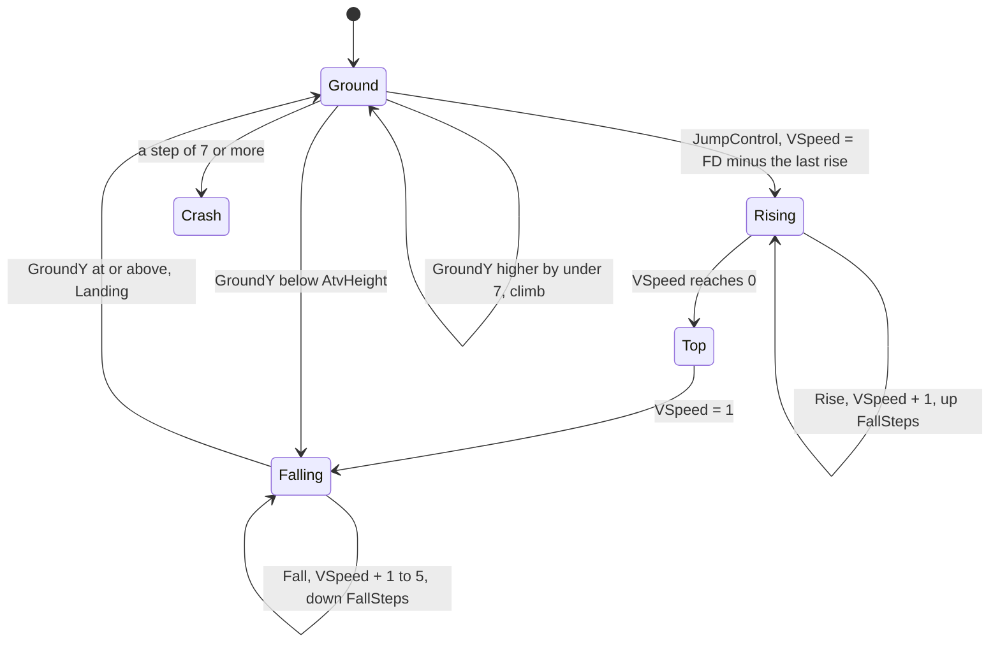

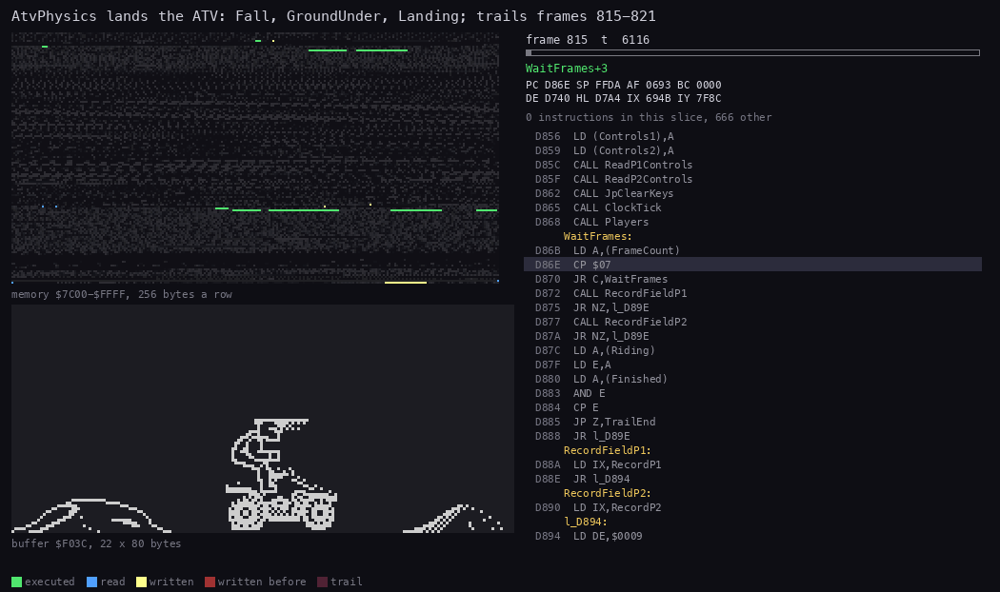

*Animation 10.1: AtvPhysics in the landing pass of `trails`, frames 815-821, 80 pictures. How to read: the left is
the memory `$7C00-$FFFF` with the code that runs and BufferP1 below it; the right is the listing at the PC. Fall has
taken the ATV from 5 to 0 the pass before; here GroundY 0 meets AtvHeight 0 with VSpeed 5: Landing, its Tone and
Noise, SlowDown. Command: `work/docs/atC/anims1.sh` (`routine_anim.py --window 815:0-822:0 --pc E5BA-E870,E663-E675
--view buffer:F03C:22x80`).*

**Worked example.** The first crest of trail 1, `tab.py 810 830 1` (the record at the start of each frame):

| Frame | TrackPos | AtvHeight | PrevHeight, PrevHeight2 | VSpeed | GroundY | Speed |
| --- | --- | --- | --- | --- | --- | --- |
| 810 | 335 | 5 | 9, 11 | 4 | 0 | 21 |
| 812 | 346 | 0 | 5, 9 | 5 | 0 | 21 |
| 819 | 356 | 0 | 0, 5 | 0 | 0 | 20 |
| 825 | 366 | 0 | 0, 0 | 0 | 0 | 21 |

The fall goes 11 → 9 → 5 → 0: VSpeed 3 takes FallSteps[2] = 2, VSpeed 4 takes 4, VSpeed 5 takes 6 (5 → 0, clamped at
0). In the next pass GroundY 0 equals AtvHeight 0 with VSpeed 5: Landing sets VSpeed 0 and SlowDown takes the speed
from 21 to 19; the throttle (Accelerate, +1) leaves 20. The pass after, the throttle gives 21 again.

**Witness.** `work/docs/atC/trails-vars.jsonl` rows 810-830; [Landing.gif](img/routines/Landing.gif) in
[doc 9](09-sound.md) for the thud's sound.

**The point.** The fall is fast and short: 1, 2, 4, 6, 6 lines, so a 12-line crest takes 4 passes to come down. Every
landing costs 2 of speed, one pass of throttle wins back 1. A fall does not stop at the ground: it can sink up to 5
lines into it, and the next pass lifts the ATV out (a climb, measured by the step test of 10.6).

## 10.4 The jump

### In short

The jump key on a mounted, grounded ATV sets VSpeed to `$FD` less the height it rose in this pass (at most 5). So a
jump on flat ground is a hop of 1 line; a jump at the top of a ramp, rising 4 or 5 a pass, flies 19 or 25 lines. The
jump also lifts the nose (WheelieUp), sets WheelieTimer to 3 and costs 2 of speed (SlowDown). The jump key on foot
starts the rider's own jump (10.9).

### Pseudocode

```text
JumpControl():                                 # $E34B
    if FallPhase or ThrowSpeed: GetUp(); return    # thrown or lying (10.8)
    if jump not held: JumpLatch = 0; (the rider's jump goes on); return
    if RiderJump: RiderJumpStep(); return
    if VSpeed != 0 or JumpLatch: return        # in the air, or still held from before
    JumpLatch = 1
    if AtvFrame == $5C: return                 # turning round
    if not Mounted: RiderJumpStart(); return
    VSpeed = $FD
    rise = AtvHeight - PrevHeight              # this pass's climb, set by AtvPhysics
    if rise >= 0: VSpeed -= min(rise, 5)
    WheelieUp(); WheelieTimer = 3; SlowDown()
```

### Assembly

```asm
  E36E  LD A,(RiderJump)
  E371  CP $00
  E373  JR NZ,RiderJumpStep
  E375  LD A,(VSpeed)
  E378  CP $00
  E37A  RET NZ                   ; only from the ground
  E37B  LD A,(JumpLatch)
  E37E  CP $01
  E380  RET Z                    ; one jump per press
  E381  LD A,$01
  E383  LD (JumpLatch),A
  E386  LD A,(AtvFrame)
  E389  CP $5C
  E38B  RET Z
  E38C  LD A,(Mounted)
  E38F  CP $00
  E391  JR Z,RiderJumpStart
  E393  LD A,$FD
  E395  LD (VSpeed),A
  E398  LD A,(PrevHeight)
  E39B  LD E,A
  E39C  LD A,(AtvHeight)
  E39F  SUB E                    ; the rise of this pass
  E3A0  JR C,l_E3B0
  E3A2  CP $05
  E3A4  JR C,l_E3A8
  E3A6  LD A,$05
l_E3A8:
  E3A8  LD E,A
  E3A9  LD A,(VSpeed)
  E3AC  SUB E
  E3AD  LD (VSpeed),A
l_E3B0:
  E3B0  CALL WheelieUp
  E3B3  LD A,$03
  E3B5  LD (WheelieTimer),A
  E3B8  JP SlowDown
```

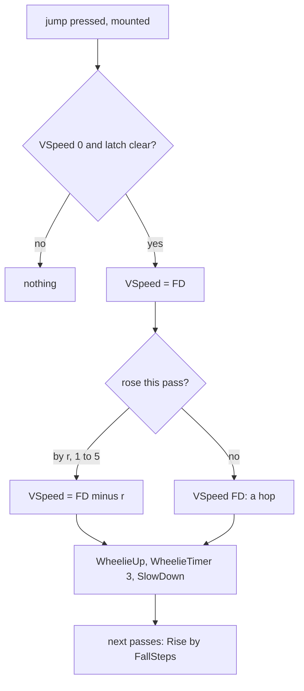

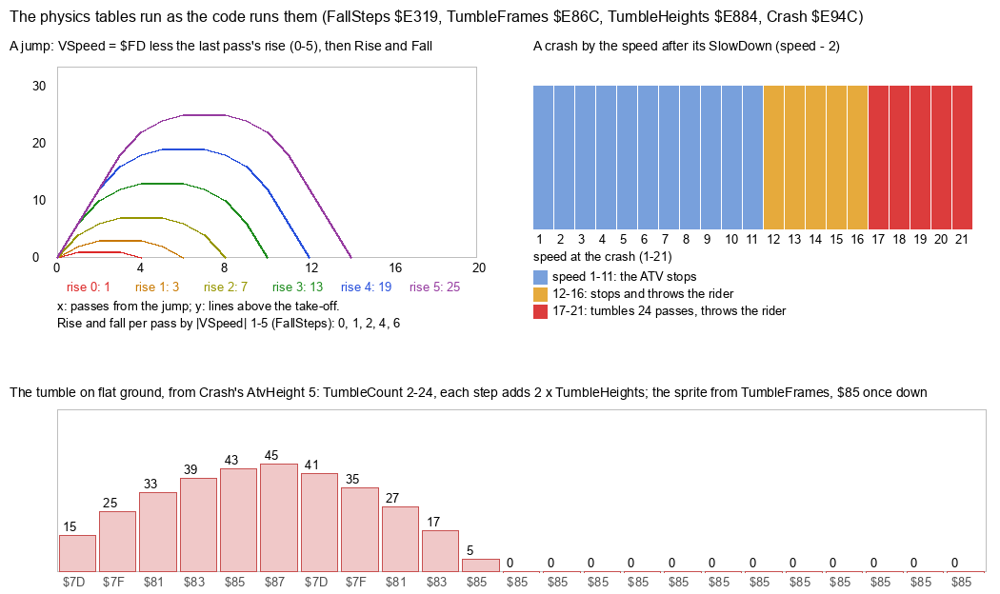

*Figure 10.2: the physics tables run as the code runs them (`tools/fig_gameplay.py`, from the build's FallSteps
`$E319`, TumbleFrames `$E86C` and TumbleHeights `$E884`). How to read: top left, the flight of a jump on flat ground
for each rise of the take-off pass, 0-5, in lines above the take-off, pass by pass; top right, what a crash does by
the speed at the crash (10.6); bottom, the tumble on flat ground (10.7), the height after each step and the sprite.
The point: the take-off's rise is the whole jump, from a hop of 1 to a flight of 25 lines and 14 passes. Command:
`python3 tools/fig_gameplay.py fig-tables docs/img/gameplay/tables.png`.*

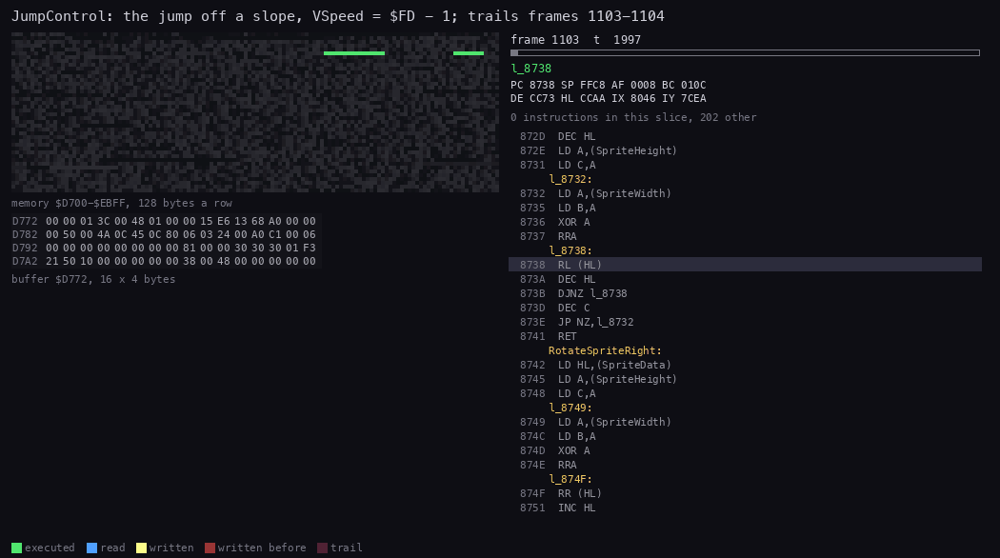

*Animation 10.2: JumpControl in the pass of `trails` frames 1 103-1 104, 70 pictures. How to read: the left is the
memory `$D700-$EBFF` with the record `$D772` in hex below; the right is the listing. The ATV is on a slope rising 1 a
pass (AtvHeight 2, PrevHeight 1): VSpeed becomes `$FD` - 1 = `$FC`, WheelieUp, WheelieTimer 3, SlowDown. Command:
`work/docs/atC/anims4.sh`.*

**Worked example.** Two jumps in `trails` (the working record at `$D772`):

| Frame | VSpeed | AtvHeight | Step |
| --- | --- | --- | --- |
| 1 104 | `$FC` | 2 | the jump: `$FD` - 1 |
| 1 111 | `$FD` | 4 | +2 (FallSteps[2]) |
| 1 118 | `$FE` | 5 | +1 |
| 1 125 | `$FF` | 5 | +0 |
| 5 628 | `$F9` | 5 | the jump at trail 2's ramp: `$FD` - 4 (1 → 5) |
| 5 635 | `$FA` | 11 | +6 |
| 5 642 | `$FB` | 17 | +6 |
| 5 649 | `$FC` | 21 | +4 |
| 5 656 | `$FD` | 23 | +2 |
| 5 663 | `$FE` | 24 | +1 |
| 5 670 | `$FF` | 24 | +0 |

The slope jump of the pass at 1 103 gains 3 lines in 3 passes, the ramp jump of the pass before 5 628 gains 19 in 6
passes, as Figure 10.2 gives for a rise of 1 and of 4. Each costs 2 of speed (21 → 19 at 1 109).

**Witness.** `pcs.py` counts `$E393` (VSpeed = `$FD`) once, in frame 1 103, in the trace of JumpControl.gif
(`1103_0-1105_0.uatr`); the bot's jump key goes down at 1 101 (`tests/inputs/trails.txt`).

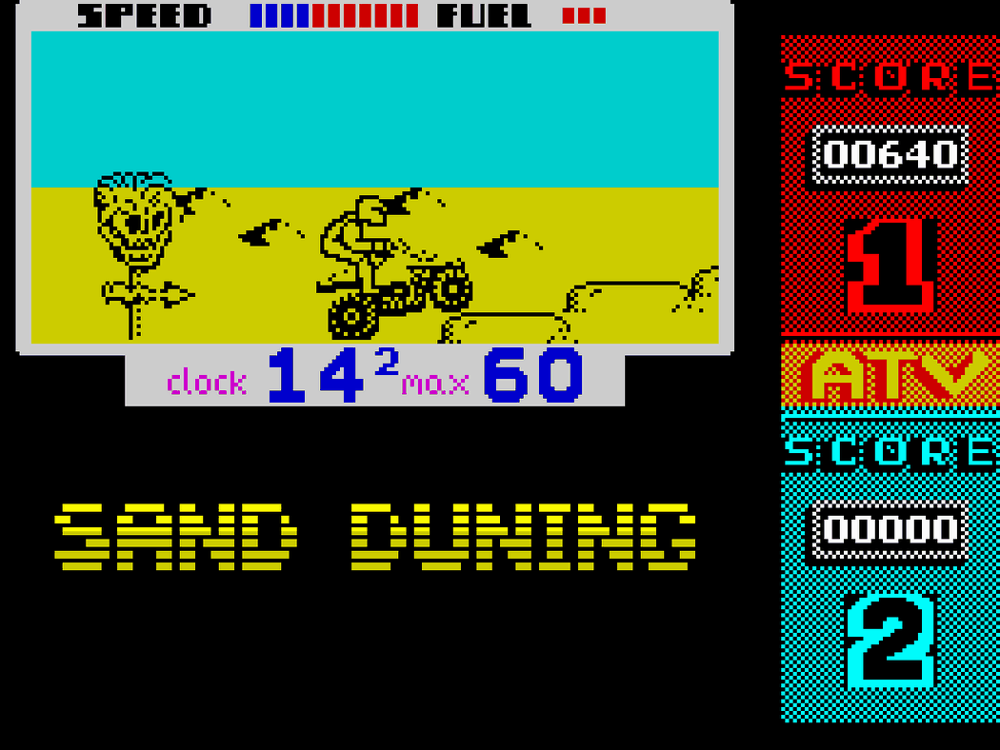

*Animation 10.3: `trails` frames 1 280-1 446, every 3rd frame, 56 pictures, the whole screen. How to read: the top half
is player 1; the ATV climbs the staircase (1 292-1 341), rides the top, dips its nose over the crest (1 348) and drops
(1 362-1 390), landing on the lower step at 1 397. Command: `python3 ../../kit/screen_anim.py --work
work/docs/atC/trails --width 1050 --from 1280 --to 1446 --step 3 --delay 100 docs/img/play/trails-jump-dune.gif`.*

**The point.** The height of a jump is earned on the ramp, not by the key: the key only decides when. Pressing jump
in the pass the ATV climbs the ramp's top gives the longest flight; a jump on the flat is useless and costs 2 of
speed.

## 10.5 The nose: slopes and wheelies

### In short

The ATV's sprite, AtvFrame, also is its angle: `$38` level, `$3A-$44` nose up in five steps, `$46-$4C` nose down.
AtvPhysics scans the ground under the nose (WheelOffsets `$E61B` give the nose's x and height for each frame). If the
ground is above the nose, the nose is lifted to the slope's angle (SlopeFrames `$E797`); a slope of 21 or more is a
wall and a crash. If the nose hangs 3 or more over the ground and no wheelie is running, it dips a step
(WheelieDown). Up (wheel up) holds WheelieTimer at 10 and lifts the nose a step a pass; at full nose-up (`$44`) one
more pass of Up throws the rider off the back (ThrowOff, 10.8).

### Pseudocode

```text
nose (AtvPhysics $E6F8):
    (dx, dy) = WheelOffsets[AtvFrame - $38]
    NoseLine = AtvHeight + dy (0 if that wraps past $A0)       # $D6C8
    NoseGround = GroundScan(AtvX + dx + 1, NoseLine + 8)       # $D6C7
    if NoseLine == 0:                                          # nose on the window's floor
        if AtvHeight >= 3: NoseHigh(); else AtvFrame = $38
        # NoseHigh $E7C5: 7 or more up and falling at 5 a pass (FastFall): CrashIfAir ($E7D1)
        return
    gap = NoseLine - NoseGround
    if gap >= 0:                                               # the nose is over the ground
        if gap < 3: return
        if WheelieTimer == 0: WheelieDown(); return            # dip a step
        if AtvFrame != $5C and wheel down held: WheelieDown()
        return
    if AtvFrame == $44: return                                 # full nose-up ignores the ground ahead
    slope = NoseGround - GroundY
    if slope >= $15: Crash(); return                           # a wall
    angle = AtvFrame, nose-down frames counted below $38       # $46 -> $36, $48 -> $34
    target = SlopeFrames[slope] + $38
    if target < angle: return                                  # already steeper
    if target - angle >= 6: CrashIfAir()                       # a sharp lift in the air: crash
    AtvFrame = target

WheelieUp():   frame $38-$43: +2 (stops at $44); $46-$4C: -2, below $46 -> $38   # $E838
WheelieDown(): frame $46-$4B: +2 (stops at $4C); $3A-$44: -2, below $38 -> $46   # $E852
```

### Assembly

```asm
l_E75F:                         ; the ground is above the nose
  E75F  LD A,(AtvFrame)
  E762  CP $44
  E764  RET Z
  E765  LD A,(GroundY)
  E768  LD B,A
  E769  LD A,(GroundY+$0003)     ; the nose's ground
  E76C  SUB B
  E76D  CP $15
  E76F  JR C,l_E774
  E771  JP Crash                 ; a wall: 21 lines over the wheels
l_E774:
  E774  LD E,A
  E775  LD D,$00
  E777  LD HL,SlopeFrames
  E77A  ADD HL,DE
  E77B  LD A,(AtvFrame)
  E77E  LD C,A
  E77F  SUB $46
  E781  JR C,l_E788
  E783  LD C,A
  E784  LD A,$36
  E786  SUB C
  E787  LD C,A                   ; nose-down frames below $38
l_E788:
  E788  LD A,(HL)
  E789  ADD A,$38
  E78B  SUB C
  E78C  RET C
  E78D  CP $06
  E78F  CALL NC,CrashIfAir
  E792  ADD A,C
  E793  LD (AtvFrame),A
  E796  RET
SlopeFrames:
  E797  DEFB $00,$00,$00,$02,$02,$02,$04,$04
  E79F  DEFB $04,$06,$06,$06,$08,$08,$08,$0A
  E7A7  DEFB $0A,$0A,$0C,$0C,$0C,$0E,$0E,$0E
```

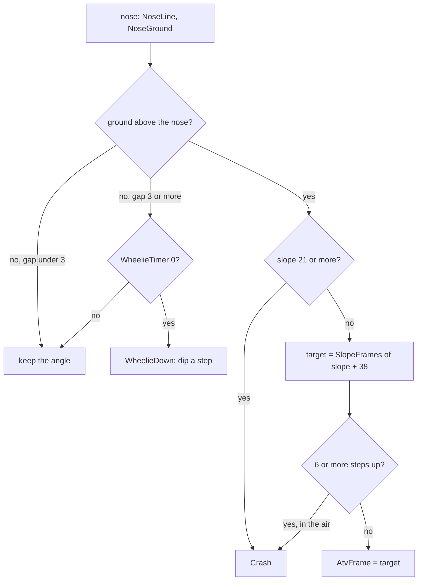

**Worked example.** At the foot of the staircase, the record at frame 1 278 holds the pass just run: GroundY 0,
NoseLine 1, NoseGround 7. The ground is 6 above the nose, so the slope is 7 - 0 = 7; SlopeFrames[7] = 4 and the
target is `$3C`, two steps up; the record holds AtvFrame `$3C`. Over the crest at 1 341 the nose's ground has fallen
to 15 under NoseLine 25: the gap is 10, WheelieTimer is 0, and WheelieDown takes `$38` to `$46`, held at frame 1 348.
At 1 360 the bot holds Up (`KU` in `tests/inputs/trails.txt`): WheelieTimer reads 10 from 1 369 and WheelieUp brings
the nose from `$48` (1 362) through `$46` back to `$38` by 1 376.

**Witness.** `tab.py 1278 1400 7`, the columns GroundNose and NoseLine (`$D6C7`, `$D6C8`) and AtvFrame; the drop in
Animation 10.3.

**The point.** The angle is cosmetic until it is not: it moves the nose's scan point, and the nose decides the walls.
At full nose-up (`$44`) the ATV is blind to walls ahead (the test returns at once), but one more pass of Up throws
the rider off.

## 10.6 The crash

### In short

Three tests call Crash `$E94C`: a step under the wheels of 7 or more beyond what the ATV rose in the last pass
(AtvPhysics `$E6E6`), the nose test (`$E76D`: the ground under the nose less the ground under the wheels, as an
unsigned byte, `$15` or more), and a sharp lift of the nose while in the air (CrashIfAir). The nose test catches a
wall 21 or more above the wheels and, through the wrap, any ground under the nose that is lower than under the wheels. Crash undoes the pass's move, takes 2 off the speed, and then by the speed left: under 10 the ATV
stops; 10-14 it stops and throws the rider; 15 and over it tumbles (10.7) and throws the rider.

### Pseudocode

```text
the step test (AtvPhysics $E6D4):
    climb = GroundY - AtvHeight                     # how much higher the ground is
    lastRise = max(0, PrevHeight - PrevHeight2)
    if climb - lastRise >= 7: Crash()

Crash():                                            # $E94C
    Facing ^= 1; Advance(); Facing ^= 1             # step back the distance just moved
    SlowDown()                                      # Speed - 2
    if Speed < 10: Stop(); return
    if Speed < 15: Stop(); Throw(); return
    if TumbleCount != 0: return
    AtvHeight = PrevHeight + 5; TumbleCount = 1
    Throw()

the nose test (AtvSlope $E75F, when the nose line is in the ground):
    if AtvFrame == $44: return                      # full nose-up: no test
    if (NoseGround - GroundY) & $FF >= $15: Crash() # NoseGround = GroundY+3 ($D6C7); a drop wraps to $EB-$FF

CrashIfAir():                                       # $E806
    if AtvHeight - GroundY >= 4: Crash()            # off the ground (unsigned)
```

### Assembly

```asm
  E6D4  SUB E                    ; GroundY - AtvHeight
  E6D5  PUSH AF
  E6D6  LD A,(PrevHeight+$0001)
  E6D9  LD E,A
  E6DA  LD A,(PrevHeight)
  E6DD  SUB E                    ; the last pass's rise
  E6DE  JR NC,l_E6E1
  E6E0  XOR A
l_E6E1:
  E6E1  LD E,A
  E6E2  POP AF
  E6E3  SUB E
  E6E4  JR C,l_E6F0
  E6E6  CP $07
  E6E8  JP C,l_E6F0
  E6EB  CALL Crash
  E6EE  JR l_E6F8
l_E6F0:
  E6F0  LD A,(GroundY)
  E6F3  LD (AtvHeight),A         ; climb onto it
Crash:
  E94C  LD A,(Facing)
  E94F  XOR $01
  E951  LD (Facing),A
  E954  CALL Advance             ; the move, backwards
  E957  LD A,(Facing)
  E95A  XOR $01
  E95C  LD (Facing),A
  E95F  CALL SlowDown
  E962  LD A,(Speed)
  E965  CP $0A
  E967  JP C,Stop
  E96A  CP $0F
  E96C  JR NC,l_E974
  E96E  CALL Stop
  E971  JP Throw
l_E974:
  E974  LD A,(TumbleCount)
  E977  CP $00
  E979  RET NZ
  E97A  LD A,(PrevHeight)
  E97D  LD (AtvHeight),A
  E980  LD A,(AtvHeight)
  E983  ADD A,$05
  E985  LD (AtvHeight),A
  E988  LD A,$01
  E98A  LD (TumbleCount),A
  E98D  CALL Throw
  E990  RET
```

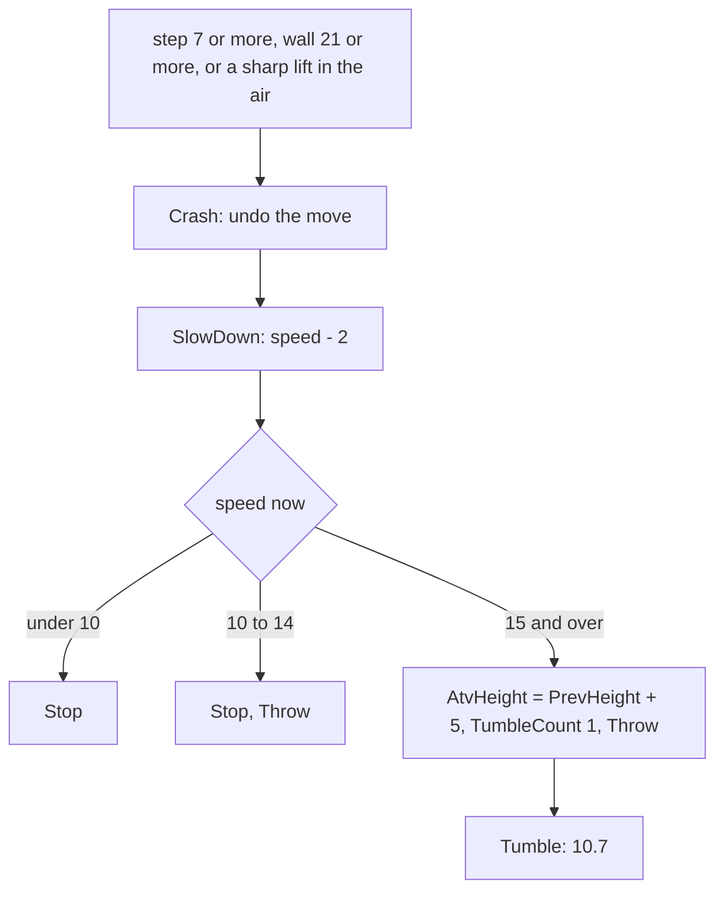

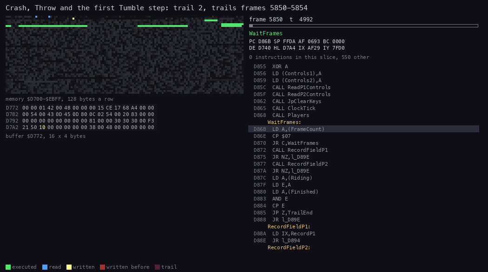

*Animation 10.4: Crash in `trails` frames 5 850-5 854 (trail 2), 70 pictures. How to read: the left is the memory
`$D700-$EBFF` with the record `$D772` below; the right is the listing. AtvPhysics finds the step, Crash steps back,
SlowDown, the tumble branch, Throw, and the first Tumble step. Command: `work/docs/atC/anims1.sh`.*

**Worked example.** Trail 2, `tab.py 5847 5856 1`. At 5 851 the record holds TrackPos 524, AtvHeight 0, PrevHeight 0
and 0, GroundY 7, Speed 21. In the pass of 5 851-5 854 the step is 7 - 0 - max(0, 0 - 0) = 7: Crash. Speed 21 - 2 =
19, 15 or more: AtvHeight = 0 + 5, TumbleCount 1, Throw (ThrowSpeed = `$F8` - 19/8 = `$F6`, Mounted 0). The same
pass's Tumble lifts the ATV to 15 (10.7) and Thrown moves the rider; at 5 855 the record holds TrackPos 523 (the
undone move at 21 against the end-of-pass Advance at 19), AtvHeight 15, Speed 19, AtvFrame `$7D`, TumbleCount 2,
Mounted 0, ThrowSpeed `$F7`.

**Witness.** The rows of `work/docs/atC/trails-vars.jsonl` above; `pcs.py` finds `$E98D` (the call of Throw) once in
the trace of Crash.gif (`5850_0-5855_0.uatr`).

**The other two paths, recorded.** Two short recordings from `c1`'s menu snapshot (`tools/rec_crashes.py`)
take the other paths. In `speedcrash` (1 432 frames, no POKE) the ATV hits trail 1's kerb at TrackPos 614 at speed
15: the step test crashes (`$E6EB`), 15 - 2 = 13 takes the middle branch (Stop and Throw `$E96E`), and between
frames 1 025 and 1 032 TrackPos goes 614 to 607, Mounted 0, speed 0. In `wallcrash` (2 083 frames; the distance POKEd
to 1 568 at frame 521 (`$D78A`, `$D726`, trail 1's finish less 40) to reach trail 2) the crash comes from the nose
test (`$E771`) at TrackPos 296, frames 1 676-1 683: speed 21 - 2 = 19, the tumble branch (`$E974`), Throw, AtvFrame
`$4A` to `$7D`. The ground bytes there are GroundY `$12` and the nose's `$0B`: the nose's ground is 7 lower, and
`$0B` - `$12` = `$F9` passes the `$15` test: the wrap, not a wall.

**Witness.** The L1 of `work/stage1/rec/speedcrash` (Crash 1, `$E96E` 1, Throw 1) and of
`work/stage1/rec/wallcrash` (Crash 1, `$E974` 1); their log.json samples.

**CrashIfAir, recorded.** `c1`'s tumble is the third path. In the trace `work/docs/integrate/c1/traces/15400_0-15800_0.uatr`
(`work/docs/atC/pcs.py`) `$E80D` (CrashIfAir's `JP Crash`) runs 8 times and Crash `$E94C` the same 8, at frames 15 574,
15 581, 15 587, 15 594, 15 623, 15 630, 15 636 and 15 657; the step test's `$E6EB` and the nose test's `$E771` never.
At 15 574 the call comes from the slope branch (`$E78F`: a lift of 6 or more frames while 4 or more above the
ground): Speed 17 after the -2 ([doc 2](02-architecture.md)'s sample at 15 580), so the tumble branch (`$E974`) and
Throw (`$E98D`). The later seven come from NoseHigh (`$E7D1`) while the ATV falls during the tumble: Crash returns at
once for a tumbling ATV once more (15 581), takes the middle branch once as the speed falls (`$E96E`, 15 587, Stop;
the rider is already off) and then only stops. The L1 of `c1` agrees: CrashIfAir 8 entries, Crash 8, first 15 574, last 15 657.

**The point.** The crash rule measures the step against the momentum: a ramp the ATV is already climbing at 5 a
pass can rise 11 in one pass, while a 7-line kerb hit on the flat is a crash at any speed. The penalty is by speed:
riding slower than 12 never throws the rider.

## 10.7 The tumble

### In short

From a crash at 15 or more, the ATV tumbles while TumbleCount goes from 1 to 24. While it is in the air, each pass
sets the sprite from TumbleFrames (`$7D-$87`, the ATV turning over) and moves the height by twice TumbleHeights: up
10, 10, 8, 6, 4, 2, then down 4, 6, 8, 10, 12 a pass. On the ground the sprite is `$85` and the speed falls by 4 a
pass. From count 10 on, the speed falls by another 4 a pass. The ATV keeps moving at its speed all the while
(Advance). At 24, once within 4 of the ground, it lands upright at nose-up (`$44`) and stops.

### Pseudocode

```text
Tumble():                                        # $E89C
    if TumbleCount == 0: return
    if TumbleCount >= 10: SlowDown(); SlowDown()
    if TumbleCount >= 24:
        if AtvHeight - GroundY >= 4 (and not below): return
        TumbleCount = 0; AtvFrame = $44; AtvHeight = GroundY; Stop(); return
    TumbleCount += 1
    if AtvHeight - GroundY < 4:                  # on the ground (OnGround $E7FB)
        AtvFrame = $85; SlowDown(); SlowDown(); return
    AtvFrame = TumbleFrames[TumbleCount - 2]
    AtvHeight += 2 * TumbleHeights[TumbleCount - 2]   # 0 if it wraps past $A0
```

### Assembly

```asm
Tumble:
  E89C  LD A,(TumbleCount)
  E89F  CP $00
  E8A1  RET Z
  E8A2  CP $0A
  E8A4  JR C,l_E8AC
  E8A6  CALL SlowDown
  E8A9  CALL SlowDown
l_E8AC:
  E8AC  LD A,(TumbleCount)
  E8AF  CP $18
  E8B1  JR C,l_E8D2
  E8B3  LD A,(GroundY)
  E8B6  LD E,A
  E8B7  LD A,(AtvHeight)
  E8BA  SUB E
  E8BB  JR C,l_E8C0
  E8BD  CP $04
  E8BF  RET NC
l_E8C0:
  E8C0  XOR A
  E8C1  LD (TumbleCount),A
  E8C4  LD A,$44
  E8C6  LD (AtvFrame),A
  E8C9  LD A,(GroundY)
  E8CC  LD (AtvHeight),A
  E8CF  JP Stop
l_E8D2:
  E8D2  ADD A,$01
  E8D4  LD (TumbleCount),A
  E8D7  CALL OnGround
  E8DA  JR NC,l_E8E8
  E8DC  LD A,$85
  E8DE  LD (AtvFrame),A
  E8E1  CALL SlowDown
  E8E4  CALL SlowDown
  E8E7  RET
l_E8E8:
  E8E8  LD A,(TumbleCount)
  E8EB  SUB $02
  E8ED  LD E,A
  E8EE  LD D,$00
  E8F0  LD HL,TumbleFrames
  E8F3  ADD HL,DE
  E8F4  LD A,(HL)
  E8F5  LD (AtvFrame),A
  E8F8  LD HL,TumbleHeights
  E8FB  ADD HL,DE
  E8FC  LD E,(HL)
  E8FD  SLA E                    ; × 2
  E8FF  LD A,(AtvHeight)
  E902  ADD A,E
  E903  CP $A0
  E905  JR C,l_E908
  E907  XOR A
l_E908:
  E908  LD (AtvHeight),A
  E90B  RET
TumbleFrames:
  E86C  DEFB $7D,$7F,$81,$83,$85,$87,$7D,$7F ...
TumbleHeights:
  E884  DEFB $05,$05,$04,$03,$02,$01,$FE,$FD
  E88C  DEFB $FC,$FB,$FA,$FA,$FA,$FA,$FA,$FA ...
```

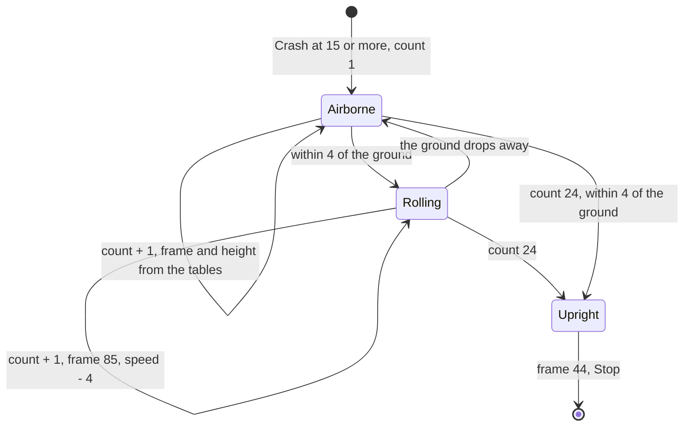

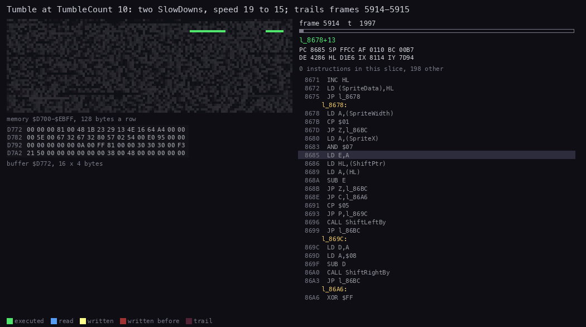

*Animation 10.5: Tumble in `trails` frames 5 914-5 915, the pass in which TumbleCount goes from 10 to 11, 70 pictures.
How to read: the left is the memory `$D700-$EBFF` with the record `$D772` below; the right is the listing. The two
SlowDowns of count 10 take the speed from 19 to 15, the tables give the frame and the fall. Command:
`work/docs/atC/anims4.sh`.*

**Worked example.** The tumble of trail 2, the record at the start of frames, `tab.py 5861 6015 7`:

| Frame | TumbleCount | AtvHeight | Speed | AtvFrame | TrackPos |
| --- | --- | --- | --- | --- | --- |
| 5 861 | 2 | 15 | 19 | `$7D` | 523 |
| 5 868 | 3 | 25 | 19 | `$7F` | 533 |
| 5 896 | 7 | 45 | 19 | `$87` | 571 |
| 5 917 | 10 | 27 | 19 | `$81` | 599 |
| 5 924 | 11 | 17 | 15 | `$83` | 607 |
| 5 931 | 12 | 5 | 11 | `$85` | 612 |
| 5 938 | 13 | 0 | 7 | `$87` | 616 |
| 5 945 | 15 | 0 | 0 | `$85` | 616 |
| 6 008 | 24 | 0 | 0 | `$85` | 616 |
| 6 015 | 0 | 0 | 0 | `$44` | 616 |

The heights follow Figure 10.2's bottom row from 5 to 45 and back: 15, 25, 33, 39, 43, 45, 41, 35, 27, 17, 5, 0. In
count 13's pass the ATV was still 5 above the ground: OnGround failed, the air branch added 2 x TumbleHeights[11] =
-12 and the `CP $A0` clamp gave height 0, so only the count's 4 applied (11 to 7, the sprite `$87`). At count 14
the ATV is down: `$85` (`$E8DC`), and 4 off for the count plus 4 for the ground take 7 to 0. The ATV slid 93 pixels
while tumbling (523 → 616); from 5 945 to 6 012 the count only counts, ten passes standing still.

**Witness.** `work/docs/atC/trails-vars.jsonl`; `pcs.py` finds `$E8A6` (count 10 or more) in frame 5 914 of
Tumble.gif's trace; [trails-crash-tumble.gif](img/play/trails-crash-tumble.gif) (10.8).

**The point.** A tumble costs 23 passes, 2.3 seconds on the clock, and all the speed: the ATV ends stopped. The
distance it slides is a small gain; the walk back to it (10.9) is the real cost.

## 10.8 The rider thrown

### In short

Throw starts the rider's flight: ThrowSpeed = `$F8` less an eighth of the speed, Mounted 0. Thrown then moves the
rider 4 pixels right a pass (up to x `$87`) while ThrowSpeed rises to 0 like a jump's VSpeed, with the rider's sprite
spinning (`$5E-$64`); then he falls by FallSteps until he meets the ground and lies there (`$77`). The jump key gets
him up (GetUp: frame 0, on foot). ThrowOff, from a full wheelie or from a low overhang at speed, sends him off the
back instead (FallPhase, FallRider). The ATV, tumbling or not, goes on without him.

### Pseudocode

```text
Throw():                                       # $E9FA
    if ThrowSpeed != 0 or not Mounted: return
    ThrowSpeed = $F8 - Speed / 8; Mounted = 0

Thrown():                                      # $EA21, each pass while ThrowSpeed != 0
    RiderGround()                              # GroundBelowRider under his feet
    if RiderHeight == GroundBelowRider: lie(); return
    if RiderX + 4 < $88: RiderX += 4
    if ThrowSpeed is even: spin the sprite, $5E -> $60 -> $62 -> $64 -> $5E
    if ThrowSpeed < 0:                         # going up
        ThrowSpeed += 1; if 0: (fall at once)
        else RiderHeight += FallSteps[min(-ThrowSpeed, 5) - 1]; return
    if RiderHeight <= GroundBelowRider: lie(); return
    ThrowSpeed += 1; RiderHeight -= FallSteps[min(ThrowSpeed, 5) - 1], not under the ground
    if RiderHeight == GroundBelowRider: lie()
lie(): RiderFrame = $77; ThrowSpeed = 0

GetUp():                                       # $E31F, from JumpControl
    if (FallPhase == 5 or RiderFrame == $77) and jump held:
        RiderFrame = 0; Mounted = WheelieTimer = FallPhase = ThrowSpeed = 0; JumpLatch = 1

ThrowOff():                                    # $E2E2: off the back
    Mounted = 0; FallPhase = 1
    RiderX += $10 - (facing right ? $20 : 0); RiderHeight += 10
RiderMounted():                                # $DE59: an overhang 12-30 above the rider at speed 4 or more
    if 12 <= GroundBelowRider - RiderHeight < 31 and Speed >= 4: ThrowOff()
```

### Assembly

```asm
Throw:
  E9FA  LD A,(ThrowSpeed)
  E9FD  CP $00
  E9FF  RET NZ
  EA00  LD A,(Mounted)
  EA03  CP $00
  EA05  RET Z
  EA06  LD A,$F8
  EA08  LD (ThrowSpeed),A
  EA0B  LD A,(Speed)
  EA0E  SRL A
  EA10  SRL A
  EA12  SRL A
  EA14  LD E,A
  EA15  LD A,(ThrowSpeed)
  EA18  SUB E
  EA19  LD (ThrowSpeed),A
  EA1C  XOR A
  EA1D  LD (Mounted),A
  EA20  RET
Thrown:
  EA21  CALL RiderGround
  EA24  LD A,(RiderHeight)
  EA27  LD E,A
  EA28  LD A,(GroundBelowRider)
  EA2B  CP E
  EA2C  JR Z,l_EAA4              ; on the ground: lie
  EA2E  LD A,(RiderX)
  EA31  ADD A,$04
  EA33  CP $88
  EA35  JR NC,l_EA3A
  EA37  LD (RiderX),A
  ...
l_EA5C:
  EA5C  LD A,(ThrowSpeed)
  EA5F  BIT 7,A
  EA61  JP Z,l_EA7F
  EA64  ADD A,$01
  EA66  JR NZ,l_EA6D
  EA68  LD (ThrowSpeed),A
  EA6B  JR l_EA8B
l_EA6D:
  EA6D  LD (ThrowSpeed),A
  EA70  XOR $FF
  EA72  ADD A,$01
  EA74  CALL FlightStep          ; FallSteps[min(n, 5) - 1]
  EA77  LD A,(RiderHeight)
  EA7A  ADD A,E
  EA7B  LD (RiderHeight),A
  EA7E  RET
  ...
l_EAA4:
  EAA4  LD A,$77                 ; lying
  EAA6  LD (RiderFrame),A
  EAA9  XOR A
  EAAA  LD (ThrowSpeed),A
  EAAD  RET
```

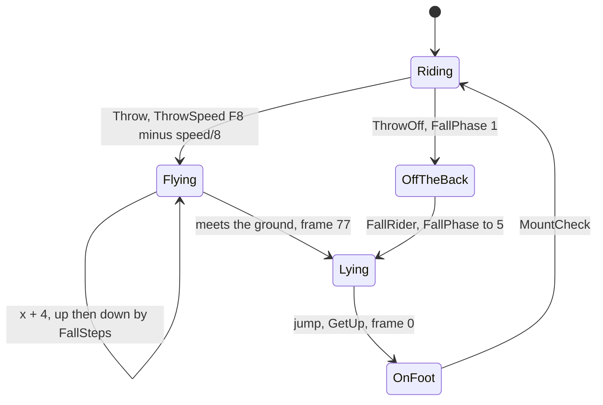

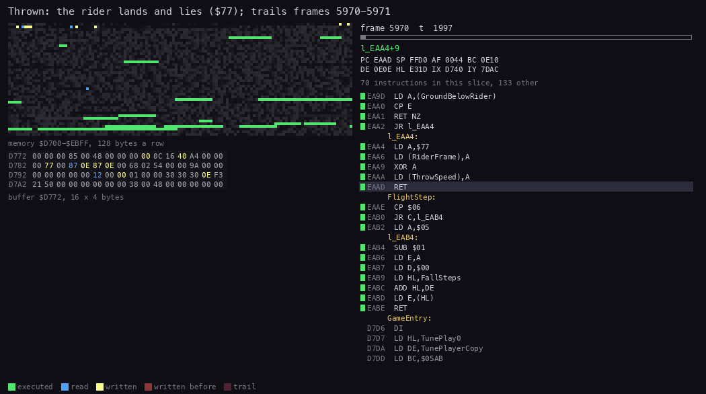

*Animation 10.6: Thrown in `trails` frames 5 970-5 971, the pass in which the rider lands, 70 pictures. How to read:
the left is the memory `$D700-$EBFF` with the record `$D772` below; the right is the listing. ThrowSpeed has come to
7; RiderToGround puts him on the ground and `$EAA4` sets the lying frame `$77`. Command: `work/docs/atC/anims4.sh`.*

**Worked example.** The throw of trail 2 (the record at the start of frames, `tab.py 5861 5980 7`): ThrowSpeed `$F7`
at 5 861 and `$FF` at 5 917, then 1, 2, 3, 5, 7 by 5 959; RiderX 71, 75, 79 ... 115 by 5 938, then 123, 131 and 135
(two passes between the samples); RiderHeight from 19 up to 50 at 5 910-5 917 and down to 14 at 5 973, where
RiderFrame is `$77` and ThrowSpeed 0. The bot holds jump from 5 940 to 5 975 (`tests/inputs/trails.txt`): at 5 980
the frame is `$18`, the rider up and jumping. He is 63 pixels right of the ATV, which sits at x 72.

**Witness.** `work/docs/atC/trails-vars.jsonl`; `pcs.py` finds `$EAA4` once, in frame 5 970, in the trace of
Thrown.gif (`5970_0-5972_0.uatr`).

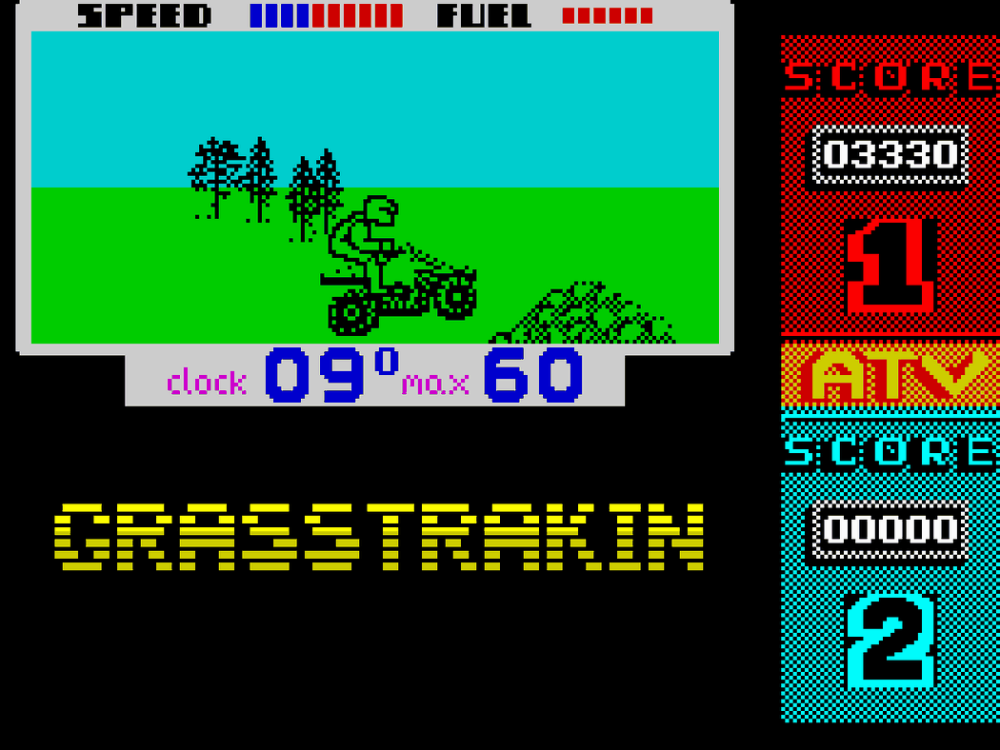

*Animation 10.7: `trails` frames 5 826-6 040, every 3rd frame, 72 pictures, the whole screen. How to read: the top
half; the ATV meets the step at 5 851, turns over in the air with the rider flying ahead of it, rolls, and comes to
rest nose-up at 6 012; the rider lies at the right and gets up. Command: `python3 ../../kit/screen_anim.py --work
work/docs/atC/trails --width 1050 --from 5826 --to 6040 --step 3 --delay 100 docs/img/play/trails-crash-tumble.gif`.*

**Off the back, recorded.** `work/stage1/rec/throwoff` (850 frames from `c1`'s menu snapshot, no POKE,
`tools/rec_crashes.py`) holds Up through a full wheelie: AtvFrame reaches `$44` at frame 612, ThrowOff `$E2E2` runs
once and Mounted is 0 at 619 (speed 13 to 10); FallRider `$E991` runs 35 times while FallPhase counts 1 to 5, and the
rider lies behind the ATV at x 35. Witness: its L1 (ThrowOff 1, FallRider 35, ControlUp 31) and log.json.

**The overhang, recorded with a POKE.** No trail has a piece floating 12-30 lines over the track, so
`work/stage1/rec/overhang` (1 060 frames from `c1`'s menu snapshot, `tools/rec_crashes.py overhang`) makes one: at the
menu, trail 1's list A item 3 (distance `$0148`, the dune `$67`, 12 lines high, y 0) gets y 30 (POKE at its +2 byte,
in `record.json`), so the dune floats with its top at 30 and its bottom at 19, above the wheels' scan (AtvHeight + 8)
and the nose's. The rider rides right with no wheel key: at frame 756, speed 21, AtvFrame `$38` (level), RiderMounted
finds the dune's top 21 above the rider (RiderHeight 9) and jumps to ThrowOff (`$DE76`, its only jump; ControlUp
also falls through into it at full nose-up): Mounted 0, FallPhase 1, RiderX 77 to 61 (+`$10` - `$20`), RiderHeight 9 to 19. Witness: its L1 (ThrowOff 1 at frame 756, no
Crash, no Throw) and log.json.

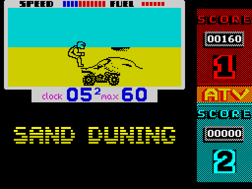

*Figure 10.3: `overhang` frame 759: the dune POKEd to float over the track; the rider, thrown off the back by
RiderMounted's overhang test, rises behind the ATV. A screen kept by `tools/rec_crashes.py overhang`.*

**The point.** The throw carries the rider forward, away from the ATV, and the ATV cannot come to him: only the rider
on foot can close the gap.

## 10.9 On foot and getting on

### In short

Every trail starts with the rider on foot 48 pixels behind the ATV, and every throw ends with him on foot. Left and
right walk 3 pixels a pass (the first press only turns him); a rise of 3 or more blocks him, a drop of 3 or more makes
him fall. The jump key jumps: up 7, 4, 2 lines in three passes, then down 1, 2, 4, 4 ... (RiderJumpTable `$E312`).
MountCheck puts him on the ATV when, in the falling part of a jump, he is over the seat: x from AtvX - 12 to AtvX + 17,
height 4-24 above the ATV, facing its way, and the ATV upright (frame `$38-$4D`).

### Pseudocode

```text
RiderOnFoot():                                 # $DF37
    if RiderJump in 1..4: return               # rising
    d = RiderHeight - GroundBelowRider
    if d == 0: return
    if d < 0:                                  # ground higher than his feet
        if -d < 3: RiderLand(); return
        RiderX = RiderSavedX; TurnLeft = TurnRight = 0    # blocked
        return
    if RiderJump: return
    if d < 3: RiderLand() else RiderJump = 5   # a drop: fall

MountCheck():                                  # $E46E
    x = RiderX - (RiderFacing ? 8 : 0)
    if not (AtvX - 12 <= x < AtvX + 18): return
    if not (AtvHeight + 4 <= RiderHeight < AtvHeight + 25): return
    if RiderFacing != Facing: return
    if RiderJump < 5: return                   # only falling onto the seat
    if not ($38 <= AtvFrame < $4E): return     # upright
    RiderJump = TurnLeft = TurnRight = 0; Mounted = 1; RiderFrame = $59
```

### Assembly

```asm
MountCheck:
  E46E  LD A,(AtvX)
  E471  SUB $0C
  E473  LD E,A
  E474  ADD A,$1E
  E476  LD D,A
  E477  LD C,$00
  E479  LD A,(RiderFacing)
  E47C  CP $00
  E47E  JR Z,l_E482
  E480  LD C,$08
l_E482:
  E482  LD A,(RiderX)
  E485  SUB C
  E486  CP E
  E487  RET C
  E488  CP D
  E489  RET NC
  E48A  LD A,(AtvHeight)
  E48D  ADD A,$04
  E48F  LD E,A
  E490  LD A,(AtvHeight)
  E493  ADD A,$19
  E495  LD D,A
  E496  LD A,(RiderHeight)
  E499  CP E
  E49A  RET C
  E49B  CP D
  E49C  RET NC
  E49D  LD A,(RiderFacing)
  E4A0  LD E,A
  E4A1  LD A,(Facing)
  E4A4  CP E
  E4A5  RET NZ
  E4A6  LD A,(RiderJump)
  E4A9  CP $05
  E4AB  RET C
  E4AC  LD A,(AtvFrame)
  E4AF  CP $38
  E4B1  RET C
  E4B2  CP $4E
  E4B4  RET NC
  E4B5  XOR A
  E4B6  LD (RiderJump),A
  E4B9  LD (TurnLeft),A
  E4BC  LD (TurnRight),A
  E4BF  LD A,$01
  E4C1  LD (Mounted),A
  E4C4  LD A,$59
  E4C6  LD (RiderFrame),A
  E4C9  RET
```

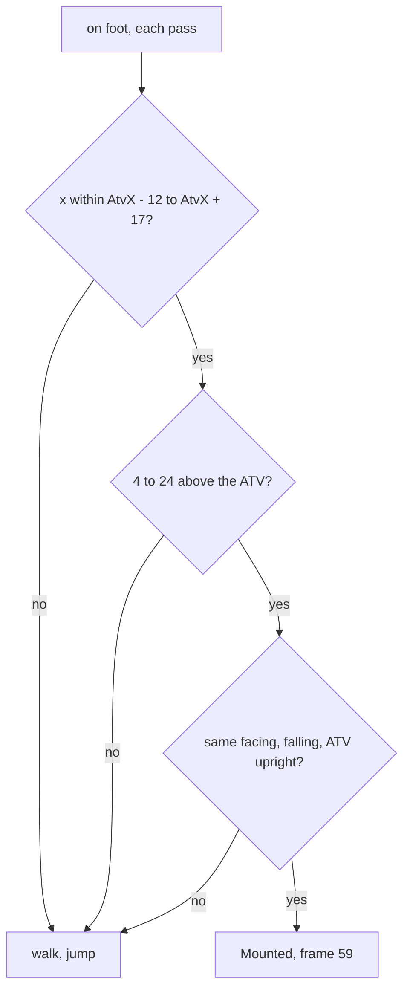

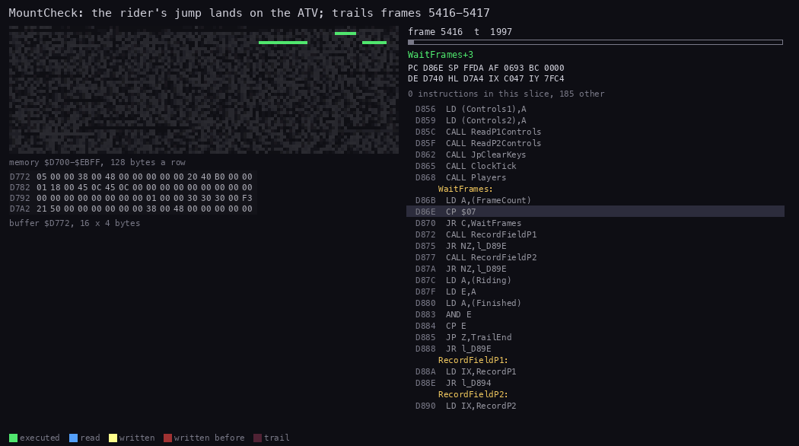

*Animation 10.8: MountCheck in `trails` frames 5 416-5 417, the pass the rider gets on for trail 2, 70 pictures. How
to read: the left is the memory `$D700-$EBFF` with the record `$D772` below; the right is the listing. RiderX 77,
RiderHeight 12, the falling part of his jump: every test passes and `$E4C4` sets the riding frame. Command:
`work/docs/atC/anims4.sh`.*

**Worked example.** At the start of trail 2 the rider stands at x 24, the ATV at x 72. The bot holds right from frame
4 937 and taps jump at 5 259, 5 300, 5 341 and 5 382 (`tests/inputs/trails.txt`): he walks right and jumps; the
record turns Mounted at 5 417 with RiderX 77 and RiderHeight 12. 77 is in 60-89, 12 in 4-24 above an ATV at 0. The
clock started at 5 200: getting on cost 31 passes, 3.1 s; on trail 1 it cost 32 (clock 3.2 at frame 508).

After the crash of 10.8 the rider gets up at x 153. The bot holds left for three passes (6 017-6 037): he turns and
walks to 147; then right again: 150, 153, 156, where GroundBelowRider is 19 under a rider at 13. The rise of 6 blocks
him, and from 6 066 to the end (7 441) he stays at x 156, walking on the spot until the input stops at 6 241. The ATV
at x 72 is never reached: the bot's plan for trail 2 runs out.

**Witness.** `work/docs/atC/trails-vars.jsonl`, the `P1` record's RiderX, RiderHeight, RiderFacing and
GroundBelowRider at 6 010-6 073; `pcs.py` finds `$E4C4` once (5 416) in MountCheck.gif's trace
(`5416_0-5418_0.uatr`).

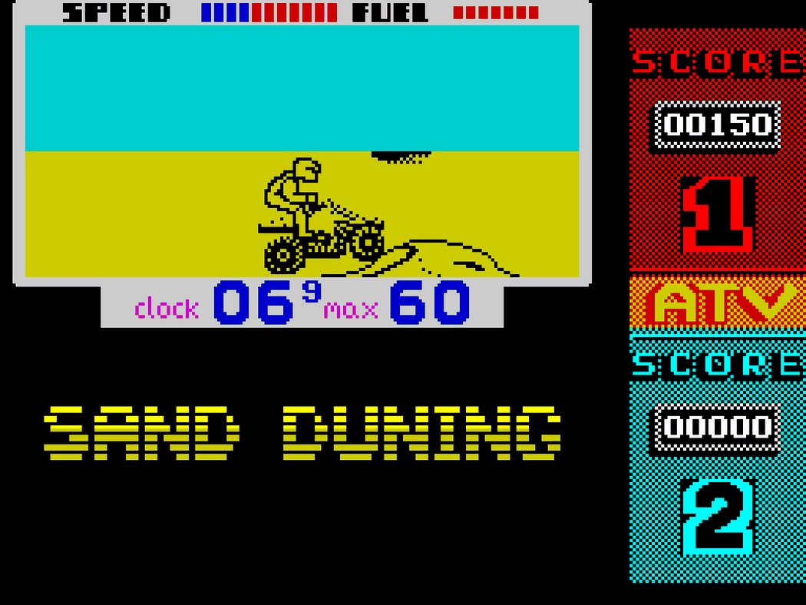

*Animation 10.9 (from [doc 5, 5.11](05-controls.md#511-on-foot-the-walk-and-the-walk-back)): `trail1` frames
880-1 200, every 6th frame: after a crash the rider walks left towards the ATV and is stopped behind a dune by the same
rule. Command: `python3 ../../kit/screen_anim.py --work work/docs/atB/trail1 --from 880 --to 1200 --step 6 --width
1050 --delay 100 docs/img/play/walk-back.gif`.*

**The point.** Getting on is the game's hardest move: a jump timed to come down over a 30-pixel window. The walk back
after a throw has to cross the same dunes the ATV rode over, and a rise of 3 or more must be jumped.

## 10.10 Throttle, brake and the speed

### In short

The speed (Speed `$D77B`, 0-21) is changed in eleven places. The throttle adds 1 a pass; the brake and every
landing, jump and crash take 2. A finished rider loses 2 a pass, an empty tank 4, a tumble 4 or 8, a thrown rider's
fall 4; riding back past the start stops the ATV. The distance moves Speed/2
pixels a pass, but only from speed 2. [Doc 5, 5.9](05-controls.md#59-throttle-brake-and-the-turn-round) has the
controls in full; this section is the speed's ledger.

| Change | Routine | When |
| --- | --- | --- |
| +1, up to 21 | Accelerate `$E54C` | throttle in the facing direction, on the ground or at speed 0 |
| -2 | SlowDown `$E53E` | brake (the other direction) |
| -2 | Landing `$E663` | each landing |
| -2 | JumpControl `$E3B8` | each jump |
| -2 | Crash `$E95F` | each crash, before the test by speed |
| -2 a pass | PassP1 `$DA71`, PassP2 `$DAB1` | after this player's finish |
| -4 a moving pass | OutOfFuel `$DFF1` | with the tank empty |
| -4 or -8 a pass | Tumble `$E8A6`, `$E8E1` | from count 10, and on the ground |
| -4 a pass | FallRider `$E991` (SlowDown twice, `$E998`, `$E99B`) | the rider falling after ThrowOff |
| to 0 | BackList `$E06D` (Stop) | riding back past the start: TrackPos below 0; Distance, TrackPos and the scroll reset, ScoreStep `$E05A` |
| to 0 | Stop `$E511`, WaitFrames `$D8AB` | a crash under 15, the tumble's end; TIME OUT |

### Pseudocode

```text
ControlRight (mounted, right held):      # ControlLeft mirrors it
    if Speed != 0 and AtvHeight - GroundY >= 4: return   # no grip in the air
    if Facing == right: Accelerate()
    elif Speed >= 1: SlowDown()
    else: TurnRight = 1; AtvFrame = $5C                 # stopped: turn round

Advance():                               # $E011, the end of each pass
    if Speed < 2: return
    Distance += Speed * 128              # in 1/256 pixel: Speed / 2 pixels
    UseFuel(); the scenery; the score

FallRider():                             # $E991, FallPhase 1-5 after ThrowOff
    SlowDown(); SlowDown()               # -4 a pass, not below 0

BackList():                              # $E030, riding back
    Distance -= Speed * 128
    if TrackPos goes below 0:            # past the start
        ScoreStep(); Distance = TrackPos = Scenery = SceneryPos = 0; Stop()
```

### Assembly

```asm
SlowDown:
  E53E  LD A,(Speed)
  E541  SUB $02
  E543  JR NC,l_E546
  E545  XOR A
l_E546:
  E546  LD (Speed),A
  E549  JP SpeedBar
Accelerate:
  E54C  LD A,(Speed)
  E54F  ADD A,$01
  E551  CP $15
  E553  JR C,l_E557
  E555  LD A,$15
l_E557:
  E557  LD (Speed),A
  E55A  JP SpeedBar
Advance:
  E011  LD A,(Speed)
  E014  CP $02
  E016  RET C                    ; speed 0 or 1: no move, no fuel
FallRider:
  E998  CALL SlowDown
  E99B  CALL SlowDown            ; -4 a pass
BackList:
  E051  LD A,(TrackPos+$0001)
  E054  SUB $01
  E056  LD (TrackPos+$0001),A
  E059  RET NC
  E05A  CALL ScoreStep           ; below the start
  E05D  PUSH DE
  E05E  LD HL,$0000
  E061  LD (Distance),HL
  E064  LD (TrackPos),HL
  E067  LD (Scenery),HL
  E06A  LD (SceneryPos),HL
  E06D  CALL Stop                ; Speed 0
```

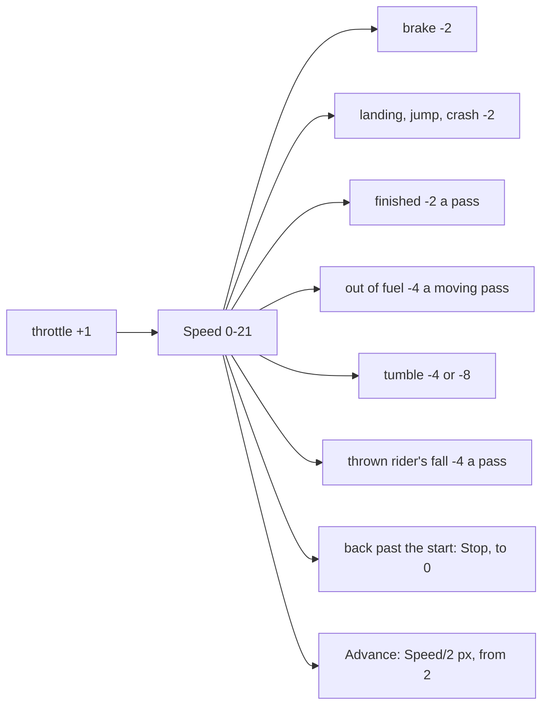

**Worked example.** After trail 1's finish the bot keeps right held. Each pass PassP1 takes 2 (Finished) and the
throttle adds 1: 21 at 1 680, then down 1 a pass (7 at 1 780, 6 at 1 787, 5 at 1 794) to 1 at 1 822, where SlowDown
floors at 0 and Accelerate gives 1 again. At speed 1 Advance does not move: TrackPos stays 1 727 from frame 1 815 to
the trail's end.

**Witness.** `tab.py 1780 1830 7`; the Speed panel of Figure 10.4 (10.13). FallRider: L1 78 runs in `overhang` and
`throwoff`.

**The point.** Speed is a budget: each bump, jump and landing costs 2 of 21, and one pass of throttle wins back only
1. Holding the throttle after the finish keeps the speed at 1 for ever, which matters at the end of the trail (10.15).

## 10.11 Fuel

### In short

Each trail starts with Fuel `$D77C` = `$2000`. Every pass that moves (speed 2 or more) takes 2 × Speed, that is 4 for
each pixel moved. The FUEL bar is the high byte: a block of 4 pixels for each `$400`. When the high byte AND `$FC` is
0 (under `$400`) the tank is empty: OutOfFuel takes 4 off the speed in every pass that moves and prints OUT OF FUEL
for a rider who has not finished. A full tank therefore gives (`$2000` - `$400`) / 4 = 1 792 pixels of travel before it is empty.

### Pseudocode

```text
UseFuel():                                     # $DF91, from Advance
    Fuel = max(0, Fuel - 2 * Speed)
    if (Fuel >> 8) & $FC == 0: OutOfFuel(); return
    redraw the bar if its length changed

OutOfFuel():                                   # $DFE6
    the bar to its start; SlowDown(); SlowDown()
    if this player has not finished: print "OUT OF FUEL"
```

### Assembly

```asm
UseFuel:
  DF91  LD HL,(Fuel)
  DF94  LD A,(Speed)
  DF97  SLA A
  DF99  LD E,A
  DF9A  LD D,$00
  DF9C  XOR A
  DF9D  SBC HL,DE
  DF9F  JR NC,l_DFA4
  DFA1  LD HL,$0000
l_DFA4:
  DFA4  LD (Fuel),HL
  ...
FuelEmptyTest:
  DFBC  AND $FC                  ; the high byte: under $400 is empty
  DFBE  CP $00
  DFC0  JP Z,OutOfFuel
OutOfFuel:
  DFE6  LD A,$90
  DFE8  LD (FuelBar),A
  DFEB  LD (SpriteX),A
  DFEE  CALL FuelBarStep
  DFF1  CALL SlowDown
  DFF4  CALL SlowDown
```

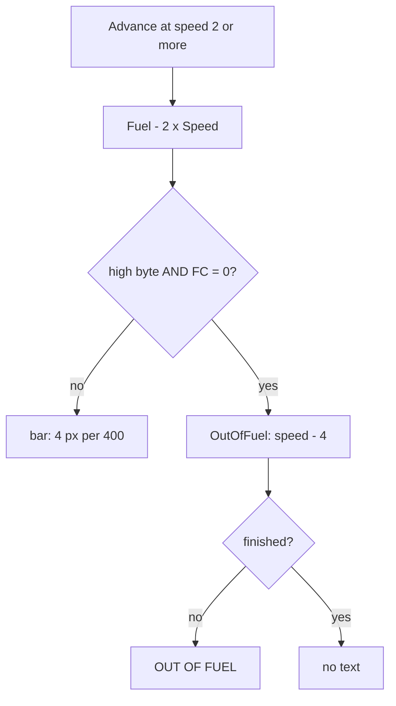

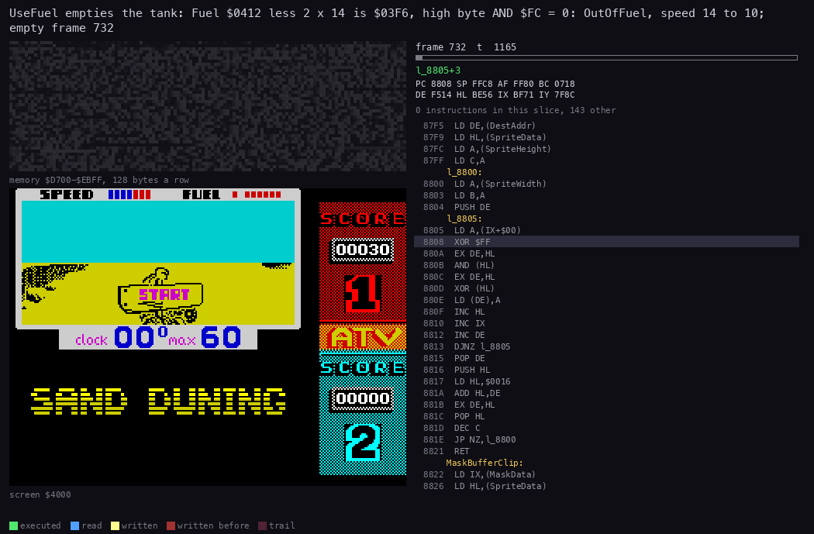

*Animation 10.10: UseFuel and OutOfFuel in `empty` frame 732, 60 pictures, the screen on the left. How to read: the
listing on the right; Fuel `$0412` less 2 × 14 is `$03F6`, its high byte AND `$FC` is 0, so OutOfFuel resets the bar,
calls SlowDown twice (14 → 10) and prints OUT OF FUEL. Command: `work/docs/atC/anims4.sh` (`routine_anim.py --window
732:0-733:0 --pc DF91-E010,E53E-E54B --view screen`), on `empty` opened as `trails` above (`--work
work/docs/atC/empty --ttd work/stage1/rec/empty/session.ttd`).*

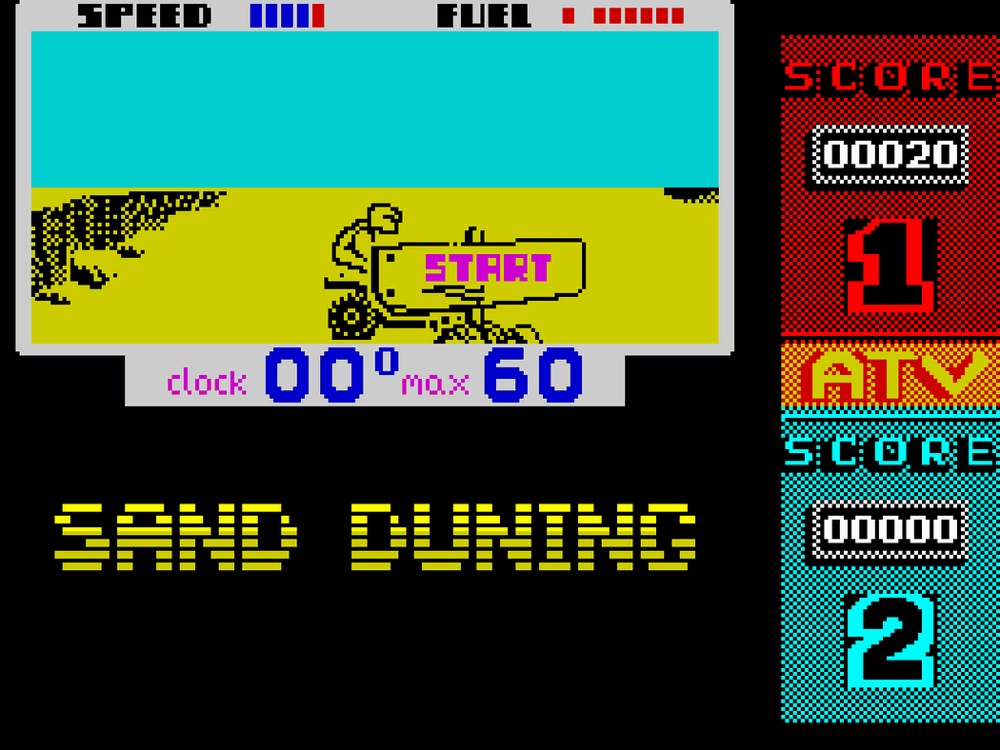

*Animation 10.11: `empty` frames 700-980, every 4th frame, 71 pictures, the whole screen. How to read: the top half;
the fuel was POKEd to `$0500` at frame 567 ([doc 1, 1.8](01-game-design.md#18-fuel-and-out-of-fuel)), the ATV rides
off from the START banner, the tank empties at 732 and the ATV slows to a crawl; OUT OF FUEL flickers, shown only in
the passes that move. Command: `python3 ../../kit/screen_anim.py --work work/docs/atC/empty --width 1050 --from 700
--to 980 --step 4 --delay 100 docs/img/play/empty-out-of-fuel.gif`.*

**Worked example.** Trail 1 in `trails`: Fuel `$2000` until the ATV moves; at 1 095 `$1410`, at 1 102 `$13E6`: 42 = 2
× 21 for a pass at full speed, 10.5 pixels. At 1 680 Fuel is `$06A6` and TrackPos 1 622: `$2000` - `$06A6` = 6 490 =
4 × 1 622.5. Trail 1's finish at 1 608 is 184 pixels short of empty; trail 6's at 1 619 is 173 short. A ride that
goes back and forth (a turn round, a ride back to a thrown rider) can run out.

In `empty` (the working record, `work/docs/atC/empty-vars.jsonl`, frames 540-1 000 sampled like `trails`): Fuel
`$0430` at speed 14 at 720, `$0412` at 726, `$03F6` and speed 10 at 733, `$03E0` and speed 7 at 739, speed 1 by 755.
Then the throttle and OutOfFuel take turns: speed 1 does not move and so does not call UseFuel; the throttle makes it
2; that pass moves 1 pixel, UseFuel finds the tank empty and OutOfFuel takes it back to 0. TrackPos creeps from 78 at
755 to 91 at 1 000, a pixel every 2-3 passes, 4 of fuel each.

**Witness.** `work/docs/atC/trails-vars.jsonl`; `work/docs/atC/empty-vars.jsonl`; `pcs.py` over
`work/docs/atC/empty/traces/732_0-733_0.uatr` finds `$DFE6` (OutOfFuel) and `$E002` (the text) in frame 732; OUT OF
FUEL is dark in the pictures of 736-968 that follow a moving pass (counted in the GIF's text box).

**The point.** The tank is set so that a clean ride finishes with about a tenth of it left. Fuel is spent per pixel,
not per pass, so riding fast costs nothing extra; only extra distance does. An empty tank does not stop the ATV: it
crawls a pixel every few passes, too slow to reach any finish before the clock.

## 10.12 The score

### In short

The score goes up 10 (one point, the screen's tens digit) every time TrackPos crosses a multiple of 16 going forward,
and down 10 going back. ScoreStep checks the Finished bit: after the finish no point is scored. ScoreDown `$E072`
has no such test (BackList `$E04C` calls it straight): after the finish, riding back still costs a point each 16
pixels, and riding forward does not return it. The bonus adds its
points at the trail's end (10.14, 10.15).

### Pseudocode

```text
ForwardList (in Advance):
    if TrackPos's bit 4 changed: ScoreStep()
ScoreStep():                                   # $E0CB
    if this player has finished: return
    player 1 ? ScoreUpP1() : ScoreUpP2()       # +1 on the tens digit, with carries
BackList: if bit 4 changed: ScoreDown()        # -1 on the tens digit; no Finished test ($E04C, $E072)
```

### Assembly

```asm
ScoreStep:
  E0CB  LD A,(Finished)
  E0CE  LD E,A
  E0CF  LD A,(PlayerIndex)
  E0D2  ADD A,$01
  E0D4  AND E
  E0D5  RET NZ                   ; finished: no more points
  E0D6  LD A,(PlayerIndex)
  E0D9  CP $00
  E0DB  JP Z,ScoreUpP1
  E0DE  JP ScoreUpP2
```

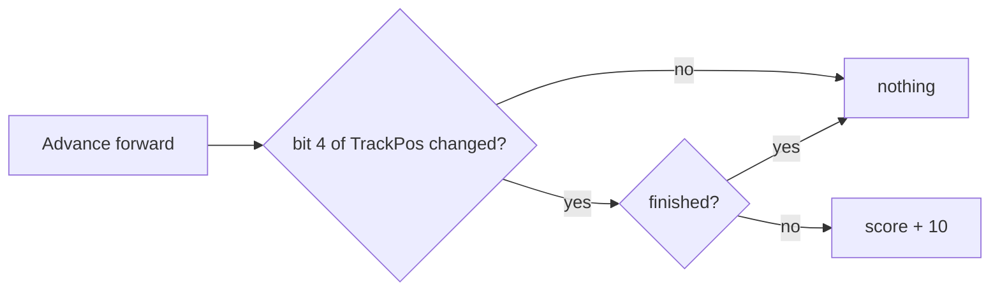

**Worked example.** Trail 1 in `trails`: the score reads 01000 at the finish (frame 1 673, TrackPos 1 612): 1 600 / 16
= 100 points. It stays 01000 while the ATV coasts to 1 727, and becomes 03030 after the bonus of 203 points.

**Witness.** The Score panel of Figure 10.4.

**The point.** The distance is worth about 100 points a trail; the bonus, from the lap time, is worth from a few points to about 1 000.
The score rewards speed more than distance.

## 10.13 The clock and the course of the bot game

### In short

The clock `$D6C9` is three ASCII digits, shown as seconds and tenths, and ClockTick adds one tenth per pass. It starts
at 000 on each trail and is shared by both players. The trail's maximum, MaxTime `$D6CC`, is two digits from MaxTimes
`$D6CF` ("60", "60", "60", "40", "50", "50"), "30" for every trail of the second round.

### Pseudocode

```text
ClockTick():                       # $EB53, once a pass
    ClockUnits += 1                # the tenths
    if ClockUnits > '9': ClockUnits = '0'; ClockTens += 1
    if ClockTens > '9': ClockTens = '0'; Clock += 1
    redraw the changed digits

ShowMaxTime():                     # $EACF, at each trail's start
    MaxTime = SecondRound ? "30" : MaxTimes[Trail]
```

### Assembly

```asm
ClockAdd:
  EB59  ADD A,$01
  EB5B  LD (ClockUnits),A
  EB5E  CP $3A
  EB60  JP C,ClockDigit
  EB63  LD A,$30
  EB65  LD (ClockUnits),A
  ...
ShowMaxTime:
  EACF  LD A,(SecondRound)
  EAD2  CP $00
  EAD4  JR Z,l_EADF
  EAD6  LD HL,$3033              ; "30"
  EAD9  LD (MaxTime),HL
```

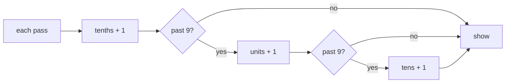

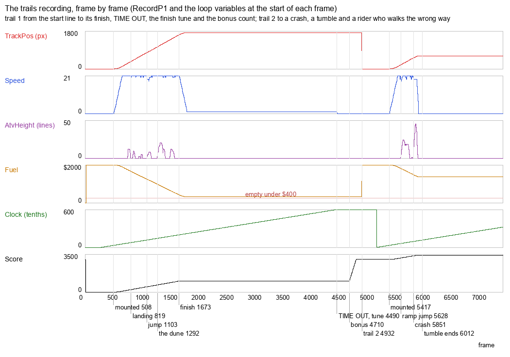

*Figure 10.4: `trails` frame by frame (the `P1` record and the loop variables at the start of each frame). How to
read: six panels share the frame axis; the grey lines are the events named below. The values before frame 280 are
the menu's memory. The point: trail 1 takes 166 passes from the mount (508) to the finish (1 673), then 402 passes of
waiting at speed 1 until TIME OUT; trail 2 ends in a crash at 5 851 and a rider who never gets back on. Command:
`python3 tools/fig_gameplay.py fig-course work/docs/atC/trails-vars.jsonl docs/img/gameplay/course.png`.*

**Worked example.** The course of `trails`:

| Frame | Clock | Event |
| --- | --- | --- |
| about 286 | 000 | trail 1's first pass; the rider on foot at x 24 |
| 508 | 032 | mounted |
| 819 | 076 | the first landing (10.3) |
| 1 103 | 116 | a jump on a slope (10.4) |
| 1 292-1 397 | 144-159 | the staircase dune and the drop (10.2) |
| 1 673 | 198 | the finish: LapTime 19.8, Bonus 203 (10.14) |
| 1 822 | 219 | speed 1, TrackPos 1 727, held there |
| 4 484 | 600 | the clock reaches the maximum |
| 4 490 | 600 | WaitFrames: TIME OUT, TrailEnd, the tune (10.15) |
| 4 710-4 832 | 600 | the bonus counted: 01000 → 03030 |
| 4 932 | 600 | trail 2 (GRASSTRAKIN) set up |
| 5 200 | 001 | trail 2's clock runs |
| 5 417 | 031 | mounted |
| 5 628 | 062 | the ramp jump, 19 lines |
| 5 851 | 094 | the crash, the tumble (10.6, 10.7) |
| 6 012 | 116 | the tumble ends |
| 7 441 | 321 | the recording ends, the rider at x 156 |

The clock at 1 673 is 198 after about 1 387 frames from 286: 7.0 frames a pass, every pass of one player fits.

**Witness.** `work/docs/atC/trails-vars.jsonl`, the clock and the record at the frames above.

**The point.** The clock is in passes, not in seconds: one tenth for every turn of the loop, however long it took.
A "60" trail is 600 passes, 84 s when every pass fits in 7 frames.

## 10.14 The finish and the bonus

### In short

FinishCheck `$DB34` runs at the end of every Update. When TrackPos reaches FinishDistance (the trail's length less
`$48`), the player's Finished bit is set. The first time, the clock is stored as LapTime and the bonus is computed;
in that pass and every pass after, LAP TIME and EXTENDED PLAY are printed in the half.

Bonus = (((MaxTime in tenths - LapTime) / 2 + 1) AND `$FF`) × (Trail + 1) + 1. The multiply takes 8-bit factors, so
the first one loses its high byte.

### Pseudocode

```text
FinishCheck():                                  # $DB34
    if TrackPos < FinishDistance: return
    bit = PlayerIndex + 1
    first = not (Finished & bit); Finished |= bit
    if first:
        LapTime = Clock
        d = (DigitsValue(MaxTime) - DigitsValue(Clock)) >> 1
        Bonus = ((d + 1) & $FF) * (Trail + 1) + 1
    print "LAP TIME" LapTime, "EXTENDED PLAY"

DigitsValue(ix): 100 * ix[0] + 10 * ix[1] + ix[2]   # MaxTime's third digit is the '0' at $D6CE
```

### Assembly

```asm
FinishCheck:
  DB34  LD DE,(FinishDistance)
  DB38  LD HL,(TrackPos)
  DB3B  XOR A
  DB3C  SBC HL,DE
  DB3E  RET C
  DB3F  LD A,(Finished)
  DB42  LD E,A
  DB43  LD A,(PlayerIndex)
  DB46  ADD A,$01
  DB48  LD D,A
  DB49  OR E
  DB4A  LD (Finished),A
  DB4D  LD A,E
  DB4E  AND D
  DB4F  JR NZ,l_DB82             ; finished before: only the texts
  DB51  LD HL,(Clock)
  DB54  LD (LapTime),HL
  DB57  LD A,(ClockUnits)
  DB5A  LD (LapTime+$0002),A
  DB5D  LD IX,Clock
  DB61  CALL DigitsValue
  DB64  PUSH HL
  DB65  LD IX,MaxTime
  DB69  CALL DigitsValue
  DB6C  POP DE
  DB6D  XOR A
  DB6E  SBC HL,DE
  DB70  SRL H
  DB72  RR L
  DB74  INC L                    ; INC L, not INC HL
  DB75  LD E,L                   ; the low byte only
  DB76  LD A,(Trail)
  DB79  ADD A,$01
  DB7B  CALL JpMultiply
  DB7E  INC HL
  DB7F  LD (Bonus),HL
```

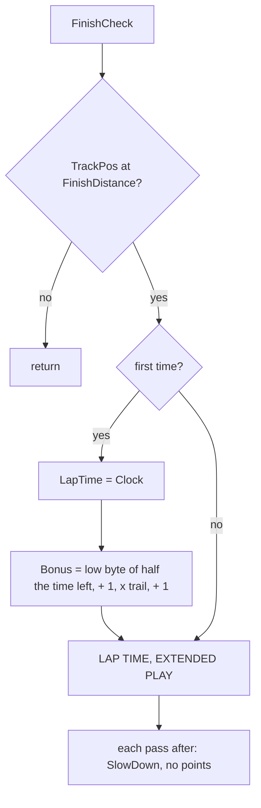

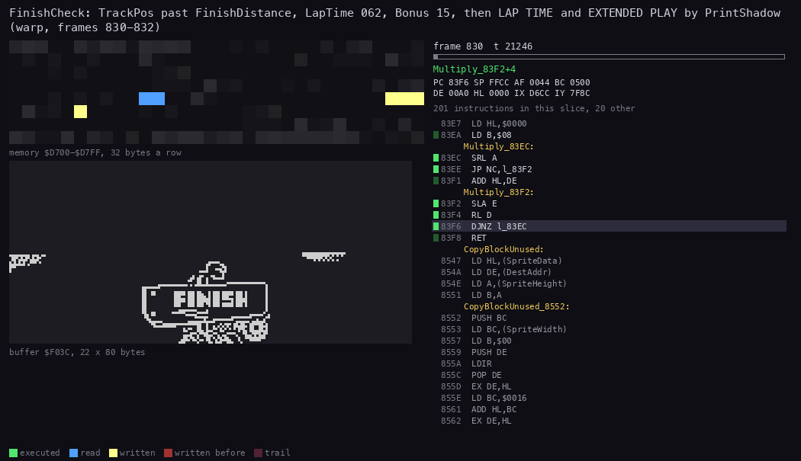

*Animation 10.12: FinishCheck in `trails` frames 1 669-1 672, 60 pictures, the screen on the left. How to read: the
listing on the right; the first pass past 1 608: Finished set, LapTime, DigitsValue twice, the multiply, then
PrintShadow puts LAP TIME 19 8 and EXTENDED PLAY in the half. Command: `work/docs/atC/anims1.sh`.*

**Worked example.** Trail 1 in `trails`: the pass of 1 670-1 672 finds TrackPos 1 612, at least 1 608, with the clock
at 198. DigitsValue(MaxTime "60" + "0") = 600, DigitsValue("198") = 198; (600 - 198) / 2 = 201; + 1 = 202; × (0 + 1)
= 202; + 1 = 203. The record holds Bonus 203 from frame 1 680, and the bonus count turns 01000 into 03030. The same
formula for other laps:

| Trail | MaxTime | Lap 15.0 | Lap 20.0 | Lap 30.0 |
| --- | --- | --- | --- | --- |
| 1 SAND DUNING | 60 | 227 | 202 | 152 |
| 2 GRASSTRAKIN | 60 | 453 | 403 | 303 |
| 4 PYRAMIDS | 40 | 505 | 405 | 205 |
| 6 SWAMP | 50 | 1 057 | 907 | 607 |
| 6, second round | 30 | 457 | 307 | 7 |

**Witness.** `work/docs/atC/trails-vars.jsonl` (Bonus `$D79B`); `docs/img/play/trails-001700-extended-play.png`.

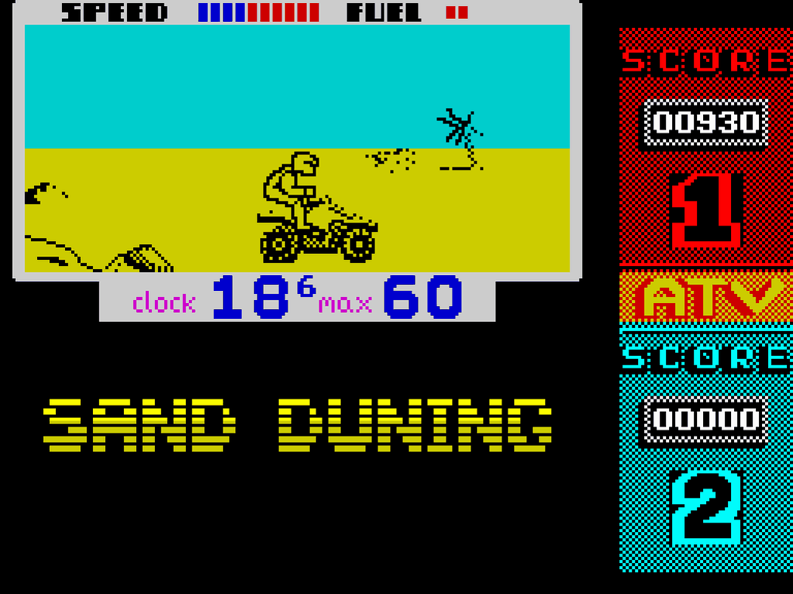

*Animation 10.13: `trails` frames 1 590-1 722, every 3rd frame, 45 pictures, the whole screen. How to read: the top
half; the ATV passes the FINISH banner, LAP TIME and EXTENDED PLAY appear, the ATV slows by 1 a pass. Command:
`python3 ../../kit/screen_anim.py --work work/docs/atC/trails --width 1050 --from 1590 --to 1722 --step 3 --delay 100
docs/img/play/trails-finish.gif`.*

**The point.** The bonus is half the time left, in tenths, times the trail's number: a fast lap on a late trail is
worth far more than the distance points. The wrap of the 8-bit factor needs a lap 51 s or more under the maximum, a
lap of 9.0 on a "60" trail, which no trail allows (a full-speed ride takes about 15 s).

## 10.15 The end of a trail

### In short

After the players' passes WaitFrames waits for the 7th frame, then tests. If both records' speed is 0 and every rider
still in has finished, the trail ends (TrailEnd). Otherwise, if the clock's first digit equals MaxTime's, it is TIME
OUT: both speeds are set to 0, TIME OUT is printed in each unfinished rider's half, and the trail ends if anyone
finished; if no one did, 250 frames and the game is over. TrailEnd keeps in the game only the riders who finished
(Riding = Finished), plays the finish tune, paints the finished halves' bands, counts each bonus into the score and
goes on to the next trail.

### Pseudocode

```text
WaitFrames():                                    # $D86B
    wait until FrameCount >= 7
    if RecordP1.Speed == 0 and RecordP2.Speed == 0 and (Finished & Riding) == Riding:
        TrailEnd()
    if Clock[0] != MaxTime[0]: next pass
    RecordP1.Speed = RecordP2.Speed = 0
    TimeOut()                                    # the text for unfinished riders
    if Finished & 3: TrailEnd()
    250 HALTs; return                            # out of NewGame: the game is over

TrailEnd():                                      # $ECE0
    Riding = Finished                            # the unfinished drop out
    TunePlay(1); SetupIm2; 50 HALTs
    the bands of the finished halves; CountBonus(); 100 HALTs
    Trail += 1
    if Trail == 6: SecondRound = 1; Trail = 0
    NextTrail
```

### Assembly

```asm
WaitFrames:
  D86B  LD A,(FrameCount)
  D86E  CP $07
  D870  JR C,WaitFrames
  D872  CALL RecordFieldP1       ; RecordP1's Speed
  D875  JR NZ,l_D89E
  D877  CALL RecordFieldP2
  D87A  JR NZ,l_D89E
  D87C  LD A,(Riding)
  D87F  LD E,A
  D880  LD A,(Finished)
  D883  AND E
  D884  CP E
  D885  JP Z,TrailEnd
  D888  JR l_D89E
l_D89E:
  D89E  LD A,(Clock)
  D8A1  LD E,A
  D8A2  LD A,(MaxTime)
  D8A5  CP E
  D8A6  JR NZ,Pass
  D8A8  CALL RecordFieldP1
  D8AB  LD (HL),$00
  D8AD  CALL RecordFieldP2
  D8B0  LD (HL),$00
  D8B2  CALL TimeOut
  D8B5  LD A,(Finished)
  D8B8  AND $03
  D8BA  JP NZ,TrailEnd
  D8BD  LD B,$FA
l_D8BF:
  D8BF  HALT
  D8C0  DJNZ l_D8BF
  D8C2  RET
TrailEnd:
  ECE0  LD A,(Finished)
  ECE3  LD (Riding),A
  ...
  ED39  LD A,(Trail)
  ED3C  ADD A,$01
  ED3E  LD (Trail),A
  ED41  CP $06
  ED43  JP C,NextTrail
  ED46  LD A,$01
  ED48  LD (SecondRound),A
  ED4B  XOR A
  ED4C  LD (Trail),A
  ED4F  JP NextTrail
```

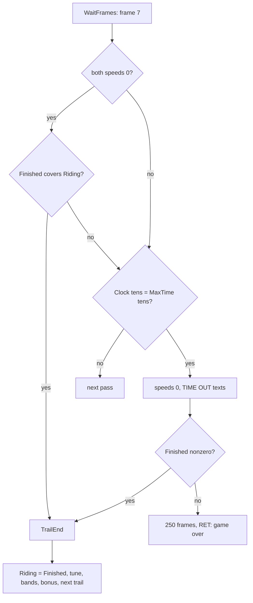

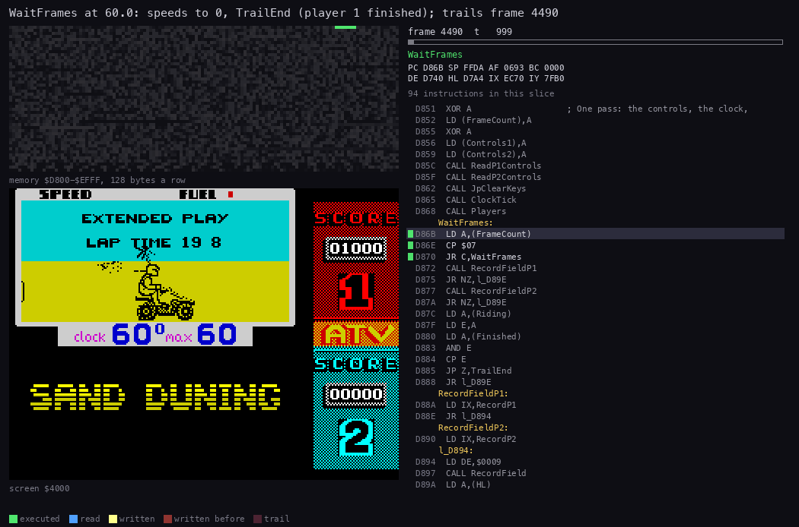

*Animation 10.14: WaitFrames at `trails` frame 4 490, 70 pictures, the screen on the left. How to read: the clock
shows 60.0; the speed test fails (Speed 1), the clock's tens digit equals MaxTime's, both speeds go to 0, TimeOut
prints nothing (player 1 finished), Finished is 1, so TrailEnd: Riding = 1, the tune player copied back and TunePlay
starts. Command: `work/docs/atC/anims4.sh`.*

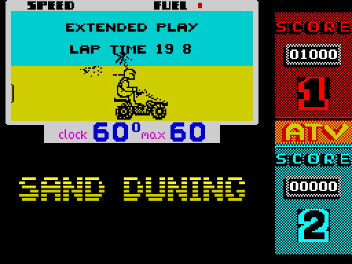

*Figure 10.5: `trails` frame 4 510: the finish tune playing after TIME OUT; player 1's half keeps LAP TIME and
EXTENDED PLAY, and no TIME OUT text (TimeOut skips a finished rider).*

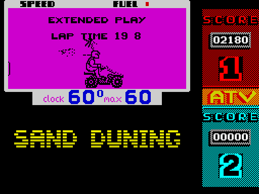

*Figure 10.6: `trails` frame 4 780: CountBonus at work, player 1's half in its band, the score climbing to 03030
([doc 9, 9.5](09-sound.md) for the tone, [CountBonus.gif](img/routines/CountBonus.gif)).*

**Worked example.** In `trails` the rider finished at 1 673 but kept the throttle held: Speed stayed 1 (10.10), so
the first test failed at every pass. The trail ended only at TIME OUT: the clock 198 → 600, 402 passes, 2 817 frames
of waiting (56 s). Released, the throttle would have let PassP1's SlowDown take 21 to 0 in 11 passes, and the trail
would have ended at about clock 21.0. The bonus is the same either way (it is fixed at the finish), so the cost is
only time; in a two-player game, though, the trail cannot end by the stop until both riders have finished.

**Witness.** `pcs.py` over `4484_0-4492_0.uatr`: `$D89E`, `$D8A8`, `$D8B2` and `$ECE0` once each, all in frame
4 490; the Speed panel of Figure 10.4.

**A drop-out, recorded.** `work/stage1/rec/dropout` (7 830 frames from recording menu's `menu-two-kb.szx`, two
players on the keyboard, `tools/rec_crashes.py dropout`): player 1 mounts, his distance is POKEd to the finish less
40 (`$D726` = 1 568, in `record.json`), he crosses the line (Finished 1 at frame 747) and stops; player 2 never leaves
the start. At the clock's 60.0 TimeOut runs once (frame 6 783), TrailEnd follows at once (`$ECE0`, 6 784; Finished
& 3 is 1, no 250-frame wait), Riding goes 3 to 1, and trail 2 starts for player 1 alone: PassP2 `$DA8F` runs its last
time at 6 783, PassP1 on to 7 829, and player 2's half shows only the trail's name.

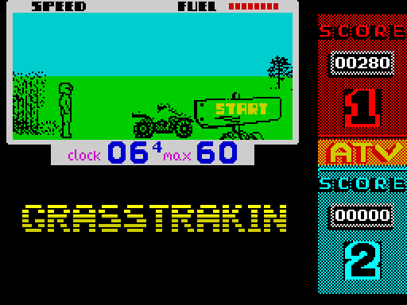

*Figure 10.7: `dropout` frame 7 830: trail 2 after TIME OUT; player 2 did not finish trail 1 and is out (Riding 1),
his half shows the trail's name, his score stays 00000. A screen kept by `tools/rec_crashes.py dropout`.*

**Witness.** The L1 of `dropout` (TimeOut 1, TrailEnd 1, PassP2 600 calls from 405 to 6 783, PassP1 664 to 7 829)
and its log.json (Riding, Finished, the clock, each 13 frames).

**The point.** "Finished and stopped" is the rule: the finish line does not end the trail, the player's own stopping
does. A trail's end is also the only place a player can drop out.

## 10.16 The game: trails, rounds and the game over

### In short

NewGame `$D80D` clears the score, sets Riding to 1 (one player) or 3 (two), and runs the trails from NextTrail
`$D82F`. SelectTrail picks the trail's record: TrailRecords + 6 × Trail for trails 1-4, Trail5 `$EE84` for trail 5,
Trail6 `$60AC` for trail 6, and sets FinishDistance. After trail 6 the second round starts at trail 1 with every
maximum "30", and it does not end: the trails repeat with SecondRound set until a TIME OUT with no one finished returns
to the high score table.

### Pseudocode

```text
NewGame():                                  # $D80D
    Trail = 0; SecondRound = 0; both scores = "00000"
    Riding = PlayerCount * 2 + 1            # 1 or 3
    LoadIntro()
  NextTrail:                                # $D82F
    Finished = 0; SelectTrail(); FrameCount = $FF
    InitListWidths(); InitRecords(); TrailIntro(); ShowHud(); ClearKeys(); EI
    loop Pass()                             # until TrailEnd jumps back or WaitFrames returns
SelectTrail():                              # $EC9C
    record = Trail == 4 ? Trail5 : Trail == 5 ? Trail6 : TrailRecords + 6 * Trail
    ListA, ListB = record[0], record[1]; FinishDistance = record[2] - $48
```

### Assembly

```asm
NewGame:
  D80D  XOR A
  D80E  LD (Trail),A
  D811  XOR A
  D812  LD (SecondRound),A
  D815  LD HL,Scores
  ...
  D822  LD A,(PlayerCount)
  D825  SLA A
  D827  OR $01
  D829  LD (Riding),A
  D82C  CALL JpLoadIntro
NextTrail:
  D82F  LD HL,Attributes
  D832  LD (AttrBase),HL
  D835  XOR A
  D836  LD (Finished),A
  D839  CALL SelectTrail
  ...
OuterLoop:
  D801  CALL MenuTable
  D804  CALL NewGame             ; returns only at a game over
  D807  CALL JpCheckHiScore
  D80A  JP OuterLoop
```

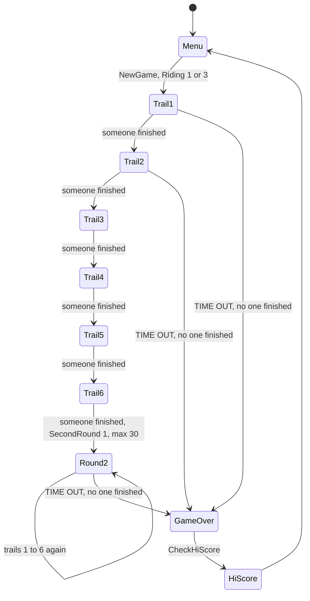

**Worked example.** `warp` (POKEd distances, WALKTHROUGH 6.1) rides all six trails and the second round's trail 1:
player 1 ends with 33 350 and enters the table
([doc 1, 1.10](01-game-design.md#110-time-out-the-end-of-the-game-and-the-high-score-table)). `c1` ends at TIME OUT on
trail 1 with nobody finished: 250 frames, then the title
([c1-019260-time-out.png](img/play/c1-019260-time-out.png)). In `kb` both players finish trail 1 and both ride trail
2 ([doc 1, 1.9](01-game-design.md#19-two-players-on-the-split-screen)).

**Witness.** doc 1's recordings; the call chain above in `build/game.lst`.

**The point.** The game is endless by design: the second round repeats with 30 s maxima until the clock wins. A
two-player game becomes a one-player game the first time one player misses a maximum.

## 10.17 The expected techniques

### In short

The rules leave a player six things to learn. They follow from the code above; `trails` shows what two of them are
worth.

| Technique | Rule (section) | What it gains |
| --- | --- | --- |
| jump at the top of a ramp, not before | the jump's VSpeed is `$FD` less this pass's rise (10.4) | 19-25 lines of flight against 1-3 |
| ride over steps of 6 or less, jump steps of 7 | the crash test, 7 beyond the last rise (10.6) | no crash; a climb in one pass |
| no Up held at full nose-up | `$44` + Up = ThrowOff (10.5, 10.8) | the rider stays on |
| crash slower than 12 if at all | Crash by speed: under 10 stop, 10-14 throw, 15+ tumble (10.6) | no walk back, or no tumble |
| come down onto the seat | MountCheck: falling, 4-24 above, x within 30 (10.9) | getting on in 3 s |
| release the throttle after the finish | the trail ends at speed 0 (10.15) | `trails`: 391 passes saved on trail 1 |

### Pseudocode

```text
the ride the rules reward:
    hold the throttle from the mount to the finish
    press jump in the pass the ATV tops a ramp (its rise 4-5)
    keep the nose under $44; jump steps of 7 or more
    after the finish line: release everything; the trail ends when the speed reaches 0
```

### Assembly

```asm
  E39C  LD A,(AtvHeight)         ; the jump's power: this pass's rise
  E39F  SUB E
  E6E6  CP $07                   ; the crash: a step of 7 beyond the rise
  D872  CALL RecordFieldP1       ; the end: speed 0 needed
```

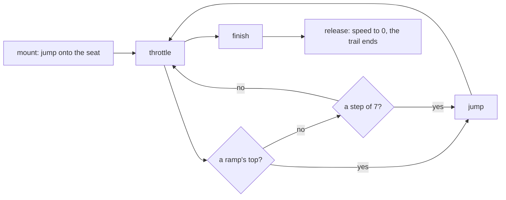

**Worked example.** In `trails` the bot's plan rides trail 1 cleanly (166 passes, lap 19.8) but holds the throttle
after the finish: 402 passes to TIME OUT where 11 would do. On trail 2 it jumps the ramp well (rise 4, 19 lines), but
at 5 851 meets a 7-line step on the flat at speed 21: the worst crash, a 23-pass tumble and a throw to x 153; then the
rider walks right, away from the ATV. A jump in the pass before the step would have lifted the ATV over it, and a
speed of 11 or less would have kept the rider on.

**Witness.** `tests/inputs/trails.txt` and the course in Figure 10.4.

**The point.** Every technique is a rule's edge: a threshold of 7, a window of 30 pixels, a test of speed 0.

## 10.18 Quirks and what is known only from the code

### In short

| Quirk | Where | Effect |
| --- | --- | --- |
| a finished rider who holds the throttle never stops | PassP1 SlowDown -2, Accelerate +1, Advance from 2 | the trail ends only at TIME OUT (10.15) |
| Fall goes into the ground | Fall clamps at 0, not at GroundY | up to 5 lines; the next pass's climb pulls it out |
| the ground scans see 8 lines up at most | GroundUnder starts at AtvHeight + 8 | a wall is met by the nose scan only |
| full nose-up is blind to walls | AtvPhysics `$E762` | `$44` skips the wall test |
| the bonus's first factor is 8 bits | FinishCheck `$DB74` (INC L, LD E,L) | wraps for a lap 51 s under the maximum; unreachable |
| PassP2 does not call ClearKeys | PassP2 `$DA8F` (PassP1 has `$DA80`) | no effect found |
| the time test compares one digit | WaitFrames `$D89E` | right only because every MaxTime ends in 0 |
| a crash during a tumble | Crash returns at `$E979` | at 15 or more only the -2 and the undone move |
| DismountUnused `$E3BB` | no caller | a dismount left in the code |
| ScoreDown has no Finished test | BackList `$E04C`, ScoreDown `$E072` | a finished rider riding back loses points he cannot win back (10.12); known only from the code |

Recorded since (`tools/rec_crashes.py`): ThrowOff from a full wheelie and FallRider (`throwoff`), the nose test's
crash (`wallcrash`, by the unsigned wrap), a crash at speed 12-16 (stop and throw, `speedcrash`), ThrowOff from an
overhang (`overhang`, with a POKE that floats a dune, 10.8), a two-player drop-out at TIME OUT (`dropout`, the
distance POKEd, 10.15). CrashIfAir was in `c1` all along: its tumble at 15 574 (10.6). Known only from the code (no
recording shows it): a nose crash on a real wall 21 or more high, OUT OF FUEL in a real ride (only POKEd in `empty`),
the second round's "30" maxima beyond its first trail, and a finished rider losing points by riding back.

### Pseudocode

```text
the stuck finish (10.10, 10.15):
    each pass: Speed = max(0, Speed - 2) + 1     # throttle held
    -> 21, 20, ..., 2, 1, 1, 1 ...
    Advance: Speed under 2, no move; WaitFrames: Speed not 0, no end
```

### Assembly

```asm
  DA6C  LD A,(Finished)          ; PassP1
  DA6F  AND $01
  DA71  CALL NZ,SlowDown         ; -2
  ...
  E555  LD A,$15                 ; Accelerate caps at 21
  E014  CP $02                   ; Advance: no move under 2
```

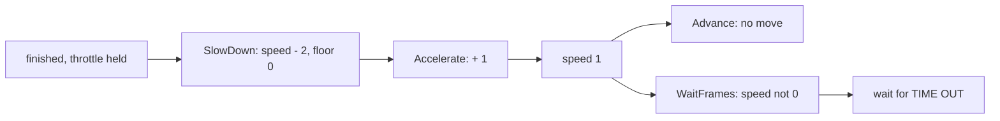

**Worked example.** The stuck finish in `trails`: Speed 21 at 1 680, 20 at the next pass, and so on to 1 at 1 822;
then 1 at every sample to 4 483. The trail ends at frame 4 490 by TIME OUT, not by the stop.

**Witness.** `tab.py 1680 4490 100`.

**The point.** The rules are simple and consistent; their edges come from integer steps (the 7-line step, the speed
floor at 1) rather than from errors in the code.
