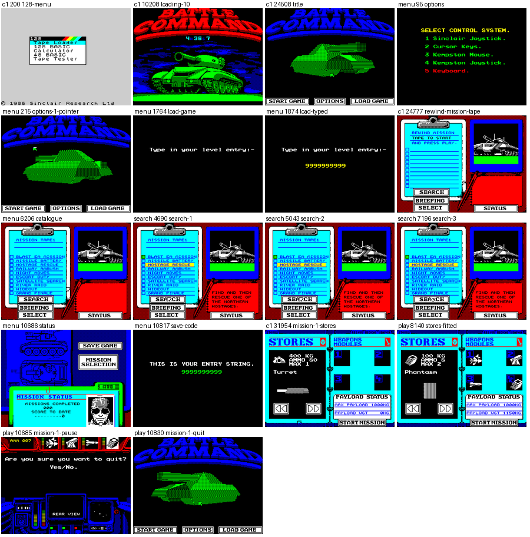
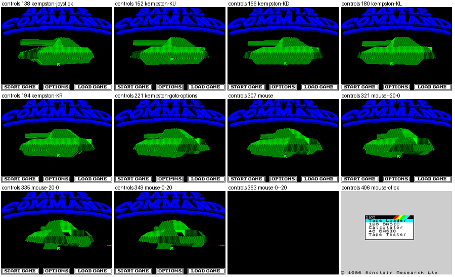
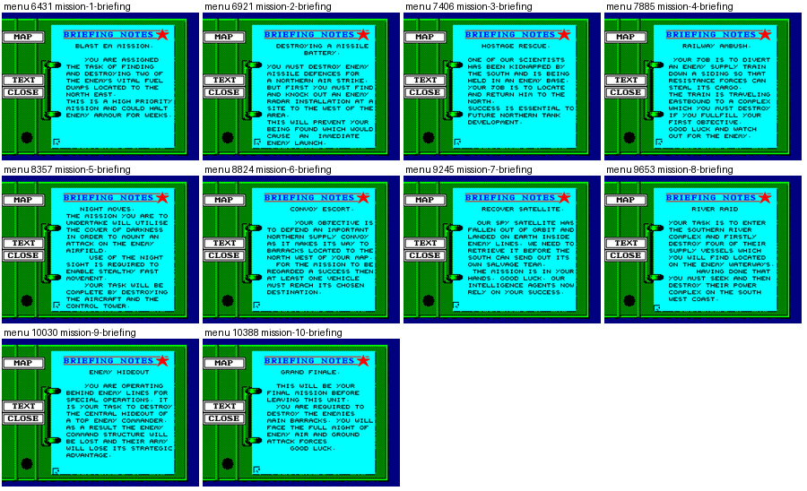
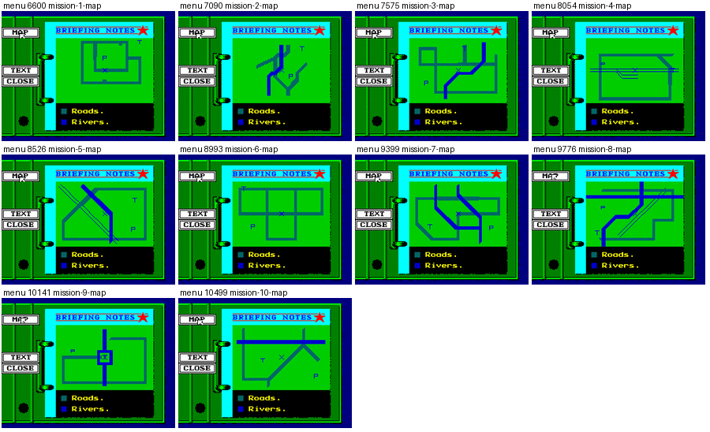
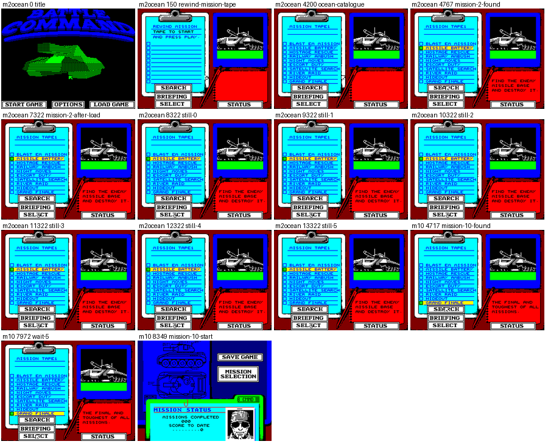
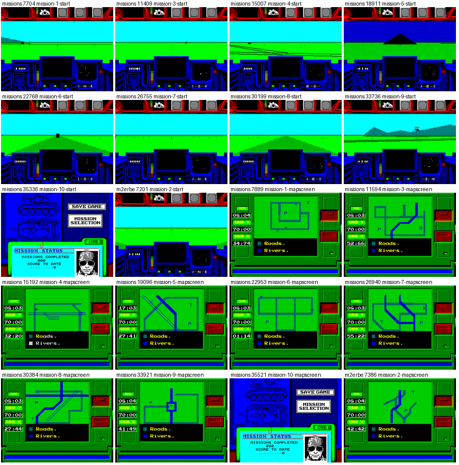
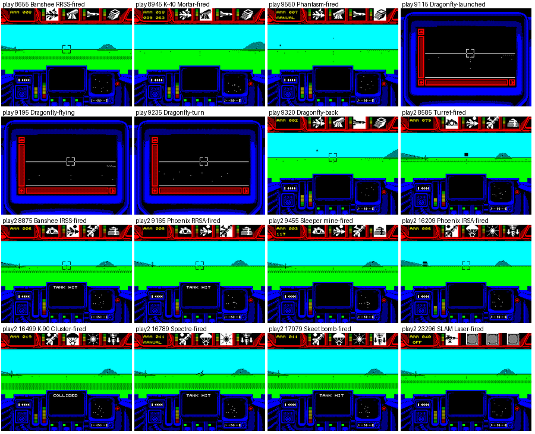
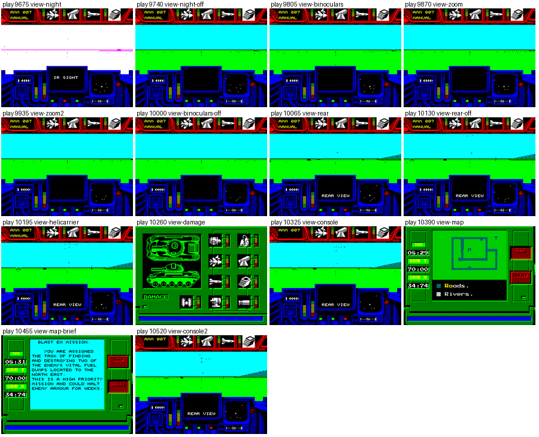

# Battle Command: walkthrough

How the reverse was done, step by step, and which unreal-ng call answered each question. Terms:
[docs/README.md](docs/README.md). Recipes: `../recipes/`.

Every recording is named with its load (ROM speed or the fast LD-BYTES trap) beside every frame number. Every
recording of this case loads at signal speed (fast and turbo tape off); all but c1 and m4complete start from
`work/stage1/explore/loaded.szx`, the title after side 1 loaded at signal speed (`work/stage1/explore1.py`);
m4complete starts from m1complete's end.

## 0. The medium

### 0.1 The files

`orig/BattleCommand.tzx.zip` is ZXDB download 3059, copied unchanged; its hashes and the two sides' hashes are in
the [README](README.md). The sides are unpacked in `work/stage1/media/side1.tzx` and `side2.tzx`; the other copies
sit in `work/candidates/<source>/`, unpacked in `work/stage1/media/`.

### 0.2 The release check

Each copy's blocks were listed with `python3 tools/tzxblocks.py list FILE` and compared byte for byte with the
Ocean blocks and with the eight banks of the game image (`work/stage1/findblocks.py IMAGE TAPE`: where each block's
bytes sit in the banks).

- **Ocean, side 1**: no data block is found in memory as it is on the tape: SpeedLock 7 deciphers while it loads
  ([doc 3, 3.1](docs/03-build-and-load.md#31-the-tape-block-by-block)).
- **Erbe, side 1**: six of its seven ROM-speed blocks are byte for byte banks 5 (`$5B00-$7FFF`), 0, 3, 4, 6 and 7
  of c1 at the entry (frame 23974): the same program without the protection.
- **Side 2**: Erbe, the TAP crack and the TOSEC TZX carry the catalogue and the ten missions byte for byte as the
  Ocean side 2, except Missile Battery (mission 2): the Ocean block holds 6384 data bytes where its own header says
  `$1906` = 6406; the first 3487 bytes agree (`$DBC5-$E963`; corrected by docs, see doc 3.10).
- **What the game does with the Ocean mission 2**: the m2ocean recording winds the Ocean side 2 to mission 2's
  header; SEARCH lights Missile Battery (frame 4767), SELECT reads the block, and the game stays on the catalogue
  screen with the tape read past it: frames 7322 to 13 322 show the same screen and no stores screen
  ([mission-tape.png](docs/img/play/mission-tape.png), the "still" tiles). The m2erbe recording does the same with
  the Erbe side 2: mission 2 loads (in play at frame 7201) and its map screen (frame 7386) shows the roads and rivers
  of the mission 2 briefing map (menu frame 7090, [briefing-maps.png](docs/img/play/briefing-maps.png)). The Ocean
  tape in ZXDB 3059 thus has a short mission 2 block (a bad dump of that block, or a mastering fault); the Erbe block
  is the one the game accepts.
- **`BATTLECO.Z80`** (NVG snaps, 128K): `work/stage1/z80cmp.py` compares its eight pages with the image at the entry
  and in play: only scattered 256-byte runs agree, the layout differs (another build or a relocated crack). It is
  not used as a witness.
- **The demos** (`btcom128`, `BCTANK.Z80`) are other programs (README).

The original is the Ocean tape (README).

### 0.3 The load

c1 loads side 1 with the 128K menu's Tape Loader at signal speed: the tape is played at frame 208, the BASIC loads
by frame 1999, the SpeedLock loader runs from frame 2484 and jumps into the game at frame 23974 (stage 23, `JP $68F4`
at `$8043`); the title is on screen at frame 24508. Doc 3 has the blocks, the stages and the bootstrap
([3.1](docs/03-build-and-load.md#31-the-tape-block-by-block)).

### 0.4 The machine: 128K only

`work/stage1/try48.py` loads side 1 on a 48K at signal speed and logs the PC every 2000 frames
(`work/stage1/try48.log`): the loader runs (PC in `$B1BD-$BDB9`) to frame 24232, and at frame 26232 the PC is
`$10AC` in the 48K ROM: the machine restarted to the Sinclair copyright screen after the load. The loader pages
banks through `$7FFD` (doc 3), which a 48K ignores, so the code it jumps to is not there. ZXDB and the
instructions ("Spectrum Tape +2/+3") agree: 128K only.

## 1. Interrupts and timing

**The mode.** The entry at `$68F4` runs `DI`, `LD SP,$81FF`, fills `$8200-$8300` with `$83` (`LDIR` at `$6903`),
sets `I` = `$82`, `IM 2`, `EI`: every vector reads `$8383`, the handler (doc 2, bank 2). No `HALT` is executed in
any recording (none in the L1 instruction lists).

**The handler** (`work/stage1/dis.sh work/mkgame/original.bin 8383 8443`):

```
$8383 DI / EX (SP),HL / LD ($842B),SP / LD SP,$7C49   ; its own stack in bank 5
$838C PUSH IY, IX, AF, AF', HL, DE, BC, HL', DE', BC'
$839B CALL $7E6E, $72D2, $7DFB, $8836, $8459, $8475, $848F, $7D80, $87D6
$83B9 LD A,0 / INC A / JR NZ,$8404     ; the operand at $83BA is a flag written by other code
$83BE LD A,0 / AND A / JP Z,$83DF      ; the operand at $83BF is a second flag
$83C4 CALL $8431, $D251, $897E, $D0CA, $83F1, $D142, $D27C, $D1BE, $843A
$83DF CALL $885F, $88CF, $8999, $72D2, $8AEC / JP $841C
$841C POP the registers, SP back from $842B, return
```

`python3 $RS interrupts --work work/stage1/rec/NAME` over each recording's L1:

| Recording | Handler entries | A frame | T an entry | CPU share |
| --- | --- | --- | --- | --- |
| c1 | 4124 in 33 299 frames (the load runs under `DI`) | | | 2.3 % |
| menu | | 0.69 | | 12.5 % |
| play | 5510 in 10 967 frames | 0.50 | 14 073 | 10.0 % |

In play the nine calls at `$839B` run on every entry (5510 times each), the block at `$83C4` on 3423 entries, the
block at `$83DF` on 706. Half the interrupts of play are not taken: the code runs long stretches under `DI` (the
back-buffer clear `$96F1`, which points `SP` at the buffer for its `PUSH` loop, and `$9941-$99C0`), and an interrupt
that arrives under `DI` is lost.

**The paging.** One routine pages: `$7270-$7287` in bank 5 (`OUT (C),A` at `$727F`, 54 858 times in c1), with
entries for banks 4, 7, 6 and 0 (doc 2). The other `OUT`s are `$D7E4` / `$D7EB` in bank 0 (10 907 times in c1, the
AY candidates) and `$C16F` in bank 4.

**The 3D frame.** A pass of the 3D view clears the back buffer once (`$96F1`) and runs `$C7BC` once, so the count
of `$96F1` in a window of the playx build (play, `re_session.py build --from-frame/--to-frame`) is the passes in it:

| play frames | On screen | Frames a pass |
| --- | --- | --- |
| 8370-8970 | the normal view, three windows of 200 frames | 7.7, 7.4, 7.1 |
| 9115-9315 | the Dragonfly's view | 8.0 |
| 9805-9995 | binoculars and zoom | 6.8 |
| 10 065-10 125 | the rear view | 12 (the heaviest measured) |
| 10 520-10 620 | the console after the map | 11.1 |

Over play frames 8400-9400: 128 passes in 1000 frames, 7.8 frames a pass (6.4 passes a second). The main loop is
not tied to the interrupt (no `HALT`); the pass takes as long as the scene needs.

## 2. Static pass over the medium

Stage 2.

## 3. The stages and the packers

The stages of c1 are in [doc 3](docs/03-build-and-load.md#38-from-power-on-to-the-title): the 103-layer decryption
chain keyed by R (69 add, 22 dec, 12 sub; `python3 tools/speedlock.py layers`, [doc 3.3](docs/03-build-and-load.md#33-the-decryption-chain-103-layers-keyed-by-r))
runs in c1 frames 2033-2048, then the SpeedLock loader reads the blocks from frame 2050 to about 24000
([LoadBlocks.gif](docs/img/routines/LoadBlocks.gif)) and jumps into the game at frame 23974.

## 4. The medium from source

`sh tools/mkasm_all.sh` writes every source from its `.ann` (kit/mkgame.py: the game and nine parts), then
`rm -rf build && sh tools/build.sh $SJASMPLUS` builds both sides and prints `identical` for each against
`orig/BattleCommand.tzx.zip`; `python3 tools/res_formats.py check` builds every resource of `src/res` back to the
bytes it came from ([README, Build](README.md#build)).

## 5. Tool gaps found and fixed in unreal-ng

| Gap | Fix | unreal-ng commit |
| --- | --- | --- |

None. The reset with the Kempston mouse chosen (6.0, controls) is the game's own bug, not the emulator's: its
reader's stores damage the 3D code until a jump into the middle of an instruction at `$7E79` reaches `RST 0` at
`$FC0C` (corrected by docs, see doc 5.5).

## 6. The game

### 6.0 The recordings

The stage 1 recordings are made by `python3 tools/record.py PLAN --work work/stage1/rec/NAME --port-base 37310
[--start work/stage1/explore/loaded.szx]` (the plan's docstring is its description); the later ones by the commands
in the table below. Each folder keeps `session.ttd`, `l1.json`, `record.json` (tape actions, POKEs, moments) and
`end.szx`; the input script is `tests/inputs/NAME.txt`. All load at signal speed.
The tape is wound with `POST /tape/seek` to a mission's header, as a player winds it: SEARCH reads up to the next
mission header on the tape, whichever it is (the search recording), so the first runs that only pressed SEARCH loaded
the wrong missions and were thrown away. In play the game reads the keys once a pass, so the scripts hold a key 25
frames.

| Name | Frames | Start | POKEs | What it reaches |
| --- | --- | --- | --- | --- |
| c1 | 33 299 | power-on | none | side 1 by its own loader, the title, OPTIONS, START GAME, the mission tape's catalogue, Blast Em Mission searched and loaded, the Turret fitted, a short drive with the cannon; it ends in play and completes no mission (MissionCompleteScreen and PicCompletion never run in its L1; corrected by docs, see doc 10.9) |
| menu | 10 997 | title | none | OPTIONS with control systems 1 (Sinclair), 2 (cursor) and 5 (keyboard), the pointer moved with each; LOAD GAME with a code; the catalogue; the briefing text and map of all ten missions; STATUS; a save code |
| controls | 406 | title | none | OPTIONS 4 (Kempston joystick): up, down, left and right each move the pointer (frames 152-194), and it reaches OPTIONS (221); OPTIONS 3 (Kempston mouse): the pointer does not follow the mouse, the pointer variables read 23 296, 72 at frame 335, and the machine resets to the 128K menu (frames 363, 406) |
| missions | 35 998 | title | none | missions 1 and 3-10 wound to, searched, selected: 1 and 3-9 load, start, drive, map screen, quit; mission 10 goes back to the status screen (35 336) |
| m2ocean | 13 322 | title | none | Ocean mission 2 found (4767), selected: the block does not load, no stores screen in 6000 frames |
| m2erbe | 7809 | title | none | the Erbe side 2's mission 2: loads, played (7201), its map (7386), quit |
| m10 | 9029 | title | none | Grand Finale found (4717), SELECT: the status screen again (8349), no load |
| search | 7196 | title | none | three SEARCHes after the catalogue: Blast Em, then Missile Battery, then Hostage Rescue light in turn |
| play | 10 967 | title | `$C1C6`, `$C875` (bank 6) | Blast Em Mission with Banshee RRSS, K-40 Mortar, Dragonfly, Phantasm, each fired, the Dragonfly flown; the views N, B, Z, R, H, D, C, M and the map's briefing; pause; quit |
| play2 | 23 666 | title | as play, three times | the other nine stores (Turret, Banshee IRSS, Phoenix RRSA, Sleeper mine; Phoenix IRSA, K-90 Cluster, Spectre, Skeet bomb; SLAM Laser), each fired |
| death | 20 039 | title | none | Blast Em Mission with the Turret driven and fired for 12 000 frames: TANK HIT messages, no death |
| fuel | 11 704 | title | Fuel `$7C57` = 32 at 7704 | Blast Em Mission with the Turret; the fuel runs out (0 at 7904), MissionFailedScreen at 7862: "RAN OUT OF FUEL.", then the title (8051) |
| armour | 18 939 | title | armour `$8301-$8304` = 1 at 7704 | Blast Em Mission with the Turret, the death plan's keys; the first hit (18423) destroys the tank: "UNIT DESTROYED" |
| m1complete | 22 303 | title | Immunity (bank 0 `$C875`) on the long drives only | Blast Em Mission completed: both fuel dumps destroyed, the goal, H, the Helicarrier lands (pickup 21533), HelicarrierHit 21558, the COMPLETION REPORT (21593), STATUS (MISSIONS COMPLETED 001, SCORE 500), the save code `C5989999PB` (22240) |
| m4complete | 22 098 | m1complete's end | as m1complete | Railway Ambush completed after mission 1: the points, the engine on the siding, the station, H, the Helicarrier (HelicarrierHit 21299), the COMPLETION REPORT (21339), STATUS (002, 2500), the save code `H59K9999PK` (22035) |

The commands and the TTD sessions of the later recordings:

| Name | Command | session.ttd |
| --- | --- | --- |
| fuel | `python3 tools/record.py fuel --work work/stage2/rec/fuel --port-base 37320 --start work/stage1/explore/loaded.szx` | `work/stage2/rec/fuel/session.ttd` |
| armour | `python3 tools/rec_armour.py` (the plan; inputs in the folder's `inputs.txt`) | `work/docs/bcC/rec/armour/session.ttd` |
| m1complete | `python3 tools/rec_complete.py m1 --work work/stage2/rec/m1complete --port-base 37390 --start work/stage1/explore/loaded.szx --inputs tests/inputs/m1complete.txt` | `work/stage2/rec/m1complete/session.ttd` |
| m4complete | `python3 tools/rec_complete.py m4 --work work/stage2/rec/m4complete --port-base 37390 --start work/stage2/rec/m1complete/end.szx --inputs tests/inputs/m4complete.txt` | `work/stage2/rec/m4complete/session.ttd` |

The stage 1 sessions are `work/stage1/rec/NAME/session.ttd`. The completion recordings steer in a closed loop on the
player record (work/stage2/complete-NOTES.md); their Immunity POKE is written back to `$FA` before any shooting and
before the Helicarrier.

The POKEs come from the release's `.pok` (6.3) and are written into bank 6 of the recording's machine at the
stores screen and at the mission start (frames in `record.json`); the image of the case is cut from c1, never from
these.

Grand Finale refuses SELECT in m10 and in missions: LoadMissionIfAllowed `$759A` needs all nine flags
MissionsDone `$6799-$67A1` (doc 10.11). A failed mission ends at the title (fuel, armour): there are no lives and no
game over screen. Not reached by any recording: missions 2, 3 and 5-10 completed, the desertion, the bridge and the
pickup failures, Grand Finale in play.

### 6.1 Screens

Every recording keeps its named screenshots in `screens/` (`FRAME-NAME.png`): c1 22, menu 48, controls 12, missions
93, m2ocean 11, m2erbe 12, m10 18, search 7, play 38, play2 58, death 69 (`work/stage1/rec/`), fuel 49, m1complete
58, m4complete 57 (`work/stage2/rec/`), armour 63 (`work/docs/bcC/rec/`). The sheets below are drawn by `python3
tools/fig_shots.py OUT.png COLS rec:glob ...` from them; each tile is labelled with its recording and frame.

The recorder's screenshots (and `tools/lab.py shot`, the TTD screen reads) take the screen at `$4000`, bank 5, not
the screen shown: while bit 3 of `$7FFD` shows bank 7's black shadow screen (a bank 7 picture unpacking, play
10220-10370 and 10460-10500, menu 95-139) they show what the player does not see. `tools/fig_shownscreen.py` renders
the shown screen (doc 6, the shadow screen).



*The menus: the 128K menu, the load, the title, OPTIONS, LOAD GAME, the mission tape, the catalogue, SEARCH, STATUS
and the save code, the stores screen, pause and quit.*



*The controls recording: the Kempston joystick moves the pointer; with the Kempston mouse the pointer stays and the
machine resets (frames 363, 406).*



*The briefing text of the ten missions (menu).*



*The briefing map of the ten missions (menu): roads, rivers, P, T and X marks. These are the game's own maps; a map
drawn from the mission data is stage 2's.*



*m2ocean: Ocean mission 2 found, then the same catalogue screen for 6000 frames; m10: Grand Finale found, then the
status screen.*



*missions and m2erbe: the start of missions 1-9 and the map screen of each; mission 10 refused. Night Moves
(mission 5) has a dark blue sky.*



*play and play2: each of the 13 stores fired, the Dragonfly launched, flown and back.*



*play: night sight, binoculars and zoom, rear view, the Helicarrier, the damage screen, the console, the map and its
briefing.*

The completion recordings' screenshots, each linked from the document that uses it:

| File | Recording, frame | What | Doc |
| --- | --- | --- | --- |
| [m1complete-021533-pickup.png](docs/img/play/m1complete-021533-pickup.png) | m1complete 21533 | the Helicarrier landed on the pad, the pickup text | 10.9 |
| [m1complete-021593-complete.png](docs/img/play/m1complete-021593-complete.png) | m1complete 21593 | the COMPLETION REPORT of Blast Em Mission | 8 |
| [m1complete-022100-status.png](docs/img/play/m1complete-022100-status.png) | m1complete 22100 (from the TTD) | STATUS: MISSIONS COMPLETED 001, SCORE 500 | 1 |
| [m1complete-022240-save-code.png](docs/img/play/m1complete-022240-save-code.png) | m1complete 22240 | the save code `C5989999PB` | 10.12 |
| [m4complete-021339-complete.png](docs/img/play/m4complete-021339-complete.png) | m4complete 21339 | the COMPLETION REPORT of Railway Ambush | 1 |
| [m4complete-021832-status.png](docs/img/play/m4complete-021832-status.png) | m4complete 21832 | STATUS: 002, 2500 | 8 |
| [m4complete-022035-save-code.png](docs/img/play/m4complete-022035-save-code.png) | m4complete 22035 | the save code `H59K9999PK` | 8 |

The documents' own screen sheets: [screens-menu.png](docs/img/design/screens-menu.png),
[screens-play.png](docs/img/design/screens-play.png) and [screens-end.png](docs/img/design/screens-end.png) (doc 1,
`tools/fig_screens.py`; screens-end has m1complete 21593), [text/screens.png](docs/img/text/screens.png) (doc 8).

### 6.1a Animations

Every animation of the documents, with the recording and the frames it shows (`frame:T`; the commands are in each
caption):

| File | Doc | Recording | Frames |
| --- | --- | --- | --- |
| [Layer000.gif](docs/img/routines/Layer000.gif) | 3.3 | c1 | 2033-2048, every quarter frame, 61 pictures |
| [LoadBlocks.gif](docs/img/routines/LoadBlocks.gif) | 3.4 | c1 | 2050-24000, every 300 frames, 74 pictures |
| [ClearBackBuffer.gif](docs/img/routines/ClearBackBuffer.gif) | 4.3 (and 6) | play | 8509:65990-8510:14000, 30 pictures |
| [PlayLoop.gif](docs/img/routines/PlayLoop.gif) | 4.4 (and 12) | play | 8509:65903-8517:32142, 60 pictures |
| [PointerTick.gif](docs/img/routines/PointerTick.gif) | 5 | menu | 0-60, 60 pictures |
| [FillSpans-mouse.gif](docs/img/routines/FillSpans-mouse.gif) | 5.5 | controls | 328:68000-329:31000, 60 pictures |
| [menu-options.gif](docs/img/controls/menu-options.gif) | 5 | menu | 0-640, every 4th frame, 161 pictures |
| [FillPolygon.gif](docs/img/routines/FillPolygon.gif) | 6 | death | 8340:61000-8341:18000, 60 pictures |
| [ViewBlitFront.gif](docs/img/routines/ViewBlitFront.gif) | 6 | play | 8455:7000-8455:60000, 50 pictures |
| [view-change.gif](docs/img/play/view-change.gif) | 6 | play | 9600-10500, every 5th frame, 181 pictures |
| [UnpackPicture.gif](docs/img/routines/UnpackPicture.gif) | 6 | menu | 95:9000-124:40000, 60 pictures |
| [ActivateMissionObjects.gif](docs/img/routines/ActivateMissionObjects.gif) | 7 (animation 7.1) | death | 7598:65000-7599:28500, 90 pictures |
| [M1TankChase.gif](docs/img/routines/M1TankChase.gif) | 7 (animation 7.2) | death | 7980:68700-7981:700, 50 pictures |
| [CollisionPass.gif](docs/img/routines/CollisionPass.gif) | 7.10 (animation 7.3) | death | 8121:42000-8121:68000, 80 pictures |
| [PrintString.gif](docs/img/routines/PrintString.gif) | 8 | menu | 6396-6403, 60 pictures |
| [UpdateSlotBars.gif](docs/img/routines/UpdateSlotBars.gif) | 8 | death | 8093:28900-8093:65100, 60 pictures |
| [MusicTick.gif](docs/img/routines/MusicTick.gif) | 9 | menu | 809:2640-809:7300, 60 pictures |
| [fuel-failure.gif](docs/img/play/fuel-failure.gif) | 1 and 10.2 | fuel | 7700-7910, 49 pictures |
| [PlayerStep.gif](docs/img/routines/PlayerStep.gif) | 10.2 (animation 10.2, and 12) | fuel | 7860:56900-7860:61300, 40 pictures |
| [enemy-attack.gif](docs/img/play/enemy-attack.gif) | 10.4 (animation 10.3) | death | 7990-8135, every third frame, 37 pictures |
| [PlayerHit.gif](docs/img/routines/PlayerHit.gif) | 10.5 (animation 10.4) | death | 8121:58400-8121:59400, 40 pictures |
| [ArmourDestroyed.gif](docs/img/routines/ArmourDestroyed.gif) | 10.5 (animation 10.5) | armour | 18423:69900-18424:1200, 40 pictures |
| [armour-death.gif](docs/img/play/armour-death.gif) | 10.5 (animation 10.6) | armour | 18330-18560, every third frame, 28 pictures |
| [HitTest.gif](docs/img/routines/HitTest.gif) | 10.6 (animation 10.7) | death | 8531:14000-8531:17200, 50 pictures |

### 6.2 The images

The eight banks were dumped with `time_travel memory_at` (`tools/image.py` for the entry; `work/stage1/img/`) at c1
frames 23974 (the entry), 24508 (the title), 28827 (the catalogue loaded), 31954 (mission 1 loaded), 32999 (play)
and death frames 7939 and 13 939 (play, 6000 frames apart); `work/stage1/diffimg.py A B` counts the bytes that
differ per bank:

| From, to | 0 | 1 | 2 | 3 | 4 | 5 | 6 | 7 |
| --- | --- | --- | --- | --- | --- | --- | --- | --- |
| entry, title | 1 | 0 | 650 | 343 | 95 | 3736 | 30 | 13 |
| title, catalogue | 0 | 0 | 1919 | 303 | 6542 (`$CB64-$E737`) | 6265 | 50 | 8 |
| catalogue, mission 1 | 7068 (`$DBC5-$FB3E`) | 0 | 1892 | 7105 (`$DCBC-$FB3E`) | 4 | 5600 | 469 | 8 |
| mission 1, play | 306 | 0 | 831 | 132 | 4 | 6161 | 67 | 6 |
| play, play + 6000 frames | 286 | 0 | 313 | 140 | 4 | 978 | 4 | 0 |

Bank 1 never changes after the entry; bank 7 hardly (read-only data); bank 4 takes the catalogue; a mission writes
bank 0 (the block) and bank 3 (a work area of nearly the same span). In play the changes are the screen, the back
buffer and the variables: bank 5 `$75F7-$7B8F` (the 24 records of 60 bytes at `$75F0`), bank 2 `$8199-$81FE` (the
main stack; over every recording it reaches down to `$8149` in menu and `$816B` in play: corrected by docs, see doc
2.6), `$83BF-$845B` (the handler's flag and its variables) and `$8CB1-$9692` (the back buffer), and the rows
`$FC00-$FF53` of banks 0 and 3. The world and the 3D models are in the mission block (bank 0 `$DBC5` on), with the shared models in bank 3 `$CA8B-$CFCC` and the map's in bank 6 `$E512` (corrected by docs, see doc 7; bank 7 holds the pictures).

### 6.3 The state variables and the POKEs

| Variable | Address | Witness |
| --- | --- | --- |
| slot 1's ammunition | `$836D` (bank 2) | death: 79 at frame 7939, 69 at 9939, 59 at 11 939, 49 at 13 939 (one cannon round every 200 frames); read by `$B550 LD HL,$836D / LD A,(HL) / DEC A` |
| the pointer | X `$7C51`, Y `$7C53` (bank 5) | `tools/bcbot.py` reads them and its moves land where it aims (menu) |
| the mission clock | the 0-59 counter stored at `$7E11` | the infinite time POKE (below) |
| position, heading, speed | X `$7613`, Y `$7616` (24-bit), heading `$7612`, speed `$75F7` (record 0 at `$75F0`) | m1complete, m4complete steer on them (work/stage2/complete-NOTES.md); doc 7 |
| fuel, armour | fuel `$7C57`, armour `$8301-$8304` | the fuel and armour recordings (POKEs at 7704); doc 10.2, 10.5 |
| the score, the goal | score `$68E2`, goal flag `$68E8`, MissionsDone `$6799-$67A2` | m1complete, m4complete; doc 10.6, 10.9 |
| the failure cause | `$7BF9`, the text's address (bank 6 `$CC94-$CD1D`) | fuel, armour; doc 10.10 |

The release's `.pok` (`work/candidates/docs/Battle Command (1990)(Ocean Software).pok`), each checked against the
code at the moment it applies (`Z 8` = whatever bank is paged at `$C000`):

| Cheat | POKE | At that address | Result |
| --- | --- | --- | --- |
| Infinite Ammo | 46420 (`$B554`) = 0 | `DEC A` after `LD HL,$836D / LD A,(HL)` | the slot's ammunition is not decremented |
| Infinite Time | 32273 (`$7E11`) = 0 | `LD (HL),A` in the 0-59 counter | the clock is not stored |
| Immunity | 51317 (`$C875`) = 58 | bank 0 CollisionPass `JP M,$C8AF` becomes `LD A,(nn)`: no overlap is handled, the player's own shells included | play and play2 wrote it into bank 6 (inside `LD B,7`), which proves nothing; m1complete and m4complete wrote it into bank 0 for the long drives (corrected by docs, see doc 7.10) |
| No Weight Limit | bank 6 49606 (`$C1C6`) = 58 | the stores screen's weight check | applied in play: a 1150 kg payload accepted |
| Infinite Missiles | 50161 (`$C3F1`) = 0 | bank 0 LaunchMissile, `DEC A` of the missile count | from the code (stage 2) |
| Infinite Fuel | 43352 (`$A958`) = 42 | bank 2 PlayerStep, `LD ($7C57),HL` becomes `LD HL,(nn)` | from the code (stage 2) |
| Infinite Damage | 51912 / 51944 / 51992 (`$CAC8`, `$CAE8`, `$CB18`) = 182 | bank 0 PlayerHit, `SUB` / `SBC (IY+$14)` become `OR (IY+$14)` | from the code (stage 2) |
| Infinite Payload Weight, Ammo Number | bank 6 49593 (`$C1B9`) = 0, 49582 (`$C1AE`) = 1 | bank 6 FitOrRemoveWeapon, the stores screen | from the code (stage 2) |

## 7. Review
