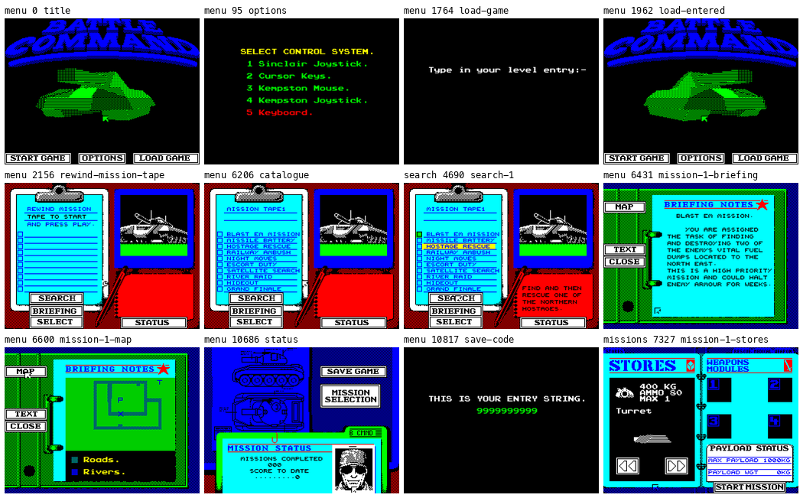
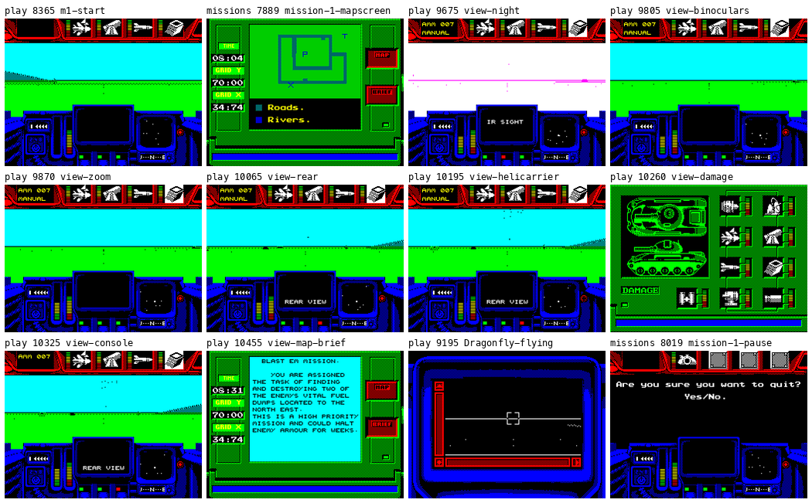
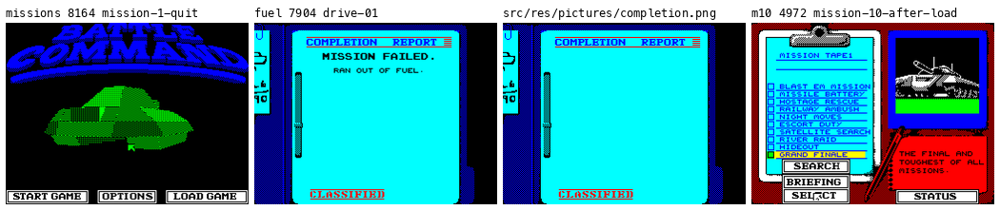
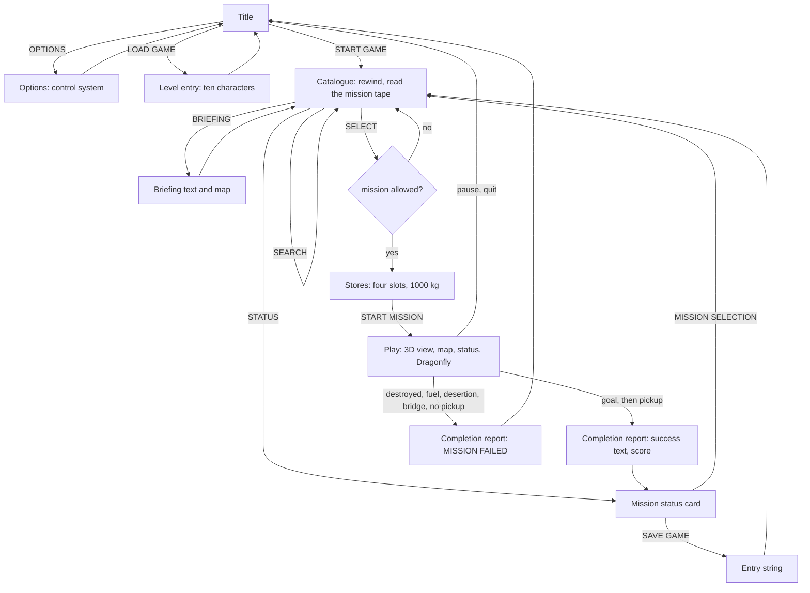
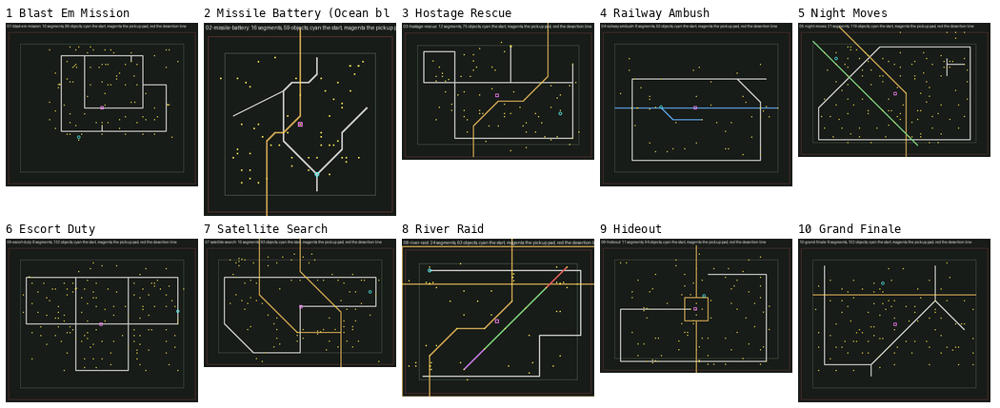
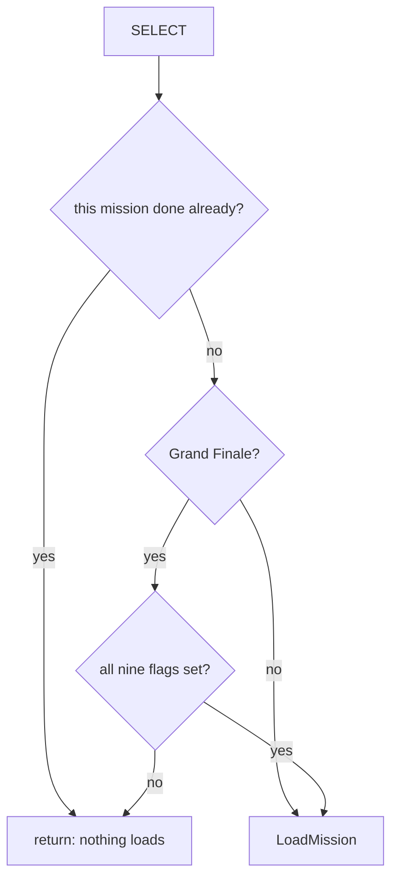
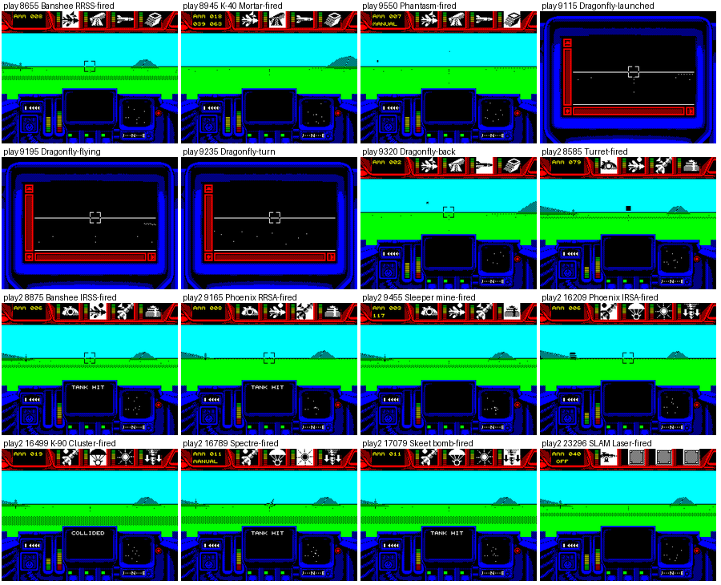
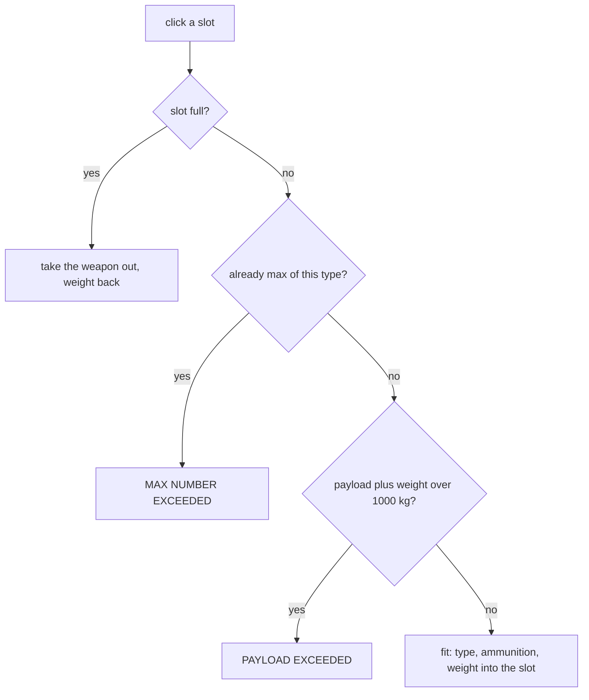
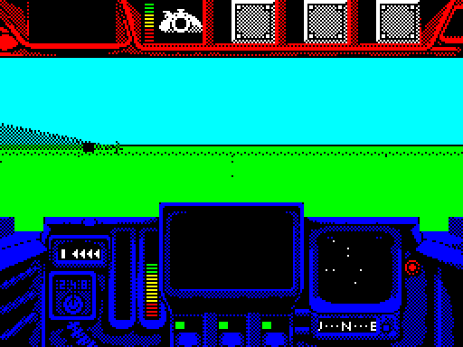
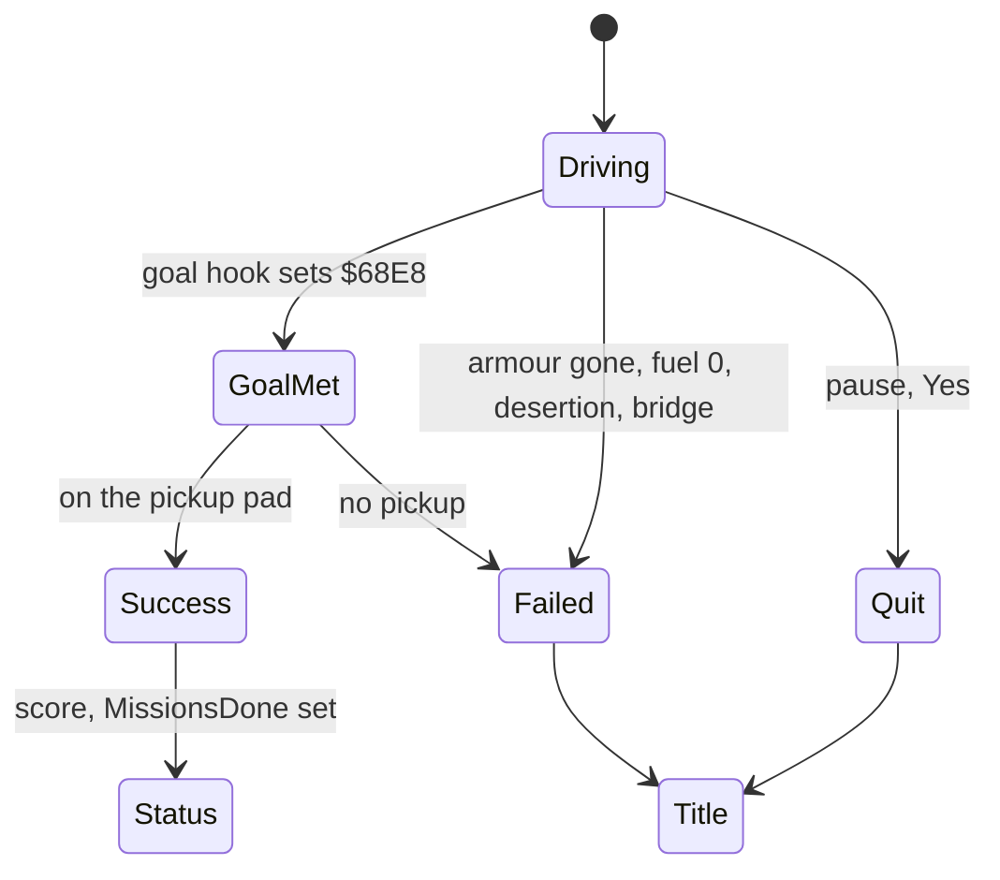

# 1. Game design

What this covers: the game as a player meets it. The premise; every screen from the title to the end of a mission and
how they connect; the ten missions and their goals; the stores, the weapons and the payload limit; play and its views,
the Dragonfly; how a mission ends, in success or in one of five failures; the entry string that carries progress; the
Grand Finale and what unlocks it; the worlds of the ten missions side by side.

The recordings it rests on ([WALKTHROUGH 6.0](../WALKTHROUGH.md#60-the-recordings)). All start from the title after
c1's load of side 1, and the missions come from side 2 wound to their header:

- `menu`: OPTIONS, LOAD GAME, the catalogue, the ten briefings and maps, STATUS, the entry string.
- `missions`, `m2erbe`, `m10`: each mission started, driven, its map screen, paused and quit; mission 10 refused.
- `play`, `play2`: Blast Em Mission with every store fired, the Dragonfly flown, every view. Both use the release's
  No Weight Limit POKE (bank 6 `$C1C6` = `$3A`) and its Immunity POKE ([WALKTHROUGH 6.3](../WALKTHROUGH.md#63-the-state-variables-and-the-pokes)).
- `search`: SEARCH on the mission tape.
- `stage2/rec/fuel`: the fuel failure (a POKE: Fuel `$7C57` = 32 at frame 7704).

The figures are sheets of the screens `tools/record.py` saved at the named frames of each recording, drawn by
`python3 tools/fig_screens.py OUT COLS ITEM...`; each tile is labelled with its recording and frame.

## 1.1 The premise

Battle Command (Ocean, 1990) is a 3D tank game for the 128K Spectrum. Two powers, North and South, are at war (the
catalogue's texts speak of "northern" hostages, convoys and air strikes against the "south"). The player commands a
single Northern tank, set down in enemy territory and picked up again by a Helicarrier when the job is done. Each of
the ten missions is a separate world loaded from the mission tape, with one or two objectives: fuel dumps, a missile
battery, a hostage, a train, an airfield, a convoy, a satellite, river boats, a hideout, the barracks. The player
picks up to four stores from thirteen weapons, drives in filled 3D, fights the enemy's vehicles and emplacements
(doc 10), completes the objective and drives to the pickup pad.

The game's sense of time is a mission clock that starts at 08:00 (the header's `time $0800`) and runs 50 game seconds
for every real second ([doc 4.3](04-game-loop.md#what-a-lost-interrupt-costs-the-player)).

The point: it is a strategy game in the shape of a driving game. The briefing, the choice of stores and the route on
the map decide a mission before the first shot.

## 1.2 The screens and how they connect



*`python3 tools/fig_screens.py docs/img/design/screens-menu.png 4 ...` from menu frames 0, 95, 1764, 1962, 2156,
6206, 6431, 6600, 10686, 10817, search frame 4690 and missions frame 7327.*

| Screen | What the player sees | What it does |
| --- | --- | --- |
| Title | the logo, a tank turning in a 3D window, START GAME, OPTIONS, LOAD GAME | the first screen after the load (c1 frame 24508) |
| Options | "SELECT CONTROL SYSTEM.": Sinclair joystick, cursor keys, Kempston mouse, Kempston joystick, keyboard | the chosen line turns red; doc 5 |
| Load game | "Type in your level entry:-" | ten characters that restore the missions done and the score (1.7) |
| Rewind mission tape | the clipboard: "REWIND MISSION TAPE TO START AND PRESS PLAY" | the game reads the catalogue from side 2 |
| Catalogue | MISSION TAPE1, ten names in boxes, SEARCH, SELECT, BRIEFING, STATUS; the goal's short text beside | the hub of the game |
| Search | the found mission's box marked as its header passes | stops at the next mission header on the tape ([doc 3.9](03-build-and-load.md#39-side-2-the-catalogue-and-the-mission-blocks)) |
| Briefing | BRIEFING NOTES: the mission's text, and its MAP with roads, rivers and marks | from the catalogue in bank 4 |
| Status | MISSION STATUS card: missions completed, score to date; SAVE GAME, MISSION SELECTION | |
| Entry string | "THIS IS YOUR ENTRY STRING." and ten characters | SAVE GAME: the password of the progress |
| Stores | one of 13 weapons with its weight, ammunition and limit, its model turning; four slots; the payload | START MISSION goes to play |



*`python3 tools/fig_screens.py docs/img/design/screens-play.png 4 ...` from play frames 8365, 9675, 9805, 9870,
10065, 10195, 10260, 10325, 10455, 9195 and missions frames 7889, 8019.*



*`python3 tools/fig_screens.py docs/img/design/screens-end.png 4 ...` from missions frame 8164 (after quit: the
title), fuel frame 7904 (MISSION FAILED, RAN OUT OF FUEL), the picture `src/res/pictures/completion.png` (the
COMPLETION REPORT background, no recording completes a mission) and m10 frame 4972 (Grand Finale found but not
loaded).*

Every screen is a node of one graph, ScreenList `$74E6`; a screen leaves through SetScreen `$7060` with the number of
one of its links ([doc 4.1](04-game-loop.md#41-the-states-of-the-program)). The player's path through them:



The failed path and the quit go back to the title: the fuel recording shows the failed screen at frame 7904 and the
title at 11 704, and the missions recording the title at 8164 after quitting at 8019. Doc 4.1 follows the graph node
by node.

The point: the catalogue is the centre. Everything a player does between missions (reading, searching the tape,
saving) is one step away from it.

## 1.3 The ten missions

The mission names, the briefings and the success texts are in the catalogue, `src/res/missions/catalogue.txt`
(loaded from side 2 to bank 4 `$CB64`; the game writes `:` for a space). The figures of each world are the header
fields of its block (`src/res/missions/NN-NAME.txt`, the table of `src/res/missions/README.md`).

| # | Mission | Goal (from the catalogue's texts) | Size | Objects | Bytes |
| --- | --- | --- | --- | --- | --- |
| 1 | Blast Em Mission | destroy the two fuel dumps to cut southern supplies | 28 x 22 | 89 | 8058 |
| 2 | Missile Battery | find the enemy missile base and destroy it; first knock out a radar to the west | 18 x 17 | 59 | 6406 (Erbe) |
| 3 | Hostage Rescue | find and rescue one of the northern hostages, a kidnapped scientist | 26 x 16 | 75 | 6769 |
| 4 | Railway Ambush | divert an enemy supply train down a siding, then destroy the station | 28 x 22 | 50 | 6418 |
| 5 | Night Moves | attack an enemy airfield under cover of darkness: the aircraft and the control tower | 28 x 17 | 119 | 7534 |
| 6 | Escort Duty | travel with the northern convoy; at least one vehicle must reach the barracks | 28 x 22 | 132 | 7716 |
| 7 | Satellite Search | find and recover a lost satellite from enemy territory | 28 x 16 | 93 | 7748 |
| 8 | River Raid | destroy four supply vessels and then their power station complex | 23 x 17 | 63 | 6204 |
| 9 | Hideout | locate and demolish the secret hideout of a top enemy commander | 28 x 17 | 94 | 6709 |
| 10 | Grand Finale | the final and toughest of all missions: destroy the enemy's main barracks | 28 x 22 | 102 | 7014 |

The size is the world's half extent in coarse units of 1024 world units, X by Y; four units beyond it is desertion
(doc 7). The objects count every record of the block: vehicles, buildings, trees, hills, the objectives.



*`python3 tools/fig_screens.py docs/img/design/worlds.png 5 src/res/missions/NN-NAME.preview.png=...` over the ten
previews that `tools/res_missions.py` draws from the mission blocks (no recording): roads and rivers by style, the
objects as dots (yellow the active ones), the start in cyan, the pickup pad in magenta, the desertion line in red.
Mission 2 is the Ocean block, whose second half is foreign data ([doc 3.10](03-build-and-load.md#310-oceans-mission-2-block-and-why-the-game-refuses-it)).*

The worlds are small and open: a road or river network of 8 to 24 segments across a field of 50 to 132 objects.
Night Moves is the one mission played at night (its sky is dark blue in the missions sheet,
[missions.png](img/play/missions.png)), which is why its briefing asks for the night sight.

### The Grand Finale

Mission 10 loads only when missions 1 to 9 are all done. SELECT calls LoadMissionIfAllowed `$759A`
(`src/game/hud.asm`):

```text
LoadMissionIfAllowed:             ; C = the mission found on the tape, 0-9
    if MissionsDone[C] != 0: return          ; a mission done cannot be played again
    if C == 9:                                ; Grand Finale
        if MissionsDone[0] AND ... AND MissionsDone[8] == 0: return   ; refused
    LoadMission()                             ; $84C1, doc 3.9
```

```text
$759A LoadMissionIfAllowed:  CALL MissionDone      ; A = MissionsDone[C], NZ when done
                             RET NZ
                             LD A,$09 / CP C
                             JR NZ,$75AF
                             LD A,$FF
                             LD HL,MissionsDone    ; $6799
                             LD B,$09
$75AA                        AND (HL) / INC HL / DJNZ $75AA
                             RET Z                 ; one flag is 0: refused
$75AF                        CALL LoadMission ...
```



Worked example, the m10 recording: the tape is wound to the Grand Finale and SEARCH finds it (frame 4717). With no
mission done, MissionsDone `$6799-$67A1` are nine zeros: `$FF` AND 0 = 0 at the first byte, A stays 0 over the nine,
and `RET Z` refuses. The tile "m10 4972 mission-10-after-load" shows the catalogue with Grand Finale marked and no
stores screen; the recording then waits (frames 5472 to 7972) and nothing loads. The first test also means that a
completed mission is never played again: its flag is set and LoadMissionIfAllowed returns at once.

The Grand Finale's success text closes the game: "CONGRATULATIONS ON PASSING THE TOUGHEST OF ALL TESTS WITH FLYING
COLOURS", then "THANK YOU FOR PLAYING BATTLE COMMAND".

The point: the campaign is a list, not a line. The first nine missions may be played in any order, each once, and
only the full set opens the tenth.

## 1.4 The stores and the payload

Before each mission the stores screen offers thirteen weapons, one at a time with the arrows. A weapon goes into one of
four slots (the records at `$8368`, doc 7). WeaponRecords, bank 6 `$C373`, holds one 11-byte record per weapon: the
type, the ammunition, the most the four slots may hold, the weight, the icon, the text and the model:

| Weapon | Type | Ammunition | Max | Weight |
| --- | --- | --- | --- | --- |
| Turret | 4 | 80 | 1 | 400 kg |
| Banshee RRSS | 2 | 8 | 2 | 300 kg |
| Banshee IRSS | 6 | 6 | 2 | 300 kg |
| Phoenix RRSA | 1 | 8 | 2 | 250 kg |
| Phoenix IRSA | 5 | 6 | 2 | 250 kg |
| K-40 Mortar | 3 | 20 | 2 | 250 kg |
| Sleeper mine | 9 | 5 | 2 | 300 kg (its text says 290 KG) |
| Dragonfly | 7 | 3 | 2 | 500 kg |
| K-90 Cluster | 8 | 20 | 4 | 250 kg |
| Spectre | 13 | 12 | 2 | 100 kg |
| Phantasm | 12 | 8 | 2 | 100 kg |
| Skeet bomb | 11 | 12 | 2 | 200 kg |
| SLAM Laser | 10 | 40 | 1 | 250 kg |



*Stage 1's sheet (`python3 tools/fig_shots.py OUT 4 play:*-* play2:*-*`, 900 px) of play and play2: each store locked
on, fired and after, the Dragonfly launched, flown and back. Doc 10 has what each weapon does.*

FitOrRemoveWeapon, bank 6 `$C173`, fits the shown weapon into a slot, or empties the slot when it is full:

```text
FitOrRemoveWeapon(slot):                  ; bank 6 $C173
    if slot holds a weapon: RemoveWeapon; return
    n = the slots holding the shown type
    if n == record.max: "MAX NUMBER EXCEEDED"; return
    w = PayloadWeight + record.weight     ; the operand at $C11B
    if w >= 1001: "PAYLOAD EXCEEDED"; return
    PayloadWeight = w
    slot = (type, weight, ammunition, ...)
```

```text
$C1B6        LD HL,($C11B)         ; the payload so far (PayloadWeightOp's operand)
$C1B9        ADD HL,BC             ; + the weapon's weight
$C1BA        LD ($C1D5),BC
$C1BE        PUSH HL
$C1BF        LD BC,$03E9           ; 1001
$C1C2        AND A
$C1C3        SBC HL,BC
$C1C5        POP BC
$C1C6        JP NC,PayloadExceeded ; $C23A
$C1C9        LD ($C11B),BC         ; the new payload
```



Worked example, play's stores (frame 8140): Banshee RRSS 300 kg, K-40 Mortar 250 kg, Dragonfly 500 kg and Phantasm
100 kg, PAYLOAD WGT 1150KG. Without the POKE the third store is refused: 300 + 250 = 550, then 550 + 500 = 1050, and
1050 - 1001 leaves no borrow, so `JP NC,PayloadExceeded`. The recording fitted all four because the No Weight Limit
POKE writes `$3A` over the `JP NC` at `$C1C6`, which becomes `LD A,($C23A)` and never jumps. A legal load is, for
example, the Dragonfly, a Banshee RRSS and two Phantasms: 500 + 300 + 100 + 100 = 1000 kg, and 1000 - 1001 borrows.

The point: 1000 kg is the real choice of the game. The Dragonfly alone is half the payload, the Turret 400 kg; the
light Spectre and Phantasm let a player fill all four slots.

## 1.5 Play and its views

Play is the 3D view through the tank's front: the sky, the ground in green, the objects in filled polygons, the radar
and the instruments in the panel below, the four slots' icons and ammunition above. The keys of play (PlayKeys `$6B3B`;
doc 5 has the readers and the joystick and mouse controls):

| Key | Action | Routine |
| --- | --- | --- |
| 1-4 | choose the weapon slot | bank 6 `$C53F` |
| N | night sight on or off | NightKey `$87FC` |
| B | binoculars on or off | ToggleBinoculars `$CEA7` |
| Z | binocular zoom x2, x4, x8 | CycleBinocularZoom `$CEE5` |
| R | rear view | RearViewOff `$BA45`, ToggleRearView |
| M | the map | `$705A` |
| D | launch the Dragonfly | `$6BC2` |
| H | call the Helicarrier to the pad (once) | PlaceHelicarrier `$D52E` |
| E | sound off | SoundOffKey `$843F` |

On the map view, B goes to the status view, C back to the 3D view and D to the Dragonfly (MapKeys `$6B95`).

The views in the play sheet above: the night sight paints the scene in one colour on white ("IR SIGHT"); the
binoculars narrow and zoom the view; the rear view looks back ("REAR VIEW"); the damage board shows the tank's two
outlines and each store's state; the map shows the roads, the rivers, the player's grid position and the mission clock,
with the briefing's text behind its second button.

The Dragonfly is a remote flying drone (500 kg, up to two in the slots, three rounds each). Launched with D, it takes
over the screen with its own frame (play frames 9115-9320: launched, flying, a turn, back) and then returns to the
tank's view. Doc 10 has its flight and doc 6 its view.

The cost of a view is not the same for all ([doc 4.6](04-game-loop.md#46-frames-per-pass-in-every-view)): the normal
view draws a picture every 7.5 frames, the rear view every 12, so looking back makes the game slower.

The point: the panel and the views are the player's information. The radar, the map and the binoculars matter because
the 3D view, at under 7 pictures a second, shows little at a distance.

## 1.6 The end of a mission

A mission ends in one of three ways:

- **Success.** The mission's goal hook, called once a pass (the operand of the `CALL` at `$6A66`; Blast Em Mission
  `$EB60`), sets the goal flag `$68E8`. PickupMessage `$DB77` prints "MISSION COMPLETE PROCEED TO PICKUP". The tank must
  then reach the pickup pad; the COMPLETION REPORT shows the catalogue's success text ("YOU HAVE CUT THE ENEMY'S VITAL
  FUEL SUPPLY ... RECEIVE YOUR SCORE AND PREPARE FOR FURTHER ORDERS") and the mission's flag in MissionsDone is set.
  No recording meets a goal; this path is known from the code (doc 10).
- **Failure.** The COMPLETION REPORT says "MISSION FAILED." and one of five reasons (bank 6 FailedTexts `$CC94`,
  chosen by FailReason `$7BF9`, doc 10):

| Reason | Text | Address |
| --- | --- | --- |
| destroyed | UNIT DESTROYED | `$CCAB` |
| no pickup | FAILED TO MAKE PICKUP | `$CCBE` |
| left the area | PLAYER DESERTION | `$CCD8` |
| fuel | RAN OUT OF FUEL | `$CCED` |
| a bridge | TANK DESTROYED ON BRIDGE | `$CD01` |

- **Quit.** Pause asks "Are you sure you want to quit? Yes/No."; Yes goes back to the title (missions frames 8019,
  8164).



*The fuel recording (stage 2), from the POKE Fuel `$7C57` = 32 at frame 7704 to the title: the tank stops, the
failed screen, the title. Doc 10 has the command.*



The point: success is two steps, the objective and the pickup. A mission can still be lost after its goal, on the way
to the pad.

## 1.7 Progress: the entry string

There is no save to tape. SAVE GAME on the status card shows ten characters, the entry string; LOAD GAME on the title
takes them back. The string packs the completion flags MissionsDone `$6799-$67A2` and the 32-bit score `$CC79`
(bank 6, the password module). EncodePassword `$CE2E` takes 4 bits of the score for each of eight values, with a
mission's flag in bit 4; the last two values hold the flags of missions 9 and 10 and a 5-bit checksum of the score's
bytes. PasswordToChars `$CF1C` maps each 5-bit value through PasswordAlphabet `$CF5F`,
`9876543210ZYXWVUTSRQPONMLKJIHABCDE`.

```text
EncodePassword:                           ; bank 6 $CE2E
    for i in 0..7:
        v[i] = 4 bits of the score OR (MissionsDone[i] AND $10)
    c = Score[0] XOR Score[1] XOR Score[2] XOR Score[3]
    v[8], v[9] = the flags of missions 9 and 10, c spread over both
PasswordToChars: char[i] = PasswordAlphabet[v[i]]
```

Worked example, the menu recording (frame 10817): no mission done and a score of 0. Every value is 0, the checksum of
four zero bytes is 0, and PasswordAlphabet[0] is `9`: the screen shows `9999999999`.

Decoding (DecodePassword `$CE8B`) runs the same way back and takes the flags and the score only when the checksum
agrees, so a mistyped string is refused. Doc 8 has the entry screen.

The point: ten characters carry the whole campaign, because the campaign is only ten flags and a score.

## 1.8 Known only from the code

- The success path: the goal flag, PickupMessage, the success text, the score and the MissionsDone flag. No recording
  completes a mission.
- The failures other than fuel: destroyed, no pickup, desertion, bridge (doc 10 records a death).
- An entry string with progress, and the Grand Finale played.
- The refusal of a mission already done (the first test of LoadMissionIfAllowed).

The gaps are in [bcA-NOTES](../work/docs/bcA-NOTES.md).
