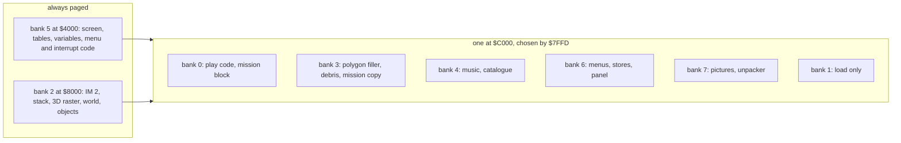
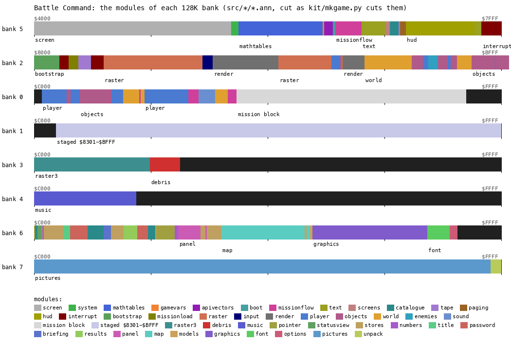
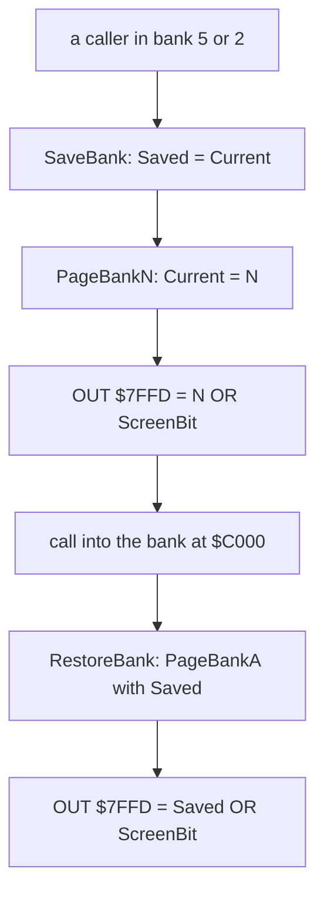
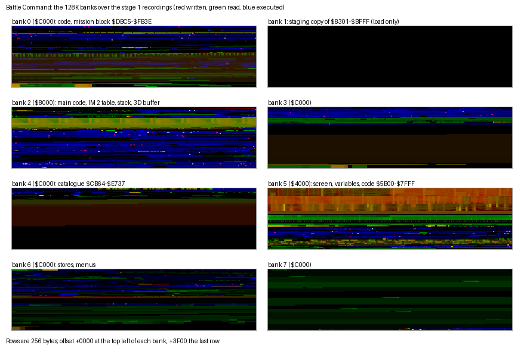
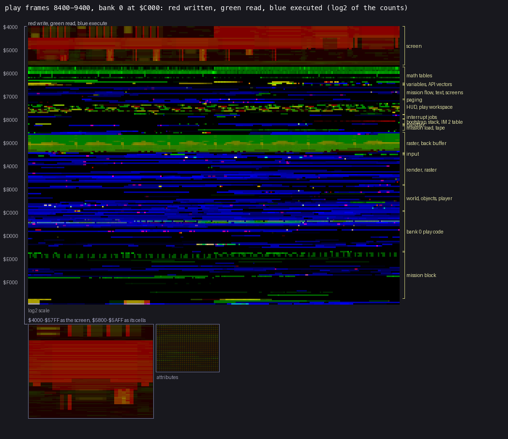
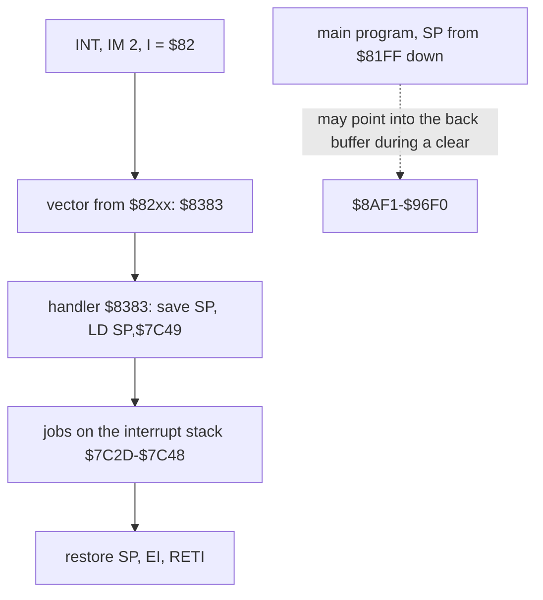
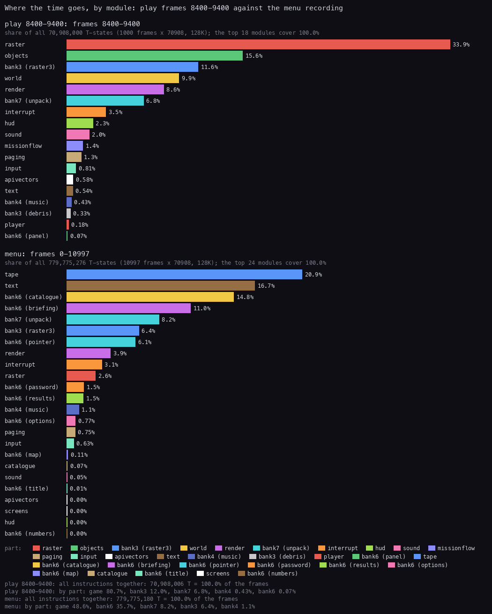
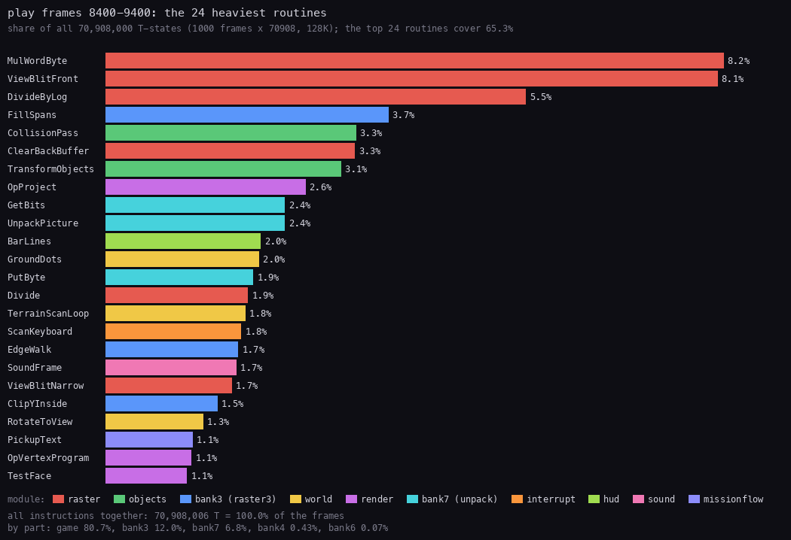
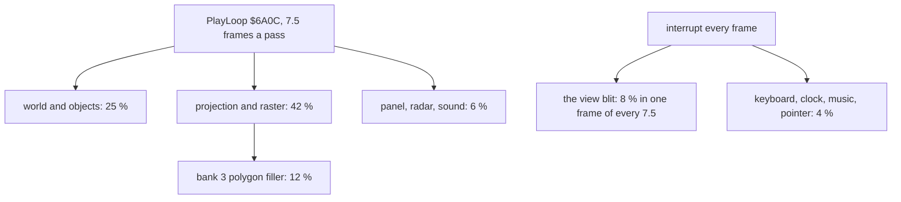

# 2. Architecture

What this covers: the machine and how the game spreads over the eight banks of a 128K; the module map of every bank;
the paging routines and the one bank layout the game keeps; the memory map as stage 2 corrected it; the heatmaps; the
two stacks; the leftovers; where the CPU's time goes, in play and in the menus.

The recordings it rests on ([WALKTHROUGH 6.0](../WALKTHROUGH.md#60-the-recordings)):

- `c1`: power-on, side 1 at signal speed, the game started, the catalogue and mission 1 loaded.
- `play`: from the title, Blast Em Mission with four stores, every view. An L1 build of frames 8400-9400 (normal view,
  three launches, the Dragonfly), made for this document:
  `python3 ../../kit/rs.py build --work work/docs/bcA/play --from-frame 8400 --to-frame 9400 --into work/docs/bcA/play/w8400`.
- `menu`: the menus, the catalogue, the briefings, the status card (stage 1's L1 over the whole recording).
- The L1 builds of stage 1 for the other recordings (`work/stage1/rec/*/l1.json`).

A frame is 70 908 T. The source is `src/game/game.asm` (banks 5, 2 and 0 as the game sees them at the entry, `$5B00-$FFFF`)
and `src/bank3`, `bank4`, `bank6`, `bank7`; the listings are `build/*.lst` (`sh tools/build.sh`).

## 2.1 The machine and the banks

Battle Command runs only on a 128K (+2, +2A, +3): the loader pages banks through `$7FFD`, which a 48K ignores
([WALKTHROUGH 0.4](../WALKTHROUGH.md#04-the-machine-128k-only): on a 48K the load ends in a reset). The game uses
all eight banks. Banks 5 and 2 are always at `$4000` and `$8000`; one of the others is at `$C000`.

| Bank | Slot | Size used | What it holds | Loaded by |
| --- | --- | --- | --- | --- |
| 5 | `$4000` | 16 K | the screen, the 3D engine's tables, the game's variables, the menus' and the interrupt's code | tape block 23, `$5B00-$7FFF` |
| 2 | `$8000` | 16 K | the IM 2 table and handler, the stack, the 3D raster and its back buffer, the world and the objects | block 27 into bank 1, copied by the bootstrap |
| 0 | `$C000` | 16 K | the play code (objects, player, world, sound), then the mission block from side 2 at `$DBC5-$FB3E` | block 25; side 2 |
| 1 | `$C000` | 15 K | the staging copy of bank 2's `$8301-$BFFF`; never used after the load | block 27 |
| 3 | `$C000` | 5 K code, 11 K work | the polygon filler (raster3), the debris; a copy of the loaded mission block | block 29; the mission load |
| 4 | `$C000` | 3.5 K code, 7 K data | the music; the mission catalogue from side 2 at `$CB64-$E737` | block 31; side 2 |
| 6 | `$C000` | 14.5 K | every menu screen, the stores, the briefings, the maps, the panel jobs of play, the fonts | block 33 |
| 7 | `$C000` | 16 K | ten packed screens and their unpacker | block 35 |



The two fixed banks hold everything the paged banks call: the paging routines, the tables of the 3D engine, the
handler, the variables shared by every screen. A paged bank never calls another paged bank directly. It returns
first, or calls a routine in bank 5 or 2 that pages, works and pages back.

The point: the game is a 128K program throughout, not a 48K game with extras. The 3D engine alone fills bank 2, and
the menus a bank of their own.

## 2.2 The module map

The source cuts each bank into modules (the `@module` lines of each `.ann`, cut by `kit/mkgame.py`). The game part
has 23 module names; several come back more than once, because the original layout interleaves them.



*Drawn by `python3 tools/fig_modules.py docs/img/arch/modules.png` from `src/*/*.ann` and the binaries of `build/`
(no recording: the source). One strip a bank, 16 K wide. Bank 0's mission block is the one loaded in c1 and play
(Blast Em Mission, 8058 bytes); dark is not covered by any part of the source.*

| Bank | Modules (ranges) |
| --- | --- |
| 5 | screen `$4000-$5AFF`; system `$5B00-$5BFF`; mathtables `$5C00-$6797`; gamevars `$6798-$67BD`; apivectors `$67BE-$68F3`; boot `$68F4-$694A`; missionflow `$694B-$6CE3`; text `$6CE4-$703F`; screens `$7040-$70C5`; catalogue `$70C6-$71F0`; tape `$71F1-$7224`; paging `$7225-$72F3`; hud `$72F4-$7C58` (the object table and the play workspace inside); text `$7C59-$7D50`; interrupt `$7D51-$7FFF` |
| 2 | bootstrap `$8000-$8382` (the stack and the IM 2 table inside); interrupt `$8383-$84C0`; missionload `$84C1-$8616`; tape `$8617-$87D5`; interrupt `$87D6-$898A`; raster `$898B-$9714` (the back buffer `$8AF1-$96F0` inside); input `$9715-$9881`; render `$9882-$A183`; raster `$A184-$A8C6`; player, objects, raster, render `$A8C7-$AD44`; world `$AD45-$B3C8`; then objects, player, enemies and world interleaved up to `$BFFF` |
| 0 | objects (MoveObject from `$BFD1` runs on into bank 0) and player interleaved `$C000-$CC3B`; world `$CC3C-$CE67`; missionflow `$CE68-$CEA3`; world `$CEA4-$CF25`; player `$CF26-$D52D`; missionflow `$D52E-$D691`; sound `$D692-$D8D3`; world `$D8D4-$DA8B`; missionflow `$DA8C-$DBC4`; the mission block `$DBC5-$FB3E` |
| 3 | raster3 `$C000-$CFEB`; debris `$CFEC-$D3FF` |
| 4 | music `$C000-$CDFF` |
| 6 | pointer `$C000`; catalogue, statusview, stores, numbers, title `$C409`, password `$C4FC`, catalogue, briefing `$C98A`, stores, results `$CC54`, password, catalogue, stores, pointer `$D0CA`, numbers, panel `$D3C9`, stores, panel, stores `$D7BB-$D9B1`; map `$D9B2-$E511`; models `$E512-$E623` (two pieces); graphics `$E624-$F5E3`; font `$F5E4-$F8F3`; options `$F8F4-$F9FF` |
| 7 | pictures `$C000-$FE8E`; unpack `$FE8F-$FFFF` |

### Code that runs across a bank boundary

MoveObject `$BFD1` (objects, bank 2) does not end at `$BFFF`. Its instruction `LD A,($BBC8)` sits at `$BFFF-$C001`,
two bytes of its operand in bank 0, and the routine goes on to `RET` at `$C025` (`build/game.lst` lines 17726-17744).
MoveObject therefore works only while bank 0 is paged. In every other bank the bytes at `$C000-$C025` are something
else and the CPU would run into them. The game keeps bank 0 paged during play (2.3), so the routine is safe there.
The listing has to treat banks 2 and 0 as one 32 K image for this reason, and `game.asm` assembles them together.

The point: bank 0 is part of the play program, not a library: the code of bank 2 runs on into it.

## 2.3 The paging

All paging goes through one block in bank 5, `$7225-$72F3` (`src/game/paging.asm`). The current bank is kept in the
operand of SaveBank, `$728A`, and the screen bit in the `OR` operand of PageOut, `$7284`.

```text
$726C PageBank3:   LD A,$03 / JR PageBankA
$7270 PageBank4:   LD A,$04 / JR PageBankA
$7274 PageBank7:   LD A,$07 / JR PageBankA
$7278 PageBank6:   LD A,$06 / JR PageBankA
$727C PageBank0:   XOR A
$727D PageBankA:   LD ($728A),A            ; the current bank, in SaveBank's operand
$7280 PageOut:     LD BC,$7FFD
                   OR $00                  ; $7284: the screen bit, 0 or 8
                   OUT (C),A
                   RET
$7288 SaveBank:    PUSH AF / LD A,$00      ; $728A: the current bank
                   LD ($729D),A            ; into RestoreBank's operand
                   POP AF / RET
$729B RestoreBank: PUSH AF / LD A,$00      ; $729D: the bank SaveBank kept
                   CALL PageBankA / POP AF / RET
```

```text
PageBank(n):                      ; PageBank0/3/4/6/7
    Current = n                   ; $728A
    OUT $7FFD = n OR ScreenBit    ; ScreenBit at $7284: 0 or 8
PageShadowScreen / PageBank0Main: ; $7268 / $7262
    ScreenBit = 8 or 0
    OUT $7FFD = Current OR ScreenBit
SaveBank:    Saved = Current      ; $729D
RestoreBank: PageBank(Saved)
```



The values written to `$7FFD` have bit 4 clear (ROM 0, the 128K editor ROM; the game uses no ROM routine) and bit 5
clear (paging stays unlocked). Bit 3 is the screen bit: PageShadowScreen sets it, PageBank0Main clears it, and every
later `OUT` keeps it, so a change of bank never changes the screen shown. Doc 6 has the two screens.

PageOut never writes BANKM `$5B5C`, the 128K ROM's own copy of `$7FFD`: the game keeps its copy in `$728A`, and the
system area at `$5B00` holds load leftovers (2.7).

Worked example, the stage-1 counts of the L1 builds of the eight recordings: PageBankA runs 870 750 times; PageBank6
206 018, PageBank0 181 126, PageBank3 158 933, PageBank4 76 703, PageBank7 122. Bank 7 is paged only to unpack a
picture. Bank 3 is paged for every polygon (raster3's filler) and every debris step, so it is paged and unpaged
several times in every 3D pass. A play pass that calls Bank3Step `$72A3` writes:

1. SaveBank: `$729D` = 0 (bank 0 was current);
2. PageBank3: `$728A` = 3, `OUT ($7FFD)` = `$03` OR the screen bit;
3. the debris and polygons of bank 3;
4. RestoreBank: PageBankA with 0, `OUT ($7FFD)` = `$00` OR the screen bit.

A switch costs 88 T with its `CALL` (`LD A,n` 7, `JR` 12, `LD (nn),A` 13, `LD BC,nn` 10, `OR n` 7, `OUT (C),A` 12,
`RET` 10, `CALL` 17), small next to a polygon.

The point: one variable and one `OUT` routine page everything. The paging block never needs to read `$7FFD`, which
the hardware cannot do anyway.

## 2.4 The memory map

The tables below are stage 2's: every range is an entry of the source. Stage 1's map (from the L1 classes alone) had
bank 6 and bank 7 only as code and data; they are now named routine by routine.

### Bank 5, `$4000-$7FFF`

| Range | What | Source |
| --- | --- | --- |
| `$4000-$5AFF` | the screen | |
| `$5B00-$5BFF` | LoadLeftover5B00: leftovers of the load in the 128K ROM's system area | system |
| `$5C00-$64FF` | the 3D engine's tables: log2 fractions and integers, antilogs, squares, 16- and 8-bit sines, page-aligned | mathtables |
| `$6500-$667F` | ScreenRowTable: the screen address of each pixel row | mathtables |
| `$6680-$6797` | polygon work: the clipped lists, fill patterns, edge masks, PolyVerts | mathtables |
| `$6798-$67BD` | the game's variables below the entry: MissionsDone `$6799-$67A1` and more | gamevars |
| `$67BE-$68F3` | ApiVectors: 22 `JP`s the mission code calls, and their targets | apivectors |
| `$68F4-$694A` | Entry and ResetCollisionTables | boot |
| `$694B-$6CE3` | StartMission, PlayLoop `$6A0C`, NextView `$6A91`, the play keys | missionflow |
| `$6CE4-$71F0` | the text primitives, SetScreen `$7060`, the catalogue's tape side | text, screens, catalogue |
| `$71F1-$72F3` | LoadBlock and the paging block | tape, paging |
| `$72F4-$7C58` | the panel; ScreenList `$74E6` (doc 4.1); the object table (24 records of 60 bytes at ObjectTable `$75F0`, the player first); PlayWorkspace `$7B90` with FailReason `$7BF9`, the interrupt's stack (top `$7C49`) and Fuel `$7C57` | hud |
| `$7C59-$7D50` | SmallFont and SmallFontLeftover `$7D35` | text |
| `$7D51-$7FFF` | the interrupt's jobs: PointerTick `$7D8D`, ClockTick `$7DFB`, the mouse | interrupt |

### Bank 2, `$8000-$BFFF`

| Range | What | Source |
| --- | --- | --- |
| `$8000-$8043` | the bootstrap, dead after the entry | bootstrap |
| `$8044-$8180` | LoadAttrLeftover: the rest of the loading screen's attributes | bootstrap |
| `$8181-$8183` | ImJump: `JP $8383`, written by the entry | bootstrap |
| `$8184-$81FF` | the main stack, `SP` = `$81FF` at the entry (2.6: deeper in the menus) | bootstrap |
| `$8200-$8300` | Im2Table: 257 bytes of `$83`, `I` = `$82` | bootstrap |
| `$8301-$8382` | the armour `$8301-$8304`, the weapon slots | bootstrap |
| `$8383-$84C0` | the IM 2 handler | interrupt |
| `$84C1-$8616` | LoadMission, LoadMissionHeader, LoadMissionBlock `$855B` | missionload |
| `$8617-$87D5` | LdBytes, LdEdge2, LdEdge1, SaBytes (unused) | tape |
| `$87D6-$898A` | MenuJobs, ScanKeyboard `$8910`, KeyCode `$8979` | interrupt |
| `$898B-$9714` | the view blits, the back buffer `$8AF1-$96F0` (3072 bytes), ClearBackBuffer `$96F1` | raster |
| `$9715-$9881` | the controls | input |
| `$9882-$AD44` | StartViewPass `$9882`, RunScript `$990F`, the projection, clipping, the line and span rasteriser | render, raster |
| `$AD45-$BFFF` | the world, the objects, the player, the enemies | world, objects, player, enemies |

### Bank 0, `$C000-$FFFF`

| Range | What | Source |
| --- | --- | --- |
| `$C000-$C025` | the end of MoveObject (from bank 2) | objects |
| `$C026-$DBC4` | RunObjectHandlers, DrawRadar `$C05E`, CollisionPass `$C7BC`, DrawSightOverlay `$C4CD`, LaunchMissile `$C3DE`, the player, the sound driver `$D692`, PickupMessage `$DB77` | objects, player, world, sound, missionflow |
| `$DBC5-$FB3E` | the mission block (Blast Em Mission: 8058 bytes; header, models, world, objects, mission code) | side 2, doc 7 |
| `$FB3F-$FFFF` | work rows (`$FC00`, `$FD00`, `$FE00`, `$FF00` written in play) | |

### Banks 3, 4, 6, 7

| Bank | Range | What |
| --- | --- | --- |
| 3 | `$C000-$CFEB` | raster3: FillSpans, EdgeWalk, ClipYInside (the polygon filler) |
| 3 | `$CFEC-$D3FF` | debris: DrawDebris, MoveAllDebris; PushLeftover `$D203` |
| 3 | `$DCBC-$FB3E` | the copy of the mission block, for a retry without the tape (c1: these bytes change when mission 1 loads) |
| 4 | `$C000-$CDFF` | the music: the player and tune data |
| 4 | `$CB64-$E737` | the catalogue from side 2: titles, briefings, maps (7124 bytes) |
| 6 | `$C000-$D9B1` | the menus: title `$C409`, password, catalogue, briefing, stores, results, panel jobs |
| 6 | `$D9B2-$F5E3` | the maps, the map models, the graphics |
| 6 | `$F5E4-$F9FF` | the font, the options screen |
| 7 | `$C000-$FE8E` | ten packed screens (src/res/pictures) |
| 7 | `$FE8F-$FFFF` | UnpackPicture `$FE95` |

The catalogue in bank 4 (`$CB64-$E737`) begins inside the 3.5 K that tape block 31 loads (`$C000-$CDFF`). The last
668 bytes of that block, CatalogueSpace `$CB64-$CDFF`, are filler (`$E5` bytes and zeros) that the catalogue load
overwrites.

The point: the fixed banks hold the engine and the shared state; the paged banks are libraries of screens, music and
pictures. Only bank 0 behaves as part of the main program.

## 2.5 The heatmaps



*Drawn by `tools/fig_heatmap128.py docs/img/arch/heatmap-banks.png work/stage1/rec/{menu,play,play2,death,m2erbe,m2ocean,search,m10}/l1.json`
(stage 1): red written, green read, blue executed, per physical page, all recordings after the load summed.*



*`python3 ../../kit/heatmap.py work/docs/bcA/play/w8400/l1.json OUT --from 4000 --to FFFF --cell 3 --regions
work/docs/bcA/regions.txt`, the composite panel (red written, green read, blue executed, log2 of the counts) of the
play window 8400-9400 with bank 0 at `$C000`; the screen inset below.*

What they show:

- Bank 2's band `$8AF1-$96F0` is the brightest written and read range after the screen: the back buffer, cleared,
  drawn and copied once a pass.
- `$5C00-$64FF` is read only: the log, square and sine tables of the 3D engine.
- In play, bank 0's code is blue up to `$DBC4`, and the mission block above it is mostly green: data read by the
  world and the objects, with a few blue rows of mission code.
- Banks 4 and 7 are read in short bursts (the music every interrupt, a picture on a view change); bank 1 stays black.

The point: the hot memory of play is small. The back buffer, the tables and the object table take the reads and
writes; the code of banks 2 and 0 takes the execution.

## 2.6 The stacks

The game uses two stacks.

- **The main stack** grows down from `SP` = `$81FF`, set by Entry. The source names `$8184-$81FF` as its area.
- **The interrupt's stack**: the handler saves the interrupted `SP` and sets `LD SP,$7C49` at `$8389`
  ([doc 4.2](04-game-loop.md#42-the-interrupt)), so its pushes never land on the main stack. That is required: the
  main program moves `SP` into the back buffer for its `PUSH` clears (ClearBackBuffer `$96F1`, doc 4.3), and an
  interrupt then would push its return address into the picture.

The depth of each, from the L1 builds (the bytes both pushed and popped, `byte_use` flags 2 and 3):

| Build | Main stack, lowest byte | Bytes | Interrupt stack | Bytes |
| --- | --- | --- | --- | --- |
| play 8400-9400 | `$81BB` | 68 | `$7C2D-$7C48` | 28 |
| play, whole recording | `$816B` | 148 | `$7C2D-$7C48` | 28 |
| c1 (load, title, catalogue, mission 1) | `$8199` | 102 | `$7C2D-$7C48` | 28 |
| menu | `$8149` | 182 | `$7C2D-$7C48` | 28 |

The interrupt's 28 bytes are the same in every recording: the handler's depth does not depend on the screen. The main
stack goes deeper than the area the source names. In the menu recording it reaches `$8149`, 55 bytes below `$8184`,
across ImJump `$8181-$8183` and into LoadAttrLeftover. Losing ImJump is harmless to lose: with `I` = `$82` and the table full
of `$83`, every interrupt vector is `$8383`, whatever the bus holds, and nothing ever jumps to `$8181`. The bytes
below are unused attributes of the loading screen. The menus therefore have 443 bytes of stack between `$8044` and
`$81FF` before they would reach the bootstrap.



The point: the interrupt has its own 28 bytes so that the main program can use `SP` as a fast pointer; the main stack
has no guard and simply has room.

## 2.7 The leftovers

Code and data that no recording runs or reads, and that no path of the code reaches, from the source's entries:

| Address | Name | What it is |
| --- | --- | --- |
| `$5B00` | LoadLeftover5B00 | bytes of the load in the ROM's system area |
| `$7D35` | SmallFontLeftover | 28 bytes after the small font |
| `$8044-$8180` | LoadAttrLeftover | the loading screen's attributes beyond the copy |
| `$83F1` | ClearMarkColumn | a `RET`, and behind it a clear of three bytes in 33 for 48 lines of the back buffer |
| `$86C1` | SaBytes | the game's copy of the ROM's SA-BYTES: a save, never called |
| `$8739` | SaveLeftover | bytes after SaBytes |
| `$9893` | ClearBackBufferOld | an older buffer clear with a test pattern of `$AA`/`$55` rows |
| bank 3 `$D203` | PushLeftover | 509 bytes of `$E5` (`PUSH HL`) |
| bank 6 `$C88E` | ShowWrongDisk | "INCORRECT DISK": a disk version's message |
| bank 6 `$CA27` | CopyMissionTextOld | an older copy of the mission texts |
| bank 6 `$CC54` | PrintFinalScore | the score as ten digits, never called |
| bank 6 `$C618` | PasswordLeftover | "...DAMAG", never read |
| loader `$BE70` | FinalLeftover | an earlier TimeEnd and bootstrap, in tape block 37 |

SaBytes, ShowWrongDisk and PrintFinalScore look like the remains of other versions: one that saved to tape, one on
disk, one that printed a final score. The run of `PUSH HL` in bank 3 and ClearBackBufferOld look like earlier forms of
the `PUSH` clear.

Many routines of bank 0 are marked "no recording runs it" (LaunchMissile `$C3DE`, PushBack `$CBC6`, the mine and
Phantasm code): those are live code that the recordings did not reach, not leftovers, and doc 10 covers them.

The point: the shipped game carries code for features it does not have (a save, a disk check, a final score), so the
tape was built from a source shared with other versions.

## 2.8 Where the time goes

A frame is 70 908 T; the game never halts, so every T-state runs code. In play the 3D pass takes 7.53 frames in the
normal view and 11.95 behind ([doc 4.6](04-game-loop.md#46-frames-per-pass-in-every-view)). The interrupt takes
4614 T in a quiet frame and about 61 000 T in the frame that copies the view to the screen (doc 4.2).



*`python3 ../../kit/fig_budget.py work/docs/bcA/play/w8400/l1.json docs/img/arch/budget-modules.png --ann
src/game/game.ann,page=0/2/5 --ann src/bank3/bank3.ann,page=3 --ann src/bank4/bank4.ann,page=4 --ann
src/bank6/bank6.ann,page=6 --ann src/bank7/bank7.ann,page=7 --by module --label "play 8400-9400" --state
"menu=work/stage1/rec/menu/l1.json"`. Shares of all the T-states of each window: 1000 frames of play, 10 997 of the menu
recording.*



*The same command with `--top 24` and no `--by module`.*

| Play 8400-9400 | Share | What |
| --- | --- | --- |
| raster | 33.9 % | MulWordByte 8.2 %, ViewBlitFront 8.1 % (the blit, in the interrupt), DivideByLog 5.5 %, ClearBackBuffer 3.3 % |
| objects | 15.6 % | CollisionPass 3.3 %, TransformObjects 3.1 % |
| bank 3, raster3 | 11.6 % | FillSpans 3.7 %, EdgeWalk 1.8 %, ClipYInside 1.5 % |
| world | 9.9 % | GroundDots 2.0 %, TerrainScanLoop 1.8 %, RotateToView 1.3 % |
| render | 8.6 % | OpProject 2.6 %, OpVertexProgram 1.1 %, TestFace 1.1 % |
| bank 7, unpack | 6.8 % | two pictures, at frames 9051 and 9274: the Dragonfly's panel and back |
| interrupt | 3.5 % | ScanKeyboard 1.8 % |
| hud, sound, missionflow, paging, input, the rest | 10.1 % | BarLines 2.0 %, SoundFrame 1.7 % |

By part: the game (banks 5, 2, 0) 80.7 %, bank 3 12.0 %, bank 7 6.8 %, bank 4 0.4 %, bank 6 0.1 %. The menu recording
is another program: the tape (LdEdge1 waiting on the catalogue load) 20.9 %, the text and the pointer zones 16.7 %,
bank 6's catalogue and briefing screens 25.8 %, bank 7's unpacker 8.2 %.



Worked example, from the routines of the L1 window (entries and inclusive T-states):

1. StartViewPass `$9882` is entered 128 times in the 1000 frames: 7.8 frames a pass, a little slower than the 7.53 of
   the quiet normal view (doc 4.4), because the window holds three launches and the Dragonfly.
2. ClearBackBuffer `$96F1`: 128 entries, 2 331 520 T, 18 215 T each, the 18 201 T of doc 4.3 plus the call.
3. ViewBlitFront `$8999`: 104 entries, 5 725 368 T, 55 052 T each; the other passes are the Dragonfly's, blitted by
   ViewBlitNarrow.
4. Per pass of 7.8 frames (553 000 T): the clear is 3.3 %, the blit 10 %.

The multiply MulWordByte alone (8.15 %) costs as much as the screen copy: the 3D engine multiplies through tables and
shifts, and its multiplications are the largest single cost of a frame.

The point: two thirds of play is the 3D pipeline (projection, raster, filler, blit), a quarter is the simulation of the
world. The menus spend their time waiting on the tape and drawing text.

## 2.9 Known only from the code

- MoveObject's run across `$BFFF` into bank 0 is read from the listing; no recording pages another bank while it runs.
- SaBytes, ShowWrongDisk, PrintFinalScore and the other leftovers of 2.7: never run.
- That the music never reads `$CB64-$CDFF` comes from the L1 builds; that the bytes are a build leftover is inferred.

The commands are in [bcA-NOTES](../work/docs/bcA-NOTES.md); the source changes asked for in
[bcA-src-changes](../work/docs/bcA-src-changes.md).
