# 3. Build and load

What this covers: both tape sides as pictures; the SpeedLock 7 protection stage by stage: the BASIC that hides its
own address, the decryption chain of 103 layers keyed by the R register, the turbo loader and its cipher, the table
that sends each block to its bank, the bootstrap; the mission tape, its catalogue and its mission blocks; Ocean's
short mission 2 block and why the game never takes it; the Erbe re-release without the protection; the build that
re-protects the source into a tape identical to the original.

The recordings it rests on ([WALKTHROUGH 6.0](../WALKTHROUGH.md#60-the-recordings)):

- `c1`: power-on of a 128K, side 1 played at signal speed through the 128K menu's Tape Loader at frame 208, the game
  started, then side 2 read by the game: the catalogue and mission 1. The animations of this document are memanim
  runs over c1 on a replay of its own (port base 37350).
- `search`, `m2ocean`, `m2erbe`: SEARCH on side 2; the Ocean and the Erbe mission 2 block.
- SkoolKit's simulator runs of `tools/speedlock.py` and `work/stage2/chain_trace.py` (the chain), and the store trace
  `work/stage2/stores.txt` (every byte the loader stores), from [stage 2's notes](../work/stage2/NOTES.md).

A position is written `frame:T`. The tape times are the TZX's own (3.5 MHz T-states and the pauses); c1 runs on a
128K at 3.5469 MHz, so its frames run about 1.8 % ahead of the tape times converted at 50 frames a second (the tape
ends at 24 412 by its timings, the game starts at c1 frame 23 974). The frames below are c1's, measured.

## 3.1 The tape block by block

The release is ZXDB download 3059, two TZX files ([WALKTHROUGH 0.1](../WALKTHROUGH.md#01-the-files)). Side 1 holds
the program: 45 TZX blocks, 484.1 s with the pauses. Side 2 holds the mission tape: 43 blocks, 620.3 s, all at ROM
speed. `python3 tools/tzxblocks.py list work/stage1/media/side1.tzx` lists every block with its timings, flag and
checksum.

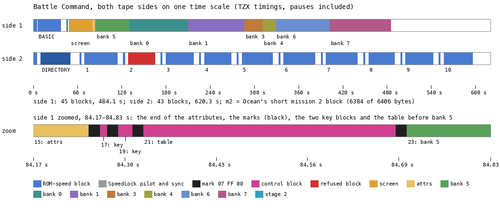

*Drawn by `python3 tools/fig_tape.py docs/img/load/tape-sides.png` from the two TZX files of the release (no
recording: the TZX timings). Top: side 1, blue the ROM-speed BASIC, then the SpeedLock blocks in the colour of the
bank they fill. Middle: side 2, the catalogue and the ten missions, red the short mission 2 block. Bottom: side 1
zoomed into 0.66 s between the attributes and bank 5, where four marks and three control blocks sit.*

The side 1 blocks, with the bank each fills (`python3 tools/mktape.py src/tape/side1.txt --decode build/orig/side1.tzx
DIR` decodes every block with the loader's own keys; stage 2 compared each one with the game image):

| TZX blocks | Kind | Bytes | Tape time | Where it goes |
| --- | --- | --- | --- | --- |
| 1, 2 | ROM header "BATTLE" (Program, `LINE 0`), ROM data | 4917 | 0-36.9 s | the BASIC area from PROG `$5CCB`, by the ROM's LD-BYTES |
| 3-8 | group "Speedlock 7 Block 1": tone 1579 x 2165 T, 16 sync pulses, the 6-bit `$E8`, data | 196 | 44.6-46.5 s | the loader's second stage `$BF0D-$BFCF` and a check byte (3.5) |
| 9-13 | group "Speedlock 7 Block 2": tone 1578 x 2165 T, sync, `$E8`, the bitmap | 6144 | 48.9-80.1 s | the screen `$4000-$57FF` |
| 14, 15 | mark `07 FF 00`, data | 768 | 80.1-84.2 s | AttrBuffer `$8000`, copied to `$5800` by the reveal task (3.4) |
| 16, 17 | mark, data | 2 | 84.2 s | `$BD9C`: `3E 86`, the new key of StoreByte (3.5) |
| 18, 19 | mark, data | 4 | 84.3 s | `$BDD0`: `3E 86 AD C6`, the new key of StoreLast |
| 20, 21 | mark, data | 75 | 84.3-84.7 s | `$BF30`: a new BlockTable over the old one (3.6) |
| 22, 23 | mark, data | 9472 | 84.7-129.9 s | bank 5 `$5B00-$7FFF`, still XORed with `$AD` |
| 24, 25 | mark, data | 16 384 | 129.9-210.1 s | bank 0 `$C000-$FFFF` |
| 26, 27 | mark, data | 15 615 | 210.1-286.6 s | bank 1 `$C301-$FFFF`: the game's `$8301-$BFFF`, staged |
| 28, 29 | mark, data | 5120 | 286.6-311.7 s | bank 3 `$C000-$D3FF` |
| 30, 31 | mark, data | 3584 | 311.7-329.2 s | bank 4 `$C000-$CDFF` |
| 32, 33 | mark, data | 14 848 | 329.2-402.4 s | bank 6 `$C000-$F9FF` |
| 34, 35 | mark, data | 16 384 | 402.4-483.0 s | bank 7 `$C000-$FFFF` |
| 36, 37 | mark, data | 115 | 483.0-483.6 s | `$BE5D`: Unxor5B00 over TimeCheck (3.7) |
| 38, 39 | mark, data | 15 | 483.7 s | `$BF21`: TimeEnd over the stage's own end |
| 40, 41 | mark, data | 54 | 484.0 s | `$8000`: the bootstrap |
| 42, 43 | mark, data | 15 | 484.1 s | `$8036-$8043` and the check byte |

### The static decode against the recording

`mktape.py --decode` reads each `sl` block with the keys of `chain.bin` alone, with no emulator. Each decoded block
was compared byte for byte with the memory of the recording c1 (TTD `memory_at` at the start of the frame named,
`$C000` blocks against the bank dumps `work/stage1/img/entry-bankN.bin` of frame 23974, the game's entry):

| Block | Decoded | c1 frame | Equal | Notes |
| --- | --- | --- | --- | --- |
| 7 | 195 bytes `$BF0D` | 2484 | yes | from 6000 on, the 49 bytes block 21 loads over `$BF30` differ |
| 13 | 6144 bytes `$4000` | 6000 | all but 28 | the 28 are the countdown's digits (`$40ED-$46F2`), drawn over the bitmap; 26 at 23974 |
| 15 | 768 bytes `$8000` | 6000 | yes | also equal to `$5800-$5AFF` at 23974, after the reveal |
| 17, 19 | 2 bytes `$BD9C`, 4 bytes `$BDD0` | 6000 | yes | |
| 21 | 75 bytes `$BF30` | 6000 | yes | |
| 23 | 9472 bytes `$5B00` | 12 000 | yes | equal to the image XOR `$AD` at 23974, once Unxor5B00 has run (half done at 23966) |
| 25 | 16 384 bytes, bank 0 | 23 974 | yes | |
| 27 | 15 615 bytes, bank 1 `$C301` | 23 974 | yes | also equal to bank 2 `$8301-$BFFF` (the bootstrap's copy) |
| 29, 31, 33, 35 | banks 3, 4, 6, 7 | 23 974 | yes | bank 7 is 42 bytes short at 23900: still loading |
| 37, 39 | 115 bytes `$BE5D`, 15 bytes `$BF21` | 23 966 | yes | |
| 41, 43 | 54 bytes `$8000`, 14 bytes `$8036` | 23 966 | yes | |

So the decode of 3.5 is the loader's: every byte the loader stores, the static decode gives.

The side 2 blocks are in 3.9.

Why a picture: side 1 is one stream. After the two short groups at the start nothing on it has a pilot tone. The
blocks follow each other with no gap, separated only by 21-bit marks, so a copier that waits for a pilot or a pause
sees one block of 400 seconds.

The point: the program is eight minutes of tape, and seven of them are a single SpeedLock stream that only its own
loader can cut into blocks.

## 3.2 The BASIC: a line that lies about its number

The ROM's Tape Loader loads "BATTLE", 4917 bytes, and runs line 0. LIST shows one line:

```text
0 RANDOMIZE USR ((PEEK 23635+256*PEEK 23636)+10)
```

PEEK 23635 + 256 x PEEK 23636 is PROG (`$5C53`), the start of the program, `$5CCB` here. The number after the plus
is printed as "10", but every Spectrum number in a line carries a hidden five-byte form after the marker `$0E`, and
that is what the ROM computes with. Here it says 59 (`$3B`): the bytes `31 30 0E 00 00 3B 00 00` are "10" then the
integer 59 (`src/tape/basic-module.asm`, BasicLine0). USR therefore enters PROG + 59 = `$5D06`, Stage1, right after
the line's ENTER. A reader who types the line in again gets USR PROG + 10 and a crash.

Stage1, from the listing `build/basic.lst`:

```text
$5D06 Stage1:  DI
               LD HL,$4000 / LD DE,$4001 / LD BC,$1AFF / LD (HL),L / LDIR   ; clear the screen and attributes
               XOR A / OUT ($FE),A                                          ; black border
               LD HL,($5C53) / LD DE,$005F / ADD HL,DE                       ; PROG + 95: the chain on the tape
               LD DE,$AC38 / LD BC,$12D5                                    ; 4821 bytes to $AC38-$BF0C
               LD SP,$8000 / PUSH DE                                        ; $AC38 as the return address
               LDIR / RET                                                   ; RET enters the chain
```

Stage1 reads PROG from the system variable rather than using `$5CCB`, so the copy works wherever the ROM puts the
program (an interface that moves PROG does not break it). It enters the chain with RET, not JP: no address of the
chain appears as an operand in the BASIC.

c1: the BASIC is loaded by frame 1999, Stage1 runs at frame 2028, the chain starts at frame 2033 (stage 1's code
arrivals, `re_session.py stages`).

The point: the first protection is a lie the ROM tells for free: LIST shows a number the computation does not use.

## 3.3 The decryption chain: 103 layers keyed by R

The 4821 bytes at `$AC38-$BF0C` are a chain. Layer000 decrypts everything after itself and runs into what it has just
decrypted, which is Layer001; that decrypts everything after itself, and so on 103 times. The last layer, Layer102 at
`$B8D0`, falls into LoaderStart `$B8F9`. The layers and their transforms are in `src/loader/chain.ann`; the listing
is `build/chain.lst`.

Each layer does two things:

- it shifts the 30 bytes up to its own LDDR down by one byte, which garbles the code that has already run (a dump
  taken during the chain shows no clean earlier layer);
- it rewrites every byte from its own end up to `$BF0C` with one of three transforms, where c is the byte before and
  p the byte after:

| Kind | Layers | Transform | Example |
| --- | --- | --- | --- |
| add | 69 | p = key + c, then a CPL, a subtraction or nothing | Layer000: p = NOT ((R XOR `$F3`) + c) |
| dec | 22 | p = c - 1 | Layer001, Layer005, Layer010 |
| sub | 12 | p = key - c, then an XOR | Layer006: p = ((R XOR IXh) - c) XOR IXl |

The keys come from the R register, from constants in the layer and from the loop counters. They never come from the
bytes being decrypted, so the transform of each byte is fixed by its address and the chain can be run backwards
(3.12).

```text
Layer000:                                   ; $AC38, entered by Stage1's RET
    DI
    R = 12                                  ; LD A,$0C / LD R,A: the key stream's seed
    move the 30 bytes $AC24..$AC41 down by one, to $AC23..$AC40 (LDDR)
    for HL = $AC5C to $BF0C:                ; 4785 bytes
        (HL) = NOT ((R XOR $F3) + (HL))     ; R as LD A,R reads it: 11 more for every pass
    fall into $AC5D, which is now Layer001
```

```text
$AC38 Layer000:      DI
                     LD A,$0C
                     LD R,A                 ; R = 12, bit 7 clear
                     LD HL,$AC41
                     LD BC,$001E
                     LD DE,$AC40
                     LDDR                   ; 30 bytes down by one
                     LD HL,$AC5C
                     LD BC,$12B1            ; 4785 bytes
                     LD D,$F3
$AC50 Layer000Loop:  LD A,R                 ; the key: R, 11 M1 cycles later each pass
                     XOR D
                     ADD A,(HL)
                     CPL
                     LD (HL),A
                     INC HL
                     DEC BC
                     LD A,B
                     OR C
                     JP NZ,Layer000Loop     ; falls into $AC5D
```

The first byte Layer000 rewrites is the high byte of its own `JP NZ`. `$AC5C` is the last byte of the instruction at
`$AC5A`. On the tape the instruction reads `C2 50 B0` (bytes `$22-$24` of `build/chain-tape.bin`), a jump to `$B050`.
Pass 0 (R = 80, key 80 XOR `$F3` = `$A3`) rewrites `$B0` to NOT (`$A3` + `$B0`) = `$AC` before the `JP` is fetched,
so the loop jumps back to `$AC50`. A disassembly of the tape bytes shows a loop that leaves after one pass, to
`$B050`. The CPU never sees that jump. Layer001 and Layer002 start their sweeps the same way, at the high
byte of their own `JP NZ` (`$AC6D`, `$AC90`).

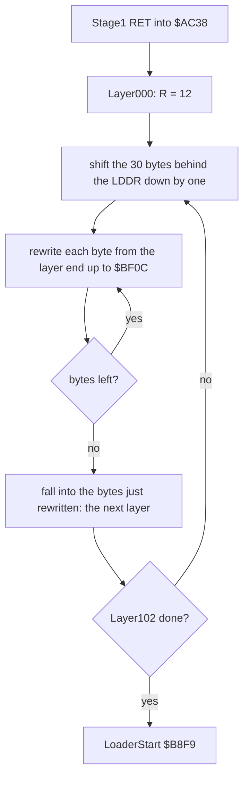

### Why the R register is the key

R counts instruction fetches (M1 cycles): one for a plain opcode, two for a prefixed one, and its bit 7 stays as
last loaded. Layer000 sets it to 12 and then reads it once a pass. Its value at each byte depends on the exact number
of fetches since `LD R,A`, including the 30 turns of LDDR (two fetches each). An emulator that counts R wrongly, a
debugger that steps with its own code, or a copier that runs the chain with an interrupt in the middle, decrypts
garbage. The interrupts are off from the first byte (`DI` at `$5D06` and again at `$AC38`).

### Worked example: the key of one byte

Take the byte that ends as the first byte of LoaderStart, `$B8F9`. On the tape (in the BASIC) it is `$0C`.

1. Layer000 reaches it on pass `$B8F9` - `$AC5C` = `$C9D` = 3229.
2. Fetches from `LD R,A` to the first `LD A,R` read: LD HL, LD BC, LD DE (3), LDDR 30 x 2 (60), LD HL, LD BC, LD D
   (3), `LD A,R` itself (2): 68. R = 12 + 68 = 80 at pass 0.
3. Every pass adds 11 fetches (`LD A,R` 2, then nine plain opcodes). 11 x 3229 = 35 519, and 35 519 mod 128 = 63.
4. R = (80 + 63) mod 128 = 15 = `$0F`. The key is `$0F` XOR `$F3` = `$FC`.
5. p = NOT (`$FC` + `$0C`) = NOT `$08` = `$F7`.

`$F7` is what `work/docs/bcA/chainex.py B8F9` (the chain run of `tools/speedlock.py` in SkoolKit's simulator) gives
after layer 0. The byte is rewritten 103 times in all: layer 1 (dec) makes it `$F6`, and so on. The last three
layers make it `$7A`, then `$1A`, then `$F3`. `$F3` is `DI`, the first instruction of LoaderStart. The byte `$AC5D`,
the first of Layer001, is rewritten only by Layer000: `$94` on the tape becomes `$C3`, the `JP` that starts Layer001.

### The chain at work

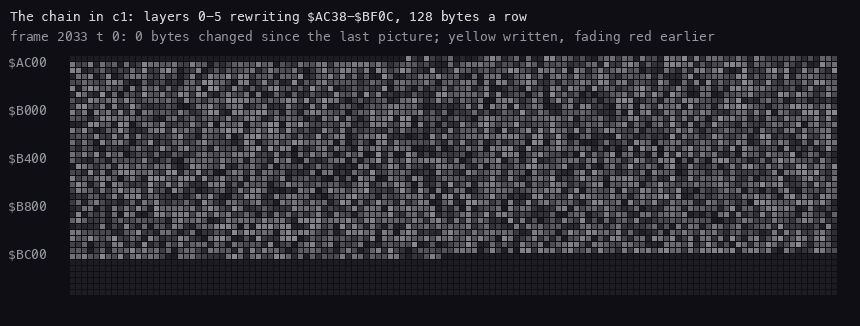

*memanim over c1, frames 2033-2048 every quarter frame (17 727 T), `$AC00-$BFFF`, 3 pixels a byte, 61 pictures:
`python3 ../../kit/memanim.py --work work/docs/bcA/c1 --from 2033 --to 2048 --step 17727 --from-address AC00
--to-address BFFF --cell 3 --width 1050 docs/img/routines/Layer000.gif`. Yellow: written since the last picture.
Each layer is a yellow sweep from its own end to `$BF0C`; the start of the sweep creeps up as the layers get
shorter.*

The whole chain runs from c1 frame 2033 to 2288: 255 frames, about 18 million T. In SkoolKit's simulator it is
2 868 819 instructions (`work/stage2/chain_trace.py`). The layers shrink from 4785 bytes to 1557 (Layer102 rewrites
`$B8F8-$BF0C`), because each starts after the one before.

The point: the chain costs five seconds of loading and nothing on the tape. Each layer is only as hard as its
predecessor, but 103 of them keyed by R stop anyone who cannot execute them exactly.

## 3.4 The loader: LoaderStart, the notice and the turbo reader

LoaderStart `$B8F9` first checks for a Multiface. `IN A,($3F)` and `IN A,($9F)` page in a Multiface's ROM. If either
does, the byte at `$0000` is no longer the 128K ROM's `DI` (`$F3`) and the loader jumps to `$0000`, which restarts
the machine through the Multiface's own reset code. The `OUT`s to `$1F`, `$7B` and `$BB` then page such interfaces
out again, and two block moves over `$0000-$3FFF` wipe any RAM an interface still keeps there. The loader then
prints the copyright notice and the FAST warning (PrintNotice `$B935`, the strings of NoticeText `$B9FB`, with the
ROM font at `$3D00`).

```text
LoaderStart:                          ; $B8F9
    DI; SP = $BFFF
    for port in $3F, $9F:             ; a Multiface's page-in ports
        IN A,(port)
        if (0) != $F3: JP $0000       ; not the ROM's DI: an interface's ROM is in
    OUT ($1F),0; OUT ($7B),1; OUT ($BB),1     ; page such interfaces out
    (0) = 0; copy $0000..$3FFE up to $0001..$3FFF, rising    ; LDIR: fills RAM with 0
    OUT ($7F),$43                     ; SUSPECTED: pages another interface page in
    copy $3FFE..$0000 to $3FFF..$0001, falling               ; LDDR: shifts RAM up by one
    PrintNotice; JP LoaderMain
```

```text
$B8F9 LoaderStart:  DI
                    LD SP,$BFFF
                    IN A,($3F)            ; Multiface page-in port
                    LD A,($0000)
                    CP $F3                ; the 128K ROM starts with DI
$B904 l_B904:       JP NZ,$0000           ; an interface's ROM: its own reset
                    IN A,($9F)            ; the other page-in port
                    LD A,($0000)
                    CP $F3
                    JR NZ,l_B904
                    XOR A
                    LD L,A
                    LD H,L                ; HL = $0000
                    OUT ($1F),A
                    INC A
                    LD E,$01
                    OUT ($7B),A
                    LD D,L                ; DE = $0001
                    OUT ($BB),A
                    LD (HL),L             ; (0) = 0: lost on ROM
                    LD A,$43
                    LD BC,$3FFF
                    LDIR                  ; (1) = (0), (2) = (1), ...: $0000-$3FFF all 0 on RAM
                    DEC HL                ; HL = $3FFE
                    OUT ($7F),A           ; A = $43
                    LD BC,$3FFF
                    DEC DE                ; DE = $3FFF
                    LD A,C
                    LDDR                  ; ($3FFF) = ($3FFE), ... ($0001) = ($0000)
                    CALL PrintNotice
                    JP LoaderMain
```

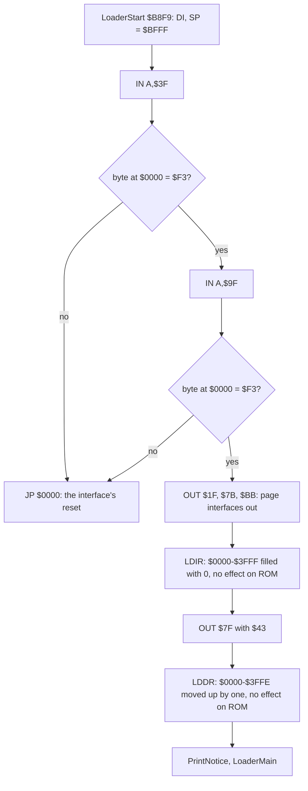

With the 128K ROM at `$0000` both moves do nothing: the CPU writes to ROM are lost. With a RAM page at `$0000` the
`LDIR` clears it (each byte copies the zero before it) and the `LDDR` shifts whatever is paged after `OUT ($7F)` up
by one byte, so a copier's resident code there no longer runs. What `OUT ($7F),$43` pages on which interface is
SUSPECTED: the code shows only the port and the value. No recording has an interface attached (3.13).

LoaderMain `$BEEA` wipes `$5D00-$BBF3` (the BASIC and every layer already run) and loads the 196-byte second stage to
`$BF0D` through TimeCheck `$BE5D` and LoadBlocks `$BD13`. It then clears the screen and runs the stage. c1:
LoaderStart at frame 2288, the stage entered at frame 2484.

### The pulses

| Part | ROM (LD-BYTES) | SpeedLock 7 |
| --- | --- | --- |
| pilot | 2168 T, 3223 or 8063 pulses | 2165 T, only before blocks 7 and 13: 1579 pulses before block 7, 1578 before block 13 |
| sync | 667 T, 735 T | 16 pulses: 714 x 4, 1428 x 2, 2147 x 6, 1428 x 2, 714 x 2 |
| flag | the first byte | 6 bits of `$E8`: `111010` = `$3A` |
| zero bit | 2 x 855 T | 2 x 714 T |
| one bit | 2 x 1710 T | 2 x 1428 T |
| between blocks | a pilot and a pause | a mark: `07 FF 00`, 21 bits at 2 x 875 T / 2 x 1750 T |
| rate, half the bits ones | 2565 T a bit: 171 bytes a second | 2142 T a bit: 204 bytes a second (bank 0: 16 384 in 80.1 s) |

The speed gain is small: 20 %. The protection is in the format: the sync pulses must match a table, the flag is
6 bits, and there is no pilot between the banks.

### The edge reader

The loader's edge loop (`$BCFC`, in `build/chain.lst`) is the ROM's LD-EDGE without the SPACE test:

```text
$BCF6 sub_BCF6:  LD A,$16
$BCF8 sub_BCF8:  DEC A / JR NZ,sub_BCF8     ; a fixed delay of A turns
$BCFB l_BCFB:    AND A
$BCFC l_BCFC:    INC B / RET Z              ; B wraps: a time-out, NC
                 LD A,$7F / IN A,($FE)      ; port $7FFE, the EAR bit in bit 6
                 RRA / XOR C / AND $20
                 JR Z,l_BCFC                ; no edge yet: 54 T a turn
                 LD A,C / CPL / LD C,A      ; the new level
                 AND $07 / OR $08 / OUT ($FE),A   ; the border stripe
                 SCF / RET
```

One turn of the loop is 54 T (INC B 4, RET Z 5, LD A,n 7, IN A,(n) 11, RRA 4, XOR C 4, AND n 7, JR Z 12). LoadBlocks
measures a bit as two edges: it sets B = `$B2`, waits a fixed delay, runs the first edge, calls WaitTask, runs the
second edge from WaitTask's own jump to `l_BCFB`. Then:

```text
$BDBC  LD A,$D0 / CP B / RL L          ; B past $D0: a 1 shifts into L
       LD B,$B2 / JP NC,l_BDB0         ; L started as $01: 8 bits when the 1 falls out
       LD A,H / XOR L / LD H,A          ; H: the XOR of every byte read
       LD A,D / OR E / JR NZ,StoreByte
```

A one bit (2 x 1428 T) takes more than 30 turns of the counter beyond `$B2`, a zero (2 x 714 T) fewer. If B wraps
past `$FF` (78 turns from `$B2`, 4212 T of sampling with no edge) the reader returns NC and the load fails.

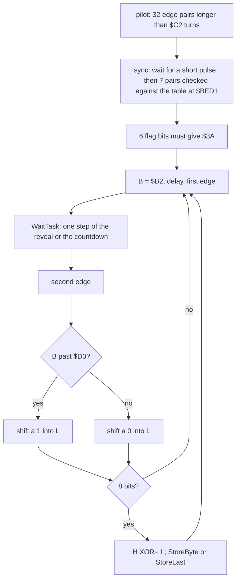

### The task between two edges

WaitTask `$BBF4` is called between the two edges of every bit. It runs one step of a task through a pointer it
rewrites (the operand of `CALL WaitTask` at `$BDB7`), then jumps back into the edge loop at `l_BCFB`. The first task
waits until the attributes have arrived in AttrBuffer `$8000` (its last byte non-zero). It then copies 12 bytes of
attributes a step with twelve `LDI`, so the loading screen appears in colour bit by bit. The second task is the
countdown: the minutes and seconds left, drawn at the top right with the digits of CountdownFont (in the stage at
`$BF0D`). Each path through the task ends in a `DJNZ` wait of its own length and a few `NOP`s, so the paths are
padded towards one length; the time a task takes is part of the bit timing.

```text
WaitTask:                             ; $BBF4, step 0, then the pointer at $BDB7 moves on
    if AttrBuffer[767] == 0: wait; return to the edge     ; the attributes not yet in
    pointer = $BC19; HL = $8000; DE = $5800; A' = $41
Reveal:                               ; $BC19, one call a bit
    A' -= 1
    if A' == 0: goto CountdownSetup   ; after 64 calls: 64 x 12 = 768 bytes
    12 x LDI                          ; AttrBuffer to the attributes
CountdownSetup:                       ; $BC3C
    pointer = $BC5A; A' = 1; patch the edge loop's delay operands ($BD0C = 0, $BD0E = 8)
Countdown:                            ; $BC5A, the phase counter in A'
    if A' >= $98:                     ; the draw phase: 4 digits x 3 calls
        C -= 1
        if C != 0: copy 4 rows of the glyph at HL to DE, D += 1 a row
        else:
            A' -= 1                   ; $9B, $9A, $99, $98: the next digit
            if A' >= $98:
                C = 3; HL = the digit's pointer ($BCF1 - (A' - $98))
                DE = its screen byte ($40ED, $40EF, $40F0, $40F2)
                HL = $BF00 + (HL)     ; the glyph in CountdownFont
    else:                             ; the wait phase
        A' -= 1
        if A' == 0:                   ; one tenth gone
            A' = $9C
            tenths -= 1                   ; each step only when the one before wrapped
            if it wrapped: tenths = 9;  seconds -= 1
            if it wrapped: seconds = 9; tens -= 1
            if it wrapped: tens = 5;    minutes -= 1
            C = 1                         ; the next draw phase starts at once
    pad with DJNZ; return to the edge
```

A digit is a pointer into CountdownFont `$BF80`: the byte `$80` + 8 x digit, so one step down is `ADD A,$F8` and
the wrap test is `CP $78` (the pointer below digit 0). The four pointers `$BCEE-$BCF1` start as `B0 98 C0 B0`:
6 minutes, 3 tens of seconds, 8 seconds, 6 tenths.

```text
$BC5A data_BC5A:  EXX                   ; DEFB $D9,$08,$FE,$98: code reached through the pointer
                  EX AF,AF'
                  CP $98
$BC5E             JR C,l_BCBD           ; the wait phase
                  DEC C
                  JR Z,l_BC71           ; the next digit
                  EX AF,AF'
                  LD B,$04
$BC66 l_BC66:     LD A,(HL)             ; 4 rows of the glyph
                  LD (DE),A
                  INC HL
                  INC D
                  DJNZ l_BC66
                  ...
$BCBD l_BCBD:     DEC A
                  JR NZ,l_BCA7          ; not yet a tenth: pad and return
                  LD A,$9C
                  EX AF,AF'
                  LD HL,data_BCEE+3     ; the tenths
                  LD DE,$78F8           ; D: the wrap value, E: -8
                  LD A,E
                  ADD A,(HL)
                  CP D
                  LD B,$07
                  JR NZ,l_BCB4          ; no wrap: store and return
                  LD (HL),$C8           ; 9
                  ...
                  LD (HL),$A8           ; tens of seconds wrap to 5
```

The countdown counts bits, not time. One cycle of A' is 13 calls in the draw phase and 151 in the wait phase: 164
bits, 164 x 2142 T = 351 288 T, 0.099 s at 3.5469 MHz with half the bits ones. So the tenth on the screen is a tenth
of a second only for that mix of bits.

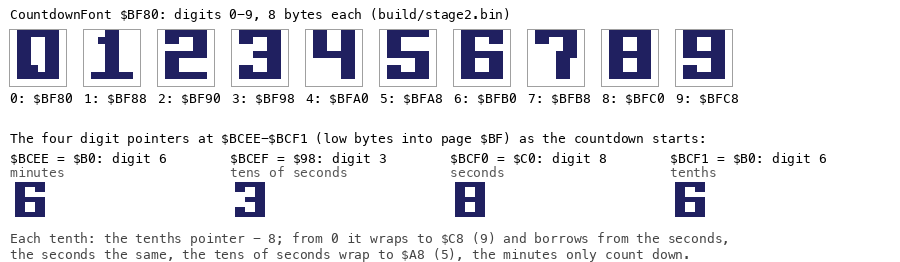

*Drawn by `python3 tools/fig_load_timeline.py countdown docs/img/load/countdown-font.png` from `build/stage2.bin` and
`build/chain.bin`: the ten glyphs of CountdownFont `$BF80` and the four pointers `$BCEE-$BCF1` at the start of the countdown.*

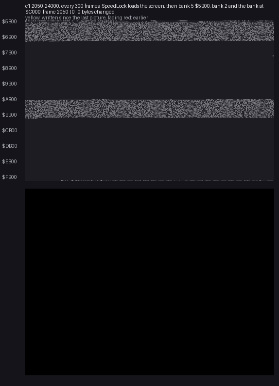

*memanim over c1, frames 2050-24000 every 300 frames (21 272 400 T), `$5B00-$FFFF` with the screen beside, 2 pixels
a byte, 74 pictures: `python3 ../../kit/memanim.py --work work/docs/bcA/c1 --from 2050 --to 24000 --step 21272400
--from-address 5B00 --to-address FFFF --screen --cell 2 --width 1050 docs/img/routines/LoadBlocks.gif`. The bitmap
arrives in black and white, the attributes come in from the reveal task, and the countdown ("3m15s7" at frame 14225)
runs at the top right while the banks fill.*

The point: the loader does the screen effects inside its bit timing. A loader that only reads bits would leave the
CPU idle; this one draws while it waits for the next edge.

## 3.5 The store cipher

LoadBlocks never stores the byte it reads. StoreByte `$BD9C` stores `(L XOR k) + a`, where L is the byte from the
tape and k and a are operands of its own code:

```text
$BD9C StoreByte:  LD A,$C1          ; k: $C1, rewritten to $86 by tape block 17
                  XOR L             ; L: the byte off the tape
                  ADD A,$11         ; a: $11
                  LD (IX+$00),A
                  INC IX
                  DEC DE
```

StoreLast `$BDD0` stores the last byte of every block the same way with its own copy of the operands, then reads the
mark and the next table row (3.6). The tape's own blocks rewrite the keys: block 17 lands on `$BD9C` and block 19 on
`$BDD0`.

```text
store(L, last):                   ; p = (L XOR k) + a
    if last: k, a = (StoreLast+1), (StoreLast+4)
    else:    k, a = (StoreByte+1), (StoreByte+4)
    (IX) = (L XOR k) + a; IX += 1
master(p):                        ; tools/mktape.py: the inverse
    L = ((p - a) AND $FF) XOR k
```

Stage 2's store trace (`work/stage2/stores.txt`, every `LD (IX+0),A` of the load in SkoolKit's simulator) holds
88 777 stores by StoreByte and 15 by StoreLast.

### Worked example: three keys

- **The stage, key `$C1`.** Block 7's first tape byte is `$5F`. (`$5F` XOR `$C1`) + `$11` = `$9E` + `$11` = `$AF`,
  which is `XOR A`, the first instruction of Stage2Start `$BF0D`.
- **The key change.** Block 17's two bytes are `EC B4`. With k = `$C1`: (`$EC` XOR `$C1`) + `$11` = `$3E`, and
  (`$B4` XOR `$C1`) + `$11` = `$86`. They land at `$BD9C`: StoreByte now begins `LD A,$86`. From block 23 on, every
  body byte is stored with k = `$86`.
- **A key that changes in flight.** Block 19's four bytes are `AB F3 1A 33`, to `$BDD0-$BDD3`. The first three go
  through StoreByte (k = `$86` already): `$3E`, `$86`, `$AD`. The fourth is the block's last byte, stored by
  StoreLast, whose k at `$BDD1` the second byte has just rewritten from `$C1` to `$86`. (`$33` XOR `$86`) + `$11` =
  `$B5` + `$11` = `$C6`. StoreLast is again `LD A,$86 / XOR L / ADD A,$11`: the block has re-keyed the routine that
  stores its own last byte.
- **A bank byte.** Bank 7's first tape bytes are `78 70 69 8C A8 08`. (`$78` XOR `$86`) + `$11` = `$FE` + `$11` =
  `$0F`; the six give `0F 07 00 1B 3F 9F`, the first bytes of `build/bank7.bin`. Backwards, as `tools/mktape.py`
  writes them: (`$0F` - `$11`) XOR `$86` = `$FE` XOR `$86` = `$78`.

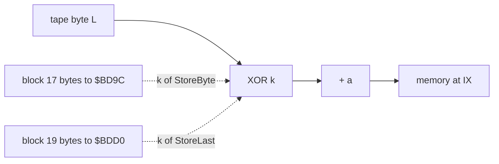

The checksum is the same idea: H is the XOR of every tape byte read, from the block reader's call in Stage2Start to
the end of the stream. LoadEnd `$BEDF` wants H = 0 (`LD A,H / CP $01 / RET C`, else `CALL $C3EB`, outside the loader;
no recording takes this path). Block 43's last byte is the check byte: the XOR of
the data of blocks 13-43 is 0 (stage 2).

The point: the cipher is one XOR and one add, but its key lives in the loader's code and the tape changes it twice.
A copier that does not run the loader cannot know which key each block wants.

## 3.6 The stage at `$BF0D` and the table of banks

Stage2Start `$BF0D` points the last-byte path of LoadBlocks at StoreLast, then reads the bitmap (IX = `$4000`, DE =
`$17FF`) and every block of BlockTable, each after its mark:

```text
$BF0D Stage2Start:  XOR A / LD (AttrFlag),A          ; $82FF = 0: the reveal waits
                    LD IX,$4000 / LD DE,$17FF        ; the bitmap
                    LD HL,StoreLast / LD (LastStoreJump),HL
                    CALL LoadBlocks                  ; the bitmap, then the table to its end
                    LD A,(TimeFailed) / OR A / CALL NZ,WaitTask
                    LD HL,$4000
$BF2B Stage2Wipe:   LD (HL),$00 / INC HL / JR Stage2Wipe   ; replaced by block 39 before it is reached
```

A row of BlockTable is five bytes: the address, the length less one, the `$7FFD` value. After each block StoreLast
reads a mark as three groups of 7 bits (ReadMark `$BE47`, L = `$02` each time: 21 bits, 8 + 8 + 5). The first group
leads to the row's page byte (zero: the end). The second must read as `$7F`: anything else sets TimeFailed `$BED0` to
`$7F`. The third precedes the next block. StoreLast then pages the bank with `OUT ($7FFD)`, takes the address and
the length, and goes on storing.

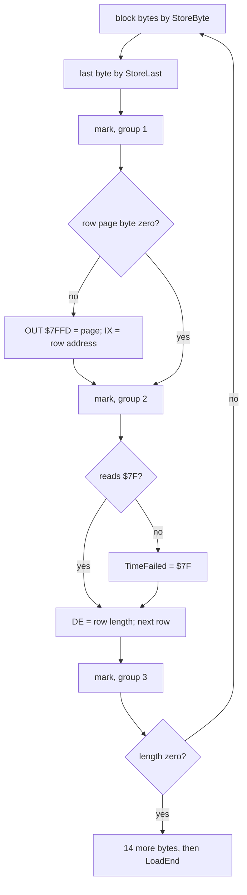

The first table (in the stage, `build/stage2.lst`) has four useful rows: `$8000` 768 (the attributes), `$BD9C` 2,
`$BDD0` 4, `$BF30` 75. The fourth loads a new table over the table itself, so the rows the stage carries after it
(`$6000` 8192, `$4000` 6912, `$FB00` 512) are decoys that are never read. The new table, from block 21:

| Row | Address | Bytes | `$7FFD` | Block | What |
| --- | --- | --- | --- | --- | --- |
| 1 | `$5B00` | 9472 | `$10` | 23 | bank 5 from `$5B00`, XORed with `$AD` |
| 2 | `$C000` | 16 384 | `$10` | 25 | bank 0 |
| 3 | `$C301` | 15 615 | `$11` | 27 | bank 1: the game's `$8301-$BFFF` |
| 4 | `$C000` | 5120 | `$13` | 29 | bank 3 |
| 5 | `$C000` | 3584 | `$14` | 31 | bank 4 |
| 6 | `$C000` | 14 848 | `$16` | 33 | bank 6 |
| 7 | `$C000` | 16 384 | `$17` | 35 | bank 7 |
| 8 | `$BE5D` | 115 | `$17` | 37 | Unxor5B00 over TimeCheck |
| 9 | `$BF21` | 15 | `$17` | 39 | TimeEnd over the stage's end |
| 10 | `$8000` | 54 | `$17` | 41 | the bootstrap |
| 11 | end | | 0 | 43 | 14 bytes to `$8036` and the check byte |

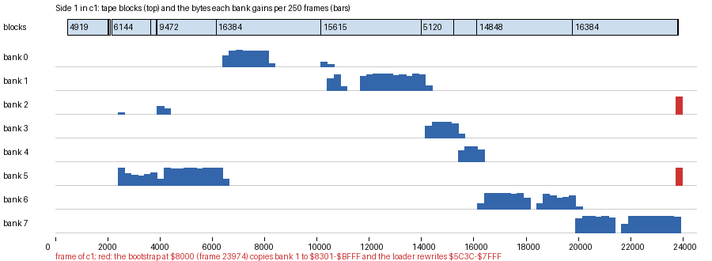

*Drawn by `tools/fig_load_timeline.py work/stage1/loadscan.json docs/img/load/load-timeline.png` from c1 (stage 1:
`time_travel memory_at` of every bank every 250 frames over frames 0-24500). Each bar is the bytes a bank gained in
250 frames, under the tape block that fills it. Zero bytes of a block do not show.*

The game's own `$8000-$BFFF` (bank 2) is the one region that cannot be loaded where it belongs: the loader runs
there. So row 3 stages it in bank 1 and the bootstrap copies it later.

The point: the table is data the tape brings and then replaces. The stage's own table is half a decoy, and the real
one arrives as block 21, enciphered like everything else.

## 3.7 The end of the load: two patches and the bootstrap

Blocks 37 and 39 land on the loader itself. Block 37 replaces TimeCheck at `$BE5D` with Unxor5B00. Block 39 replaces
the stage's endless wipe at `$BF21` with TimeEnd. When the table ends, LoadBlocks returns into the stage, which runs
into TimeEnd:

```text
$BF21 TimeEnd:     LD A,(TimeFailed) / OR A
                   JP Z,$BE5D                     ; Unxor5B00
                   LD HL,$C3EE
$BF2B TimeWipe:    DEC HL / LD (HL),$00 / JR TimeWipe   ; a failed mark: wipe the memory for ever
$BE5D Unxor5B00:   LD HL,$5B00 / LD BC,$2500
$BE63              LD A,(HL) / XOR $AD / LD (HL),A / INC HL
                   DEC BC / LD A,B / OR C / JR NZ,$BE63
                   JP $8000                       ; the bootstrap
```

Block 23 carries the game's `$5B00-$7FFF` XORed with `$AD` on top of the store cipher, so even a dump taken right after
bank 5 loads shows no game code there. Unxor5B00 takes the second layer off just before the jump.

The bootstrap at `$8000` (`src/game/bootstrap.asm`, the listing `build/game.lst`):

```text
$8000 Bootstrap:  LD HL,$2758 / EXX              ; HL' as the ROM's BASIC wants it
                  LD SP,$8200 / LD IY,$5C3A / RES 4,(IY+1)
                  ...                            ; three register loads overwritten before use
$8021             LD BC,$7FFD / LD A,$11 / OUT (C),A    ; bank 1 at $C000
$8028             LD HL,$C301 / LD DE,$8301 / LD BC,$3CFF / LDIR   ; 15 615 bytes to $8301-$BFFF
$8033             LD BC,$7FFD / LD A,$10 / OUT (C),A    ; bank 0 back
$803A             LD HL,$68F4 / LD DE,$8000 / XOR A / LD B,$44
$8043             JP (HL)                        ; the game's entry
```

The LDIR copies over the loader, which is safe: the bootstrap runs below `$8301`. `$8000-$8300` keeps the
bootstrap, and the game then builds its IM 2 table at `$8200-$8300` (doc 4.2).

c1: the last block is read by frame 23856; the bank-5 bytes change, the bootstrap runs and the game is entered
(`JP $68F4`) at frame 23974. Bank 2 then differs from frame 23724 in 10 838 bytes. Bank 1 is never written again in
any recording.

The point: the last pieces of the loader come off the tape as the loader runs, so the code that starts the game
exists in memory only for the last half second of the load.

## 3.8 From power-on to the title

c1, measured (`re_session.py stages` over its L1; the screens by `screen_at`).

### The stages

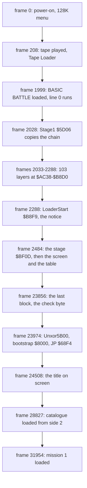

| From | To | Frames | Seconds |
| --- | --- | --- | --- |
| tape played | BASIC loaded | 208-1999 | 35.8 |
| Stage1 and the chain | LoaderStart | 2028-2288 | 5.2 |
| the stage | the game's entry | 2484-23974 | 429.8 |
| the game's entry | the title | 23974-24508 | 10.7 |
| power-on | the title | 0-24508 | 490.2 |

The ten seconds between the entry and the title are the game's own start-up until the title picture is drawn
([doc 4.1](04-game-loop.md#41-the-states-of-the-program)).

The point: of eight minutes, the protection itself (BASIC trick, chain, notice) takes five seconds; the rest is tape.

## 3.9 Side 2: the catalogue and the mission blocks

Side 2 is plain ROM-speed tape (`python3 tools/tzxblocks.py list work/stage1/media/side2.tzx`). The game reads it with
its own copy of the ROM's LD-BYTES, LdBytes `$8617` in bank 2, called through LoadBlock `$71F1`
(`src/game/tape.asm`). LoadBlock disables the interrupts, saves the bank, sets the pointer and the menu's flag aside in
bank 6, loads, restores them and enables the interrupts again.

| TZX blocks | Contents | Bytes | Where the game puts it |
| --- | --- | --- | --- |
| 1, 2 | header `DIRECTORY:` (Bytes, length 7124, start `$8904`), data | 7124 | bank 4 `$CB64-$E737`: the catalogue (titles, briefings, maps) |
| 3-6 | stop, text "Blast Em Mission", 17-byte block `MISSHDR:1:` + length `$1F7A`, data | 8058 | bank 0 `$DBC5-$FB3E` |
| 7-10 | "Missile Battery", `MISSHDR:2:`, length `$1906` = 6406 | **6384** | refused (3.10) |
| 11-14 | "Hostage Rescue", `MISSHDR:3:` | 6769 | bank 0 `$DBC5` |
| 15-18 | "Railway Ambush", `MISSHDR:4:` | 6418 | |
| 19-22 | "Night Moves", `MISSHDR:5:` | 7534 | |
| 23-26 | "Escort Duty", `MISSHDR:6:` | 7716 | |
| 27-30 | "Satellite Search", `MISSHDR:7:` | 7748 | |
| 31-34 | "River Raid", `MISSHDR:8:` | 6204 | |
| 35-38 | "Hideout", `MISSHDR:9:` | 6709 | |
| 39-42 | "Grand Finale", `MISSHDR:::` (the character after `9`) | 7014 | |

The catalogue's header says `$8904`, but the game loads it with its own IX to bank 4 `$CB64`: the start in a header is
only a label for a ROM loader. c1: bank 4 `$CB64-$E737` changes between frames 24508 and 28827.

A mission header is a data block (flag `$FF`), not a ROM header: 17 bytes, `$03`, the ten characters `MISSHDR:n:`,
the length word, four zeros. A ROM `LOAD ""` skips it. LoadMissionHeader `$84FE` reads 17-byte blocks until one
starts with "MISSHDR:" (IsMissionHeader), stores the length into the operand of LoadMissionBlock and the mission
number (the digit - `"1"`) into ScreenOfMission, and lights that mission's line of the catalogue (MarkMission: the
attribute `$C4` at `$5902` + 32 x n). SEARCH is this routine: it stops at the next header, whichever mission it is
(the search recording). SELECT then calls LoadMission `$84C1`:

```text
LoadMission:                          ; $84C1
    page bank 0; reset the player's object; clear the view flags
    if the mission asked for == LastLoadedMission:
        copy bank 3's copy back to bank 0     ; the same mission again: no tape
        MissionSetup
    else:
        LoadMissionBlock:             ; $855B
            DE = the header's length  ; the operand at $855C
            IX = $DBC5; A = $FF; carry set
            if LoadBlock() fails:
                if SPACE is not held: goto LoadMissionBlock
                return                ; SPACE: give up
        copy the part a reload restores to bank 3   ; MissionBlockLoaded $8579: from the object list
                                      ; (header word $DBDA) to restore-end ($DBED); mission 1 $DCBC-$FB3E
        MissionSetup                  ; the parameters, the objects to bank 6
```

```text
$855B LoadMissionBlock:   LD DE,$0000        ; the header's length, patched by LoadMissionHeader
                          LD IX,$DBC5
                          LD A,$FF
                          SCF
                          CALL LoadBlock
                          JR C,MissionBlockLoaded
                          CALL SpacePressed  ; NC when SPACE is held
                          JR C,LoadMissionBlock
                          RET
```

The copy in bank 3 is why a failed mission restarts with no tape: the second time, LoadMission finds the mission
loaded last and restores bank 0 from bank 3 (the loop RestoreFromBank3).

The point: side 2 is a random-access medium made of a linear tape. SEARCH reads headers only, SELECT reads the one
block after it, and bank 3 keeps a copy so that the player never has to rewind for a retry.

## 3.10 Ocean's mission 2 block and why the game refuses it

On the Ocean tape the Missile Battery block holds 6384 data bytes, while its own header asks for `$1906` = 6406. The
Erbe tape's block holds 6406 bytes. The first 3487 bytes agree (`$DBC5-$E963` when loaded). From `$E964` on, the
Ocean block holds 2897 bytes that no block of either release holds; its checksum over those 6384 bytes is valid
(`tzxblocks.py`: "checksum ok"), so the tape was mastered from a different file, not damaged in the copy.

```text
python3 tools/tzxblocks.py work/stage1/media/side2.tzx 10 m2o.bin
python3 tools/tzxblocks.py ".../Battle Command - Side 2 (Erbe).tzx" 6 m2e.bin
first difference at offset 3487 ($E964): Ocean c0 26 80 00 e0 61, Erbe c0 26 66 ff 02 05
```

LdBytes reads like the ROM's LD-BYTES: it counts DE down and wants one more byte, the parity, after the last. The
Ocean block ends 22 bytes short. After its last byte the tape is silent (the 7.9 s pause), the edge reader LdEdge1
`$86A3` counts B up to `$00` and returns NC, and LdBytes returns NC: the load failed. LoadMissionBlock asks again.
The next block on the tape is mission 3's 17-byte header: it is short in the same way. Then mission 3's block: 6406
bytes are read, the 6407th is taken as the parity, and the XOR of the flag and those 6407 bytes is `$EA`, not 0. Every later block fails the same way,
so the game keeps reading until the tape ends and then waits on silence for ever. Only SPACE (SpacePressed, port
`$7FFE` bit 0) leaves the loop.

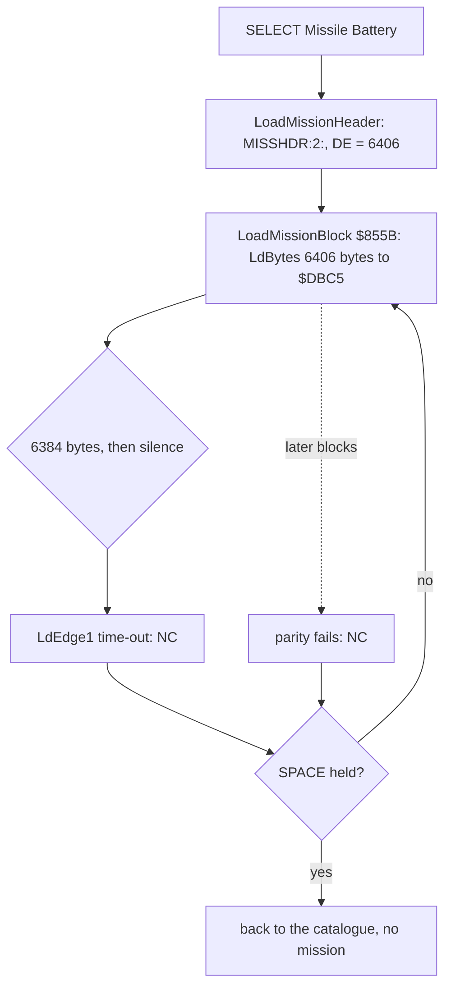

The witness is m2ocean: SEARCH lights Missile Battery at frame 4767, SELECT reads the block, and frames 7322 to
13 322 show the same catalogue screen with the tape read past the block. The m2erbe recording does the same with the
Erbe side 2: mission 2 loads and is in play at frame 7201 ([mission-tape.png](img/play/mission-tape.png)).

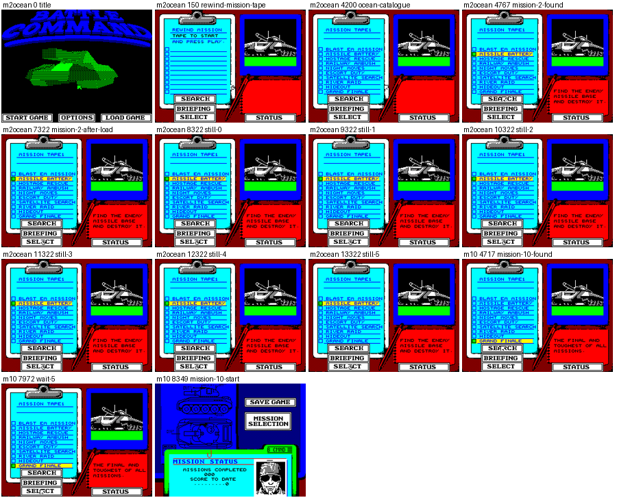

*Drawn by `tools/fig_shots.py` from the screenshots of the search, m2ocean and m2erbe recordings (stage 1).*

Had the block been loaded anyway, 19 of its 21 models would be broken (stage 2, open point 6, comparing the Ocean
bytes against the model format of doc 7).

The point: the game never checks a mission's contents, only the ROM-style parity and length; that is enough to refuse
the bad block, and the retry loop makes the refusal look like a hang.

## 3.11 The Erbe release

Erbe Software re-released the game in Spain (ZXDB lists it; `work/stage1/media/zxdb__BattleCommand(ErbeSoftwareS.A.).tzx/`).
Its side 1 has no protection at all:

| Block | Bytes | What | Against Ocean |
| --- | --- | --- | --- |
| 1, 2 | 123 | BASIC "Battle C.", `LINE 10` | a plain loader line |
| 3, 4 | 512 | Bytes "loader" at `$B800` | its own small loader |
| 5 | 6912 | the loading screen | differs from Ocean's in 40 bytes |
| 6 | 9472 | bank 5 `$5B00-$7FFF` | equal (without the `$AD` layer) |
| 7 | 16 384 | bank 2 `$8000-$BFFF` | equals the game's `$8301-$BFFF`; differs in `$8000-$82FF` (765 bytes: the bootstrap and the vector table area) |
| 8 | 16 384 | bank 0 | equal |
| 9-12 | 5120, 3584, 14 848, 16 384 | banks 3, 4, 6, 7 | equal |

All the blocks are at ROM speed with pilots and pauses: 587.0 s, 103 s longer than Ocean's turbo tape. Erbe's side 2
holds the same catalogue and the same missions as Ocean's, byte for byte, except mission 2, which is complete (6406
bytes). Stage 2 found every Ocean bank, decoded with the loader's keys, equal to the Erbe block of that bank: the two
releases are one program.

The point: the Erbe tape is the decrypted game, already cut into banks. It confirms the decryption from outside, and
its mission 2 block is the one the game accepts.

## 3.12 The build that re-protects

`sh tools/build.sh` builds both sides from the source and compares them with the original:

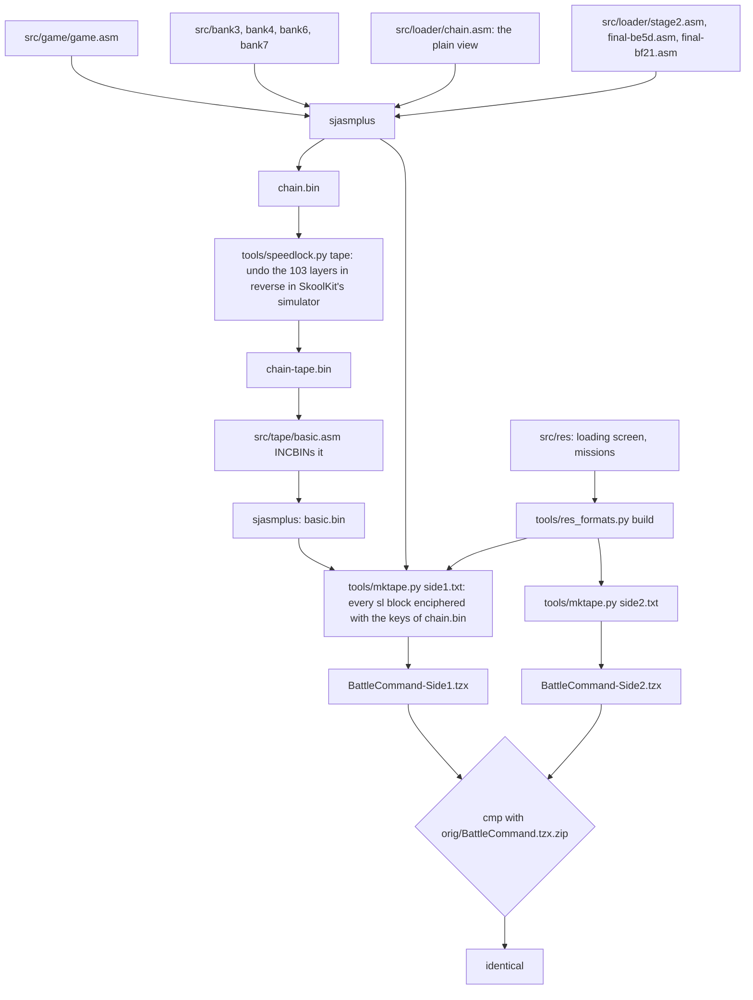

Two steps make the protection again from the plain source:

- **The chain.** `src/loader/chain.asm` is the plain view: each byte after the last layer that rewrites it.
  `tools/speedlock.py tape` runs the chain backwards: it undoes the layers from Layer102 down to Layer000, each with its
  own key stream, R included. Running it forwards from the tape bytes gives the plain view back. The R key stream
  needs the exact fetch count, so both directions run in SkoolKit's simulator.
```text
tape_view(plain):                     ; tools/speedlock.py tape
    run the chain forwards over plain in SkoolKit's simulator, R counted per fetch
        every rewrite (layer, kind, key, post-step) of each byte noted, the byte left plain
        ; the code that runs is the plain code, so the loops and R are those of the real run
    for each byte b of $AC38-$BF0C:
        x = plain[b]
        for each noted rewrite of b, last first:
            add, post CPL:   x = NOT x - key
            add, post SUB n: x = x + n - key
            add:             x = x - key
            sub, post XOR n: x = key - (x XOR n)
            dec:             x = x + 1
        tape[b] = x
```

Worked through for `$B8F9` (`work/docs/bcA/chainex.py B8F9`): the forward run makes the tape's `$0C` into `$F7`
(layer 0, add), `$F6` (layer 1, dec), `$25`, `$51`, `$0D` (layers 2-4, add), `$0C` (layer 5, dec), then `$C1`
(layer 6, sub: key `$E2`, p = (`$E2` - `$0C`) XOR `$17` = `$D6` XOR `$17` = `$C1`). The backward run undoes them in
the other order: layer 6, c = `$E2` - (`$C1` XOR `$17`) = `$E2` - `$D6` = `$0C`; layer 5, c = `$0C` + 1 = `$0D`;
and so on down to layer 0, c = NOT `$F7` - `$FC` = `$08` - `$FC` = `$0C`, the tape's byte.

- **The store cipher.** `tools/mktape.py` writes each `sl` block of `src/tape/side1.txt` as
  `((p - a) AND $FF) XOR k`, with k and a read from the loader's own bytes in `chain.bin`. When a block lands on `$BD9C-$BDD4` it changes the
  keys for the bytes after it, as the loader does. The stage block's last byte is a check byte that makes the XOR of
  the stream 0.

The build prints:

```text
build: BattleCommand-Side1.tzx identical to orig/BattleCommand.tzx.zip's Side 1
build: BattleCommand-Side2.tzx identical to orig/BattleCommand.tzx.zip's Side 2
```

A change to any routine of the game therefore produces a new protected tape that the original loader accepts.

The point: the protection is fully understood when it can be put back. The source holds the game in clear and the
build makes the same 45 blocks Ocean mastered, bit for bit.

## 3.13 Known only from the code

- The Multiface check of LoaderStart (no recording has a Multiface attached).
- TimeFailed and TimeWipe: every mark in c1 reads correctly, so the wipe path never runs.
- The decoy rows of the stage's first table (`$6000`, `$4000`, `$FB00`): replaced before they are read.
- The SPACE exit of LoadMissionBlock: m2ocean never presses SPACE.
- The padding of WaitTask's paths towards one length: read from the code, not timed.
- FinalLeftover (bytes after Unxor5B00 in block 37): an earlier TimeEnd and bootstrap, never run.

The gaps and the commands behind each figure are in [bcA-NOTES](../work/docs/bcA-NOTES.md).
