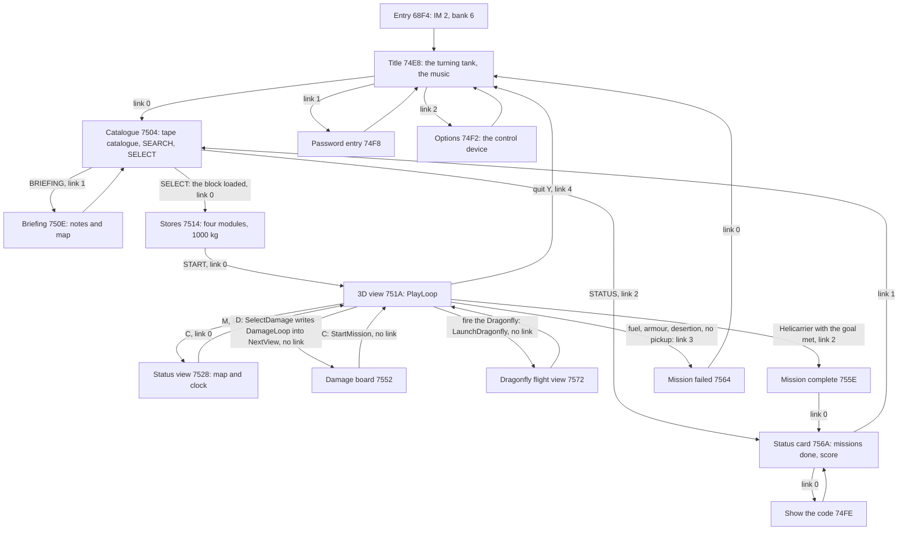
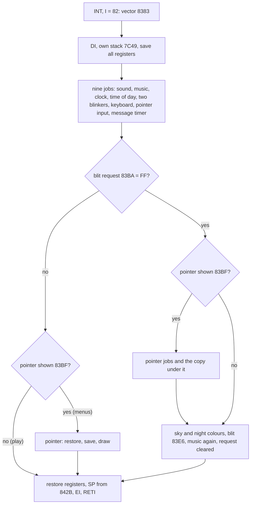
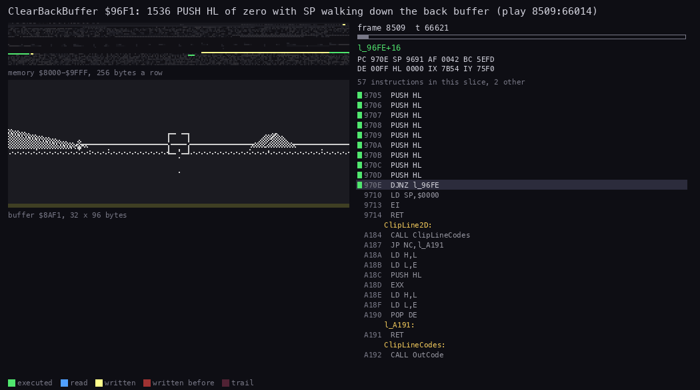
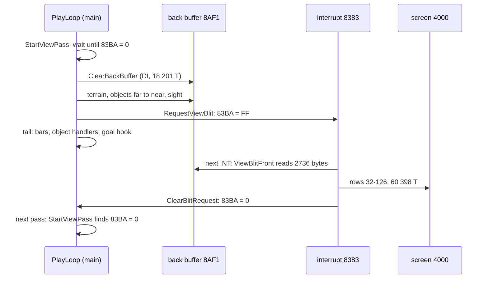
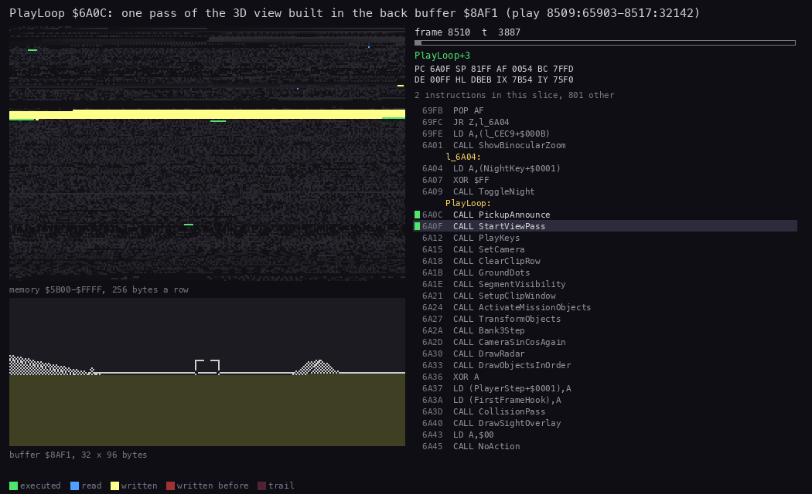
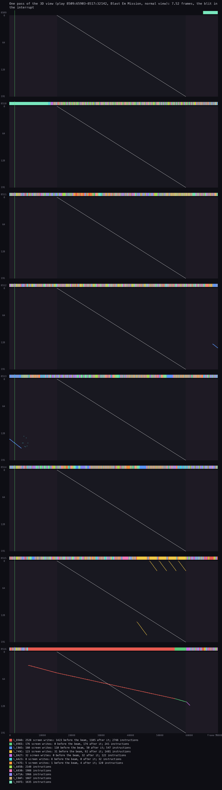
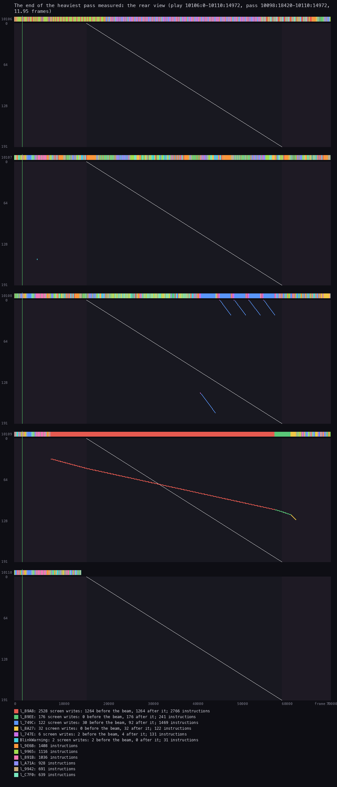

# 4. Game loop

What this covers: the program's states from the title to the end of a mission, as a graph of screens; the IM 2
interrupt, what each job in it does and what it costs; where the game runs with interrupts disabled and the
interrupts it loses there; one pass of the 3D view step by step, with its cost in every view; the pass against the
beam; the delays and the timers.

The recordings it rests on ([WALKTHROUGH 6.0](../WALKTHROUGH.md#60-the-recordings)), all loaded at signal speed:

- `play`: from the title, Blast Em Mission with four stores, every view. Four access traces of it:
  - 8400:0-8600:0, 200 frames of the normal view (26 passes, 192 interrupts);
  - 8500:0-8520:0, three passes and their interrupts;
  - 8509:65903-8517:32142, one pass of the normal view;
  - 10070:0-10125:0, four passes of the rear view.
- `stage2/rec/fuel`: the fuel failure (a POKE, Fuel `$7C57` = 32 at frame 7704): a mission that ends in the
  failed screen and goes back to the title.
- `menu`, `missions`, `m10`: the menus, the catalogue, the status card, Grand Finale refused.
- `stage2/rec/m1complete`, `stage2/rec/m4complete`: missions 1 and 4 completed: the pickup, the completion node, the
  status card and the save code.

A frame is 70 908 T (the 128K). A [pass](README.md#terms) is one run of PlayLoop `$6A0C`, one picture of the 3D view.
A position is written `frame:T`. A value read with `memory_at` (or from a trace's start memory) is the state at the
start of that frame; a trace puts an instruction in the frame where it ran. The scripts behind the numbers are in
`work/docs/bcA/` (`pass.py`, `ints.py`, `lost.py`); the commands are in [bcA-NOTES](../work/docs/bcA-NOTES.md).

## 4.1 The states of the program

The menus and the play views are nodes of one graph, ScreenList `$74E6` in bank 5. A node is two words, the routine
that runs the screen and its pointer zone table, followed by the node's links: one word for each way out. A screen
leaves by calling SetScreen `$7060` with E = 2 x the link number. SetScreen takes the link, makes its target the
current node, puts the target's routine where the loop returns to (the `LD HL,n` operand at `$6A99` in NextView) and
its zone table into PointerZones `$6D42`, and sets the view flag `$6A6D` that ends the running loop. The next screen
then runs from NextView `$6A91`.

Why a graph: one switch routine serves the title, the menus, the play views and the two ends of a mission. A view knows
only its link numbers (0 to 4), never the address of the next screen.

```text
SetScreen(E):                         ; $7060, E = 2 x the link number
    node = word at (Current + E)      ; Current = ScreenList $74E6: the links of the screen running now
    NextRoutine = node.routine        ; into NextView's operand ($6A99)
    PointerZones.table = node.zones   ; the operand at $6D47
    Current = node + 4                ; the new screen's links
    ViewFlag = $FF                    ; SetViewFlag $707E: the running loop ends at its next test
```

```text
7060  2A E6 74       SetScreen:  LD HL,(ScreenList)    ; the current node's links
7063  16 00                      LD D,$00
7065  19                         ADD HL,DE             ; link E/2
7066  5E                         LD E,(HL)
7067  23                         INC HL
7068  56                         LD D,(HL)
7069  23                         INC HL
706A  EB                         EX DE,HL              ; HL = the target node
706B  5E                         LD E,(HL)             ; its routine
...                              LD (NextView+$0008),DE
...                              LD E,(HL) / INC HL / LD D,(HL) / INC HL
...                              LD (PointerZones+$0005),DE   ; its zones
...                              LD (ScreenList),HL    ; its links are now the current ones
707E  3E FF          SetViewFlag: LD A,$FF
...                              LD (ViewChangeFlag+$0001),A
```

The graph as the image holds it (`$74E8-$757B`, read from `build/game.lst`):

| Node | Routine | Zones | Link 0 | Link 1 | Link 2 | Link 3 | Link 4 |
| --- | --- | --- | --- | --- | --- | --- | --- |
| `$74E8` | TitleMenu `$C409` (bank 6) | TitleZones `$C4E9` | catalogue `$7504` | password `$74F8` | options `$74F2` | | |
| `$74F2` | OptionsScreen `$F8F4` | none | title | | | | |
| `$74F8` | PasswordScreen `$C578` | `$C729` | title | | | | |
| `$74FE` | ShowPassword `$C4FC` | none | status card `$756A` | | | | |
| `$7504` | MissionCatalogueScreen `$C790` | CatalogueZones `$C851` | stores `$7514` | briefing `$750E` | status card `$756A` | | |
| `$750E` | BriefingScreen `$C98A` | `$CA10` | catalogue | | | | |
| `$7514` | StoresScreen `$CA8B` | StoresZones `$CBC4` | play `$751A` | | | | |
| `$751A` | StartMission `$694B` (the 3D view) | none | status view `$7528` | damage board `$7552` | complete `$755E` | failed `$7564` | title |
| `$7528` | StatusLoop `$6BC7` | none | play | MAP page `$7536` | complete | failed | BRIEF page `$7544` |
| `$7536` | StatusLoop's re-entry `$6BDE` (the MAP page) | none | play | itself | complete | failed | BRIEF page |
| `$7544` | BriefPage `$6C44` (the briefing text in the console) | none | play | MAP page | complete | failed | BRIEF page |
| `$7552` | DamageLoop `$6C93` (the damage board) | none | play | (none) | complete | failed | |
| `$755E` | MissionCompleteScreen `$CD1E` | EndZones `$CD70` | status card | | | | |
| `$7564` | MissionFailedScreen `$CD84` | EndZones | title | | | | |
| `$756A` | MissionStatusScreen `$CDBF` | StatusScreenZones `$C4DC` | show the code `$74FE` | catalogue | | | |
| `$7572` | DragonflyViewLoop `$6AB9` (the Dragonfly's flight view) | none | play | | | | |

No link leads to `$7572`: DragonflyViewLoop is entered directly, by the Dragonfly's launch (LaunchDragonfly `$C30F`,
`LD HL,DragonflyViewLoop` into NextView's operand in player.asm), not through SetScreen. The play keys enter two more
views the same way, without a link: D (SelectDamage `$6BC2`) writes DamageLoop into NextView through SelectLoop
`$6BB4` and sets the view flag, and on the damage board DamageKeys `$6B95` sends B to StatusLoop, C to StartMission
and D to DamageLoop again. SetScreen is not called, so the current node stays `$751A`: link 1 of `$751A` (`$7520` =
`$7552`) is not what the key D takes, and which code takes it, if any, is not settled.
The 3D view's node runs StartMission each time play is re-entered from the status view or the damage board
(StartMission runs 27 times in the recordings, for 14 mission starts).



Worked example, the fuel failure (`stage2/rec/fuel`). At frame 7704 the POKE leaves 32 units of fuel. PlayerStep
`$A8C7` takes C = (A >> 4) OR 1 a step (`$A93A-$A942`), 3 in this drive: the fuel reads 3 from frame 7842 and 0 from 7852 (an
exact hit, `work/docs/bcC/fuel-player.jsonl`). In frame 7860 the next step's `SBC HL,BC` borrows, and OutOfFuel (bank
2 `$A94E`) is taken instead of the store at `$A958`: Fuel `$7C57` keeps its 0 and FailReason `$7BF9` gets `$CCED`
("RAN OUT OF FUEL.", read from frame 7861). OutOfFuel stores the reason and calls ScreenSix `$7047` (E = 6): the current node is StartMission's (`$751A`), its links start at
`$751E`, and the word at `$751E` + 6 = `$7524` is `$7564`. SetScreen reads that node: routine `$CD84`
(MissionFailedScreen), zones `$CD70`, links from `$7568`. The view flag ends PlayLoop, NextView runs `$CD84`:
MissionFailedScreen starts at frame 7862 (L1 of fuel) and shows "MISSION FAILED." with the reason (screen at frame
7904). Its only zone is ScreenZero (link 0): the word at `$7568` is `$74E8`, the title, on screen with its music at
frame 8051.

There is no game over beyond that: a failed mission goes back to the title, and the player loads or replays a mission.
Grand Finale (mission 10) is refused by LoadMissionIfAllowed `$759A` until the nine flags MissionsDone `$6799-$67A1`
are all set: the refusal is `RET Z` at `$75AE` back into the catalogue's zone loop, so in `m10` SELECT leaves the
catalogue on screen (4972 to 7972); the status card at 8349 is the script's click on STATUS (the cursor at 192, 181
in CatalogueZones' STATUS zone).

Witness: every node's routine is run by a recording; BriefPage (`$7544`, `$6C44`) once, in play (L1 1, the BRIEF page
of `010455-view-map-brief.png`, reached by StatusKeys' B and ScreenEight). The completion is the
Helicarrier's collision handler (`JP $67EE`, ScreenFour, link 2) once the goal flag `$68E8` is set: m1complete runs
HelicarrierHit `$DAAB` and `$67EE` at frame 21558 and MissionCompleteScreen `$CD1E` (page 6) at 21560-21721, then the
status card (22100) and the save code (22240); m4complete the same at 21299 and 21301-21462
([doc 10.9](10-gameplay-logic.md)). Between the goal and the report, PickupMessage (bank 0 `$DB77`) puts ViewBlitLow
`$898B` in the blit pointer `$83E6`: the view is copied from back-buffer row 8 and the message line stays above it
(m1complete: 530 runs from frame 16138).

The point: the whole program is one loop of screens. Every screen, even the 3D view, is a routine that loops until
the view flag is set and then returns into NextView, which runs the routine SetScreen chose.

## 4.2 The interrupt

### The set-up

The entry `$68F4` runs once, at c1 frame 23974, when the bootstrap jumps to it
([doc 3](03-build-and-load.md#38-from-power-on-to-the-title)). It builds an IM 2 table in which every vector is the
same, so the byte the bus holds at the acknowledge does not matter.

```text
68F4  F3             Entry:  DI
68F5  31 FF 81               LD SP,$81FF           ; the main stack, downwards from $81FF
68F8  21 00 82               LD HL,Im2Table        ; $8200
68FB  11 01 82               LD DE,Im2Table+1
68FE  01 00 01               LD BC,$0100
6901  36 83                  LD (HL),$83
6903  ED B0                  LDIR                  ; $8200-$8300: 257 bytes of $83
6905  3E 82                  LD A,$82
6907  ED 47                  LD I,A                ; vector = the word at $82xx = $8383 for any xx
6909  3E C3                  LD A,$C3
690B  32 81 81               LD (ImJump),A         ; $8181: JP $8383
690E  21 83 83               LD HL,InterruptHandler
6911  22 82 81               LD (ImJump+1),HL
6914  ED 5E                  IM 2
6916  FB                     EI
6917  CD EB 6C               CALL BorderBlack
691A  00 x 8                 NOP ...               ; room for a patch
6922  CD 78 72               CALL PageBank6
6925  C3 09 C4               JP TitleMenu          ; bank 6
```

Worked example: with `I` = `$82` and `$FF` on the bus, the CPU reads the vector from `$82FF-$8300`: `$83 $83`, so
`$8383`. With any other byte n it reads `$82nn` and the byte after it, again `$83 $83`. The `JP $8383` at `$8181` is
never reached as a vector (the table answers every bus byte), a guard the authors kept rather than a need.

### The handler, line by line

InterruptHandler `$8383` switches to its own stack, top `$7C49` in bank 5 (inside PlayWorkspace `$7B90`), so its 28
bytes of register saves stay off the main stack. It cannot protect a buffer `SP` points into: the CPU's push of the
return address and the handler's `EX (SP),HL` land on the interrupted stack first. That is why the main code points
`SP` at data (the PUSH clear of the back buffer, the radar's clear, the vertex program) only under `DI` (4.3). It saves
every register, both sets, and runs nine jobs on every interrupt. Then the blit request `$83BA` chooses between a
short tail and the long one.

```text
8383  F3             InterruptHandler: DI
8384  E3                     EX (SP),HL            ; HL saved on the interrupted stack
8385  ED 73 2B 84            LD (SavedSP+1),SP     ; the interrupted SP into the LD SP,n at $842A
8389  31 49 7C               LD SP,$7C49           ; the handler's own stack (bank 5)
838C  FD E5 ... D9           PUSH IY, IX, AF, AF', HL, DE, BC, HL', DE', BC'
839B  CD 6E 7E               CALL SoundTick        ; bank 0 SoundFrame $D692: the AY effects
839E  CD D2 72               CALL Bank4Tick        ; bank 4 MusicTick $C0D2: the tune
83A1  00 00 00               NOP x 3
83A4  CD FB 7D               CALL ClockTick        ; the mission clock
83A7  CD 36 88               CALL TimeOfDay        ; the hour against HourTable $88F8
83AA  CD 59 84               CALL BlinkWarning     ; every 12 interrupts (a RET while off)
83AD  CD 75 84               CALL BlinkLamp        ; every 8 interrupts (a RET while off)
83B0  CD 8F 84               CALL KeyRepeat        ; ScanKeyboard, the repeat counter
83B3  CD 80 7D               CALL PointerTick      ; ReadControls, the pointer, the fire
83B6  CD D6 87               CALL MessageTimer     ; the message line's timer
83B9  3E 00          BlitRequest: LD A,n              ; n = $83BA, the blit request: $FF when set
83BB  3C                     INC A
83BC  20 46                  JR NZ,PlayJobs        ; no request: the short tail
83BE  3E 00          PointerShown: LD A,n              ; n = $83BF: non-zero while the pointer is shown
83C0  A7                     AND A
83C1  CA DF 83               JP Z,MenuJobs
83C4  CD 31 84               CALL PageBank6Kept    ; the pointer jobs (bank 6): restore, copy, save,
...                                                ; the copy under the pointer, draw, PageBankKept
83DF  CD 5F 88       MenuJobs: CALL SkyColours     ; once per change of the hour
83E2  CD CF 88               CALL NightColours
83E5  CD 99 89       ViewBlit: CALL ViewBlitFront  ; the operand $83E6 is the blit of the current view
83E8  CD D2 72               CALL Bank4Tick        ; the tune a second time in a blit frame
83EB  CD EC 8A               CALL ClearBlitRequest ; $83BA = 0: the main loop may clear the buffer
83EE  C3 1C 84               JP HandlerExit
8404  3A BF 83       PlayJobs: LD A,(PointerShown+1)
8407  A7                     AND A
8408  28 12                  JR Z,HandlerExit      ; no pointer: nothing more
840A  CD 31 84               CALL PageBank6Kept    ; the pointer's restore, copy, save and draw
...
841C  C1 ... FD E1   HandlerExit: POP BC, DE, HL, BC', DE', HL', AF', AF, IX, IY
842A  31 00 00       SavedSP: LD SP,n              ; the interrupted stack
842D  E3                     EX (SP),HL            ; HL back, the return address back on top
842E  FB                     EI
842F  ED 4D                  RETI
```



The two operands at `$83BA` and `$83BF` are flags written by other code and read as the immediate of `LD A,n`:

- `$83BA`, the blit request: RequestViewBlit `$988D` writes `$FF` when a pass has finished drawing the back buffer,
  ClearBlitRequest `$8AEC` writes 0 after the blit. StartViewPass `$9882` waits for 0 before it clears the buffer.
- `$83BF`, the pointer flag: non-zero while the menus show the pointer, 0 in the play views (DrawBank7Picture `$74AA`
  clears it). PointerTick `$7D80` moves the pointer only when it is set (`$7D8D`). The play traces read it 0
  throughout.

### What an interrupt costs

`ints.py` over the trace 8500:0-8520:0 (play, normal view) gives every entry from `$8383` to the instruction after
its RETI, with the two flags at the entry:

| Kind | Entries in 20 frames | T an entry | Share of a frame | Example |
| --- | --- | --- | --- | --- |
| a quiet interrupt (`$83BA` = 0, `$83BF` = 0) | 15 | 4614 (4815 to 6402 in the first five, while a sound effect ran) | 6.5 % | 8509:1872 |
| a blit interrupt (`$83BA` = `$FF`) | 3 | 60 398 to 62 169 | 85 to 88 % | 8516:1866, 60 398 T |

The blit is the interrupt's heavy job: ViewBlitFront copies 79 rows of 32 bytes, 8 rows of 22 and 8 rows of 4 with
`LDI`, 2736 bytes (2528 + 176 + 32), inside the handler. A pass of 7.5 frames therefore spends one frame in its blit interrupt and about six quiet
interrupts of 4614 T: 91 818 T of the 533 993 T of the trace's first pass (17 %).

Witness: stage 1's `re_session.py interrupts` over all of play gives 14 073 T an entry and 10 % of the CPU
([WALKTHROUGH 1](../WALKTHROUGH.md#1-interrupts-and-timing)): the mean of the two kinds, over the menu and load frames too.

The point: the interrupt does the screen copy, the sound, the music, the clock, the keyboard and the pointer. The main
loop only computes and draws into the back buffer.

## 4.3 Where interrupts are off, and the interrupts lost

The game never executes `HALT` (none in the L1 instruction lists of any recording). An interrupt that arrives while
interrupts are disabled is lost: the INT lasts about 32 T, and the CPU samples it only at the end of an instruction
with IFF1 set.

`lost.py` lists every `DI`-to-`EI` span of a trace by the routine of its `DI`, and for each frame with no entry of
`$8383` the instruction that ran when the INT came:

| Routine of the `DI` | Spans in 8500:0-8520:0 | Total T | Longest T | Why off |
| --- | --- | --- | --- | --- |
| InterruptHandler `$8383` | 18 | 259 165 | 62 151 | the handler itself |
| ClearBackBuffer `$96F1` | 3 | 54 603 | 18 201 | `SP` points into the back buffer |
| ClearRadar (bank 0 `$C094`) | 2 | 12 306 | 6362 | the radar's clear, `SP` used the same way |
| OpVertexProgram `$9938` (its `DI` at `$9941`) | 6 | 15 966 | 3709 | `SP` walks the vertex rows `$FD00-$FF00` |

| Frame with no interrupt | Running at the INT | Its `DI` |
| --- | --- | --- |
| 8510 | ClearBackBuffer, the `PUSH` loop at `$9705` | 8509:66014 |
| 8513 | ClearRadar, `$C0A8` | 8512:69046 |

Over the 200 frames 8400:0-8600:0 the handler runs 192 times: 4 % of the interrupts of the normal view are lost. In
the rear view (10070:0-10125:0) 48 of 55 are taken: 13 % lost.

The same in another recording: `lost.py` over the death trace 8093:0-8160:0 (`work/docs/bcD/death/traces/`, normal
view, the enemy tank firing) finds 63 handler entries in 67 frames. The frames without one are 8114, 8119, 8124 and
8133: at their INT the CPU is in ClearBackBuffer's `PUSH` loop (8114 at `$9705`, 8124 at `$96FF`, 8133 at `$9709`)
and in OpVertexProgram (8119 at `$9978`). Those four frames are also the four with no SoundFrame `$D692`
([doc 9.3](09-sound.md#93-the-effect-driver-soundframe)): the AY effects and the music skip a tick with each lost interrupt.

### The back-buffer clear

ClearBackBuffer zeroes the 3072 bytes of the back buffer `$8AF1-$96F0` with 1536 `PUSH HL`. A `PUSH` writes two bytes
in 11 T, 5.5 T a byte; an `LDIR` takes 21 T a byte. The price is the stack: while `SP` walks down the buffer, an
interrupt would push its return address into the buffer and run the handler's first instructions on it, so the
routine turns interrupts off.

```text
ClearBackBuffer():                    ; $96F1
    disable interrupts
    saved = SP; SP = $96F1            ; one past the buffer's end
    for row in 0..95:                 ; B = $60
        repeat 16: push 0             ; 32 bytes, one buffer row, from the bottom up
    SP = saved
    enable interrupts
```

```text
96F1  F3             ClearBackBuffer: DI
96F2  ED 73 11 97            LD ($9711),SP         ; into the LD SP,n below
96F6  31 F1 96               LD SP,$96F1
96F9  26 00                  LD H,$00
96FB  6C                     LD L,H
96FC  06 60                  LD B,$60              ; 96 rows
96FE  E5             l_96FE: PUSH HL               ; 16 x PUSH HL: one row of 32 bytes
...
970D  E5                     PUSH HL
970E  10 EE                  DJNZ l_96FE
9710  31 00 00               LD SP,n               ; the saved SP
9713  FB                     EI
9714  C9                     RET
```

Worked example, the clear of play 8509:66014: one row costs 16 x 11 + 13 = 189 T, 96 rows 18 144 T, with the set-up
and the end 18 201 T (the longest span of the table). It starts at frame T 66 014 and ends at 8510:13 307. The INT of
frame 8510 rises at frame T 1846, inside the clear (at `$9705`): frame 8510 has no interrupt.



*ClearBackBuffer `$96F1` on play 8509:65990-8510:14000 (normal view of Blast Em Mission), 30 pictures of 631 T. Left
above: bank 2 `$8000-$9FFF`, 256 bytes a row; left below: the back buffer `$8AF1` as 32 x 96 bytes, row 0 at the top.
Drawn by `python3 ../../kit/routine_anim.py --work work/docs/bcA/play --window 8509:65990-8510:14000 --listing
build/game.lst --view buffer:8AF1:32x96 --range 8000-9FFF --pc 96F1-9714 --pictures 30`.*

How to read it:

- the yellow band climbing the buffer is the `PUSH` front, 32 bytes a row; the last pass's picture vanishes from the
  bottom row up;
- the memory map shows only writes and the routine's own 36 bytes executed: no data is read.

The point: the fastest clear on a Z80 costs the game an interrupt whenever the INT falls in its 18 201 T, about one
pass in four in the normal view.

### What a lost interrupt costs the player

ClockTick `$7DFB` counts interrupts, not time. After the first 50 interrupts it reloads its counter with 1, so from then
on every interrupt taken adds one second to MissionClock `$68EA` (seconds, minutes, hours): the mission clock runs at
50 game seconds to one real second, and an hour of the mission takes 72 real seconds.

```text
7DFB  00             ClockTick: NOP               ; RET until play ($8612 writes it)
7DFC  3E 32                  LD A,n               ; n = $7DFD: 50 at the load, then 1
7DFE  3D                     DEC A
7DFF  32 FD 7D               LD ($7DFD),A
7E02  C0                     RET NZ
7E03  3E 01                  LD A,$01             ; the reload is 1, not 50
7E05  32 FD 7D               LD ($7DFD),A
7E08  21 EA 68               LD HL,MissionClock   ; seconds 0-59, minutes 0-59, hours 0-23
7E0B  7E                     LD A,(HL)
7E0C  FE 3B                  CP $3B
7E0E  30 03                  JR NC,l_7E13
7E10  3C                     INC A
7E11  77                     LD (HL),A            ; the Infinite Time POKE puts 0 here
7E12  C9                     RET
...                                               ; the carry into the minutes and the hours
```

Worked example from the traces' start memories (the state at the frame's start): at play frame 8400 the clock reads
08:02:21, at 8500 08:03:56, at 10070 08:27:01 (the counter `$7DFD` is 1 in all three). From 8400 to 8500: 95 seconds in
100 frames, the 5 interrupts lost. From 8500 to 10070: 1385 seconds in 1570 frames (88 %), the stretch with the rear
view and the other views that lose more.

The point: the mission clock is a count of interrupts. A heavy scene loses interrupts and so slows the clock, which
gives the player a little more time where the scene is busiest.

## 4.4 One pass of the 3D view

PlayLoop `$6A0C` is one pass: it computes the world, draws the whole view into the back buffer, asks the interrupt to
copy it, and then does the work that does not draw. The loop is not tied to the frame: a pass takes as long as the
scene needs, and the interrupt copies the picture whenever it is ready.

```text
PlayLoop:                                     ; $6A0C, until ViewFlag ($6A6D) is set
    PickupAnnounce()          ; once the goal flag $68E8 is set: the message, the blit with a message line
    StartViewPass()           ; wait for the last blit ($83BA = 0), ClearBackBuffer
    PlayKeys()                ; one key code a pass: views, weapons, Dragonfly, map
    SetCamera()               ; from the viewed object: the tank, a missile, the Dragonfly
    ClearClipRow()            ; back-buffer row 48 set to $FF
    GroundDots()              ; the ground's dot grid
    SegmentVisibility()       ; the map segments near the tank
    SetupClipWindow()         ; the segments' clip window and vertex buffers
    ActivateMissionObjects()  ; spawn near, despawn far, 16 a call
    TransformObjects()        ; every object camera-relative, culled, into the depth tree
    Bank3Step()               ; bank 3: DrawDebris, MoveAllDebris
    CameraSinCosAgain()
    DrawRadar()               ; clear the radar, plot the blips
    DrawObjectsInOrder()      ; far to near: each model script run by RunScript $990F
    PlayerStep.flag = 0; FirstFrameHook = NOP
    CollisionPass()           ; the registered pairs, both handlers
    DrawSightOverlay()        ; the sight mask into the back buffer
    NoAction(0..3)            ; four calls with A = 0..3, a RET
  PlayLoopTail:                               ; $6A57
    RequestViewBlit()         ; $83BA = $FF: the next interrupt copies the buffer
    MessageOnce(); UpdateSlotBars(); RunObjectHandlers(); FlickerPlayer()
    LoopHook()                ; the CALL's operand patched: the mission's goal hook ($EB60 in Blast Em Mission)
    FirstFrameHook()
```

```text
6A0C  CD 71 DB       PlayLoop:  CALL PickupAnnounce
6A0F  CD 82 98                  CALL StartViewPass
6A12  CD 3B 6B                  CALL PlayKeys
6A15  CD F6 B9                  CALL SetCamera
...
6A33  CD 53 BF                  CALL DrawObjectsInOrder
...
6A57  CD 8D 98       PlayLoopTail: CALL RequestViewBlit
6A5A  CD 5D 7D                  CALL MessageOnce
6A5D  CD 27 73                  CALL UpdateSlotBars
6A60  CD 26 C0                  CALL RunObjectHandlers
6A63  CD 1D 6B                  CALL FlickerPlayer
6A66  CD 60 EB                  CALL $EB60            ; in the image CALL LoopHook; the mission patches it
6A69  CD 56 72                  CALL FirstFrameHook
6A6C  3E 00          ViewChangeFlag: LD A,n          ; n = $6A6D
6A6E  A7                        AND A
6A6F  28 9B                     JR Z,PlayLoop
```

The pass and the interrupt work as a pipeline over one buffer:



The tail of the pass (bars, object handlers, the goal hook) runs while the interrupt copies, so StartViewPass finds
the request already cleared: its own time is the clear alone (18 307 T, 18 201 of them the clear). Witness: play
8500:30216 RequestViewBlit, 8501:1873 the blit interrupt (62 169 T), 8502:28266 the next PlayLoop.

### Where a pass goes

`pass.py` cuts a pass at each call PlayLoop makes and books every instruction to the call it runs under, the
interrupts apart. Two passes of the normal view (play 8502:28266-8509:65903 and 8509:65903-8517:32142) and the
heaviest steady pass of the rear view (10098:18420-10110:14972):

| Call | Normal, pass 1 (T) | Normal, pass 2 (T) | Rear view (T) | Rear, frames |
| --- | --- | --- | --- | --- |
| StartViewPass (the clear) | 18 307 | 18 287 | 18 287 | 0.26 |
| GroundDots | 48 069 | 48 249 | 29 719 | 0.42 |
| SegmentVisibility | 6666 | 6525 | 6722 | 0.09 |
| SetupClipWindow | 48 996 | 51 085 | 79 500 | 1.12 |
| ActivateMissionObjects | 7277 | 7716 | 7458 | 0.11 |
| TransformObjects | 67 979 | 70 814 | 63 441 | 0.89 |
| Bank3Step (debris) | 2955 | 2050 | 2985 | 0.04 |
| DrawRadar | 8744 | 8224 | 8213 | 0.12 |
| DrawObjectsInOrder | 131 803 | 139 762 | 442 798 | 6.24 |
| CollisionPass | 16 907 | 24 821 | 17 696 | 0.25 |
| UpdateSlotBars | 14 397 | 19 289 | 19 091 | 0.27 |
| RunObjectHandlers | 65 565 | 48 459 | 29 512 | 0.42 |
| the rest (keys, camera, sight, hooks) | 4510 | 4754 | 2560 | 0.04 |
| the interrupts taken in the pass | 91 818 (7) | 83 468 (6) | 119 466 (10) | 1.68 |
| **the pass** | **533 993 = 7.53 frames** | **533 503 = 7.52 frames** | **847 448 = 11.95 frames** | |

Worked example, the rear view. Turning the view round (key R at frame 10065) puts the enemy base, which lay behind
the tank, in the window. DrawObjectsInOrder draws more and nearer models: 442 798 T against 131 803 to 139 762. Every
other step stays within a frame of the normal pass. The pass grows from 7.5 to 12 frames, and the extra 4.5 frames are
the models alone.

The point: the 3D frame is bound by the models, not by the terrain or the logic. The scene's model load sets the frame
rate: 6.6 pictures a second in the normal view of Blast Em Mission, 4.2 in the rear view.



*PlayLoop `$6A0C` over one pass of the normal view, play 8509:65903-8517:32142 (533 503 T), 60 pictures of 8892 T.
Left above: memory `$5B00-$FFFF`; left below: the back buffer `$8AF1`, 32 x 96 bytes. Drawn by `python3
../../kit/routine_anim.py --work work/docs/bcA/play --window 8509:65903-8517:32142 --listing build/game.lst --view
buffer:8AF1:32x96 --range 5B00-FFFF --pc 6A0C-6A9C --pictures 60`.*

How to read it:

- the listing shows the PlayLoop call running; "other" counts the instructions in the callees;
- the buffer is cleared, the horizon row and the ground dots come first, then the hills and the objects from far to
  near, the sight box last; after RequestViewBlit the buffer stays and the tail runs;
- the memory map's green rows near `$9900-$AB00` are the 3D engine, the rows at `$C000` the bank 3 filler, line
  drawer and debris, and the bank 0 code paged between them.

The point: one picture is built in about six frames and copied in one.

## 4.5 The pass against the beam



*play 8509:65903-8517:32142, the pass of the table's second column: eight frames, one panel each. Drawn by
`python3 ../../kit/beam_timeline.py --work work/docs/bcA/play --window 8509:65903-8517:32142 --listing build/game.lst --machine 128k --frames 8`.
`l_89A8`, `l_89EE` and `l_8A27` are the three row loops of ViewBlitFront `$8999`; `l_C0A5` is ClearRadar's loop; `l_747E` and `l_749C` are BarLines `$7464` (the slot bars); `l_AA23` is in
PlotRadarPixel `$A9FE`.*

How to read it:

- across, the frame T (0 the frame start, the green tick the INT at 1846); down, the 192 paper lines; the diagonal is
  the beam;
- a dot is a write into the screen bitmap: left of the diagonal it shows in this frame, right of it only in the next;
- the strip above each panel is the routine the CPU is in.

What it shows:

- frames 8509-8515 have almost no screen write: the pass draws into the back buffer. The writes are the radar's clear
  and blips (8512, 8513) and the slot bars (8515);
- the blit (8516, red) writes its first byte at frame T 6456, while the beam is still in the top border, and writes
  rows 32 to 110 at about 630 T a row (line 110 ends at 56 265). The beam moves one line in 228 T (the paper starts at
  frame T 16 212), so it overtakes the blit in line 76 (frame T about 33 500): lines 32 to 75 (1408 writes) and 15
  bytes of line 76 land before the beam, 1423 of the 2528 full-row writes; 1105 after it;
- the 16 short rows (green: 8 rows of 22 bytes, `l_89EE`, and 8 of 4, `l_8A27`) all land after the beam.

So the view tears in the blit frame: lines 32 to 75 show the new picture, lines 77 to 126 still the old one, until the
next frame (the counts per line from the trace, `--trace work/docs/bcA/play/traces/8509_65903-8517_32142.uatr`). A pass is 7.5 frames, so one frame in 7.5 shows a torn view. The game accepts it: it has one buffer and no
frame sync.



*play 10106:0-10110:14972: the last five frames of the rear view's pass 10098:18420-10110:14972 (11.95 frames). Drawn
by `python3 ../../kit/beam_timeline.py --work work/docs/bcA/play --window 10106:0-10110:14972 --listing build/game.lst
--machine 128k --frames 5`.*

The blit is the same routine, but its interrupt starts it about 1750 T later in the frame (first write at frame T
8203): 1264 of its 2528 full-row writes before the beam, 1264 after, and the beam overtakes it in line 71 (lines 32 to
70 and 16 bytes of line 71 before it). The rear view tears five lines higher, and the time between two blits is
longer.

The point: the copy of the view races the beam and loses half way down. That is the price of doing the blit in the
interrupt as soon as a picture is ready.

## 4.6 Frames per pass in every view

The count of ClearBackBuffer runs in a window is the number of passes in it (one clear a pass). Stage 1 measured it in
windows of the playx build ([WALKTHROUGH 1](../WALKTHROUGH.md#1-interrupts-and-timing)); the traces above measure single
passes from PlayLoop to PlayLoop:

| View (play frames) | Measured over | Frames a pass |
| --- | --- | --- |
| normal (8400-8600) | 26 passes in 200 frames (trace) | 7.69 |
| normal (8370-8970) | three windows of 200 frames (stage 1) | 7.7, 7.4, 7.1 |
| normal, single passes | 8502:28266-8509:65903, 8509:65903-8517:32142 | 7.53, 7.52 |
| the Dragonfly's view (9115-9315) | 200 frames (stage 1) | 8.0 |
| binoculars and zoom (9805-9995) | 190 frames (stage 1) | 6.8 |
| rear view, single passes | 10098:18420-10110:14972, 10110:14972-10122:22997 | 11.95, 12.11 |
| rear view, the first pass after the key | 10083:65367-10098:18420 | 14.34 |
| the 3D view with the rear view left on (10520-10620) | 100 frames (stage 1) | 11.1 |

The binoculars are faster than the normal view: the narrower view holds fewer models (the blit stays ViewBlitFront;
ViewBlitNarrow `$8A98`, 95 rows of 22 bytes, is installed only by the Dragonfly's flight view). The first rear pass is longer than the next ones: the key (PlayKeys 16 589 T) and a
DrawObjectsInOrder of 559 699 T while the newly visible objects enter the depth tree.

The point: 7.5 frames a pass is the normal view of Blast Em Mission; the frame rate falls to 4 pictures a second when
the base is in view.

## 4.7 Delays and timers

| Timer | Where | Counted in | Length |
| --- | --- | --- | --- |
| the mission clock | ClockTick `$7DFB` | interrupts | one game second an interrupt taken, after the first 50 (4.3) |
| the time of day | TimeOfDay `$8836`, HourTable `$88F8` | the clock's hours | four rows: the hour at which the sky and ground colours and the light `$757A` change; SkyColours `$885F` repaints once per change |
| a held key | KeyRepeat `$848F` | interrupts | a new key at once, then after 17 interrupts (`LD A,$11`), then every 2 |
| a click | PointerFire `$7DC2` | interrupts | fire held 25 interrupts gives a click, repeated every 5 |
| the warning blinker | BlinkWarning `$8459` | interrupts | every 12, the attributes `$5758` and `$5078` |
| the lamp blinker | BlinkLamp `$8475` | interrupts | every 8, four pixel lines at `$525C` |
| the message line | MessageTimer `$87D6` | interrupts | 100 (MessageOnce `$7D5D` sets `$87D7`), then the blank line `$87F0`; measured: 109 frames for the 100 ticks in death 8121-8230 ([doc 8.6](08-hud-and-text.md#86-the-messages)), the lost interrupts of 4.3 |
| the play keys | PlayKeys `$6B3B` | passes | one key code a pass, and only a new one (LastKey `$6B45`): the scripts hold a key 25 frames |
| Delay | bank 6 `$CD63` | CPU loops | 5 x 65 535 turns of `DEC HL / LD A,H / OR L / JR NZ` (26 T): 8 519 640 T, 120 frames of its own time plus the interrupts; used on the end screens, the code screen and the status card |

```text
CD63  06 05          Delay:      LD B,$05
CD65  21 FF FF       DelayOuter: LD HL,$FFFF
CD68  2B             DelayInner: DEC HL          ; 6 T
CD69  7C                         LD A,H          ; 4 T
CD6A  B5                         OR L            ; 4 T
CD6B  20 FB                      JR NZ,DelayInner ; 12 T
CD6D  10 F6                      DJNZ DelayOuter
CD6F  C9                         RET
```

Witness: KeyRepeat, PointerFire, the blinkers and MessageTimer run on every interrupt of every recording (L1 69 895);
Delay 36 times in ten recordings. The lengths are from the code.

The point: everything that must keep time counts interrupts; only Delay counts loops, on screens where nothing else
runs.

## 4.8 Known only from the code

- The `JP $8383` at `$8181` as a vector: the 257-byte table answers every bus byte first.
- The second Bank4Tick in a blit interrupt (`$83E8`): the tune's tick runs twice in that frame. The music stops at
  the mission start, so in play it changes nothing; the title loop requests a blit every pass, so there the tune runs
  one tick fast in each blit frame (from the code; not measured).
