# 5. Controls

What this covers:

- the five control devices of the options screen and their readers, which all give one five-bit code;
- DecodeDirections, which turns that code into two steps that grow while a direction is held;
- the pointer: PointerTick in the interrupt, its clamp, and the click with its repeat;
- the Kempston mouse: why the pointer does not follow it, and how its reader damages the 3D code until the game
  jumps into the middle of an instruction at `$7E79` and an `RST 0` restarts the machine;
- the keyboard scan of the interrupt (ScanKeyboard, KeyRepeat) and the 40-key table;
- the menus as an input state machine: the ScreenList graph and the click zones;
- the options screen;
- driving: the speed, the heading, the brake key and the Dragonfly;
- the play keys and the weapon keys;
- what is known only from the code.

The recordings it rests on (WALKTHROUGH 6.0):

- `menu` (10 997 frames from the title):
  - the keyboard moves the pointer (A held, frames 0-51) and SPACE clicks OPTIONS (frame 52);
  - OPTIONS 1 (Sinclair) at 95, keys 6 and 9 from frame 138;
  - OPTIONS 2 (cursor) at 342, keys 5, 6, 7, 8 from 385;
  - then the catalogue, the briefings, LOAD GAME and STATUS.
- `controls` (406 frames from the title):
  - OPTIONS 4 (Kempston joystick) at 95, the stick up, down, left, right and fire at 138-224;
  - OPTIONS 3 (Kempston mouse) at 264;
  - the machine restarts in frame 331.
- `play` (10 967 frames): mission 1 with Q for speed (8365-8425), the weapon keys 1-4, J to aim, SPACE to fire, the
  Dragonfly, the views N, B, Z, R, H, D, C, M, Q with P to turn (10 520-10 620), then E and Y to quit.
- `fuel` (stage 2, a POKE sets the fuel to 32): the mission-failed path.

Frames and times:

- A memory sample "at frame N" is the state at the start of frame N (TTD `memory_at`, T 0).
  It shows what the interrupt of frame N - 1 and the main code after it left.
- An event "at N:t" is an instruction of an access trace that ran in frame N, t T-states into the 70 908 T frame
  of the 128K machine.
- The traces are `work/docs/bcB/menu/traces/0_0-60_0.uatr` (menu 0-60) and
  `work/docs/bcB/ctl/traces/326_0-334_0.uatr` (controls 326-334), read with `work/docs/bcB/tr.py`.
- The game runs its input in the IM 2 handler `$8383` (doc 04), once a frame.
  A frame whose interrupt falls inside a `DI` stretch loses it.
  The title loses one frame in 13 this way (frames 1, 10, 23, 36 and 49 in the trace of menu 0-60), so its
  pointer misses that tick.

## 5.1 The input path

The game keeps two input paths, both run by the interrupt.

- The pointer path:
  - PointerTick `$7D80` calls ReadControls `$971A`, which runs the reader of the chosen device;
  - the reader gives a five-bit code;
  - DecodeDirections `$9758` turns the code into StepX `$985E` and StepY `$985F`;
  - PointerTick moves the pointer by the steps, and PointerFire `$7DC2` turns the fire bit into a click.
- The key path:
  - KeyRepeat `$848F` calls ScanKeyboard `$8910`, which finds the first key down of the 40;
  - KeyRepeat keeps its code in KeyCode `$8979` and its state in KeyState `$8978`.

The menus read the click.
The 3D view reads both paths.
The steps drive the vehicle.
The click fires.
The key code picks a weapon or a view.

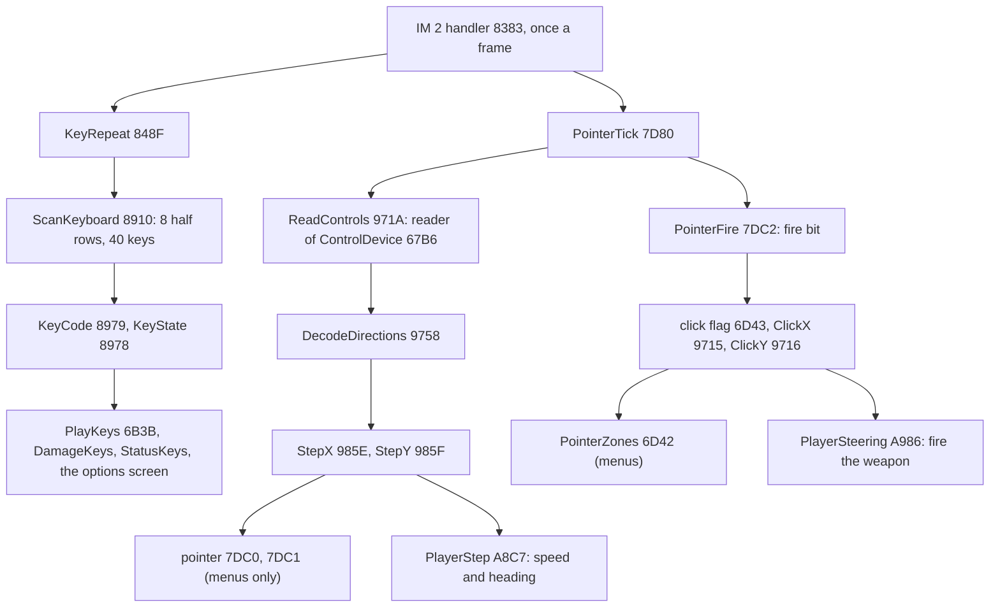

The point: one device choice serves both the pointer and the vehicle.
The steps do not know what they move.

## 5.2 Five readers, one code

The options screen (5.8) stores the device in ControlDevice `$67B6`.
ReadControls jumps through DeviceReaders `$9723` with that index.
Every reader leaves the same code in A, with a bit set when the control is pressed:

| Bit | Control |
| --- | --- |
| 4 | left |
| 3 | right |
| 2 | down |
| 1 | up |
| 0 | fire |

| Index | Key on the options screen | Reader | Address | Ports | Witness |
| --- | --- | --- | --- | --- | --- |
| 0 | 1 Sinclair Joystick | ReadSinclair | `$972D` | `$EFFE` (keys 6 7 8 9 0) | menu, 11 runs in frames 115-140 |
| 1 | 2 Cursor Keys | ReadCursor | `$9734` | `$F7FE` (5), `$EFFE` (6 7 8), `$7FFE` (SPACE) | menu, frames 386, 388, 654, 656 |
| 2 | 3 Kempston Mouse | ReadMouse | `$9813` | `$FBDF` (X), `$FFDF` (Y) | controls, frames 326-331 |
| 3 | 4 Kempston Joystick | ReadKempston | `$9833` | `$1F` | controls, frames 138-224 |
| 4 | 5 Keyboard (the default) | ReadKeys | `$9844` | `$FE` with KeyTable `$9862` | menu, 55 runs in frames 0-59 |

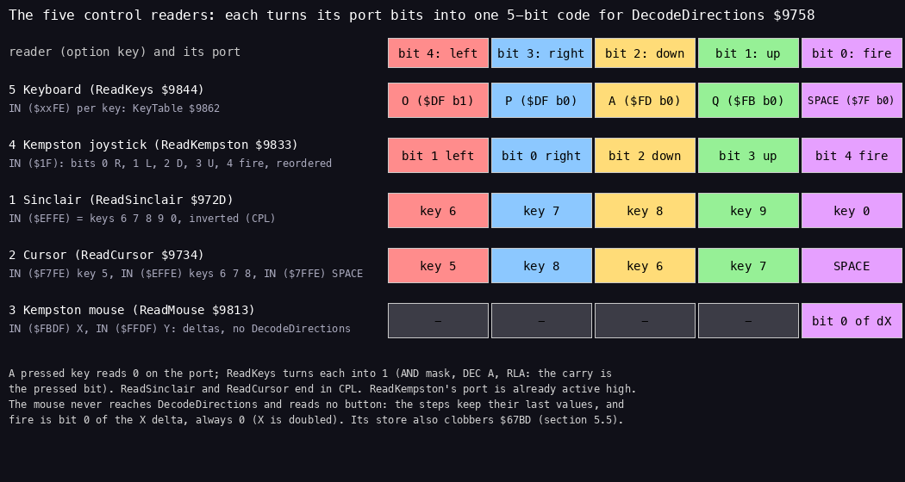

*The five readers: the port bits each one reads and where they land in the five-bit code. From the listing
`build/game.lst` (ReadControls `$971A` to KeyTable `$9862`); `python3 tools/fig_controls.py devices
docs/img/controls/devices.png`.*

ReadKeys reads five keys from KeyTable.
Each entry is a half-row address byte and a bit mask:

| Key | Half row | Mask | Code bit |
| --- | --- | --- | --- |
| O | `$DF` | `$02` | 4 left |
| P | `$DF` | `$01` | 3 right |
| A | `$FD` | `$01` | 2 down |
| Q | `$FB` | `$01` | 1 up |
| SPACE | `$7F` | `$01` | 0 fire |

It turns each key into one bit without a branch:

1. `AND mask` gives 0 for a key that is down and the mask (1 to 16) for one that is up.
2. `DEC A` turns 0 into `$FF` and the mask into a number below `$80`.
3. `RLA` moves bit 7 into the carry, so the carry is set only for a key that is down.
4. `RL D` shifts that carry into the code.

Four more entries follow the five in KeyTable: `$FE`,`$08` (C), `$FE`,`$02` (Z), `$FE`,`$04` (X) and `$FD`,`$02`
(S).
ReadKeys counts only five, so it never reads them.

```
ReadKeys:  LD HL,KeyTable        ; 5 pairs: half row, mask
           LD E,$05
           LD C,$FE
l_984B:    LD B,(HL)             ; the half row
           INC L
           IN A,(C)
           AND (HL)              ; 0 when the key is down
           DEC A                 ; $FF when down, below $80 when up
           RLA                   ; carry = down
           RL D                  ; into the code: O, P, A, Q, SPACE = bits 4..0
           INC L
           DEC E
           JR NZ,l_984B
           LD A,D
           JP DecodeDirections
```

The other readers:

- ReadSinclair reads the half row `$EFFE`.
  Its keys 0, 9, 8, 7, 6 sit in bits 0-4, which is the Interface 2 layout of fire, up, down, right, left.
  It needs only `CPL`, because a key reads as 0 when down.
- ReadCursor reads 5 from the half row `$F7FE`, 6, 7 and 8 from `$EFFE`, and SPACE from `$7FFE` as fire.
  It gathers the bits one by one with `RL E`, then inverts them.
- ReadKempston reads port `$1F`, where a set bit means pressed (bit 0 right, 1 left, 2 down, 3 up, 4 fire).
  It reorders the bits with `RRCA` and `RL C`.

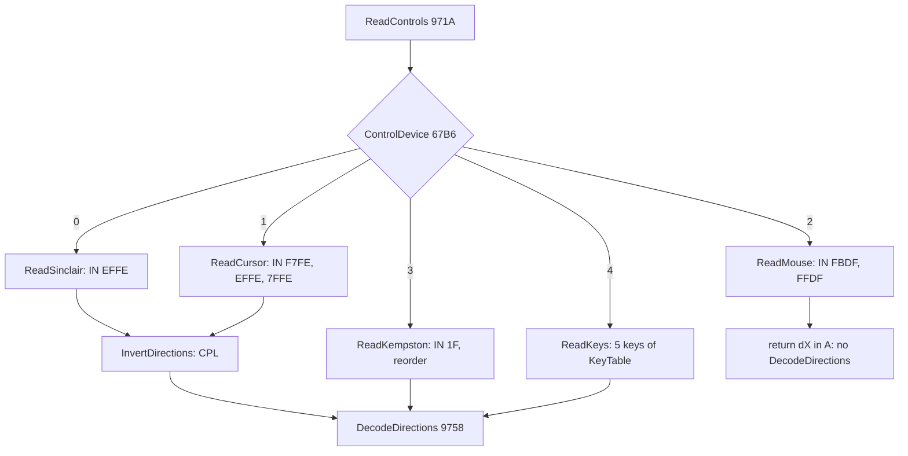

Worked example, menu frame 0, with the script holding A:

1. O, P and Q are up and give carry 0.
2. For A, the half row `$FD` reads `$FE`, `AND $01` gives 0, `DEC A` gives `$FF`, and the carry is 1.
3. SPACE is up.
4. D ends as `00100` = 4, "down".

Witness:

- In the trace of menu 0-60, ReadKeys `$9844` runs 55 times, once in each frame whose interrupt was not lost.
- In the menu recording, ReadSinclair `$972D` runs 11 times in frames 115-140, after OPTIONS 1.
- ReadCursor `$9734` runs in frames 386 and 388, after OPTIONS 2: two runs in 386-389, one every second frame.

The point: four readers feed one decoder.
The mouse reader is the exception, and 5.5 shows what that costs.

## 5.3 DecodeDirections: steps that grow

DecodeDirections `$9758` takes the five-bit code and makes two signed steps.
StepY `$985F` comes from up and down.
StepX `$985E` comes from left and right.
Down and right are positive, as the screen's Y grows downwards.
Each axis works the same way:

- Both directions of the axis, or neither: the step is 0 and the repeat count is reset to StepFrames `$9719` (4).
  Both opposite bits are cleared from the code first.
- A direction that was not down at the last call: the step is +1 or -1 and the repeat count is reset.
- The same direction as at the last call: the repeat count goes down by one.
  At zero, it is reset to 4 and the step grows by one in its direction, up to 8 or down to -8.

The code of the call is kept in LastDirections `$67B8` for the next call.
RepeatY `$67B7` serves the Y axis, and RepeatX `$67BA` the X axis.

```
DecodeDirections:
  AND $1F
  LD C,A
  AND $06               ; up and down
  JR Z,l_9767           ; neither
  CP $06
  JR NZ,l_9773          ; one of them
  LD A,C                ; both: drop both
  AND $F9
  LD C,A
l_9767:
  XOR A
  LD (StepY),A          ; step 0
  LD A,(StepFrames)
  LD (RepeatY),A        ; count = 4 (RepeatY serves Y)
  JR l_97B2
l_9773:
  LD B,A
  LD A,(LastDirections)
  AND $06
  CP B
  LD A,B
  JR Z,l_9790           ; held since the last call
  RRA
  RRA                   ; carry = up
  LD A,$01
  JR NC,l_9785
  NEG                   ; up: -1
l_9785:
  LD (StepY),A
  ...                   ; count = 4
l_9790:
  LD HL,RepeatY
  DEC (HL)
  JR NZ,l_97B2          ; not yet
  ...                   ; count = 4 again
  LD A,(StepY)
  JR C,l_97AA
  CP $08                ; down: grow to 8
  JR NC,l_97AF
  INC A
  ...
l_97B2:                 ; the same for left and right into StepX, then
  LD A,C
  LD (LastDirections),A
```

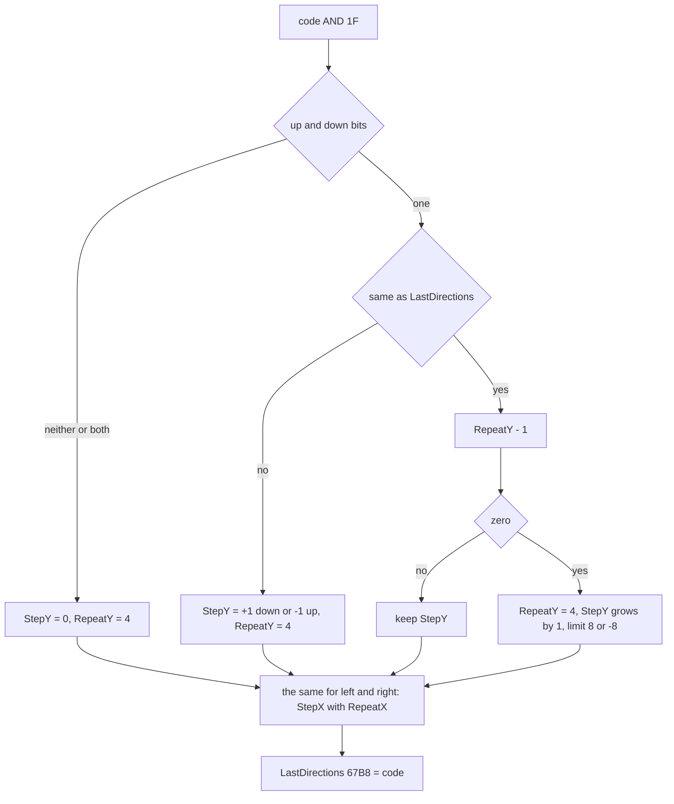

Worked example, menu frames 0-9 with A held.
The values are taken at each frame's start, so each row shows the call of the frame before.

| Frame | Call | RepeatY `$67B7` | StepY `$985F` | Pointer Y `$7DC1` |
| --- | --- | --- | --- | --- |
| 0 | none yet | 4 | 0 | 128 |
| 1 | A new: step +1 | 4 | 1 | 129 |
| 2 | frame 1 lost its interrupt | 4 | 1 | 129 |
| 3 | held: count 3 | 3 | 1 | 130 |
| 4 | held: count 2 | 2 | 1 | 131 |
| 5 | held: count 1 | 1 | 1 | 132 |
| 6 | count 0: reset to 4, step 2 | 4 | 2 | 134 |
| 7, 8 | held | 3, 2 | 2 | 136, 138 |
| 9 | A up at frame 8: step 0 | 4 | 0 | 138 |

The script releases A for one frame every 9 frames, so the step never passes 2 here.
The driving figure of 5.9 shows it reaching 8.

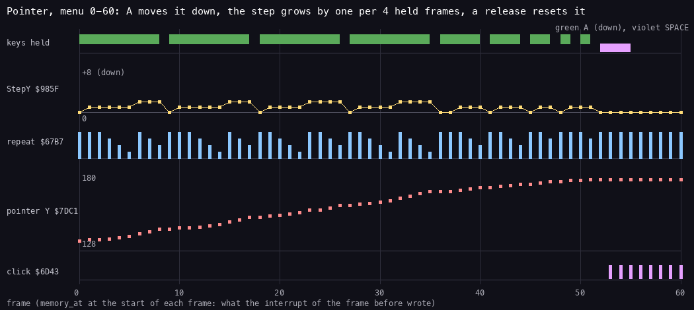

*Menu frames 0-60: the keys of `tests/inputs/menu.txt` against StepY `$985F`, the Y repeat count `$67B7`, the
pointer Y `$7DC1` and the click flag `$6D43`, sampled with `memory_at` at the start of each frame. `python3
tools/fig_controls.py timeline docs/img/controls/pointer-timeline.png --work work/docs/bcB/menu`.*

The point: a tap moves the pointer one pixel, and a held direction accelerates to 8 pixels a frame.
The same steps steer the vehicle.
PlayerSteering halves StepX with `SRA`, so a left tap (-1) turns it by one heading step, while a right tap (+1)
does not turn it at all (`SRA` of 1 is 0); a long press turns it 4 steps a pass either way (5.9).

## 5.4 The pointer

PointerTick `$7D80` runs in the interrupt in every screen.
It reads the device and stores the code at `$66CE` (PolyClipVars + 2).
Nothing reads that byte back: the only accesses in the main image and in banks 3, 4, 6 and 7 are the three writes
`$7D83`, `$7E7B` and `$A9BC` (the mission blocks were not scanned).
It calls PointerFire.
Then it stops unless two flags allow the move:

- the operand of `LD A,$FF` at `$7D8A` (the instruction is at `$7D89`; StatusLoop clears it at `$6BF0`);
- the operand of PointerShown at `$83BF` (doc 04).

The 3D view clears the second flag, so the pointer stays where it is while the steps steer the vehicle.
Otherwise ClampStep moves PointerPos X `$7DC0` by StepX inside 8-247, and PointerPos Y `$7DC1` by StepY inside
8-183.
The pointer coordinates are screen pixels.

```
PointerTick:
  CALL ReadControls
  LD (PolyClipVars+$0002),A  ; the code (no reader)
  CALL PointerFire
  LD A,$FF                   ; operand $7D8A: 0 freezes the pointer
  AND A
  RET Z
  LD A,(PointerShown+$0001)      ; $83BF: 0 in the 3D view
  AND A
  RET Z
  LD A,(StepX)
  LD HL,PointerPos
  LD D,$08                   ; lowest X
  LD E,$F7                   ; highest X, 247
  CALL ClampStep
  INC HL
  LD A,(StepY)
  LD D,$08
  LD E,$B7                   ; highest Y, 183: falls into ClampStep
ClampStep:
  LD C,(HL)
  LD B,A
  AND A
  JP P,l_7DB6
  ADD A,C                    ; a negative step
  SUB D
  JR C,l_7DB4
  ADD A,D
  LD (HL),A
  RET
l_7DB4:
  LD (HL),D                  ; stop at the low edge
  RET
l_7DB6:
  LD A,C                     ; a positive step
  ADD A,B
  SUB E
  JR NC,l_7DBE
  ADD A,E
  LD (HL),A
  RET
l_7DBE:
  LD (HL),E                  ; stop at the high edge
  RET
```

PointerFire `$7DC2` takes bit 0 of the code:

- With fire up, it clears FireHeld `$9717`.
- With fire newly down, it sets FireHeld and the click flag (the operand `$6D43` of PointerZones) to `$FF`, and
  loads FireCount `$9718` with 25.
- While fire stays down, FireCount counts down.
  At zero, the click flag is set to `$7F` and FireCount to 5.

So a held fire clicks once, then again after half a second, then every tenth of a second.
Each click copies the pointer position into ClickX `$9715` and ClickY `$9716`.
It takes the copy that CopyPointer `$897E` keeps at `$7C51` and `$7C53`.
The flag stays set until a reader clears it.
PointerZones clears it after its scan (`$6D7A`: `XOR A` / `LD (PointerZones+1),A`), ClearPointerState `$7E7A`
clears it too, and PlayerSteering clears it whenever it reads a click and while the fire cooldown runs (5.9).

```
PointerFire:
  RRA                        ; carry = fire
  JR C,l_7DCA
  XOR A
  LD (FireHeld),A
  RET
l_7DCA:
  LD A,(FireHeld)
  AND A
  JR Z,l_7DE1                ; newly down
  LD A,(FireCount)
  DEC A
  LD (FireCount),A
  RET NZ
  LD A,$7F                   ; a repeat click
  LD (PointerZones+$0001),A
  LD A,$05
  JR l_7DEB
l_7DE1:
  LD A,$FF
  LD (FireHeld),A
  LD (PointerZones+$0001),A  ; the first click
  LD A,$19                   ; 25 frames to the first repeat
l_7DEB:
  LD (FireCount),A
  LD A,($7C51)
  LD (ClickX),A
  LD A,($7C53)
  LD (ClickY),A
  RET
```

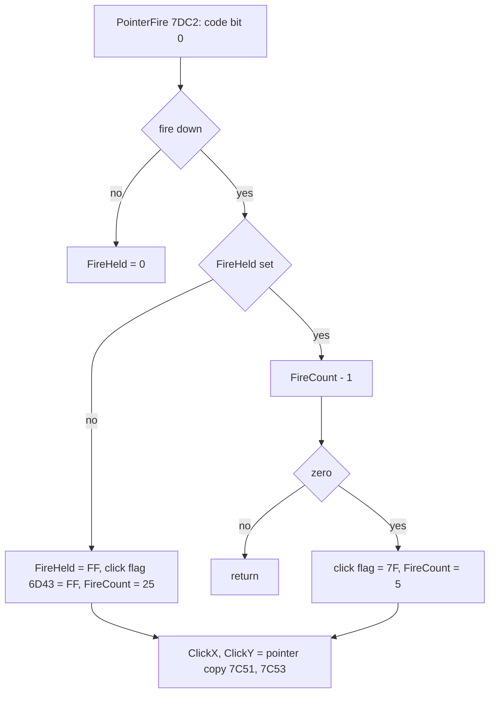

Worked example, menu frame 52: SPACE goes down with the pointer at X 128, Y 180.
At frame 53, the click flag reads `$FF`, and ClickX and ClickY read 128 and 180 (the figure of 5.3).
That point lies in the OPTIONS zone of the title (X 98-157, Y 180-184).
The next pass of the title calls the zone's routine, and the options screen follows (5.7).

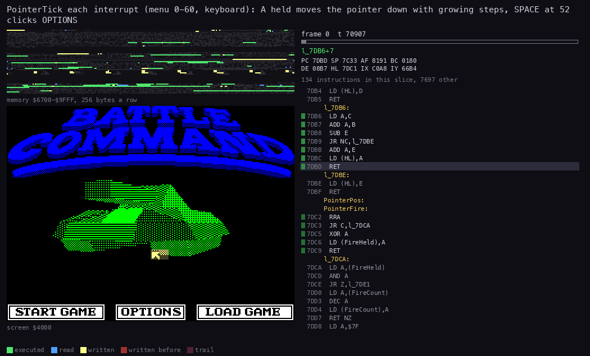

*PointerTick over menu frames 0-60: the pointer moves down the title with A held, then SPACE clicks OPTIONS.
`python3 R/kit/routine_anim.py --work work/docs/bcB/menu --window 0:0-60:0 --listing build/game.lst --view screen
--pc 7D80-7DFA,971A-9870 --range 6700-9FFF --out docs/img/routines/PointerTick.gif`.*

The point: the screen code draws the pointer, but only the interrupt moves it.
A slow screen still gets a smooth pointer.

## 5.5 The Kempston mouse: no movement, then a restart

The mouse reader is the one reader that does not give a five-bit code.

1. It reads X from `$FBDF` (`AND $7F`, doubled) and Y from `$FFDF` (inverted).
2. It stores them at MousePos `$67BB` (X) and `$67BC` (Y).
3. It stores the deltas as a word at `$67BC`: dX into `$67BC` and dY into `$67BD`.
   So dX replaces the new Y that step 2 has just stored.
   The next delta of Y is taken against the wrong number.
4. It returns with A = dX.

```
ReadMouse:
  LD HL,(MousePos)       ; L = old X, H = old Y
  LD BC,$FBDF
  IN A,(C)
  AND $7F
  ADD A,A                ; X, always even
  LD E,A
  LD BC,$FFDF
  IN A,(C)
  CPL
  LD D,A                 ; Y
  LD (MousePos),DE
  SUB H
  LD H,A                 ; dY
  LD A,E
  SUB L
  LD L,A                 ; dX
  LD (MousePos+$0001),HL ; $67BC = dX (over the new Y), $67BD = dY
  RET                    ; A = dX
```

Three faults follow, all in the code:

- The pointer does not follow the mouse.
  ReadMouse does not call DecodeDirections.
  StepX and StepY keep whatever the last device left, and nothing reads the deltas.
- The mouse cannot click.
  PointerFire takes bit 0 of A, which is dX, and dX is always even.
  No button port is read.
- `$67BD` has another owner.
  FillPolygon `$C4C4` (bank 3, doc 06) keeps there the bottom row of the polygon it fills.
  FillSpans reads it back to know where to start.
  When the interrupt falls between the two, the bottom row becomes the mouse's dY.

The controls recording shows the third fault end in a restart.
OPTIONS 3 is chosen at frame 264, and the mouse moves.

| Moment | What happens |
| --- | --- |
| 328:68 686 | FillPolygon writes the bottom row `$45` (69) to `$67BD` |
| 329:9 693 | the interrupt runs ReadMouse, whose store at `$982F` writes dY `$A6` to `$67BD` |
| 329:18 923 | FillSpans starts from row 166 instead of 69; its first write, from `$C955`, lands at `$9FBB`, inside the 3D opcode code |
| after 329:18 923 | the spans go up from `$9FBB` to `$9D39`, over RunScript's opcode routines |
| 329:30 511 | the damaged code runs at `$9DFA` |
| 329:33 315 | it runs `$9EA9`, jumps to `$AA34`, and returns into bank 3 at `$CCC6` |
| 329:33 568 | it meets a `$76` byte at `$CCD2`, data read as HALT, and halts; the interrupts go on |
| 331 | the CPU runs through zero bytes from `$5B00` |
| 331:2 109 | the handler path reaches `$7E79`, the last byte of `JP PageBankKept` in SoundTick, and runs it as an opcode (SP `$7C33`) |
| 331:51 545 | an `RST 0` at `$FC0C` restarts the machine; the 128K menu follows (frames 363 and 406 of WALKTHROUGH 6.0) |

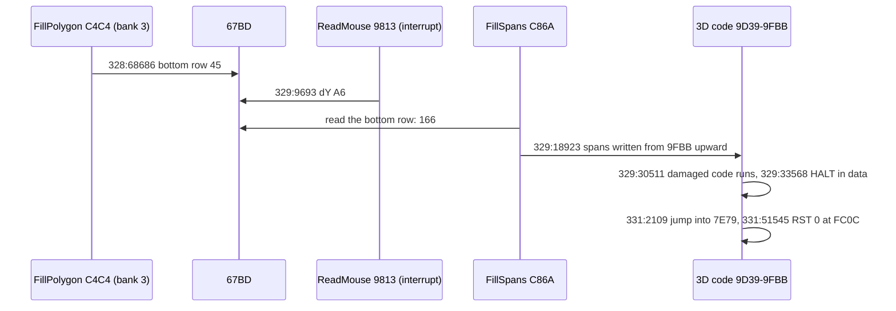

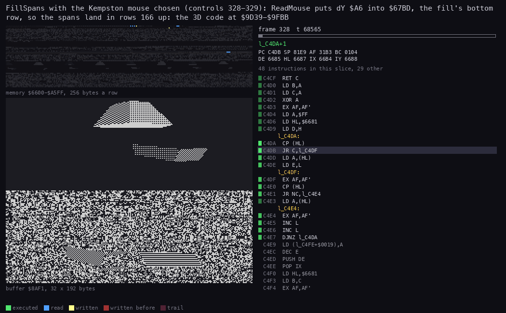

*FillSpans in controls 328:68 000-329:31 000. The view runs below the back buffer `$8AF1` to show the spans going
past its end into the code. `python3 R/kit/routine_anim.py --work work/docs/bcB/ctl --window 328:68000-329:31000
--listing build/bank3.lst --view buffer:8AF1:32x192:rows --pc C4C4-C958 --range 6600-A5FF --out
docs/img/routines/FillSpans-mouse.gif`.*

Witness: the access trace of controls 326-334 (`work/docs/bcB/ctl/traces/326_0-334_0.uatr`) and the window
328:68 000-329:31 000.
At frame 335, the pointer variables read 23 296 and 72 (WALKTHROUGH 6.0), because the machine is already in the
ROM.

The point: the restart is the game's own fault, not the emulator's.
The mouse reader was never finished.
It has no decoder and no button, and it writes a variable that FillPolygon also uses.

## 5.6 The keyboard scan

KeyRepeat `$848F` runs once a frame in the interrupt.
It calls ScanKeyboard `$8910`.
ScanKeyboard reads the eight half rows from `$7FFE` down (`RRC B`) and stops at the first key down.
KeyCodes `$8950` gives the code of each of the 40 keys in that order:

- letters and digits: their ASCII codes;
- SPACE `$02` and ENTER `$03`;
- SYMBOL SHIFT 0 and CAPS SHIFT 1.

ScanKeyboard sets bit 1 of KeyState `$8978` while a key is down, and keeps the raw code at `$897B`.
CAPS SHIFT with 0 gives `$04`, a delete key for the code entry.

KeyRepeat then makes a typing repeat:

- A key that differs from KeyCode `$8979` is stored there, and the repeat count `$897A` is set to 17.
- The same key counts down, and at zero the count is set to 2.
- Both cases set bit 0 of KeyState.
- With no key, KeyCode is cleared once bit 0 is clear.

So bit 0 marks a new key, then the same key after 17 frames, then every second frame.

```
KeyRepeat:
  CALL ScanKeyboard
  JR C,l_84A1            ; a key is down
  LD HL,KeyState
  BIT 0,(HL)
  JR NZ,l_84C0
  XOR A
  LD (KeyCode),A         ; no key: forget it
  JR l_84C0
l_84A1:
  LD C,A
  LD A,(KeyCode)
  CP C
  JR Z,l_84B3
  LD A,C
  LD (KeyCode),A         ; a new key
  LD A,$11
  LD (KeyRepeatCount),A  ; first repeat after 17 frames
  JR l_84BB
l_84B3:
  LD HL,KeyRepeatCount
  DEC (HL)
  JR NZ,l_84C0
  LD (HL),$02            ; then every second frame
l_84BB:
  LD HL,KeyState
  SET 0,(HL)             ; a key to act on
l_84C0:
  RET
```

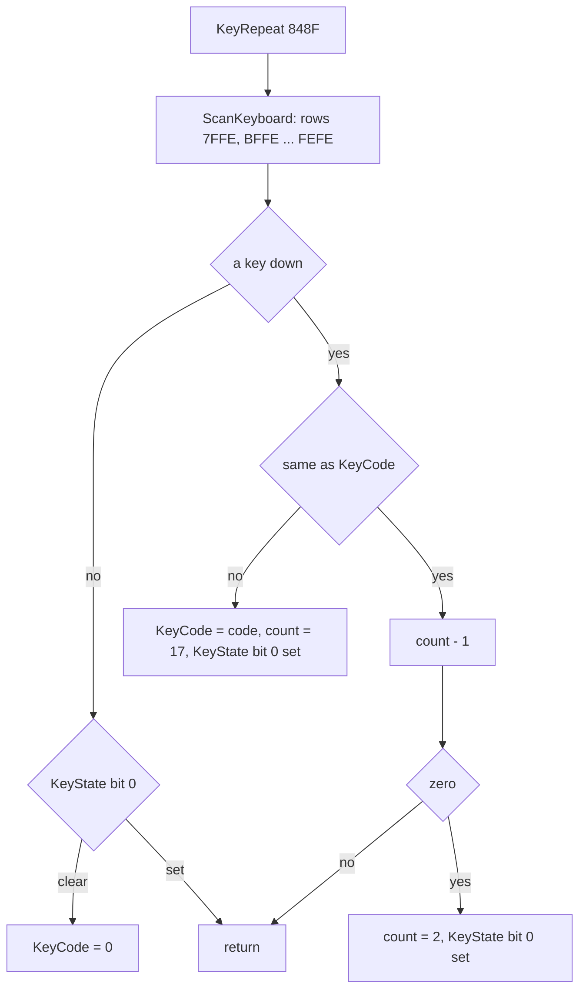

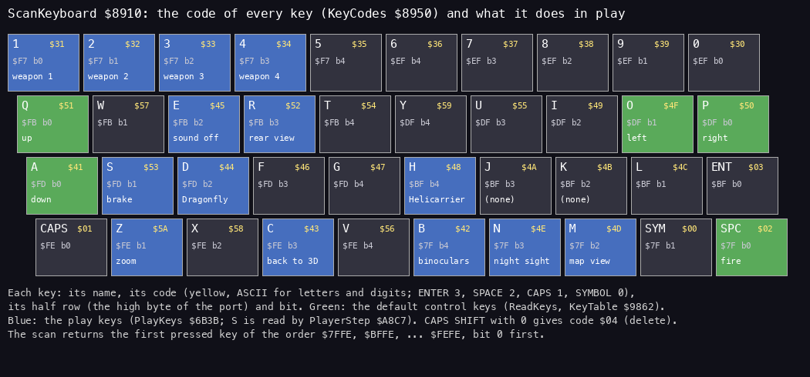

*The 40 keys with their codes from KeyCodes `$8950` and their use in play (PlayKeys `$6B3B`, PlayerStep `$A8C7`)
and on the menus. From `build/game.lst`; `python3 tools/fig_controls.py keyboard
docs/img/controls/keyboard.png`.*

Worked example: the options screen of the menu recording waits for bit 1 of KeyState and reads KeyCode.
Key 1 at frame 95 gives code `$31`.
`SUB $31` gives 0, and ControlDevice becomes 0 (Sinclair).

Witness: ScanKeyboard runs in every interrupt of the trace of menu 0-60 (55 runs).

The point: one key has two readers.
The pointer path reads the five control keys as levels.
The key path reads all 40 as codes.
O, P, Q, A and SPACE therefore also appear as KeyCode, which PlayKeys ignores.

## 5.7 The menus as a state machine

Every screen of the game is a node of the ScreenList graph at `$74E8`.
A node is a draw routine word, a zone table word and a list of transition words.
ScreenList `$74E6` holds the address of the current node's transition list.
SetScreen `$7060` takes E = 2N and reads transition N.
From the new node, it sets the draw routine as the operand of NextView (`$6A99`).
It sets the zone table as the operand of PointerZones (`$6D47`).
Then ScreenList points to the new node's transitions.
The entries ScreenZero `$705A`, ScreenTwo `$705E`, ScreenFour `$7040`, ScreenSix `$7047` and ScreenEight `$704E`
load E = 0, 2, 4, 6, 8.
The current screen's loop ends when it sees the view flag.
NextView then pushes the new draw routine and returns into it.

```
SetScreen:
  LD HL,(ScreenList)       ; the current node's transitions
  LD D,$00
  ADD HL,DE                ; transition N
  LD E,(HL)
  INC HL
  LD D,(HL)
  INC HL
  EX DE,HL                 ; HL = the next node
  LD E,(HL)
  INC HL
  LD D,(HL)
  INC HL
  LD (NextView+$0008),DE   ; its draw routine
  LD E,(HL)
  INC HL
  LD D,(HL)
  INC HL
  LD (PointerZones+$0005),DE ; its zone table
  LD (ScreenList),HL       ; its transitions
```

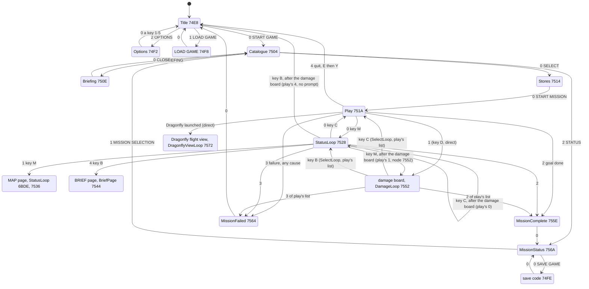

Nodes `$7536` and `$7544` have the same transitions as StatusLoop `$7528`.
Their arrows are left out of the diagram.
The two are the console's pages:

- Node `$7536` (M in the status view, through ScreenTwo) re-enters StatusLoop at `$6BDE`, past the picture and the
  help: the MAP page.
- Node `$7544` (B, through ScreenEight) is BriefPage `$6C44`.
  It calls BriefPageOnce, which calls BriefPageText `$70B6` once: a box (bank 6 `$C079`), the briefing text at
  (`$70A3`) and an attribute box.
  StatusLoop `$6BF6` puts the `NOP` of BriefPageOnce back on each visit.
  The screenshot `010455-view-map-brief` of the play recording shows the page, with its MAP and BRIEF buttons.

The damage board's node `$7552` has transition 1 = `$0000`.
Transition 3 is taken on any failure: the code that fails the mission stores its reason at FailReason `$7BF9` and
calls ScreenSix (OutOfFuel in 5.9 is one of them).
The key D does not use transition 1 of the play node: SelectDamage `$6BC2` writes DamageLoop `$6C93` into the
NextView operand through SelectLoop `$6BB4`, and so do DamageKeys' B and C (StatusKeys' C takes transition 0).
Only StartMission, StatusLoop and DamageLoop are entered through SelectLoop.

SelectLoop does not touch ScreenList: only SetScreen writes it (`$707B`; no other `LD ($74E6),HL` in any listing).
The damage board, and the status view entered from it with B, keep the play node's transitions `$751E`.
From there the status view's keys go elsewhere than from M in play:

- C (ScreenZero) takes play's transition 0, `$7528`: the status view again, not play.
- M (ScreenTwo) takes play's transition 1, `$7552`: the damage board, now through SetScreen.
- B (ScreenEight) takes play's transition 4, `$74E8`: the title.
  The mission is abandoned without QuitPrompt, without QuitYes's clock stop and without SaveLoadedMission.
- StatusLoop sets its own latch to `$4D` (`$6BD9`), so a B still held from the damage board acts at once.

Node `$7552`'s own list `$7556` (`$751A`, `$0000`, `$755E`, `$7564`) becomes current only through that M.
A later quit (E, Y: transition 4) then reads the word `$CD1E` at `$755E`, the first word of the next node, as a node.
The diagram's three edges marked "after the damage board" exist only on this path.
This is known only from the code: the play recording presses D at 10 195 and then C at 10 260, never B on the
damage board.
Node `$7572` (draw DragonflyViewLoop `$6AB9`) is in the list, but no transition word names it.
LaunchDragonfly reaches it: at `$C30F` it writes DragonflyViewLoop into NextView, after pointing the camera `$B9F4`
at the Dragonfly's record (doc 06, 6.10).

A screen with zones calls PointerZones `$6D42` on each turn of its loop.
The click flag is its `LD A,n` operand, so with no click the routine returns at once.
Otherwise it walks the zone table: 6-byte records x1, x2, y1, y2 and a routine, ended by a 0 byte.
Each record with x1 <= ClickX < x2 and y1 <= ClickY < y2 has its routine called through a patched `CALL`; the scan
does not stop at the first, and at the end byte it clears the click flag (`$6D7A`).

```
PointerZones:
  LD A,$00               ; $6D43: the click flag
  AND A
  RET Z
  LD HL,$C4E9            ; $6D47: the zone table of the screen
l_6D49:
  LD A,(HL)
  AND A
  JR Z,l_6D7A            ; 0: the end
  PUSH HL
  LD A,(ClickX)
  LD C,(HL)
  CP C
  JR C,l_6D73            ; X below x1
  INC HL
  LD C,(HL)
  CP C
  JR NC,l_6D73           ; X at or past x2
  INC HL
  LD A,(ClickY)
  LD C,(HL)
  CP C
  JR C,l_6D73
  INC HL
  LD C,(HL)
  CP C
  JR NC,l_6D73
  INC HL
  LD E,(HL)
  INC HL
  LD D,(HL)
  INC HL
  LD ($6D71),DE          ; the zone's routine
  CALL $0000
l_6D73:
  POP HL
  LD BC,$0006
  ADD HL,BC              ; the next record, match or not
  JR l_6D49
l_6D7A:
  XOR A
  LD (PointerZones+$0001),A ; the click is used up
  RET
```

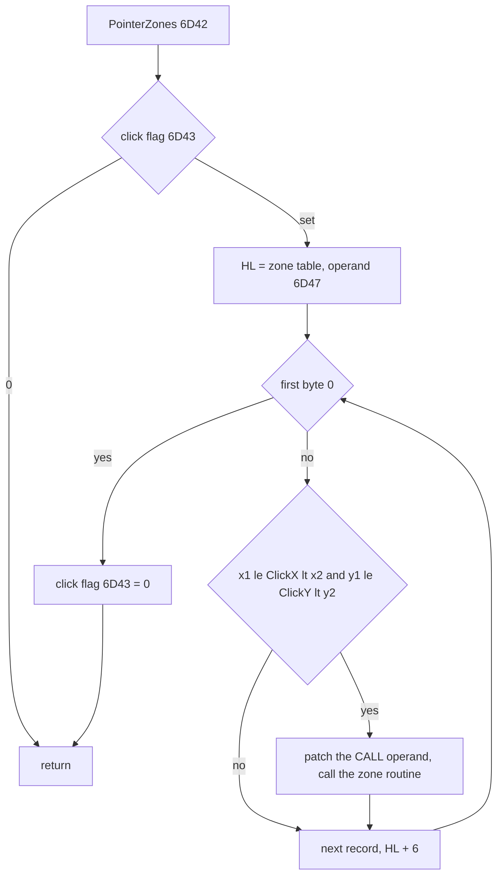

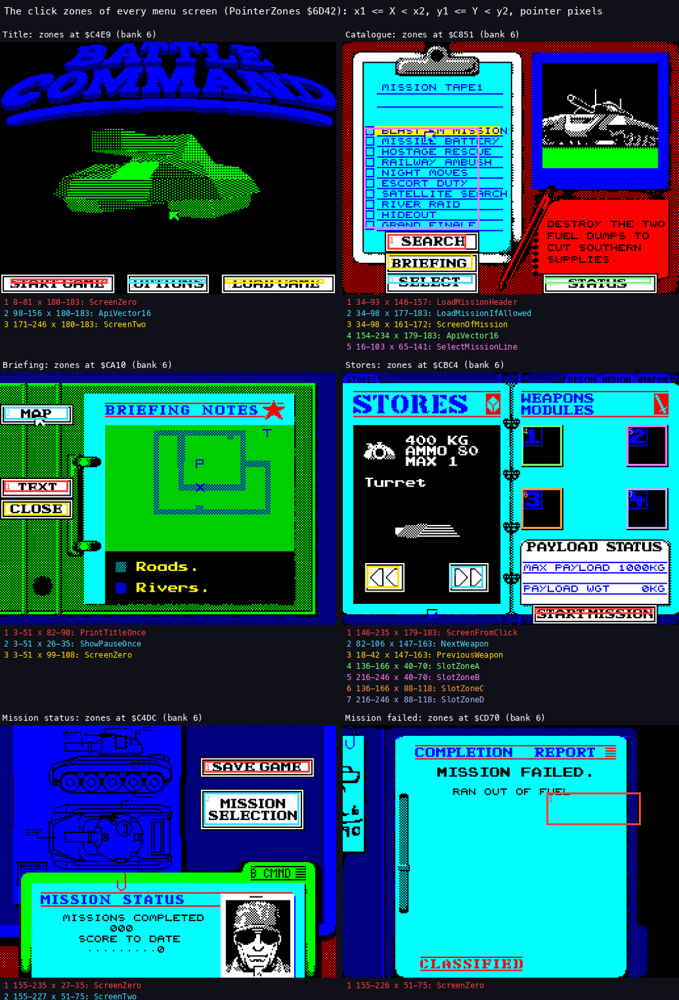

*The zone tables of the title, catalogue, briefing, stores, status and end screens, drawn over the screenshots of the
menu and fuel recordings. From the zone tables named by the ScreenList nodes; `python3 tools/fig_controls.py zones
docs/img/controls/zones.png`.*

The zones of each screen:

| Screen | Zone (x1-x2, y1-y2) | Routine | Leads to |
| --- | --- | --- | --- |
| Title | START GAME 8-82, 180-184 | ScreenZero | the catalogue |
| Title | OPTIONS 98-157, 180-184 | ApiVector16 (ScreenFour) | the options |
| Title | LOAD GAME 171-247, 180-184 | ScreenTwo | the code entry |
| Catalogue | the mission list 16-104, 65-142 | SelectMissionLine | marks a mission |
| Catalogue | SEARCH 34-94, 146-158 | LoadMissionHeader | the tape search |
| Catalogue | BRIEFING 34-99, 161-173 | ScreenOfMission | the briefing |
| Catalogue | SELECT 34-99, 177-184 | LoadMissionIfAllowed | the stores |
| Catalogue | STATUS 154-235, 179-184 | ApiVector16 | the mission status |
| Briefing | MAP 3-52, 26-36 | ShowBriefingMapOnce | the briefing map |
| Briefing | TEXT 3-52, 82-91 | BriefingTextOnce | the briefing text |
| Briefing | CLOSE 3-52, 99-109 | ScreenZero | the catalogue |
| Stores | PREVIOUS 18-43, 147-164 and NEXT 82-107, 147-164 | PreviousWeapon, NextWeapon | the weapon shown |
| Stores | four slots 136-167 or 216-247, 40-71 or 88-119 | SlotZoneA-D | fit or remove |
| Stores | START MISSION 146-236, 179-184 | ScreenFromClick | play |
| Mission complete, failed | 155-227, 51-76 | ScreenZero | status or title |
| Mission status | SAVE GAME 155-236, 27-36 | ScreenZero | the save code |
| Mission status | MISSION SELECTION 155-228, 51-76 | ScreenTwo | the catalogue |

The password node `$74F8` has a zone table whose first byte is 0.
It has no zone, because the code is typed.

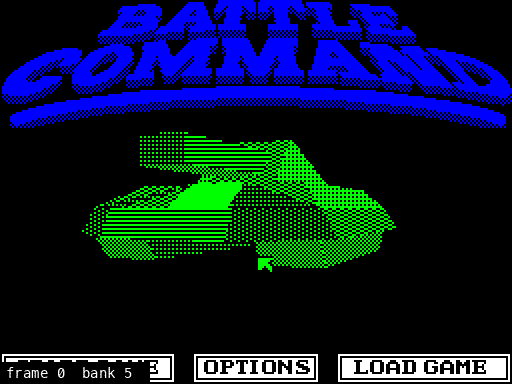

*The screen that is shown over menu frames 0-640 (every 4th frame). The pointer moves down, SPACE clicks OPTIONS,
key 1 picks Sinclair and keys 6 and 9 move the pointer, then key 2 picks the cursor keys. The black frames are the
shadow screen of bank 7, shown while a picture is unpacked (doc 06). The band under the screen gives the frame and
the screen bank.
`python3 tools/fig_shownscreen.py --work work/docs/bcB/menu --from 0 --to 640 --step 4 --label docs/img/controls/menu-options.gif`.*

The point: the whole front end is data.
Six bytes of zone record make a new button, and a node of six bytes or more makes a new screen.

## 5.8 The options screen

OptionsScreen `$F8F4` (bank 6) is node `$74F2`.

1. It prints the five devices from OptionsText.
2. It waits for bit 1 of KeyState.
3. A key `1` to `5` gives 0-4, which goes to ControlDevice `$67B6`.
   Any other key is ignored.
4. The old line's attribute byte inside the text goes back to `$44`, and the new one becomes `$42`.
   The address of the highlighted attribute is kept as the operand of HighlightedOp `$F912` (at `$F913`), so the
   next visit starts from it.
5. The click flag is cleared, then ScreenZero and NextView return to the title.

```
OptionsKey:
  LD HL,$8978            ; KeyState
OptionsKeyLoop:
  LD A,(HL)
  AND $02
  JR Z,OptionsKeyLoop    ; wait for a key
  INC HL
  LD A,(HL)              ; KeyCode
  SUB $31
  JR C,OptionsKey        ; below 1
  CP $05
  JR NC,OptionsKey       ; above 5
HighlightedOp:
  LD HL,OptionsText+$0078 ; the attribute of the highlighted line
  LD (HL),$44
  LD ($67B6),A           ; ControlDevice
```

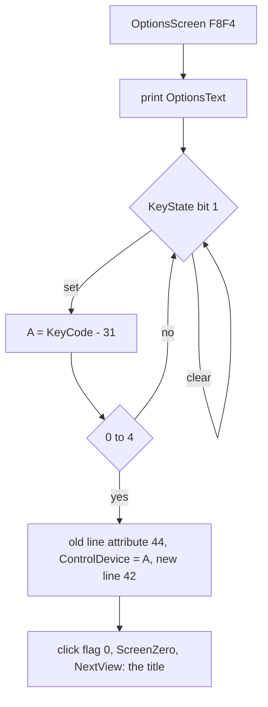

Witness: menu frame 95 (key 1) and frame 342 (key 2); controls frame 95 (key 4) and frame 264 (key 3).
The keyboard is the default (ControlDevice 4 in the image).
The options screen is the second part of the menu animation of 5.7.

The point: the device is chosen with the keyboard, not the pointer, so a broken device can always be undone.

## 5.9 Driving, turning and the Dragonfly

The 3D view uses the same steps.
PlayerStep `$A8C7` is the handler of the player's object record (IX = `$75F0`, doc 07), run once a pass.
The speed is record +7 (`$75F7`), and the heading is record +`$22` (`$7612`).

- Terrain first (doc 10, 10.2): TerrainCollision `$CC3C` stores the terrain type at TerrainType `$CE69`.
  - Type 2 or `$80` (a wall): the speed is negated, MoveObject moves the tank back, and the handler becomes
    BounceDecay `$CC09`, which halves the speed each pass and then gives the handler back to `$A8C7`.
    The pass ends there, with no throttle and no steering.
  - Type 0 or 6: 1.25 x the speed goes to `$7E8E`, the speed bar's value (doc 08, 8.5); the record's speed is put
    back at once, so the move uses the plain speed.
    Any other type stores the plain speed there.
- Speed 0: the fuel, BoundaryCheck and MoveObject are all skipped, and the step goes straight to the throttle.
- Speed: speed = speed - StepY.
  Q (up, a negative step) speeds up, and A slows down and then reverses.
  The speed is held below `$30` forwards and below `$18` backwards, so the range is -23 to +47.
- Fuel: each pass with a speed takes (|speed| >> 4) OR 1 from the fuel word `$7C57`.
  When the fuel would go below zero, OutOfFuel `$A94E` sets the failure text and calls ScreenSix, which leads to the
  mission-failed node (doc 10, the fuel recording).
- Heading: PlayerSteering `$A986` adds StepX / 2 (`SRA A`) to the heading, so P turns right and O left.
  `SRA` rounds down: StepX -1 turns by -1, StepX +1 by 0.
- Fire: while the cooldown FireCooldown `$A9FD` is not 0, PlayerSteering counts it down and clears the click flag
  `$6D43`.
  At zero, a set click flag is cleared and fires only if the rear view `$BA27` is off and NextView is StartMission
  (the front view): then the `CALL` at `$A9B8` calls the slot's fire routine through its operand `$A9B9` (set by
  SelectWeapon, doc 10).
  The fire routine itself restarts the cooldown: at 8 through SetFireCooldown `$A9F7` (`$B58F`, `$B5E2`, `$D289`),
  at 16 after a missile (LaunchMissile `$C44D`), and at 8 when the Dragonfly hands back (`$C38D`).
  PlayerSteering then clears `$66CE`.
- The brake: the key S (code `$53`) sets the record's handler to `$A9C9`; it is tested after the terrain, before
  the fuel.
  That handler takes 8 from |speed| each pass, ignores StepY, runs MoveObject and PlayerSteering, and uses no fuel.
  It tests no terrain (no wall bounce) and no boundary, and writes |speed| to the speed bar's `$7E8E` (`$A9D1`).
  Below 8, it sets the speed to 0 and the handler back to `$A8C7`.
  It sits in the source as the routine BrakeKey `$A9C9` (stage 2 had kept it as data); known only from the code: no recording presses S in play (no L1 run of `$A9C9`).

```
PlayerStep:
  JR l_A8C9
l_A8C9:
  CALL ApiVector17      ; TerrainCollision: carry = a segment hit
  JR NC,l_A8ED
  LD A,(TerrainType)
  CP $02
  JR Z,l_A8D9
  CP $80
  JR NZ,l_A8F2
l_A8D9:                 ; a wall: bounce
  LD A,(IX+$07)
  NEG
  LD (IX+$07),A
  CALL ApiVector00      ; MoveObject
  LD (IX+$18),$09       ; handler = BounceDecay $CC09
  LD (IX+$19),$CC
  RET
l_A8ED:
  LD A,$03              ; nothing hit: type 3
  LD (TerrainType),A
l_A8F2:
  ...                   ; S down: JP l_A9C0, the brake handler
  ...                   ; type 0 or 6: $7E8E = 1.25 x speed, else the speed
l_A935:
  CALL ApiVector08      ; |speed|
  JR Z,l_A961           ; 0: no fuel, no move
  SRL A
  SRL A
  SRL A
  SRL A
  OR $01
  ...                   ; fuel - cost, OutOfFuel on a borrow
  CALL BoundaryCheck
  CALL ApiVector00      ; MoveObject
l_A961:
  LD A,(StepY)
  NEG
  ADD A,(IX+$07)        ; speed - StepY
  PUSH AF
  LD C,$30              ; forward limit
  AND A
  JP P,l_A972
  SRL C                 ; backward limit $18
l_A972:
  CALL ApiVector08      ; |speed|
  CP C
  JR C,l_A982
  DEC C                 ; clamp to the limit - 1
  POP AF
  LD A,C
  JP P,l_A983
  NEG
  JR l_A983
l_A982:
  POP AF
l_A983:
  LD (IX+$07),A
PlayerSteering:
  LD A,(StepX)
  SRA A
  ADD A,(IX+$22)        ; heading + StepX / 2
  LD (IX+$22),A
  LD A,(FireCooldown)
  AND A
  JR Z,l_A9A0
  DEC A
  LD (FireCooldown),A
  XOR A
  LD (PointerZones+$0001),A ; no click while it cools down
  RET
l_A9A0:
  LD HL,PointerZones+$0001
  LD A,(HL)
  AND A
  RET Z                 ; no click
  LD (HL),$00
  LD A,(l_BA1F+$0008)   ; $BA27: the rear view
  AND A
  RET NZ
  LD HL,(NextView+$0008)
  LD BC,StartMission
  AND A
  SBC HL,BC
  JR NZ,l_A9BB          ; not the front view
  CALL NoAction         ; operand $A9B9: the slot's fire routine
l_A9BB:
  XOR A
  LD (PolyClipVars+$0002),A
  RET
```

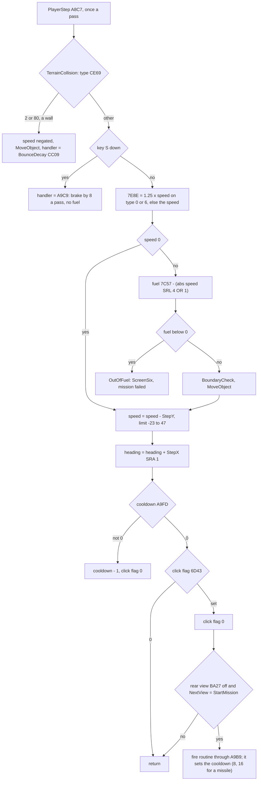

Worked example, play frames 8360-8438 (Q held 8365-8425).
The values are taken at each frame's start.

| Frame | StepY | Speed `$75F7` | Fuel `$7C57` | Y low byte `$7616` |
| --- | --- | --- | --- | --- |
| 8360 | 0 | 0 | 16 128 | `$00` |
| 8372 | -2 | 1 | 16 128 | `$00` |
| 8384 | -5 | 7 | 16 126 | `$04` |
| 8396 | -8 | 20 | 16 124 | `$17` |
| 8420 | -8 | 44 | 16 119 | `$6B` |
| 8426 | 0 | 47 | 16 116 | `$97` |
| 8438 | 0 | 47 | 16 113 | `$C6` |

At speed 47, a pass takes (47 >> 4) OR 1 = 3 from the fuel and moves Y by 47 (`$97` to `$C6`).
In play 10 526-10 614, Q with P gives StepX 8.
The heading goes 0, 1, 4, 8, 12, 16, 20, 24, 28, 32: 4 a pass.

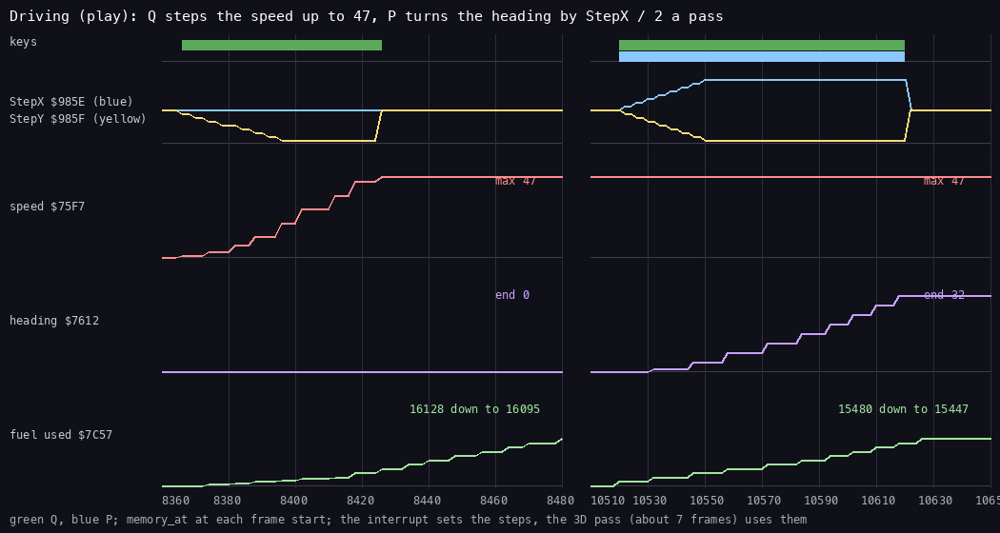

*Play frames 8360-8480 and 10 510-10 650: Q and P from `tests/inputs/play.txt` against StepX, StepY, the speed
`$75F7`, the heading `$7612` and the fuel used, sampled with `memory_at` at the start of every second frame.
`python3 tools/fig_controls.py driving docs/img/controls/driving.png --work work/docs/bcB/play`.*

The Dragonfly is a weapon (store type 7, doc 10): with its slot selected, the fire key launches it (LaunchDragonfly
`$C2BC`), and the view becomes DragonflyViewLoop `$6AB9`, seen from the Dragonfly (doc 06, 6.10).
Its handler is DragonflyStep `$C391`.
StepX turns it, and StepY changes its height.
In play, key 3 at 9005 and SPACE at 9050 launch it; Q held at 9115-9195 lifts it, and O at 9195-9235 turns it (the
screenshots `009195-Dragonfly-flying` and `009235-Dragonfly-turn`).
The key D is not the Dragonfly: it shows the damage board (5.10).

The turret has no key of its own: the weapons fire along the heading.
J and K call the selected weapon's aim pair instead (5.10): the mortar's elevation, the mine's timer and the other
pairs of doc 10.7.

The point: the vehicle has inertia only through the steps.
A tap gives StepY -1, one unit of speed a pass; a long press gives -8.

## 5.10 The play keys and the weapon keys

PlayKeys `$6B3B` runs once a pass in the play loop (doc 04).
It acts while bit 1 of KeyState is set, so on each pass the key is down.
It compares KeyCode with each key in turn.
The two `JP Z` targets of J and K are patched by SelectWeapon, so these keys do what the selected weapon needs.

| Key | Code | Routine | What it does |
| --- | --- | --- | --- |
| E | `$45` | QuitKey `$843F` → QuitPrompt `$DA09` (bank 6) | the quit prompt: Y abandons the mission (ScreenEight), N resumes; the sound effects are silenced while it waits |
| J, K | `$4A`, `$4B` | the weapon's aim pair, patched into `$6B50` (J) and `$6B55` (K) by SelectWeapon from `$7B89` + 8 x type (words 1 and 0) | mortar elevation, mine timer and the other pairs of doc 10.7; NoAction for a damaged slot and before any weapon is selected; an empty slot keeps the previous weapon's pair |
| M | `$4D` | ScreenZero | the status view (node `$7528`), whose screen shows the map |
| D | `$44` | SelectDamage `$6BC2` | the damage board (DamageLoop `$6C93`) |
| 1-4 | `$31`-`$34` | SelectWeapon `$C53F` | the weapon slot 1-4 |
| H | `$48` | PlaceHelicarrier `$D52E` | the helicarrier |
| N | `$4E` | NightKey `$87FC` | the night (infrared) view |
| R | `$52` | RearViewOff `$BA45` | the rear view on or off |
| B | `$42` | ToggleBinoculars `$CEA7` | the binoculars |
| Z | `$5A` | CycleBinocularZoom `$CEE5` | zoom 1-3 |
| C | `$43` | none | kept at `$6B45` (back to 3D from the other views) |
| S | `$53` | PlayerStep (5.9) | the brake |

SelectWeapon stores the key at `$6B45`.
It stores the slot 0-3 at CurrentSlot `$C53C`, and at `$C53D` the address of the slot's `CALL` operand in PlayLoop
(`$6A46` + 5 x slot, the `CALL`s at `$6A45`, `$6A4A`, `$6A4F` and `$6A54`), which the select code patches.
It copies the four words of the store type's record at `$7B89` + 8 x type:

| Word | Goes to | Use |
| --- | --- | --- |
| 0 | `$6B55` | the `JP Z` target of K |
| 1 | `$6B50` | the `JP Z` target of J |
| 2 | `$A9B9` | the fire routine (5.9) |
| 3 | `$C600` | the select routine, called at once |

Then it calls the store type's select routine (doc 10).
An empty slot (store type 0, read at `$C580` from the slot's record at WeaponSlots `$8368` + 6 x slot) returns at
`$C585`, before the copy of the four words (`$C5D9-$C5F8`) and before `$C605`.
It has only moved CurrentSlot and `$C53D`, written the latch and played the select sound: J, K and the fire key keep
the previous weapon's routines, and ConsumeAmmo's pointer `$B551` keeps the previous slot.
Whether SPACE then fires depends on the routine; FireCannon re-reads the ammunition of CurrentSlot and finds none
(suspected, not traced).
A slot whose status is 0 prints "DAMAGED IN COMBAT" (`$C605`) and sets the J, K and fire targets to NoAction.
The status view has its own keys in StatusKeys `$6C60`: C back to play, B ScreenEight (the BRIEF page), M ScreenTwo
(the MAP page).
The damage board has its own keys in DamageKeys `$6B95`, called only from DamageLoop: B the status view, C back to
play, D the damage board again.

E opens the quit prompt.
QuitKey calls SilenceAY, pages bank 6 and calls QuitPrompt `$DA09`, which prints "Are you sure you want to quit?
Yes/No." (QuitText `$DA5E`, doc 08) and waits for a key.
On Y (QuitYes `$DA4E`) it stops the clock, calls SaveLoadedMission and jumps to ScreenEight `$704E`: the mission
ends.
On N it requests a blit and returns; QuitKey then clears SoundGate `$D689` (the effects come back, doc 09) and
PickupAnnounce `$DB71`.
The play recording presses E at 10 620 and Y at 10 685 (the screenshots `010685-mission-1-pause` and
`010830-mission-1-quit`).

```
PlayKeys:
  LD A,(KeyState)
  AND $02
  RET Z                  ; no key down
  LD A,(KeyCode)
  LD C,$00               ; operand $6B45: the last view key
  CP C
  RET Z
  CP $45
  JP Z,QuitKey
  CP $4A
  JP Z,NoAction          ; operand $6B50: J, the weapon's aim word 1
  CP $4B
  JP Z,NoAction          ; operand $6B55: K, the weapon's aim word 0
  ...
  CP $31
  JP Z,SelectWeapon      ; 1, 2, 3, 4 alike
  ...
  CP $43
  RET NZ
  LD (PlayKeys+$000A),A  ; C: remembered
  RET
```

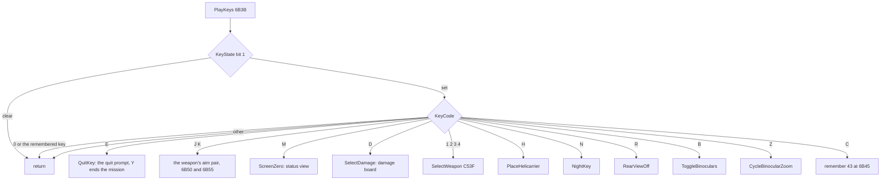

The `LD C,n` operand at `$6B45` holds the last weapon or view key.
SelectWeapon, SelectLoop, the C key and the screen entries ScreenFour, ScreenSix, ScreenEight and ScreenFromClick
write the key code there.
PlayKeys ignores a key equal to it, so these keys act once while they are held.
NightKey `$87FC` writes it too, but with its old flag value, not the key code: 0 when it turns the night sight on
(`$8807`), `$FF` when it turns it off (`$881B`).
So a held N toggles on every pass, and the write also cancels a remembered C or weapon key.
R, B, Z, H, E, J and K do not write it: they act again on every pass while held.
A held R toggles the rear view on each pass, so where it ends depends on how many passes the press spans; in play,
R at 10 065-10 090 leaves the rear view on, and doc 06's witness at 10 606 still shows it (6.10).

Worked example, play frame 8425: key 1 gives KeyCode `$31`.
PlayKeys reaches `CP $31`, and SelectWeapon stores 0 at `$C53C`.
The screenshots `008570-Banshee RRSS-lock` and `008655-Banshee RRSS-fired` show slot 1's missile locked and fired
with SPACE.

Witness:

- The play recording presses 1 (8425), J (8470, 8760, 9365), 2 (8715), 3 (9005), 4 (9320), N (9610), B (9740),
  Z (9805), R (10 000), H (10 130), D (10 195), C (10 260), M (10 325), E (10 620) and Y (10 685).
- SelectWeapon has 14 runs over the death, play and play2 recordings (the L1 count in `game.ann`).

The point: the keys pick, and the fire button acts.
The same SPACE that clicks the menus fires the chosen weapon in play.

## 5.11 What is known only from the code

- The brake: the key S and its handler `$A9C9`, because no recording presses S in play.
- The damage board's B and the status view after it, which keep the play node's transitions (5.7): no recording
  presses B on the damage board.
- An empty weapon slot (store type 0): SelectWeapon returns before the copy of the routines (5.10).
- The four KeyTable entries after the five read keys (C, Z, X, S), which ReadKeys never reads.
- The freeze operand of PointerTick (`$7D8A`) at 0: StatusLoop writes it, but no trace of mine samples a pass with
  it cleared.
