# 6. Rendering

What this covers:

- the screen, the back buffer `$8AF1-$96F0` and where each blit puts it;
- one pass of the 3D view, and who writes each byte of the buffer and of the screen;
- the camera from the player's record (heading `$7612`, X `$7613`, Y `$7616`, height `$75F5`);
- the model scripts and the face test, as far as drawing needs them (the models are doc 07);
- the projection and its logarithm tables;
- clipping: the near plane, the 2D line clip, the polygon clips of bank 3;
- the polygon filler (FillPolygon, EdgeWalk, FillSpans) and its 13 patterns;
- lines and the ground dots;
- the buffer clear and the copy to the screen, against the beam;
- the views: day and night, the night sight, the binoculars and the zoom, the rear view, the Dragonfly, the console
  and map screens;
- the ten packed pictures of bank 7 and UnpackPicture, with the black shadow screen shown while they unpack;
- the HUD drawn on the screen during a pass;
- the frame rate against the load of the scene;
- what is known only from the code.

The recordings it rests on (WALKTHROUGH 6.0):

- `play` (10 967 frames): mission 1, the weapons, the Dragonfly, the views N, B, Z, R, H, D, C, M.
  Traces: `work/docs/bcB/play/traces/8440_0-8462_0.uatr` (three passes while driving),
  `8455_0-8456_0.uatr` (one blit).
- `death` (20 039 frames): mission 1 driven for a long time with the armour POKE.
  At frame 8339 the view holds buildings, a flying enemy and hills: the busiest scene of the recordings.
  Traces: `work/docs/bcB/death/traces/8300_0-8450_0.uatr` (12 passes) and `8330_36000-8343_23000.uatr` (one pass).
- `menu` (10 997 frames): the title picture unpacked at frames 95-124 (`work/docs/bcB/menu/traces/95_9000-124_40000.uatr`).

Frames and times:

- A memory sample "at frame N" is the state at the start of frame N (TTD `memory_at`, T 0).
- An event "at N:t" is an instruction of an access trace that ran t T-states into frame N of 70 908 T (the 128K
  machine).
- A pass is one turn of PlayLoop (doc 04), from StartViewPass `$9882` to the next.
  It takes 7 to 13 frames, as long as the scene needs.

## 6.1 The screen and the back buffer

The 3D view is drawn into a back buffer of 96 rows of 32 bytes at `$8AF1-$96F0` (bank 2).
Row r of the buffer starts at `$8AF1` + 32r, so the buffer is linear, not in the screen's interleaved order.
The interrupt copies it to the screen with one of three blits.
Each blit points SP at the screen row table `$6500` (one address word a screen line) and pops one destination a row.

| Blit | Address | Buffer rows | Screen lines | Bytes | Used by |
| --- | --- | --- | --- | --- | --- |
| ViewBlitFront | `$8999` | 0-94 | 32-126, with the cockpit cut out | 2736 | the 3D view |
| ViewBlitWide | `$8A41` | 0-85 | 64-149, full width | 2752 | the title model, the console and map views |
| ViewBlitNarrow | `$8A98` | 0-94, bytes 5-26 | 40-134 at column 6 | 2090 | the binoculars and the rear view |
| ViewBlitLow | `$898B` | 8-94, with the cockpit cut out | 40-126 | 2480 | m1complete: 530 runs from frame 16138 (after the goal) |

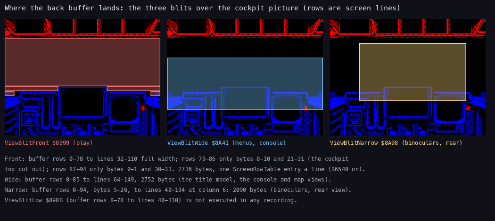

*The three blits over the cockpit picture. From `src/game/raster.asm` (ViewBlitFront to ClearBlitRequest);
`python3 tools/fig_rendering.py layout docs/img/render/layout.png`.*

ViewBlitFront copies the first 79 rows whole (lines 32-110).
The next 8 rows keep only bytes 0-10 and 21-31, as the cockpit's top edge covers the middle.
The last 8 rows keep only the two outer bytes on each side.
So the cockpit picture is never overwritten, and the game never redraws it during play.

The point: the buffer is plain and linear, so the drawing code needs no screen address arithmetic.
The interleaving is paid once, by the row table, in the copy.

## 6.2 One pass

PlayLoop draws one picture a pass, in this order (doc 04 has the whole loop):

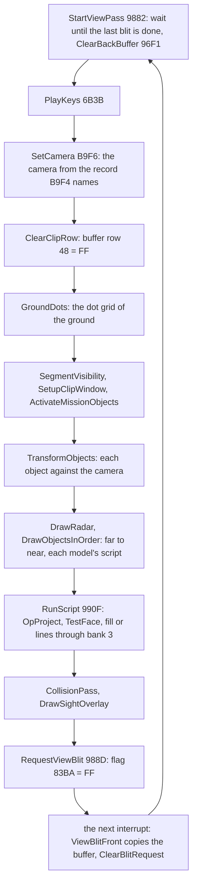

In the `play` trace of frames 8440-8462 a pass runs like this:

| Event | Pass 1 | Pass 2 |
| --- | --- | --- |
| StartViewPass, then ClearBackBuffer | 8441:20 184 | 8448:55 120 |
| SetCamera | 8441:38 548 | 8449:2 576 |
| DrawLine, the one line of the pass | 8446:33 234 | 8454:8 854 |
| RequestViewBlit | 8446:56 184 | 8454:31 924 |
| ViewBlitFront, in the next interrupt | 8447:7 335 | 8455:8 215 |

The pass of 8448-8455 is 7.4 frames.
StartViewPass waits for the blit flag `$83BA` to be 0 before it clears, so the buffer is never cleared while the
interrupt copies it.

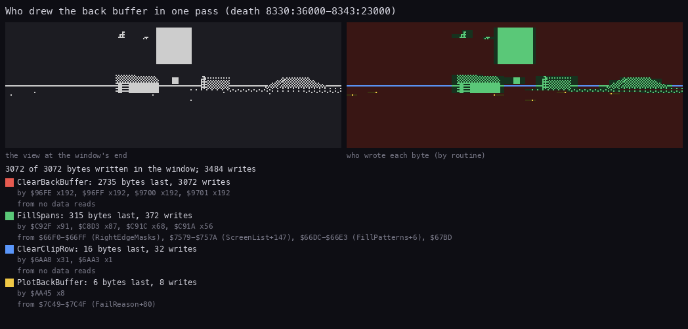

**How to read it.** The left panel is the buffer at the end of a pass of `death` (8330-8343), the right one colours
each byte by the routine that wrote it last.
ClearBackBuffer writes all 3072 bytes.
FillSpans draws every face: the buildings, the flying enemy (the solid block), the hills.
Its sources list FillPatterns `$66DC-$66E3` (the colours), the edge masks `$66F0-$66FF`, and `$67BD`, the bottom row
of the face (the variable the mouse reader also writes, doc 05).
ClearClipRow draws the full line of row 48 and PlotBackBuffer the few ground dots.
`python3 R/kit/writers_map.py --work work/docs/bcB/death --window 8330:36000-8343:23000 --listing
work/docs/bcB/game-bank3.lst --view buffer:8AF1:32x96:rows --sources --out docs/img/render/writers-buffer.png`
(the listing joins `build/game.lst` below `$C000` and `build/bank3.lst` above it).

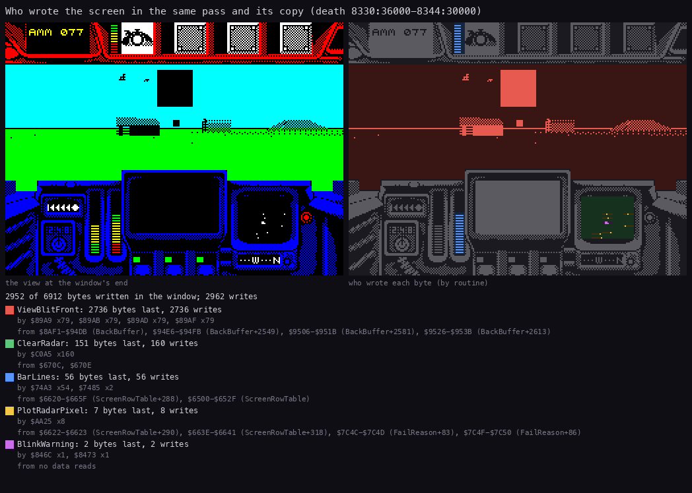

**How to read it.** The same pass and its copy (death 8330:36 000-8344:30 000).
ViewBlitFront writes the 2736 bytes of the view, once each.
The rest of the screen is the HUD (6.12): ClearRadar and PlotRadarPixel draw the radar, BarLines the bars,
BlinkWarning the lamp.
`python3 R/kit/writers_map.py --work work/docs/bcB/death --window 8330:36000-8344:30000 --listing
work/docs/bcB/game-nol.lst --sources --out docs/img/render/writers-screen.png` (`game-nol.lst` is `build/game.lst`
without the local `l_` labels).

The point: everything 3D goes through the buffer, and only the HUD writes the screen directly.
The cost of a pass is mostly arithmetic (6.13), not pixels.

## 6.3 The camera

SetCamera `$B9F6` runs once a pass.
The camera record is the object record whose address is at `$B9F4`.
CameraToPlayer puts the player's record `$75F0` there; the Dragonfly puts its own (doc 10).
SetCamera copies:

| From the record | Bytes | To | Meaning |
| --- | --- | --- | --- |
| +`$21`, +`$22` | 2 | `$67A5`, `$67A6` | the heading, a fraction byte and the heading byte (256 to a turn) |
| +`$23`-`$25` | 3 | `$67A7`-`$67A9` | X: a fraction byte and a 16-bit integer |
| +`$26`-`$28` | 3 | `$67AA`-`$67AC` | Y: a fraction byte and a 16-bit integer |
| +5, +6 | 2 | `$67AD`, `$67AE` | the eye height (or IrViewHeight `$B8FF` while the IR view flag `$BA13` is set) |

For the player, these are `$7611`-`$7618` and `$75F5`, the variables the brief names.
With the rear view on (the operand at `$BA27` not 0), SetCamera adds `$8000` to the heading word: half a turn.
CameraSinCos then takes the sine and cosine of the heading byte and patches them into RotateToView `$BBBC`: the
sine as the operand at `$BBBD`, the cosine at `$BBC8`.

```
SetCamera:
  LD HL,($B9F4)          ; the camera's record
  PUSH HL
  LD BC,$0021
  ADD HL,BC
  LD DE,$67A5
  LDI                    ; 8 bytes: heading, X, Y
  ...
  POP HL
  LD A,$00               ; operand $BA13: the IR view
  AND A
  JR Z,l_BA1C
  LD HL,IrViewHeight+$0003 ; $B8FF
  JR l_BA1F
l_BA1C:
  LD C,$05
  ADD HL,BC              ; the record's height +5
l_BA1F:
  LDI
  LDI
  LD HL,($67A5)
  LD A,$00               ; operand $BA27: the rear view
  AND A
  JR Z,CameraSinCos
  LD BC,$8000            ; half a turn
  ADD HL,BC
  LD ($67A5),HL
CameraSinCos:
  CALL ApiVector07
  CALL SinCosHalf
  LD (RotateToView+$000C),A ; $BBC8
  LD A,E
  LD (RotateToView+$0001),A ; $BBBD
  RET
```

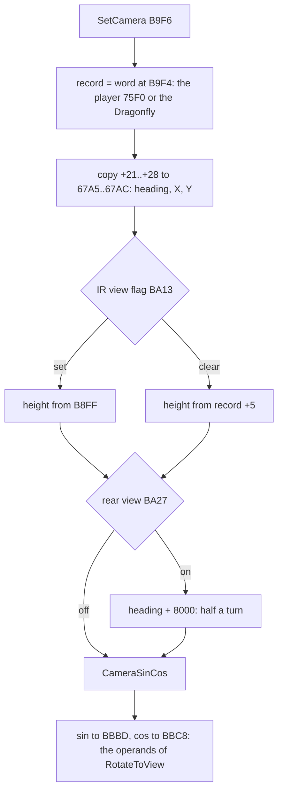

Worked example, `play` frame 10 070, with the rear view on:

- the player's heading `$7612` is `$00` and the camera's `$67A6` is `$80`;
- X is `$FFE0` + `$00`/256, Y is `$FB79` + ... (the record bytes `00 e0 ff 79 fb ff`), the same in both copies;
- the height `$75F5` is `$20` (32), copied to `$67AD`;
- the cosine operand `$BBC8` reads `$81` (-127, the cosine of half a turn) and the sine operand `$BBBD` reads 0.

TransformObjects then subtracts the camera's X and Y from each object's position.
RotateToView turns that offset by the heading with two MulFrac products each for the side offset and the depth.
The results become the position operands of the projection (6.5).

The point: the camera is just a pointer to an object record.
The rear view is one addition, and the Dragonfly's view is a different pointer.

## 6.4 Model scripts and the face test

Each object is drawn by its model's script, a list of byte opcodes that RunScript `$990F` reads through IX.
The opcode indexes OpcodeTable `$98E1` (23 words).
RunScript patches the `CALL` at `$9927` with the handler and calls it.
Every handler returns to `JP $990F` with IX past its operands.
The models and the opcodes are doc 07; the drawing needs four of them:

- OpProject `$9A43` projects a range of vertices (6.5);
- TestFace takes the sign of the cross product of three screen points into FaceFlags `$6728`, so a face that turns
  away is not drawn;
- the fill opcodes copy a face's points into PolyVerts `$6700`, its colour into `$7579`, and call bank 3's
  FillPolygon through `$7290` (6.7);
- OpLines `$9AD8` draws a polyline through ClipLine2D `$A184` and bank 3's DrawLine through `$72B1` (6.8).

TestFace has one more rule.
It counts the face's points that are behind the eye.
All three behind gives flag 0 (not drawn).
One or two behind gives `$FF`: the face is drawn and cut at the near plane by ClipPolyNear `$A509` (6.6).

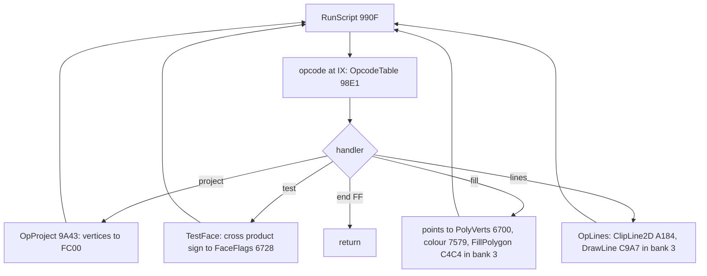

Witness: in each of the two `play` passes of 8441-8455, RunScript runs 25 times, OpProject 5 times, FillPolygon 7
times and DrawLine once (trace of 8440-8462).

The point: a model draws itself.
The engine only supplies the opcodes, and the script decides what to test, fill or join.

## 6.5 The projection

OpProject `$9A43` takes a first vertex and a count from the script.
The vertices are three rows of words: x at `$FD00` + 2i, y at `$FE00` + 2i, z at `$FF00` + 2i.
For each vertex it adds the object's position, which earlier code left in its own operands, and writes the screen
point to `$FC00` + 4i (x word, y word):

- depth = z + the operand at `$9A6C`;
- below 96, the point is behind the eye: x = `$8000` marks it, and nothing more is done;
- the depth is shifted right by the zoom count, the operand at `$9A93` (0, or 1-3 with the binoculars);
- sx = the centre operand at `$9AA3` (128) + 256 (x + the operand at `$9A8E`) / depth;
- sy = the horizon operand at `$9ABB` (49 in play) - 256 (y + the operand at `$9AB3`) / depth.

StartMission sets the centre to 128 and the horizon to 49.

```
l_9A5E:
  LD IXH,$FF              ; the z row
  LD E,(IX+$00)
  LD D,(IX+$01)
  DEC IXH
  DEC IXH                 ; the x row
  LD HL,$0190             ; operand $9A6C: the object's depth
  ADD HL,DE
  PUSH HL
  AND A
  LD DE,$0060
  SBC HL,DE               ; depth - 96
  JP P,l_9A85
  LD (IY+$00),$00         ; behind the eye: x = $8000
  LD (IY+$01),$80
  POP HL
  JP l_9AC7
l_9A85:
  LD E,(IX+$00)
  LD D,(IX+$01)
  INC IXH                 ; the y row next
  LD HL,$0000             ; operand $9A8E: the object's x
  ADD HL,DE
  POP DE                  ; the depth
  LD A,$00                ; operand $9A93: the zoom
  ...                     ; SRA D / RR E that many times
  CALL Divide             ; HL = 256 x / depth, DE = log2 depth
  PUSH DE
  LD DE,$0080             ; operand $9AA3: the centre
  ADD HL,DE
  LD (IY+$00),L
  LD (IY+$01),H
  ...
  LD HL,$0000             ; operand $9AB3: the object's y
  ADD HL,DE
  POP DE
  CALL DivideByLog        ; HL = 256 y / depth, with the same log
  LD DE,$0040             ; operand $9ABB: the horizon
  CALL NegHL
  ADD HL,DE
  LD (IY+$02),L
  LD (IY+$03),H
```

The divisions use logarithms.
Divide `$A687` takes log2 of the depth from two tables.
LogInteger `$5D00` gives the integer part and LogFraction `$5C00` the fraction, in 8.8.
It first shifts the depth right until it fits a byte and adds the shifts to the integer part.
DivideByLog `$A6D2` takes log2 |x| + 8 the same way (the 8 is the factor 256), subtracts the depth's log, and turns
the difference back with ExpFraction `$5E00` (256 (2^(f/256) - 1)) and a shift.
A negative difference gives 0 (ZeroQuotient).
The sign is kept in F' and put back by ApplySign.
One log of the depth serves both x and y, so the second division costs only one table look-up.

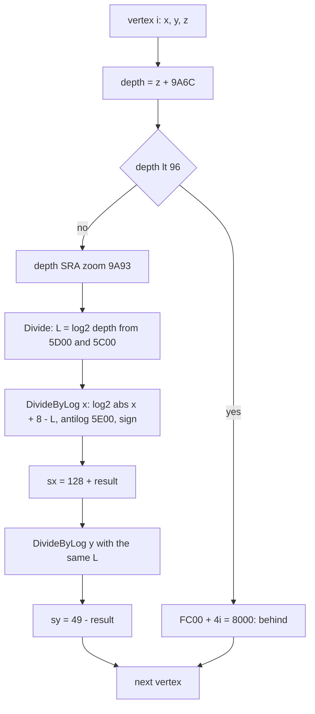

Worked example, `play` 8442:38 158, the first vertex of the first OpProject of the pass (the operands at that moment:
depth 0, x 0, y -32, zoom 0):

1. The vertex is x = -6005, y = 0, z = 1879.
2. depth = 1879 + 0 = 1879, above 96.
3. Divide shifts 1879 (`$0757`) right three times to 234 and looks up log2 234 = 7.87.
   With the three shifts, DE = `$0ADF`: 10 + 223/256 = 10.87 (log2 1879 = 10.876).
4. DivideByLog takes |x| = 6005: log2 6005 + 8 = 20.55 (`$148D`).
   The difference is `$09AE` = 9.68, and 2^9.68 = 818.
   The sign is negative: -818 (HL = `$FCCE` at `$9AA1`).
5. sx = 128 - 818 = -690, off the left of the window.
6. DivideByLog takes y + -32 = -32 with the same log: 256 x 32 / 1879 = 4.
   sy = 49 - (-4) = 53 (HL = `$0035` at `$9AC4`).

The four vertices of that call give sx -690, 1228, 1364, -806 and sy 53 for all four: a strip of ground that spans
the whole view, four rows below the horizon.
The second call (8442:66 686) adds two far vertices at z 7793 and 7975, which land at sy 50: farther points lie
closer to the horizon.

Witness: the instruction records at `$9A9E`, `$A6D2`, `$9AA1` and `$9AC4` in
`work/docs/bcB/play/traces/8440_0-8462_0.uatr` (one call takes 6097 T for 4 vertices, 1524 T a vertex).

The point: two divisions a vertex cost about 1500 T with logarithms.
A shift-and-subtract division of 16 bits would cost several times that.

## 6.6 Clipping

The game clips in four places, each for its own case.

| Clip | Address | What it cuts | How |
| --- | --- | --- | --- |
| near plane, faces | ClipPolyNear `$A509` | a face with 1 or 2 points behind the eye | Sutherland-Hodgman against depth 96 |
| near plane, edges | NearClipLine `$A42B` | one 3D edge | halves the edge until its depth is 96, then projects the cut |
| window, lines | ClipLine2D `$A184` | a 2D line of OpLines | to the window, in words; carry = something to draw |
| window, polygons | ClipPolyY `$C000`, ClipPolyX `$C218` (bank 3) | every face before it is filled | Sutherland-Hodgman against rows 0-95, then columns 0-255 |

ClipPolyY walks the polygon in PolyVerts `$6700` and keeps one state for where the last vertex was: inside
(`$C17B`), below row 95 (`$C02F`) or above row 0 (`$C0DE`).
Each change of state adds the crossing point, from IntersectRow95 `$C40A` or IntersectRow0 `$C420`.
The result goes to PolyYClipped `$66A8`.
ClipPolyX does the same against the columns into PolyXClipped `$6680`.
SetClipWidth `$CFCD` patches its right limit in 10 places: `$FF` for the full view, `$5F` for the 96-pixel window of
the console views.
A polygon with fewer than 3 vertices left is not filled.

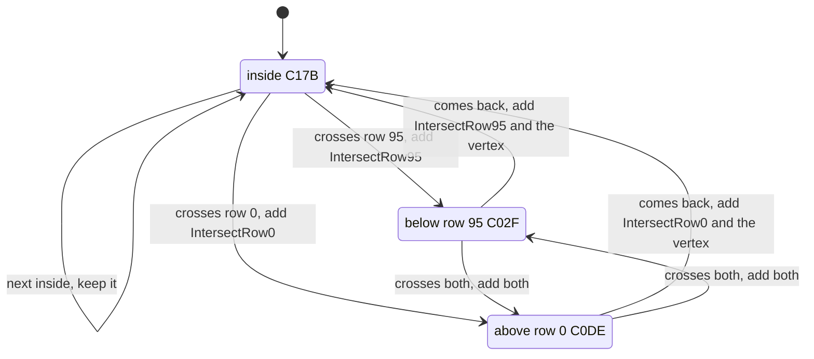

NearClipLine does not solve for the crossing.
It halves the 3D segment again and again, keeping the half that holds depth 96, until depth - 96 is 0.
`$67B2-$67B5` hold the two depths being halved.
Then it projects the cut point like OpProject.

Worked example: the ground strip of 6.5 has sx -690 to 1364.
ClipPolyX cuts it at columns 0 and 255, so FillSpans gets a polygon that spans exactly the view's width.

Witness: in the pass of death 8340, FillPolygon at 8340:61 205 calls ClipPolyY at 61 222 (ClipYInside from 61 434)
and ClipPolyX at 62 656 before EdgeWalk at 64 836 (`work/docs/bcB/death/traces/8330_36000-8343_23000.uatr`).

The point: the cheap clips come first.
A whole face behind the eye is dropped by TestFace, and the costly near-plane cut runs only on the few faces that
cross it.

## 6.7 The polygon fill

FillPolygon `$C4C4` (bank 3, paged by `$726C`) fills the polygon in PolyVerts `$6700` in the colour `$7579`.

1. It clips (6.6) and returns when fewer than 3 vertices are left.
2. It finds the top and bottom rows and the top vertex.
   It doubles the vertex list, so that the edge walks can run past its end.
   It stores the bottom row in `$67BD` and the row count in `$68A8`.
3. EdgeWalk `$C542` walks the left edge forwards (IX) and the right edge backwards (IY) from the top vertex.
   It pushes one (left x, right x) word pair a row on the stack, so the bottom row is pushed last.
   EdgeSlope `$C959` gives each edge's x step a row by logarithms.
   EdgeWalk is the biggest block of bank 3 (385 instructions).
4. FillSpans `$C86A` pops the rows from the bottom up, 32 bytes back each row (DE = `$FFE0`).

FillSpans takes its two pattern bytes (a, b) from FillPatterns `$66D6` + 2c for the colour c.
It writes b on one row and b XOR a on the next: the `XOR $00` at `$C931` is patched to a.
The parity comes from bit 0 of the bottom row, so the pattern is fixed to the screen, not to the polygon.
When the light value `$757A` is 0 (from 17:00 to 08:00 by TimeOfDay's HourTable `$88F8`), FillSpans takes B = `$FF`
for every face: the scene becomes black silhouettes.

```
FillSpans:
  POP HL
  LD (l_C930+$000A),HL    ; the return address
  LD A,($757A)            ; the light value
  AND A
  JP NZ,l_C879
  LD B,$FF                ; dark: solid ink
  JR l_C885
l_C879:
  LD A,($7579)            ; the colour
  ADD A,A
  ADD A,$D6
  LD L,A
  LD H,$66
  LD A,(HL)               ; a
  INC L
  LD B,(HL)               ; b
l_C885:
  LD C,A
  LD (l_C930+$0002),A     ; the XOR operand of the next row
  LD A,($67BD)            ; the bottom row
  LD H,A
  RRA
  LD A,B
  JR NC,l_C892
  XOR C                   ; an odd bottom row starts with b XOR a
l_C892:
  ...
  LD DE,$8AF1
  ADD HL,DE               ; the bottom row's address
  LD A,($68A8)
  LD B,A                  ; the row count
  ...
  LD DE,$FFE0             ; one row up
l_C8A3:
  ...
  POP DE                  ; the span: E = left x, D = right x
  ...                     ; the left byte through the mask at $66F8 + (x AND 7)
l_C8D6:
  LD A,$1F
  AND A
  SBC A,C
  ADD A,A
  LD (l_C8D6+$0009),A     ; jump into the unrolled run
  JR l_C8D6+$0009
  LD (HL),B               ; 31 times LD (HL),B / INC HL
  INC HL
  ...                     ; then the right byte through the mask at $66F0
```

The middle bytes of a span are written by a jump into a run of 31 `LD (HL),B / INC HL`.
The jump distance is patched for each span: 2 x (31 - the byte count).
A span inside one byte goes to `$C93C`, which masks both ends at once.

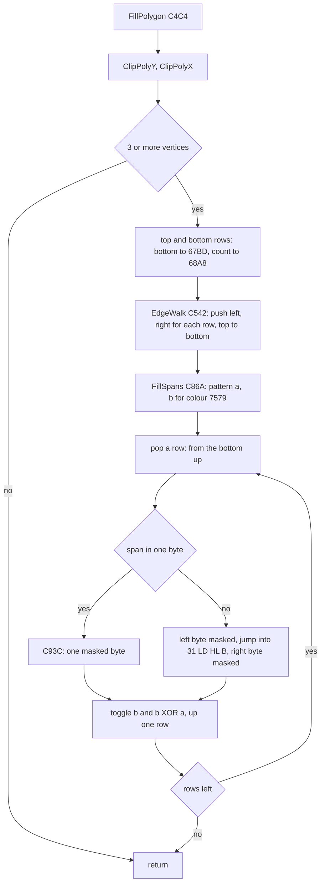

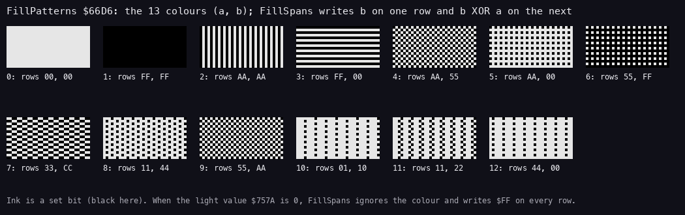

*FillPatterns `$66D6` as FillSpans uses them. From `build/game.lst` and the bank 5 cut; `python3
tools/fig_rendering.py patterns docs/img/render/patterns.png`.*

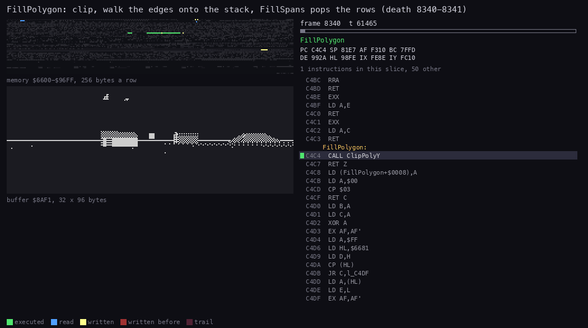

*One face of the flying enemy in death 8340:61 000-8341:18 000: the clips and EdgeWalk run first and write
nothing; then FillSpans fills the block from its bottom row upwards, with the interrupt in between. `python3
R/kit/routine_anim.py --work work/docs/bcB/death --window 8340:61000-8341:18000 --listing
work/docs/bcB/game-bank3.lst --view buffer:8AF1:32x96:rows --pc C4C4-C958 --range 6600-96FF --pictures 60 --out
docs/img/routines/FillPolygon.gif`.*

Worked example, the block above:

- the 112 writes to the buffer run from 8340:69 942 to 8341:17 381;
- the first lands at `$8EDF` (row 31) and the last at `$8B82` (row 4): 28 rows of 4 bytes, bottom first;
- the whole face takes 8340:61 205 to 8341:17 381, 27 084 T, of which the interrupt takes 5 727 T.

Witness: FillPolygon runs 225 times in bank 3 over death 8300-8450 (12 whole passes of 14 to 20 faces, and the
ends of two more).

The point: the stack is the span list.
EdgeWalk pushes, FillSpans pops, and nothing else is stored.

## 6.8 Lines and the ground dots

DrawLine `$C9A7` (bank 3) draws a line from (H, L) to (D, E), x and y in bytes, into the back buffer with `OR`.
It is a Bresenham line with three special cases: vertical (`$CA60`), horizontal (`$CA4E`) and 45 degrees (`$CA74`).
LinePixelBit `$CA89` holds the start pixel's bit.
OpLines `$9AD8` reaches it through ClipLine2D and `$72B1` for each pair of points in front of the eye.

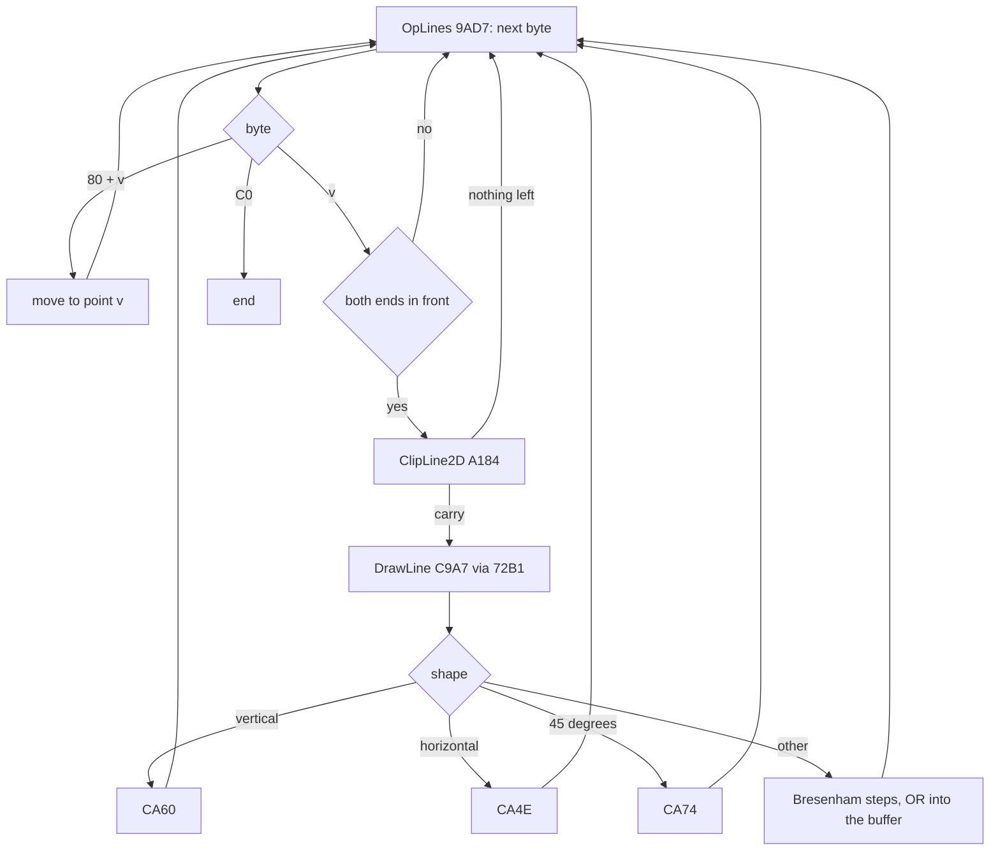

Lines are rare in this game.
In `play` 8440-8462, bank 3's DrawLine runs three times, once a pass (8446:33 234, 8454:8 854, 8461:48 488), and
each draws one 3-pixel vertical line at `$9138`, `$9158`, `$9178` (rows 50-52 of the buffer, byte 7).
At the address `$C9A7` of bank 0 lies another routine, CollisionFilter, which the death trace runs 14 times a pass.

The ground is a grid of dots.
GroundDots moves the grid with the camera (GridVectors `$BB54`, GridStep `$BBA6` between rows).
PlotGroundDot `$BB75` projects each dot with the same Divide and DivideByLog, keeps it if it falls inside 0-254 by
0-94, and PlotBackBuffer `$AA27` sets its pixel (the masks at `$7C49`).

Witness: PlotBackBuffer writes 8 bytes in the pass of death 8330 (the writers figure of 6.2); L1 counts 37 012
calls over the recordings (`game.ann`).

The point: the ground has no polygons.
A moving grid of dots is enough to show speed and turning.

## 6.9 The buffer clear and the copy

ClearBackBuffer `$96F1` zeroes the buffer with 1536 `PUSH HL` (96 x 16) under `DI`.
SP is saved at `$9711` and set to `$96F1`, the end of the buffer.
At 11 T a push, the clear takes about 17 000 T, a quarter of a frame, and an interrupt in that time is lost (doc 04).
Its animation is in doc 04: [ClearBackBuffer.gif](img/routines/ClearBackBuffer.gif).

```
ViewBlitFront:
  LD ($8A3E),SP           ; saved in the LD SP,n at the end
  LD HL,BackBuffer
  LD A,$4F                ; 79 full rows
  LD SP,ScreenRowTable+$0040 ; line 32
l_89A5:
  LD BC,$0C00
l_89A8:
  POP DE                  ; the line's screen address
  LDI                     ; 32 times
  ...
  DEC A
  JR NZ,l_89A8
  LD A,$08
l_89EE:
  POP DE                  ; 8 rows: 11 bytes, skip 10, 11 bytes
  ...
  LD A,$08
l_8A27:
  POP DE                  ; 8 rows: 2 bytes, skip 28, 2 bytes
  ...
  LD SP,$0000
  RET
```

The copy runs in the interrupt, as the job MenuJobs names (its operand `$83E6`), when the blit flag `$83BA` is set.
ClearBlitRequest `$8AEC` clears the flag afterwards, which lets the next pass clear the buffer.

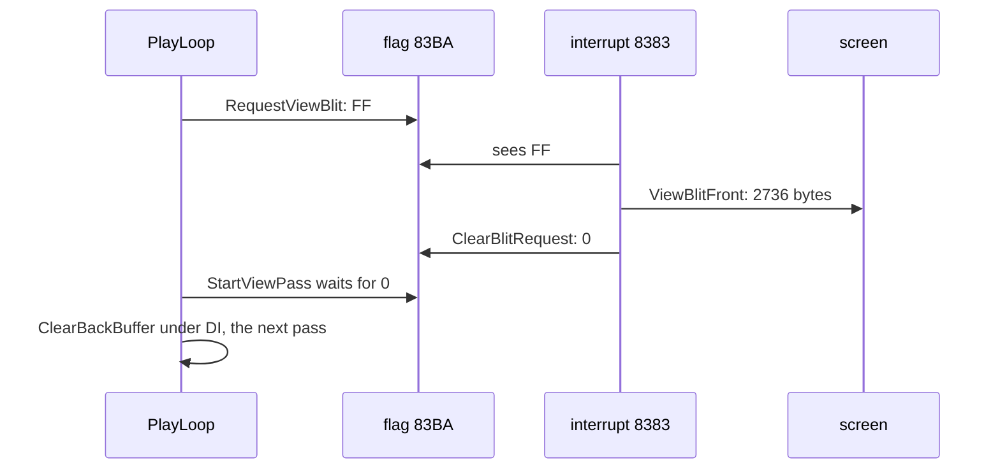

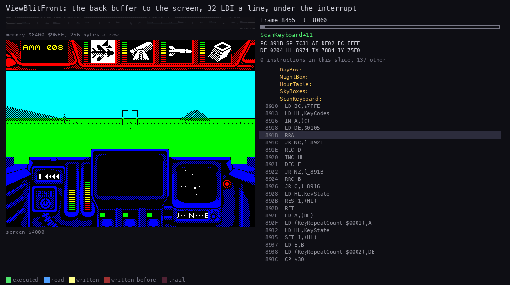

*ViewBlitFront in play 8455:7 000-60 000: one LDI a byte, line by line from line 32 down. `python3
R/kit/routine_anim.py --work work/docs/bcB/play --window 8455:7000-8455:60000 --listing work/docs/bcB/game-nol.lst
--view screen --pc 8999-8A40 --range 8A00-96FF --pictures 50 --out docs/img/routines/ViewBlitFront.gif`.*

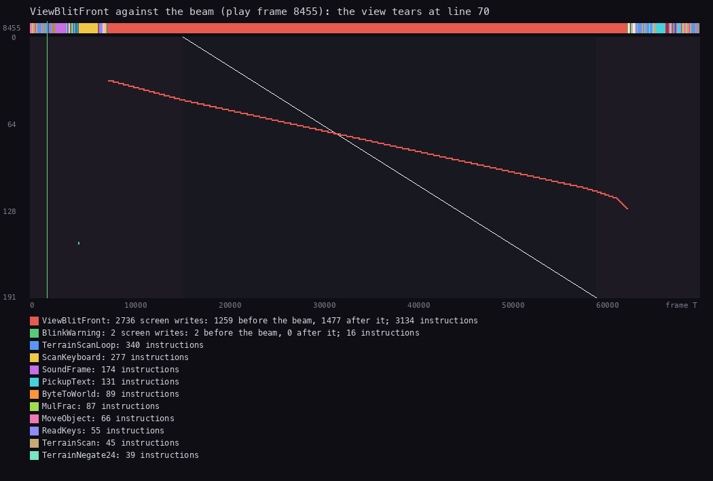

**How to read it.** Play frame 8455, one row a screen line, time across.
The white line is the beam.
The copy starts at T 8 215 and ends at T 63 295: 55 080 T for 2736 bytes (16 T for each LDI, more where the ULA
holds the bus).
The beam overtakes the copy at line 70 (T about 30 300).
1259 bytes land before the beam reaches their line, and 1477 after it.
So the frame of 8455 shows the new view above line 70 and the old one below it: one torn frame each pass, then
whole pictures until the next copy.
`python3 R/kit/beam_timeline.py --trace work/docs/bcB/play/traces/8455_0-8456_0.uatr --listing
work/docs/bcB/game-nol.lst --machine 128k --out docs/img/render/beam-blit.png`.

Worked example: a pass of 7.4 frames shows 6.4 whole frames of one picture and one torn frame.
At 13 frames a pass (the busy scene of death), the tear is one frame in 13.

The point: the copy is in the interrupt, so it starts at the top of a frame, near line 0.
It never waits for the beam, but it starts ahead of it.

## 6.10 The views

The play keys (doc 05) switch views by changing a few operands; the renderer is the same.

| View | Key | What changes | Frames a pass (WALKTHROUGH) |
| --- | --- | --- | --- |
| normal | | ViewBlitFront, zoom 0 | 7.7, 7.4, 7.1 (play 8370-8970) |
| night sight | N | ToggleNight `$87FF`: the lamp `$5ACF`, the text `$BA6E` or `$BA7A`, `$757A` from HourTable | |
| binoculars | B | SetBinoculars `$CEAB`: zoom `$9A93` = 1, the lamp `$5ACC`, StepFrames `$9719` = 32, "BINOC:X2" | 6.8 (9805-9995, with the zoom) |
| zoom | Z | CycleBinocularZoom `$CEE5`: the zoom 1, 2, 3, back to 1 (x2, x4, x8) | |
| rear view | R | `$BA27`: the camera heading + half a turn | 12 (10 065-10 125) |
| Dragonfly | D | the camera record `$B9F4`, the Dragonfly's panel from bank 7 | 8.0 (9115-9315) |
| console and map | M, then B | StatusLoop `$6BC7`, PicGridPanel, its own blit `$DBBD` (bank 6), SetClipWidth `$5F` | 11.1 (10 520-10 620) |

The zoom shifts the depth right before the division, so zoom 1 doubles every screen offset from the centre.
The binoculars also slow the steps (StepFrames 32 instead of 4, doc 05), for fine aiming.
With the rear view, SetCamera turns the camera, and nothing else knows.
The day and the dusk are TimeOfDay's: at 08:00 the light value `$757A` becomes `$FF` and the faces get their
patterns; from 17:00 it is 0 and they are solid (6.7).
SkyColours `$885F` repaints the sky and ground attributes once a change.

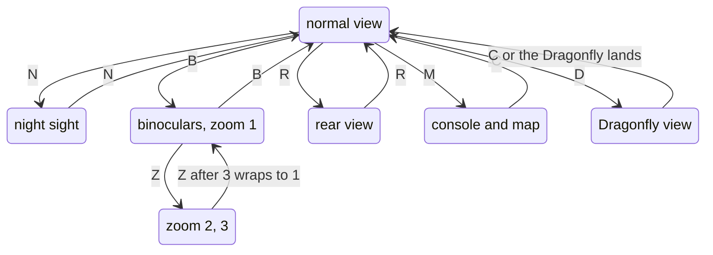

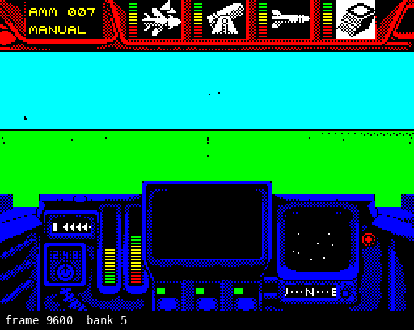

*The screen that is shown over play frames 9600-10 500 (every 5th frame): the night sight, the binoculars and the
zoom, the rear view, the helicarrier, the damage screen, the console with the map and the briefing. The black
frames are the shadow screen of bank 7, shown while a new screen is unpacked and drawn (6.11). `python3
tools/fig_shownscreen.py --work work/docs/bcB/play --from 9600 --to 10500 --step 5 --label --delay 70
docs/img/play/view-change.gif`.*

Witness: the keys of `tests/inputs/play.txt` at N 9610 and 9675, B 9740, Z 9805 and 9870, B 9935, R 10 000 and 10 065,
H 10 130, D 10 195, C 10 260, M 10 325, B 10 390, C 10 455.
At frame 10 606 the camera heading `$67A6` is `$98` while the player's `$7612` is `$18`: the rear view is still on.

The point: the views are operands, not code.
The zoom is one shift count, the rear view one addition, the night one byte.

## 6.11 The bank 7 pictures and UnpackPicture

Every full-screen picture of the game is packed in bank 7: ten blocks, 14 442 bytes for 69 120 bytes of screens.
UnpackPicture `$FE95` (bank 7) unpacks one onto the screen at `$4000`.

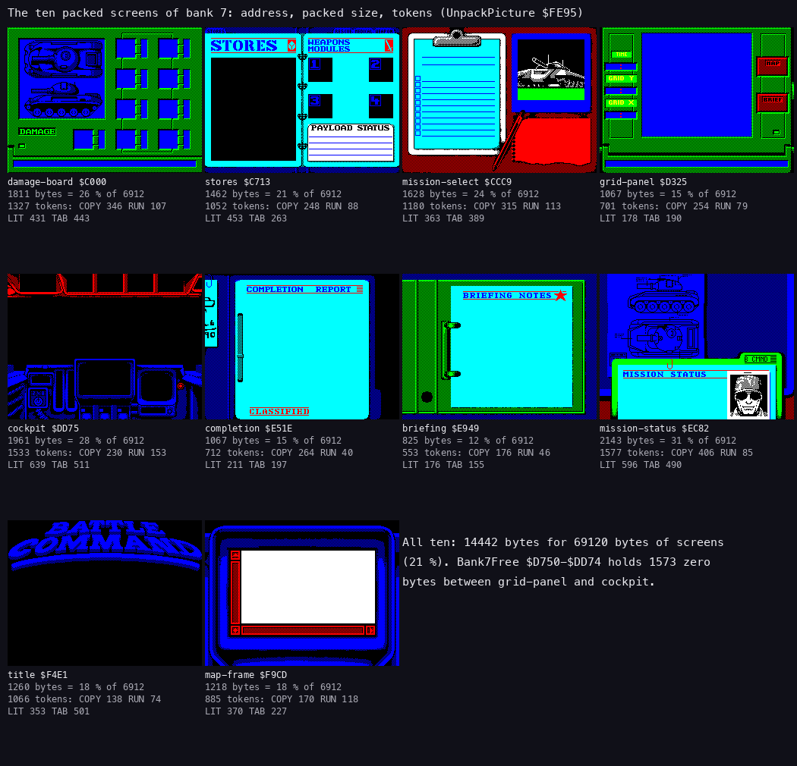

*The ten blocks of bank 7, decoded. From `build/bank7.bin` with `tools/bank7pic.py`; the pictures are
`src/res/pictures/*.png`; `python3 tools/fig_rendering.py pictures docs/img/render/pictures.png`.*

### The format, byte by byte

| Offset | Size | Content | PicTitle `$F4E1` |
| --- | --- | --- | --- |
| +0 | 2 | the length of +2 to the end of the stream | `E8 04` (1256) |
| +2 | 2 | the unpacked length, always `$1B00` | `00 1B` |
| +4 | 16 | the table of common bytes | `07 F0 A8 0F F8 FC BF FA 01 FD AA 55 FE 7F 00 FF` |
| +20 | 1 | the extra offset bits, always 1 (offsets 1-511) | `01` |
| +21 | ... | the bit stream, read least significant bit first | `34 E3 1F 9E 7E 86` ... |
| end | 2 | `$00 $00`, the packer's padding, never read | `00 00` |

The stream is a list of tokens.
Each opens with a 2-bit type:

| Type | Token | Then | Output |
| --- | --- | --- | --- |
| 01 | LIT | 8 bits v | v |
| 11 | TAB | 4 bits i | table[15 - i] |
| 10 | COPY | a count n, 8 + 1 bits of offset d | n bytes from d bytes back in the output |
| 00 | RUN | a count n, 1 bit: 1 then 4 bits i, or 0 then 8 bits v | n copies of table[15 - i] or of v |

A count is 6 bits n.
3 to 63 is the count itself.
0 means 7 more bits follow, 1 means 8 bits, and 2 means 8 bits then 6 bits above them.
When the output reaches the length, BrightenAttributes `$FFA6` ORs BRIGHT (`$40`) into all 768 attributes: the
blocks keep their attributes without it.

### Unpacking

```
NextToken:
  LD HL,(WrittenCountOp+$0001)
LengthOp:
  LD BC,$0000             ; the unpacked length
  SBC HL,BC
  JR C,l_FECF
  JP BrightenAttributes   ; done
l_FECF:
  LD A,$02
  CALL GetBits            ; the type
  AND $03
  LD (TokenTypeOp+$0001),A
  BIT 0,A
  JR Z,CountedToken       ; 00 or 10
  BIT 1,A
  JR NZ,TableByte         ; 11
  LD A,$08
  CALL GetBits            ; 01: a literal
  CALL PutByte
  JR NextToken
TableByte:
  LD A,$04
  CALL GetBits
  LD HL,(TablePtr)
  CPL
  AND $0F                 ; 15 - i
  LD C,A
  LD B,$00
  ADD HL,BC
  LD A,(HL)
  CALL PutByte
  JR NextToken
CountedToken:
  LD A,$06
  CALL GetBits            ; the count, maybe longer
  ...
TokenTypeOp:
  LD A,$00                ; the type kept: 0 = RUN, 2 = COPY
  AND A
  JR Z,RunToken
  LD D,$00
  LD A,$08
  CALL GetBits            ; the offset
  LD E,A
  ...                     ; plus the extra bit
  LD HL,(PutByte+$0001)
  SBC HL,DE
CopyLoop:                 ; count bytes from output - offset
```

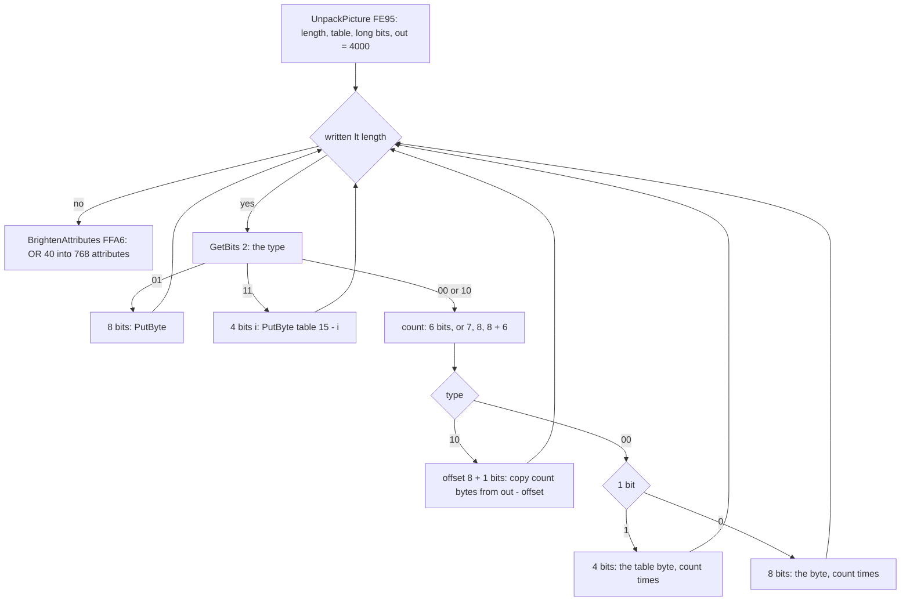

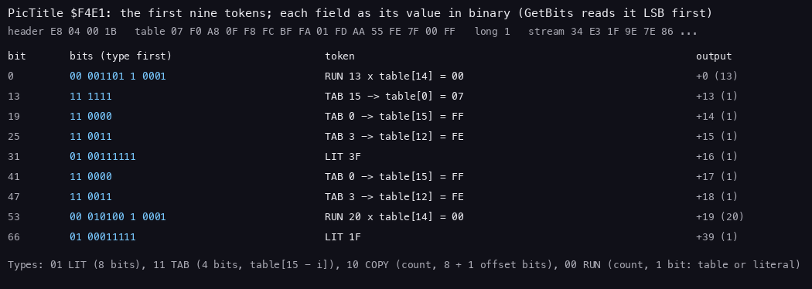

*PicTitle's first nine tokens as UnpackPicture reads them. From `build/bank7.bin`; `python3 tools/fig_rendering.py
tokens docs/img/render/tokens.png`.*

Worked example, decoding, the first two bytes of PicTitle's stream, `$34` and `$E3`:

1. `$34` is `00110100`.
   Read from bit 0, the bits come as 0, 0, 1, 0, 1, 1, 0, 0.
2. The first two give the type 00: a RUN.
3. The next six give the count 001101 read from the top: 13.
4. The next bit (bit 0 of `$E3`) is 1: the run byte comes from the table.
5. The next four bits (bits 1-4 of `$E3`: 1, 0, 0, 0) give i = 1, so the byte is table[14] = `$00`.
6. Output: 13 bytes of `$00`, the first 13 bytes of line 0.
7. Bits 5 and 6 of `$E3` are 1, 1: a TAB; bit 7 and the low bits of `$1F` give i = 15, so table[0] = `$07`.

### Packing: the other direction

`tools/bank7pic.py` does both directions.
`decode` gives the screen and the parse (the token list).
`encode` writes a parse back with the same bit writer, least significant bit first.
The parse of each picture is kept as `src/res/pictures/NAME.parse.txt`, and the build encodes it back byte for byte.
Ocean's packer made choices no simple rule reproduces (a shorter match than the longest, a farther offset of the same
bytes), so the parse is kept rather than recomputed.
`pack` makes a new greedy parse for a changed screen, which UnpackPicture reads the same way.

Worked example, encoding the first token, RUN 13 x table[14]:

1. Type 00: put the bits 0, 0.
2. Count 13 = 001101: put 1, 0, 1, 1, 0, 0 (lowest bit first).
3. From the table: put 1.
4. Index 15 - 14 = 1 = 0001: put 1, 0, 0, 0.
5. The first byte holds bits 0-7: 0, 0, 1, 0, 1, 1, 0, 0 = `$34`.
   The flag and the index begin the second byte, which the next token (TAB, 1, 1, then 1, 1, 1, 1) completes as
   `$E3`.

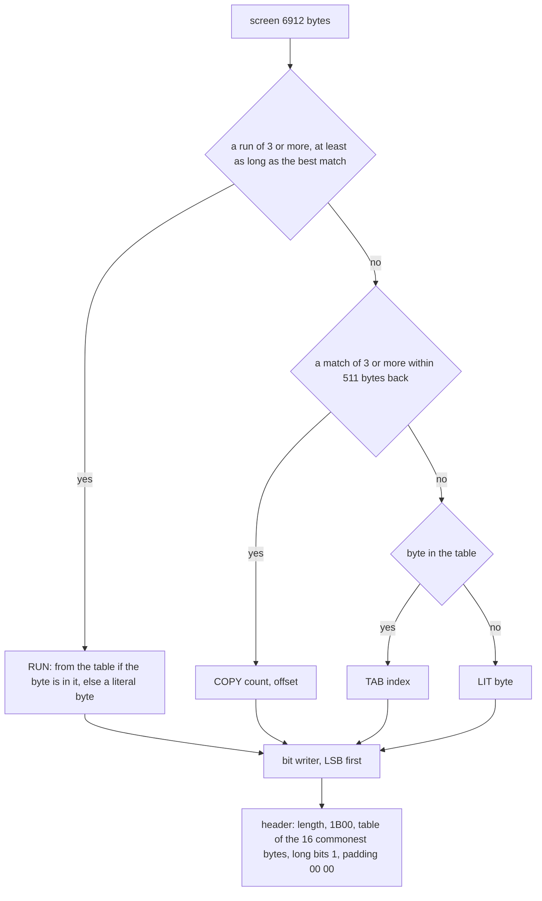

### The shadow screen while unpacking

UnpackPicture writes the screen that is shown.
To hide the unpacking, the game first sets the screen bit of `$7FFD`.
It keeps the bit as the `OR` operand at `$7284` of PageOut, so every page change keeps it.
The shadow screen at bank 7 `$C000` then shows.
Bank 7's attribute area `$D800-$DAFF` lies inside Bank7Free (`$D750-$DD74`, all zero), so the shadow screen is
black ink on black paper.
When the picture and its texts are done, the game clears the bit and the whole new screen appears at once.

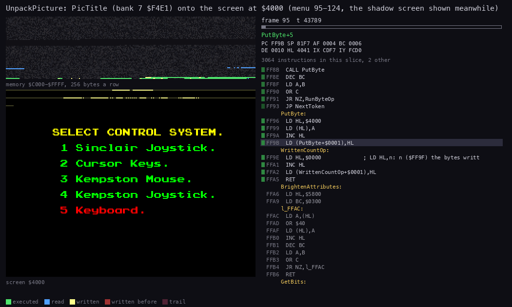

*UnpackPicture over menu 95:9 000-124:40 000, the title picture (`DE` = `$F4E1` at 95:9 028). The animation shows
bank 5, which the player does not see at that time. `python3 R/kit/routine_anim.py --work work/docs/bcB/menu
--window 95:9000-124:40000 --listing build/bank7.lst --view screen --pc FE95-FFFF --range C000-FFFF --pictures 60
--out docs/img/routines/UnpackPicture.gif`.*

Witness:

- In the menu trace, the `OUT` to `$7FFD` at 95:8 691 writes `$0E` (bit 3 set: the shadow screen).
- UnpackPicture runs from 95:9 028 to 124:34 216, when BrightenAttributes starts.
  That is 29.4 frames, about 300 T a byte.
- The `OUT`s keep bit 3 set until 139:8 964, which writes `$06`: the title reappears.
- The black frames of the animations of 5.7 and 6.10 are these stretches.

The point: an unpacker that takes 29 frames cannot run behind the beam unseen.
The game shows a black screen instead of the picture building up.

## 6.12 The HUD drawing

The HUD is drawn straight onto the screen, around the view.
In the pass of death 8330 (the second writers figure of 6.2), it writes 226 bytes:

| Routine | Bytes | What |
| --- | --- | --- |
| ClearRadar (in DrawRadar) | 160 | the radar's background |
| PlotRadarPixel | 8 | the blips of the list `$6768` |
| BarLines (in UpdateSlotBars) | 56 | the weapon bars, through the row table |
| BlinkWarning | 2 | the warning lamp |

DrawRadar runs every pass but the first (3483 runs over the recordings).
The texts of the view (the night sight, the binoculars, the messages) are printed by PrintString (doc 08).
DrawSightOverlay runs every pass (3507 runs).
It copies the sight mask `$FD80` into the back buffer at `$9000` while `$C4DC` is set.
Only SelectPhoenix sets it, the Phoenix sight of `play2` (2 runs); `play` and `death` never show it.

Doc 08 covers the panel, the bars and the texts in full.

The point: the HUD is small and changes little, so it is cheaper to draw in place than through the buffer.

## 6.13 The frame rate against the load

A pass takes as long as its scene.
The loop has no `HALT`, so nothing ties it to the frame.

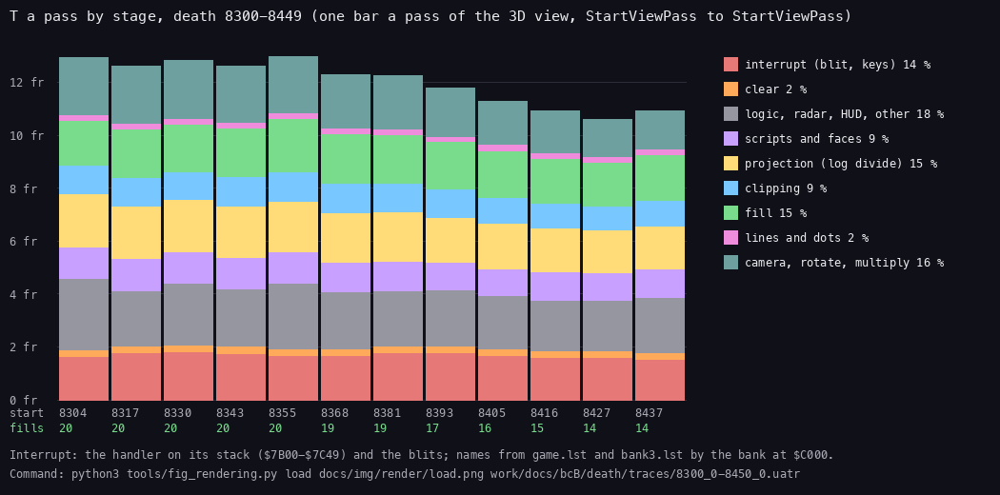

**How to read it.** One bar for each of the 12 passes of death 8304-8448, split by stage.
The interrupt, which includes the blit, takes 14 %.
The camera, the rotations and the multiplies take 16 %, the projection 15 % and the fill 15 %.
Clipping takes 9 % and the scripts and face tests 9 %.
The clear takes 2 %, and the lines and dots 2 %.
As the flying enemy draws away, the faces filled go from 20 to 14 a pass and the pass from 12.9 to 10.6 frames.
`python3 tools/fig_rendering.py load docs/img/render/load.png work/docs/bcB/death/traces/8300_0-8450_0.uatr`.

The views of `play` measured by WALKTHROUGH 1 (the count of ClearBackBuffer in a window):

| play frames | On screen | Frames a pass |
| --- | --- | --- |
| 8370-8970 | the normal view | 7.7, 7.4, 7.1 |
| 9115-9315 | the Dragonfly's view | 8.0 |
| 9805-9995 | binoculars and zoom | 6.8 |
| 10 065-10 125 | the rear view | 12 |
| 10 520-10 620 | the console after the map | 11.1 |

Worked example: in death 8304-8317, a pass of 12.94 frames (917 600 T) fills 20 faces and projects 17 vertex ranges.
In death 8427, 14 faces take 10.61 frames.
Six faces fewer save 2.3 frames (165 008 T), about 27 500 T a face with its share of the transform, the projection and the clip.

The point: the game draws 3.9 to 7.4 pictures a second (50 / 12.9 to 50 / 6.8).
Each face on the screen costs about 0.4 of a frame, and the mission's busiest views halve the rate.

## 6.14 What is known only from the code

- The special cases of DrawLine (horizontal `$CA4E`, 45 degrees `$CA74`): the three lines of `play` are vertical.
- FillSpans with the light value 0 (the silhouettes): read from the code; no trace of mine covers a pass with
  `$757A` = 0.
