# 7. Objects

What this covers: every thing in Battle Command that the game keeps state for. A mission is one block on side 2. It
holds a header, a map of roads, a list of placed objects, a table of object types, the mission's own code and its 3D
models. At run time the objects live in 24 records of 60 bytes. Record 0 is the player's tank. This document gives:

- the mission block byte by byte: the header, the vertices, the segments, the object list and the templates, with a
  worked decode of mission 1;
- the models and the box generators, with BoxRect16's radius times 64;
- the object record field by field and the slots;
- the spawn and free paths, at work in a recording;
- each object kind as a state machine: the scenery, the spawners, the enemy units, the shells, the gun;
- the collision pass: the pair timers, the distance estimate, the box test, with a worked example;
- the player's state: speed, heading, position, height, fuel, armour, score, the goal flag, the failure cause;
- the weapon slots and the weapon records;
- the random-number generator.

The rules that use these records (driving, the enemies' attacks, damage, kills, the weapons, goals, completion and
failure) are [doc 10](10-gameplay-logic.md). How a model is drawn is [doc 06](06-rendering.md); how the mission block
is loaded is [doc 03](03-build-and-load.md).

The recordings it rests on ([WALKTHROUGH 6.0](../WALKTHROUGH.md#60-the-recordings)):

- `death` (stage 1, `work/stage1/rec/death`): 20 039 frames from the title, Blast Em Mission with the Turret, the
  tank driven and the cannon fired. It was opened on an own instance after `source work/env.sh` with
  `python3 ../../kit/rs.py open --work work/docs/bcC/death --ttd work/stage1/rec/death/session.ttd --port-base 37370`
  `--model 128K --ranges 4000-FFFF --binary "$UNREAL_BINARY"` (the binary from `work/env.sh`). `tools/ttd_sample.py` (TTD `memory_at`) took `$75F0-$7BCF`
  (the object table `$75F0-$7B8F` and the 64 bytes after it), the armour, the score and `$7BF9` at every frame 7590-9600 (`work/docs/bcC/death-1.jsonl`) and
  at every tenth frame 7500-20000 (`work/docs/bcC/death-10.jsonl`).
- `fuel` (stage 2, `work/stage2/rec/fuel`): the same mission with a POKE, Fuel `$7C57` = 32 at frame 7704; the tank
  is driven ahead until the fuel runs out. Opened the same way and sampled at every frame 7690-7910
  (`work/docs/bcC/fuel-player.jsonl`).
- `armour` (made for docs 07 and 10, `work/docs/bcC/rec/armour`): 18 939 frames, the death plan with a POKE at frame
  7704 that sets the four armour bytes `$8301-$8304` to 1. Recorded with `python3 tools/rec_armour.py --work
  work/docs/bcC/rec/armour --port-base 37370 --start work/stage1/explore/loaded.szx`. The first hit, in frame 18423,
  ends the mission ([doc 10.5](10-gameplay-logic.md#105-damage-playerhit-the-armour-and-the-subsystems)).
- `m1complete`, `m4complete` (stage 2, `work/stage2/rec/`, `work/stage2/complete-NOTES.md`): missions 1 and 4
  completed; the Helicarrier record from its call to its landing, the goal records destroyed.
- The L1 counts of the stage 1 builds ("L1 n" in the `.ann` descriptions).

A sample of frame N is the memory at the start of frame N. A trace, and so a routine animation, puts an instruction
in the frame where it ran. A [pass](README.md#terms) is one turn of `PlayLoop $6A0C`: one 3D frame, 7 to 12 TV
frames ([doc 04](04-game-loop.md)). An object moves at most once a pass.

## 7.1 Units and coordinates

The world is flat. X grows to the east and Y to the north. A position is two 24-bit signed numbers, low byte first.
The height is a 16-bit number above the ground.

- One **world unit** is the smallest step.
- One **coarse unit** is 1024 world units. The mission data counts in coarse units.
- The vertices of the road map are one signed byte per axis, in coarse units.
- The object list stores each axis as a 16-bit word in units of 4. The high byte of the word is the coarse unit.
  WordToWorld `$BD83` shifts the word left by 2 into 24 bits.
- The heading is one byte, 256 steps to the full turn, at +`$22` of a record, with a fraction byte at +`$21`.
  Heading 0 faces north (+Y).

| Quantity | Format | Example (mission 1) |
| --- | --- | --- |
| vertex | 1 signed byte a coordinate, coarse units | vertex 0: X `$F2` = -14, Y `$12` = 18 |
| list position | 16-bit word a coordinate, units of 4 | list record 0: X `$0A00` = coarse 10 = world 10 240 |
| object position | 24-bit signed, world units | death frame 8121, the tank: X = -9558, Y = -9678 |
| heading | 1 byte, 256 a turn | the tank in death frame 8121: 202 |

The point: three scales of one grid. The map's bytes and the list's high bytes are the same coarse unit, which lets
the spawner compare a list record with the player's position by one byte subtraction.

## 7.2 The mission block and its header

SELECT loads one mission block from side 2 into bank 0 at `$DBC5` ([doc 03](03-build-and-load.md)). Its length
differs per mission; mission 1 is 8058 bytes, `$DBC5-$FB3E`. The block is self-describing: its header holds the
addresses of every other part.


*Figure 7.1. The header of mission 1 (Blast Em Mission), bytes `$DBC5-$DBFF` of
`src/res/missions/01-blast-em-mission.txt`. Drawn by `python3 tools/fig_objects.py header
docs/img/objects/mission-header.png` from the resource, not from a recording.*

How to read it:

- The grid shows the 59 bytes, 16 a row, each coloured by its field.
- The list under it names each field, its value and the routine that reads it.

The point: everything after the header is found through it. The object list, the templates, the goal hook, the
models and the player's start are addresses or values here, so the resident code serves every mission without a
table of its own.

The fields, as `tools/res_missions.py` parses them:

| Address | Bytes | Field | Mission 1 | Read by |
| --- | --- | --- | --- | --- |
| `$DBC5` | 1 | mission number | 1 | the catalogue check |
| `$DBC6` | 10 | tape name | `MISSION:::` | the tape search |
| `$DBD0` | 2 | half extents X, Y (coarse) | 28, 22 | BoundaryCheck `$D4B8` |
| `$DBD2` | 5 | not read by a recorded routine | `04 05 16 11 20` | |
| `$DBD7` | 2 | template table | `$DF85` | ObjectSetType `$BD41` (at `$BD4E`) |
| `$DBD9` | 1 | object count | 89 | ActivateMissionObjects `$BBF1`, StartMission (`$695C`) |
| `$DBDA` | 2 | object list | `$DCBC` | ActivateMissionObjects, MarkDestroyed `$B6BD`, StartMission (`$6956`) |
| `$DBDC` | 1 | segment count | 10 | SegmentVisibility `$AD45` |
| `$DBDD` | 1 | list index of the first switch object (0 none) | 0 | KillSwitchObject (`$B622`, section 7.14) |
| `$DBDE` | 1 | first switchable segment (`$FF` none) | `$FF` | SegmentVisibility, KillSwitchObject; set in missions 5, 8 and 10 |
| `$DBDF` | 2 | switch table: the segments each switch object guards | `$0000` | KillSwitchObject |
| `$DBE1` | 2 | goal hook | `$EB60` | MissionTimeSetup `$85F5`, to the play loop's `$6A67` |
| `$DBE3` | 8 | player start: heading word, X, Y | heading 0, X `$FFE000`, Y `$FFD800` | MissionTimeSetup, to `$7611` |
| `$DBEB` | 2 | models | `$EC57` | the model scripts |
| `$DBED` | 2 | end of the part restored after a mission | `$FB3F` | MissionBlockLoaded `$8579` |
| `$DBEF` | 2 | `ef` | `$DE88` | |
| `$DBF1` | 12 | Helicarrier pad, the pickup point | `00 58 00 00 48 00 ...` | PlaceHelicarrier `$D52E` (copied to `$7E82`) |
| `$DBFD` | 1 | `cafe` | `$FF` | |
| `$DBFE` | 2 | clock start: minutes, hours | 0, 8 | to `$68EB`, `$68EC` |

Worked example: the player's start. The eight bytes at `$DBE3` are `00 00 00 E0 FF 00 D8 FF`.

1. The heading word is `$0000`: heading 0, north.
2. The X field is `00 E0 FF`, the 24-bit `$FFE000` = -8192 world units = -8 coarse units.
3. The Y field is `00 D8 FF`, `$FFD800` = -10 240 = -10 coarse units.

Witness: the death recording's tank stands at X = -8192, Y = -10 240 in the sample of frame 7590, the values of the
header.

The parts of the block, in order:

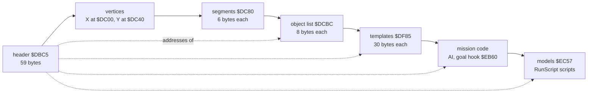

The point: a mission brings its code with it. The AI of the enemies, the goal and the spawners are routines inside
the block, called through the records' handler words. The resident game supplies the engine and a vector table of 22 `JP`s at
`$67BE-$67FF` (ApiVector00-21, the last at `$67FD`) that the mission code calls (MoveObject `$67BE`, BearingTo `$67C1`, FindFreeObject `$67C4`,
ObjectSetType `$67C7`, RegisterCollision `$67CA`, Random `$67D0`, AbsA `$67D6`).

## 7.3 The road map: vertices and segments

The vertices are two arrays of signed bytes, X at `$DC00` and Y at `$DC40`, in coarse units. A segment is 6 bytes at
`$DC80`:

| Offset | Meaning |
| --- | --- |
| +0 | vertex a |
| +1 | vertex b |
| +2 | orientation: 0 along Y, 128 (`$80`) along X, other values diagonal |
| +3 | size across: the half width of the strip |
| +4 | size along: the margin at the ends |
| +5 | style: the terrain type TerrainCollision `$CC3C` reports (0 a road) |

Worked example: segment 0 of mission 1 is `00 02 80 E0 20 00`.

1. Vertex a = 0: X `$F2` = -14, Y `$12` = 18.
2. Vertex b = 2: X `$0E` = 14, Y `$12` = 18.
3. Orientation `$80`: the strip runs along X, from X = -14 to 14 at Y = 18.
4. Style 0: a road. TerrainCollision returns type 0 on it.

The ten segments of mission 1 are the grey frame of roads in the figure below. The terrain type matters to the tank:
types 0 and 6 take another speed path in PlayerStep `$A8C7`, and types 2 and `$80` are walls
([doc 10.2](10-gameplay-logic.md#102-the-tank-playerstep)).


*Figure 7.2. Mission 1 drawn from its block, with the paths of record 0 (the tank) and records 7, 8 and 12 (enemy
vehicles) in the death recording, samples of every frame 7590-9100 (`work/docs/bcC/death-1.jsonl`). Drawn by
`python3 tools/fig_objects.py world docs/img/objects/mission1-world.png --samples work/docs/bcC/death-1.jsonl --slots
7,8,12 --to 9100`.*

How to read it:

- One grid step is one coarse unit; north is up.
- Grey lines: the 10 segments.
- Dots: the 89 list records, coloured by the role of their type (section 7.5); the number is the type, except for
  trees and hills.
- Magenta square: the Helicarrier pad from `$DBF1`: the words at `$7E89` / `$7E8C` (`$0000`, `$0020`) are the
  mid and high bytes of X and Y, so the pad is world (0, 8192), coarse (0, 8).
- Green frame: the half extents; red frame: 4 coarse units more, where desertion begins.
- Coloured lines: positions sampled every frame; a jump of more than two coarse units starts a new line.

The point: the enemies are not on the map. Every vehicle path starts near the tank: the units were made there by a
spawner (section 7.9) and stay within about 3 coarse units of the camera. The goal, the two fuel dumps (type 33,
magenta), sits in the north-east corner, away from the roads.

The previews of all ten missions are `src/res/missions/NN-*.preview.png`.

## 7.4 The object list

The object list holds every placed thing: trees, hills, buildings, depots, the targets. Each record is 8 bytes:

| Offset | Meaning |
| --- | --- |
| +0 | flags: b7 alive (walked by the spawner), b6 spawned (has a record now), b1 destroyed |
| +1 | type, an index into the template table |
| +2 | heading |
| +3 | spare (0 in mission 1) |
| +4, +5 | X word (units of 4; the high byte is the coarse unit) |
| +6, +7 | Y word |

Worked example: the first record of mission 1, at `$DCBC`, is `80 0B 00 00 00 0A 00 13`.

1. Flags `$80`: alive, not spawned, not destroyed.
2. Type `$0B` = 11: a depot with a gun (section 7.5).
3. Heading 0.
4. X word `$0A00`: coarse 10, world 10 240.
5. Y word `$1300`: coarse 19, world 19 456.

The point: the list is the mission's lasting state. A kill sets b1 and clears b7 in the list (MarkDestroyed
`$B6BD`), so the object never comes back, and the goal hooks read those bits
([doc 10.9](10-gameplay-logic.md#109-goals-the-helicarrier-and-completion)).

## 7.5 The templates and the object types

A type is a 30-byte template. ObjectSetType `$BD41` copies it to +2 .. +`$1F` of a record. Types below `$80` index
the mission's table (the header word `$DBD7`, mission 1 `$DF85`). Types `$80-$8C` index the resident table
ShellTemplate80 `$B3CA`: the player's weapons and the Helicarrier.

The template's bytes at their record offsets:

| Record offset | Template bytes | Field |
| --- | --- | --- |
| +2 | 0 | state (`$85`: b7 present, b2, b0) |
| +3 | 1 | flags: b0 has a step, b4 no knock-back and evictable, b6 a weapon (HitTest counts its hits) |
| +4 | 2 | draw variant |
| +5, +6 | 3, 4 | height |
| +7 | 5 | speed |
| +8, +9 | 6, 7 | wreck model (`$F103` in every mission 1 template) |
| +`$0A` | 8 | debris pieces, wreck pitch |
| +`$0B`-+`$10` | 9-14 | box half sizes: x, height, y |
| +`$11` | 15 | turn step |
| +`$12` | 16 | top speed |
| +`$13` | 17 | hit points |
| +`$14` | 18 | damage it does |
| +`$15` | 19 | unnamed (`$20` in most) |
| +`$16`, +`$17` | 20, 21 | radius |
| +`$18`, +`$19` | 22, 23 | step handler |
| +`$1A`, +`$1B` | 24, 25 | collision handler |
| +`$1C`, +`$1D` | 26, 27 | model |
| +`$1E`, +`$1F` | 28, 29 | score |

Worked example: template 7, the enemy tank, at `$DF85 + 7 x 30 = $E057`:
`85 2F 00 10 00 00 03 F1 04 E0 00 18 00 E0 00 03 28 02 02 20 40 00 C2 E5 F3 E8 3F F5 D0 07`.

1. State `$85`, flags `$2F`: a step handler, not a weapon, not evictable.
2. Height `$0010` = 16; speed 0 at the spawn.
3. Wreck model `$F103`, 4 debris pieces.
4. Box half sizes `$00E0`, `$0018`, `$00E0`: 224, 24, 224.
5. Turn step 3, top speed `$28` = 40, 2 hit points, damage 2.
6. Radius `$0040` = 64.
7. Step `$E5C2` (the chase, section 7.9), collision `$E8F3`, model `$F53F`, score `$07D0` = 2000.

Mission 1's 34 templates, read from the block (`src/res/missions/01-blast-em-mission.txt`):

| Type | In list | +3 | Height | Box x, h, y | Turn, top | HP | Damage | Radius | Step | Hit | Model | Score | Role |
| --- | --- | --- | --- | --- | --- | --- | --- | --- | --- | --- | --- | --- | --- |
| 0 | 16 | `$04` | 44 | 64, 64, 64 | 0, 0 | 0 | 1 | 64 | `$E39B` | `$B612` | `$F0D9` | 0 | tree |
| 1 | 16 | `$04` | 44 | 64, 64, 64 | 0, 0 | 0 | 1 | 64 | `$E39B` | `$B612` | `$F9A5` | 0 | tree |
| 2 | 2 | `$0D` | 88 | 484, 88, 484 | 0, 0 | 32 | 3 | 704 | `$EA12` | `$67DC` | `$EFBF` | 3000 | depot |
| 3 | 0 | `$2F` | 22 | 256, 22, 256 | 4, 32 | 1 | 1 | 100 | `$E3B2` | `$E3D3` | `$EE41` | 500 | vehicle |
| 4 | 4 | `$0D` | 64 | 404, 64, 404 | 0, 0 | 2 | 3 | 384 | `$EB77` | `$67DC` | `$F2E8` | 500 | building, spawner |
| 5 | 2 | `$0C` | 64 | 340, 128, 340 | 0, 0 | 2 | 3 | 384 | `$E39B` | `$67DC` | `$F25F` | 500 | building |
| 6 | 0 | `$0D` | 64 | 340, 128, 340 | 0, 0 | 0 | 0 | 384 | `$EB77` | `$67DC` | `$F25F` | 0 | spawner |
| 7 | 0 | `$2F` | 16 | 224, 24, 224 | 3, 40 | 2 | 2 | 64 | `$E5C2` | `$E8F3` | `$F53F` | 2000 | enemy tank |
| 8 | 0 | `$17` | 16 | 128, 128, 128 | 0, 96 | 0 | 3 | 1408 | `$EB04` | `$E39C` | `$F143` | 0 | shell of 7 |
| 9 | 0 | `$2F` | 24 | 192, 24, 192 | 3, 40 | 2 | 2 | 64 | `$E6F9` | `$E8F3` | `$F17E` | 2000 | vehicle |
| 10 | 0 | `$17` | 48 | 128, 128, 128 | 0, 96 | 0 | 3 | 1408 | `$EB04` | `$E39C` | `$F143` | 0 | shell of 9 |
| 11 | 2 | `$0D` | 36 | 128, 128, 128 | 0, 0 | 32 | 4 | 1408 | `$E38E` | `$67DC` | `$EEFD` | 4000 | depot with a gun |
| 12 | 0 | `$17` | 56 | 128, 128, 128 | 0, 96 | 0 | 3 | 1408 | `$EB04` | `$E39B` | `$F143` | 0 | shell of 11 |
| 13 | 4 | `$0C` | 120 | 404, 128, 404 | 0, 0 | 2 | 3 | 384 | `$E39B` | `$67DC` | `$F62A` | 0 | building |
| 14 | 1 | `$0D` | 20 | 160, 20, 160 | 0, 0 | 10 | 1 | 127 | `$E381` | `$67DC` | `$F6C0` | 3000 | gun emplacement |
| 15 | 5 | `$0C` | 32 | 169, 48, 169 | 0, 0 | 1 | 3 | 159 | `$E39B` | `$67DC` | `$F754` | 250 | hut |
| 16 | 4 | `$0C` | 20 | 64, 64, 64 | 0, 0 | 1 | 3 | 32 | `$E39B` | `$67DC` | `$EDC1` | 250 | crate |
| 17 | 2 | `$0C` | 64 | 160, 160, 160 | 0, 0 | 2 | 3 | 384 | `$E39B` | `$67DC` | `$F7D2` | 500 | building |
| 18 | 7 | `$0C` | 32 | 359, 32, 359 | 0, 0 | 2 | 3 | 352 | `$E39B` | `$67DC` | `$F831` | 500 | shed |
| 19 | 1 | `$05` | 64 | 34, 64, 34 | 0, 0 | 127 | 3 | 48 | `$EB7C` | `$67DC` | `$F8AF` | 0 | flag, spawner |
| 20 | 8 | `$04` | 127 | 607, 128, 607 | 0, 0 | 127 | 3 | 896 | `$E39B` | `$E39B` | `$ECB8` | 0 | hill |
| 21 | 4 | `$04` | 102 | 357, 128, 773 | 0, 0 | 127 | 3 | 896 | `$E39B` | `$E39B` | `$ECF7` | 0 | hill |
| 22 | 3 | `$04` | 127 | 1821, 128, 413 | 0, 0 | 127 | 3 | 2048 | `$E39B` | `$E39B` | `$ED41` | 0 | hill |
| 23 | 3 | `$04` | 127 | 1166, 128, 398 | 0, 0 | 127 | 3 | 1408 | `$E39B` | `$E39B` | `$ED80` | 0 | hill |
| 24 | 0 | `$17` | 20 | 128, 128, 128 | 0, 96 | 0 | 3 | 1408 | `$EB04` | `$E39C` | `$F744` | 0 | shell of 14 |
| 25 | 0 | `$0D` | 64 | 340, 128, 340 | 0, 0 | 0 | 0 | 384 | `$0000` | `$67DC` | `$F25F` | 0 | unused |
| 26 | 0 | `$2F` | 32 | 224, 24, 224 | 3, 40 | 3 | 2 | 64 | `$E837` | `$E8F3` | `$F385` | 2000 | vehicle |
| 27 | 0 | `$0D` | 64 | 340, 128, 340 | 0, 0 | 0 | 0 | 384 | `$0000` | `$67DC` | `$F25F` | 0 | unused |
| 28 | 0 | `$17` | 64 | 128, 128, 128 | 0, 120 | 0 | 4 | 1408 | `$EAAA` | `$E39C` | `$EC57` | 0 | homing shell |
| 29 | 0 | `$2F` | 24 | 128, 24, 128 | 3, 40 | 1 | 2 | 64 | `$E6B4` | `$E8F3` | `$F8EA` | 2000 | vehicle |
| 30 | 0 | `$2F` | 24 | 192, 24, 192 | 3, 40 | 3 | 2 | 64 | `$E5C2` | `$E8F3` | `$F43C` | 2000 | vehicle |
| 31 | 0 | `$17` | 48 | 128, 128, 128 | 0, 96 | 0 | 3 | 1408 | `$EB04` | `$E39C` | `$F143` | 0 | shell of 30 |
| 32 | 3 | `$0C` | 44 | 404, 64, 404 | 0, 0 | 2 | 3 | 384 | `$E39B` | `$67DC` | `$FA06` | 0 | building |
| 33 | 2 | `$0C` | 127 | 288, 48, 288 | 0, 0 | 1 | 6 | 159 | `$E39B` | `$67DC` | `$FA56` | 250 | fuel dump (the goal) |

How to read it:

- "In list" counts the type in the 89 list records; 0 means the type appears only when a spawner or a gun makes it.
- `$E39B` is a `RET` in the mission code: no step, or a hit that does nothing.
- `$67DC` is the resident vector to HitTest `$B660`. `$B612` (KillTree) is the hit handler of the trees: it has no
  weapon test, so anything that touches a tree knocks it down, the tank included (section 7.9).

The point: behaviour is data. A type's AI is the pair of handler words in its template. Hills take hits on a `RET`
and have 127 hit points; trees have 0 hit points and fall at the first touch. Every spawned enemy vehicle (types 7,
9, 26, 29, 30) has 1 to 3 hit points and scores 2000, and none of them is in the list: all come from spawners. Type 3,
a vehicle no spawner of mission 1 makes, would score 500.

The resident types, from ShellTemplate80 `$B3CA` (read from `build/game.bin`):

| Type | Weapon | Height | Speed | Box | Damage | Step | Hit | Model |
| --- | --- | --- | --- | --- | --- | --- | --- | --- |
| `$80` | K-40 mortar shell | 40 | 96 | 32 | 1 | `$B5E8` | `$B8AB` | `$FE80` |
| `$81` | turret cannon shell | 56 | 96 | 32 | 1 | `$B592` | `$B8AB` | `$FE80` |
| `$82` | Banshee RRSS | 48 | 120 | 16 | 2 | `$C453` | `$B8A8` | `$8775` |
| `$83` | Phoenix RRSA | 56 | 120 | 16 | 2 | `$C4A5` | `$B8A8` | `$8775` |
| `$84` | Banshee IRSS | 56 | 120 | 16 | 2 | `$C4A5` | `$B8A8` | `$8775` |
| `$85` | Phoenix IRSA | 56 | 120 | 16 | 2 | `$C453` | `$B8A8` | `$8775` |
| `$86` | Dragonfly | 64 | 120 | 16 | 2 | `$C391` | `$C365` | `$8775` |
| `$87` | K-90 cluster | 56 | 96 | 32 | 127 | `$CF4A` | `$B8AB` | `$FE80` |
| `$88` | Sleeper mine | 56 | 127 | 32 | 31 | `$D048` | `$D0E9` | `$8739` |
| `$89` | Skeet bomb | 64 | 64 | 32, 64, 32 | 4 | `$D2AE` | `$B8AB` | `$7ECA` |
| `$8A` | Phantasm | 56 | 96 | 32 | 1 | `$D405` | `$6BB0` | `$FE80` |
| `$8B` | Spectre | 56 | 96 | 64 | 31 | `$D369` | `$B8AB` | `$FE80` |
| `$8C` | the Helicarrier | 104 | 100 | 256, 128, 256 | 1 | `$DB00` | `$DAAB` | `$D9A5` |

All have state `$85`, hit points 0, top speed 127, radius 10 and score 7; all but the Helicarrier have the flags
`$57` (a step, no knock-back, a weapon); the Helicarrier has `$07`. The names follow the fire routines: FireClusterBomb
`$CF3F` launches `$87`, DropMine `$D005` `$88`, the Skeet's FireDecoy `$D24C` `$89`, LaunchPhantasm `$D3F7` `$8A`,
the Spectre's `$D341` `$8B`; the SLAM laser fires no projectile. The K-40 shell (`$B5E8`) does not burst at the
ground: a negative height removes it (RemoveObject `$B8B1`); only a hit explodes it (`$B8AB`). Which store fires which type is
[doc 10.7](10-gameplay-logic.md#107-the-weapons).

The point: the player's weapons are ordinary objects. A shell is a record with a step that moves it and a collision
handler that explodes it; +3 bit 6 is what lets it hurt an enemy.

## 7.6 The models

A model is a script of RunScript `$990F` ([doc 06](06-rendering.md)). Its first instruction is a box generator that
makes the corners of a box from three numbers. Vertex programs then derive more points, and face lists fill the
polygons. The generators are BoxSquare `$AA63`, BoxRect `$AB7B`, BoxRect16 `$AAF5` and BoxTilted `$ABFF`.

The rectangle generators take three numbers: a half angle b, a radius r and a height. The four corners lie at the
distance r from the centre, on the angles heading + b, heading - b and their opposites, so b sets the aspect: 32 (45
degrees) makes a square, a smaller b a long box. BoxRect uses 8-bit corners; BoxRect16 `$AAF5` makes 16-bit corners
and scales the radius by 64 (Sine16 through MulWordByte `$A82C`, vector `$67D9`), for the big objects: the hills.

Worked example: `box_rect16 32 12 127` (the hill `$ECB8`, type 20) puts its corners 12 x 64 = 768 world units from
the centre at 45 degrees, so the base is a square of half side 768 x sin 45 = 543 world units, and its height is
127. Template 20 gives the record a box of half side 607 and height 127 for the collision test, a little larger
than the drawing.

The whole script of model `$ECB8` of mission 1, bytes `$ECB8-$ECF6`, as `tools/models3d.py` decodes it
(`src/res/models/01-blast-em-mission.txt`):

```text
$ECB8 box_rect16 32 12 127                         half angle 32, radius 12 x 64, height 127
$ECBE verts P=V40 P=(P+V38)/2 V38=P P+=V38 V38=P   the apex from two corners
$ECC6 project 5 from V34                           five points to the screen
$ECC9 faces_test from 0: (38 35 34) (38 36 35) (38 37 36) (38 34 37)
$ECD8 fill_faces_clip (f0 c9 38 35 34) (f1 c4 38 36 35) (f2 c9 38 37 36) (f3 c4 38 34 37)
$ECF6 end
```

Four triangles share the apex V38: a pyramid, the hill. Colours 9 and 4 alternate on opposite faces.

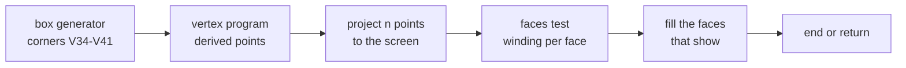


*Figure 7.3. The 28 models of mission 1 that its templates use, drawn from the block by `python3 tools/fig_models.py`
(`src/res/models/01-blast-em-mission.png`, 1200 px wide), heading 0; colours are the scripts' colour numbers.*

How to read it: each cell is one model, labelled with its address. `$ECB8`-`$ED80` are the four hills, `$F0D9` and
`$F9A5` the trees, `$F53F` the enemy tank, `$FA56` the fuel dump.

The point: the template's model word picks the picture. When the record's wreck bit is set, DrawObject `$B827` (at
`$B86F`) reads the wreck word +8/+9 (`$F103`) instead of +`$1C`/+`$1D`. Every model of every mission is drawn in
`src/res/models`.

## 7.7 The object record

ObjectTable `$75F0` holds 24 records of 60 bytes, `$75F0-$7B8F`. Record n is at `$75F0 + 60 n`.


*Figure 7.4. Record 0 (the tank) in the fuel recording, sample of frame 7800, and record 7 (an enemy tank, type 7)
in the death recording, sample of frame 8000. Drawn by `python3 tools/fig_objects.py record
docs/img/objects/object-record.png --player work/docs/bcC/fuel-player.jsonl:7800 --other
work/docs/bcC/death-1.jsonl:8000:7`.*

How to read it:

- One row a field: its offset, its meaning and its bytes in both records.
- Green rows (+2 .. +`$1F`) come from the template; the others are set at the spawn or by the handlers.

The point: the record is the template plus a place. The first two bytes link it to the list, +`$20` is a serial
that tells a reused record from its previous owner, +`$21`-+`$28` are heading and position, +`$2B`-+`$30` the
view-space position the renderer fills, and +`$31`-+`$3A` are free for the type's own state (a shell's lifetime, a
spawner's three children, a unit's wander count).

The fields set outside the template:

| Offset | Field | Set by |
| --- | --- | --- |
| +0 | list index, `$FF` when not from the list | ActivateMissionObjects (its counter operand `$BC33`); `$FF` from the spawners and guns |
| +1 | type | ObjectSetType |
| +2 bit 6 | wreck | KillMissionObject `$B67D`; at a spawn, from the list's b1 |
| +2 bit 5 | in view this pass | TransformObjects `$BD98`; Debris `$B6D1` throws pieces only when it is set |
| +`$20` | serial | ObjectSetType: a running count, the operand of `LD A,n` at `$BD5E` |
| +`$21`-+`$22` | heading | CopyHeading `$BCBA` from the list, or the firer's |
| +`$23`-+`$28` | X, Y | CopyPosition `$BCC6` from the list words, or the spawner's |
| +`$2A` | pitch | BoxTilted models |
| +`$2B`-+`$30` | view-space x, height, depth | TransformObjects |
| +`$31`-+`$3A` | per-type state | the step handlers |
| +`$3B` | collision slot | RegisterCollision `$C957` |

The slots:

| Records | Use | Found by |
| --- | --- | --- |
| 0 | the player's tank (type 0, step PlayerStep `$A8C7`, hit PlayerHit `$CAA5`) | fixed |
| 1-20 | list objects, spawned units, projectiles | FindFreeObject `$BCDA` (D = `$15`) |
| 21-22 | also projectiles | FindProjectileSlot `$BCD6` (D = `$17`) |
| 21 (`$7ADC`) | the Helicarrier, called by the key H (m1complete frame 16239) | PlaceHelicarrier `$D52E` |

## 7.8 The spawn and the free: ActivateMissionObjects

The world is bigger than the record table. ActivateMissionObjects `$BBF1` keeps records only for list objects near
the player. It runs once a pass from PlayLoop and walks 16 list records a call, so the 89 records of mission 1 take
six passes.

Its state is in its own operands:

- the list pointer and the count left (`LD HL,nn` at `$BBF1`, `LD C,n` at `$BBF9`);
- the list index of the record being looked at (`$BC33`);
- the player's coarse X and Y, patched into the `LD A,n` operands at `$BC12` and `$BC1D` before the walk.

For each record with b7 (alive), InRange `$BD67` takes |player coarse - list high byte| on each axis and compares it
with a range: 4 coarse units for type 0, 9 for every other type.

- In range and not spawned: FindSlot `$BCFD` scans records 1-20 once and takes the first that is free or holds an
  enemy shell (+3 AND `$50` = `$10`: b4 set, b6 clear); a shell taken so is unregistered and freed first. It does
  not call FindFreeObject and does not prefer a free record: a shell earlier in the table is evicted even when a
  free record follows. ObjectSetType copies the template. RegisterCollision
  gives a collision slot, unless the list record is destroyed. The list's b1 becomes the record's wreck bit b6. The
  list record gets b6 (spawned). CopyHeading and CopyPosition fill +`$21`-+`$28`.
- Out of range and spawned: the list record loses b6. The record whose +0 is the list index is found among records
  0-22, unregistered (vector 05) and freed (+2 = 0).
- Destroyed records (b7 clear) are skipped.

```text
ActivateMissionObjects():
    repeat 16 times:
        rec = list[index]
        if rec.alive:
            near = |player_cx - rec.x_hi| < R and |player_cy - rec.y_hi| < R    # R = 4 for type 0, else 9
            if near and not rec.spawned:
                obj = FindSlot()                     # for r in 1..20: if free(r) or evictable(r): return r
                if obj:
                    obj.index = index; ObjectSetType(obj, rec.type)
                    if not rec.destroyed: RegisterCollision(obj)
                    obj.wreck = rec.destroyed
                    rec.spawned = 1
                    obj.heading = rec.heading; obj.xy = rec.xy << 2
            elif not near and rec.spawned:
                rec.spawned = 0
                obj = the record with obj.index == index
                Unregister(obj); obj.state = 0
        index += 1
        if index == count: index = 0; pointer = list start
```

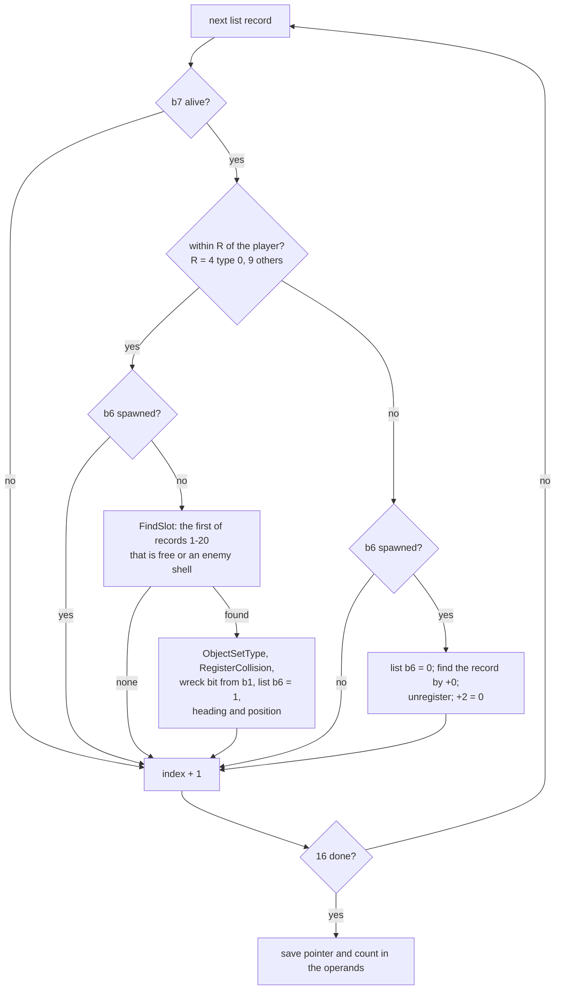

The range test and its two ranges:

```text
$BC11  LD A,$E4          ; operand $BC12: the player's coarse X (patched)
$BC13  LD C,(HL)         ; the list X high byte
$BC14  CALL InRange
$BC17  JP C,$BC86        ; out of range: the despawn path
...
InRange:
$BD67  AND A
$BD68  SBC A,C           ; player - object, signed
$BD69  JP PO,$BD6E
$BD6C  CCF
$BD6D  RRA               ; on overflow: halve, the carry as the sign
$BD6E  LD C,A
$BD6F  CALL ApiVector08  ; |A|
$BD72  EX AF,AF'         ; the type
$BD73  CP $01
$BD75  JR C,$BD7D        ; type 0: range 4
$BD77  EX AF,AF'
$BD78  CP $09            ; other types: range 9
$BD7A  LD A,C
$BD7B  CCF               ; carry = out of range
$BD7C  RET
```


*Animation 7.1. ActivateMissionObjects in the death recording, frames 7598:65000 to 7599:28500 (a pass of the
mission start that spawns), 90 pictures. Drawn by `python3 ../../kit/routine_anim.py --work work/docs/bcC/death
--listing build/game.lst --window 7598:65000-7599:28500 --pc BBF1-BDA0,C957-C9FF --view buffer:75F0:30x24:hex --range
7500-7BFF --pictures 90 --out docs/img/routines/ActivateMissionObjects.gif`.*

How to read it:

- Right: the code running in each slice, the current instruction highlighted; "other" is code outside the ranges.
- Left: records 0-11 of the object table, 30 bytes a row, so two rows a record; yellow bytes are written in the
  slice.
- Records 4 to 7 (`$76E0`, `$771C`, `$7758`, `$7794`) fill one after the other: the template, the serial, heading
  and position.

Witness: in the death recording the first list objects spawn in frames 7594-7612. The call traced above runs 16
range tests in frame 7598 (`$BD72-$BD6F` repeated from T 65 487), then ObjectSetType at 7599:20, RegisterCollision at
7599:8376, and ends at 7599:28404. In the sample of frame 16 000 list record 26 (type 32) is destroyed and its wreck
in record 8 stands 16.6 coarse units from the tank: a destroyed record is never despawned, because the walk skips it.

The point: a sliding window. Only objects within 9 coarse units (4 for type-0 trees, 9 for everything else) have records, so 24 records serve a
list of 89. The price is the wreck leak: a wreck keeps its record for the rest of the mission
([doc 10.13](10-gameplay-logic.md#1013-notable-features)).

## 7.9 The object kinds as state machines

RunObjectHandlers `$C026` calls, once a pass, the step handler (+`$18`) of each record with +2 b7 and +3 b0 set,
with IX = the record. CollisionPass (section 7.10) calls the collision handlers (+`$1A`) in pairs. Every kind below
is a pair of handlers.

### The scenery: trees, hills, buildings

Trees (types 0, 1), hills (20-23) and plain buildings have the step `$E39B`, a `RET`, and +3 b0 clear: they never
step. Their hit handler decides what a hit does.

- A hill's hit handler is the `RET` at `$E39B`: nothing happens.
- A building's is `$67DC`, HitTest: a weapon takes its hit points, and at 0 it becomes a wreck that keeps its record
  (section 7.8, doc 10.6).
- A tree's is KillTree `$B612`, the handler of types 0 and 1 in all ten missions (and of mission 5's types 23-25,
  mission 6's 27-29, mission 10's 23-25, 30 and 31). It calls HitPoints with no weapon test. A tree has 0 hit points,
  so any collider kills it, the tank (damage 0 at +`$14`) included. On the kill it unregisters the collision, throws
  debris and joins the kill path at `$B677`, which frees the record (+2 = 0) and adds the tree's score, 0. It
  bypasses KillMissionObject: the list record is never marked destroyed and keeps b7 and b6.

```text
KillTree:                    ; $B612, the hit handler of types 0 and 1
$B612  CALL HitPoints        ; +$13 -= the hitter's +$14; NC: no kill
$B615  RET NC
$B616  CALL ApiVector05      ; UnregisterCollision
$B619  CALL ApiVector11      ; Debris
$B61C  JR $B677              ; LD (IX+$02),0, then AddKillScore (+0)
```

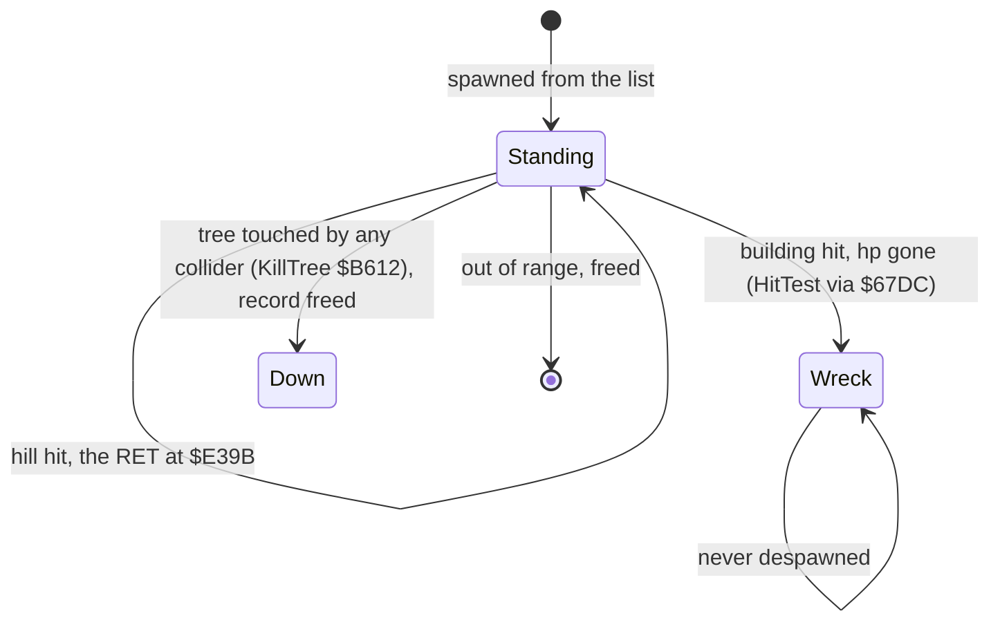

Whether a felled tree stands again is not settled: its list record keeps b6 (spawned), so the walk does not spawn it
while it is in range; out of range the despawn path clears b6 and frees the record whose +0 holds the list index,
which may by then belong to another object (SUSPECTED, no recording drives back to a felled tree).

### The spawners: depots, buildings, the flag

Types 4 and 6 (step `$EB77`), type 19, the flag (step `$EB7C`), and the entry `$EB72` keep three children each.

- The first pass (M1SpawnerA `$EB77`, M1SpawnerFlag `$EB7C`, M1SpawnerC `$EB72`) writes three triples (record,
  serial, type) at +`$31`-+`$39`, each (0, 0, kind) from the spawner's kind table, and `$FF` at +`$3A`. Then it
  installs M1Respawn `$EB9F` as the step.
- M1Respawn walks the triples to the `$FF`. A triple whose record is 0, or whose record holds another serial at
  +`$20` or is free (+2 = 0), is a dead child: M1SpawnUnit `$EBE5` makes a new one of the triple's type, the triple
  gets the new record's number (+`$3B`) and serial (+`$20`), and the pass ends. So at most one child is made a pass.
- M1SpawnUnit takes a record from FindFreeObject (none: try again next pass), sets the type, registers the
  collision and sets +0 = `$FF`. The position is the camera's (the mid and high bytes `$67A8` / `$67AB`) plus an
  offset in units of 256: one axis gets +-12 (`$0C00`, 3 coarse units, the sign from Random), the other one of 0, 4,
  8, 12 or -4 (0 to +3 coarse units, or -1), and Random swaps the two axes.

```text
M1SpawnerStart(spawner, kinds):  # kinds: $EB58 = 7, 26, 9 (types 4, 6); $EB54 = 30, 26, 29 (flag); $EB5C = 7, 30, 29
    spawner[$31..$39] = (0, 0, kinds[0]), (0, 0, kinds[1]), (0, 0, kinds[2]); spawner[$3A] = $FF
    spawner.step = M1Respawn

M1Respawn(spawner):
    for t in the triples up to $FF:
        if t.record != 0 and record[t.record].serial == t.serial and record[t.record].state != 0:
            continue                                      # the child lives
        new = M1SpawnUnit(t.type)                         # NC: no free record
        if new: t.record = new.number; t.serial = new.serial
        return                                            # one child a pass at most

M1SpawnUnit(type):
    new = FindFreeObject(); if none: return NC
    ObjectSetType(new, type); RegisterCollision(new)
    a = +12 or -12 (Random sign)                          # units of 256: 3 coarse units
    b = 4 x (|Random| AND 3) if Random >= 0 else -4       # 0, 1, 2, 3 or -1 coarse unit
    if Random < 0: swap a, b
    new.x = camera.x_mid + a (low byte 0); new.y = camera.y_mid + b; new.index = $FF
```

```text
M1Respawn:
$EB9F  PUSH IX
$EBA1  POP HL
$EBA2  LD BC,$0031
$EBA5  ADD HL,BC         ; the first triple
$EBA6  LD A,(HL)         ; its record
$EBA7  CP $FF
$EBA9  RET Z             ; the end mark: all three live
$EBAA  LD ($EBBF),HL     ; kept in an operand
$EBAD  INC HL
$EBAE  AND A
$EBAF  JR Z,$EBD2        ; record 0: never made, make it
...                      ; IY = $75F0 + 60 x record
$EBC2  LD A,(IY+$20)
$EBC5  CP (HL)           ; the serial still the same?
$EBC6  JR NZ,$EBD2
$EBC8  LD A,(IY+$02)
$EBCB  AND A
$EBCC  JR Z,$EBD2        ; freed
$EBCE  INC HL
$EBCF  INC HL
$EBD0  JR $EBA6          ; the next triple
$EBD2  INC HL
$EBD3  LD A,(HL)         ; the type
$EBD4  CALL M1SpawnUnit
$EBD7  RET NC            ; no free record
$EBD8  LD HL,($EBBF)
$EBDB  LD A,(IX+$3B)     ; the new record's number
$EBDE  LD (HL),A
$EBDF  INC HL
$EBE0  LD A,(IX+$20)     ; its serial
$EBE3  LD (HL),A
$EBE4  RET               ; one a pass
```

The children appear around the camera, not around the spawner. A spawner keeps the player's surroundings full of
enemies as long as it has a record, that is while it is within 9 coarse units.

```mermaid
stateDiagram-v2
  [*] --> Start: spawned from the list
  Start --> Watching: three triples (0, 0, kind), step = M1Respawn
  Watching --> Spawning: a triple's record is 0, freed, or holds another serial
  Spawning --> Watching: M1SpawnUnit made one, triple = (record, serial); the pass ends
  Spawning --> Watching: no free record, try again next pass
  Watching --> [*]: the spawner is destroyed or out of range
```

Worked example: the type 4 spawner in record 3, death sample of frame 8000. Its +`$31`-+`$3A` are `07 06 07 08 07
1A 0C 0B 09 FF`:

1. Triple 0: record 7, serial 6, type 7. Record 7 holds type 7 with serial 6 at +`$20`: alive.
2. Triple 1: record 8, serial 7, type `$1A` = 26. Record 8 holds type 26, serial 7: alive.
3. Triple 2: record 12, serial 11 (`$0B`), type 9. Record 12 holds type 9, serial 11: alive.
4. `$FF`: the walk ends, nothing is made this pass.

Witness: the spawner's +`$31`-+`$3A` in the death samples (`work/docs/bcC/death-1.jsonl`): all 0 at 7595 (record 3
just spawned), `00 00 07 00 00 1A 00 00 09 FF` at 7596 (the first pass), then one child a pass: triple 0 filled at
7602 (record 7), triple 1 at 7606 (record 8), triple 2 at 7612 (record 12). The children carry +0 = `$FF`, the mark
of M1SpawnUnit. At 8284 record 3 itself is despawned (the tank more than 9 coarse units away), so the children freed
later (record 12 at 8625, by the leash) are not replaced.

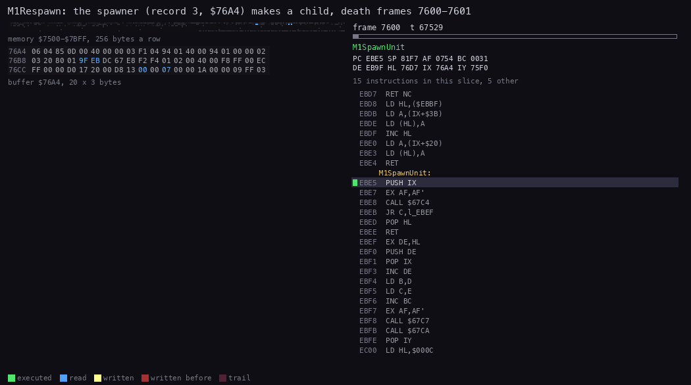

*Animation 7.2. The spawner's step in the death recording, frames 7600:67300 to 7601:10100, 60 pictures: M1Respawn
reads triple 0 (record 0: empty), M1SpawnUnit takes a record (FindFreeObject), sets its type 7 (ObjectSetType) and
collision slot (RegisterCollision), places it around the camera (`$67A8`, `$67AB`) and marks +0 = `$FF`; at the end
record 7 and serial 6 go into triple 0 (+`$31`/+`$32`, `$76D5`, the third row of the view). The interrupt runs in the
middle (frame 7601 up to t 8830), shown as other code. Drawn by `python3 ../../kit/routine_anim.py --work
work/docs/bcC/death --listing work/docs/bcC/m1game.lst --window 7600:67300-7601:10100 --pc
EB9F-EC56,BCDA-BD66,C957-CA3A --view buffer:76A4:20x3:hex --range 7500-7BFF --pictures 60 --out
docs/img/routines/M1Respawn.gif`.*

### The enemy units: tank and vehicles

The units are types 7, 9, 26, 29 and 30. Their hit handler is `$E8F3`; type 7's step is `$E5C2`. The mission code
has no labels in `game.ann`. The names below (`M1...`) come from the listing `work/docs/bcC/m1game.lst`, made for the
animation by `work/docs/bcC/scripts/m1lst.py`, and are proposed to the lead.

- **Chase** `$E5C2`: below 2 hit points, go to the wander start. Turn toward the player by up to 8 a pass
  (M1TurnToPlayer `$E555`, carry when aligned). Not aligned: return. Aligned: the fire check (M1FireCheck `$E79B`),
  speed up toward +`$12` (M1Accelerate `$E533`), MoveObject, the terrain turn (M1TerrainTurn `$E8D8`: off the road,
  turn by `$80`) and the leash (M1Leash `$E8C9`). Within `$258` world units of the camera (M1DistanceToCamera
  `$E751` measures X and Y against the camera's `$67A7` and `$67AA`, which is the player only in the tank's own views), go to Close.
- **Close** `$E5EF`: below 4 hit points, go to the wander start. Every mission 1 unit has 3 hit points or fewer, so
  in mission 1 Close always falls through to the wander start at once; else it turns, fires and goes back to Chase
  beyond `$258`.
- **Wander start** `$E63F`: with 2 or more hit points, draw a count (+`$3A`, 0-63) and a heading (+`$39`), then
  wander (`$E68E`), return (`$E611`) and aim (`$E633`). Below 2: flee (`$E66E`).
- **Leash**: a unit more than `$0C00` world units (3 coarse units) from the camera on either axis is removed
  (+2 = 0). Its spawner makes a new one.
- **Hit** `$E8F3`: a hitter with +3 b6 (a weapon) goes to HitTest; any other collision starts an avoidance turn
  (`$E965`).

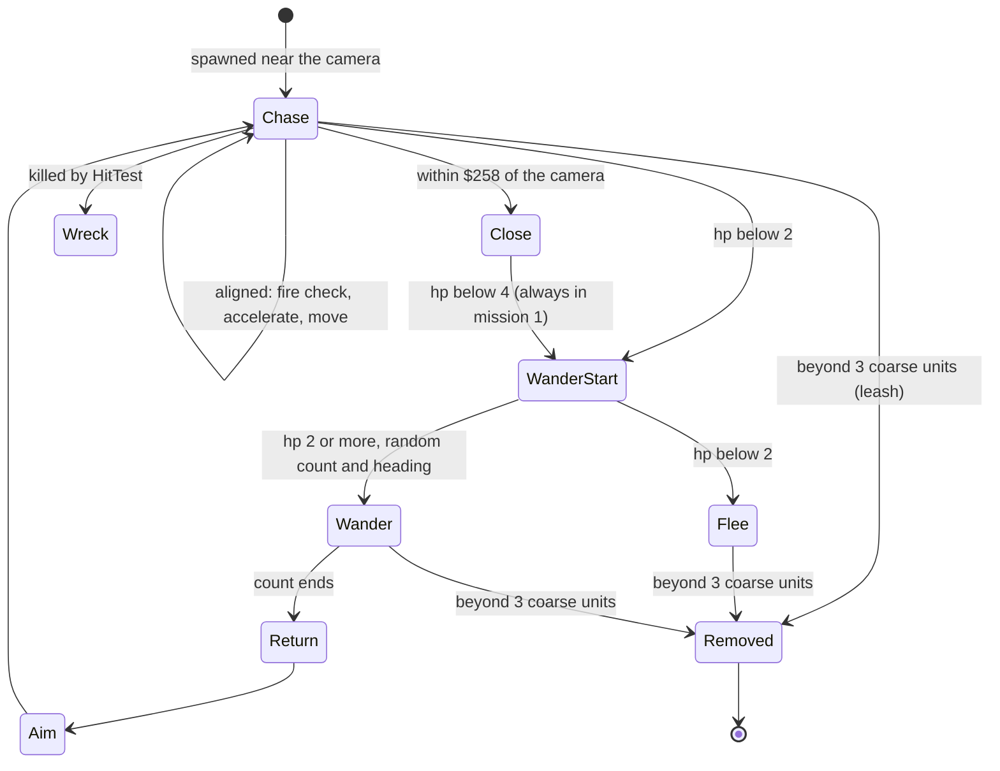

The turn, as the trace shows it:

```text
M1TurnToPlayer:
$E555  EXX
$E556  LD IY,$75F0       ; the player
$E55A  CALL $67C1        ; BearingTo: A = the bearing to IY
$E55D  EXX
$E55E  LD D,$02
$E560  LD E,$08          ; the largest turn a pass
$E562  LD C,(IX+$22)     ; the heading
$E565  AND A
$E566  SBC A,C           ; the difference
$E567  LD B,A
$E568  CALL $67D6        ; |difference|
$E56B  CP E
$E56C  JR NC,$E57F       ; 8 or more: turn by 8, no carry
$E56E  LD E,A            ; less: snap onto the bearing
...
$E57A  LD (IX+$22),A
$E57D  SCF               ; aligned
$E57E  RET
```


*Animation 7.3. The step of record 7 (type 7, `$7794`) in the death recording, frames 7980:68700 to 7981:700, 50
pictures. Drawn by `python3 ../../kit/routine_anim.py --work work/docs/bcC/death --listing work/docs/bcC/m1game.lst
--window 7980:68700-7981:700 --pc E381-EC56,BFD1-C060 --view buffer:7794:20x3:hex --range 7700-77FF --pictures 50
--out docs/img/routines/M1TankChase.gif`.*

How to read it:

- Left: the 60 bytes of record 7, 20 a row: the heading at +`$22` (row 2, byte 14), X at +`$23`-+`$25`, Y at
  +`$26`-+`$28`.
- Right: M1TankChase calls M1TurnToPlayer, M1FireCheck, M1Accelerate, then MoveObject `$BFD1`.

Witness: in the samples of record 7 the heading falls by one on most passes while the position advances: it
changes at frames 7981, 7990, 8010, 8029, 8038 and 8057 and stays at 8000, 8020 and 8049, six steps in about nine
passes (`death-1.jsonl`). The unit is within 8 of its bearing, so it snaps onto it; a pass where it is already
aligned leaves the heading alone. Record 12 (type 9) is removed in frame 8625, record 8 (type 26) in 8963 and record 7 in 9044, each about 3.3
coarse units from the camera: the leash.

The point: the enemies are short-lived and local. They are made near the camera, they chase, and they vanish when
the player gets 3 coarse units away. The threat follows the player instead of waiting at its post.

### The enemy shells and the gun emplacement

The gun emplacement (type 14, step `$E381`) turns toward the player like a tank and fires type 24 (`LD A,$18`,
M1Fire `$E7A2`). The depot with a gun (type 11, step `$E38E`) fires type 12. A unit's M1FireCheck fires its own
type + 1 (7 fires 8, 9 fires 10, 30 fires 31). Type 26 (step `$E837`) has no M1FireCheck: once aligned it fires the
homing shell 28 itself (`$E89C`: `LD A,$1C`, `LD HL,$FFBA`, `JP M1Fire`). Type 29 (step `$E6B4`) never fires.

M1Fire counts a cooldown down in its own operand (`LD A,n` at `$E7A9`). That operand is one byte for every firer:
the whole mission shares one gun timer. Every call decrements it, and a unit calls M1Fire once a pass while it is
aligned, so N aligned firers drain it N times as fast. At 0 M1Fire draws a new count, Random AND `$1F` OR 8: bit 3 is
forced, so the count is 8-15 or 24-31 calls (never 16-23), 19.5 on average. Then it takes a free record
(FindFreeObject), sets the type and registers it, and gives the shell the firer's heading, position and a lifetime
of `$1E` passes at +`$31`.

```text
M1Fire(type, muzzle):           # A = the shell type, HL = the muzzle offset (10; type 26: -70)
    if timer != 0: timer -= 1; return          # the operand at $E7AA, shared by every firer
    timer = (Random() AND $1F) OR 8            # 8-15 or 24-31
    shell = FindFreeObject(); if none: return
    ObjectSetType(shell, type); RegisterCollision(shell)
    shell.heading = firer.heading; shell.xy = firer.xy + muzzle x (sin, cos)(heading)
    shell.lifetime = $1E
```

```text
M1Fire:
$E7A2  LD ($E7E1),HL     ; the muzzle offset into two operands
$E7A5  LD ($E805),HL
$E7A8  EX AF,AF'         ; the shell type aside
$E7A9  LD A,$0A          ; the shared timer (operand $E7AA)
$E7AB  AND A
$E7AC  JR Z,$E7B3
$E7AE  DEC A             ; not yet: one call less
$E7AF  LD ($E7AA),A
$E7B2  RET
$E7B3  CALL $67D0        ; Random
$E7B6  AND $1F
$E7B8  OR $08            ; 8-15 or 24-31
$E7BA  LD ($E7AA),A
$E7BD  CALL $67C4        ; FindFreeObject
$E7C0  RET NC
```

The shell step M1ShellStep `$EB04` counts +`$31` down and moves the shell; at 0 it frees it. The shells 8, 10, 24,
28 and 31 have the hit handler `$E39C` (M1ShellHit: unregister, +2 = 0), which frees them on any hit. Type 12, the
depot gun's shell, has `$E39B`, a `RET`: a hit does not free it, only its lifetime or an eviction does.

Type 28 (step `$EAAA`) is the homing shell. Each pass `$EAAA` first looks for a Phantasm, a record of type `$8A`
among records 1-23 (`$EAF3`; the type byte alone is tested, so a freed Phantasm record still counts until it is
reused):

- none: M1ShellStep, then TurnToward `$C485` with IY = the player; the step stays `$EAAA`;
- found: the Phantasm's record goes to +`$32`/+`$33` and the step becomes `$EACE` for good. `$EACE` runs M1ShellStep,
  turns toward the Phantasm (`$C47C`: IY = that record, then TurnToward) and moves its height 1/32 of the way to the
  Phantasm's height each pass. The Phantasm is a decoy: from the moment one exists, every type 28 shell in flight
  chases it instead of the tank (doc 10.7).

```text
$EAAA  CALL $EAF3        ; a type $8A record (a Phantasm)? no carry when found
$EAAD  JR C,$EAC4        ; none
$EAAF  LD DE,$0001
$EAB2  AND A
$EAB3  SBC HL,DE         ; HL = the Phantasm's record (+0)
$EAB5  LD (IX+$32),L
$EAB8  LD (IX+$33),H
$EABB  LD (IX+$18),$CE   ; the step becomes $EACE
$EABF  LD (IX+$19),$EA
$EAC3  RET
$EAC4  CALL M1ShellStep
$EAC7  LD IY,$75F0       ; the player
$EACB  JP $C485          ; TurnToward
```

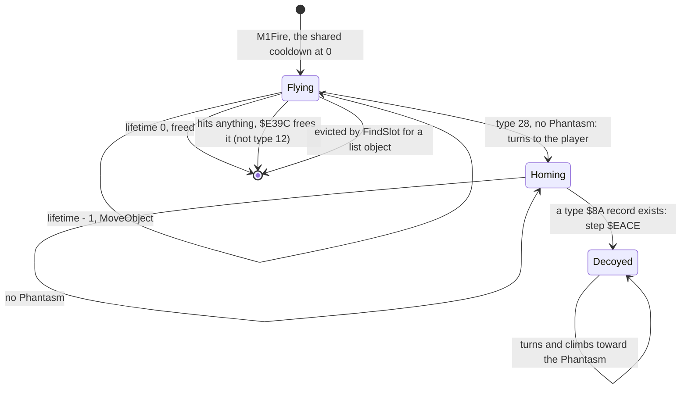

Witness: in death frame 8121 the shell in record 15 (type 28, height 64, damage 4) hits the tank; it is gone in the
sample of frame 8122. Records 16 and 18 (types 8 and 10, flags `$17`) fly at speed 64 at the same time.

The point: the enemies' shells are the only objects a list object may push out (flags b4 set, b6 clear), so a
building near the player is never refused for lack of records.

### The player's projectiles

A player's projectile is a resident type (`$80-$8C`, section 7.5), spawned by its store's fire routine
([doc 10.7](10-gameplay-logic.md#107-the-weapons)). The Turret is the example here; the other stores are in doc 10.7.

FireCannon `$B568`, the Turret's fire routine, takes a round (ConsumeAmmo `$B550`: the slot's count - 1, M when it was
0; then FindProjectileSlot `$BCD6`, records 1-22, and SoundFire), sets the type `$81` and registers the collision,
copies 8 bytes from the camera (`$67A5`: the heading word, X, Y) to +`$21`-+`$28`, so the shell leaves from the
camera along the turret's heading, puts the lifetime 100 (`$64`) at +`$31`, prints the count and restarts the fire
cooldown (SetFireCooldown `$A9F7`). Its step CannonShellStep `$B592` counts +`$31` down and moves it, and frees it
(RemoveObject `$B8B1`) at 0. Its hit handler `$B8AB` (Explode) throws debris, plays the explosion and frees it.

```text
FireCannon():                        # store type 4
    if not ConsumeAmmo(): return     # no round, or no record of 1-22
    s = the record; ObjectSetType(s, $81); RegisterCollision(s)
    s.heading, s.x, s.y = camera.heading, camera.x, camera.y
    s.lifetime = 100; PrintAmmo(); SetFireCooldown()

CannonShellStep(s):                  # $B592, once a pass
    s.lifetime -= 1
    if s.lifetime == 0: RemoveObject(s); return
    MoveObject(s)                    # speed 96 along the heading
```

```text
FireCannon:
$B568  LD A,(CurrentSlot)
$B56B  CALL SelectAmmoPointer
$B56E  CALL ConsumeAmmo      ; NC: no record; M: no round
$B571  RET NC
$B572  RET M
$B573  EX DE,HL
$B574  PUSH DE
$B575  POP IX                ; the new record
$B577  INC DE
$B578  LD A,$81              ; the turret shell
$B57A  CALL ApiVector03      ; ObjectSetType
$B57D  CALL ApiVector04      ; RegisterCollision
$B580  LD BC,$0008
$B583  LD HL,$67A5           ; the camera's heading and position
$B586  LDIR
$B588  LD (IX+$31),$64       ; 100 passes
$B58C  CALL PrintAmmo
$B58F  JP SetFireCooldown
CannonShellStep:
$B592  LD A,(IX+$31)
$B595  DEC A
$B596  JP Z,RemoveObject
$B599  LD (IX+$31),A
$B59C  JP ApiVector00        ; MoveObject
```

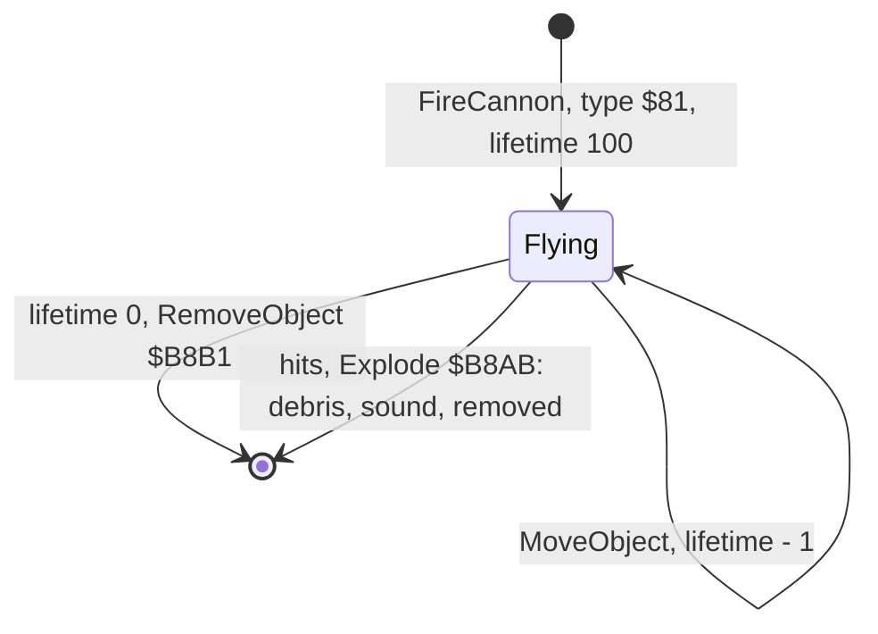

Worked example: the shell of death frame 7897 in record 2. Its heading is 202, 54 steps west of north: -54 / 256 x
360 = -75.9 degrees. At speed 96 a pass moves it 96 x sin(-75.9) = -93 in X and 96 x cos(75.9) = 23 in Y. The
samples agree: X -8593, -8686, -8779, ... and Y -9908, -9885, -9862, ... (one step of -93, +23 a pass), while +`$31`
counts 99, 98, 97 (`work/docs/bcC/death-1.jsonl`, frames 7898-8094). With 100 passes the turret reaches about
9 600 world units, 9.4 coarse units: about the spawner's 9-unit window.

Witness: the death recording fires the turret through the whole mission (FireCannon in its L1); the hut of frame 8531
is killed by such a shell (doc 10.6).

## 7.10 Collisions: CollisionPass

CollisionPass `$C7BC` runs once a pass. It tests pairs of registered records, not all records, and not every pair
every pass.

The tables, CollisionTables `$C648`:

- `$C648-$C774`: a triangular table, one byte a pair. Row r spans r + 1 bytes (the row pointers step 1, 2, 3 ...),
  of which r are the pairs (r, c) with c < r. A
  byte with b7 set means no test (one of the two is not registered); b7 clear is the pass number when the pair is
  due.
- `$C775-$C78B`: the slot list, 23 bytes, the record number with b7 set when registered.
- `$C78C`: 24 row pointers.

The pass counter is the operand of `LD A,n` at `$C7BC`, incremented modulo 128 at the end of every pass. A pair is
tested when its byte equals the counter.

For a due pair (IX, IY):

1. dx = |X(IX) - X(IY)| and dy = |Y(IX) - Y(IY)|, on the low 16 bits of the positions.
2. The distance estimate: d = max(dx, dy) + min(dx, dy) / 2 - radius(IX) - radius(IY).
3. When d is 0 or more the pair is apart. The next test is scheduled: d is halved once for each bit of
   (top speed(IX) + top speed(IY)). A result of 128 or more stores `$7F`. Otherwise n = d (the `CP $06` test does
   nothing: both of its branches load L), 0 becomes 1, and the byte becomes counter + n modulo 128.
4. When d is negative the boxes are tested: dx < half x(IX) + half x(IY), dy < half y(IX) + half y(IY) and
   |height(IX) - height(IY)| < half height(IX) + half height(IY). dx and dy were stored in the operands of the
   `LD HL,$0000` at `$C8BE` and `$C8D5`.
5. All three true: a hit. IX's collision handler is called with IY as the other, then IY's with IX.
6. After a box test the byte becomes counter + 1 (tested again next pass), unless a handler set b7.

```text
CollisionPass():
    for r in registered slots:
        for c in 0 .. r-1:
            if timer[r][c] has b7 or timer[r][c] != pass: continue
            a, b = record[c], record[r]
            dx, dy = |a.x - b.x|, |a.y - b.y|              # low 16 bits
            d = max(dx, dy) + min(dx, dy) / 2 - a.radius - b.radius
            if d >= 0:
                s = a.top_speed + b.top_speed
                repeat: d >>= 1; s >>= 1 until s == 0
                timer[r][c] = $7F if d >= 128 else (pass + max(d, 1)) mod 128
                continue
            if dx < a.bx + b.bx and dy < a.by + b.by and |a.h - b.h| < a.bh + b.bh:
                a.on_hit(other=b); b.on_hit(other=a)
            if timer[r][c] has no b7: timer[r][c] = (pass + 1) mod 128
    pass = (pass + 1) mod 128
```

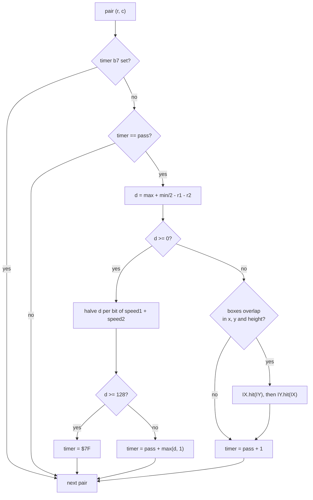

The estimate and the schedule:

```text
$C85E  SRA D
$C860  RR E              ; min / 2
$C862  ADD HL,DE         ; max + min / 2
$C863  LD C,(IX+$16)
$C866  LD B,(IX+$17)
$C869  AND A
$C86A  SBC HL,BC         ; - radius 1
$C86C  LD C,(IY+$16)
$C86F  LD B,(IY+$17)
$C872  AND A
$C873  SBC HL,BC         ; - radius 2
$C875  JP M,$C8AF        ; negative: the box test (the Immunity POKE writes 58 here)
$C878  LD A,(IX+$12)
$C87B  LD C,(IY+$12)
$C87E  ADD A,C           ; the speed sum
$C87F  SRL H
$C881  RR L              ; d / 2
$C883  SRL A
$C885  JP NZ,$C87F       ; once per bit of the sum
$C888  LD A,L
...
$C892  LD A,$7F          ; far: the pair waits for pass 127
$C894  JR $C8A9
$C896  LD A,L
$C897  CP $06
$C899  JP C,$C89D        ; both ways A = L
$C89C  LD A,L
$C89D  AND A
$C89E  JP NZ,$C8A2
$C8A1  INC A             ; 0 becomes 1
$C8A2  LD H,A
$C8A3  LD A,(CollisionPass+1)
$C8A6  ADD A,H
$C8A7  AND $7F           ; pass + n
```

Worked example: the hit of death frame 8121. The sample of frame 8121 holds the tank (record 0) at X = -9558,
Y = -9678, height 32, radius 135, half sizes 160, 96, 160, and the type 28 shell (record 15) at X = -9283,
Y = -9662, height 64, radius 1408, half sizes 128, 128, 128.

1. dx = 275, dy = 16.
2. d = 275 + 8 - 135 - 1408 = -1260: negative, so the boxes are tested.
3. x: 275 < 160 + 128 = 288. True.
4. y: 16 < 160 + 128. True.
5. Height: |32 - 64| = 32 < 96 + 128. True.
6. The pass calls PlayerHit `$CAA5` (the tank's handler) with IY = the shell, then `$E39C` (the shell's) with IY =
   the tank. The shell is freed; the top armour loses 4
   ([doc 10.5](10-gameplay-logic.md#105-damage-playerhit-the-armour-and-the-subsystems)).

The Immunity POKE at `$C875` makes the pass skip every overlap, the player's own shells included: in the lab of the
completion recordings, 12 Turret rounds at a fuel dump with the POKE in place did nothing (hp stayed 1, score 0); with
the original `$FA` the first hit killed it (`work/stage2/complete-NOTES.md`). While the cheat is on, no kill is
possible.


*Animation 7.4. CollisionPass in the death recording, frame 8121, T 42 000 to 68 000, 80 pictures. Drawn by
`python3 ../../kit/routine_anim.py --work work/docs/bcC/death --listing build/game.lst --window 8121:42000-8121:68000
--pc C7BC-C956 --view buffer:C648:24x12:hex --range C600-C7FF --pictures 80 --out
docs/img/routines/CollisionPass.gif`.*

How to read it:

- Left: the pair timers from `$C648`, 24 a row. Bytes 0-127 are due passes; bytes with b7 set are pairs not tested.
- A yellow byte is a timer written in the slice.
- The run of `$FF` written at `$C6C0` is the shell's row cleared by its hit handler (UnregisterCollision).
- Right: the code; at T 58 570 the pass leaves for PlayerHit and returns at T 59 219.

Witness: the trace of frame 8121 runs the pass from T 42 866 to 67 574, with the two handler calls at T 58 570
(`$C900-$CAB3`) and T 60 500 (`$C92A`) (`work/docs/bcC/pc-hit.txt`). CollisionPass has L1 3550 in the stage 1 builds,
one a pass.

The point: the timers turn an n-squared test into a few tests a pass. Take the enemy tank (radius 64, top speed 40)
1000 world units east of the player's tank (radius 135, +`$12` = 64): d = 1000 + 0 - 64 - 135 = 801; the speed sum
104 has seven bits, so d is halved seven times, 801 >> 7 = 6, and the pair waits 6 passes before the next test. A
building (radius 384, top speed 0) at the same distance from the enemy tank: d = 1000 - 64 - 384 = 552, sum 40, six
halvings, 8 passes. The closer and faster, the sooner. A far pair gets `$7F`, an absolute pass number, so it waits until the counter comes round to
127, up to 128 passes.

## 7.11 The player's state

The player is record 0, so most of its state is fields of that record. The rest is in fixed bytes.

| Address | Size | Field | Format | Range |
| --- | --- | --- | --- | --- |
| `$75F5` | 2 | height (+5) | world units | 32 on the ground |
| `$75F7` | 1 | speed (+7) | signed, scaled by sin and cos of the heading | -23 to 47 |
| `$7611`-`$7612` | 2 | heading (+`$21`, +`$22`) | fraction, byte | 0-255 |
| `$7613`-`$7615` | 3 | X (+`$23`) | 24-bit signed world units | |
| `$7616`-`$7618` | 3 | Y (+`$26`) | 24-bit signed world units | |
| `$7608` | 2 | step handler (+`$18`) | PlayerStep `$A8C7`; BounceDecay `$CC09` after a wall | |
| `$7C57` | 2 | Fuel | 16 bits | 16 128 (`$3F00`) at the start |
| `$8301`-`$8303` | 3 | armour, sides 1-3 (2 is the front) | byte | `$7F` at the start |
| `$8304` | 1 | armour, top | byte | `$7F` |
| `$68E2`-`$68E5` | 4 | the mission's score | 32-bit | |
| `$68E8` | 1 | goal flag | `$FF` when the goal is met | 0 or `$FF` |
| `$68EB`, `$68EC` | 2 | mission clock: minutes, hours | binary | from `$DBFE` |
| `$7BF9` | 2 | failure cause | the address of the failure text | 0 while playing |
| `$CC79` (bank 6) | 4 | Score: the missions completed | 32-bit | |
| `$6799`-`$67A1` | 9 | MissionsDone | `$FF` a mission | |

StoresToGauges `$CC1B` (bank 6) sets the fuel to 16 128 and the four armour bytes to `$7F` when the mission starts.

The success path in m1complete (samples at the start of a frame, so frame F+1 shows what frame F did): `$68E2` = 250
at 15787 and 500 at 16137 (the two fuel dumps), `$68E8` = `$FF` at 16139, MissionsDone `$6799` = `$FF` and Score
`$CC79` = `F4 01 00 00` at 21591, 0 before; m4complete adds `C4 09 00 00` (2500) and MissionsDone +3 at 21332. The
speed holds without a key at its top of 47 (about 6.7 world units a frame); A brakes it to 0 and then reverses it
(233 = -23). Heading 0 is +Y, 64 is +X.


*Figure 7.5. Record 0's speed and Y and the fuel word in the fuel recording, samples of frames 7690-7870
(`work/docs/bcC/fuel-player.jsonl`). Drawn by `python3 tools/fig_objects.py player docs/img/objects/fuel-chart.png
--samples work/docs/bcC/fuel-player.jsonl --from 7690 --to 7870`.*

How to read it:

- Three panels on one frame axis: the speed (+7), Y (+`$26`) and the fuel `$7C57`, clipped at 33 (it was 16 128
  before the POKE at frame 7704).
- The ticks under each line mark the frames where the value changed: one tick a pass.
- The vertical lines: the POKE (7704), the fuel at 0 (sample 7852), the failure cause set (sample 7861).

The point: the fuel falls by (|speed| >> 4) OR 1 each pass that the tank moves: 1 a pass below speed 32 (the OR
turns 1 into 1), 3 at 32-47. The speed grows by 8 a pass while Q is held, from 3 up to the limit 47. Y grows by about 47 a pass
at full speed, since the heading is 0. The first pass whose cost is more than the fuel left sets the failure cause
([doc 10.2](10-gameplay-logic.md#102-the-tank-playerstep)).

## 7.12 The weapon slots and the weapon records

The tank carries four weapon modules. The stores screen (bank 6) fills them; the play code reads them.

| Address | Size | What |
| --- | --- | --- |
| `$834A` | 9 x 6 | DamageBoardRecords: nine records whose icons DrawDamagePanel `$7383` draws (`$10`, `$11`, `$12`, `$0F`, `$0E`, then the four slots); StoresToGauges maps record k to the gauge `$68AB + 6k` (`$5F` when non-zero, else 0) |
| `$8368` | 4 x 6 | WeaponSlots, records 5-8 of the nine: the four loaded slots, +0 store type (1-13), +5 rounds left; FitOrRemoveWeapon writes them (C = `$1E`, `$24`, `$2A`, `$30` from `$834A`) |
| `$8338` | 9 x 2 | the subsystem gauge pointers, three per side (doc 10.5) |
| `$C534` | 4 x 2 | the slots' rounds pointers |
| `$C53C` | 1 | the current slot |
| `$7B89` | 13 x 8 | the store-type table: aim, aim 2, fire, select of type n at `$7B89 + 8 n` |
| `$C373` (bank 6) | 13 records | WeaponRecords: store type, rounds, the most fitted, weight |

WeaponRecords, read from bank 6:

| Store | Type | Rounds | Most fitted | Weight (kg) |
| --- | --- | --- | --- | --- |
| Turret | 4 | 80 | 1 | 400 |
| Banshee RRSS | 2 | 8 | 2 | 300 |
| Banshee IRSS | 6 | 6 | 2 | 300 |
| Phoenix RRSA | 1 | 8 | 2 | 250 |
| Phoenix IRSA | 5 | 6 | 2 | 250 |
| K-40 Mortar | 3 | 20 | 2 | 250 |
| Sleeper mine | 9 | 5 | 2 | 300 (the stores text says 290) |
| Dragonfly | 7 | 3 | 2 | 500 |
| K-90 Cluster | 8 | 20 | 4 | 250 |
| Spectre | 13 | 12 | 2 | 100 |
| Phantasm | 12 | 8 | 2 | 100 |
| Skeet bomb | 11 | 12 | 2 | 200 |
| SLAM Laser | 10 | 40 | 1 | 250 |

FitOrRemoveWeapon `$C173` (bank 6) refuses a store when the count would pass "most fitted" or the payload would
reach 1001 kg ([doc 10.7](10-gameplay-logic.md#107-the-weapons)).

The point: a slot is just a store type and a count. The type indexes the store-type table, whose four words are the
routines for aiming, firing and selecting; the fire key calls the third word through the operand at `$A9B9`.

## 7.13 The random-number generator

Random `$A779` (the mission vector `$67D0`) keeps three 16-bit words in its own operands: w1 at `$A77C`, w2 at
`$A77F`, w3 at `$A787`. Each call steps them like a Fibonacci sequence and mixes in the refresh register R.

```text
Random():
    s  = w1 + w2
    w1 = w2
    w2 = w3
    w3 = w3 + s
    return (low(w3) XOR high(w3)) + R
```

```text
Random:
$A779  PUSH HL
$A77A  PUSH DE
$A77B  LD DE,$04D2       ; w1
$A77E  LD HL,$0ECA       ; w2
$A781  LD (Random+3),HL  ; w1 = w2
$A784  ADD HL,DE         ; s = w1 + w2
$A785  EX DE,HL
$A786  LD HL,$250B       ; w3
$A789  LD (Random+6),HL  ; w2 = w3
$A78C  ADD HL,DE         ; w3 + s
$A78D  LD (Random+14),HL ; w3 = w3 + s
$A790  LD A,L
$A791  XOR H
$A792  LD H,A
$A793  LD A,R
$A795  ADD A,H           ; + R
```

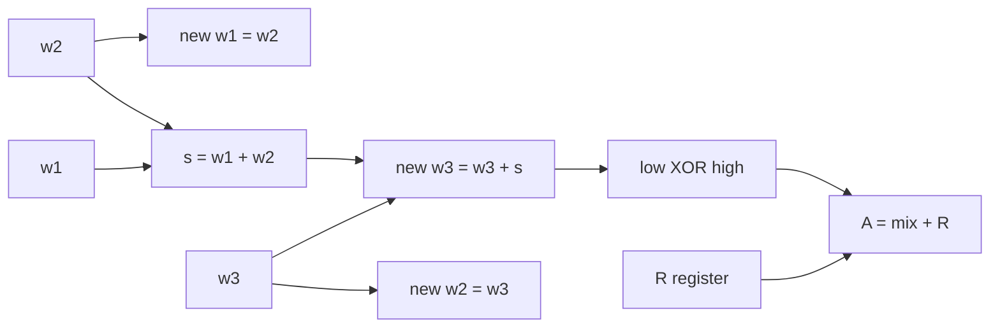

Worked example, from the words in the image (w1 `$04D2`, w2 `$0ECA`, w3 `$250B`):

1. s = `$04D2` + `$0ECA` = `$139C`.
2. New w1 = `$0ECA`, new w2 = `$250B`.
3. New w3 = `$250B` + `$139C` = `$38A7`.
4. `$A7` XOR `$38` = `$9F`; A = `$9F` + R.

Its users: the spawners' offsets, the units' wander counts and headings, the shared gun cooldown (8-15 or 24-31), the subsystem
PlayerHit damages, the debris velocities.

Witness: Random has L1 584 in six recordings (c1, death, m2erbe, missions, play, play2).

The point: R makes the game unrepeatable from the keys alone. R counts instruction fetches, so any change in the code
path changes every random number after it. The armour recording, played with the death recording's keys but with
another armour gauge to draw, met its first hit in frame 18423 instead of 8121.

## 7.14 The units of missions 2-10

Every mission block carries its own copy of mission 1's unit library (section 7.9), relocated to the block's
addresses. The step handlers match mission 1's one to one; only a few constants differ, and some copies store a
handler word with `LD (IX+$18),n` instead of `LD HL,n` and two `LD (IX+$18),L/H`. Around the library each mission
adds a few routines of its own for its target: a radar and launchers, a hostage, a train, a convoy, a satellite.

Method: each block (`src/res/missions/NN-*.txt`) was disassembled and its instructions matched with mission 1's,
after the absolute addresses were blanked (`work/docs/bcC/m2-10/match.py`, `tr.py`). The match is per instruction
run: `$E39D-$E52B` of mission 2, for example, is mission 1's `$E5C2-$E750` byte for byte apart from the jump
targets. The kinds below are named after mission 1's step they copy: chase (type 7, `$E5C2`), hit and run (type 9,
`$E6F9`), homing carrier (type 26, `$E837`) and flanker (type 29, `$E6B4`). Each mission's units share a hit
handler, a copy of M1UnitHit `$E8F3`.

### The spawned units, mission by mission

All of them have the flags `$2F`, score 2000 and are made by spawners (none is in the object list). "Fires" is
the type the unit's M1FireCheck fires (its own type + 1), or the homing shell its homing-carrier step fires.

| Mission | Type | Kind | Step | Hit | HP | Damage | Top speed | Fires |
| --- | --- | --- | --- | --- | --- | --- | --- | --- |
| 2 | 13 | chase | `$E39D` | `$E6CE` | 2 | 2 | 40 | 14 |
| 2 | 15 | hit and run | `$E4D4` | `$E6CE` | 2 | 4 | 48 | 16 |
| 2 | 17 | homing carrier | `$E612` | `$E6CE` | 3 | 2 | 40 | 18 (flies straight) |
| 2 | 19 | flanker | `$E48F` | `$E6CE` | 2 | 2 | 56 | - |
| 2 | 20 | chase | `$E39D` | `$E6CE` | 3 | 2 | 40 | 21 |
| 3 | 9 | chase | `$E4C6` | `$E7FB` | 3 | 2 | 40 | 10 |
| 3 | 11 | hit and run | `$E5FD` | `$E7FB` | 3 | 2 | 40 | 12 |
| 3 | 13 | homing carrier | `$E73F` | `$E7FB` | 2 | 2 | 40 | 14 (homing) |
| 3 | 15 | flanker | `$E5B8` | `$E7FB` | 5 | 2 | 40 | - |
| 3 | 16 | chase | `$E4C6` | `$E7FB` | 4 | 2 | 40 | 17 |
| 4 | 17 | chase | `$E139` | `$E467` | 3 | 2 | 40 | 18 |
| 4 | 19 | hit and run | `$E270` | `$E467` | 3 | 2 | 40 | 20 |
| 4 | 21 | homing carrier | `$E57F` | `$E467` | 2 | 2 | 40 | 22 (homing) |
| 4 | 23 | chase | `$E139` | `$E467` | 4 | 2 | 40 | 24 |
| 5 | 4 | chase | `$E4FE` | `$E824` | 2 | 2 | 40 | 5 |
| 5 | 6 | hit and run | `$E62F` | `$E824` | 2 | 2 | 40 | 7 |
| 5 | 18 | homing carrier | `$E76A` | `$E824` | 3 | 2 | 40 | 19 (homing) |
| 5 | 20 | flanker | `$E5EB` | `$E824` | 1 | 2 | 40 | - |
| 5 | 21 | chase | `$E4FE` | `$E824` | 3 | 2 | 40 | 22 |
| 6 | 5 | chase | `$E68D` | `$E9B3` | 2 | 2 | 40 | 6 |
| 6 | 7 | hit and run | `$E7BE` | `$E9B3` | 2 | 2 | 40 | 8 |
| 6 | 19 | homing carrier | `$E8F9` | `$E9B3` | 3 | 2 | 40 | 21 (homing) |
| 6 | 22 | flanker | `$E77A` | `$E9B3` | 1 | 2 | 40 | - |
| 6 | 23 | chase | `$E68D` | `$E9B3` | 3 | 2 | 40 | 24 |
| 7 | 11 | flanker | `$E82B` | `$E8EF` | 1 | 2 | 40 | - |
| 7 | 13 | hit and run | `$E86F` | `$E8EF` | 2 | 2 | 40 | 14 |
| 7 | 15 | hit and run | `$E86F` | `$E8EF` | 2 | 2 | 40 | 16 |
| 7 | 28, 29 | recovery team | `$E3A1` | `$E8EF`, `$E3D2` | 2 | 2 | 40 | - |
| 8 | 10 | direct fire | `$E229` | `$E612` | 2 | 2 (4 a strike) | 40 | - |
| 8 | 17 | hit and run | `$E334` | `$E612` | 2 | 4 | 48 | 18 |
| 8 | 19 | homing carrier | `$E87B` | `$E612` | 3 | 2 | 40 | 20 (flies straight) |
| 9 | 12 | flanker | `$E671` | `$E735` | 1 | 2 | 40 | - |
| 9 | 14 | hit and run | `$E6B5` | `$E735` | 2 | 2 | 40 | 15 |
| 9 | 16 | hit and run | `$E6B5` | `$E735` | 2 | 2 | 40 | 17 |
| 10 | 4 | chase | `$E446` | `$E76C` | 2 | 2 | 40 | 5 |
| 10 | 6 | hit and run | `$E577` | `$E76C` | 2 | 2 | 40 | 7 |
| 10 | 18 | homing carrier | `$E6B2` | `$E76C` | 3 | 2 | 40 | 19 (homing) |
| 10 | 20 | flanker | `$E533` | `$E76C` | 1 | 2 | 40 | - |
| 10 | 21 | chase | `$E446` | `$E76C` | 3 | 2 | 40 | 22 |
| 10 | 27 | hit and run | `$E577` | `$E76C` | 2 | 2 | 40 | 28, an aircraft |

The other objects with a behaviour of their own (the list records are counted from 0, as in doc 10.9):

| Mission | Type | What | Step | Hit | HP | Damage | Top speed | Score | Where |
| --- | --- | --- | --- | --- | --- | --- | --- | --- | --- |
| 2 | 3 | bridge | `RET` | `$B64E` | 16 | 3 | 0 | 7 | list 0, 1 |
| 2 | 8 | radar | `$E2B7` | HitTest | 1 | 3 | 0 | 800 | list 2 |
| 2 | 10 | missile launcher (the goal) | `$E2C7` | HitTest | 3 | 1 | 32 | 550 | list 6, 8 |
| 2 | 24 | depot with a gun, fires 25 | `$E7EA` | HitTest | 32 | 4 | 0 | 4000 | 1 record |
| 3 | 20 | depot with a gun, fires 21 | `$E917` | HitTest | 32 | 4 | 0 | 4000 | 1 record |
| 3 | 22 | hostage (the goal) | `$E2CF` | `$E311` | 1 | 3 | 0 | 0 | list 2 |
| 3 | 23 | gate | `$E2A5` | HitTest | 1 | 3 | 0 | 300 | list 4 |
| 4 | 8 | engine | `$E647` | `$E60F` | 6 | 127 | 32 | 0 | list 2 |
| 4 | 9 | carriage | `$E647` | `$E62B` | 1 | 1 | 32 | 0 | list 3, 4 |
| 4 | 10 | buffer stop | `RET` | `RET` | 2 | 2 | 0 | 0 | list 5 |
| 4 | 11 | points | `RET` | `$E638` | 2 | 2 | 0 | 0 | list 10 |
| 4 | 13 | station (the goal) | `RET` | HitTest | 0 | 1 | 0 | 0 | list 11 |
| 5 | 13 | flag | `$E98D` | HitTest | 127 | 3 | 0 | 0 | 1 record |
| 5 | 26, 28 | airfield vehicles (the goal) | `RET` | HitTest | 2 | 3, 2 | 40 | 2000 | list 0, 1, 3, 4 |
| 5 | 29 | post of a span chain | `RET` | `$B61E` | 0 | 1 | 0 | 0 | list 7-14 |
| 6 | 2 | convoy truck | `$E505` | `$E4A8` | 1 | 1 | 32 | 500 | list 0-2 |
| 6 | 13 | convoy destination | `RET` | `$E463` | 2 | 3 | 0 | 500 | list 5 |
| 7 | 7 | aircraft (unused) | `$E4B4` | HitTest | 0 | 2 | 127 | 7 | - |
| 7 | 18 | gun emplacement, fires 19 | `$E3E9` | HitTest | 10 | 1 | 0 | 3000 | 1 record |
| 7 | 26 | mobile spawner | `$E64F` | HitTest | 2 | 2 | 40 | 2000 | list 21 |
| 7 | 32 | satellite (the goal) | `RET` | `$E3B2` | 1 | 3 | 0 | 150 | list 34 |
| 8 | 8, 9 | bridge supports | `RET` | `$B61E` | 0 | 1 | 0 | 0 | list 57-62 |
| 8 | 13 | supply vessel (the goal) | `$E72A` | HitTest | 8 | 2 | 8 | 2000 | list 12, 16, 19, 23 |
| 9 | 7 | aircraft | `$E3E4` | HitTest | 0 | 2 | 127 | 7 | from the hideout |
| 9 | 9 | hideout (the goal), launches 7 | `$E333` | HitTest | 0 | 1 | 0 | 200 | list 39 |
| 9 | 10 | ram-only object | `RET` | `$E326` | 1 | 3 | 0 | 7 | list 40 |
| 9 | 19 | gun emplacement, fires 20 | `$E319` | HitTest | 10 | 1 | 0 | 3000 | 2 records |
| 9 | 27 | mobile spawner | `$E57F` | HitTest | 2 | 2 | 40 | 2000 | list 61 |
| 10 | 13 | flag | `$E8D5` | HitTest | 2 | 3 | 0 | 0 | 2 records |
| 10 | 28 | aircraft | `$E8DE` | HitTest | 0 | 2 | 127 | 7 | fired by type 27 |

"HitTest" is the vector `$67DC`. The guns of missions 5, 6 and 10 (types 8, 9 and 8, hp 32, score 4000) and the
aircraft launcher of mission 7 (type 9, `$E403`) are templates no list record names.

### What differs from mission 1

Four constants and the shells' damage:

| Mission | Close: wander below | Homing carrier: sentry below | Leash | Shell damage (homing shell) |
| --- | --- | --- | --- | --- |
| 1 | 4 hp | 2 hp | `$0C00` | 3 (4) |
| 2 | 2 hp | 4 hp | `$1000` | 1 (1) |
| 3 | 2 hp | 4 hp | `$0C00` | 1 (1) |
| 4 | 4 hp | 4 hp | `$0C00` | 1 (1) |
| 5, 6, 10 | 4 hp | 2 hp | `$0C00` | 3 (4) |
| 7, 9 | (no chase unit) | (no homing carrier) | `$0C00` | 3 |
| 8 | (no chase unit) | 4 hp | `$0C00` | 1 (1) |

What the constants do:

- **Close** (`CP $04` at `$E5F2` in mission 1). In missions 2 and 3 a chase unit near the camera stays in Close,
  turning and firing, as long as it has 2 hit points or more. In mission 1 it falls through to the wander at
  once, because no unit there has 4 hit points. Of the missions that keep `CP $04` (4, 5, 6, 10), only mission
  4's type 23 (4 hit points) stays in Close.
- **Homing carrier** (`CP $02` at `$E84D`). With `CP $04` every homing carrier of missions 2, 3, 4 and 8 has fewer
  hit points than the limit when it is made. It drives one pass, then stops for good as a turret (next section).
- **Leash**. Mission 2 lets its units follow the camera 4 coarse units away instead of 3.

The shells of missions 2, 3, 4 and 8 do 1 point of damage, a third of mission 1's. In mission 3 the shell
templates have top speed 0 and the shell step sets the speed (96, the homing shell 120). The homing shells of
missions 3 and 4 are decoyed by a Spectre (`CP $8B` at `$E978` and `$E90B`); those of missions 1, 5, 6 and 10 by a
Phantasm (`$8A`, section 7.9). In missions 2 and 8 the homing shell (types 18 and 20, speed 120) has the plain
shells' step (`$E7F7`, `$E96B`): it does not home, it flies straight.
Mission 3's fire tail also writes `LD (IX+0),$FF` (`$E735`).

One more thing is the same in every copy. Mission 1's homing carrier loads D with 8, 16 or 1 before each
M1TurnToPlayer, but M1TurnToPlayer overwrites D at once (`$E55E` `LD D,$02`). So every unit turns by up to 8 steps
a pass. The routine at `$E591`, which does use D as a dead zone, is called by nobody, in mission 1 or in any copy.

### Hit and run (type 9's step)

The unit drives and turns toward the player at the same time. When it is aligned, it calls the fire check. After a
shot it runs: it takes a random heading and a random count, stops, and drives that way until the count ends. Then it
goes back to the attack.

```text
HitAndRun(unit):                  # M1 $E6F9; mission 2 $E4D4
    Accelerate(); MoveObject()
    if Leash(): return            # removed
    if TerrainTurn(): return      # off the road: turned round
    if not TurnToPlayer(): return # turns up to 8; carry only when aligned
    if not FireCheck(): return    # the shared gun timer (section 7.9): no shot
    unit[$39] = Random()          # the run heading
    unit[$3A] = Random() AND $3F  # the run count
    unit.speed = 0
    unit.step = Run

Run(unit):                        # M1 $E72B
    TurnToward(unit[$39]); Accelerate(); MoveObject()
    if Leash() or TerrainTurn(): return
    unit[$3A] -= 1
    if unit[$3A] == 0: unit.step = HitAndRun
```

```text
M1Type9Step:
$E707  CALL M1TurnToPlayer
$E70A  RET NC            ; not aligned
$E70B  CALL M1FireCheck
$E70E  RET NC            ; no shot this pass
$E70F  CALL $67D0        ; Random
$E712  LD (IX+$39),A     ; the run heading
$E715  CALL $67D0
$E718  AND $3F
$E71A  LD (IX+$3A),A     ; the run count, 0-63
...
$E726  XOR A
$E727  LD (IX+$07),A     ; speed 0
```

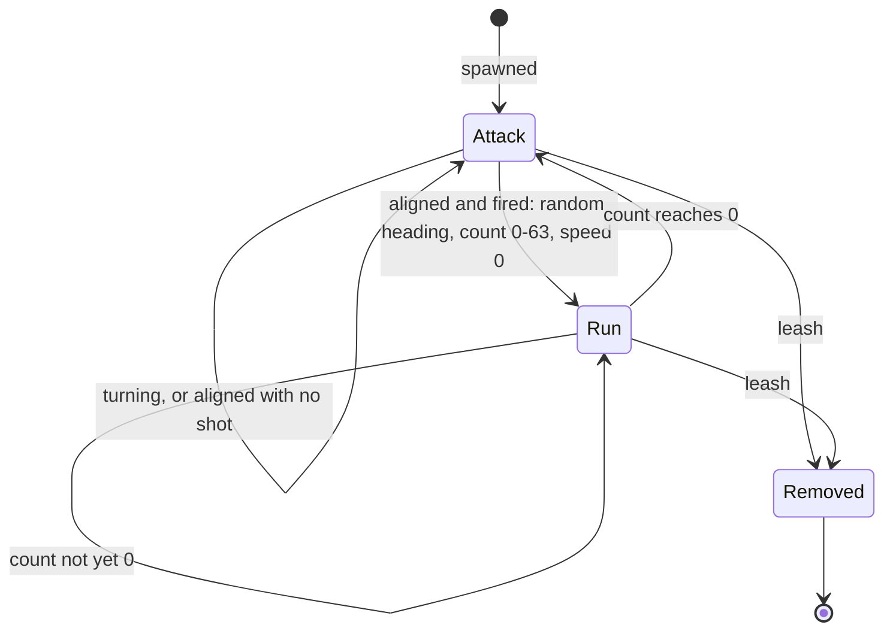

Worked example: mission 2's type 15 (top speed 48, damage 4). Say it fires and Random gives the count 40. From
speed 0 it gains 1 a pass, so in the 40 passes of the run it moves 1 + 2 + ... + 40 = 820 world units, 0.8 of a
coarse unit, while it turns by up to 8 a pass toward the run heading. A count of 0 is decremented to 255 before the
test, so one shot in 64 starts a run of 256 passes, which in practice lasts until the leash removes the unit.

Witness: in the m2erbe recording (`work/stage1/m2erbe/l1.json`, mission 2, frames 7094-7522) mission 2's copy
`$E4D4` runs 43 times. The chase `$E39D` runs 86 times and M1Fire `$E57D` 150 times.

### The homing carrier (type 26's step)

The homing carrier drives at the player and fires the homing shell (`LD A,type; LD HL,$FFBA; JP M1Fire`: the
muzzle is 70 units behind). As it drives, it fires whenever the shared timer allows, aligned or not. Hurt below the
sentry limit, it stops for good: a turret that turns toward the player and fires only when aligned. Near the
camera (`$2BC` = 700 world units on both axes) it veers once to a random heading. With fewer than 4 hit points it
then also becomes a turret.

```text
HomingCarrier(unit):              # M1 $E837
    TurnToPlayer(); Accelerate(); MoveObject()
    if TerrainTurn() or Leash(): return
    if unit.hp < limit: goto MakeSentry          # limit: 2 (missions 1, 5, 6, 10) or 4 (2, 3, 4, 8)
    if near(camera, $2BC):
        unit[$35] = Random(); unit.step = Veer; return
    TurnToPlayer(); FireHoming()                 # aligned or not
    Accelerate(); MoveObject(); TerrainTurn(); Leash()

MakeSentry(unit): unit.speed = 0; unit.step = Sentry
Sentry(unit):     if Leash(): return; if TurnToPlayer(): FireHoming()
Veer(unit):                                       # M1 $E8A4
    if TurnToward(unit[$35]): Accelerate(); MoveObject(); TerrainTurn(); Leash()
    if unit.hp < 4: MakeSentry(unit)
```

```text
M1Type26Step (from $E84A):
$E84A  LD A,(IX+$13)     ; hit points
$E84D  CP $02            ; missions 2, 3, 4, 8: CP $04
$E84F  JR C,$E880        ; below: the sentry
$E851  LD BC,$02BC
$E854  CALL M1DistanceToCamera
$E857  JP NC,$E86A       ; far: drive and fire
...
$E89C  LD A,$1C          ; the homing shell (mission 2: $12 at $E677)
$E89E  LD HL,$FFBA       ; the muzzle: -70
$E8A1  JP M1Fire
```

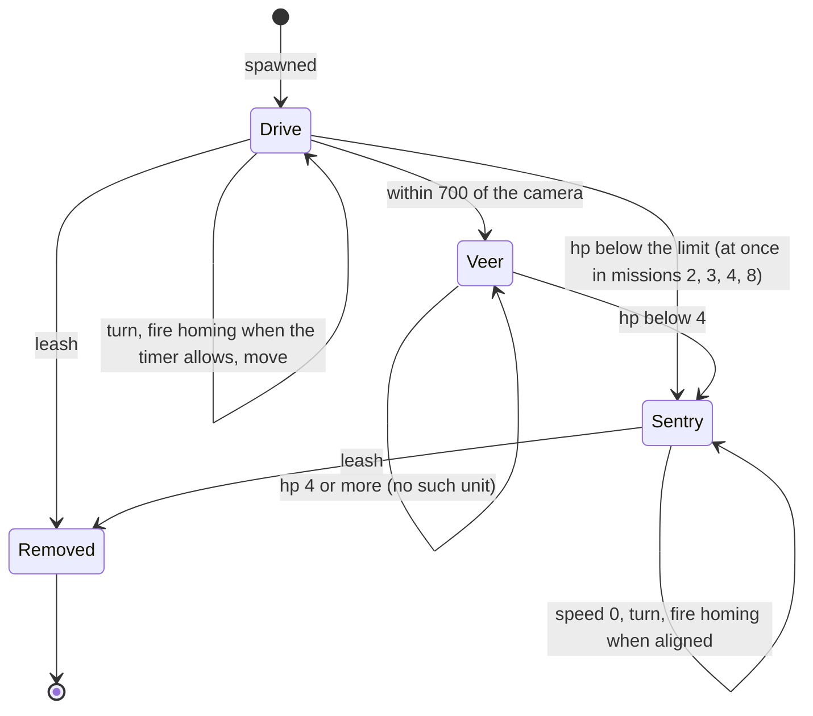

Worked example: mission 2's type 17 has 3 hit points against the limit 4. On its first pass it turns by up to 8,
gains speed 1, moves 1 unit, then becomes a sentry: from then on it stands where its spawner put it, 3 coarse units
from the camera, and fires its shell (type 18, which in mission 2 flies straight) whenever it faces the player and
the shared timer reaches 0. Mission 5's
type 18 (also 3 hit points) has the limit 2. It drives at the player firing homing shells, veers once within 700
units, and stops there as a turret because 3 is below 4.

Witness: none for the homing carriers of missions 2-10 (mission 2's `$E612` does not run in m2erbe); from the code
only.

### The flanker (type 29's step)

The flanker never fires. It drives at a heading 32 steps (45 degrees) to the right of the bearing to the player, so
it passes the player on a curve. Within `$4B0` (1200 world units) of the camera on both axes it takes a random
heading and drives off for good, until the leash removes it.

```text
Flanker(unit):                    # M1 $E6B4
    TurnToward(BearingTo(player) + $20); Accelerate(); MoveObject()
    if TerrainTurn() or Leash(): return
    if near(camera, $4B0): unit[$39] = Random(); unit.step = DriveOff
DriveOff(unit):                   # M1 $E6E5
    TurnToward(unit[$39]); Accelerate(); MoveObject(); TerrainTurn(); Leash()
```

```text
M1Type29Step:
$E6B4  LD IY,$75F0       ; the player
$E6B8  CALL $67C1        ; BearingTo
$E6BB  ADD A,$20         ; 45 degrees off
$E6BD  CALL $E55E        ; turn toward A, up to 8
...
$E6CE  LD BC,$04B0
$E6D1  CALL M1DistanceToCamera
$E6D4  RET NC            ; still far
$E6D5  CALL $67D0
$E6D8  LD (IX+$39),A     ; a random heading, then DriveOff
```

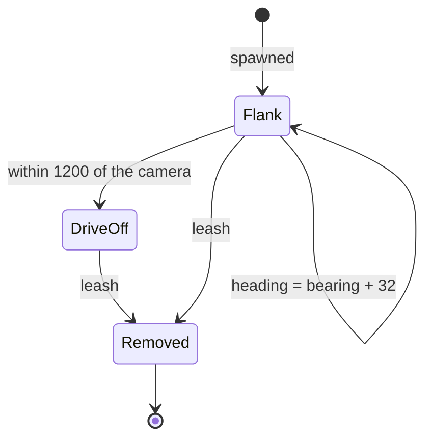

Worked example: mission 2's type 19 (top speed 56) with the player due north (bearing 0) heads for 32, north-east.
Once it is within 1200 units of the camera it turns to, say, Random = `$A7` (south-west) and drives on at 56 a pass.
If that heading leads straight away from the camera, mission 2's leash (`$1000`, 4096 units) removes it
(4096 - 1200) / 56 = 52 passes later.

Witness: none (`$E48F` does not run in m2erbe); from the code only.

### Spawners, spawner trees and mobile spawners

The spawners are mission 1's (section 7.9: three triples, one child a pass, 3 coarse units from the camera). Each
entry is `LD DE,table; JR` to the shared start; a table is the three child types and `$FF`:

| Mission | Spawner type: its children |
| --- | --- |
| 2 | 23 `$E1C5`: 13, 15, 13; 22 `$E1CA`: 19, 13, 13; 12 `$E1CF`: 20, 17, 15 |
| 3 | 19 `$E32E`: 9, 11, 13; 18 `$E333`: 16, 9, 16; 28 `$E338`: 15, 11, 13; 8 `$E33D`: 9, 13, 13 |
| 4 | 14 `$E7C6`: 23, 17, 23; 15 `$E7CB`: 17, 19, 21; 16 `$E7D0`: 17, 21, 21 |
| 5 | trees 23 `$EA28`: 21, 18, 20; 24 `$EA23`: 4, 18, 6; 25 `$EA2D`: 4, 21, 20 |
| 6 | trees 27 `$EB99`: 23, 19, 22; 28 `$EB94`: 5, 19, 7; 29 `$EB9E`: 5, 23, 22 |
| 7 | 12 `$E65E`: 13, 15, 13; 17 `$E641`: 15, 13, 15; 27 `$E646`: 11, 15, 11; 31 `$E741`: 15, 13, 15; 30 `$E74E`: 28, 29, 11; mobile 26 `$E64F`: 15, 13, 15 |
| 8 | 11 `$E47F`: 10, 10, 19; 21 `$E470`: 17, 17, 19; 22 `$E475`: 17, 19, 17; 23 `$E47A`: 10, 17, 19 |
| 9 | 13 `$E58E`: 14, 16, 14; 18 `$E571`: 16, 14, 16; 28 `$E576`: 12, 16, 12; mobile 27 `$E57F`: 16, 14, 16; the hideout 9 `$E333`: 7, 7, 7 |
| 10 | trees 23 `$EA2B`: 21, 18, 20; 24 `$EA26`: 4, 18, 6; 25 `$EA30`: 4, 21, 20; 30 `$EA21`: 28, 27, 18; 31 `$EA1C`: 28, 4, 20 |

Two new forms:

- **Spawner trees** (missions 5, 6 and 10): flags `$01` and the hit handler `$B612`, the trees' one. With 0 hit
  points they fall at the first touch, like a tree, and while they stand they keep three units around the camera.
- **Mobile spawners** (mission 7's type 26, height 170; mission 9's type 27, height 150; both in the list): the
  first pass fills the triples, then the step (`$E680` in mission 7) turns toward the player, moves and runs the
  respawn walk, so the source of the units drives after the tank.

Mission 10's tree 30 lists type 28 (the aircraft) as a child. Its hit and run type 27 fires type 28 through
M1FireCheck (type + 1), so in the Grand Finale an aircraft can also be "fired" like a shell.

Witness: mission 2's spawner start `$E1C5` runs once, M1Respawn's copy `$E1F2` 44 times and M1SpawnUnit's copy
`$E238` 3 times in m2erbe. The other missions: from the code only.

### The aircraft and its missile

Mission 9's hideout (type 9, list 39) is a spawner of three type 7 aircraft. Its respawn walk is mission 1's with
two changes. It runs only every 64th pass: the byte `$E355` is a count (`LD HL,$E355`, `DEC (HL)`, `RET NZ`,
`LD (HL),$40`). And a new aircraft is put at the world point (0, 1024) with heading `$40`, not near the camera.
Mission 7 has the same launcher, byte for byte (type 9, `$E403`, the count at `$E425`), but no list record of that
type, so mission 7 has no aircraft. Mission 10's aircraft (type 28) come from the hit and run type 27 and from
the trees 30 and 31.

```text
Aircraft(unit):                   # mission 7 $E4B4, mission 9 $E3E4, mission 10 $E8DE
    $6760..$6763 = 0; $6764..$6767 = $FF          # the same bytes HelicarrierInit $DB00 sets
    unit.step = Climb
Climb(unit):  MoveObject(); unit.height += 8; if unit.height >= $C0: unit.step = Hunt
Hunt(unit):   MoveObject(); if TurnToPlayer() and Fire(type + 1): unit[$31] = 64; unit.step = Pass
Pass(unit):   MoveObject(); unit[$31] -= 1; if 0: unit.step = Hunt

Missile(unit):                    # mission 7 $E5FE (type 8)
    TurnToPlayer()
    unit[$31] -= 1; if 0: unit.damage = 0; $B612 on itself       # end of its life: the trees' kill handler
    unit.height += (player.height - unit.height) / 16
    MoveObject()
```

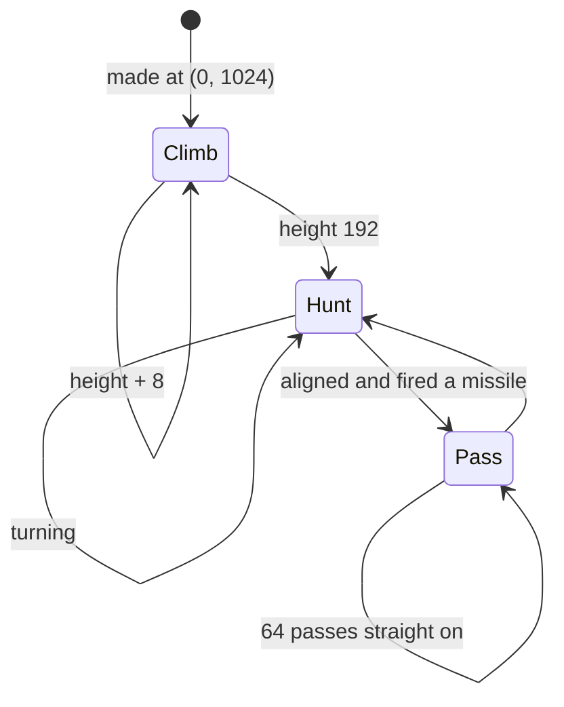

Worked example: an aircraft made at height 10 (its template) climbs 8 a pass and reaches 194 after 23 passes
(10 + 23 x 8; 186 after 22 is still below 192). M1Fire gives its missile the firer's heading and position, not its
height, so the missile starts at its template height 64. The height gap to the player then shrinks by a sixteenth
each pass, the shift rounding toward minus infinity: 64, 60, 56, 52, 48, 45, 42 ... 30 after 10 passes, 3 after 30,
when its lifetime (`$1E`) ends.

Witness: none; from the code only. What the bytes `$6758-$6767` drive is open: the aircraft and the Helicarrier
set `$6760-$6767`. The goal hooks of missions 7 and 9 call `$F03D` and `$EC2E`, which invert `$6758-$675F` every
pass. `$EC2E` is also a target of the model scripts (section 7.6).

### The direct-fire unit of mission 8 (type 10)

Type 10's step (`$E229`) is a chase copy without the fire check. While the unit is aligned, a draw-variant count
runs at +4 from 8 down to 0, then a random wait (Random AND `$20`: 32 passes, or 256 when it is 0). At the end of
the wait the variant is set to 8 again and the unit calls the resident `$CA7C`. `$CA7C` sets its own +3 b4,
doubles its damage and calls PlayerHit `$CAA5` with IY = the unit, then puts both bytes back. So the hit lands
with no shell and from any distance, 4 points at a time. When the unit is not aligned the variant is 0.

```text
StrikePlayer $CA7C:              # resident; reached from mission 8's $E1FC
    save unit[3], unit[$14]
    unit[3] |= $10; unit[$14] *= 2
    PlayerHit(IX = player, IY = unit)
    restore unit[3], unit[$14]
```

```text
$E1E9  LD A,(IX+$3A)     ; waiting?
$E1EC  AND A
$E1ED  JR Z,$E204        ; no: run the variant count
$E1EF  LD A,(IX+$38)
$E1F2  DEC A
$E1F3  LD (IX+$38),A
$E1F6  RET NZ
$E1F7  LD A,$08
$E1F9  LD (IX+$04),A     ; draw variant 8
$E1FC  CALL $CA7C        ; strike the player
$E1FF  LD (IX+$3A),$00
```

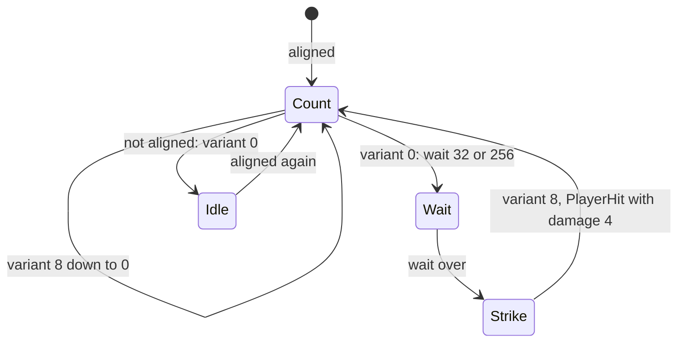

Worked example: a type 10 that stays aligned strikes after 8 + 32 = 40 passes, or 8 + 256 = 264 passes when the
wait is 0, half the time each: 152 passes on average, 4 points of damage each time.

Witness: none; from the code only. The draw variants 8 to 0 are SUSPECTED to be a muzzle flash; the model was not
drawn.

### Mission 2: the radar, the missile launchers, the bridges

The radar (type 8, list 2, at (-14, 0)) turns: its step `$E2B7` adds 4 to the heading each pass, a full turn
every 64 passes. The two launchers (type 10, list 6 and 8, at (13.9, 14) and (11.9, 14)) are the goal.

```text
Launcher(unit):                   # $E2C7
    unit.pitch = $C0              # +$2A: the model stands up (BoxTilted)
    if list[2].destroyed: return  # the radar is gone: the launcher stays down
    if not near(camera, $1C00): return            # 7 coarse units on both axes
    unit.step = Launch
Launch(unit):                     # $E2E3, every pass from then on
    unit.height += 10
```

```text
$E2C7  LD A,$C0
$E2C9  LD (IX+$2A),A     ; pitch
$E2CC  LD A,($DCF0)      ; list record 2, the radar
$E2CF  AND $02
$E2D1  RET NZ            ; destroyed: stay
$E2D2  LD BC,$1C00
$E2D5  CALL $E52C        ; the copy of M1DistanceToCamera
$E2D8  RET NC
$E2D9  LD HL,$E2E3       ; climb from now on
```

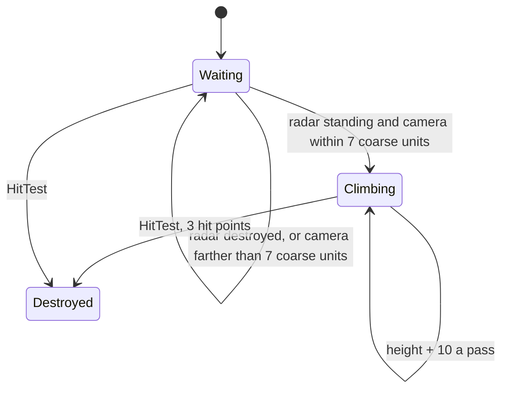

Worked example: a launcher at its template height 48 that starts to climb is at 48 + 10 x 50 = 548 after 50
passes. Nothing in the block reads the height or ends the climb. So the order of play the code rewards is the
radar first: with the radar destroyed, the launchers never leave the ground. The goal hook `$E2F4` tests the
destroyed bits of list records 6 and 8 (`$DD10`, `$DD20`).

The bridges (type 3, list 0 and 1, 16 hit points) have BridgeHit `$B64E`, which fails the mission when a bridge is
destroyed while the tank touches a type 4 object
([doc 10.10](10-gameplay-logic.md#1010-failure-and-its-causes)).

Witness: in m2erbe neither `$E2B7` nor `$E2C7` runs (the radar and the launchers never get a record there), while
the goal hook `$E2F4` runs 41 times. The launchers: from the code only.

### Mission 3: the gate and the hostage

The hostage (type 22, list 2, at (4, 16)) stands where a hut (type 25, list 3) is; the gate (type 23, list 4) is
at (3.9, 15.6), just south-west of it.

```text
Gate(unit):                       # $E2A5
    unit.variant = 7              # +4, the draw variant
    if near(camera, $200): unit.step = GateOpen   # half a coarse unit
GateOpen(unit):                   # $E2BB
    if unit.variant == 0: unit.flags3 &= ~1; return   # no step any more
    unit.variant -= 1

Hostage(unit):                    # $E2CF
    unit.variant = (unit.variant + 1) mod 4           # $E302: 0, 1, 2, 3, 0 ...
    if not list[4].destroyed: return                  # $DCE8: the gate
    unit[$31] = 60; unit.speed = $F8; unit.step = Walk
Walk(unit):                       # $E2EC
    if unit[$31] == 0: unit.flags3 &= ~1; return
    unit[$31] -= 1; MoveObject(); cycle the variant

HostageHit(unit, hitter):         # $E311
    if not hitter.flags3 & $80: return                # only the tank's family
    UnregisterCollision(); MarkDestroyed(); unit.state = 0
```

```text
$E311  LD A,(IY+$03)
$E314  AND $80           ; the tank?
$E316  RET Z
$E317  CALL $67CD        ; UnregisterCollision
$E31A  CALL $67E5        ; MarkDestroyed: list b1, the goal's bit
$E31D  XOR A
$E31E  LD (IX+$02),A     ; the record is free
```

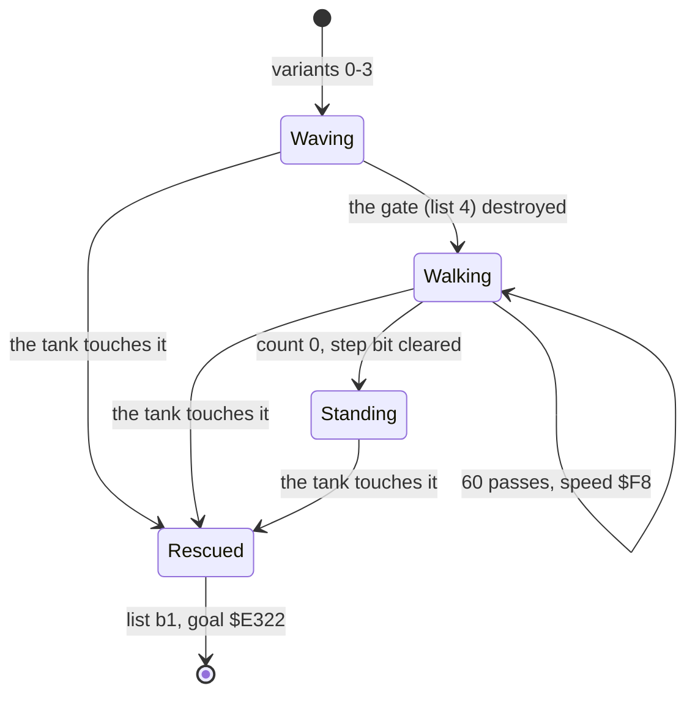

Worked example: the speed `$F8` is -8 as a signed byte, so the hostage walks backwards: with heading 0 it moves
8 units south a pass, 60 x 8 = 480 units in all, about half a coarse unit, out through the place of the destroyed
gate. The goal hook `$E322` then needs only list record 2's destroyed bit (`$DCD8`), which the tank's touch sets:
the rescue is a pickup, not a kill (no score, no debris). The gate's own count (7 down to 0) only changes its
drawing; what lets the hostage out is the gate's destruction.

Witness: none (no recording plays mission 3 alone); from the code only.

### Mission 4: the train

The train is an engine (type 8, list 2) and two carriages (type 9, list 3 and 4). They stand on the main line at
(-20, 0), (-20.25, 0) and (-20.5, 0), heading `$40` (east). They follow the rails with a vertex walker: mission
1's dormant type 3 has the same code (section 7.5: a vehicle no spawner of mission 1 makes), and mission 6's
convoy and mission 8's vessels have it too.

```text
TrainWait(car):                   # $E647, the step of types 8 and 9
    if not (list[2].b6 and list[3].b6 and list[4].b6): return   # all three have a record
    list[car.index].b7 = 0        # ActivateMissionObjects lets it be from now on
    car[$32] = $FF                # no vertex passed yet
    car.step = TrainRun
TrainRun(car):                    # $E6BD
    if list[2].destroyed: return  # the engine stops the whole train
    if car is a carriage and list[car.index].destroyed: return
    MoveObject()                  # the template speed 32; no Accelerate
    list[car.index].xy = car.xy >> 2                            # $E67A
    k = AtVertex()                # $E737: vertices 0 and 1 only, |dx| < $C0, |dy| < $70, k != car[$32]
    if none: return
    car[$32] = k
    car[$31] = Junctions[3k + pick]                             # $E7C0; pick 0, 1, 2 or 2 (Random AND 3)
    car.step = TrainTurn
TrainTurn(car):                   # $E707
    MoveObject()
    if |car[$31] - car.heading| >= 8: car.heading += 4 toward it; return
    car.heading = car[$31]; car.step = TrainRun

PointsHit(points, hitter):        # $E638, type 11
    if HitTest(): Junctions[0..2] = $60           # vertex 0 now leads south-east
EngineHit(engine, hitter):        # $E60F
    if hitter.model != $F0A8: HitTest(); return   # $F0A8: the buffer stop's model
    engine.hp = 0; Kill($B666); CarriageHit.operand = $FF
CarriageHit(car, hitter):         # $E62B
    if operand == 0: HitTest(); return
    car.hp = 0; Kill($B666)
```

```text
M4TrainRun (from $E6E2):
$E6E2  EX AF,AF'         ; A = k, the vertex index
$E6E3  LD C,A
$E6E4  ADD A,A
$E6E5  ADD A,C           ; 3k
...
$E6E9  LD HL,$E7C0       ; the junction table
$E6EC  ADD HL,BC
$E6ED  CALL $67D0        ; Random
$E6F0  AND $03
$E6F2  CP $03
$E6F4  JR C,$E6F8
$E6F6  LD A,$02          ; 3 becomes 2
$E6F8  LD C,A
$E6F9  ADD HL,BC
$E6FA  LD C,(HL)
$E6FB  LD (IX+$31),C     ; the new heading
```

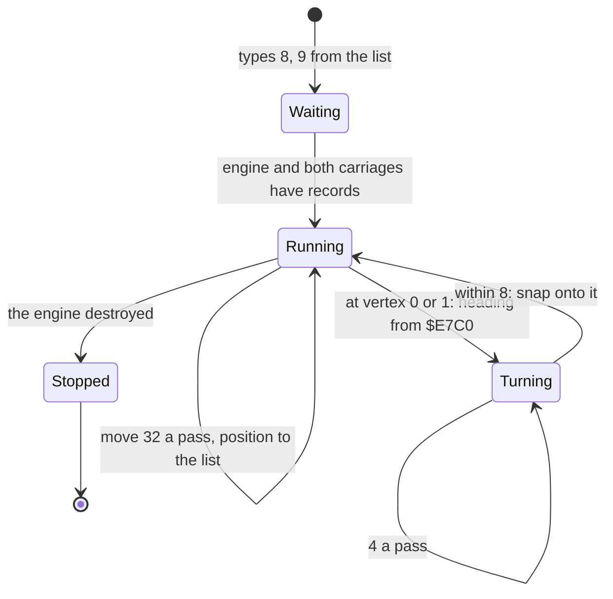

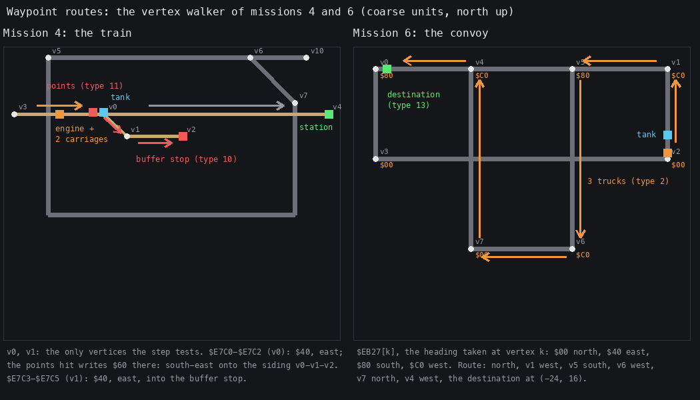

*Figure 7.6. The rails of mission 4 and the roads of mission 6 from their blocks (vertices, segments, the listed
objects named here), with the headings of the junction tables `$E7C0` and `$EB27`. Drawn by `python3
work/docs/bcC/m2-10/fig_routes.py docs/img/objects/routes-m4-m6.png`.*

How to read it:

- Left: the light line is the railway (segments of style 1): the main line v3-v4 and the siding v0-v1-v2. Grey
  lines are the roads. Arrows: the train's path, light grey on to the station, red onto the siding.
- Right: the roads of mission 6. Each vertex carries its `$EB27` heading; orange arrows are the convoy's route from
  its start south of v1 to the destination.

The junction table `$E7C0-$E7C5` holds three headings for each of vertices 0 and 1, all `$40` (east). So by
default the train passes vertex 0 on the main line toward the station (28, 0), and vertex 1, which lies on the
siding, is never reached. The points (type 11, list 10, at (-14, 0.25), 2 hit points) are the switch: destroying
them writes `$60` (south-east) into vertex 0's three entries. The train then turns onto the siding at vertex 0,
turns east again at vertex 1, and runs at the buffer stop (type 10, list 5, at vertex 2). The engine's hit handler
recognises the buffer stop by its model `$F0A8`: the engine is destroyed on the spot (hit points 0 and the kill
path `$B666`), and the carriage handler's operand at `$E62C` becomes `$FF`, so the carriages are destroyed at
their next collision whatever hits them. The goal hook `$E927` needs the station (list 11) and the engine (list 2)
destroyed and the Y high byte of carriage 1's list record (`$DCCF`) equal to `$FB`, that is, the carriage on the
siding's last leg (list Y from -1280 to -1025, world -5120 to -4100; on the main line the byte is `$00` or `$FF`).
So the ambush is: throw the points, wreck the train on the siding, destroy the station.

The pick from the three entries (Random AND 3, with 3 made 2: entries 0 and 1 a quarter each, entry 2 a half)
changes nothing here, because the three entries of a vertex are always equal. Mission 8's vessels use the same
pick with entries that differ.

Worked example, the turn at vertex 0 after the points are destroyed: the heading goes from `$40` to `$60`, 32
steps. TrainTurn turns by 4 while the difference is 8 or more: 32, 28, 24, 20, 16, 12, 8, then 4, which is below
8, so the eighth pass snaps it. Vertex 1 turns from `$60` back to `$40` in 8 passes too. Three cars at two
vertices make 3 x 2 x 8 = 48 runs of TrainTurn.

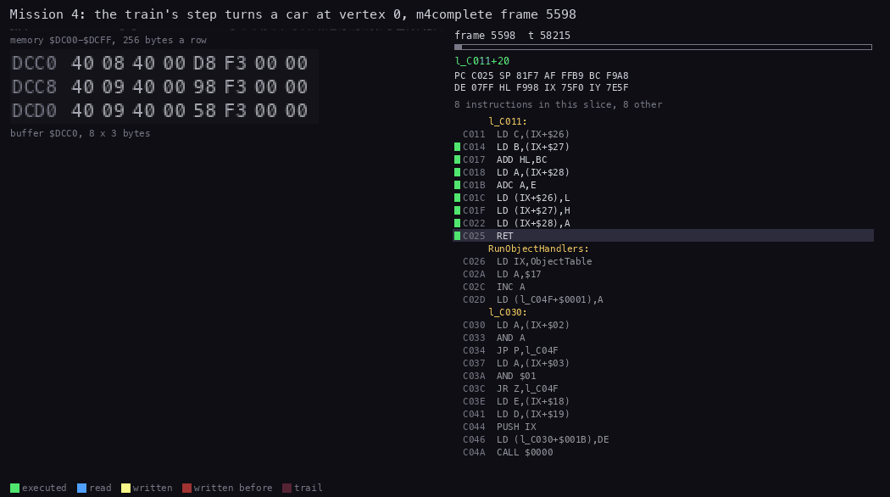

*Animation 7.5. The step of the train at vertex 0 in the m4complete recording, one pass, frame 5598 from T 58 000
(TrainTurn `$E707` runs at T 58 807), 60 pictures. Drawn by `python3 ../../kit/routine_anim.py --work
work/docs/bcC/m4c --listing work/docs/bcC/m2-10/m4game.lst --window 5598:58000-5599:0 --pc E60F-E7C5,BFD1-C060 --view buffer:DCC0:8x3:hex --range
DCB0-DCFF --pictures 60 --out docs/img/routines/M4TrainTurn.gif`. The listing is game.lst with mission 4's code
put in, made by `python3 work/docs/bcC/m2-10/mlst.py 4` (run in that folder).*

How to read it:

- Left: list records 2, 3 and 4 (engine, carriage, carriage), 8 bytes a row: the flags (b7 cleared once the train
  runs), the type, the heading, then the X and Y words that M4TrainToList rewrites every pass.
- Right: M4TrainRun, M4TrainAtVertex and M4TrainTurn, with MoveObject `$BFD1`.

Witness: m4complete (`work/stage2/rec/m4complete/l1.json`):

- TrainWait `$E647` runs 3 times, all in frame 3217: the three cars start together.
- TrainRun `$E6BD` runs 4980 times, M4TrainToList `$E67A` and AtVertex `$E737` 1620 times each (540 moving passes
  a car). TrainTurn `$E707` runs 48 times, in frames 5598-7307: the 3 x 2 x 8 of the worked example.
- PointsHit `$E638` runs twice, in frames 3819 and 4010: the points' 2 hit points, so the second hit writes `$60`.
- EngineHit `$E60F` runs 250 times (3220-8835) and CarriageHit `$E62B` 720 times. The cars stand 256 units apart
  with boxes of 294 and 196, so they touch each other every pass, and each touch goes to HitTest, which ignores
  them (flags `$2F` and `$0F` have no b6).
- In record.json the engine's list record is `40 08 40 00 0D F6 F1 FD` in frame 6307: b7 cleared, X word `$F60D`
  (-9.95 coarse), Y word `$FDF1` (-2.06), on the diagonal from v0 (-12, 0) to v1 (-8, -4). In frame 7171 it is
  `40 08 40 00 45 F8 FF FB`: (-7.7, -4.0), at v1, Y high byte `$FB`.

Open: what the train does at the far end of the main line. The step has no test for it, and complete-NOTES
mentions a restart that was not found in this code.

### Mission 6: the convoy

Three trucks (type 2, list 0-2, at (26, 2), (26, 1) and (26, 0), heading 0, 1 hit point, top speed 32) drive to
the destination (type 13, list 5, at (-24, 16)). The first truck to touch the destination sets the goal flag
(GoalHook6 is a `RET`).

```text
Truck(truck):                     # $E505
    if goal flag $68E8: return    # arrived: everyone stops
    if not near(camera, $1C00): return             # waits for the tank: 7 coarse units
    Accelerate(); MoveObject(); list[truck.index].xy = truck.xy >> 2   # $EB4C
    k = AtVertex()                # $E571: 8 vertices, tolerance = the speed, k != truck[$32]
    if none: return
    truck.xy = vertex k           # snap
    truck[$31] = $EB27[k]; truck.step = TruckTurn
TruckTurn(truck):                 # $E545
    if |truck[$31] - truck.heading| >= 4: truck.heading += 4 toward it; return
    truck.heading = truck.heading # (the copy keeps its own heading, up to 3 off)
    truck.step = Truck

TruckHit(truck, hitter):          # $E4A8
    if hitter.flags3 & $10: HitTest(); return       # a projectile: only weapons with b6 hurt it
    if hitter.type == 2 and BearingTo(hitter) - truck.heading < 0: return
    BackOff(): save the step, step back once (speed negated, MoveObject), speed 0, wait 16 passes
DestinationHit(dest, hitter):     # $E463
    if hitter.type == 2: $68E8 = $FF
    HitTest()
```

```text
$E4A8  LD A,(IY+$03)
$E4AB  AND $10           ; a projectile?
$E4AD  JR Z,$E4B2
$E4AF  JP $67DC          ; HitTest: enemy shells ($17) have no b6 and do nothing
$E4B2  LD A,(IY+$01)
$E4B5  CP $02            ; another truck?
$E4B7  JR NZ,$E4C1
$E4B9  CALL $67C1        ; BearingTo the other truck
$E4BC  SUB (IX+$22)
$E4BF  AND A
$E4C0  RET M             ; in the left half: ignore it
$E4C1  ...               ; back off: one step back, 16 passes still
```

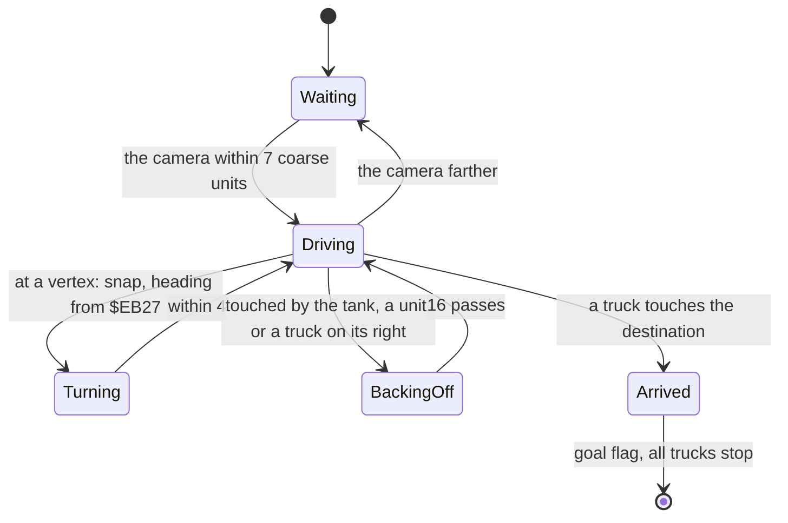

The route (figure 7.6, right) follows `$EB27` = `80 C0 00 00 C0 80 C0 00`: north from the start to v1 (26, 16),
west to v5 (9, 16), south to v6 (9, -16), west to v7 (-9, -16), north to v4 (-9, 16), west to the destination.

Worked example: the lead truck's route is 14 + 17 + 32 + 18 + 32 + 15 = 128 coarse units, 131 072 world units, so
4096 passes at 32 a pass. It covers them only while the tank stays within 7 coarse units.

Only the player can destroy a truck. Projectiles go to HitTest, and HitTest counts only a hitter with +3 b6: the
player's weapons (flags `$57`) have it, the enemy shells (`$17`) do not. The enemy units do not aim at the trucks
either (they turn toward record 0), and their touch only makes a truck back off. Nothing in the block fails the
mission when the trucks are lost; with all three destroyed the goal flag can no longer be set.

Witness: none; from the code only.

### Mission 8: the supply vessels

The four vessels (type 13, list 12, 16, 19, 23; 8 hit points, top speed 8) are the goal with the power station
(type 6, list 0). They start at (-20, -13) heading north, (4, 13) south, (18, 11) east and (-20, 11) east. Their
step is the convoy's walker with the train's pick: `$E72A` sets +`$31` and +`$32` to `$FF` and installs `$E77E`:
save the position to the list (`$DD10`), Accelerate, MoveObject, test 31 vertices (`$E7EE`, tolerance = the
speed), snap, take a heading from the 93-byte table `$E90B` at 3k + pick, and turn by 4 a pass (`$E7C2`).

The vertices with non-zero entries in `$E90B`:

| Vertex | Place | Entries | Meaning |
| --- | --- | --- | --- |
| 9 | (4, 6) | `00 A0 A0` | back north a quarter of the time, else south-west |
| 10 | (-4, -2) | `20 C0 C0` | back north-east, else west |
| 11 | (-12, -2) | `40 A0 A0` | back east, else south-west |
| 12 | (-20, -10) | `20 80 80` | back north-east, else south |
| 14 | (-32, 11) | `40 40 40` | east |
| 28 | (4, 14) | `80 80 80` | south |
| 29 | (23, 11) | `C0 C0 C0` | west |

The other vertices have `00 00 00` (north), among them v13 (-20, -26), the south end of the first river. So one
vessel shuttles along the line v28-v9-v10-v11-v12-v13 and turns back at random on the way (a quarter of the time
at v9-v12). Another shuttles east and west between v14 and v29 at Y = 11.

Worked example: a vessel going south-west from v9 meets v10 after 8 coarse units in X and Y; at 8 a pass that is
about 1450 passes (8 x 1024 x 1.41 / 8). There it goes back to v9 with probability 1/4 and on to v11 with 3/4.

Witness: none; from the code only.

### Missions 5 and 8: objects that carry segments

KillSwitchObject `$B61E`, the resident hit handler of mission 5's type 29 and mission 8's types 8 and 9, removes
road segments from the map when such an object is destroyed. It uses three header fields: the list index of the
first such object (`$DBDD`, 0 for none), the first switchable segment (`$DBDE`) and a table of segment numbers
(the word `$DBDF`). The nine flags at `$7BFD-$7C05` start at `$FF`, and SegmentVisibility `$AD45` ANDs flag k
into segment `$DBDE` + k.

```text
KillSwitchObject(obj):            # $B61E
    if not HitTest(): return
    if $DBDD == 0: return
    c = obj.index - $DBDD
    a = table[c] - $DBDE; b = table[c + 1] - $DBDE
    flag[$7BFD + a] = 0; flag[$7BFD + b] = 0      # both segments vanish
```

```text
$B61E  CALL $67DC        ; HitTest
$B621  RET NC
$B622  LD HL,$DBDD       ; the first switch object's list index
$B625  LD A,(HL)
$B626  AND A
$B627  RET Z             ; none in this mission
$B628  LD A,(IX+$00)
$B62B  SUB (HL)          ; c
...
$B63E  LD BC,$7BFD       ; the switch flags
$B641  LD H,$00
$B643  LD L,A
$B644  ADD HL,BC
$B645  LD (HL),$00
```

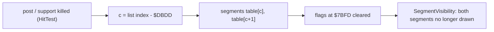

Worked example, mission 5: `$DBDD` = 7, `$DBDE` = 12, table `$E984` = `0C 0D 0E 0F 10 11 12 13 14`. The eight posts
(list 7-14) stand on vertices 9-16 of a chain of nine segments of style 3 (12-20, from v8 (-28, 18) to v17
(8, -18)). Post k clears flags k and k + 1, so it takes away the two spans it carries: post 0, at v9 (-24, 14),
removes segments 12 and 13.

Mission 8: `$DBDD` = 57, `$DBDE` = 19, table `$E1D9` = `13 13 14 15 16 17 17`. The six supports (list 57-62)
carry segments 19-23 (styles 5, 3, 3, 3, 4: a bridge from v16 (-10, -14) to v21 (20, 16)). The end supports
carry one span each (19 and 19; 23 and 23), the inner ones two.

Mission 10 has `$DBDD` = 0; its table `$E8CC` is a copy of mission 5's that nothing uses.

Witness: none; KillSwitchObject is in no recording. From the code only.

### Mission 7: the satellite and the recovery team

The satellite (type 32, list 34, at (-18, -8)) is the goal. A spawner at the same place (type 30, list 35) keeps
types 28 and 29, the recovery team, and a flanker 11 around the camera.

```text
RecoveryTeam(unit):               # $E3A1, types 28 and 29
    IY = $7E5F                    # pseudo-record: its X, Y (+$23..+$28) are $7E82-$7E87
    TurnToward(BearingTo(IY)); Accelerate(); MoveObject()
Type29Hit(unit, hitter):          # $E3D2
    if hitter.type == 32: unit.step = $E558 (RET); HitTest(); return   # at the satellite: parked
    UnitHit()
SatelliteHit(sat, hitter):        # $E3B2
    if not hitter.flags3 & $80: HitTest(); return                       # weapons: an ordinary target
    if (sat[$30] XOR rearView $BA27) >= 0: return                       # in front of the camera
    MarkDestroyed(); UnregisterCollision(); sat.state = 0; $68E8 = $FF
```

```text
$E3B2  LD A,(IY+$03)
$E3B5  AND $80           ; the tank?
$E3B7  JP Z,$67DC        ; no: HitTest
$E3BA  LD HL,$BA27       ; the rear-view flag
$E3BD  LD A,(IX+$30)     ; the view-space depth, high byte
$E3C0  XOR (HL)
$E3C1  RET P             ; ahead of the camera: not yet
$E3C2  CALL $67E5        ; MarkDestroyed
$E3C5  CALL $67CD        ; UnregisterCollision
$E3C8  LD (IX+$02),$00
$E3CC  LD A,$FF
$E3CE  LD ($68E8),A      ; the goal
```

```mermaid
stateDiagram-v2
  [*] --> Lying
  Lying --> Recovered: touched by the tank, behind the camera
  Lying --> Lying: touched by the tank in front of the camera
  Lying --> Lost: destroyed by a weapon (HitTest, 1 hit point)
  Recovered --> [*]: goal flag
  Lost --> [*]: the goal can no longer be met
```

The recovery team's target is the pad block's first six bytes: mission 7's are `00 B8 FF 00 E0 FF`, X `$FFB800` =
-18432 and Y `$FFE000` = -8192, the satellite's place. So the units drive to the satellite, and a type 29 that
touches it parks there. Nothing in the block reads the parked state.

Worked example: the test is the sign of the satellite's view depth, flipped by the rear-view flag. In the tank's
own forward view a satellite in contact ahead of the camera has a positive depth and nothing happens; the tank has
to back onto it (or, in the rear view, drive at it). A weapon hit instead destroys it through HitTest (1 hit point,
score 150) without setting the goal.

Witness: none; from the code only. GoalHook7 (`$EA6F`) only calls `$F03D`, which inverts `$6758-$675F`.

### Mission 9: the hideout; mission 10

The hideout (type 9, list 39, at (0, 0), 0 hit points) stands among four hills at two coarse units. It launches the
aircraft (above) and falls to the first weapon hit. Type 10 (list 40, at (-4, 0)) has the hit handler `$E326`,
which acts only for the tank's family: `LD A,(IY+3); AND $80; RET Z; LD (IX+$13),0; JP $B666`. So it is destroyed
by the tank's touch only, and weapons do nothing to it. Its role (a door?) is SUSPECTED. The goal hook `$E8B5`
calls `$EC2E` (the inversion of `$6758-$675F`), then tests list record 39 (`$DDFA`).

Mission 10 has mission 5's units under the same numbers (4, 6, 18, 20, 21) and mission 5's spawner trees 23-25.
It adds the hit and run type 27 that fires aircraft (type 28, `$E8DE`, with its missile type 29 at `$E948`, fired
at `$E97F` `LD A,$1D`), and two flags (type 13, `$E8D5`). The goal is list records 2 and 3 (type 12, 2 hit points each).

The flags of missions 5 and 10 wave: mission 5's step `$E98D` sets the heading to Random AND `$1F` (0-31) every
pass.

Witness: none; from the code only.

The point: the ten missions are one game engine with ten target scripts. The enemy behaviour is mission 1's
library in every block, tuned by four constants. The sentry limit alone turns the homing carriers of missions 2, 3,
4 and 8 into fixed turrets. What makes each mission different is a few dozen bytes of its own: a radar that keeps
launchers on the ground, a gate that frees a hostage, a set of points that sends a train into a buffer stop, a
convoy that waits for the tank, a satellite that must be picked up from behind.
