# 7. Objects

What this covers: every thing in Battle Command that the game keeps state for. A mission is one block on side 2. It
holds a header, a map of roads, a list of placed objects, a table of object types, the mission's own code and its 3D
models. At run time the objects live in 24 records of 60 bytes. Record 0 is the player's tank. This document gives:

- the mission block byte by byte: the header, the vertices, the segments, the object list and the templates, with a
  worked decode of mission 1;
- the models and the box generators, with BoxRect16's radius times 64;
- the object record field by field and the slots;
- the spawn and free paths, at work in a recording;
- each object kind as a state machine: the scenery, the spawners, the enemy units, the shells, the gun;
- the collision pass: the pair timers, the distance estimate, the box test, with a worked example;
- the player's state: speed, heading, position, height, fuel, armour, score, the goal flag, the failure cause;
- the weapon slots and the weapon records;
- the random-number generator.

The rules that use these records (driving, the enemies' attacks, damage, kills, the weapons, goals, completion and
failure) are [doc 10](10-gameplay-logic.md). How a model is drawn is [doc 06](06-rendering.md); how the mission block
is loaded is [doc 03](03-build-and-load.md).

The recordings it rests on ([WALKTHROUGH 6.0](../WALKTHROUGH.md#60-the-recordings)):

- `death` (stage 1, `work/stage1/rec/death`): 20 039 frames from the title, Blast Em Mission with the Turret, the
  tank driven and the cannon fired. It was opened on an own instance after `source work/env.sh` with
  `python3 ../../kit/rs.py open --work work/docs/bcC/death --ttd work/stage1/rec/death/session.ttd --port-base 37370`
  `--model 128K --ranges 4000-FFFF --binary "$UNREAL_BINARY"` (the binary from `work/env.sh`). `tools/ttd_sample.py` (TTD `memory_at`) took the object
  table `$75F0-$7BCF`, the armour, the score and `$7BF9` at every frame 7590-9600 (`work/docs/bcC/death-1.jsonl`) and
  at every tenth frame 7500-20000 (`work/docs/bcC/death-10.jsonl`).
- `fuel` (stage 2, `work/stage2/rec/fuel`): the same mission with a POKE, Fuel `$7C57` = 32 at frame 7704; the tank
  is driven ahead until the fuel runs out. Opened the same way and sampled at every frame 7690-7910
  (`work/docs/bcC/fuel-player.jsonl`).
- `armour` (made for docs 07 and 10, `work/docs/bcC/rec/armour`): 18 939 frames, the death plan with a POKE at frame
  7704 that sets the four armour bytes `$8301-$8304` to 1. Recorded with `python3 tools/rec_armour.py --work
  work/docs/bcC/rec/armour --port-base 37370 --start work/stage1/explore/loaded.szx`. The first hit, in frame 18423,
  ends the mission ([doc 10.5](10-gameplay-logic.md#105-damage-playerhit-the-armour-and-the-subsystems)).
- The L1 counts of the stage 1 builds ("L1 n" in the `.ann` descriptions).

A sample of frame N is the memory at the start of frame N. A trace, and so a routine animation, puts an instruction
in the frame where it ran. A [pass](README.md#terms) is one turn of `PlayLoop $6A0C`: one 3D frame, 7 to 12 TV
frames ([doc 04](04-game-loop.md)). An object moves at most once a pass.

## 7.1 Units and coordinates

The world is flat. X grows to the east and Y to the north. A position is two 24-bit signed numbers, low byte first.
The height is a 16-bit number above the ground.

- One **world unit** is the smallest step.
- One **coarse unit** is 1024 world units. The mission data counts in coarse units.
- The vertices of the road map are one signed byte per axis, in coarse units.
- The object list stores each axis as a 16-bit word in units of 4. The high byte of the word is the coarse unit.
  WordToWorld `$BD85` shifts the word left by 2 into 24 bits.
- The heading is one byte, 256 steps to the full turn, at +`$22` of a record, with a fraction byte at +`$21`.
  Heading 0 faces north (+Y).

| Quantity | Format | Example (mission 1) |
| --- | --- | --- |
| vertex | 1 signed byte a coordinate, coarse units | vertex 0: X `$F2` = -14, Y `$12` = 18 |
| list position | 16-bit word a coordinate, units of 4 | list record 0: X `$0A00` = coarse 10 = world 10 240 |
| object position | 24-bit signed, world units | death frame 8121, the tank: X = -9558, Y = -9678 |
| heading | 1 byte, 256 a turn | the tank in death frame 8121: 202 |

The point: three scales of one grid. The map's bytes and the list's high bytes are the same coarse unit, which lets
the spawner compare a list record with the player's position by one byte subtraction.

## 7.2 The mission block and its header

SELECT loads one mission block from side 2 into bank 0 at `$DBC5` ([doc 03](03-build-and-load.md)). Its length
differs per mission; mission 1 is 8058 bytes, `$DBC5-$FB3E`. The block is self-describing: its header holds the
addresses of every other part.

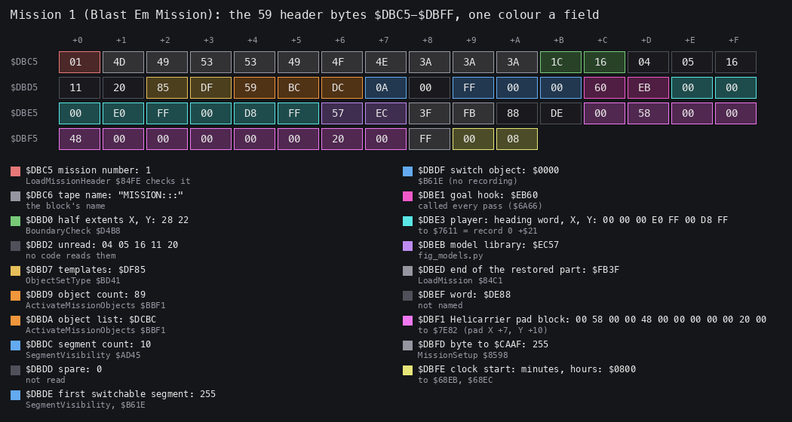

*Figure 7.1. The header of mission 1 (Blast Em Mission), bytes `$DBC5-$DBFF` of
`src/res/missions/01-blast-em-mission.txt`. Drawn by `python3 tools/fig_objects.py header
docs/img/objects/mission-header.png` from the resource, not from a recording.*

How to read it:

- The grid shows the 59 bytes, 16 a row, each coloured by its field.
- The list under it names each field, its value and the routine that reads it.

The point: everything after the header is found through it. The object list, the templates, the goal hook, the
models and the player's start are addresses or values here, so the resident code serves every mission without a
table of its own.

The fields, as `tools/res_missions.py` parses them:

| Address | Bytes | Field | Mission 1 | Read by |
| --- | --- | --- | --- | --- |
| `$DBC5` | 1 | mission number | 1 | the catalogue check |
| `$DBC6` | 9 | tape name | `MISSION:::` | the tape search |
| `$DBCF` | 2 | half extents X, Y (coarse) | 28, 22 | BoundaryCheck `$D4B8` |
| `$DBD1` | 5 | not read by a recorded routine | `04 05 16 11 20` | |
| `$DBD6` | 2 | template table | `$DF85` | ObjectSetType `$BD41` |
| `$DBD8` | 1 | object count | 89 | ActivateMissionObjects `$BBF1` |
| `$DBD9` | 2 | object list | `$DCBC` | ActivateMissionObjects, MarkDestroyed `$B6BD` |
| `$DBDB` | 1 | segment count | 10 | SegmentVisibility `$AD45` |
| `$DBDC` | 1 | `dd`, not read in the recordings | 0 | |
| `$DBDD` | 1 | switch segment (`$FF` none) | `$FF` | set in missions 5, 8 and 10 |
| `$DBDE` | 2 | switch object | `$0000` | |
| `$DBE0` | 2 | goal hook | `$EB60` | the play loop |
| `$DBE2` | 8 | player start: heading word, X, Y | heading 0, X `$FFE000`, Y `$FFD800` | StartMission |
| `$DBEA` | 2 | models | `$EC57` | the model scripts |
| `$DBEC` | 2 | end of the part restored after a mission | `$FB3F` | |
| `$DBEE` | 2 | `ef` | `$DE88` | |
| `$DBF0` | 12 | Helicarrier pad, the pickup point | `00 58 00 00 48 00 ...` | PlaceHelicarrier `$D52E` |
| `$DBFC` | 1 | `cafe` | `$FF` | |
| `$DBFE` | 2 | clock start: minutes, hours | 0, 8 | to `$68EB`, `$68EC` |

Worked example: the player's start. The eight bytes at `$DBE2` are `00 00 00 E0 FF 00 D8 FF`.

1. The heading word is `$0000`: heading 0, north.
2. The X field is `00 E0 FF`, the 24-bit `$FFE000` = -8192 world units = -8 coarse units.
3. The Y field is `00 D8 FF`, `$FFD800` = -10 240 = -10 coarse units.

Witness: the death recording's tank stands at X = -8192, Y = -10 240 in the sample of frame 7590, the values of the
header.

The parts of the block, in order:

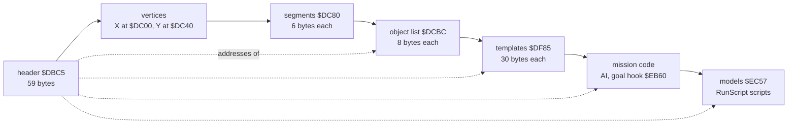

The point: a mission brings its code with it. The AI of the enemies, the goal and the spawners are routines inside
the block, called through the records' handler words. The resident game supplies the engine and a vector table at
`$67BE-$67F1` that the mission code calls (MoveObject `$67BE`, BearingTo `$67C1`, FindFreeObject `$67C4`,
ObjectSetType `$67C7`, RegisterCollision `$67CA`, Random `$67D0`, AbsA `$67D6`).

## 7.3 The road map: vertices and segments

The vertices are two arrays of signed bytes, X at `$DC00` and Y at `$DC40`, in coarse units. A segment is 6 bytes at
`$DC80`:

| Offset | Meaning |
| --- | --- |
| +0 | vertex a |
| +1 | vertex b |
| +2 | orientation: 0 along Y, 128 (`$80`) along X, other values diagonal |
| +3 | size across: the half width of the strip |
| +4 | size along: the margin at the ends |
| +5 | style: the terrain type TerrainCollision `$CC3C` reports (0 a road) |

Worked example: segment 0 of mission 1 is `00 02 80 E0 20 00`.

1. Vertex a = 0: X `$F2` = -14, Y `$12` = 18.
2. Vertex b = 2: X `$0E` = 14, Y `$12` = 18.
3. Orientation `$80`: the strip runs along X, from X = -14 to 14 at Y = 18.
4. Style 0: a road. TerrainCollision returns type 0 on it.

The ten segments of mission 1 are the grey frame of roads in the figure below. The terrain type matters to the tank:
types 0 and 6 take another speed path in PlayerStep `$A8C7`, and types 2 and `$80` are walls
([doc 10.2](10-gameplay-logic.md#102-the-tank-playerstep)).

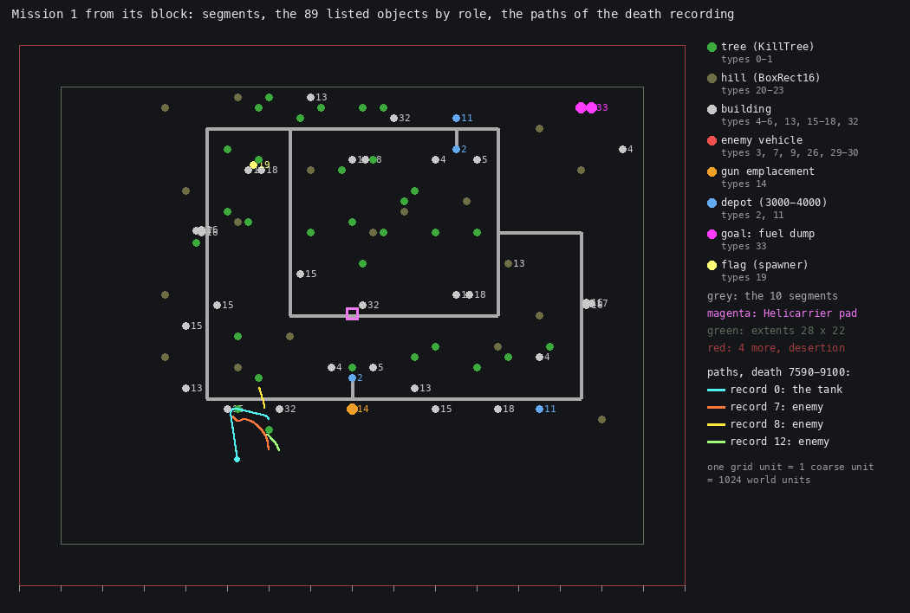

*Figure 7.2. Mission 1 drawn from its block, with the paths of record 0 (the tank) and records 7, 8 and 12 (enemy
vehicles) in the death recording, samples of every frame 7590-9100 (`work/docs/bcC/death-1.jsonl`). Drawn by
`python3 tools/fig_objects.py world docs/img/objects/mission1-world.png --samples work/docs/bcC/death-1.jsonl --slots
7,8,12 --to 9100`.*

How to read it:

- One grid step is one coarse unit; north is up.
- Grey lines: the 10 segments.
- Dots: the 89 list records, coloured by the role of their type (section 7.5); the number is the type, except for
  trees and hills.
- Magenta square: the Helicarrier pad from `$DBF0`.
- Green frame: the half extents; red frame: 4 coarse units more, where desertion begins.
- Coloured lines: positions sampled every frame; a jump of more than two coarse units starts a new line.

The point: the enemies are not on the map. Every vehicle path starts near the tank: the units were made there by a
spawner (section 7.9) and stay within about 3 coarse units of the camera. The goal, the two fuel dumps (type 33,
magenta), sits in the north-east corner, away from the roads.

The previews of all ten missions are `src/res/missions/NN-*.preview.png`.

## 7.4 The object list

The object list holds every placed thing: trees, hills, buildings, depots, the targets. Each record is 8 bytes:

| Offset | Meaning |
| --- | --- |
| +0 | flags: b7 alive (walked by the spawner), b6 spawned (has a record now), b1 destroyed |
| +1 | type, an index into the template table |
| +2 | heading |
| +3 | spare (0 in mission 1) |
| +4, +5 | X word (units of 4; the high byte is the coarse unit) |
| +6, +7 | Y word |

Worked example: the first record of mission 1, at `$DCBC`, is `80 0B 00 00 00 0A 00 13`.

1. Flags `$80`: alive, not spawned, not destroyed.
2. Type `$0B` = 11: a depot with a gun (section 7.5).
3. Heading 0.
4. X word `$0A00`: coarse 10, world 10 240.
5. Y word `$1300`: coarse 19, world 19 456.

The point: the list is the mission's lasting state. A kill sets b1 and clears b7 in the list (MarkDestroyed
`$B6BD`), so the object never comes back, and the goal hooks read those bits
([doc 10.9](10-gameplay-logic.md#109-goals-the-helicarrier-and-completion)).

## 7.5 The templates and the object types

A type is a 30-byte template. ObjectSetType `$BD41` copies it to +2 .. +`$1F` of a record. Types below `$80` index
the mission's table (the header word `$DBD6`, mission 1 `$DF85`). Types `$80-$8C` index the resident table
ShellTemplate80 `$B3CA`: the player's weapons and the Helicarrier.

The template's bytes at their record offsets:

| Record offset | Template bytes | Field |
| --- | --- | --- |
| +2 | 0 | state (`$85`: b7 present, b2, b0) |
| +3 | 1 | flags: b0 has a step, b4 no knock-back and evictable, b6 a weapon (HitTest counts its hits) |
| +4 | 2 | draw variant |
| +5, +6 | 3, 4 | height |
| +7 | 5 | speed |
| +8, +9 | 6, 7 | wreck model (`$F103` in every mission 1 template) |
| +`$0A` | 8 | debris pieces, wreck pitch |
| +`$0B`-+`$10` | 9-14 | box half sizes: x, height, y |
| +`$11` | 15 | turn step |
| +`$12` | 16 | top speed |
| +`$13` | 17 | hit points |
| +`$14` | 18 | damage it does |
| +`$15` | 19 | unnamed (`$20` in most) |
| +`$16`, +`$17` | 20, 21 | radius |
| +`$18`, +`$19` | 22, 23 | step handler |
| +`$1A`, +`$1B` | 24, 25 | collision handler |
| +`$1C`, +`$1D` | 26, 27 | model |
| +`$1E`, +`$1F` | 28, 29 | score |

Worked example: template 7, the enemy tank, at `$DF85 + 7 x 30 = $E057`:
`85 2F 00 10 00 00 03 F1 04 E0 00 18 00 E0 00 03 28 02 02 20 40 00 C2 E5 F3 E8 3F F5 D0 07`.

1. State `$85`, flags `$2F`: a step handler, not a weapon, not evictable.
2. Height `$0010` = 16; speed 0 at the spawn.
3. Wreck model `$F103`, 4 debris pieces.
4. Box half sizes `$00E0`, `$0018`, `$00E0`: 224, 24, 224.
5. Turn step 3, top speed `$28` = 40, 2 hit points, damage 2.
6. Radius `$0040` = 64.
7. Step `$E5C2` (the chase, section 7.9), collision `$E8F3`, model `$F53F`, score `$07D0` = 2000.

Mission 1's 34 templates, read from the block (`src/res/missions/01-blast-em-mission.txt`):

| Type | In list | +3 | Height | Box x, h, y | Turn, top | HP | Damage | Radius | Step | Hit | Model | Score | Role |
| --- | --- | --- | --- | --- | --- | --- | --- | --- | --- | --- | --- | --- | --- |
| 0 | 16 | `$04` | 44 | 64, 64, 64 | 0, 0 | 0 | 1 | 64 | `$E39B` | `$B612` | `$F0D9` | 0 | tree |
| 1 | 16 | `$04` | 44 | 64, 64, 64 | 0, 0 | 0 | 1 | 64 | `$E39B` | `$B612` | `$F9A5` | 0 | tree |
| 2 | 2 | `$0D` | 88 | 484, 88, 484 | 0, 0 | 32 | 3 | 704 | `$EA12` | `$67DC` | `$EFBF` | 3000 | depot |
| 3 | 0 | `$2F` | 22 | 256, 22, 256 | 4, 32 | 1 | 1 | 100 | `$E3B2` | `$E3D3` | `$EE41` | 500 | vehicle |
| 4 | 4 | `$0D` | 64 | 404, 64, 404 | 0, 0 | 2 | 3 | 384 | `$EB77` | `$67DC` | `$F2E8` | 500 | building, spawner |
| 5 | 2 | `$0C` | 64 | 340, 128, 340 | 0, 0 | 2 | 3 | 384 | `$E39B` | `$67DC` | `$F25F` | 500 | building |
| 6 | 0 | `$0D` | 64 | 340, 128, 340 | 0, 0 | 0 | 0 | 384 | `$EB77` | `$67DC` | `$F25F` | 0 | spawner |
| 7 | 0 | `$2F` | 16 | 224, 24, 224 | 3, 40 | 2 | 2 | 64 | `$E5C2` | `$E8F3` | `$F53F` | 2000 | enemy tank |
| 8 | 0 | `$17` | 16 | 128, 128, 128 | 0, 96 | 0 | 3 | 1408 | `$EB04` | `$E39C` | `$F143` | 0 | shell of 7 |
| 9 | 0 | `$2F` | 24 | 192, 24, 192 | 3, 40 | 2 | 2 | 64 | `$E6F9` | `$E8F3` | `$F17E` | 2000 | vehicle |
| 10 | 0 | `$17` | 48 | 128, 128, 128 | 0, 96 | 0 | 3 | 1408 | `$EB04` | `$E39C` | `$F143` | 0 | shell of 9 |
| 11 | 2 | `$0D` | 36 | 128, 128, 128 | 0, 0 | 32 | 4 | 1408 | `$E38E` | `$67DC` | `$EEFD` | 4000 | depot with a gun |
| 12 | 0 | `$17` | 56 | 128, 128, 128 | 0, 96 | 0 | 3 | 1408 | `$EB04` | `$E39B` | `$F143` | 0 | shell of 11 |
| 13 | 4 | `$0C` | 120 | 404, 128, 404 | 0, 0 | 2 | 3 | 384 | `$E39B` | `$67DC` | `$F62A` | 0 | building |
| 14 | 1 | `$0D` | 20 | 160, 20, 160 | 0, 0 | 10 | 1 | 127 | `$E381` | `$67DC` | `$F6C0` | 3000 | gun emplacement |
| 15 | 5 | `$0C` | 32 | 169, 48, 169 | 0, 0 | 1 | 3 | 159 | `$E39B` | `$67DC` | `$F754` | 250 | hut |
| 16 | 4 | `$0C` | 20 | 64, 64, 64 | 0, 0 | 1 | 3 | 32 | `$E39B` | `$67DC` | `$EDC1` | 250 | crate |
| 17 | 2 | `$0C` | 64 | 160, 160, 160 | 0, 0 | 2 | 3 | 384 | `$E39B` | `$67DC` | `$F7D2` | 500 | building |
| 18 | 7 | `$0C` | 32 | 359, 32, 359 | 0, 0 | 2 | 3 | 352 | `$E39B` | `$67DC` | `$F831` | 500 | shed |
| 19 | 1 | `$05` | 64 | 34, 64, 34 | 0, 0 | 127 | 3 | 48 | `$EB7C` | `$67DC` | `$F8AF` | 0 | flag, spawner |
| 20 | 8 | `$04` | 127 | 607, 128, 607 | 0, 0 | 127 | 3 | 896 | `$E39B` | `$E39B` | `$ECB8` | 0 | hill |
| 21 | 4 | `$04` | 102 | 357, 128, 773 | 0, 0 | 127 | 3 | 896 | `$E39B` | `$E39B` | `$ECF7` | 0 | hill |
| 22 | 3 | `$04` | 127 | 1821, 128, 413 | 0, 0 | 127 | 3 | 2048 | `$E39B` | `$E39B` | `$ED41` | 0 | hill |
| 23 | 3 | `$04` | 127 | 1166, 128, 398 | 0, 0 | 127 | 3 | 1408 | `$E39B` | `$E39B` | `$ED80` | 0 | hill |
| 24 | 0 | `$17` | 20 | 128, 128, 128 | 0, 96 | 0 | 3 | 1408 | `$EB04` | `$E39C` | `$F744` | 0 | shell of 14 |
| 25 | 0 | `$0D` | 64 | 340, 128, 340 | 0, 0 | 0 | 0 | 384 | `$0000` | `$67DC` | `$F25F` | 0 | unused |
| 26 | 0 | `$2F` | 32 | 224, 24, 224 | 3, 40 | 3 | 2 | 64 | `$E837` | `$E8F3` | `$F385` | 2000 | vehicle |
| 27 | 0 | `$0D` | 64 | 340, 128, 340 | 0, 0 | 0 | 0 | 384 | `$0000` | `$67DC` | `$F25F` | 0 | unused |
| 28 | 0 | `$17` | 64 | 128, 128, 128 | 0, 120 | 0 | 4 | 1408 | `$EAAA` | `$E39C` | `$EC57` | 0 | homing shell |
| 29 | 0 | `$2F` | 24 | 128, 24, 128 | 3, 40 | 1 | 2 | 64 | `$E6B4` | `$E8F3` | `$F8EA` | 2000 | vehicle |
| 30 | 0 | `$2F` | 24 | 192, 24, 192 | 3, 40 | 3 | 2 | 64 | `$E5C2` | `$E8F3` | `$F43C` | 2000 | vehicle |
| 31 | 0 | `$17` | 48 | 128, 128, 128 | 0, 96 | 0 | 3 | 1408 | `$EB04` | `$E39C` | `$F143` | 0 | shell of 30 |
| 32 | 3 | `$0C` | 44 | 404, 64, 404 | 0, 0 | 2 | 3 | 384 | `$E39B` | `$67DC` | `$FA06` | 0 | building |
| 33 | 2 | `$0C` | 127 | 288, 48, 288 | 0, 0 | 1 | 6 | 159 | `$E39B` | `$67DC` | `$FA56` | 250 | fuel dump (the goal) |

How to read it:

- "In list" counts the type in the 89 list records; 0 means the type appears only when a spawner or a gun makes it.
- `$E39B` is a `RET` in the mission code: no step, or a hit that does nothing.
- `$67DC` is the resident vector to HitTest `$B660`; `$B612` (KillTree) kills a tree hit by any weapon.

The point: behaviour is data. A type's AI is the pair of handler words in its template. Hills take hits on a `RET`
and have 127 hit points; trees have 0 hit points and die at the first weapon. Every enemy vehicle has 1 to 3 hit
points and scores 2000, and none of them is in the list: all come from spawners.

The resident types, from ShellTemplate80 `$B3CA` (read from `build/game.bin`):

| Type | Weapon | Height | Speed | Box | Damage | Step | Hit | Model |
| --- | --- | --- | --- | --- | --- | --- | --- | --- |
| `$80` | K-40 mortar shell | 40 | 96 | 32 | 1 | `$B5E8` | `$B8AB` | `$FE80` |
| `$81` | turret cannon shell | 56 | 96 | 32 | 1 | `$B592` | `$B8AB` | `$FE80` |
| `$82` | Banshee RRSS | 48 | 120 | 16 | 2 | `$C453` | `$B8A8` | `$8775` |
| `$83` | Phoenix RRSA | 56 | 120 | 16 | 2 | `$C4A5` | `$B8A8` | `$8775` |
| `$84` | Banshee IRSS | 56 | 120 | 16 | 2 | `$C4A5` | `$B8A8` | `$8775` |
| `$85` | Phoenix IRSA | 56 | 120 | 16 | 2 | `$C453` | `$B8A8` | `$8775` |
| `$86` | Dragonfly | 64 | 120 | 16 | 2 | `$C391` | `$C365` | `$8775` |
| `$87` | Sleeper mine | 56 | 96 | 32 | 127 | `$CF4A` | `$B8AB` | `$FE80` |
| `$88` | K-90 cluster | 56 | 127 | 32 | 31 | `$D048` | `$D0E9` | `$8739` |
| `$89` | SLAM laser | 64 | 64 | 32, 64, 32 | 4 | `$D2AE` | `$B8AB` | `$7ECA` |
| `$8A` | Skeet bomb | 56 | 96 | 32 | 1 | `$D405` | `$6BB0` | `$FE80` |
| `$8B` | Spectre / Phantasm | 56 | 96 | 64 | 31 | `$D369` | `$B8AB` | `$FE80` |
| `$8C` | the Helicarrier | 104 | 100 | 256, 128, 256 | 1 | `$DB00` | `$DAAB` | `$D9A5` |

All have state `$85`, hit points 0, top speed 127, radius 10 and score 7; all but the Helicarrier have the flags
`$57` (a step, no knock-back, a weapon); the Helicarrier has `$07`. Which store fires which type is
[doc 10.7](10-gameplay-logic.md#107-the-weapons).

The point: the player's weapons are ordinary objects. A shell is a record with a step that moves it and a collision
handler that explodes it; +3 bit 6 is what lets it hurt an enemy.

## 7.6 The models

A model is a script of RunScript `$990F` ([doc 06](06-rendering.md)). Its first instruction is a box generator that
makes the corners of a box from three numbers. Vertex programs then derive more points, and face lists fill the
polygons. The generators are BoxSquare `$AA63`, BoxRect `$AB7B`, BoxRect16 `$AAF5` and BoxTilted `$ABFF`.

The rectangle generators take three numbers: a half angle b, a radius r and a height. The four corners lie at the
distance r from the centre, on the angles heading + b, heading - b and their opposites, so b sets the aspect: 32 (45
degrees) makes a square, a smaller b a long box. BoxRect uses 8-bit corners; BoxRect16 `$AAF5` makes 16-bit corners
and scales the radius by 64 (Sine16 through MulWordByte `$67D9`), for the big objects: the hills.

Worked example: `box_rect16 32 12 127` (the hill `$ECB8`, type 20) puts its corners 12 x 64 = 768 world units from
the centre at 45 degrees, so the base is a square of half side 768 x sin 45 = 543 world units, and its height is
127. Template 20 gives the record a box of half side 607 and height 127 for the collision test, a little larger
than the drawing.

The whole script of model `$ECB8` of mission 1, bytes `$ECB8-$ECF6`, as `tools/models3d.py` decodes it
(`src/res/models/01-blast-em-mission.txt`):

```text
$ECB8 box_rect16 32 12 127                         half angle 32, radius 12 x 64, height 127
$ECBE verts P=V40 P=(P+V38)/2 V38=P P+=V38 V38=P   the apex from two corners
$ECC6 project 5 from V34                           five points to the screen
$ECC9 faces_test from 0: (38 35 34) (38 36 35) (38 37 36) (38 34 37)
$ECD8 fill_faces_clip (f0 c9 38 35 34) (f1 c4 38 36 35) (f2 c9 38 37 36) (f3 c4 38 34 37)
$ECF6 end
```

Four triangles share the apex V38: a pyramid, the hill. Colours 9 and 4 alternate on opposite faces.

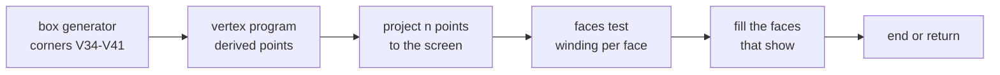

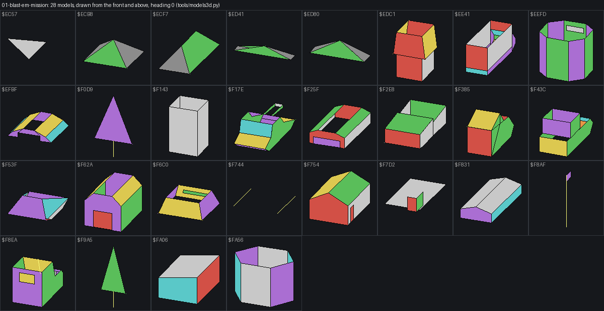

*Figure 7.3. The 28 models of mission 1 that its templates use, drawn from the block by `python3 tools/fig_models.py`
(`src/res/models/01-blast-em-mission.png`, 1200 px wide), heading 0; colours are the scripts' colour numbers.*

How to read it: each cell is one model, labelled with its address. `$ECB8`-`$ED80` are the four hills, `$F0D9` and
`$F9A5` the trees, `$F53F` the enemy tank, `$FA56` the fuel dump.

The point: the template's model word picks the picture. When the record's wreck bit is set, DrawObject `$B827` (at
`$B86F`) reads the wreck word +8/+9 (`$F103`) instead of +`$1C`/+`$1D`. Every model of every mission is drawn in
`src/res/models`.

## 7.7 The object record

ObjectTable `$75F0` holds 24 records of 60 bytes, `$75F0-$7BCF`. Record n is at `$75F0 + 60 n`.

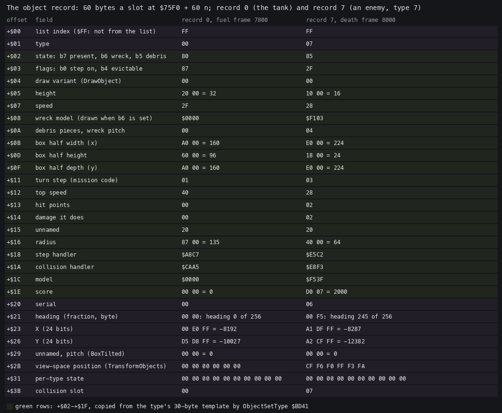

*Figure 7.4. Record 0 (the tank) in the fuel recording, sample of frame 7800, and record 7 (an enemy tank, type 7)
in the death recording, sample of frame 8000. Drawn by `python3 tools/fig_objects.py record
docs/img/objects/object-record.png --player work/docs/bcC/fuel-player.jsonl:7800 --other
work/docs/bcC/death-1.jsonl:8000:7`.*

How to read it:

- One row a field: its offset, its meaning and its bytes in both records.
- Green rows (+2 .. +`$1F`) come from the template; the others are set at the spawn or by the handlers.

The point: the record is the template plus a place. The first two bytes link it to the list, +`$20` is a serial
that tells a reused record from its previous owner, +`$21`-+`$28` are heading and position, +`$2B`-+`$30` the
view-space position the renderer fills, and +`$31`-+`$3A` are free for the type's own state (a shell's lifetime, a
spawner's three children, a unit's wander count).

The fields set outside the template:

| Offset | Field | Set by |
| --- | --- | --- |
| +0 | list index, `$FF` when not from the list | ActivateMissionObjects (its counter operand `$BC33`); `$FF` from the spawners and guns |
| +1 | type | ObjectSetType |
| +2 bit 6 | wreck | KillMissionObject `$B67D`; at a spawn, from the list's b1 |
| +2 bit 5 | in view this pass | TransformObjects `$BD98`; Debris `$B6D1` throws pieces only when it is set |
| +`$20` | serial | ObjectSetType: a running count, the operand of `LD A,n` at `$BD5E` |
| +`$21`-+`$22` | heading | CopyHeading `$BCBA` from the list, or the firer's |
| +`$23`-+`$28` | X, Y | CopyPosition `$BCC6` from the list words, or the spawner's |
| +`$2A` | pitch | BoxTilted models |
| +`$2B`-+`$30` | view-space x, height, depth | TransformObjects |
| +`$31`-+`$3A` | per-type state | the step handlers |
| +`$3B` | collision slot | RegisterCollision `$C957` |

The slots:

| Records | Use | Found by |
| --- | --- | --- |
| 0 | the player's tank (type 0, step PlayerStep `$A8C7`, hit PlayerHit `$CAA5`) | fixed |
| 1-20 | list objects, spawned units, projectiles | FindFreeObject `$BCDA` (D = `$15`) |
| 21-22 | also projectiles | FindProjectileSlot `$BCD6` (D = `$17`) |
| 21 (`$7ADC`) | the Helicarrier at the start and the end | PlaceHelicarrier `$D52E` |

## 7.8 The spawn and the free: ActivateMissionObjects

The world is bigger than the record table. ActivateMissionObjects `$BBF1` keeps records only for list objects near
the player. It runs once a pass from PlayLoop and walks 16 list records a call, so the 89 records of mission 1 take
six passes.

Its state is in its own operands:

- the list pointer and the count left (`LD HL,nn` at `$BBF1`, `LD C,n` at `$BBF9`);
- the list index of the record being looked at (`$BC33`);
- the player's coarse X and Y, patched into the `LD A,n` operands at `$BC12` and `$BC1D` before the walk.

For each record with b7 (alive), InRange `$BD67` takes |player coarse - list high byte| on each axis and compares it
with a range: 4 coarse units for type 0, 9 for every other type.

- In range and not spawned: FindSlot `$BCFD` gives a free record 1-20. When none is free it takes a record whose +3
  has b4 set and b6 clear (an enemy shell) and unregisters it. ObjectSetType copies the template. RegisterCollision
  gives a collision slot, unless the list record is destroyed. The list's b1 becomes the record's wreck bit b6. The
  list record gets b6 (spawned). CopyHeading and CopyPosition fill +`$21`-+`$28`.
- Out of range and spawned: the list record loses b6. The record whose +0 is the list index is found among records
  0-22, unregistered (vector 05) and freed (+2 = 0).
- Destroyed records (b7 clear) are skipped.

```text
ActivateMissionObjects():
    repeat 16 times:
        rec = list[index]
        if rec.alive:
            near = |player_cx - rec.x_hi| < R and |player_cy - rec.y_hi| < R    # R = 4 for type 0, else 9
            if near and not rec.spawned:
                obj = FindSlot()                     # a free record 1-20, or evict an enemy shell
                if obj:
                    obj.index = index; ObjectSetType(obj, rec.type)
                    if not rec.destroyed: RegisterCollision(obj)
                    obj.wreck = rec.destroyed
                    rec.spawned = 1
                    obj.heading = rec.heading; obj.xy = rec.xy << 2
            elif not near and rec.spawned:
                rec.spawned = 0
                obj = the record with obj.index == index
                Unregister(obj); obj.state = 0
        index += 1
        if index == count: index = 0; pointer = list start
```

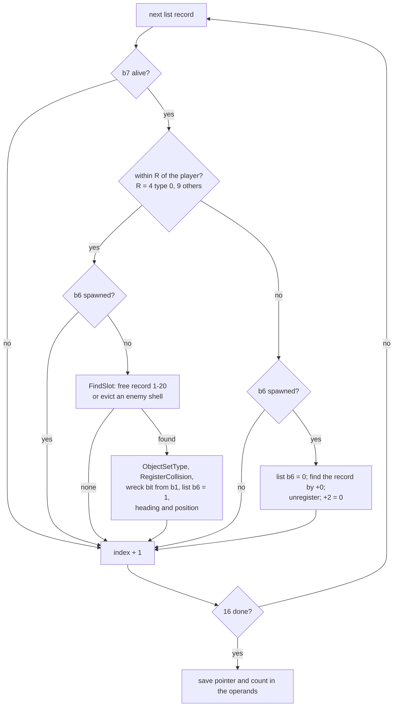

The range test and its two ranges:

```text
$BC11  LD A,$E4          ; operand $BC12: the player's coarse X (patched)
$BC13  LD C,(HL)         ; the list X high byte
$BC14  CALL InRange
$BC17  JP C,$BC86        ; out of range: the despawn path
...
InRange:
$BD67  AND A
$BD68  SBC A,C           ; player - object, signed
$BD69  JP PO,$BD6E
$BD6C  CCF
$BD6D  RRA               ; on overflow: halve, the carry as the sign
$BD6E  LD C,A
$BD6F  CALL ApiVector08  ; |A|
$BD72  EX AF,AF'         ; the type
$BD73  CP $01
$BD75  JR C,$BD7D        ; type 0: range 4
$BD77  EX AF,AF'
$BD78  CP $09            ; other types: range 9
$BD7A  LD A,C
$BD7B  CCF               ; carry = out of range
$BD7C  RET
```

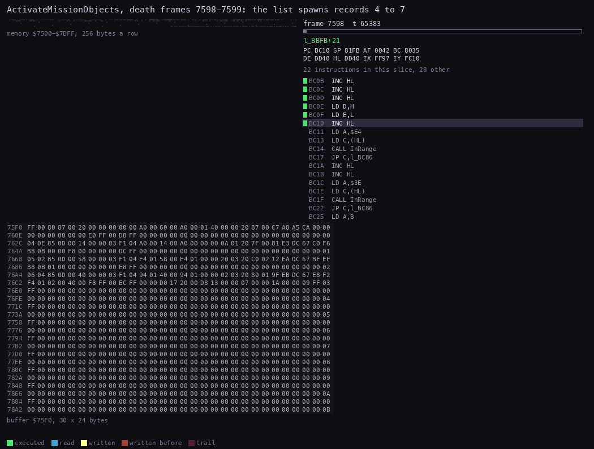

*Animation 7.1. ActivateMissionObjects in the death recording, frames 7598:65000 to 7599:28500 (a pass of the
mission start that spawns), 90 pictures. Drawn by `python3 ../../kit/routine_anim.py --work work/docs/bcC/death
--listing build/game.lst --window 7598:65000-7599:28500 --pc BBF1-BDA0,C957-C9FF --view buffer:75F0:30x24:hex --range
7500-7BFF --pictures 90 --out docs/img/routines/ActivateMissionObjects.gif`.*

How to read it:

- Right: the code running in each slice, the current instruction highlighted; "other" is code outside the ranges.
- Left: records 0-11 of the object table, 30 bytes a row, so two rows a record; yellow bytes are written in the
  slice.
- Records 4 to 7 (`$76E0`, `$771C`, `$7758`, `$7794`) fill one after the other: the template, the serial, heading
  and position.

Witness: in the death recording the first list objects spawn in frames 7594-7612. The call traced above runs 16
range tests in frame 7598 (`$BD72-$BD6F` repeated from T 65 487), then ObjectSetType at 7599:20, RegisterCollision at
7599:8376, and ends at 7599:28404. In the sample of frame 16 000 list record 26 (type 32) is destroyed and its wreck
in record 8 stands 16.6 coarse units from the tank: a destroyed record is never despawned, because the walk skips it.

The point: a sliding window. Only objects within 9 coarse units (4 for trees) have records, so 24 records serve a
list of 89. The price is the wreck leak: a wreck keeps its record for the rest of the mission
([doc 10.13](10-gameplay-logic.md#1013-notable-features)).

## 7.9 The object kinds as state machines

RunObjectHandlers `$C026` calls, once a pass, the step handler (+`$18`) of each record with +2 b7 and +3 b0 set,
with IX = the record. CollisionPass (section 7.10) calls the collision handlers (+`$1A`) in pairs. Every kind below
is a pair of handlers.

### The scenery: trees, hills, buildings

Trees (types 0, 1), hills (20-23) and plain buildings have the step `$E39B`, a `RET`, and +3 b0 clear: they never
step. Their hit handler decides what a hit does.

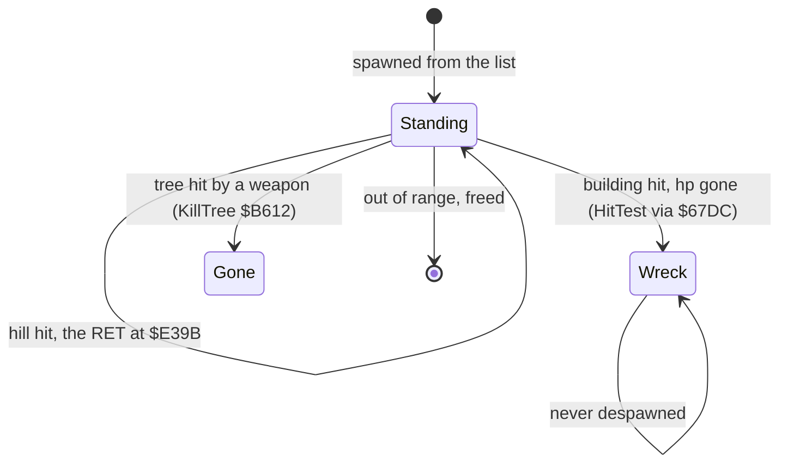

### The spawners: depots, buildings, the flag

Types 4 and 6 (step `$EB77`), type 19, the flag (step `$EB7C`), and the entry `$EB72` keep three children each. A
spawner's +`$31`-+`$36` holds three pairs (record index, serial). The handler `$EB9F` checks the pairs: when a
record is empty or holds another serial, the child is dead, and the spawner makes a new one with `$EBE5`.

```text
SpawnerStep(spawner, kinds):     # kinds: $EB58 = 7, 26, 9 (types 4, 6); $EB54 = 30, 26, 29 (flag); $EB5C = 7, 30, 29
    for k in 0, 1, 2:
        (index, serial) = spawner.children[k]
        obj = record[index]
        if obj.state == 0 or obj.serial != serial:
            new = FindFreeObject()
            if new:
                ObjectSetType(new, kinds[k]); RegisterCollision(new)
                new.index = $FF
                new.x = camera.x + Random offset of about 3 coarse units
                new.y = camera.y + Random offset
                spawner.children[k] = (number of new, new.serial)
```

The children appear around the camera (`$67A8`/`$67AB`), not around the spawner. A spawner keeps the player's
surroundings full of enemies as long as it has a record, that is while it is within 9 coarse units.

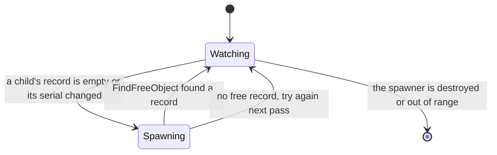

Witness: the three units of a type 4 or 6 spawner (table `$EB58`: 7, 26, 9) stand in records 7 (type 7), 8
(type 26) and 12 (type 9), each with +0 = `$FF`, in the sample of death frame 8000.

### The enemy units: tank and vehicles

The units are types 7, 9, 26, 29 and 30. Their hit handler is `$E8F3`; type 7's step is `$E5C2`. The mission code
has no labels in `game.ann`. The names below (`M1...`) come from the listing `work/docs/bcC/m1game.lst`, made for the
animation by `work/docs/bcC/scripts/m1lst.py`, and are proposed to the lead.

- **Chase** `$E5C2`: below 2 hit points, go to the wander start. Turn toward the player by up to 8 a pass
  (M1TurnToPlayer `$E555`, carry when aligned). Not aligned: return. Aligned: the fire check (M1FireCheck `$E79B`),
  speed up toward +`$12` (M1Accelerate `$E533`), MoveObject, the terrain turn (M1TerrainTurn `$E8D8`: off the road,
  turn by `$80`) and the leash (M1Leash `$E8C9`). Within `$258` world units of the player, go to Close.
- **Close** `$E5EF`: below 4 hit points, go to the wander start.
- **Wander start** `$E63F`: with 2 or more hit points, draw a count (+`$3A`, 0-63) and a heading (+`$39`), then
  wander (`$E68E`), return (`$E611`) and aim (`$E633`). Below 2: flee (`$E66E`).
- **Leash**: a unit more than `$0C00` world units (3 coarse units) from the camera on either axis is removed
  (+2 = 0). Its spawner makes a new one.
- **Hit** `$E8F3`: a hitter with +3 b6 (a weapon) goes to HitTest; any other collision starts an avoidance turn
  (`$E965`).

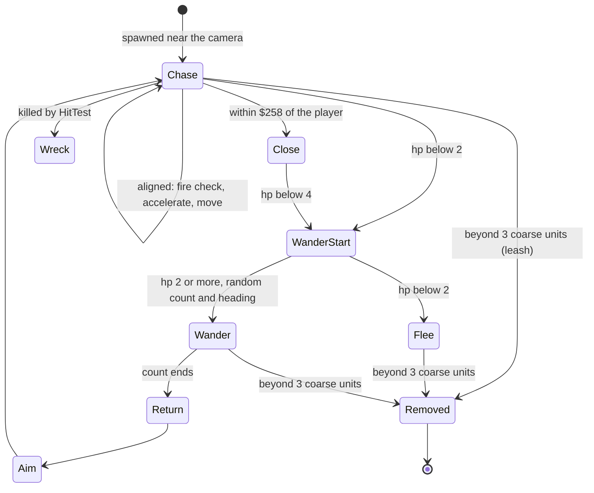

The turn, as the trace shows it:

```text
M1TurnToPlayer:
$E555  EXX
$E556  LD IY,$75F0       ; the player
$E55A  CALL $67C1        ; BearingTo: A = the bearing to IY
$E55D  EXX
$E55E  LD D,$02
$E560  LD E,$08          ; the largest turn a pass
$E562  LD C,(IX+$22)     ; the heading
$E565  AND A
$E566  SBC A,C           ; the difference
$E567  LD B,A
$E568  CALL $67D6        ; |difference|
$E56B  CP E
$E56C  JR NC,$E57F       ; 8 or more: turn by 8, no carry
$E56E  LD E,A            ; less: snap onto the bearing
...
$E57A  LD (IX+$22),A
$E57D  SCF               ; aligned
$E57E  RET
```

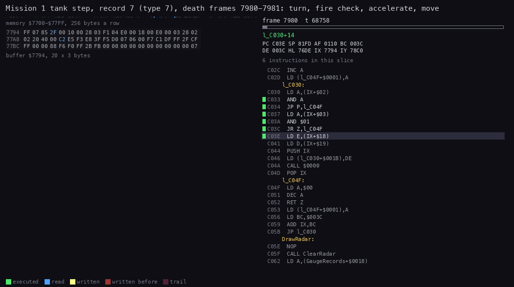

*Animation 7.2. The step of record 7 (type 7, `$7794`) in the death recording, frames 7980:68700 to 7981:700, 50
pictures. Drawn by `python3 ../../kit/routine_anim.py --work work/docs/bcC/death --listing work/docs/bcC/m1game.lst
--window 7980:68700-7981:700 --pc E381-EC56,BFD1-C060 --view buffer:7794:20x3:hex --range 7700-77FF --pictures 50
--out docs/img/routines/M1TankChase.gif`.*

How to read it:

- Left: the 60 bytes of record 7, 20 a row: the heading at +`$22` (row 2, byte 14), X at +`$23`-+`$25`, Y at
  +`$26`-+`$28`.
- Right: M1TankChase calls M1TurnToPlayer, M1FireCheck, M1Accelerate, then MoveObject `$BFD1`.

Witness: in the samples of record 7 the heading falls 247, 246, 245, 244 ... by one every pass while the position
advances (frames 7980-8057, `death-1.jsonl`): the unit is within 8 of its bearing, so it snaps onto it each pass and
moves. Record 12 (type 9) is removed in frame 8625, record 8 (type 26) in 8963 and record 7 in 9044, each about 3.3
coarse units from the camera: the leash.

The point: the enemies are short-lived and local. They are made near the camera, they chase, and they vanish when
the player gets 3 coarse units away. The threat follows the player instead of waiting at its post.

### The enemy shells and the gun emplacement

The gun emplacement (type 14, step `$E381`) turns toward the player like a tank and fires type 24 (`LD A,$18`,
M1Fire `$E7A2`). The depot with a gun (type 11, step `$E38E`) fires type 12. A unit's M1FireCheck fires its own
type + 1 (7 fires 8, 9 fires 10, 30 fires 31).

M1Fire counts a cooldown down in its own operand (`LD A,n` at `$E7A9`). That operand is one byte for every firer:
the whole mission shares one gun timer. At 0 M1Fire draws a new count, 8-39 passes (Random AND `$1F` OR 8), takes a
free record (FindFreeObject), sets the type and registers it, and gives the shell the firer's heading, position and
a lifetime of `$1E` passes at +`$31`.

The shell step M1ShellStep `$EB04` counts +`$31` down and moves the shell; at 0 it frees it. The shell's hit handler
`$E39C` frees it too. Type 28 (step `$EAAA`) is a homing shell: after its first pass its step becomes `$EACE`, which
runs M1ShellStep and then TurnToward `$C485` with IY = the player.

```mermaid
stateDiagram-v2
  [*] --> Flying: M1Fire, the shared cooldown at 0
  Flying --> Flying: lifetime - 1, MoveObject; type 28 also turns to the player
  Flying --> [*]: lifetime 0, freed
  Flying --> [*]: hits anything, $E39C frees it
  Flying --> [*]: evicted by FindSlot for a list object
```

Witness: in death frame 8121 the shell in record 15 (type 28, height 64, damage 4) hits the tank; it is gone in the
sample of frame 8122. Records 16 and 18 (types 8 and 10, flags `$17`) fly at speed 64 at the same time.

The point: the enemies' shells are the only objects a list object may push out (flags b4 set, b6 clear), so a
building near the player is never refused for lack of records.

### The player's projectiles

A player's projectile is a resident type (`$80-$8C`, section 7.5), spawned by its store's fire routine
([doc 10.7](10-gameplay-logic.md#107-the-weapons)). The turret shell `$81` has the step `$B592`: MoveObject, a
lifetime of 100 passes at +`$31`, freed at 0. Its hit handler `$B8AB` (Explode) throws debris and frees it.

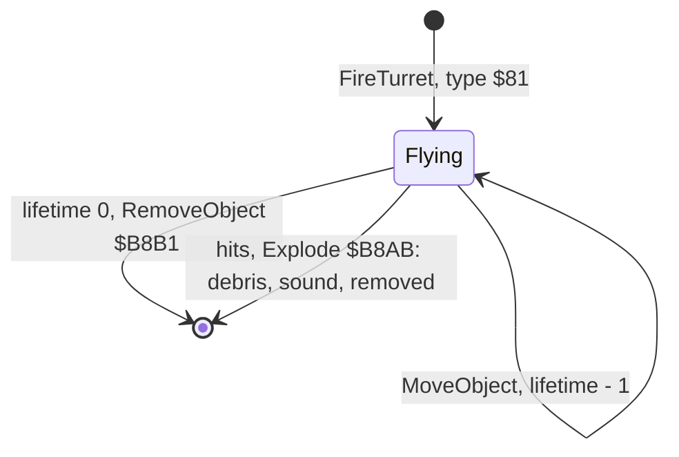

## 7.10 Collisions: CollisionPass

CollisionPass `$C7BC` runs once a pass. It tests pairs of registered records, not all records, and not every pair
every pass.

The tables, CollisionTables `$C648`:

- `$C648-$C774`: a triangular table, one byte a pair. Row r holds r bytes, one for each pair (r, c) with c < r. A
  byte with b7 set means no test (one of the two is not registered); b7 clear is the pass number when the pair is
  due.
- `$C775-$C78B`: the slot list, 23 bytes, the record number with b7 set when registered.
- `$C78C`: 24 row pointers.

The pass counter is the operand of `LD A,n` at `$C7BC`, incremented modulo 128 at the end of every pass. A pair is
tested when its byte equals the counter.

For a due pair (IX, IY):

1. dx = |X(IX) - X(IY)| and dy = |Y(IX) - Y(IY)|, on the low 16 bits of the positions.
2. The distance estimate: d = max(dx, dy) + min(dx, dy) / 2 - radius(IX) - radius(IY).
3. When d is 0 or more the pair is apart. The next test is scheduled: d is halved once for each bit of
   (top speed(IX) + top speed(IY)). A result of 128 or more stores `$7F`. Otherwise n = d (the `CP $06` test does
   nothing: both of its branches load L), 0 becomes 1, and the byte becomes counter + n modulo 128.
4. When d is negative the boxes are tested: dx < half x(IX) + half x(IY), dy < half y(IX) + half y(IY) and
   |height(IX) - height(IY)| < half height(IX) + half height(IY). dx and dy were stored in the operands of the
   `LD HL,$0000` at `$C8BE` and `$C8D5`.
5. All three true: a hit. IX's collision handler is called with IY as the other, then IY's with IX.
6. After a box test the byte becomes counter + 1 (tested again next pass), unless a handler set b7.

```text
CollisionPass():
    for r in registered slots:
        for c in 0 .. r-1:
            if timer[r][c] has b7 or timer[r][c] != pass: continue
            a, b = record[c], record[r]
            dx, dy = |a.x - b.x|, |a.y - b.y|              # low 16 bits
            d = max(dx, dy) + min(dx, dy) / 2 - a.radius - b.radius
            if d >= 0:
                s = a.top_speed + b.top_speed
                repeat: d >>= 1; s >>= 1 until s == 0
                timer[r][c] = $7F if d >= 128 else (pass + max(d, 1)) mod 128
                continue
            if dx < a.bx + b.bx and dy < a.by + b.by and |a.h - b.h| < a.bh + b.bh:
                a.on_hit(other=b); b.on_hit(other=a)
            if timer[r][c] has no b7: timer[r][c] = (pass + 1) mod 128
    pass = (pass + 1) mod 128
```

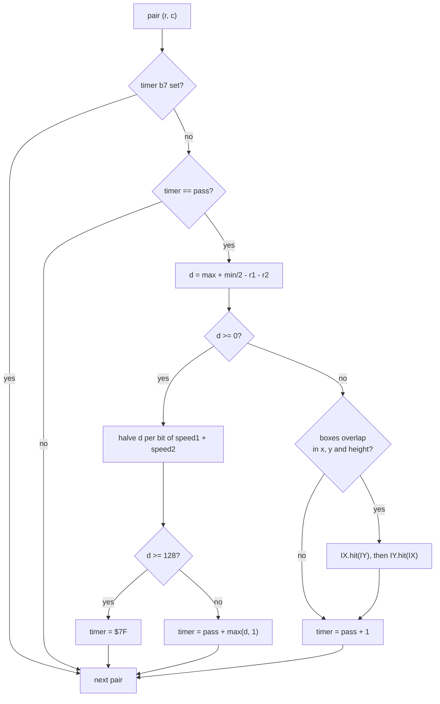

The estimate and the schedule:

```text
$C85E  SRA D
$C860  RR E              ; min / 2
$C862  ADD HL,DE         ; max + min / 2
$C863  LD C,(IX+$16)
$C866  LD B,(IX+$17)
$C869  AND A
$C86A  SBC HL,BC         ; - radius 1
$C86C  LD C,(IY+$16)
$C86F  LD B,(IY+$17)
$C872  AND A
$C873  SBC HL,BC         ; - radius 2
$C875  JP M,$C8AF        ; negative: the box test (the Immunity POKE writes 58 here)
$C878  LD A,(IX+$12)
$C87B  LD C,(IY+$12)
$C87E  ADD A,C           ; the speed sum
$C87F  SRL H
$C881  RR L              ; d / 2
$C883  SRL A
$C885  JP NZ,$C87F       ; once per bit of the sum
$C888  LD A,L
...
$C892  LD A,$7F          ; far: the pair waits for pass 127
$C894  JR $C8A9
$C896  LD A,L
$C897  CP $06
$C899  JP C,$C89D        ; both ways A = L
$C89C  LD A,L
$C89D  AND A
$C89E  JP NZ,$C8A2
$C8A1  INC A             ; 0 becomes 1
$C8A2  LD H,A
$C8A3  LD A,(CollisionPass+1)
$C8A6  ADD A,H
$C8A7  AND $7F           ; pass + n
```

Worked example: the hit of death frame 8121. The sample of frame 8121 holds the tank (record 0) at X = -9558,
Y = -9678, height 32, radius 135, half sizes 160, 96, 160, and the type 28 shell (record 15) at X = -9283,
Y = -9662, height 64, radius 1408, half sizes 128, 128, 128.

1. dx = 275, dy = 16.
2. d = 275 + 8 - 135 - 1408 = -1260: negative, so the boxes are tested.
3. x: 275 < 160 + 128 = 288. True.
4. y: 16 < 160 + 128. True.
5. Height: |32 - 64| = 32 < 96 + 128. True.
6. The pass calls PlayerHit `$CAA5` (the tank's handler) with IY = the shell, then `$E39C` (the shell's) with IY =
   the tank. The shell is freed; the top armour loses 4
   ([doc 10.5](10-gameplay-logic.md#105-damage-playerhit-the-armour-and-the-subsystems)).

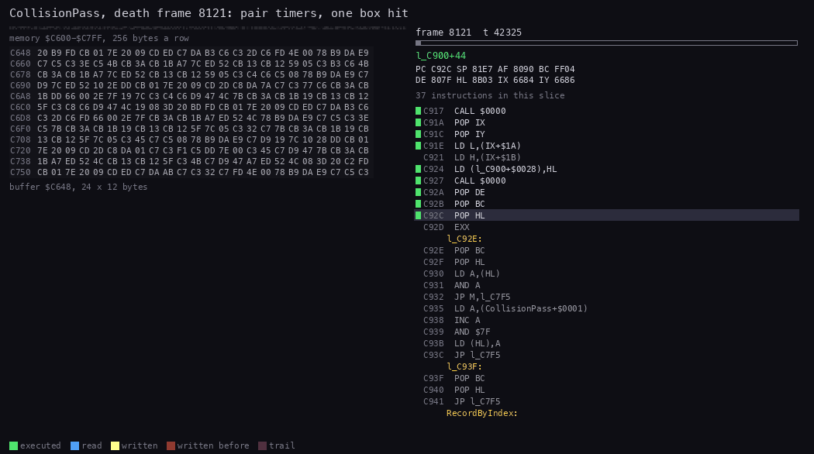

*Animation 7.3. CollisionPass in the death recording, frame 8121, T 42 000 to 68 000, 80 pictures. Drawn by
`python3 ../../kit/routine_anim.py --work work/docs/bcC/death --listing build/game.lst --window 8121:42000-8121:68000
--pc C7BC-C956 --view buffer:C648:24x12:hex --range C600-C7FF --pictures 80 --out
docs/img/routines/CollisionPass.gif`.*

How to read it:

- Left: the pair timers from `$C648`, 24 a row. Bytes 0-127 are due passes; bytes with b7 set are pairs not tested.
- A yellow byte is a timer written in the slice.
- The run of `$FF` written at `$C6C0` is the shell's row cleared by its hit handler (UnregisterCollision).
- Right: the code; at T 58 570 the pass leaves for PlayerHit and returns at T 59 219.

Witness: the trace of frame 8121 runs the pass from T 42 866 to 67 574, with the two handler calls at T 58 570
(`$C900-$CAB3`) and T 60 500 (`$C92A`) (`work/docs/bcC/pc-hit.txt`). CollisionPass has L1 3550 in the stage 1 builds,
one a pass.

The point: the timers turn an n-squared test into a few tests a pass. Two objects 1000 world units apart with top
speeds 40 and 0 halve the distance six times (40 has six bits) and wait 15 passes before the next test: the closer
and faster, the sooner. A far pair gets `$7F`, an absolute pass number, so it waits until the counter comes round to
127, up to 128 passes.

## 7.11 The player's state

The player is record 0, so most of its state is fields of that record. The rest is in fixed bytes.

| Address | Size | Field | Format | Range |
| --- | --- | --- | --- | --- |
| `$75F5` | 2 | height (+5) | world units | 32 on the ground |
| `$75F7` | 1 | speed (+7) | signed, scaled by sin and cos of the heading | -23 to 47 |
| `$7611`-`$7612` | 2 | heading (+`$21`, +`$22`) | fraction, byte | 0-255 |
| `$7613`-`$7615` | 3 | X (+`$23`) | 24-bit signed world units | |
| `$7616`-`$7618` | 3 | Y (+`$26`) | 24-bit signed world units | |
| `$7608` | 2 | step handler (+`$18`) | PlayerStep `$A8C7`; BounceDecay `$CC09` after a wall | |
| `$7C57` | 2 | Fuel | 16 bits | 16 128 (`$3F00`) at the start |
| `$8301`-`$8303` | 3 | armour, sides 1-3 (2 is the front) | byte | `$7F` at the start |
| `$8304` | 1 | armour, top | byte | `$7F` |
| `$68E2`-`$68E5` | 4 | the mission's score | 32-bit | |
| `$68E8` | 1 | goal flag | `$FF` when the goal is met | 0 or `$FF` |
| `$68EB`, `$68EC` | 2 | mission clock: minutes, hours | binary | from `$DBFE` |
| `$7BF9` | 2 | failure cause | the address of the failure text | 0 while playing |
| `$CC79` (bank 6) | 4 | Score: the missions completed | 32-bit | |
| `$6799`-`$67A1` | 9 | MissionsDone | `$FF` a mission | |

StoresToGauges `$CC1B` (bank 6) sets the fuel to 16 128 and the four armour bytes to `$7F` when the mission starts.

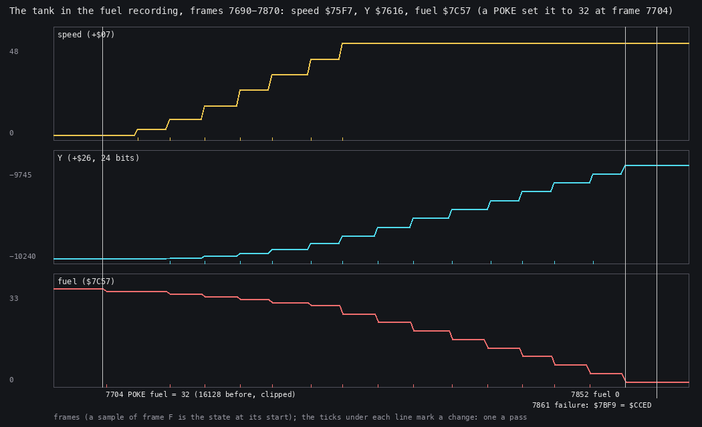

*Figure 7.5. Record 0's speed and Y and the fuel word in the fuel recording, samples of frames 7690-7870
(`work/docs/bcC/fuel-player.jsonl`). Drawn by `python3 tools/fig_objects.py player docs/img/objects/fuel-chart.png
--samples work/docs/bcC/fuel-player.jsonl --from 7690 --to 7870`.*

How to read it:

- Three panels on one frame axis: the speed (+7), Y (+`$26`) and the fuel `$7C57`, clipped at 33 (it was 16 128
  before the POKE at frame 7704).
- The ticks under each line mark the frames where the value changed: one tick a pass.
- The vertical lines: the POKE (7704), the fuel at 0 (sample 7852), the failure cause set (sample 7861).

The point: the fuel falls by (|speed| >> 4) OR 1 each pass that the tank moves: 1 a pass below speed 32 (the OR
turns 1 into 1), 3 at 32-47. The speed grows by 8 a pass while Q is held, from 3 up to the limit 47. Y grows by about 47 a pass
at full speed, since the heading is 0. The first pass whose cost is more than the fuel left sets the failure cause
([doc 10.2](10-gameplay-logic.md#102-the-tank-playerstep)).

## 7.12 The weapon slots and the weapon records

The tank carries four weapon modules. The stores screen (bank 6) fills them; the play code reads them.

| Address | Size | What |
| --- | --- | --- |
| `$8368` | 4 x 6 | the four loaded slots: +0 store type (1-13), +5 rounds left |
| `$834A` | 4 x 6 | the stores screen's slot records: FitOrRemoveWeapon writes the type and the weight there; PlayerHit's quirk reads the first (doc 10.5) |
| `$8338` | 9 x 2 | the subsystem gauge pointers, three per side (doc 10.5) |
| `$C534` | 4 x 2 | the slots' rounds pointers |
| `$C53C` | 1 | the current slot |
| `$7B89` | 13 x 8 | the store-type table: aim, aim 2, fire, select of type n at `$7B89 + 8 n` |
| `$C373` (bank 6) | 13 records | WeaponRecords: store type, rounds, the most fitted, weight |

WeaponRecords, read from bank 6:

| Store | Type | Rounds | Most fitted | Weight (kg) |
| --- | --- | --- | --- | --- |
| Turret | 4 | 80 | 1 | 400 |
| Banshee RRSS | 2 | 8 | 2 | 300 |
| Banshee IRSS | 6 | 6 | 2 | 300 |
| Phoenix RRSA | 1 | 8 | 2 | 250 |
| Phoenix IRSA | 5 | 6 | 2 | 250 |
| K-40 Mortar | 3 | 20 | 2 | 250 |
| Sleeper mine | 9 | 5 | 2 | 300 (the stores text says 290) |
| Dragonfly | 7 | 3 | 2 | 500 |
| K-90 Cluster | 8 | 20 | 4 | 250 |
| Spectre | 13 | 12 | 2 | 100 |
| Phantasm | 12 | 8 | 2 | 100 |
| Skeet bomb | 11 | 12 | 2 | 200 |
| SLAM Laser | 10 | 40 | 1 | 250 |

FitOrRemoveWeapon `$C173` (bank 6) refuses a store when the count would pass "most fitted" or the payload would
reach 1001 kg ([doc 10.7](10-gameplay-logic.md#107-the-weapons)).

The point: a slot is just a store type and a count. The type indexes the store-type table, whose four words are the
routines for aiming, firing and selecting; the fire key calls the third word through the operand at `$A9B9`.

## 7.13 The random-number generator

Random `$A779` (the mission vector `$67D0`) keeps three 16-bit words in its own operands: w1 at `$A77C`, w2 at
`$A77F`, w3 at `$A787`. Each call steps them like a Fibonacci sequence and mixes in the refresh register R.

```text
Random():
    s  = w1 + w2
    w1 = w2
    w2 = w3
    w3 = w3 + s
    return (low(w3) XOR high(w3)) + R
```

```text
Random:
$A779  PUSH HL
$A77A  PUSH DE
$A77B  LD DE,$04D2       ; w1
$A77E  LD HL,$0ECA       ; w2
$A781  LD (Random+3),HL  ; w1 = w2
$A784  ADD HL,DE         ; s = w1 + w2
$A785  EX DE,HL
$A786  LD HL,$250B       ; w3
$A789  LD (Random+6),HL  ; w2 = w3
$A78C  ADD HL,DE         ; w3 + s
$A78D  LD (Random+14),HL ; w3 = w3 + s
$A790  LD A,L
$A791  XOR H
$A792  LD H,A
$A793  LD A,R
$A795  ADD A,H           ; + R
```

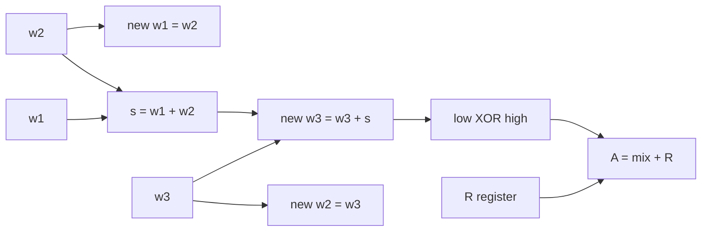

Worked example, from the words in the image (w1 `$04D2`, w2 `$0ECA`, w3 `$250B`):

1. s = `$04D2` + `$0ECA` = `$139C`.
2. New w1 = `$0ECA`, new w2 = `$250B`.
3. New w3 = `$250B` + `$139C` = `$38A7`.
4. `$A7` XOR `$38` = `$9F`; A = `$9F` + R.

Its users: the spawners' offsets, the units' wander counts and headings, the shared gun cooldown (8-39), the subsystem
PlayerHit damages, the debris velocities.

Witness: Random has L1 584 in six recordings (c1, death, m2erbe, missions, play, play2).

The point: R makes the game unrepeatable from the keys alone. R counts instruction fetches, so any change in the code
path changes every random number after it. The armour recording, played with the death recording's keys but with
another armour gauge to draw, met its first hit in frame 18423 instead of 8121.
