# 8. HUD and text

What this covers:

- the text printer PrintString: its control codes, its patched calls and its tokens (8.1);
- the 8 x 8 printer PrintChar and the two fonts (8.2);
- the small font: 6-pixel cells over 8-pixel bytes, four shift routines (8.3);
- the numbers: three digits from code 8, five and ten digits in bank 6, the dotted score (8.4);
- the cockpit panel: every field with its address, its format and its routine, and what one frame redraws (8.5);
- the messages: TANK HIT, COLLIDED and the 100-tick timer (8.6);
- the menu screens: the catalogue, the briefing, the status card, the end screens, the options (8.7);
- the load / save code entry: the line editor, the raw printer, the alphabet (8.8);
- the data sheet of every text kept as data (8.9), what is known only from the code (8.10) and the point (8.11).

The names are those of `src/game/game.ann` and `src/bank6/bank6.ann` ([Terms](README.md#terms)). The recordings are
those of [WALKTHROUGH 6.0](../WALKTHROUGH.md#60-the-recordings), all on the 128K. Each was opened from its stage-1 TTD
session on the writer's own instance (port base 37380, muted):

- `menu` (`work/stage1/rec/menu`, frames 0-10 996): the options (frame 95), the load code typed (1874), the catalogue
  (6206), the ten missions chosen and briefed (6287-10 499), the status card (10 686) and the save code (10 817). The
  briefing of mission 1 is printed in frames 6396-6401.
- `death` (`work/stage1/rec/death`, frames 0-20 038): Blast Em Mission in play. The shot of frame 8093 lowers the
  ammunition from 79 to 78 and reprints `AMM:078`. A hit at frame 8121 prints `TANK:HIT`, which the timer clears in
  frame 8230.
- `play2` (`work/stage1/rec/play2`): the L1 counts of the token branch (8.1) and of the view names.

A frame is 70 908 T, one interrupt a frame, 20 ms. A moment is written "frame F T t". A trace puts an instruction in
the frame in which it ran. A memory value "at frame F" is read with `time_travel memory_at` and a frame alone: it is
the value at the start of frame F. A screen picture of frame F is the screen at the start of that frame.

Every printer call of a window was taken from access traces of the same instances. The animations come from
`R/kit/routine_anim.py`, the writers figure from `R/kit/writers_map.py`. The static figures are drawn by
`tools/fig_text.py` from `build/game.bin` (`$5B00-$FFFF`: banks 5, 2 and 0), `build/bank6.bin` and the stage-1
screenshots.

```bash
. work/env.sh
python3 ../../kit/rs.py open --work work/docs/bcD/menu  --ttd work/stage1/rec/menu/session.ttd  --model 128K --port-base 37380
python3 ../../kit/rs.py open --work work/docs/bcD/death --ttd work/stage1/rec/death/session.ttd --model 128K --port-base 37380
python3 tools/fig_text.py list                       # the data sheet of 8.9 as markdown
python3 tools/fig_text.py fonts docs/img/text/fonts.png
python3 ../../kit/rs.py stop --work work/docs/bcD/menu
python3 ../../kit/rs.py stop --work work/docs/bcD/death
```

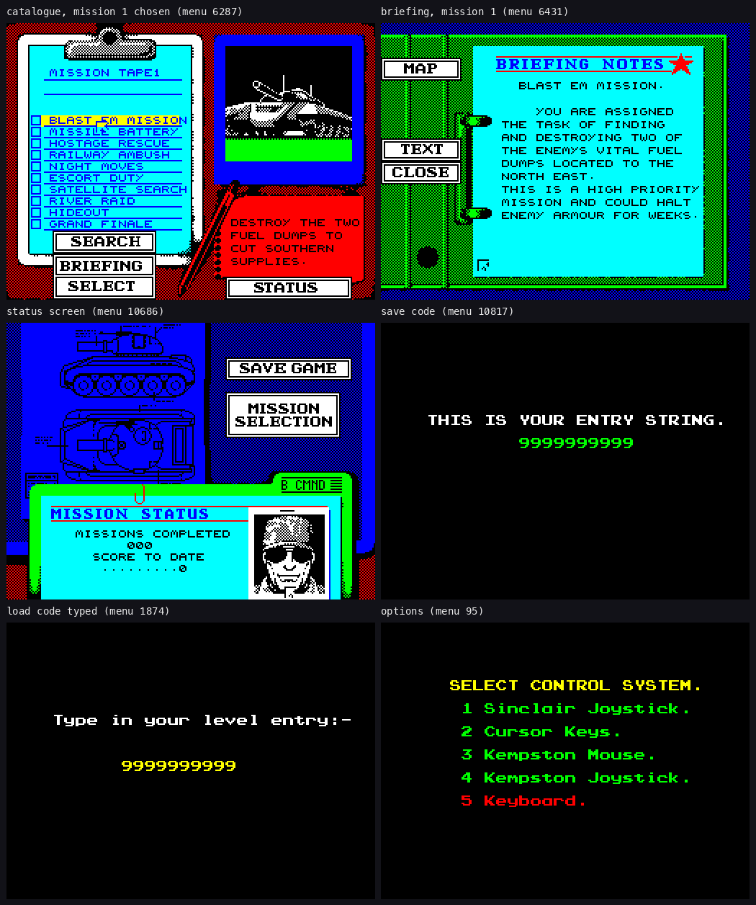

*Six text screens of the `menu` recording, from its stage-1 screenshots (frames 6287, 6431, 10 686, 10 817, 1874 and
95), at 2 x. Command, from the case folder after `. work/env.sh`: `python3 tools/fig_text.py screens
docs/img/text/screens.png`.*

How to read the figure:

- **Each panel** is one screenshot, labelled with what it is and its frame. Each is the screen at the start of that
  frame.
- **The catalogue and the briefing** use the small font: capitals only, blue on cyan or black on red. The headings
  and buttons are part of the pictures, not text.
- **The status card** mixes both: `MISSION STATUS` is a picture, the numbers below are small-font text. The dots of
  `.........0` are the score's leading zeros.
- **The save and load codes and the options** are 8 x 8 text on a black screen, with lower case and coloured lines.
- **The point**: the game has two fonts and one printer. Everything readable on these screens, apart from the
  picture headings, goes through PrintString or its raw cousin of 8.8.

## 8.1 PrintString and its control codes

PrintString `$6FB3` prints a string of bytes ending in `$FF`. A byte below `$20` is a control code. A byte from `$20`
to `$81` is a character. A byte from `$82` to `$FE` is a token: the number of another string. The printer keeps no
state in variables. Its whole state is in the operands of its own instructions: the line, the column, the margin,
the colour, and the glyph routine itself.

| Code | Routine | Operands | What it does |
| --- | --- | --- | --- |
| 0 | CodeColumn `$6EA7` | column | the 8 x 8 column (PrintChar+8) |
| 1 | CodeAt `$6EB3` | line | the pixel line L of the 8 x 8 font: its row pointer ScreenRowTable `$6500` + 2L, its attribute row `$5800` + 4L; selects PrintChar |
| 2 | CodeAtColumn `$6EAE` | line, column | code 1, then code 0 |
| 3 | CodeNumberA `$6EFB` | none | three digits of a constant `$5E` ("094") |
| 4 | CodeHex `$6F17` | none | two hex digits of the same constant ("5E") |
| 5 | CodeSmallChars `$6DA6` | column | the small font's column in 6-pixel cells; the font is not switched |
| 6 | CodeSmallAt `$7029` | line | the small font's line; selects PrintSmallChar |
| 7 | CodeSmallFont `$6DA1` | line, column | code 6, then code 5 |
| 8 | CodeNumber `$6EF1` | address (2 bytes) | the byte at the address as three decimal digits |
| 9 | CodeLeftMargin `$6F79` | column | the margin a new line starts at |
| 10 | SmallNewLine `$6F67` | none | the small font's line 9 pixel lines down, column = the margin |
| 11 | CodeNewLine `$6F4D` | none | the 8 x 8 line 8 pixel lines down, column = the margin |
| 12 | CodeMarginHere `$6F80` | none | the margin = the current 8 x 8 column |
| 13 | CodeInk `$6F88` | attribute | the attribute PrintChar writes |
| 14-17 | none | none | ControlCodes holds `$0000`: CALL `$0000`, a reset |

Code 1 takes a pixel line, not a character row. ScreenRowTable holds the screen address of each of the 192 pixel
lines, so the 8 x 8 printer can start on any line. Its attribute row is right only for lines that are multiples of 8.
Every string of the game uses such lines.

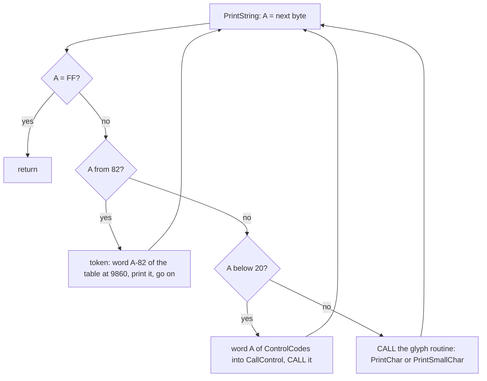

```asm
PrintString:                    ; $6FB3
  LD A,(HL)
  INC HL
  CP $FF
  RET Z                         ; the end
  CP $82
  JR NC,l_6FDB                  ; a token
  CP $20
  JR C,l_6FC6                   ; a control code
  EXX
  CALL PrintChar                ; $6FC1: the operand $6FC2 is PrintChar or PrintSmallChar
  JR PrintString
l_6FC6:
  EXX
  LD HL,ControlCodes            ; $6F8F
  ADD A,A
  LD C,A
  LD B,$00
  ADD HL,BC
  LD E,(HL)
  INC HL
  LD D,(HL)
  LD (CallControl+$0001),DE     ; patch the CALL below
CallControl:
  CALL CallControl              ; $6FD6
  JR PrintString
```

```text
PrintString(p):
    loop:
        a = mem[p]; p += 1
        if a == 0xFF: return
        if a >= 0x82: PrintString(word(0x9860 + 2 (a - 0x82))); continue
        if a < 0x20:  ControlCodes[a](p)     # reads its operands from p, advances p
        else:         glyph(a)               # PrintChar or PrintSmallChar, set by codes 1 and 6
```

The string pointer lives in HL' while a glyph routine runs: `EXX` swaps it away and the routine works on HL, DE and
BC. A control routine starts with `EXX` and reads its operands from the string with `LD A,(HL)` / `INC HL`.

**The tokens are never used.** The word table at `$9860` would start with the spare bytes after StepY `$985F` and
run on into KeyTable `$9862`, the five control keys of ReadKeys (doc 05): its words are no string addresses. The branch at `$6FBA` is taken 0 times in 3797 runs of `play2` (L1), and no
string of the game has a byte from `$82` to `$FE` before its `$FF`.

**Worked example: the goal of mission 1 on the catalogue.** PrintMissionDescription `$D06C` first prints DescriptionPos
`$D09A`, `09 22 07 88 12 FF`, then the goal string from the catalogue:

```text
09 1A                      code 9: the margin = 26 small cells
07 88 1A                   code 7: line $88 = 136 (row pointer $6500 + 272 = $6610), small font, column 26
44 45 53 ... 4F            "DESTROY:THE:TWO"   (":" is the small font's blank)
0A                         code 10: line 145, column = 26
46 55 45 ... 4F            "FUEL:DUMPS:TO"
0A 43 55 ... 4E            line 154, "CUT:SOUTHERN"
0A 53 55 ... 5B            line 163, "SUPPLIES["       ("[" is the small font's full stop)
FF                         the end
```

Column 26 is pixel 26 x 6 = 156: byte 19, offset 4. The first glyph, `D` (`$44`), is at SmallFont `$7C59` + 5 x (`$44`
- `$30`) = `$7CBD`. The four lines land at pixel lines 136, 145, 154 and 163. The catalogue panel of the screens figure
(menu 6287) shows them there, at x = 156, on the red notepad.

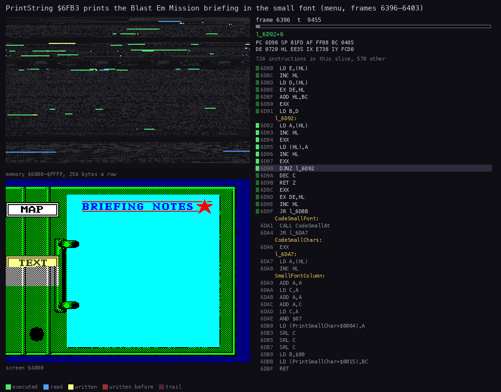

*PrintString `$6FB3` prints the briefing of mission 1 in the small font. `menu`, frames 6396-6403, 60 pictures. Command,
from the case folder after `. work/env.sh`: `python3 ../../kit/routine_anim.py --work work/docs/bcD/menu --window
6396:0-6404:0 --listing build/game.lst --view screen --range 6000-FFFF --pc 6CE4-7040 --pictures 60 --width 1050
--out docs/img/routines/PrintString.gif`.*

How to read the animation:

- **Left, the screen**: the briefing page grows a character at a time, line by line from the top.
- **The memory grid** `$6000-$FFFF`: the reads of the string at `$DCBC`, of SmallFont `$7C59-$7D34` and of
  ScreenRowTable `$6500`, and the writes to the screen.
- **Right**: the code of the slice. Most slices sit in PrintSmallChar and its four shift routines (8.3).
- **The point**: one call prints the whole page. It runs in the main code, so the interrupt cuts it four times.

Witness: BriefingScreen calls PrintString once, from `$C9E7`, at frame 6396 T 18 373 with HL = `$DCBC` (the text's
copy at `$DBF3`, pointed to by `$70A3`). The call returns 353 882 T later, at frame 6401: five frames. It prints 199
small characters and makes 12 calls of SmallNewLine.

The point: PrintString is a byte-code interpreter whose registers are its own operands. A string carries its place,
its font and its colour, so the caller only passes an address.

## 8.2 PrintChar and the two fonts

PrintChar `$6FF0` draws an 8 x 8 glyph. GlyphAddress `$6ED7` finds it at Font8x8 + 8 (c - `$20`). Font8x8 is in bank 6
at `$F5E4`, so the printer runs with bank 6 paged at `$C000`. The eight lines go to the eight words of ScreenRowTable
from the current line, each plus the column. Then one attribute byte, the colour of code 13, goes to the attribute row
plus the column, and the column moves on.

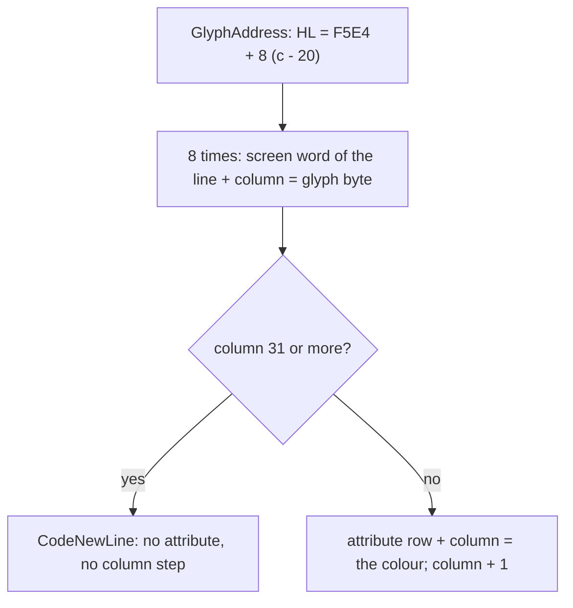

```asm
PrintChar:                      ; $6FF0
  CALL GlyphAddress
  LD B,$08
  EXX
  PUSH HL
  LD BC,$0000                   ; $6FF8: the column (codes 0, 2, 11, 12)
  LD HL,$0000                   ; $6FFB: the row pointer into ScreenRowTable (code 1)
  EXX
l_6FFE:
  LD A,(HL)                     ; a glyph line
  INC HL
  EXX
  LD E,(HL)                     ; the screen address of this pixel line
  INC HL
  LD D,(HL)
  INC HL
  EX DE,HL
  ADD HL,BC
  LD (HL),A
  EX DE,HL
  EXX
  DJNZ l_6FFE
  LD A,(PrintChar+$0008)
  CP $1F
  JR C,l_7018
  CALL CodeNewLine              ; column 31: a new line, no attribute
  POP HL
  RET
l_7018:
  LD BC,(CodeNewLine+$0010)     ; the attribute row
  LD H,$00
  LD L,A
  INC A
  LD (PrintChar+$0008),A
  ADD HL,BC
  LD A,$00                      ; $7025: the colour (code 13)
  LD (HL),A
  POP HL
  RET
```

A character in column 31 gets no attribute: PrintChar starts a new line instead. No string reaches column 31, so the
screen never shows it.

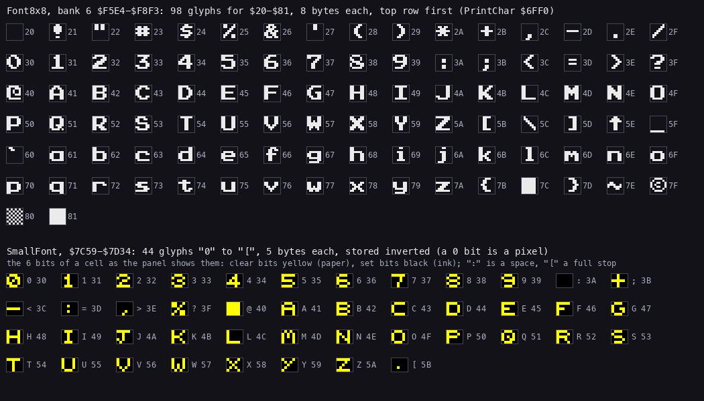

*Font8x8 (bank 6 `$F5E4-$F8F3`, 98 glyphs) and SmallFont (`$7C59-$7D34`, 44 glyphs), from the case's build, each glyph
with its code. Command, from the case folder after `. work/env.sh`: `python3 tools/fig_text.py fonts
docs/img/text/fonts.png`.*

How to read the figure:

- **Top, Font8x8**: 98 glyphs for `$20-$81`, the top row first. `$80` is a checker and `$81` a solid block: the map
  legends draw the road and the river with them (`$DAA1`, `$DAE1`). It has lower case; only the 8 x 8 texts use it.
- **Bottom, SmallFont**: 44 glyphs for `$30-$5B`, digits and capitals. Each is 5 bytes, stored inverted: a 0 bit is a
  pixel in ink. The panel's attributes are yellow paper on black ink, so the clear bits show yellow.
- **The small font's punctuation** sits on codes that look wrong. `:` (`$3A`) is the blank, `[` (`$5B`) the full stop,
  `@` (`$40`) a block. The texts are written with these codes: `MISSION:COMPLETE`, `SUPPLIES[`.
- **The point**: the big font is a full ASCII set for the menus. The small font is a 6-pixel panel font of 44
  glyphs, which is why every panel and briefing text is in capitals.

Witness: the build's `res/fonts/small-font.bin` and Font8x8 are the bytes the recordings read. GlyphAddress runs 6525
times in L1, PrintSmallChar 17 639 times.

The point: two printers share one interpreter. The font is not a parameter but a patched `CALL`.

## 8.3 The small font: four shifts

A small-font cell is 6 pixels wide, so four cells cover three bytes. SmallFontColumn `$6DA9` turns a column n into a
byte n x 6 / 8 and a pixel offset n x 6 AND 7: 0, 2, 4 or 6. PrintSmallChar `$6DE8` uses the offset as an index into
ShiftRoutines `$6E9F` and jumps to one of four routines. Each draws the glyph's 5 lines into one byte or two.
SmallFontAdvance `$6DC0` moves to the next cell: the offset becomes (offset - 2) AND 7, and the byte moves on unless
the offset was 0.

| Offset | Routine | Bytes touched | Median cost a character (`menu` 6396-6401) |
| --- | --- | --- | --- |
| 0 | l_6E08 `$6E08` | one: the glyph in the high 6 bits, `AND $03` keeps the 2 pixels on the right | 1195 T |
| 2 | l_6E84 `$6E84` | one: the glyph shifted right by 2, `AND $C0` keeps 2 pixels on the left | 1403 T |
| 4 | l_6E48 `$6E48` | two: 4 pixels in the first, 2 in the next | 2366 T |
| 6 | l_6E20 `$6E20` | two: 2 pixels in the first, 4 in the next | 1843 T |

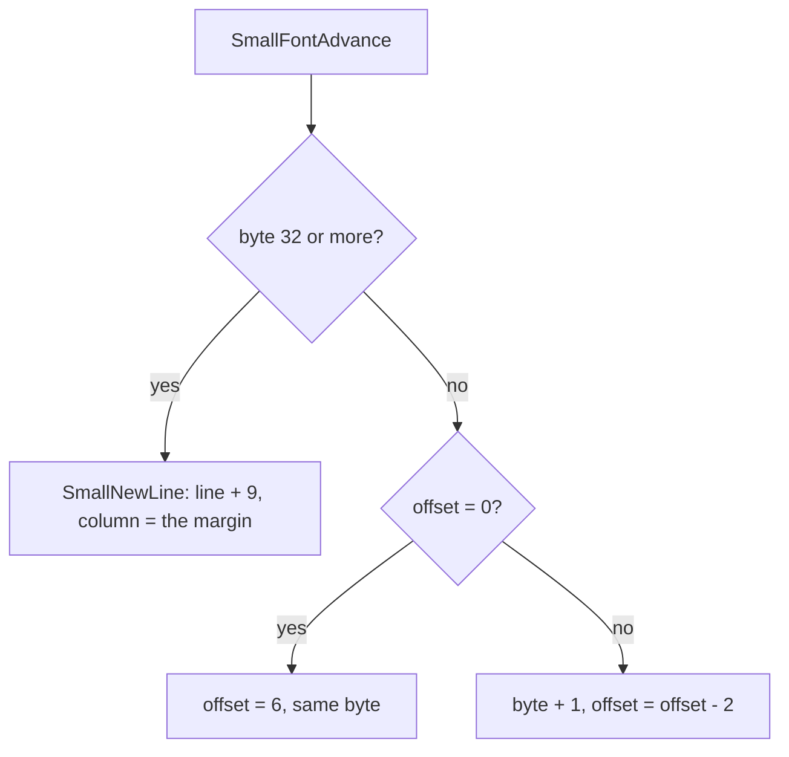

```asm
SmallFontColumn:                ; $6DA9  A = column in cells
  ADD A,A
  LD C,A
  ADD A,A
  ADD A,C                       ; A = 6 n
  LD C,A
  AND $07
  LD (PrintSmallChar+$0004),A   ; the offset: the index into ShiftRoutines
  SRL C
  SRL C
  SRL C
  LD B,$00
  LD (PrintSmallChar+$0015),BC  ; the byte column
  RET

SmallFontAdvance:               ; $6DC0
  LD A,(PrintSmallChar+$0015)
  CP $20
  JP NC,SmallNewLine
  LD A,(PrintSmallChar+$0004)
  AND A
  JR Z,l_6DD2
  LD HL,PrintSmallChar+$0015
  INC (HL)                      ; the next byte
l_6DD2:
  SBC A,$02                     ; carry is clear after AND A
  AND $07
  LD (PrintSmallChar+$0004),A
  RET
```

```text
cell(n):  byte = 6n >> 3, offset = 6n & 7
advance:  if offset != 0: byte += 1
          offset = (offset - 2) & 7          # 0 -> 6 -> 4 -> 2 -> 0: pixels +6 each time
glyph(c): rows = SmallFont[5 (c - '0') ...]  # 5 rows, no attribute written
          ShiftRoutines[offset](rows)
```

The small font writes no attribute. Its colour is whatever the panel or page already holds. SmallNewLine adds `$12`
to the row pointer: 9 table words, 9 pixel lines, so a small-font line is 5 pixels of glyph and 4 of gap.

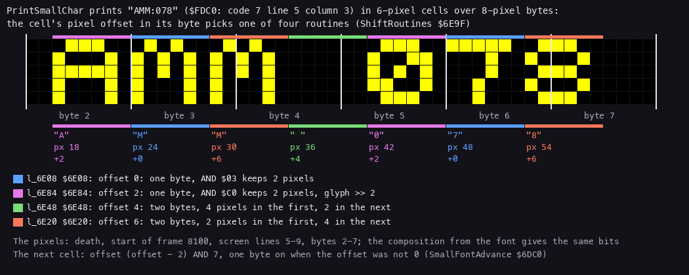

*`AMM:078` (`$FDC0`: code 7, line 5, column 3) as PrintSmallChar draws it: seven 6-pixel cells over bytes 2-7, each
with its pixel offset and its routine. The pixels are those of `death` at the start of frame 8100; the composition from
the font gives the same bits. Command, from the case folder after `. work/env.sh`: `python3 tools/fig_text.py shifts
docs/img/text/shifts.png`.*

How to read the figure:

- **The grid**: screen lines 5-9, pixels 16-63. White lines are byte borders.
- **The coloured bars** over and under the grid mark each cell, coloured by its routine. The labels give the
  character, its first pixel and its offset.
- **The sequence** of offsets is +2, +0, +6, +4, +2, +0, +6: column 3 starts at pixel 18, offset 2.
- **The point**: two cells in four cross a byte border. Those cost more, which is the 1195 T to 2366 T spread of the
  table.

Witness: in `death` frame 8093 the seven characters of `AMM:078` cost 1400, 1215, 1853, 2080, 1007, 881 and 1319 T
(PrintSmallChar from T 53 774 to T 64 926). The screen bytes the figure reads equal the composition (the script prints
`composed = recorded ... True`).

The point: a 6-pixel font gives 42 characters a line instead of 32. It costs a byte-aligned glyph routine four
times over.

## 8.4 The numbers

Control code 8 prints a byte as three decimal digits. CodeNumber `$6EF1` reads an address from the string and the
byte there. DivideDigit `$6F31` subtracts 100 and then 10 as often as it can and stores each count as a digit at
NumberText `$6F2D`. The units are added to `$30`. Then CodeNumber calls PrintString on NumberText itself: three digits
and `$FF`. The leading zeros stay (`AMM:078`).

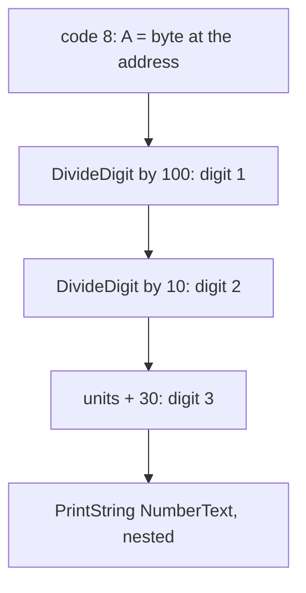

```asm
CodeNumber:                     ; $6EF1
  EXX
  LD E,(HL)                     ; the address from the string
  INC HL
  LD D,(HL)
  INC HL
  EX DE,HL
  LD A,(HL)                     ; the byte
  EX DE,HL
  JR l_6EFE
CodeNumberA:                    ; $6EFB  code 3
  LD A,$5E                      ; a constant: the caller's A is lost
  EXX
l_6EFE:
  PUSH HL
  LD HL,NumberText
  LD B,$64
  CALL DivideDigit              ; hundreds
  LD B,$0A
  CALL DivideDigit              ; tens
  AND A
  ADC A,$30
  LD (HL),A                     ; units
  DEC HL
  DEC HL
  CALL PrintString              ; "078", $FF
  POP HL
  RET
```

Codes 3 and 4 were meant to print A. Both start with `LD A,$5E`, so they print "094" and "5E" whatever A held. No
string uses them.

Bank 6 has its own converters for wider numbers:

- **NumberToDigits `$C126`**: 16 bits to five digits, with the leading zeros replaced by a character C'. The stores
  screen prints the payload weight with it (`PAYLOAD:WGT::::0KG`), the status view the grid position.
- **LongToDigits `$D353`**: the 32-bit score to ten digits. DotLeadingZeros `$CC6A` then turns up to nine leading
  zeros into `[`, the small font's full stop. That is the `.........0` of the status card.

Worked example: the shot of `death` frame 8093 leaves 78 rounds in `$C527`. 78 - 100 does not go: digit `0`.
78 - 10 goes seven times: digit `7`, rest 8. 8 + `$30` = `8`. NumberText holds `30 37 38 FF`.

Witness: the number of `AMM:078` is entered at `$6EFE` at frame 8093 T 60 956 and returns 4033 T later. The three
digits take 3207 T of that (8.3), so the division costs about 800 T.

The point: the panel needs only bytes, so the printer has a three-digit code built in. The score needs 32 bits, and
bank 6 has a separate converter for it.

## 8.5 The cockpit panel

The cockpit is a picture drawn once when a mission starts ([doc 6](06-rendering.md)). The play loop then updates its
fields. Each field has its own routine, and none draws the whole panel again.

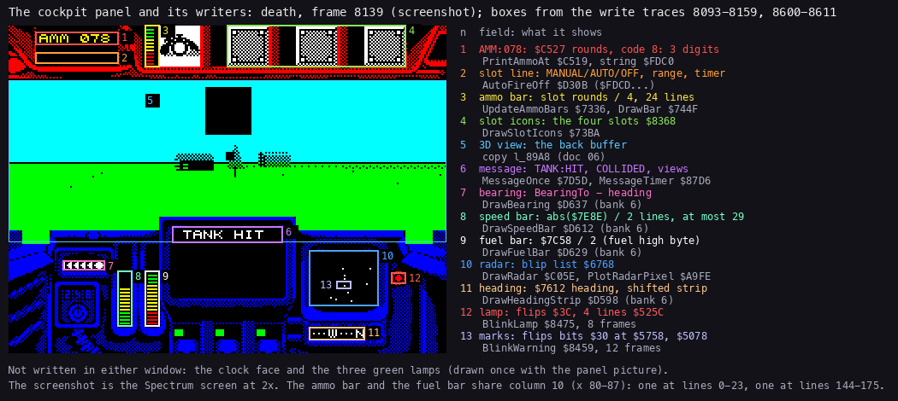

*The cockpit of `death` at frame 8139 (its stage-1 screenshot), every field boxed and numbered. The boxes are the
bounding boxes of each routine's screen writes in the traces of `death` 8093-8159 and 8600-8611. Command, from the
case folder after `. work/env.sh`: `python3 tools/fig_text.py panel docs/img/text/panel.png`.*

How to read the figure:

- **The boxes** are coloured by field. The number matches the list on the right and the table below.
- **Each list entry** gives the field, what it shows, and the routine that writes it.
- **Not boxed**: the clock face and the three green lamps. No routine writes them in either window. They are part of
  the panel picture.
- **The point**: the panel is a set of small independent writers. Text is only fields 1, 2 and 6.

| n | Field | Screen (x, y) | Value | Format | Routine |
| --- | --- | --- | --- | --- | --- |
| 1 | ammunition | 16-63, 4-10 | `$C527`, the current slot's rounds | `AMM:` and code 8, small font, line 5 column 3 (`$FDC0`) | PrintAmmoAt `$C519` (from the fire routines and SelectWeapon) |
| 2 | slot line | 16-63, 16-21 | the slot's mode or numbers | `MANUAL`, `:AUTO:`, `:OFF::` (`$FDCD`, `$FDD7`, `$FDE1`), two numbers (`$FDEB`), one number (`$FDF9`), small font line `$10` | the weapon routines, AutoFireOff `$D30B` |
| 3 | ammunition bars | 80-87, 0-23 | the four slots' rounds | a bar of 24 lines | UpdateAmmoBars `$7336`, DrawBar `$744F` |
| 4 | slot icons | 128-231, 0-23 | the four slots `$8368` | icons with frames | DrawSlotIcons `$73BA` |
| 5 | 3D view | 0-255, 32-126 | the back buffer | bytes | ViewBlitFront's copy l_89A8 ([doc 6](06-rendering.md)) |
| 6 | message | 96-159, 118-126 | the last hit | `TANK:HIT` (`$FFCF`), `COLLIDED` (`$FFDB`), blank (`$87F0`), small font line `$78` column `$11` | MessageOnce `$7D5D`, MessageTimer `$87D6` (8.6) |
| 7 | bearing | 32-55, 138-142 | the bearing to the target less the heading | an arrow shape, 5 lines | DrawBearing `$D637` (bank 6) |
| 8 | speed bar | 64-71, 144-175 | `$7E8E`, the signed speed PlayerStep stores, 1.25 x on terrain 0 and 6 (doc 05, 5.9) | a bar of abs / 2 lines (`SRL`, `AND $1F`): at most 23 at speed 47, 29 on the road (terrain 0) and on terrain 6; redrawn only when the value changes (the `CP` operand `$D616`) | DrawSpeedBar `$D612` (bank 6) |
| 9 | fuel bar | 80-87, 144-175 | `$7C58` / 2, the fuel's high byte | a bar of 0-31 lines | DrawFuelBar `$D629` (bank 6) |
| 10 | radar | 176-215, 132-163 | the blip list `$6768` | pixels | DrawRadar `$C05E`, PlotRadarPixel `$A9FE` |
| 11 | heading strip | 176-207, 177-183 | heading `$7612` | a shifted compass strip | DrawHeadingStrip `$D598` (bank 6) |
| 12 | lamp | 224-231, 145-150 | none | `$3C` flipped on 4 lines at `$525C` every 8 frames | BlinkLamp `$8475` (interrupt) |
| 13 | warning marks | 192-199, 150-153 | none | bits `$30` flipped at `$5758`, `$5078` every 12 frames | BlinkWarning `$8459` (interrupt) |

DrawHeadingStrip reads the player object's byte +`$22`, which is the heading `$7612`, and draws the compass strip;
DrawBearing, DrawSpeedBar and DrawFuelBar draw the other three fields of the table.

The order of a play loop's panel work, from PlayLoopTail `$6A57`:

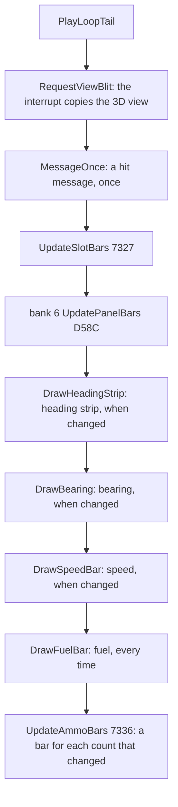

```asm
UpdatePanelBars:                ; $D58C (bank 6)
  CALL DrawHeadingStrip
  CALL DrawBearing
  CALL DrawSpeedBar
  JP DrawFuelBar

DrawFuelBar:                       ; $D629 (bank 6)
  LD A,($7C58)                  ; the fuel's high byte
  SRL A
  AND $1F                       ; 0-31 lines
  LD E,$90                      ; line 144
  LD C,$0A                      ; column 10
  JP $7438                      ; the bar, no test for a change
```

```text
UpdateSlotBars():
    bank6.UpdatePanelBars():
        if heading != last: draw the strip            # DrawHeadingStrip
        if bearing - heading != last: draw the arrow  # DrawBearing
        if abs(speed) != last: draw the speed bar     # DrawSpeedBar
        draw the fuel bar (fuel_hi / 2)               # DrawFuelBar, always
    for slot in 0..3: if rounds[slot] changed: DrawBar(slot)
```

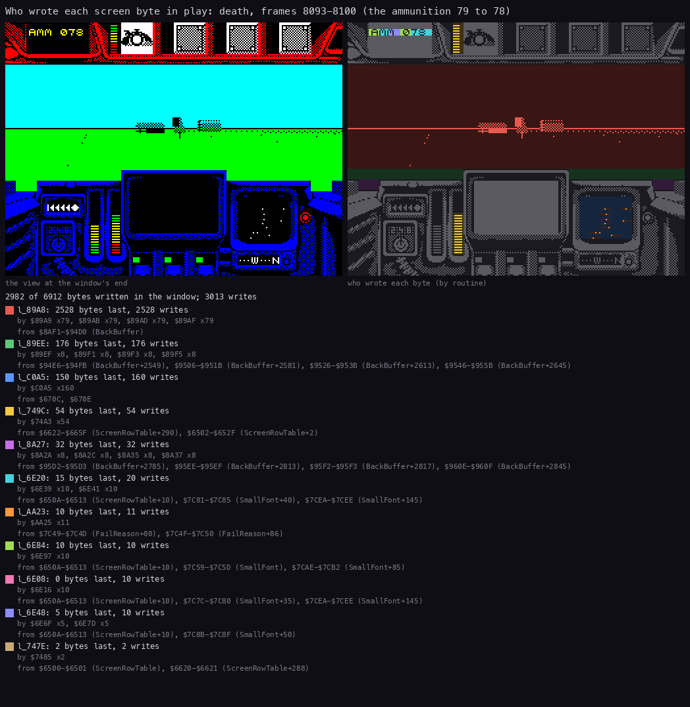

*Who wrote each screen byte in `death` frames 8093-8100. Left, the screen at the window's end; right, each written
byte coloured by the routine that wrote it last; below, the writers with their byte counts and sources. Command,
from the case folder after `. work/env.sh`: `python3 ../../kit/writers_map.py --work work/docs/bcD/death --window
8093:0-8101:0 --listing build/game.lst --view screen --sources --out docs/img/text/hud-writers.png`.*

How to read the figure:

- **Red, l_89A8**: the 3D view's copy from the back buffer `$8AF1-$94D0`, 2528 bytes. It is most of the writes.
- **Green, l_89EE and lilac, l_8A27**: the parts of the copy that go around the cockpit's middle.
- **Blue, l_C0A5**: the radar's clear loop. The blips are l_AA23 (orange).
- **Yellow, l_749C**: the ammunition bar of the slot that fired, 54 bytes.
- **Cyan, light green, pink and violet, l_6E20, l_6E84, l_6E08, l_6E48**: the four small-font shift routines printing
  `AMM:078`. Their sources include SmallFont.
- **The point**: in eight frames of play the panel takes about 100 of the 2982 bytes written. The text is a few dozen
  bytes, and only when a value changes.

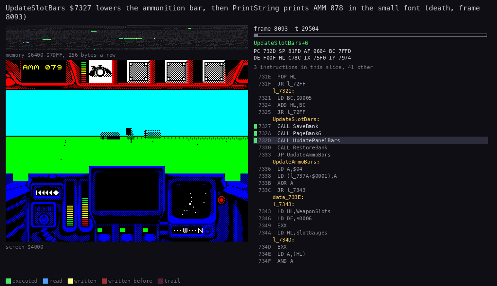

*UpdateSlotBars `$7327` lowers the ammunition bar, then PrintString prints `AMM:078` in the small font. `death`, frame
8093 T 28 900-65 100, 60 pictures. Command, from the case folder after `. work/env.sh`: `python3
../../kit/routine_anim.py --work work/docs/bcD/death --window 8093:28900-8093:65100 --listing build/game.lst --view
screen --range 6400-7DFF --pc 7327-74B0,6CE4-7040 --pictures 60 --width 1050 --out
docs/img/routines/UpdateSlotBars.gif`.*

How to read the animation:

- **Left, the screen**: the panel. Watch the yellow bar at x 80-87 at the top, then the digits after `AMM`.
- **The memory grid** `$6400-$7DFF`: ScreenRowTable at `$6500` lights up for every line drawn. SmallFont at `$7C59`
  lights up for the glyphs.
- **Right**: the code of the slice. First the bank 6 bars, then UpdateAmmoBars and DrawBar, then the shot's print.
- **The point**: the bars are drawn first, the text after; each touches only its own bytes.

Witness: `death` frame 8093. UpdateSlotBars runs at T 28 981 for 9946 T. Its parts: UpdatePanelBars 5667 T
(DrawHeadingStrip 65 T unchanged, DrawBearing 1619 T, DrawSpeedBar 31 T unchanged, DrawFuelBar 3891 T) and UpdateAmmoBars 3846 T
(DrawBar `$744F` at T 35 428, 2943 T). The shot then lowers `$836D` at T 46 075. PrintAmmoAt runs at T 52 776 for
12 256 T.

The point: the panel costs about 10 000 T a loop. The fuel bar, the one field drawn every time, is 3891 T of it.

## 8.6 The messages

A hit or a collision prints one word in the panel's message box. The colliding code calls SetMessage `$7D51`, which
stores the other object's attribute byte in MessageOnce's operand `$7D64` and turns MessageOnce's first byte from `RET`
into `NOP`. The next PlayLoopTail runs MessageOnce `$7D5D` once:

- it sets the timer, MessageTimer's operand `$87D7`, to 100;
- bit 4 of the attribute picks the message: set, SoundExplosion and `TANK:HIT` (`$FFCF`); clear, SoundEffectA and
  `COLLIDED` (`$FFDB`);
- it puts its `RET` back.

MessageTimer `$87D6` runs in the interrupt. It counts the timer down. At 0 it prints the blank message `$87F0`
(`{7 $78 $11}::::::::`), or the status view's blank line `$7C06` when its other operand `$87E0` is not 0.
StatusLoop sets that operand to `$FF` (`$6BE6`) and clears it when it leaves (`$6C33`), DamageLoop sets it to `$C9`
(`$6C9B`), and StartMission clears it (`$69D5`).

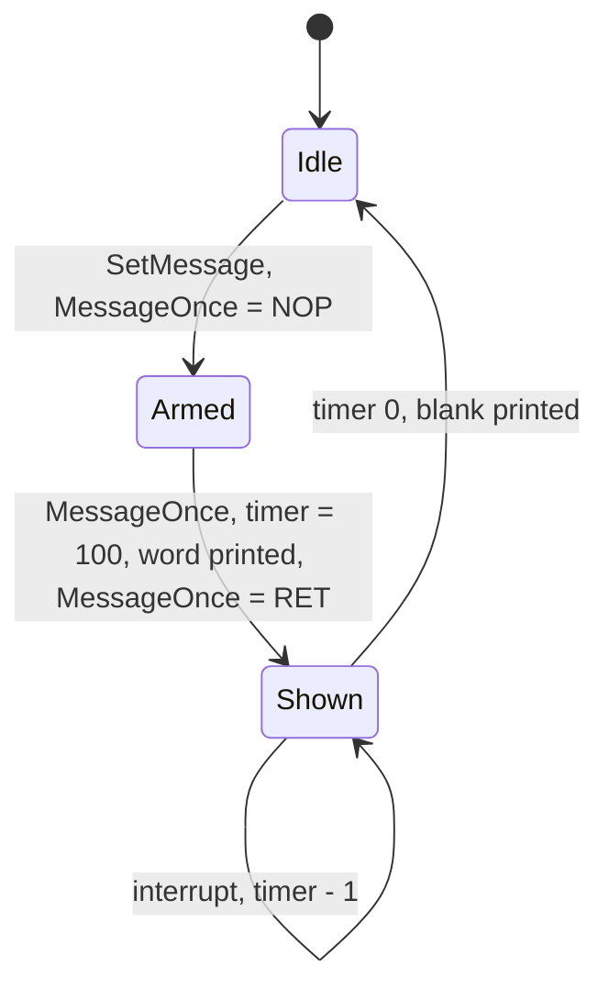

```asm
MessageOnce:                    ; $7D5D
  RET                           ; NOP while armed (SetMessage)
  LD A,$64
  LD (MessageTimer+$0001),A     ; 100 ticks
  LD A,$00                      ; $7D64: the attribute stored by SetMessage
  BIT 4,A
  JR Z,l_7D71
  CALL SoundExplosion
  LD HL,$FFCF                   ; TANK:HIT
  JR l_7D77
l_7D71:
  CALL SoundEffectA
  LD HL,$FFDB                   ; COLLIDED
l_7D77:
  CALL PrintString
  LD A,$C9
  LD (MessageOnce),A
  RET

MessageTimer:                   ; $87D6 (interrupt)
  LD A,$00                      ; $87D7: the ticks left
  AND A
  RET Z
  DEC A
  LD (MessageTimer+$0001),A
  RET NZ
  LD A,$00                      ; $87E0: StatusLoop FF, DamageLoop C9, StartMission 0
  AND A
  JR Z,l_87EA
  LD HL,FailReason+$000D        ; $7C06
  JP PrintString
l_87EA:
  LD HL,BlankMessage            ; $87F0
  JP PrintString
```

The status view and the damage board print their own message, `TANK HAS BEEN HIT` (`$D3EA`) or `COLLISION OCCURED`
(`$D401`), in the 8 x 8 font at line `$B0`. StatusViewMessage `$D3C9` in bank 6 does it once per message, with the same
timer. It runs 43 times in the recordings (m2erbe 4, missions 34, play 5), but every run returns at its first test,
as MessageOnce is already `RET`: the print at `$D3CF` never runs, so no screen of the recordings shows the two texts.
They are drawn in their font on the text sheet of 8.9, and they are known only from the code (8.10).

Worked example and witness: the hit of `death` frame 8121.

| Start of frame | Timer `$87D7` | MessageOnce `$7D5D` | Screen line 121, bytes 13-18 |
| --- | --- | --- | --- |
| 8121 | 0 | `$C9` (`RET`) | blank |
| 8122 | 100 | `$00` (`NOP`): the print still running | `77 7F FF FF FF FF`, `T` drawn |
| 8123 | 99 | `$C9` | `77 4D 6F F7 77 DF`, the whole word |
| 8226 | 4 | `$C9` | the word |
| 8231 | 0 | `$C9` | blank |

MessageOnce runs in frame 8121 and its PrintString ends in frame 8122. The timer reaches 0 in frame 8230, 109 frames
after it was set. The 9 extra frames are lost interrupts: the 3D frame's `DI` hides them ([doc 4](04-game-loop.md)).
The timer also stays at 3 for two frames (8227 and 8228).

The point: a message costs one PrintString and one byte of timer. The blank that ends it is another string of
blanks, not a clear routine.

## 8.7 The menu screens

The menus use the same printer on a cleared screen. Each screen is a node of the screen list
([doc 5](05-controls.md)). It draws a picture from bank 7, adds its strings and waits in PointerZones.

**The catalogue.** MissionCatalogueScreen `$C790` prints the catalogue's title from CatalogueTitle `$CF85`. Then
PrintMissionList `$CFA9` prints the ten names. Each name is 18 bytes at the pointers of `$93B9`. Its spaces are
turned into `:`, the small font's blank, and an `$FF` is put after it. The list runs from line `$41`, 8 lines apart,
at column 5. A click on a line runs SelectMissionLine `$D013`: it computes the mission from the pointer's Y, sets the
line's attributes to `$4E`, sets the old line's back to `$4D` and prints the mission's goal (8.1's worked example).

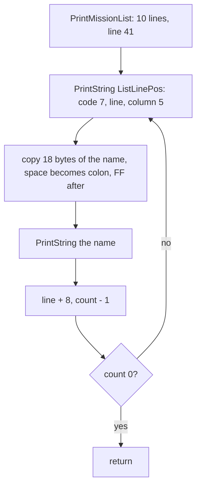

```asm
ListLineLoop:                   ; PrintMissionList $CFA9
  LD HL,ListLinePos             ; 07 41 05 FF: its line byte is moved by 8 each time
  CALL $6FB3
ListPtrOp:
  LD HL,$0000                   ; the next pointer of $93B9
  LD E,(HL)
  INC HL
  LD D,(HL)
  INC HL
  LD (ListPtrOp+$0001),HL
  LD H,D
  LD L,E
  LD B,$12                      ; 18 characters
ListCharLoop:
  LD A,(DE)
  CP $20
  JR NZ,ListCharStore
  LD A,$3A                      ; a space becomes the blank glyph
ListCharStore:
  LD (DE),A
  INC DE
  DJNZ ListCharLoop
  LD A,$FF
  LD (DE),A
  CALL $6FB3
```

**The briefing.** BriefingScreen `$C98A` copies the mission's texts from the catalogue to `$DBF3` (CopyMissionText
`$70F6`). It unpacks the briefing picture, adds three graphics and prints the text at (`$70A3`) in one call (8.1's
animation). The mission 1 text begins `09 0E 07 20 00 0A`: margin 14, small font at line `$20` column 0, then a new
line. The title `::BLAST:EM:MISSION[` therefore starts at line 41 and column 14 (pixel 84), and so does every line
after it.

**The status card.** MissionStatusScreen `$CDBF` draws the commander's card and calls PrintScore `$CC7D`. That converts
Score `$CC79` to ten digits and dots the leading zeros. Then it prints StatusText `$D46C`: `MISSIONS:COMPLETED`, code 8
on MissionsCompleted `$CC93`, `SCORE:TO:DATE` and the ten digits.

**The end screens.** MissionFailedScreen `$CD84` prints `MISSION FAILED.` (`$CC94`, 8 x 8 font) and the reason the
play code left in `$7BF9`: one of five small-font strings, `UNIT:DESTROYED[` to `TANK:DESTROYED:ON:BRIDGE[`.
MissionCompleteScreen `$CD1E` adds the mission's score to Score and prints the mission's own completion text (at
`$7C55`, from the catalogue: `WELL:DONE[:YOU:HAVE ...` for mission 1). m1complete runs it at frames 21560-21721
(page 6) and shows the report at 21593; m4complete at 21301-21462.

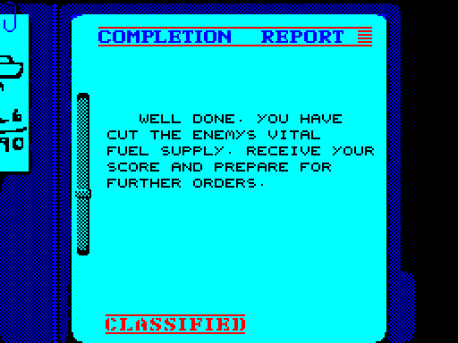

*m1complete frame 21593: MissionCompleteScreen's text, `WELL DONE. YOU HAVE CUT THE ENEMYS VITAL FUEL SUPPLY ...` in
the small font on PicCompletion. Screenshot of the recording (`work/stage2/rec/m1complete`).*

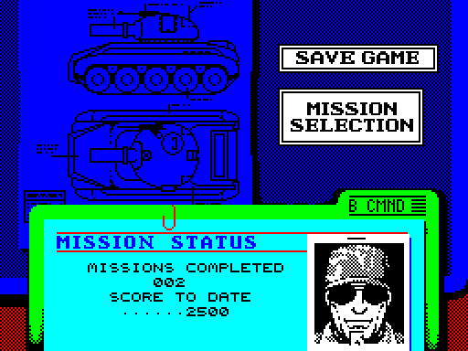

*m4complete frame 21832: the status card after Blast Em Mission and Railway Ambush: MISSIONS COMPLETED `002`, SCORE TO
DATE `......2500`, PrintScore's dotted leading zeros. Screenshot of the recording.*

**The options.** OptionsScreen `$F8F4` prints OptionsText `$F93F` (the resource `src/res/texts/options.txt`). It waits
for a key 1-5 and stores it in ControlDevice `$67B6`. Then it writes colour bytes inside the string itself: `$44`
(green) into the old line's code 13 operand and `$42` (red) into the new one's. The highlight is the string's own
data, so the next print shows it.

Witness: `menu` frames 6206-10 499 show the catalogue with each of the ten missions chosen and briefed. The goal and
briefing texts on the screenshots equal the catalogue's bytes, decoded as in 8.1. The status card is at frame 10 686:
`000` and `.........0`. PrintMissionList runs 32 times in L1, PrintScore 4 times.

The point: the menus have almost no text code of their own. They are a list of PrintString calls plus a few
patched bytes.

## 8.8 The load / save code entry

The save code screen, ShowPassword `$C4FC`, encodes the progress (EncodePassword `$CE2E`,
[doc 10](10-gameplay-logic.md)). PasswordToChars `$CF1C` maps the ten 5-bit values through PasswordAlphabet `$CF5F`.
PrintString shows `THIS IS YOUR ENTRY STRING.` and the ten characters.

The load screen, PasswordScreen `$C578`, prints `Type in your level entry:-` and fills the ten-byte buffer `$C60E`
with spaces. ReadPassword `$C620` then calls EditLine `$C644`, with the screen address `$488A` and the cursor's
attribute address `$598A`. EditLine does not use PrintString. It redraws the line after every key with PrintRawString
`$C6FC`: 8 x 8 glyphs straight to the screen, ending at a 0 byte, with no control codes and no attributes. The cursor
is an attribute: `$C6` (flashing) on the cell after the last character, `$46` on the others.

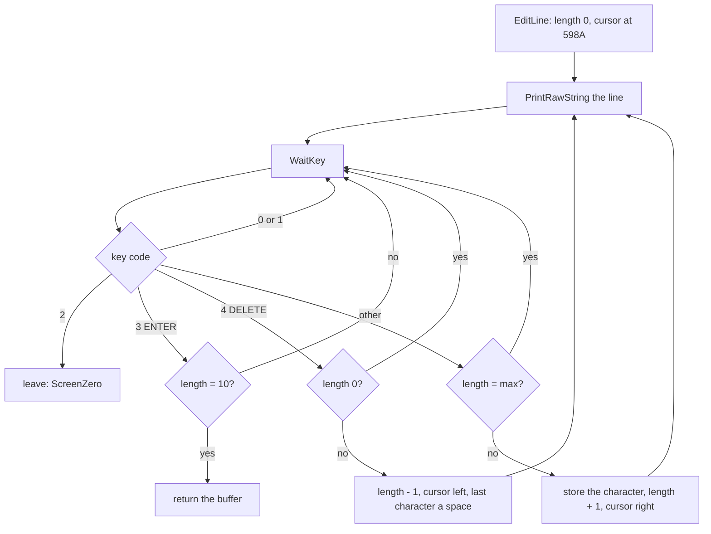

```asm
PrintRawString:                 ; $C6FC (bank 6)
  LD A,(HL)
  INC HL
  AND A
  RET Z                         ; 0 ends the line
  PUSH HL
  XOR $80
  JP M,RawGlyph                 ; codes below $80
RawSpaceGlyph:
  LD HL,Font8x8                 ; anything else: the space
  JR RawGlyphCopy
RawGlyph:
  SUB $A0                       ; = code - $20
  JR C,RawSpaceGlyph            ; control codes print as spaces
  ADD A,A
  LD L,A
  LD H,$00
  ADD HL,HL
  ADD HL,HL
  LD BC,Font8x8
  ADD HL,BC
RawGlyphCopy:
  PUSH DE
  LD B,$08
RawGlyphLine:
  LD A,(HL)
  INC HL
  LD (DE),A
  INC D                         ; the next pixel line in the character cell
  DJNZ RawGlyphLine
  POP DE
  INC E
  POP HL
  JR PrintRawString
```

CharsToPassword `$CF3E` turns each typed character into its place in the alphabet, AND 31:

```asm
ToValuesLoop:
  LD A,(HL)
  INC HL
  EXX
  LD HL,PasswordAlphabet        ; "9876543210ZYXWVUTSRQPONMLKJIHABCDEFG"
  LD B,$24
AlphabetSearch:
  CP (HL)
  INC HL
  JR Z,AlphabetFound
  DJNZ AlphabetSearch           ; not found: B = 0
AlphabetFound:
  LD A,$24
  SUB B                         ; the place 0-35, or 36
  AND $1F
```

The alphabet has 36 characters for 32 values. The values 0-3 come out as `9`, `8`, `7`, `6`. The last four letters
`D`, `E`, `F` and `G` (places 32-35) are never produced; typed, they mean 0-3 like `9876`. A character not in the
alphabet leaves B = 0, so its value is 36 AND 31 = 4, the same as `5`.

Worked example: a fresh game's save code is `9999999999` (the save code panel of the screens figure, menu 10 817).
Each value is 0, and place 0 of the alphabet is `9`. Typed back on the load screen (menu 1874), each `9` is found at
place 0: B = 36, A = 36 - 36 = 0.
With progress: m1complete shows `C5989999PB` (mission 1, 500 points) at frame 22240 and m4complete `H59K9999PK`
(missions 1 and 4, 2500 points) at 22035; doc 10.12 works both out bit by bit.

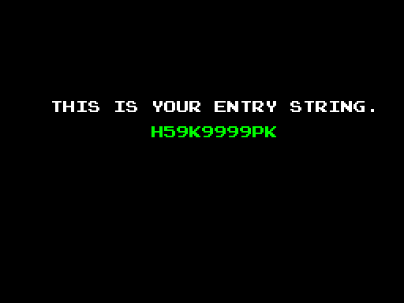

*m4complete frame 22035: THIS IS YOUR ENTRY STRING with `H59K9999PK`, printed by bank 6 ShowPassword `$C4FC` with PrintString
(EntryStringText `$C72A`, then PasswordText `$CEF6`). Screenshot of the recording.*

Witness: `menu` frames 1764-2025 type and enter `9999999999` (the screenshots `001874-load-typed.png` and
`001962-load-entered.png`). Frames 10 817-10 880 show the save code. EditLine, PrintRawString and WaitKey run only in
`menu` (L1 1, 77 and 286 697).

The point: the code entry is a separate little text system. It has a raw printer, an attribute cursor and a ten-key
limit, because PrintString cannot draw a line in place again.

## 8.9 The data sheet of the texts

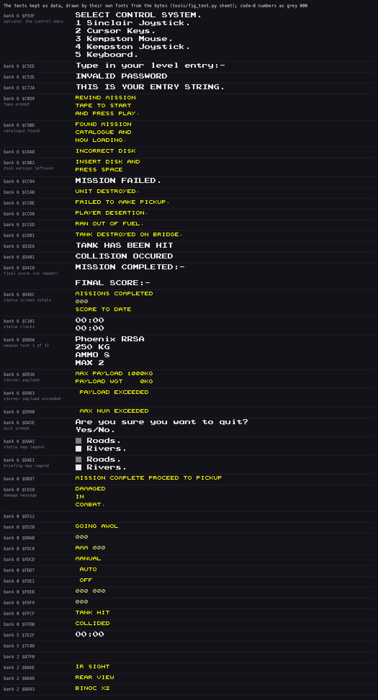

*Every string the game keeps as data, decoded from the case's build and drawn in the font its codes select, with its
bank and address. Command, from the case folder after `. work/env.sh`: `python3 tools/fig_text.py sheet
docs/img/text/sheet.png`.*

How to read the figure:

- **Each row** is one string: its bank and address on the left, then the text in the font it selects. Lower case and
  coloured lines mean the 8 x 8 font; capitals in panel colours mean the small font.
- **Control codes** are not drawn; their effect is (new lines, colours).
- **`:` and `[`** in the small-font strings appear as blanks and full stops, as on the screen.
- **The point**: about 50 strings hold all the fixed text. The mission names, goals and briefings come from the
  catalogue on the mission tape (`src/res/missions/catalogue.txt`), not from the game.

The table is the output of `python3 tools/fig_text.py list`. Control codes are in braces with their operands:
`{7 $05 $03}` is code 7 to line 5, column 3.

| Bank | Address | Bytes | Use | Decoded (control codes in braces) |
| --- | --- | --- | --- | --- |
| 6 | `$F93F-$F9C3` | 133 | options: the control menu (OptionsText) | `{2 $28 $06}{13 $46}SELECT CONTROL SYSTEM.{9 $07}{2 $38 $07}{13 $44}1 Sinclair Joystick.{11}{11}{13 $44}2 Cursor Keys.{11}{11}{13 $44}3 Kempston Mouse.{11}{11}{13 $44}4 Kempston Joystick.{11}{11}{13 $42}5 Keyboard.` |
| 6 | `$C5EE-$C60D` | 32 | load code prompt | `{2 $40 $04}{13 $47}Type in your level entry:-` |
| 6 | `$C53E-$C553` | 22 | load code refused | `{2 $78 $08}{13 $C7}INVALID PASSWORD` |
| 6 | `$C72A-$C749` | 32 | save code heading | `{2 $40 $04}{13 $47}THIS IS YOUR ENTRY STRING.` |
| 6 | `$C8D9-$C90C` | 52 | tape prompt | `{7 $20 $05}REWIND:MISSION{7 $2A $05}TAPE:TO:START{7 $34 $05}AND:PRESS:PLAY[` |
| 6 | `$C90D-$C93D` | 49 | catalogue found | `{7 $20 $05}FOUND:MISSION:{7 $2A $05}CATALOGUE:AND{7 $34 $05}NOW:LOADING[` |
| 6 | `$C8A0-$C8B1` | 18 | disk version leftover | `{7 $2A $06}INCORRECT:DISK` |
| 6 | `$C8B2-$C8D2` | 33 | disk version leftover | `{7 $2A $05}INSERT:DISK:AND{7 $33 $07}PRESS:SPACE` |
| 6 | `$CC94-$CCAA` | 23 | failure heading | `{9 $07}{2 $20 $09}{13 $68}MISSION FAILED.` |
| 6 | `$CCAB-$CCBD` | 19 | failure reason 1 | `{7 $30 $0E}UNIT:DESTROYED[` |
| 6 | `$CCBE-$CCD7` | 26 | failure reason 2 | `{7 $30 $0B}FAILED:TO:MAKE:PICKUP[` |
| 6 | `$CCD8-$CCEC` | 21 | failure reason 3 | `{7 $30 $0E}PLAYER:DESERTION[` |
| 6 | `$CCED-$CD00` | 20 | failure reason 4 | `{7 $30 $0E}RAN:OUT:OF:FUEL[` |
| 6 | `$CD01-$CD1D` | 29 | failure reason 5 | `{7 $30 $09}TANK:DESTROYED:ON:BRIDGE[` |
| 6 | `$D3EA-$D400` | 23 | status view: hit | `{2 $B0 $08}{13 $48}TANK HAS BEEN HIT` |
| 6 | `$D401-$D417` | 23 | status view: collision | `{2 $B0 $08}{13 $48}COLLISION OCCURED` |
| 6 | `$D418-$D46B` | 84 | final score (no reader) | `{2 $20 $07}{13 $68}MISSION COMPLETED:-{2 $30 $07}{13 $69}`, 20 spaces, `{2 $40 $07}{13 $68}FINAL SCORE:- {2 $50 $08}{13 $69}` and ten digit places |
| 6 | `$D46C-$D4A4` | 57 | status screen totals | `{7 $90 $08}MISSIONS:COMPLETED{7 $98 $0E}{8 $93 $CC}{7 $A0 $0A}SCORE:TO:DATE{7 $A8 $0B}` and ten digit places |
| 6 | `$C101-$C113` | 19 | status clocks | `{2 $50 $01}{13 $47}00:00{2 $70 $01}00:00` |
| 6 | `$D6DA-$D703` | 42 | weapon text 1 of 13 | `{13 $47}{2 $50 $02}Phoenix RRSA{9 $06}{2 $30 $06}250 KG{11}AMMO 8{11}MAX 2` |
| 6 | `$D936-$D962` | 45 | stores: payload | `{13 $79}{7 $92 $17}MAX:PAYLOAD:1000KG{7 $A2 $17}PAYLOAD:WGT::::0KG` |
| 6 | `$D963-$D98F` | 45 | stores: payload exceeded | `{7 $92 $17}{13 $46}:PAYLOAD:EXCEEDED:{7 $9A $17}::::::::::::::::::` |
| 6 | `$D990-$D9A7` | 24 | stores: number exceeded | `{7 $9A $17}{13 $46}:MAX:NUM:EXCEEDED:` |
| 6 | `$DA5E-$DA8B` | 46 | quit prompt | `{2 $28 $01}{13 $47}Are you sure you want to quit?{2 $38 $0C}Yes/No.` |
| 6 | `$DAA1-$DAC0` | 32 | status map legend | `{2 $70 $08}{13 $21}{road}{13 $46} Roads.{2 $80 $08}{13 $21}{river}{13 $46} Rivers.` |
| 6 | `$DAE1-$DB00` | 32 | briefing map legend | `{2 $90 $0B}{13 $21}{road}{13 $46} Roads.{2 $A0 $0B}{13 $21}{river}{13 $46} Rivers.` |
| 0 | `$DB97-$DBBC` | 38 | goal message | `{7 $22 $04}MISSION:COMPLETE:PROCEED:TO:PICKUP` |
| 0 | `$C618-$C631` | 26 | damage message | `{7 $05 $03}DAMAGED{7 $0B $05}IN{7 $11 $03}COMBAT[` |
| 0 | `$D512-$D51F` | 14 | desertion warning: blank | `{7 $8D $10}::::::::::` |
| 0 | `$D520-$D52D` | 14 | desertion warning | `{7 $8D $10}GOING:AWOL` |
| 0 | `$D0AB-$D0B1` | 7 | number at `$0000` (patched) | `{7 $10 $07}{8 $00 $00}` |
| 0 | `$FDC0-$FDCC` | 13 | HUD: ammunition | `{7 $05 $03}{13 $40}AMM:{8 $27 $C5}` |
| 0 | `$FDCD-$FDD6` | 10 | HUD: turret mode MANUAL | `{7 $10 $03}MANUAL` |
| 0 | `$FDD7-$FDE0` | 10 | HUD: turret mode AUTO | `{7 $10 $03}:AUTO:` |
| 0 | `$FDE1-$FDEA` | 10 | HUD: turret mode OFF | `{7 $10 $03}:OFF::` |
| 0 | `$FDEB-$FDF7` | 13 | HUD: two numbers | `{7 $10 $03}{13 $40}{8 $F8 $FD}:{8 $FC $B8}` |
| 0 | `$FDF9-$FDFF` | 7 | HUD: one number | `{7 $10 $03}{8 $F5 $CF}` |
| 0 | `$FFCF-$FFDA` | 12 | HUD: tank hit | `{7 $78 $11}TANK:HIT` |
| 0 | `$FFDB-$FFE6` | 12 | HUD: collided | `{7 $78 $11}COLLIDED` |
| 5 | `$7E2F-$7E39` | 11 | ClockText | `{2 $30 $01}{13 $47}00:00` |
| 5 | `$7C06-$7C20` | 27 | message line: blank | `{2 $B0 $08}{13 $49}` and 21 spaces |
| 2 | `$87F0-$87FB` | 12 | BlankMessage | `{7 $78 $11}::::::::` |
| 2 | `$BA6E-$BA79` | 12 | view name: IR SIGHT | `{7 $84 $11}IR:SIGHT` |
| 2 | `$BA86-$BA92` | 13 | view name: REAR VIEW | `{7 $96 $11}REAR:VIEW` |
| 2 | `$BA93-$BA9E` | 12 | view name: BINOC X2 | `{7 $96 $11}BINOC:X2` |

The weapon texts are 13 records from `$D6DA`, one per store type, each in the format of the first. The texts of the
missions are in the catalogue: the names (18 bytes each), the goals and, per mission, the briefing and the completion
text. They are listed in `src/res/missions/catalogue.txt`.

Witness: `tools/fig_text.py list` decodes the build. Every string above that a recording prints matches its screen:
the menu strings in `menu`, the panel strings in `death` (`AMM:078` byte for byte, 8.3), the view names and messages
in `play2`. The view names are on the screen in `play` too: `IR:SIGHT` in the screenshot `009675-view-night`,
`REAR:VIEW` in `010520-view-console2`, and all three in the view animation of doc 06
([6.10](06-rendering.md#610-the-views), play 9600-10 500).

The point: the game's own text fits in about 1.5 K. Most of it sits in bank 6 with the menus that print it.

## 8.10 What is known only from the code

- The tokens `$82-$FE` and their table at `$9860`: the branch is never taken, and the words there are StepY's spare
  bytes and KeyTable, not strings.
- The status view's messages `TANK HAS BEEN HIT` and `COLLISION OCCURED` (8.6): StatusViewMessage never reaches its
  print in a recording.
- Codes 3 and 4 (a constant `$5E`), code 0, code 5 alone and code 12: no string of the game uses them.
- Codes 14-17 would `CALL $0000`. Codes 18-31 would take their routine from PrintString's own bytes after the table.
- PrintChar in column 31 writes no attribute and starts a new line. NextColumn `$6EE5` is never called.
- EditLineAt `$C655` and EditAddSpace `$C6AC`: no caller and no jump reaches them.
- PrintFinalScore `$CC54` and its text `$D418`: nothing calls them.
- The disk texts `$C8A0` and `$C8B2` (ShowWrongDisk `$C88E`): a leftover of the disk version, never shown on tape.
- A character not in the alphabet, which gives 4 (8.8): no recording types one.

## 8.11 The point

Battle Command prints everything through one interpreter, the 61 bytes of PrintString at `$6FB3-$6FEF`. Its state is
the operands of its own instructions, and the font is a patched `CALL`. A 6-pixel panel font with four shift routines
fits 42 characters a line into a cockpit drawn as a picture. A dozen small writers then keep the panel up to date,
each redrawing only its own field; only the fuel bar is drawn every loop. Text is rare and cheap: one shot reprints
seven small characters in 12 256 T, and a hit prints one word that a timer blanks 100 ticks later.
