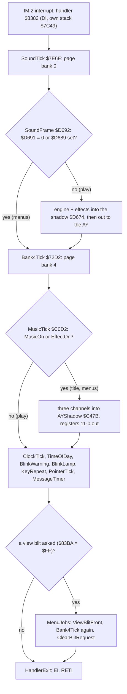
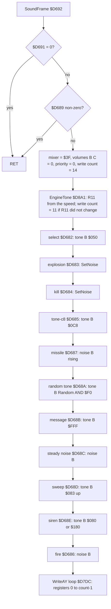
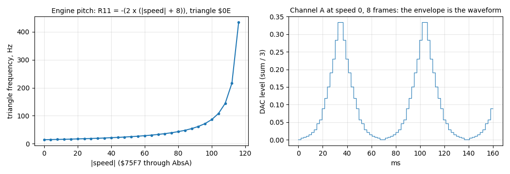
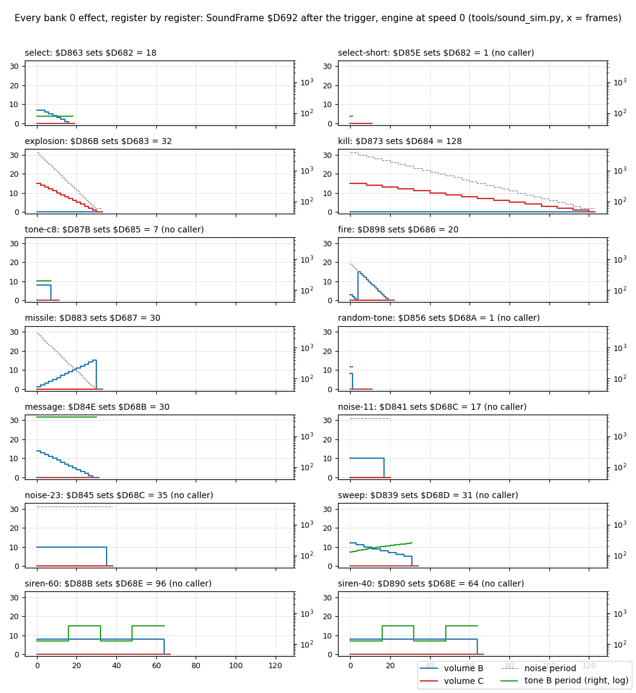
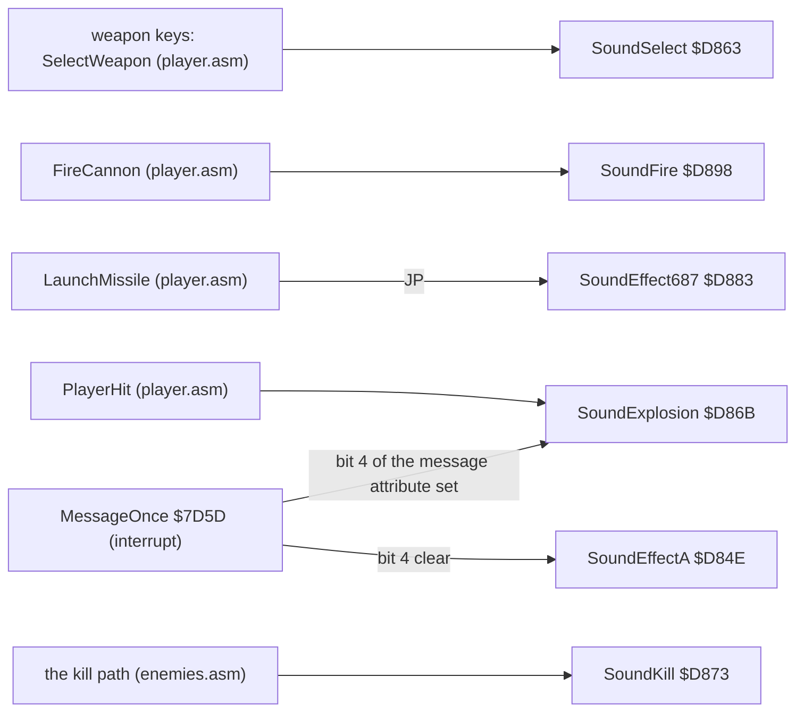
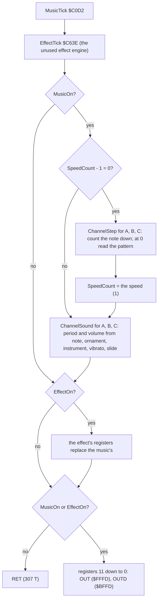
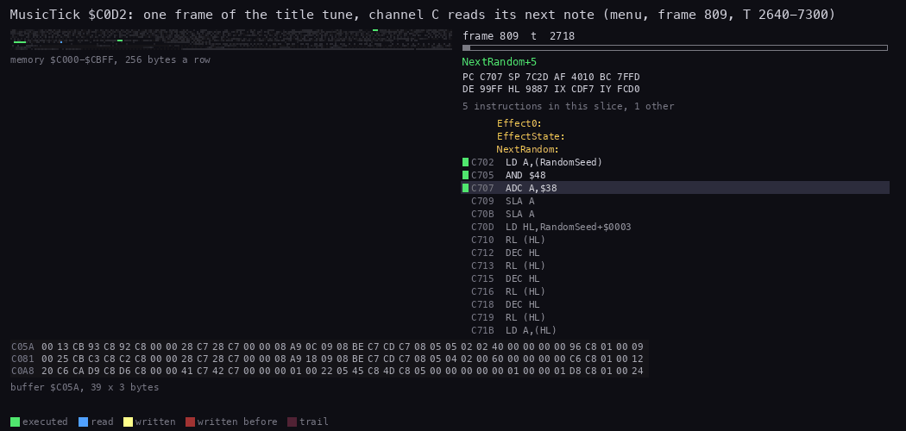
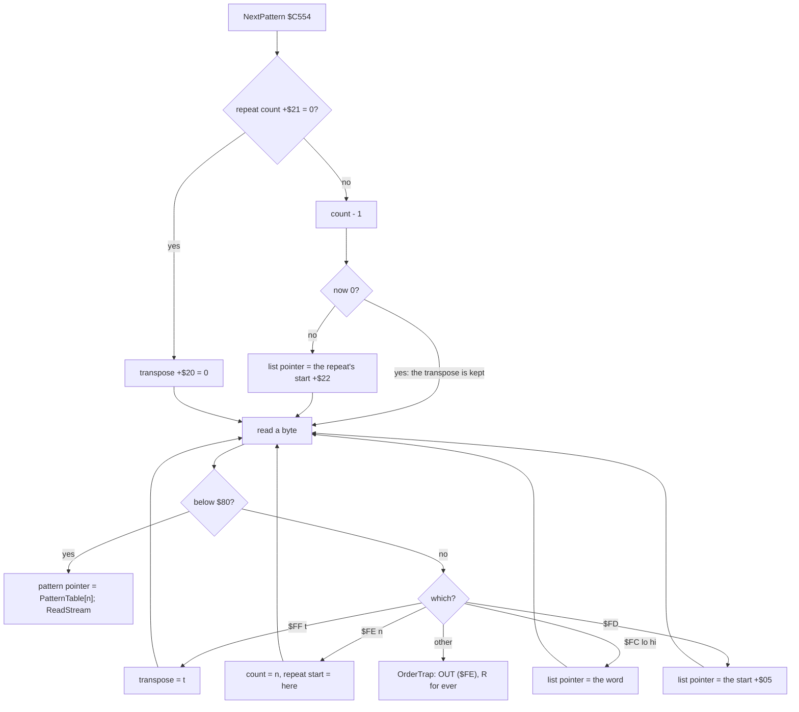
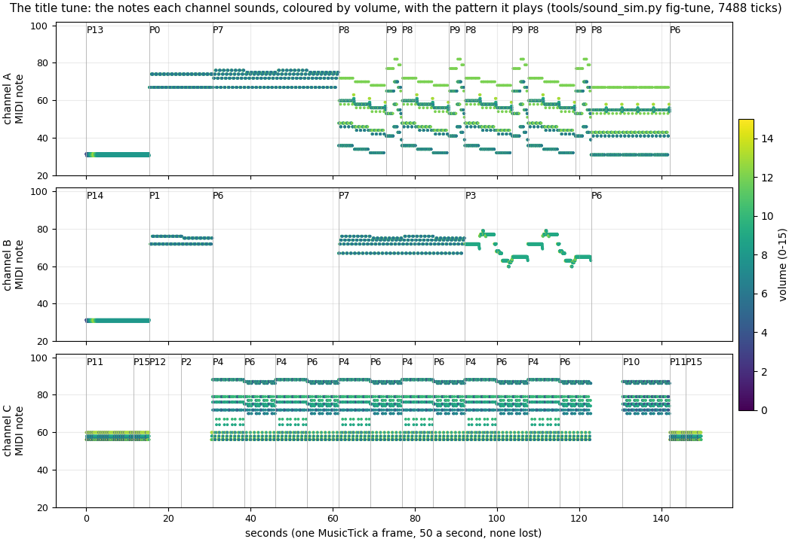

# 9. Sound

What this covers:

- the two AY drivers that share the chip, and when each runs in the interrupt (9.1, 9.2);
- the effect driver in bank 0: its gates, its register shadow, the write loop that writes register 13 only on a change
  (9.3);
- the engine sound, where the envelope itself is the waveform (9.4);
- every effect, decoded register by register, with its trigger, length, voice, priority and a WAV (9.5, 9.6);
- the music player in bank 4: its channel record, its frame, its order lists and patterns (9.7, 9.8);
- the title tune: the score, the loop and a transpose that leaks into the second pass (9.9);
- the pitch, the costs, the witnesses and what is known only from the code (9.10-9.13).

The names are those of `src/game/game.ann` and `src/bank4/bank4.ann` ([Terms](README.md#terms)). The recordings are
those of [WALKTHROUGH 6.0](../WALKTHROUGH.md#60-the-recordings). Each was opened from its stage-1 TTD session on the
writer's own instance (port base 37380, muted). No audio was played.

- `menu` (`work/stage1/rec/menu`, frames 0-10 996): the title tune from StartTune at about frame 377 to frame 1380,
  steady. It gives the music player's animation (frame 809) and the music witness (frames 420-1372).
- `death` (`work/stage1/rec/death`, frames 0-20 038): Blast Em Mission, the Turret driven and fired for 12 000
  frames. It gives the effect driver in play: the engine, the shot of frame 8093 and its register shadow, the costs.
- `play2` (`work/stage1/rec/play2`): the message beep (SoundEffectA, frames 8700-17 195), from the stage-2 witness
  lines of the `.ann`.

A frame is 70 908 T on the 128K, one interrupt a frame, 20 ms. A moment is written "frame F T t". A memory value "at
frame F" is read with `time_travel memory_at` and a frame alone: it is the value at the start of frame F. The traces
confirm it: the shot's counter, written at frame 8093 T 46 034, reads 20 at frame 8094. The AY's clock is
1 773 400 Hz.

Most numbers of the effects and the tune come from a simulation: `tools/sound_sim.py` runs the game's own code from
the case's build (`build/game.bin`, `build/bank4.bin`) in SkoolKit's Z80 simulator, one driver call a frame, and
records the AY register writes. Section 9.12 checks it against both recordings.

```bash
. work/env.sh
python3 ../../kit/rs.py open --work work/docs/bcD/menu  --ttd work/stage1/rec/menu/session.ttd  --model 128K --port-base 37380
python3 ../../kit/rs.py open --work work/docs/bcD/death --ttd work/stage1/rec/death/session.ttd --model 128K --port-base 37380
python3 tools/sound_sim.py table        # every effect as a markdown table
python3 tools/sound_sim.py score        # the order lists and patterns decoded
python3 tools/sound_sim.py costs        # T-states of each driver call
python3 tools/sound_sim.py wavs docs/audio --tune-frames 7488
```

## 9.1 Two drivers, one chip

The game has two AY drivers, written apart and paged apart. Both run from the IM 2 interrupt handler `$8383`, one
after the other, every frame.

| | Effect driver | Music player |
| --- | --- | --- |
| Where | bank 0, SoundFrame `$D692` (module `sound`) | bank 4, MusicTick `$C0D2` (module `music`) |
| Called by | SoundTick `$7E6E`, the handler's first job | Bank4Tick `$72D2`, the second job (and again after a view blit) |
| Plays | the engine and 14 one-shot effects | the title tune (one tune, three channels) |
| When it sounds | in play: StartMission clears the gate `$D689` | on the title and the menus: StartTune `$C000` |
| Registers written | 0-13 from the shadow `$D674`; 11-13 only on a change | 11 down to 0 from AYShadow `$C47B`; never 12 or 13 |
| Silenced by | SilenceAY `$D807` (sets the gate) | StopMusic `$C1A2`, MusicSilence `$C184` |
| Cost (measured) | 50 T gated, 1649 T engine only, 1724 T with a shot | 307 T stopped, 4000-4613 T playing |

The two never sound together. In the menus the effect driver's gate `$D689` is set (SilenceAY leaves `$0E` in it),
so SoundFrame returns after two tests. In play the music is stopped (MusicOn `$C0D0` = 0), so MusicTick only runs
its stopped path and writes nothing. Each driver keeps its own copy of the registers. The chip holds whatever the
last writer left.



The point: the sound is split by game state, not by channel. The menus own the chip through bank 4, play owns it
through bank 0, and the gate `$D689` and MusicOn decide which one writes.

## 9.2 When the sound runs: the interrupt

The handler `$8383` starts with `DI` and runs on its own stack (top `$7C49`). Interrupts stay off until HandlerExit.
The two sound jobs come first, so they run at a steady place in the frame:

| Job | Entry | `death` 8093-8100: start T | T a call |
| --- | --- | --- | --- |
| the handler, entry to HandlerExit `$841C` | `$8383` | 1865-1877 | 4451 (8093), 4526 (8095-8100); 60 278 with the view blit (8094) |
| SoundFrame (bank 0) | `$D692` | 2279-2291 | 1649 (8093), 1724 (8094-8100) |
| MusicTick (bank 4, stopped) | `$C0D2` | 4255-4340 | 307 |
| MusicTick again, after the blit | `$C0D2` | 61 715 (frame 8094) | 307 |

```asm
InterruptHandler:               ; $8383
  DI
  EX (SP),HL
  LD (SavedSP+$0001),SP
  LD SP,FailReason+$0050        ; $7C49: the handler's own stack
  ...                           ; all registers pushed
  CALL SoundTick                ; bank 0: SoundFrame
  CALL Bank4Tick                ; bank 4: MusicTick
  ...
MenuJobs:                       ; when a view blit was asked
  CALL SkyColours
  CALL NightColours
  CALL ViewBlitFront            ; the back buffer to the screen
  CALL Bank4Tick                ; MusicTick a second time
  CALL ClearBlitRequest
  JP HandlerExit
```

The music is timed by the interrupt alone. One MusicTick is one step of the tune (the speed is 1, 9.8). Two things
move its tempo:

- **A second tick after a view blit.** When the main code asks for a blit (RequestViewBlit `$988D` sets `$83BA`), the
  handler ends through MenuJobs, which calls Bank4Tick again. L1 counts 76 293 runs of MusicTick against 69 896 of
  SoundTick: the 6397 extra are these. In play the music is stopped and the second call costs 307 T. On a menu
  screen that blits a view, the tune steps twice in that frame.
- **Lost interrupts.** When the main code holds interrupts off across a frame's interrupt, that tick is lost. In
  `menu` the music state at the start of frame 420 equals the simulation after 43 ticks, and at the start of 1372 after 939: 896
  ticks in 952 frames. Between frames 800 and 850, frames 803, 805, 814, 827 and 840 have no MusicTick.

The effect driver loses ticks the same way in play, where the 3D frame clears its back buffer with interrupts off
([doc 4](04-game-loop.md)). An effect then lasts a frame longer than its counter says.

The point: both drivers are plain interrupt jobs with no clock of their own. The title tune plays about 6 % slow
while the title runs, and a tick fast in each frame a menu blits a view.

## 9.3 The effect driver: SoundFrame

SoundFrame keeps the 14 AY registers in a shadow and rebuilds most of it every frame. The shadow and the counters sit
at `$D674-$D691`, which game.ann labels HelicarrierData+`$A4`... (a source change is asked, 9.13).

| Address | Register or role | Written by |
| --- | --- | --- |
| `$D674-$D675` | R0-R1, tone A period: 0 | EngineTone, each frame |
| `$D676-$D677` | R2-R3, tone B period | the select, tone, message, sweep and siren paths |
| `$D678-$D679` | R4-R5, tone C period | nobody (0) |
| `$D67A` | R6, the noise period | SetNoise, the fire, missile and steady noise paths |
| `$D67B` | R7, the mixer | `$3F` each frame, then a bit cleared per voice |
| `$D67C-$D67E` | R8-R10, volumes A, B, C | A = `$10` (envelope) each frame; B and C = 0, then the effects |
| `$D67F-$D680` | R11-R12, the envelope period | R11 by EngineTone; R12 stays 0 |
| `$D681` | R13, the envelope shape: `$0E` | EngineTone |
| `$D682-$D687` | counters: select, explosion, kill, tone-c8, fire, missile | the triggers (9.6) |
| `$D688` | a noise "priority": 0 each frame | the steady noise path (10) |
| `$D689` | the gate: non-zero = silent | SilenceAY (`$0E`), StartMission and SoundOffKey (0) |
| `$D68A-$D68E` | flag and counters: random tone, message, steady noise, sweep, siren | the triggers |
| `$D691` | the master gate: 1 in the image | nobody |

A frame of the driver:



Each effect is a counter. A trigger sets it, and each frame the driver counts it down and writes the voice from what
is left. The volume, the period or both come from the counter, so the counter is the envelope.

```text
SoundFrame:
    if master_gate == 0 or menu_gate != 0: return
    mixer = $3F; vol_b = vol_c = 0; noise_priority = 0
    write_count = 14
    EngineTone()                                # 9.4; may set write_count = 11
    for each effect in the order of the flowchart:
        if effect.counter > 0:
            effect.counter -= 1
            set the period and the volume of its voice from effect.counter
            clear its tone or noise bit in the mixer
    for r in 0 .. write_count - 1:
        OUT ($FFFD), r; OUT ($BFFD), shadow[r]
```

The write loop is the trick of the driver. Its `CP` operand at `$D7F0` is the number of registers. SoundFrame sets
it to `$0E` (14) at the start of each frame. EngineTone lowers it to `$0B` (11) when the engine's period R11 is the
same as the frame before. Then registers 11, 12 and 13 are not written. A write of R13 restarts the AY's envelope, so
the envelope runs on undisturbed while the speed holds, and restarts only when the speed changes.

```asm
SoundFrame:                     ; $D692
  LD A,($D691)                  ; the master gate: 1 in the image
  AND A
  RET Z
  LD A,($D689)                  ; the menu gate
  AND A
  RET NZ
  LD HL,$D67B                   ; the mixer
  LD (HL),$3F                   ; every voice off
  ...
  LD A,$0E
  LD (l_D7E2+$000E),A           ; $D7F0: write 14 registers
  CALL EngineTone               ; may patch it to $0B
  ...
l_D7DC:
  LD C,$FD
  LD HL,$D674                   ; the shadow
  XOR A                         ; register 0
l_D7E2:
  LD B,$FF
  OUT (C),A                     ; select at $FFFD
  EX AF,AF'
  LD A,(HL)
  INC HL
  LD B,$BF
  OUT (C),A                     ; data at $BFFD
  EX AF,AF'
  INC A
  CP $0E                        ; $D7F0: patched to $0B or $0E
  JR NZ,l_D7E2
  RET
```

Worked example and witness: the shot of `death` frame 8093. FireCannon calls SoundFire at frame 8093 T 46 034
(`$D686` = 20) and lowers the ammunition `$836D` from 79 to 78 at T 46 075. The SoundFrame of frame 8094 (T 2291) is
the first that plays it: it writes 19 at T 3011. The bank 0 shadow read from the recording (`ram0` offset `$1674`, 14
bytes) at the starts of frames 8095-8114 equals the simulation's frames 0-19 of the fire effect at speed 47, register
by register. The one difference is R2-R3 (tone B): `$050` in the recording, 0 in the simulation. The weapon select at
frame 7705 left it, and no later effect wrote tone B. Frame 8114 has no SoundFrame at all (the trace of 8093-8159
lists every frame but 8114, 8119, 8124 and 8133): its interrupt was lost under the 3D frame's `DI`, so the shot lasts
one frame longer than its 20 counts.

| Start of frame | Counter `$D686` | R6 noise | R7 mixer | R8 vol A | R9 vol B | R11 | R13 |
| --- | --- | --- | --- | --- | --- | --- | --- |
| 8094 | 20 | `$00` | `$3E` | `$10` | 0 | `$92` | `$0E` |
| 8095 | 19 | `$13` | `$2E` | `$10` | 3 | `$92` | `$0E` |
| 8098 | 16 | `$10` | `$2E` | `$10` | 0 | `$92` | `$0E` |
| 8099 | 15 | `$0F` | `$2E` | `$10` | 15 | `$92` | `$0E` |
| 8114 | 0 | `$00` | `$2E` | `$10` | 0 | `$92` | `$0E` |

Read the rows as the fire path does: the counter is decremented, R6 = the counter, R9 = the counter AND 15, the mixer
loses bit 4 (noise B on) and keeps bit 1 (tone B off). `$3E` → `$2E`. The recorded cost of SoundFrame with the shot
running is 1724 T a frame (frames 8094-8100); the simulation gives 1724 T.

The point: SoundFrame is a small mixer of counters with a fixed order. Its one subtlety is the patched write count,
which keeps the engine's envelope running between speed changes.

## 9.4 The engine: the envelope as the waveform

The tank's engine is channel A. Its tone period is 0, its volume is `$10` (the envelope), and the envelope shape is
`$0E`, a continuous triangle. A tone period of 0 counts as 1 on the AY, a square of 110 kHz, so the tone gate is
always open and channel A outputs the envelope's level directly. The engine is the triangle itself.

EngineTone sets the envelope period from the speed: R11 = −2 × (|speed| + 8), modulo 256, and R12 = 0. The speed is
PlayerSpeed `$75F7`, made positive through ApiVector08 (AbsA `$67D6`). A faster tank gives a smaller period and a
higher pitch.

```asm
EngineTone:                     ; $D8A1
  LD C,A
  LD A,($75F7)                  ; PlayerSpeed
  AND A
  CALL ApiVector08              ; |A| (AbsA)
  ADD A,$08
  ADD A,A
  NEG                           ; A = -2 (|speed| + 8)
  LD C,A
  LD A,($D67F)                  ; R11 in the shadow
  CP C
  LD A,C
  LD ($D67F),A
  JR NZ,l_D8BE                  ; changed: keep the count 14
  LD A,$0B
  LD (l_D7E2+$000E),A           ; unchanged: write 11 registers only
l_D8BE:
  XOR A
  LD ($D674),A                  ; tone A period 0
  LD ($D675),A
  LD A,$10
  LD ($D67C),A                  ; volume A: the envelope
  LD A,$0E
  LD ($D681),A                  ; shape $0E: triangle
  RES 0,(HL)                    ; tone A on
  SET 3,(HL)                    ; noise A off
  RET
```

```text
EngineTone:
    r11 = (-2 * (abs(speed) + 8)) AND 255
    if r11 == shadow.r11: write_count = 11        # R13 not rewritten: the envelope keeps running
    shadow.r11 = r11                              # R12 stays 0
    tone_a = 0; vol_a = ENVELOPE; shape = TRIANGLE; tone A on, noise A off
```

Worked example, `death` frame 8094: PlayerSpeed `$75F7` = 47. |47| + 8 = 55, × 2 = 110, −110 = 146 = `$92`. The
recorded R11 is `$92` (the table of 9.3). The triangle's period is 512 × 146 clock cycles, so its frequency is
1 773 400 / (512 × 146) = 23.7 Hz. The level moves in 32 steps a cycle, so the steps come at 32 × 23.7 = 759 Hz. The
ear hears that staircase as a buzz that rises and falls 23.7 times a second.



*The engine: left, the triangle's frequency for |speed| 0 to 116; right, channel A's level over 8 frames at speed 0.
From the simulation of EngineTone `$D8A1` and SoundFrame `$D692` (no recording: the curve is the code's formula,
checked at speed 47 against `death` frame 8094). Command, from the case folder after `. work/env.sh`: `python3
tools/sound_sim.py fig-engine docs/img/sound/engine.png`.*

How to read the figure:

- **Left**: x is |speed|, y the triangle's frequency 1 773 400 / (512 × R11). The curve is flat (14.4 Hz at 0,
  23.7 Hz at 47) and steepens near 120, where R11 runs toward 0.
- **Right**: the DAC level of channel A, without the output's coupling filter. Each step is one of the envelope's 16
  levels, on the AY's logarithmic scale. One triangle takes 69 ms at speed 0.
- **The point**: the engine needs no work per frame beyond one register. The AY's envelope generator plays it.

At |speed| 120 the sum (120 + 8) × 2 is 256 and R11 wraps to 0: the formula breaks there. The recordings never go
that fast (the speed in `death` is 47). The WAV
[engine.wav](audio/engine.wav) plays speeds 0, 8, 16, 24, 32 and 48, one second each.

The point: one register change a speed step is the whole engine. The patched write count of 9.3 exists for it: were
R13 written every frame, the triangle would restart 50 times a second and the engine would buzz at 50 Hz.

## 9.5 Every effect

There are 14 effect entries. Each is a five-instruction trigger (`PUSH AF`, `LD A,n`, `LD (counter),A`, `POP AF`,
`RET`) that sets a counter, and SoundFrame plays the counter down. Six effects have a caller (9.6). Eight have no
caller in any bank or mission block and are known only from the code.

The table is the simulation's (`python3 tools/sound_sim.py table`): each trigger called once, then SoundFrame once a
frame with the engine at speed 0. "Frames heard" counts the frames whose effect voice is not silent.

| Effect | Trigger | Counter = start | Called by | Frames heard | Voice | Tone B period | Noise period | Volume | SoundFrame T (max) |
| --- | --- | --- | --- | --- | --- | --- | --- | --- | --- |
| select | `$D863` | `$D682` = 18 | SelectWeapon (player.asm) | 16 | B tone | `$050` | - | 7 to 1 | 1980 |
| select-short | `$D85E` | `$D682` = 1 | no caller | 0 | - | - | - | - | 1978 |
| explosion | `$D86B` | `$D683` = 32 | PlayerHit, MessageOnce | 30 | C noise | - | 31 to 2 | 15 to 1 | 2007 |
| kill | `$D873` | `$D684` = 128 | the kill path (enemies.asm) | 120 | C noise | - | 31 to 2 | 15 to 1 | 2023 |
| tone-c8 | `$D87B` | `$D685` = 7 | no caller | 7 | B tone | `$0C8` | - | 8 | 1973 |
| fire | `$D898` | `$D686` = 20 | FireCannon (player.asm) | 19 | B noise | - | 19 to 1 | 3 to 1, 15 to 1 | 1955 |
| missile | `$D883` | `$D687` = 30 | LaunchMissile (`JP`) | 30 | B noise | - | 29 to 0 | 1 to 15 | 1964 |
| random-tone | `$D856` | `$D68A` = 1 | no caller | 1 | B tone | Random AND `$F0` | - | 8 | 2188 |
| message | `$D84E` | `$D68B` = 30 | MessageOnce (interrupt) | 28 | B tone | `$FFF` | - | 14 to 1 | 1974 |
| noise-11 | `$D841` | `$D68C` = 17 | no caller | 17 | B noise | - | 31 | 10 | 2002 |
| noise-23 | `$D845` | `$D68C` = 35 | no caller | 35 | B noise | - | 31 | 10 | 2002 |
| sweep | `$D839` | `$D68D` = 31 | no caller | 31 | B tone | `$083` to `$0FB` | - | 12 to 5 | 2019 |
| siren-60 | `$D88B` | `$D68E` = 64 (meant 96) | no caller | 64 | B tone | `$080` / `$180` | - | 8 | 1991 |
| siren-40 | `$D890` | `$D68E` = 64 | no caller | 64 | B tone | `$080` / `$180` | - | 8 | 1991 |



*Every effect of SoundFrame `$D692`, frame by frame after its trigger: the volumes of channels B and C (left axis,
0-15), the noise period (left axis, dashed, 0-31) and the tone B period (right axis, log). From the simulation of the
case's build with the engine at speed 0; the fire curve is checked against `death` at the starts of frames 8095-8114 (9.3). Command,
from the case folder after `. work/env.sh`: `python3 tools/sound_sim.py fig-effects docs/img/sound/effects.png`.*

How to read the figure:

- **Each panel** is one trigger, titled with its entry, its counter and the counter's start. "No caller" marks the
  eight that nothing calls.
- **Blue and red** are the volumes of B and C. Green is the tone B period while tone B is on. The dashed grey line is
  the noise period.
- **x** is the frame after the trigger: frame 0 is the first SoundFrame that sees the counter.
- **The point**: every effect is a straight ramp of its counter. Volume and pitch fall or rise together because both
  are the counter, shifted or masked.

The effects one by one, n being the counter after the frame's decrement:

- **select** `$D863`: tone B period `$050` (1385 Hz), volume B = min(n, 15) >> 1, so 7 down to 0 over 18 frames.
  [effect-select.wav](audio/effect-select.wav).
- **explosion** `$D86B` and **kill** `$D873`: SetNoise `$D7F4` with A = n (explosion) or A = n >> 2 (kill). SetNoise
  makes A >> 1 the volume of C and A the noise period. The explosion falls from noise 31 and volume 15 over 32
  frames; the kill does the same four times slower. When A >> 1 is 0, SetNoise returns before writing, so the last
  frames are silent. [effect-explosion.wav](audio/effect-explosion.wav), [effect-kill.wav](audio/effect-kill.wav).
- **fire** `$D898`: noise B, the noise period = n, volume B = n AND 15. With n from 19 down, the volume reads 3, 2,
  1, 0, then 15 down to 0. The shot is a short tick, a frame of silence, then a loud falling hiss.
  [effect-fire.wav](audio/effect-fire.wav).
- **missile** `$D883`: noise B, noise period n, volume (NOT n) >> 1 AND 15. It rises from 1 to 15 while the noise
  period falls: a launch that swells. [effect-missile.wav](audio/effect-missile.wav).
- **message** `$D84E`: tone B at `$FFF` (27 Hz, the lowest the AY makes), volume n >> 1, 14 down to 0.
  [effect-message.wav](audio/effect-message.wav).
- **tone-c8** `$D87B`: tone B `$0C8` (554 Hz) at volume 8 for 7 frames. [effect-tone-c8.wav](audio/effect-tone-c8.wav).
- **random-tone** `$D856`: one frame of tone B at Random AND `$F0` (ApiVector06), volume 8.
  [effect-random-tone.wav](audio/effect-random-tone.wav).
- **noise-11** `$D841` and **noise-23** `$D845`: noise B at period 31 and volume 10 for 17 or 35 frames, unless the
  priority byte `$D688` is already 10 or more. [effect-noise-11.wav](audio/effect-noise-11.wav),
  [effect-noise-23.wav](audio/effect-noise-23.wav).
- **sweep** `$D839`: tone B period `$7F` + 4 × (n XOR 31), from `$083` to `$0FB`, so the pitch falls. Volume
  (n >> 2) + 5. [effect-sweep.wav](audio/effect-sweep.wav).
- **siren** `$D88B` and `$D890`: tone B `$080` or `$180` by bit 4 of n, volume 8: two tones, each held 16 frames.
  [effect-siren-60.wav](audio/effect-siren-60.wav), [effect-siren-40.wav](audio/effect-siren-40.wav).
- **select-short** `$D85E`: sets the select counter to 1. The next frame counts it to 0 and writes nothing, so it
  cuts a running select sound short. [effect-select-short.wav](audio/effect-select-short.wav).

The WAVs are 44 100 Hz, 16-bit mono, rendered from the simulation with the engine at speed 0 underneath, as in play.

**Priority.** Channel B carries ten of the effects. They do not queue: each frame every running counter writes its
voice in the order of the flowchart of 9.3, and the last one written wins. Fire comes last, so a shot drowns the
select, the message and the missile while it lasts. The explosion and the kill share channel C through SetNoise, and
the kill, written after, wins. The byte `$D688` looks like a noise priority: SetNoise skips a voice whose volume is
not above it. But SoundFrame zeroes it at the start of every frame, and only the steady noise path, which comes after
both SetNoise calls, sets it. So it never stops a voice.

**The siren bug.** The two siren entries share one store, as the two steady noises do: the first entry jumps over the
second entry's `PUSH AF` and `LD A,n`. The steady noise jumps 3 bytes; the siren jumps 1:

```asm
EffectTriggers:                 ; $D841, correct
  PUSH AF
  LD A,$11
  JR $D849                      ; 18 03: over PUSH AF / LD A,$23 to the store
  PUSH AF                       ; $D845
  LD A,$23
  LD ($D68C),A                  ; $D849
  POP AF
  RET
EffectTriggersD:                ; $D88B, the bug
  PUSH AF
  LD A,$60
  JR $D891                      ; 18 01: lands on LD A,$40
  PUSH AF                       ; $D890
  LD A,$40                      ; $D891
  LD ($D68E),A
  POP AF
  RET
```

The jump lands on `LD A,$40`, so the first entry also stores `$40`: 64 frames, never 96. Nothing calls either
entry, so the bug never sounds.

The point: the effects are counters shaped by shifts and masks, and their priority is the order of the code. Half of
them are a library that nothing calls.

## 9.6 Which event starts which effect

Six triggers have callers. They were found by scanning every bank and every mission block for a `CALL` or `JP` to
each trigger entry.



| Effect | Event | Witness (stage 2, from the `.ann`) |
| --- | --- | --- |
| select | a weapon key | `death` frame 7705; L1 14 (death, play, play2) |
| fire | a cannon shot | `death` 7897-19 694 (60 runs); `play` 8800-9406; `play2` 8442-16 931 |
| explosion | the tank is hit; a hit message | `death` 8121-17 902; L1 27 (death, play2) |
| kill | an object destroyed | `death` 8187-17 902 (5 runs) |
| message | a message that is not a hit | `play2` 8700-17 195 (21 runs) |
| missile | a missile launched | known only from the code: no recording runs SoundEffect687 |

MessageOnce runs in the interrupt (9.2), so a hit message and its explosion start in the same frame. In `death` the
message `TANK:HIT` is printed in frames 8121-8122 and SoundExplosion runs at frame 8121
([doc 8](08-hud-and-text.md)).

The point: the game sounds for six events only: a select, a shot, a missile, a hit, a kill and a message. The engine
runs under all of them.

## 9.7 The music player: MusicTick

The music player is a three-channel tracker player with instruments, ornaments, vibrato, slides and a drum. It sits in
bank 4 with its tune: the player `$C000-$C5E0`, an effect engine from StartEffect `$C5E1`, then the data: the
ornaments (OrnamentOffsets `$C721`), the instruments (`$C75A`), EffectRegs, NoteTable `$C494`... and the tune record
TuneTable `$C869` with the patterns up to `$CB63`. The tune data is the one resource src/res/music/tune.bin, decoded
as `tune.txt`.

Each channel has a 39-byte record: A at `$C05A`, B at `$C081`, C at `$C0A8`.

| Offset | Field | Offset | Field |
| --- | --- | --- | --- |
| +0 | flags (bit 0 vibrato phase, 2 slide, 3 bend, 5 envelope runs, 7 bend up) | +`$14` | the instrument |
| +1 | the pattern pointer | +`$16` | its envelope pointer |
| +3 | the order list pointer | +`$18` | its volume now |
| +5 | the order list's start | +`$19` | its speed count |
| +7 | the slide's sum | +`$1A` | the vibrato depth |
| +9 | the ornament (start) | +`$1B` | its step |
| +`$0B` | the ornament (now) | +`$1C` | its position |
| +`$0D` | the slide step | +`$1D` | the vibrato mode (`$40` on, `$C0` every other frame) |
| +`$0E` | the slide delay | +`$1E` | the noise follows the note |
| +`$0F` | the instrument's speed | +`$1F` | the drum (bit 7 a hit pending) |
| +`$10` | the frames left of the note | +`$20` | the pattern's transpose |
| +`$11` | the fixed duration | +`$21` | the repeat count |
| +`$12` | the note | +`$22` | the repeat's start |
| +`$13` | the volume | +`$24` | durations inline |
| +`$25` | take the next pattern | +`$26` | the channel's mixer bits (`$09`, `$12`, `$24`) |

MusicTick runs every frame:



ChannelStep `$C295` counts the note's frames down (+`$10`). At 0 it reads the pattern: commands until a note, then the
note's duration. ChannelSound `$C36A` runs every frame for each channel, whatever ChannelStep did. It makes the period
from the note, the global transpose `$C39D`, the ornament's byte and the vibrato, and the volume from the
instrument's envelope.

```asm
MusicTick:                      ; $C0D2
  CALL EffectTick
  LD A,(MusicOn)
  AND A
  JP Z,EffectMix                ; stopped: straight to the write test
  ...
  LD HL,SpeedCount
  DEC (HL)
  JR NZ,l_C102
  LD B,(HL)                     ; B = 0 for ChannelStep
  LD IX,ChannelRecords          ; A
  CALL ChannelStep
  LD IX,ChannelB
  CALL ChannelStep
  LD IX,ChannelC
  CALL ChannelStep
SpeedOp:
  LD A,$01                      ; $C0FE: the tune's speed
  LD (SpeedCount),A
l_C102:
  LD IX,ChannelRecords
  CALL ChannelSound             ; HL = period, A = volume
  LD (AYShadow),HL
  LD (AYVolumes),A
  ...                           ; the same for B and C
WriteRegisters:
  LD HL,AYVolumes+$0003         ; register 11's byte
  LD A,$0B
  LD C,$FD
l_C16D:
  LD B,$FF
  OUT (C),A                     ; select register A
  LD B,$BF
  OUTD                          ; data (HL), HL down
  DEC A
  JP P,l_C16D
  RET
```

```text
MusicTick:
    EffectTick()
    if music_on:
        speed_count -= 1
        if speed_count == 0:
            for ch in A, B, C: ChannelStep(ch)
            speed_count = speed                 # 1: a step every tick
        for ch in A, B, C:
            period[ch], volume[ch] = ChannelSound(ch)
        noise = the noise period the last noise note set
    if effect_on: overlay the effect's registers
    if music_on or effect_on:
        for r in 11 down to 0: OUT r, shadow[r]
```



*MusicTick `$C0D2` and its callees at work in `menu` frame 809, T 2640-7300: the three channel records `$C05A-$C0CE`
as hex, 39 bytes a row. Channel C reaches the end of a note and ChannelStep reads the next one (640 T, from T 3188).
Command, from the case folder after `. work/env.sh`: `python3 ../../kit/routine_anim.py --work work/docs/bcD/menu
--window 809:2640-809:7300 --listing build/bank4.lst --view buffer:C05A:39x3:hex --range C000-CB63 --pc C000-C720
--pictures 60 --width 1050 --out docs/img/routines/MusicTick.gif`.*

How to read the animation:

- **Left, the buffer**: the records of A, B and C, one row each. A byte flashes when it is written. +`$10` (the
  frames left) changes in every row each tick; channel C's pattern pointer (+1) and note (+`$12`) change when it
  reads the next note.
- **The memory grid** `$C000-$CB63`: bank 4, the code at the top, the patterns at the bottom. The pattern bytes light
  up as ChannelStep reads them.
- **Right**: the code of the slice. Most slices sit in ChannelSound, which runs for all three channels every frame.
- **The point**: reading a note is the rare event; the time goes into ChannelSound, about 1000 T a channel a frame.

Witness: L1 counts 76 293 runs of MusicTick and 15 111 of ChannelStep and of ChannelSound
([WALKTHROUGH 6.0](../WALKTHROUGH.md#60-the-recordings)). The recorded cost in `menu` is 4000-4613 T a frame with the
music on and 307 T with it stopped. Simulated over 3000 ticks: 3518-10 030 T, mean 3889 T. The 10 030 T is the first
tick, when all three channels read their first pattern.

The point: MusicTick spends about 6 % of a frame (4000 of 70 908 T) on the title tune. That is affordable on the
menus, where little else moves, and the game stops the tune in play.

## 9.8 The music format

The tune record at TuneTable `$C869` is 7 bytes: the speed (1), then the three order lists' addresses:
`01 92 C8 C2 C8 D6 C8`. NextPattern `$C554` reads an order list; ChannelStep, ReadStream `$C2AA` and Command `$C320` read a pattern.

**The order list**, one byte at a time:

| Byte | Meaning |
| --- | --- |
| `$00-$7F` | play pattern n (the word n of PatternTable `$C870`) |
| `$FF` t | the transpose of the next pattern: t semitones, signed |
| `$FE` n | repeat what follows n times (from here to the next pattern) |
| `$FD` | back to the list's start |
| `$FC` lo hi | jump to the word |
| others | OrderTrap `$C5B1`: random border colours for ever |



**The pattern**, one byte at a time:

| Byte | Meaning |
| --- | --- |
| `$00-$7F` | a note: n + the pattern's transpose; then its duration byte if durations are inline |
| `$80-$93` | a command (CommandOffsets `$C1C7`: a byte per command, its distance) |
| `$B0-$DF` | ornament n − `$B0` (OrnamentOffsets `$C721`) |
| `$E0-$FF` | instrument n − `$E0` (Instruments `$C75A`: a speed byte, then volumes until one with bit 7) |

| Command | Operands | What it does |
| --- | --- | --- |
| `$80` | | rest: volume 0 for a note's duration |
| `$81` / `$82` / `$83` | | vibrato off / every frame / every other frame |
| `$84` | step, delay | slide the period by step every delay frames |
| `$85` / `$86` | | bend down / up: the note moves a step a frame |
| `$87` | | the pattern ends: NextPattern |
| `$88` | step, depth | the vibrato's step and depth |
| `$89` | n | the global transpose `$C39D` = n |
| `$8A` / `$8B` / `$8C` | | tone only / noise only / tone and noise, the noise following the note |
| `$8D` | | sets bit 1 of the flags, read by nothing |
| `$8E` | | stop the music |
| `$8F` | | hold: the envelope stops, the volume stays, for a note's duration |
| `$90` / `$91` | | a drum hit on every note / no drum |
| `$92` | | inline durations: every note is followed by its duration |
| `$93` | n | every note lasts n steps; inline off |

The inline flag (+`$24`) and the fixed duration (+`$11`) belong to the channel, not to the pattern. They carry over
from one pattern to the next, so a pattern that starts with notes reads its durations the way the previous pattern
left the flag.

Worked example: pattern P13 at `$CB04`, channel A's drone that opens the tune.

| Bytes | Read as | Effect |
| --- | --- | --- |
| `92` | `$92` | inline durations on |
| `8A` | `$8A` | tone only |
| `E3` | instrument 3 | a slow volume envelope |
| `B0` | ornament 0 | no ornament |
| `82` | `$82` | vibrato every frame |
| `88 02 05` | `$88` 2, 5 | vibrato step 2, depth 5 |
| `91` | `$91` | no drum |
| `09 C0` | note 9, 192 steps | G1 (NoteTable word 9, `$08E0`), 3.84 s |
| `8F C0` three times | hold, 192 | the note goes on: 3 × 3.84 s |
| `87` | end | NextPattern |

Note 9 + transpose 0 indexes NoteTable `$C494` at its tenth word, `$08E0` = 2272: 1 773 400 / (16 × 2272) = 48.8 Hz,
G1 8 cents flat, with the vibrato swinging around it (9.10). One drone lasts 768 steps: 15.36 s at
50 ticks a second.

The point: the format is a classic tracker's, kept small because the duration and the inline mode are state. A note
costs one byte wherever its duration repeats.

## 9.9 The title tune

`python3 tools/sound_sim.py score` decodes the whole tune. "x n" repeats what follows; "T t" transposes the next
pattern.

| Channel | Order list | Bytes |
| --- | --- | --- |
| A `$C892` | P13, P0, x 2 P7, then 4 × (P8, T−2 P8, T−4 P8, P9), x 5 (T−5 P8), x 2 P5, jump `$C892` | `0D 00 FE 02 07 08 FF FE 08 FF FC 08 09 ... FE 05 FF FB 08 FE 02 05 FC 92 C8` |
| B `$C8C2` | P14, P1, x 8 P5, x 2 P7, T−12 P3, T−12 P3, x 7 P5, jump `$C8C2` | `0E 01 FE 08 05 FE 02 07 FF F4 03 FF F4 03 FE 07 05 FC C2 C8` |
| C `$C8D6` | x 3 P11, P15, P12, P12, P2, then 6 × (x 4 P4, x 4 P6), x 2 P5, x 6 P10, P11, P15, jump `$C8D6` | `FE 03 0B 0F 0C 0C 02 FE 04 04 FE 04 06 ... FE 02 05 FE 06 0A 0B 0F FC D6 C8` |

The 16 patterns P0-P15 (`$C90C-$CB3F`): the drones P13 and P14 (a G1 held with vibrato), the fifths P0 (G4, D5) and
the thirds P1 (C5, E5 then D#5), the arpeggio P7 (G4 C5 D5 E5), the bass P8 and P9 with the drum, the lead P3 with
slides and vibrato, the drums P2, P11, P12 and P15 (noise), the chord patterns P4, P6 and P10, and the rest P5. Each
order list adds up to 7488 steps, so the tune is 149.76 s long at one step a tick. Channel A, for example:
768 + 768 + 2 × 768 + 4 × 4 × 192 + 5 × 192 + 2 × 192 = 7488.



*The title tune over one pass, 7488 ticks: for each channel the note it sounds (the MIDI number from the AY period)
each tick, coloured by volume, with the pattern it plays. From the simulation of StartTune `$C000` and MusicTick
`$C0D2`, checked against `menu` frames 420-1372 (9.12). Command, from the case folder after `. work/env.sh`: `python3
tools/sound_sim.py fig-tune docs/img/sound/tune.png --frames 7488`.*

How to read the figure:

- **Three rows**: channels A, B and C. y is the MIDI note (69 = A4 = 440 Hz), x the time in seconds at 50 ticks a
  second.
- **The labels** P0-P15 mark where a channel starts a pattern.
- **Colour** is the volume, 0-15. Noise-only notes (P2, P12) leave no dots: they have no pitch.
- **The point**: the tune builds in layers: the drones (0-15 s), the fifths and thirds (15-31 s), the arpeggio
  (31-61 s), the bass under the arpeggio and then the lead (61-123 s), a coda of chords (123-142 s), the drums back to
  the start.

**The transpose that leaks.** The second pass is not the first. From the second pass on, the tune repeats exactly
every 7488 ticks, but its first 768 ticks differ from the first pass's. The cause is order list A's tail
`FE 05 FF FB 08 FE 02 05 FC 92 C8`: x 5 (T−5 P8), x 2 P5, jump. NextPattern resets the transpose only when the repeat
count is 0 on entry (the flowchart above). After the second P5 the count reaches 0 inside NextPattern, which reads
on without the reset, takes the jump and starts P13 with the transpose still −5. The first pass plays the drone as G1
(period `$08E0`); every later pass plays it as D1 (`$0BD8`), five semitones lower.

Channel B's tail does not leak: its `FE 07 05` is read on an entry whose count is already 0, so the reset comes
first. The simulation shows it: over ticks 1-760 channel A's periods are `$08B0-$0910` in the first pass and
`$0BA8-$0C08` in the second and the third; channels B and C are the same in all three passes.

[tune-title.mp3](audio/tune-title.mp3) is one pass and the 768 ticks of the next, rendered from the simulation
(128 kbit/s; the WAV would be 13 MB).

The point: the tune is two and a half minutes of 16 patterns. Its loop has a bug that only the second pass shows: the
opening drone drops a fourth.

## 9.10 The pitch

NoteTable `$C494` holds 96 periods, 8 octaves, from `$0EF8` down to `$000F`. On the 128K's 1 773 400 Hz clock index i
sounds as MIDI note i + 22 (index 0 = A#0), within 19 cents in the lower six octaves. The top two octaves drift more
(up to 84 cents sharp) because their periods are too short to round well.

| Index | Period | Frequency | Note |
| --- | --- | --- | --- |
| 0 | `$0EF8` = 3832 | 28.92 Hz | A#0, 13 cents flat |
| 9 | `$08E0` = 2272 | 48.78 Hz | G1, 8 cents flat |
| 48 | `$00EF` = 239 | 463.8 Hz | A#4, 9 cents flat |
| 95 | `$000F` = 15 | 7389 Hz | A#8, 16 cents flat |

The vibrato's swing is scaled by the octave. ChannelSound's loop at `$C409` doubles the vibrato's period offset once
for every 24 notes below note 96: × 2 for notes 72-95, × 4 for 48-71, × 8 for 24-47, × 16 for 0-23. Two octaves
multiply the period by 4, so a low note still gets a narrower vibrato in cents than a high one.

```asm
l_C409:
  ADD A,$A0                     ; A = note - 96
  JR C,l_C415                   ; note 96 or more: no scaling
l_C40D:
  SLA E                         ; DE = the offset x 2
  RL D
  ADD A,$18                     ; 24 notes up
  JR NC,l_C40D
l_C415:
  ADD HL,DE                     ; the period + the offset
```

The point: the tune is tuned to its table, and the table to the 128K's AY clock with A# as its lowest note.

## 9.11 What the two drivers cost

| Driver | State | T a frame | Source |
| --- | --- | --- | --- |
| SoundFrame | gated (menus) | 50 | `menu` traces |
| SoundFrame | engine only | 1649 | `death` 8093; the simulation 1649 |
| SoundFrame | a shot running | 1724 | `death` 8094-8100; the simulation 1724 |
| SoundFrame | the dearest effect frame | 2188 | the simulation (random-tone) |
| MusicTick | stopped (play) | 307, twice in a blit frame | `death` 8093-8100 |
| MusicTick | playing | 4000-4613 | `menu` 800-850 |
| MusicTick | playing, the first tick | 10 030 | the simulation |

With 70 908 T a frame, the effect driver takes 2.3-3.1 % of play's frames and the music 5.6-6.5 % of the menus'.
Both run with interrupts off, inside the handler.

The point: sound is cheap in play (under 2200 T) because the engine is the AY's envelope and the effects are counters.
The tracker player is more than twice as dear, and the game keeps it to the menus.

## 9.12 The witnesses

**The music.** The bank 4 channel records `$C05A-$C0D1` of `menu` were compared with the simulation after N ticks
(`python3 work/docs/bcD/witness_music.py work/docs/bcD/menu FRAMES`). Three bytes of each record are masked: +`$11`,
+`$22` and +`$23`, which StartTune does not reset and which hold an earlier run's values.

| `menu` frame (its start) | Ticks since StartTune | Equal |
| --- | --- | --- |
| 420 | 43 | yes |
| 500 | 117 | yes |
| 700 | 306 | yes |
| 809 | 408 | yes |
| 1000 | 583 | yes |
| 1300 | 872 | yes |
| 1372 | 939 | yes |

A tracker player's state is all in its records, so equal records mean the simulation plays the recorded tune. The
ticks grow slower than the frames: the lost interrupts of 9.2.

**The effects.** The fire effect against `death` at the starts of frames 8095-8114 (9.3), the engine's R11 against frame 8094 (9.4), and the
recorded costs against the simulated ones (9.11).

**The stage-2 witness frames** of each routine are in its `.ann` entry: StartTune (`menu` 125-1904, `missions`
8062-34 099), StopMusic and MusicSilence (frame 98 in most recordings), SoundSelect (`death` 7705), SoundFire
(`death` 7897-19 694, 60 runs), SoundExplosion (`death` 8121-17 902), SoundKill (`death` 8187-17 902), SoundEffectA
(`play2` 8700-17 195), SetNoise (`death` 8122-18 058).

The point: the tune and the effects of this document are the recorded ones, not a reading of the code.

## 9.13 Known only from the code

- **The music's effect engine.** StartEffect `$C5E1` and EffectTick `$C63E`, with their registers EffectRegs, are
  built into bank 4. No routine starts an effect, so EffectOn stays 0, and only the call of EffectTick at the top of
  MusicTick runs.
- **OrderTrap** `$C5B1`: an unknown order byte flashes the border with `LD A,R` / `OUT ($FE),A` for ever. The tune has
  no such byte. It is a debugging aid of the music editor.
- **CmdSpeedDead** `$C342`: the speed change in Command cannot be reached, because every byte below `$B0` goes to the
  command table first.
- **Command `$8D`** sets a flag that nothing reads.
- **Eight effect triggers** with no caller (9.5), among them the siren with its jump one byte short.
- **The master gate `$D691`**: 1 in the image and never written, so SoundFrame's first test always passes.
- **The missile sound**: LaunchMissile jumps to SoundEffect687, but no recording fires a missile.

Asked of the lead in work/docs/bcD-src-changes.md: name the shadow and the counters `$D674-$D691` in game.ann (they
are labelled HelicarrierData+`$A4`...), describe SetNoise as "A >> 1 the volume of C, A the noise period", mark the
EffectTriggers blocks as code with the siren's jump, and say that `$D691` is never written.

The point: Battle Command's sound is two small, separate machines. A counter mixer with an envelope engine plays the
game. A tracker player, with an effect engine nobody starts, plays the one tune in the menus.
