# 10. Gameplay logic

What this covers: the rules of Battle Command as code. The player drives one Mauler tank through a mission's world,
destroys the goal objects, and is picked up by the Helicarrier. The enemies are made around the tank and chase it.
Damage comes off four armour gauges and nine subsystem gauges. A mission ends in success, or in one of five
failures; there are no lives. This document gives:

- the order of the work in a pass;
- the tank: steering, speed, terrain, fuel, the boundary;
- the enemies: where they come from, how they attack, the leash;
- damage: PlayerHit, the armour, the subsystems, the death by armour;
- kills and the score;
- every weapon, the Dragonfly and the payload limit;
- debris;
- the goals of the ten missions, the pickup and completion;
- every failure and its cause;
- the Grand Finale, the total score and the load / save codes;
- the notable features, and what no recording reached.

The records, the templates, the spawn path and the collision pass are [doc 07](07-objects.md); the object kinds'
state machines are [doc 07.9](07-objects.md#79-the-object-kinds-as-state-machines). The mission flow around play
(briefing, stores, the end screens) is [doc 04](04-game-loop.md); the controls are [doc 05](05-controls.md).

The recordings it rests on ([WALKTHROUGH 6.0](../WALKTHROUGH.md#60-the-recordings), opened as in
[doc 07](07-objects.md)):

- `death` (stage 1): Blast Em Mission with the Turret for 12 000 frames: enemy units, one hit on the tank (frame
  8121), kills, no death. Sampled at every frame 7590-9600 (`work/docs/bcC/death-1.jsonl`).
- `fuel` (stage 2): a POKE, Fuel `$7C57` = 32 at frame 7704; the tank driven north until the fuel failure (frame
  7860). Sampled at every frame 7690-7910 (`work/docs/bcC/fuel-player.jsonl`).
- `armour` (made for this document, `work/docs/bcC/rec/armour`): a POKE at frame 7704 sets the four armour bytes
  `$8301-$8304` to 1; the death plan's keys; the first hit (frame 18423) destroys the tank. Recorded with
  `python3 tools/rec_armour.py --work work/docs/bcC/rec/armour --port-base 37370 --start
  work/stage1/explore/loaded.szx`; the POKE is on the recording's machine only, never in the image.
- `m1complete`, `m4complete` (stage 2, `work/stage2/rec/`, `work/stage2/complete-NOTES.md`): Blast Em Mission and
  then Railway Ambush completed (the goal, H, the Helicarrier, the report, the save code); the Immunity POKE only
  for the long drives, the original byte back before any shot.
- `play`, `play2` (stage 1): every store fitted and fired, the Dragonfly flown (L1 counts only).
- `menu` (stage 1): the load code typed, STATUS and the save code (frame 10 817).
- `m10` (stage 1): the Grand Finale refused.

A sample of frame N is the memory at the start of frame N. A trace puts an instruction in the frame where it ran.
A [pass](README.md#terms) is one turn of PlayLoop `$6A0C`, 7 to 12 TV frames.

## 10.1 A pass: the order of the work

PlayLoop `$6A0C` is one 3D frame of the normal view. Its first half draws; its tail, PlayLoopTail `$6A57`, moves
the world. The order decides what a frame shows: the objects are drawn where the previous pass left them, then they
move.

```text
$6A0C  CALL PickupAnnounce          ; the goal message, once
$6A0F  CALL StartViewPass           ; the 3D frame begins
$6A12  CALL PlayKeys
$6A15  CALL SetCamera
...                                 ; ground, segments, clip window
$6A24  CALL ActivateMissionObjects  ; spawn / free 16 list records
$6A27  CALL TransformObjects        ; to view space, the depth tree
$6A2A  CALL Bank3Step               ; debris
$6A2D  CALL CameraSinCosAgain
$6A30  CALL DrawRadar
$6A33  CALL DrawObjectsInOrder
$6A36  XOR A
$6A37  LD (PlayerStep+1),A          ; re-arm PlayerStep's first JR
$6A3A  LD (FirstFrameHook),A
$6A3D  CALL CollisionPass           ; pairs, handlers
$6A40  CALL DrawSightOverlay
...                                 ; four CALL NoAction
$6A57  CALL RequestViewBlit         ; the back buffer to the screen
$6A5A  CALL MessageOnce
$6A5D  CALL UpdateSlotBars
$6A60  CALL RunObjectHandlers       ; every step handler, the tank first
$6A63  CALL FlickerPlayer
$6A66  CALL LoopHook                ; the mission's goal hook
$6A69  CALL FirstFrameHook
$6A6C  LD A,$00                     ; the view-change flag ($6A6D)
$6A6E  AND A
$6A6F  JR Z,PlayLoop
```

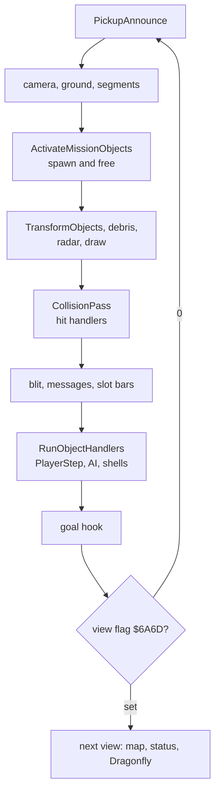

Witness: PlayLoop has L1 410 entries in five recordings (one per view change; the loop itself runs from the jump at
the end); CollisionPass and RunObjectHandlers have L1 3550 each, one a pass.

The point: collisions are found before the steps. A shell that the step of pass n moves into the tank is caught by
the collision pass of pass n + 1, after it has been drawn on top of the tank once.

## 10.2 The tank: PlayerStep

PlayerStep `$A8C7` is record 0's step handler. Each pass it does, in order:

1. **Terrain.** TerrainCollision (vector `$67F1`, `$CC3C`) tests the tank against the segments and sets the terrain
   type in `$CE69` (3 when nothing is hit).
2. **Walls.** Type 2 or `$80`: the speed is negated, the tank is moved back (MoveObject), and the step handler
   becomes BounceDecay `$CC09` for the next passes.
3. **Rough ground.** Types 0 and 6 store 1.25 x |speed| (with the speed's sign) in `$7E8E`; other types store the
   speed. IX+7 is written and restored around it, so the tank's own speed does not change (section 10.13).
4. **Fuel.** When the speed is not 0: Fuel `$7C57` -= (|speed| >> 4) OR 1. A borrow goes to OutOfFuel `$A94E`.
5. **Boundary.** BoundaryCheck `$D4B8` (section 10.3).
6. **Move.** MoveObject `$BFD1`: X += speed x sin(heading), Y += speed x cos(heading).
7. **Throttle.** speed = speed - StepY `$985F` (`$F8` = -8 while Q is held), clamped below `$30` forward and `$18`
   backward (47 and -23).
8. **Steering and fire** (PlayerSteering `$A985`): heading += turn / 2; the fire cooldown; the fire key calls the
   current store's fire routine (section 10.7).

```text
PlayerStep(tank):
    terrain = TerrainCollision(tank)               # 3 when no segment is hit
    if terrain in (2, $80):
        tank.speed = -tank.speed; MoveObject(tank)
        tank.step = BounceDecay; return
    rough_speed = 1.25 x tank.speed if terrain in (0, 6) else tank.speed   # to $7E8E only
    if tank.speed != 0:
        cost = (|tank.speed| >> 4) | 1
        if Fuel < cost: FailReason = "RAN OUT OF FUEL"; ScreenSix(); return
        Fuel -= cost
        BoundaryCheck()
        MoveObject(tank)
    s = tank.speed - StepY                         # StepY = -8 with Q held
    limit = 48 if s >= 0 else 24
    if |s| >= limit: s = sign(s) x (limit - 1)
    tank.speed = s
    PlayerSteering(tank)
```

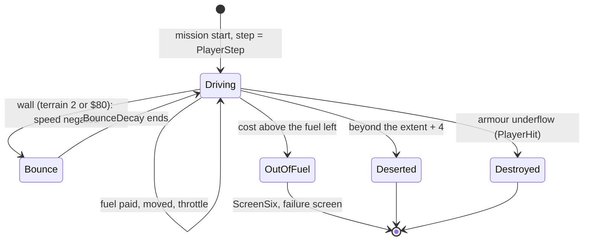

The fuel and the throttle in the code:

```text
$A935  CALL ApiVector08     ; |speed|, Z when 0
$A938  JR Z,$A961           ; standing: no fuel, no move
$A93A  SRL A
$A93C  SRL A
$A93E  SRL A
$A940  SRL A                ; |speed| >> 4
$A942  OR $01               ; at least 1
$A944  LD B,$00
$A946  LD C,A
$A947  LD HL,(Fuel)
$A94A  SBC HL,BC
$A94C  JR NC,$A958
OutOfFuel:
$A94E  LD HL,$CCED          ; "RAN OUT OF FUEL"
$A951  LD (FailReason),HL   ; $7BF9
$A954  CALL ScreenSix
$A957  RET
$A958  LD (Fuel),HL         ; the Infinite Fuel POKE writes 42 here
$A95B  CALL BoundaryCheck
$A95E  CALL ApiVector00     ; MoveObject
$A961  LD A,(StepY)
$A964  NEG
$A966  ADD A,(IX+$07)       ; speed - StepY
```

Worked example, the fuel recording (samples of the speed and the fuel word, `fuel-player.jsonl`):

| Sample | Speed | Fuel | Cost of the pass before |
| --- | --- | --- | --- |
| 7714 | 3 | 32 | 0: speed 0, no fuel |
| 7723 | 8 | 31 | (3 >> 4) OR 1 = 1 |
| 7752 | 31 | 28 | 1 |
| 7763 | 39 | 27 | (31 >> 4) OR 1 = 1 |
| 7772 | 47 | 24 | (39 >> 4) OR 1 = 3 |
| 7842 | 47 | 3 | 3 |
| 7852 | 47 | 0 | 3: no borrow, 0 is stored |
| 7861 | 47 | 0 | 3 > 0: borrow, `$7BF9` = `$CCED` |

The speed rises 3, 8, 15, 23, 31, 39, 47 and stays at the limit. A pass lasts 9 to 11 TV frames.

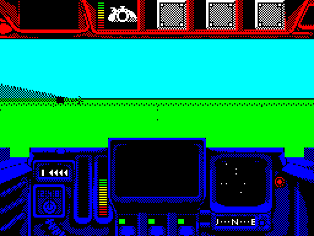

*Animation 10.1. The fuel recording, frames 7700-7910, every third frame (49 pictures): the tank drives north, the
fuel runs out, the completion report says "MISSION FAILED. / RAN OUT OF FUEL.". Drawn by `python3
../../kit/screen_anim.py --work work/docs/bcC/fuel --from 7700 --to 7910 --step 3 --scale 2
docs/img/play/fuel-failure.gif`.*

How to read it: the 3D view moves forward with the cockpit fixed; at frame 7862 MissionFailedScreen draws the
report.

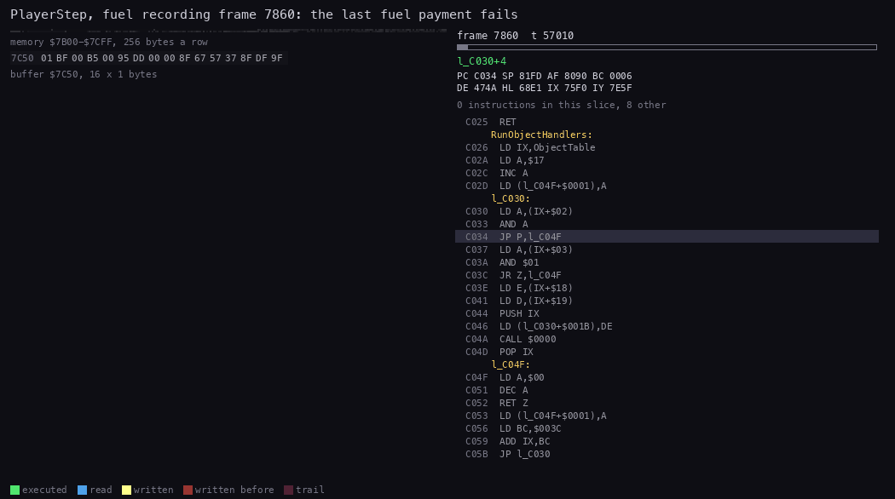

*Animation 10.2. PlayerStep in the fuel recording (POKE: Fuel = 32), frame 7860, T 56 900 to 61 300, 40 pictures:
the terrain scan, the fuel subtraction that borrows, OutOfFuel writing `$7BF9` and ScreenSix setting the view flag.
Drawn by `python3 ../../kit/routine_anim.py --work work/docs/bcC/fuel --listing build/game.lst --window
7860:56900-7860:61300 --pc A8C7-A9C0,CC3C-CCFF --view buffer:7C50:16x1:hex --range 7B00-7CFF --pictures 40 --out
docs/img/routines/PlayerStep.gif`.*

How to read it:

- Left: the bytes `$7C50-$7C5F`; the fuel word `$7C57-$7C58` reads `00 00` (paid down to 0 in frame 7851); the memory
  grid above is `$7B00-$7CFF`, where `$7BF9-$7BFA` take `$CCED`.
- Right: PlayerStep at `$A8C7`, TerrainCollision's scan (`$CC3C`-`$CC55`), then `$A935`-`$A957`: the cost of 3, the
  borrow, OutOfFuel; ScreenSix and SetScreen are "other".

The trace (`work/docs/bcC/pc-ps.txt`) runs `$A8C7`-`$A935` at T 57 033-60 709 and `$A938`-`$A954` at T 60 751-60 872:
the `JR NC` at `$A94C` falls through, so the fuel is never stored again.

See also the chart of speed, Y and fuel in [doc 07.11](07-objects.md#711-the-players-state).

Witness: the fuel recording, failure cause set during frame 7860 (sample 7861), MissionFailedScreen at 7862. The
`.ann` still calls OutOfFuel static; the fuel recording runs it (bcC-src-changes).

The point: fuel is spent by distance, not by time. A tank that stands still uses none; at full speed it uses 3 a
pass, so the 16 128 of a full tank last about 5400 passes, about 15 minutes of driving at 6 passes a second.

## 10.3 The boundary: AWOL and desertion

BoundaryCheck `$D4B8` compares the player's coarse X and Y (the operands `$BC12` and `$BC1D` that
ActivateMissionObjects patched) with the mission's half extents (`$DBCF`, `$DBD0`):

- inside on both axes: the state `$7578` = 0, the warning line is cleared;
- beyond the extent on an axis, up to 4 more: state 1, "GOING AWOL" is printed once;
- more than 4 beyond: state 2, `$7BF9` = `$CCD8` "PLAYER DESERTION", ScreenSix `$7047`.

```text
BoundaryCheck():
    for axis in X, Y:
        d = |player_coarse[axis]|; e = |extent[axis]|
        if d > e + 4: if SetAwolState(2) changed: FailReason = "PLAYER DESERTION"; ScreenSix()
        elif d > e:   if SetAwolState(1) changed: print "GOING AWOL"
    if inside on both: if SetAwolState(0) changed: clear the warning
```

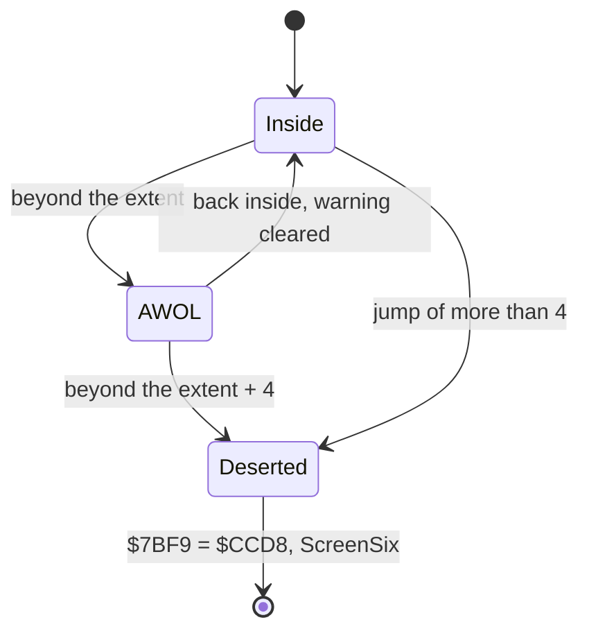

The first byte of BoundaryCheck is a gate: `NOP` in play, `RET` written by the view change (PlayLoopTail's exit
writes `$C9` to it) so the check does not run in other views.

Witness: BoundaryCheck has L1 3096 and SetAwolState `$D4E9` L1 3053 in five recordings. No recording drove out of the extents; the AWOL text and the
desertion are known only from the code. Mission 1's frame is drawn in [doc 07.3](07-objects.md#73-the-road-map-vertices-and-segments).

The point: the playfield has a soft edge and a hard edge 4 coarse units further, both checked on coarse units that
were computed once a pass for the spawner.

## 10.4 The enemies

The enemies are made by spawners around the camera, chase the tank, fire, and are removed when the tank is 3 coarse
units away ([doc 07.9](07-objects.md#79-the-object-kinds-as-state-machines) has each state machine and the step at
work).

The rules, in short:

- **Supply.** A spawner (mission 1: types 4, 6 and the flag 19) keeps three children. A dead or removed child is
  replaced at once, at a random place about 3 coarse units around the camera.
- **Chase.** A unit turns toward the tank by at most 8 heading steps a pass. Only when it is aligned does it fire,
  speed up to its top speed (40) and move.
- **Fire.** The whole mission has one gun timer (the operand at `$E7A9`). A shot resets it to 8-39 passes, so the
  enemies together fire about once every 24 passes, whatever their number.
- **Leash.** A unit more than 3 coarse units from the camera on an axis is removed.
- **Morale.** A unit with fewer than 2 hit points flees; with fewer than 4 near the tank it wanders and returns.

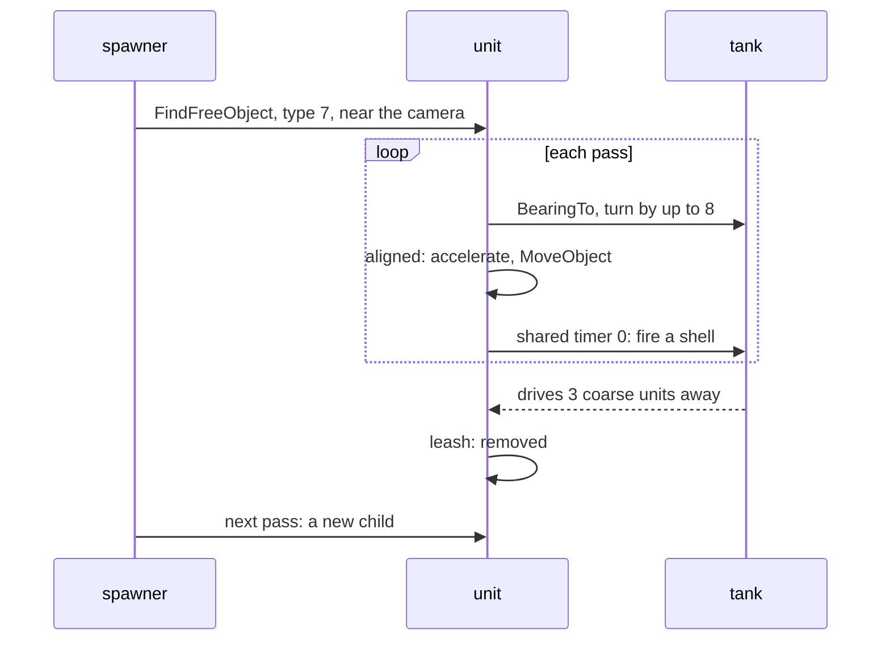

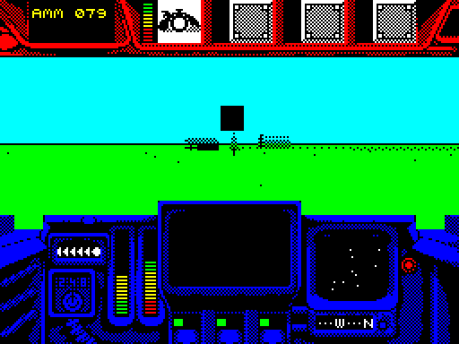

*Animation 10.3. The death recording, frames 7990-8135, every third frame: the enemy tank (record 7) ahead, its
shell coming in, "TANK HIT" on the message screen after the hit of frame 8121. Drawn by `python3
../../kit/screen_anim.py --work work/docs/bcC/death --from 7990 --to 8135 --step 3 --scale 2 --delay 90 --hold 2000
docs/img/play/enemy-attack.gif`.*

How to read it: the 3D view shows the units as the renderer draws them; the message screen in the cockpit prints
"TANK HIT".

Worked example: record 7 between the samples of frames 7980 and 8057 (`death-1.jsonl`):

| Sample | Heading | X (low, mid) | Y (low, mid) |
| --- | --- | --- | --- |
| 7980 | 247 | `$DFC1` | `$CF2F` |
| 7990 | 245 | `$DFAC` | `$CF7C` |
| 8000 | 245 | `$DFA1` | `$CFA2` |
| 8010 | 244 | `$DF95` | `$CFC8` |
| 8029 | 243 | `$DF7D` | `$D014` |
| 8057 | 241 | `$DF55` | `$D085` |

The heading falls by one a pass as the bearing to the moving tank changes; Y grows by 38 a pass (`$26`), X falls by
12: speed 40 on heading 245, about 17 degrees west of north (40 x cos 17 = 38, 40 x sin 17 = 12).

The path of three units and the tank over the world is [figure 7.2](07-objects.md#73-the-road-map-vertices-and-segments).

Witness: the death samples, frames 7590-9600: record 7 (type 7, the tank of the worked example) is made at 7601 and
freed at 9044; record 8 (type 26) lives 7605-8963; record 12 holds type 9 from 7612 to 8625, then type 28 shells
(8730-8863, 8897-9024), each freed when its lifetime ends or it hits; the shell hit on the tank is at 8121.

The point: the enemies' pressure does not depend on how many there are: one timer paces all their fire, and the
spawners refill the field around the tank wherever it goes.

## 10.5 Damage: PlayerHit, the armour and the subsystems

PlayerHit `$CAA5` is the tank's collision handler, called by CollisionPass with IY = the other record.

1. A wreck (IY +2 b6) does nothing.
2. A type 4 hitter goes to HitObstacle `$CB6C`: the tank is pushed back from a building.
3. Otherwise SetMessage prints "TANK HIT".
4. A hitter at height `$30` or more hits the top: `$8304` -= damage (+`$14`). The byte is stored before the test,
   so an underflow leaves the wrapped value.
5. A lower hitter hits a side. HitSide `$CB4C` takes the hitter's view-space x (+`$2F`/+`$30`, negated in the rear
   view): |x| < `$60` is side 2 (the front), else the sign gives side 1 or 3. `$8300` + side -= damage, tested before
   the store.
6. Then a subsystem of that side: E = Random / `$55` (0, 1, 2, or 3 when Random is 255); the pointer is at
   `$8338 + 6 (side - 1) + 2E`; the gauge loses the damage, with a floor of 0; a gauge with b7 set is skipped.
7. Unless the hitter's +3 b4 is set (shells have it), the tank's speed is negated, it is moved, and SetBounce runs:
   the knock-back.
8. Any armour underflow goes to ArmourDestroyed `$CB38`: `$7BF9` = `$CCBE` "FAILED TO MAKE PICKUP" when the goal
   flag `$68E8` is set, else `$CCAB` "UNIT DESTROYED"; JP ScreenSix `$7047`.

```text
PlayerHit(tank, hitter):
    if hitter.wreck: return
    if hitter.type == 4: HitObstacle(); return
    SetMessage("TANK HIT")
    if hitter.height >= $30:
        armour[top] -= hitter.damage            # stored even when it wraps
        if borrow: ArmourDestroyed()
    else:
        side = HitSide(hitter.view_x)            # 1, 2 (front) or 3
        if armour[side] < hitter.damage: ArmourDestroyed()
        armour[side] -= hitter.damage
        e = Random() / $55                       # 0-2, 3 when Random = 255
        gauge = pointer[$8338 + 6 (side - 1) + 2 e]
        if gauge >= 0: gauge = max(0, gauge - hitter.damage)
    if not hitter.no_knockback:
        tank.speed = -tank.speed; MoveObject(tank); SetBounce()

ArmourDestroyed():
    FailReason = "FAILED TO MAKE PICKUP" if GoalFlag else "UNIT DESTROYED"
    ScreenSix()
```

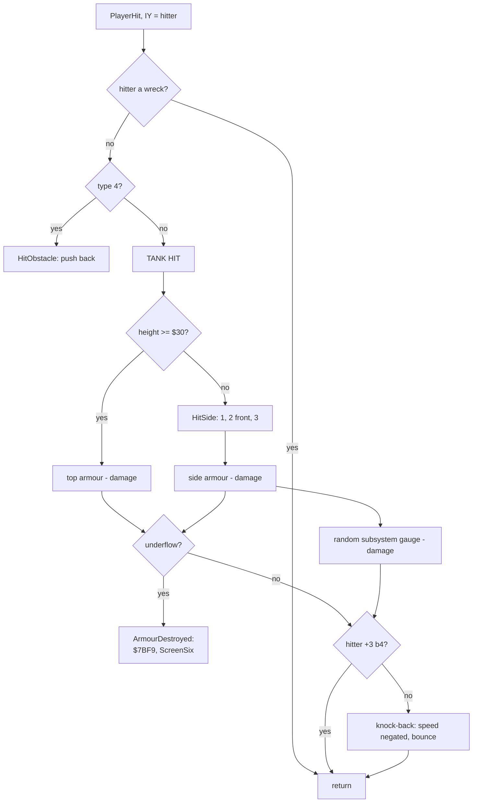

The top-armour path and the failure:

```text
$CAB3  CALL SetMessage      ; TANK HIT
$CAB6  LD L,(IY+$05)
$CAB9  LD H,(IY+$06)
$CABC  AND A
$CABD  LD BC,$0030
$CAC0  SBC HL,BC           ; hitter height - $30
$CAC2  JR C,$CAD1          ; low: a side
$CAC4  LD A,(PlayVars+3)   ; $8304, the top armour
$CAC7  SUB (IY+$14)        ; - damage
$CACA  LD (PlayVars+3),A   ; stored first
$CACD  JR C,ArmourDestroyed
$CACF  JR $CB1E            ; to the knock-back test
ArmourDestroyed:
$CB38  LD A,($68E8)        ; the goal flag
$CB3B  AND A
$CB3C  JR Z,$CB43
$CB3E  LD HL,$CCBE         ; FAILED TO MAKE PICKUP
$CB41  JR $CB46
$CB43  LD HL,$CCAB         ; UNIT DESTROYED
$CB46  LD (FailReason),HL  ; $7BF9
$CB49  JP ScreenSix
```

Worked example, death frame 8121. The hitter is record 15, the type 28 homing shell: height 64, damage 4, flags
`$17`.

1. Not a wreck, type 28: "TANK HIT".
2. Height 64 >= 48: the top. `$8304` = `$7F` - 4 = `$7B`; no borrow.
3. Flags `$17` have b4: no knock-back. The tank keeps speed 47 (sample 8122).

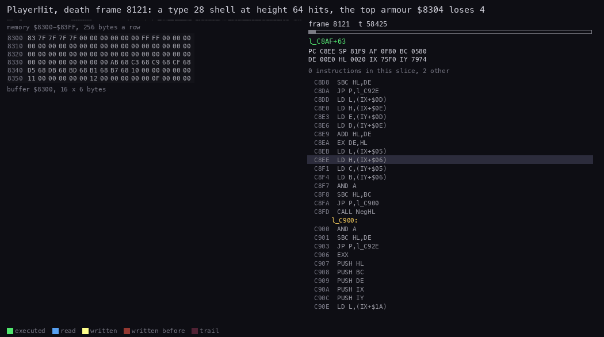

*Animation 10.4. PlayerHit in the death recording, frame 8121, T 58 400 to 59 400, 40 pictures. Drawn by
`python3 ../../kit/routine_anim.py --work work/docs/bcC/death --listing build/game.lst --window
8121:58400-8121:59400 --pc CAA5-CC3B,C900-C93F --view buffer:8300:16x6:hex --range 8300-83FF --pictures 40 --out
docs/img/routines/PlayerHit.gif`.*

How to read it:

- Left: `$8300-$835F`: the armour at `$8301-$8304` (row 1), the subsystem pointers from `$8338`, the slot records
  from `$834A`.
- `$8304` turns yellow when it goes from `$7F` to `$7B`.
- Right: the code; SetMessage and the sound are "other".

The death by armour, in the armour recording: a POKE at frame 7704 set all four armour bytes to 1. In frame 18423
the type 28 shell in record 19 (height 64, damage 4) hits the tank at X = -7292, Y = -11766 from X = -7526,
Y = -11547.

1. Height 64: the top. `$8304` = 1 - 4 = `$FD`, stored, with a borrow.
2. ArmourDestroyed: the goal flag is 0, so `$7BF9` = `$CCAB`.
3. ScreenSix `$7047`: the completion report shows "MISSION FAILED. / UNIT DESTROYED.".

The samples agree: `$8301-$8304` = `01 01 01 FD` and `$7BF9` = `$CCAB` from the sample of frame 18424.

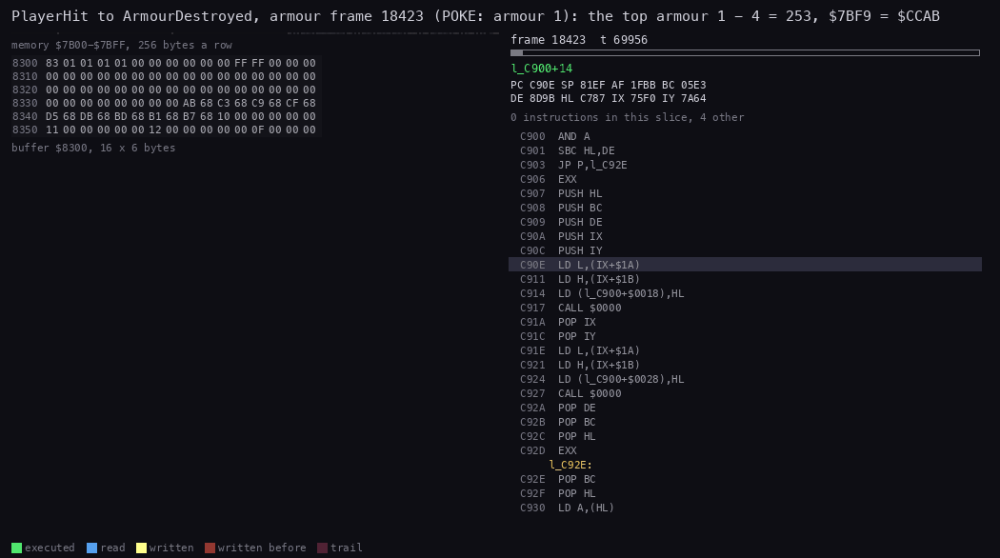

*Animation 10.5. The armour recording (POKE: armour 1), frame 18423 T 69 900 to frame 18424 T 1200, 40 pictures:
PlayerHit takes the top path, the armour wraps to `$FD`, ArmourDestroyed writes `$7BF9`. Drawn by `python3
../../kit/routine_anim.py --work work/docs/bcC/arm --listing build/game.lst --window 18423:69900-18424:1200 --pc
CAA5-CC3B --view buffer:8300:16x6:hex --range 7B00-7BFF --pictures 40 --out docs/img/routines/ArmourDestroyed.gif`.*

How to read it: the left view shows `$8300-$835F`; the memory grid above it is `$7B00-$7BFF`, where `$7BF9`-`$7BFA`
are written; the right column runs PlayerHit from `$CAA5`, then `$CB38`.

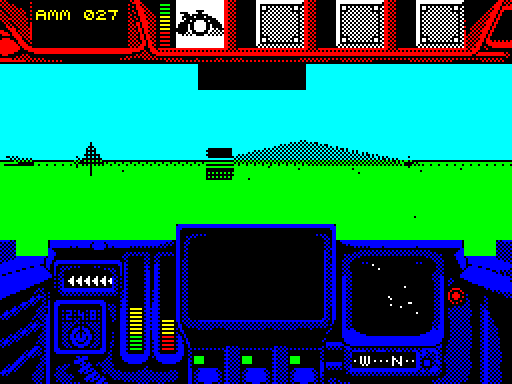

*Animation 10.6. The armour recording (POKE: armour 1), frames 18330-18560, every third frame, identical pictures
dropped (28 pictures): the shell comes in, "TANK HIT", the completion report draws over the view, "MISSION FAILED. /
UNIT DESTROYED.". Drawn by `python3 ../../kit/screen_anim.py --work work/docs/bcC/arm --from 18330 --to 18560 --step 3
--scale 2 --delay 80 --hold 2500 docs/img/play/armour-death.gif`.*

Witness: death frame 8121 (top armour `$7F` to `$7B`, the only hit in 12 000 frames); armour frame 18423 (a POKE
recording). The side path and the subsystems: m1complete, PlayerHit 44 runs (frames 15765-21558): the top branch
(`$CAC4`) 4, the side branch (`$CAD1`, HitSide) 40, the subsystem damage (`$CAFA-$CB1D`) 40; the armour went from
`7F 7F 7F 7F` to `54 7F 57 70` (`work/stage2/complete-NOTES.md`).

The point: the top is the weak side. Every enemy shell flies at height 48 or more (types 10, 12, 28, 31), so in
mission 1 only type 8 and 24 shells (heights 16 and 20) reach the side armour and the subsystems. The quirk at E = 3
is in [section 10.13](#1013-notable-features).

## 10.6 Kills and the score

An enemy or a building with the hit handler `$67DC` goes to HitTest `$B660` when it is hit.

1. A hitter without +3 b6 (not a weapon) does nothing.
2. HitPoints `$B6B1`: +`$13` -= the hitter's +`$14`. Positive: no kill. Zero or a borrow: a kill.
3. On a kill: UnregisterCollision, Debris `$B6D1` (pieces only when the object is in view, +2 b5).
4. A list object (+0 not `$FF`) goes to KillMissionObject `$B67D`: MarkDestroyed `$B6BD` sets b1 and clears b7 of its
   list record; the record keeps its place as a wreck (+2 b6 set, b2 cleared; +3 b0 and b2 cleared).
5. Any other object is freed (+2 = 0).
6. AddKillScore `$B692`: the kill sound, then the 32-bit score `$68E2` += +`$1E`/+`$1F`.

```text
HitTest(obj, hitter):
    if not hitter.is_weapon: return
    obj.hp -= hitter.damage
    if obj.hp > 0 and no borrow: return
    Unregister(obj); Debris(obj)
    if obj.index != $FF:
        list[obj.index].destroyed = 1; list[obj.index].alive = 0
        obj.wreck = 1; obj.step_on = 0
    else:
        obj.state = 0
    MissionScore += obj.score
```

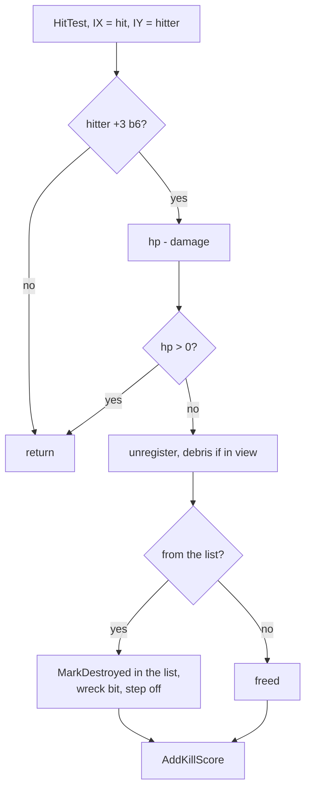

```text
AddKillScore:
$B692  CALL SoundKill
$B695  LD L,(IX+$1E)
$B698  LD H,(IX+$1F)       ; the object's score
$B69B  LD BC,($68E2)
$B69F  ADD HL,BC
$B6A0  LD ($68E2),HL       ; low word
$B6A3  LD BC,($68E4)
$B6A7  LD HL,$0000
$B6AA  ADC HL,BC
$B6AC  LD ($68E4),HL       ; high word with the carry
$B6AF  SCF
$B6B0  RET
```

Worked example, death frame 8531. Record 5 (`$771C`, list record 27, type 15, a hut: 1 hit point, score 250) is hit
by a turret shell (type `$81`, damage 1, flags `$57`).

1. The shell has +3 b6: a weapon.
2. HitPoints: 1 - 1 = 0: a kill.
3. Debris throws the hut's pieces (the hut is in view).
4. List record 27 gets b1, loses b7; record 5 becomes a wreck.
5. The score goes from 0 to 250 (`$000000FA`) in the sample of frame 8532.

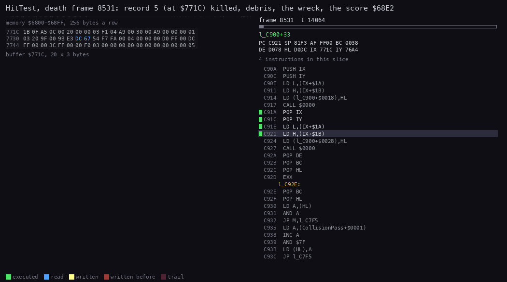

*Animation 10.7. HitTest in the death recording, frame 8531, T 14 000 to 17 200, 50 pictures. Drawn by `python3
../../kit/routine_anim.py --work work/docs/bcC/death --listing build/game.lst --window 8531:14000-8531:17200 --pc
B660-B765,C900-C93F --view buffer:771C:20x3:hex --range 6800-68FF --pictures 50 --out docs/img/routines/HitTest.gif`.*

How to read it: the view is record 5 (60 bytes, 20 a row): +`$13` (row 1, byte 19) goes to 0, +2 gets the wreck
bit; the memory grid above is `$6800-$68FF`, where the score `$68E2` is written last; the code runs HitTest, Debris,
KillMissionObject, MarkDestroyed, AddKillScore.

Witness: death frame 8531 (trace `work/docs/bcC/pc-kill.txt`: HitTest at T 14 115, Debris at 15 969, MarkDestroyed
at 16 799, AddKillScore at 17 030). The score reaches 500 by frame 13 660 (a second 250 kill).

The point: the score of a mission is the sum of what was destroyed. Hills and trees score 0, buildings 250-500, the
fuel dumps of mission 1 (its goal, template 33) 250 each, every enemy vehicle 2000. m1complete: `$68E2` = 250 at
frame 15787, 500 at 16137, the two dumps; m4complete: 2000 at 8247 from an enemy vehicle, while the train, the points
and the station score 0. The score counts only when the mission is completed (section 10.12).

## 10.7 The weapons

The fire key, when the cooldown `$A9FD` is 0, calls the current slot's fire routine through the operand at `$A9B9`,
set from the store-type table `$7B89` + 8 x type (word 3). Each fire routine takes one round (ConsumeAmmo `$B550`,
returns M when empty) and spawns a resident projectile type ([doc 07.5](07-objects.md#75-the-templates-and-the-object-types)).

| Store type | Store | Aim | Aim 2 | Fire | Select | Projectile |
| --- | --- | --- | --- | --- | --- | --- |
| 1 | Phoenix RRSA | `$B8FE` | `$B909` | `$C13E` | `$C11E` | `$83`, guided |
| 2 | Banshee RRSS | `$6BB0` | `$6BB0` | `$C14D` | `$C12C` | `$82` |
| 3 | K-40 Mortar | `$B8B9` | `$B8C4` | `$B59F` | `$B8CC` | `$80`, ballistic |
| 4 | Turret | `$6BB0` | `$6BB0` | `$B568` | `$C510` | `$81` |
| 5 | Phoenix IRSA | `$B8FE` | `$B909` | `$C20D` | `$C11E` | `$85`, guided |
| 6 | Banshee IRSS | `$6BB0` | `$6BB0` | `$C21D` | `$C12C` | `$84` |
| 7 | Dragonfly | `$6BB0` | `$6BB0` | `$C2BC` | `$C12C` | `$86`, flown |
| 8 | K-90 Cluster | `$6BB0` | `$6BB0` | `$CF3F` | `$CF30` | `$88` |
| 9 | Sleeper mine | `$CFF4` | `$CFE9` | `$D005` | `$CF26` | `$87` |
| 10 | SLAM Laser | `$D0F5` | `$D104` | `$6BB0` | `$D45E` | `$89` |
| 11 | Skeet bomb | `$6BB0` | `$6BB0` | `$D24C` | `$D24B` | `$8A` |
| 12 | Phantasm | `$D2E4` | `$D30B` | `$D319` | `$D46A` | `$8B` |
| 13 | Spectre | `$D2F7` | `$D30B` | `$D31F` | `$D34E` | `$8B` |

`$6BB0` is NoAction, a `RET`. The names of `$C13E`, `$C21D` and the two selects in `game.ann` do not match the table:
`$C13E` is fired by type 1 (Phoenix RRSA) and `$C21D` by type 6 (Banshee IRSS); bcC-src-changes lists the renames.

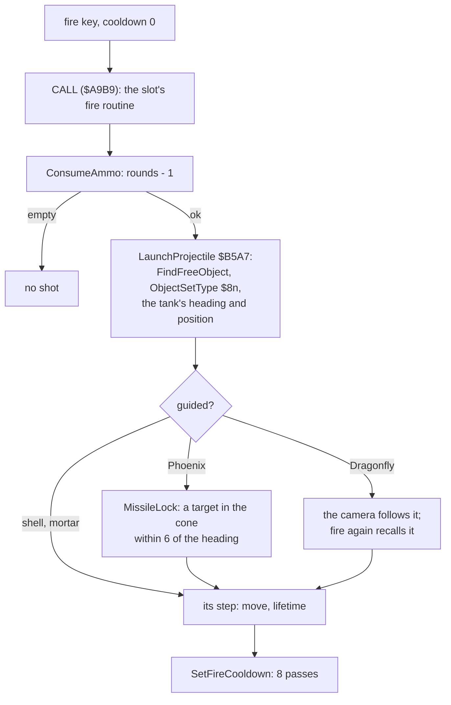

The projectiles:

- **Turret** (`$81`): straight, speed 96, 100 passes, damage 1.
- **K-40 Mortar** (`$80`): ballistic; the elevation (the operand `$B8BA`, 32 at start, lowered and raised with the aim
  keys) sets the vertical speed; height += vertical speed, which falls each pass; at the ground it bursts (Explode
  `$B8AB`).
- **Banshee** (`$82`, `$84`) and **Phoenix** (`$83`, `$85`): speed 120, damage 2. The Phoenix (store types 1 and 5)
  locks: MissileLock hooks MissileSeek into the depth-tree walk and turns toward a target within 6 heading steps
  (TargetInCone `$C197`). The IR variants (`$BA13`) also switch the IR view.
- **Dragonfly** (`$86`): spawned with the camera record `$B9F4` set to it; the controls steer it (DragonflyStep:
  turn, MoveObject, height from the up and down keys); the fire key recalls it and the camera returns to the tank.
- **Sleeper mine** (`$87`): damage 127; **K-90 Cluster** (`$88`): damage 31 with its own hit handler `$D0E9`;
  **SLAM Laser** (`$89`); **Skeet bomb** (`$8A`); **Spectre / Phantasm** (`$8B`), damage 31.

The payload limit: FitOrRemoveWeapon `$C173` (bank 6), on the stores screen, counts the slots that already hold the
store, refuses a store fitted "most fitted" times (MaxNumberExceeded), then adds its weight to the payload operand and
refuses a total of 1001 kg or more (PayloadExceeded).

```text
FitOrRemoveWeapon(slot, store):
    if slot is full: RemoveWeapon(slot); return
    n = number of slots with store.type
    if n == store.most: MaxNumberExceeded(); return
    w = payload + store.weight
    if w >= 1001: PayloadExceeded(); return
    payload = w
    slot = (store.type, store.weight, store.rounds)
```

```text
$C1B6  LD HL,(PayloadWeightOp+1)  ; the payload so far
$C1B9  ADD HL,BC                  ; + the store's weight
$C1BA  LD (SlotWeightOp+1),BC
$C1BE  PUSH HL
$C1BF  LD BC,$03E9                ; 1001
$C1C2  AND A
$C1C3  SBC HL,BC
$C1C5  POP BC                     ; the new total
$C1C6  JP NC,PayloadExceeded
$C1C9  LD (PayloadWeightOp+1),BC  ; accepted
```

Worked example: Turret (400 kg) and Dragonfly (500 kg) make 900 kg. A Phoenix RRSA (250 kg) would make 1150: refused.
A Spectre (100 kg) makes exactly 1000: accepted.

Witness: play and play2 fire every store once (L1 2-61 per fire routine); the play recording's POKE at `$C1C6` (the `JP NC`) lifts
the payload test (WALKTHROUGH 6.0). The guided-missile launch `$C171` / `$C25C` after a lock ran in no recording.

The point: the weapons share one engine. A store is four routine words and a template; the payload limit of 1000 kg
is the only balance between them, and the Turret alone weighs 400.

## 10.8 Debris

Debris `$B6D1` throws the pieces of a destroyed object into bank 3's particle list at `$CFEC`: 8 records of 20 bytes
(+0 flags, b7 live and b5 drawn; x, z, y with fractions; three speeds; two turn steps). Each piece gets the object's
position and random speeds (DebrisVelocity `$B74B` / `$B75C`). Bank3Step runs MoveDebris `$D16B` for each live piece
once a frame: the speeds are added, gravity takes 5 from the vertical speed, and a piece below the ground is freed.
DrawDebris `$D08C` draws them.

```text
MoveDebris(piece):
    piece.x += piece.vx; piece.z += piece.vz; piece.y += piece.vy
    piece.vy -= 5
    if piece.y < 0: piece.flags = 0
```

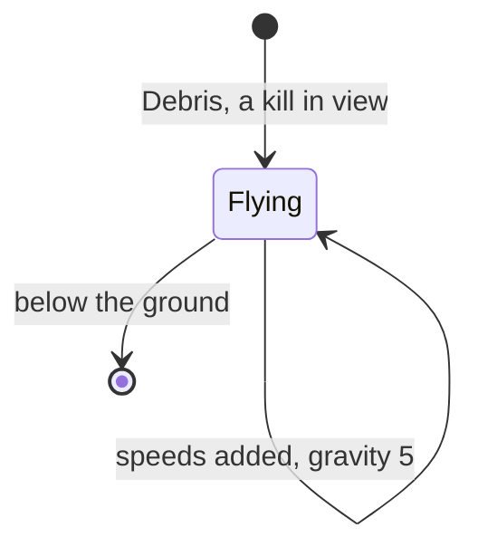

Witness: MoveDebris runs 661 times in death and play2; the kill of death frame 8531 runs Debris from T 15 969
(`pc-kill.txt`).

The point: debris is cosmetic and costs nothing out of sight: an object off the screen dies without pieces.

## 10.9 Goals, the Helicarrier and completion

Each mission's goal is a routine in its block, called every pass from `$6A66`. It reads the destroyed bits (b1) of
its target list records and sets the goal flag `$68E8` = `$FF`.

```text
GoalHook1:                  ; mission 1, $EB60
$EB60  LD A,($DE74)         ; list record 55, fuel dump 1
$EB63  AND $02
$EB65  RET Z
$EB66  LD A,($DE7C)         ; list record 56, fuel dump 2
$EB69  AND $02
$EB6B  RET Z
$EB6C  LD A,$FF
$EB6E  LD ($68E8),A         ; the goal is met
$EB71  RET
```

The ten goal hooks, disassembled from `src/res/missions` (the list index is (address - list) / 8):

| Mission | Catalogue goal | Hook | What it tests |
| --- | --- | --- | --- |
| 1 Blast Em Mission | destroy the two fuel dumps | `$EB60` | records 55 and 56 (type 33) destroyed |
| 2 Missile Battery | find the missile base and destroy it | `$E2F4` | records 6 and 8 (type 10) destroyed |
| 3 Hostage Rescue | rescue one of the northern hostages | `$E322` | record 2 (type 22) destroyed |
| 4 Railway Ambush | ambush a supply train, then destroy the station | `$E927` | records 11 (type 13) and 2 (type 8) destroyed, and byte +7 of record 3 (type 9) equal to `$FB` |
| 5 Night Moves | attack an enemy airfield | `$EA0E` | records 0-4 all destroyed (AND over five) |
| 6 Escort Duty | ensure the convoy's safe arrival | `$EB93` | a `RET`: the goal is set elsewhere in the mission code |
| 7 Satellite Search | recover a lost satellite | `$EA6F` | `CALL $F03D`, mission code |
| 8 River Raid | destroy the supply vessels and the power station | `$E97F` | records 12, 16, 19, 23 (type 13) and 0 (type 6) destroyed |
| 9 Hideout | demolish the secret hideout | `$E8B5` | `CALL $EC2E`, then record 39 (type 9) destroyed |
| 10 Grand Finale | the final and toughest mission | `$EA07` | records 2 and 3 (type 12) destroyed |

When the flag is set:

1. PickupAnnounce `$DB71` (a `NOP` gate) prints "MISSION COMPLETE PROCEED TO PICKUP" once and writes `RET` over its
   gate.
2. The key H calls the Helicarrier (PlaceHelicarrier `$D52E`): record 21, type `$8C`, height 104, spawned some
   8 000-10 000 world units from the pad. HelicarrierWait `$DB24` flies it to the pad (`$DBF0`, copied to `$7E82`):
   TurnToward and MoveObject toward the pseudo-record `$7E65`, whose X / Y at `$7E88` / `$7E8B` are the pad's. The
   test is the Helicarrier's own position, not the tank's: within 3 units of X >> 8 and Y >> 8 (768 world units) on
   both axes, HelicarrierArrival `$DB61` switches it to HelicarrierTurn `$DAC4`, which turns it 8 a step to the
   pad's heading; then HelicarrierDescent `$DADE` lowers it 8 a step from 104 to 24 and the handler `$6BB0` parks it.
   Pads: mission 1 world (0, 8192), mission 4 world (-20480, 4096).
3. HelicarrierHit `$DAAB`, the Helicarrier's collision handler, runs when the tank drives into the parked
   Helicarrier: with the goal flag set, JP `$67EE`: mission complete;
   without it, `$7BF9` = `$CC94` (only "MISSION FAILED.") and ScreenSix.
4. MissionCompleteScreen `$CD1E` (bank 6): Score `$CC79` += the mission score `$68E2`, MissionsDone `$6799` + n =
   `$FF`, the mission's completion text, MissionsCompleted + 1. Score and MissionsDone are written 32 frames after
   HelicarrierHit, before the report is drawn.

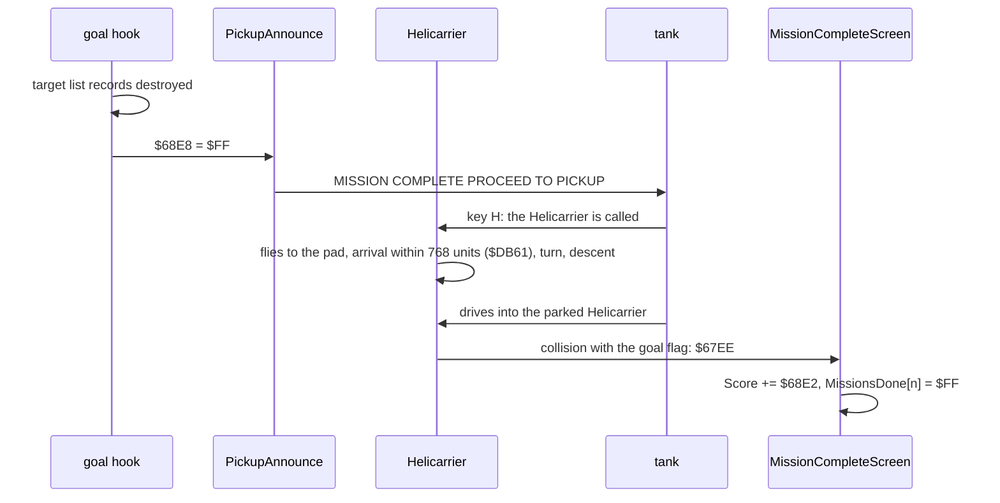

Witness: the completion recordings m1complete and m4complete (WALKTHROUGH 6.0, `work/stage2/complete-NOTES.md`). No earlier recording completes a mission: c1 ends in play, and MissionCompleteScreen (bank 6 `$CD1E`) has no run in its L1 (page 6), against one in m1complete.

| Event | m1complete | m4complete |
| --- | ---: | ---: |
| goal hook first run (one a pass) | 7595 (GoalHook1 `$EB60`, 1504 runs) | 3217 (GoalHook4 `$E927`, 2237 runs) |
| goal records destroyed | 15786, 16136 (records 55, 56) | 8836 (engine), 14213 (station) |
| goal flag `$68E8` = `$FF`, PickupMessage `$DB77` | 16138 | 14214-14215 |
| H: HelicarrierWait first run | 16239 | 14336 |
| HelicarrierArrival `$DB61` | 17099 | 15435 |
| turn `$DAC4`, descent `$DADE` | 17109-17205, 17213-17311 | 15442-15504, 15510-15575 |
| HelicarrierHit `$DAAB`, then `$67EE` | 21558 | 21299 |
| MissionCompleteScreen `$CD1E`; Score, MissionsDone written | 21560-21721; 21590 | 21301-21462; 21331 |

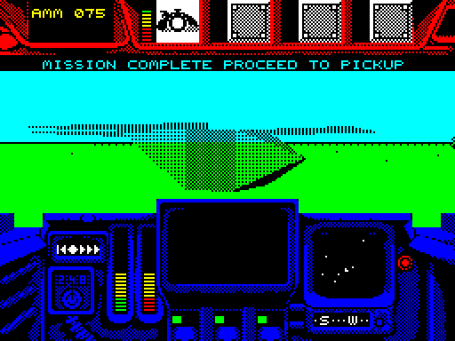

*m1complete frame 21533: the Helicarrier parked on the pad, the tank about to drive into it; the pickup message is
still in the message line. Screenshot of the recording (bank 5).*

The hooks of missions 1 and 4 are witnessed; the other eight are read from their blocks. Mission 4's `$FB` test is
the siding: shooting the points (record 10, type 11, hit handler `$E638`, frames 3819 and 4010) writes `$60` to
`$E7C0-$E7C2`, the next train runs onto the siding, where the records' Y word is `$FBFF` (byte +7 = `$FB`; on the
main line Y is 0); the engine destroyed there (8836) stops the train with record 3 at `$FB`, and the station (14213)
completes the goal.

The point: the goal is data plus a few lines of code per mission. Most goals are "these list records destroyed",
read from the same bit that keeps a wreck from respawning; the Escort Duty and Satellite Search goals live in their
missions' own code.

## 10.10 Failure and its causes

A mission fails when a routine writes a text address to `$7BF9` and calls ScreenSix `$7047`. MissionFailedScreen
`$CD84` (bank 6) shows "MISSION FAILED." (`$CC94`) and the text; then the game returns to the title. There are no
lives.

| Cause | Text (bank 6) | Set by | Witness |
| --- | --- | --- | --- |
| armour underflow | `$CCAB` UNIT DESTROYED | ArmourDestroyed `$CB38` | armour frame 18423 (POKE) |
| armour underflow after the goal | `$CCBE` FAILED TO MAKE PICKUP | ArmourDestroyed | known only from the code |
| beyond the extent + 4 | `$CCD8` PLAYER DESERTION | BoundaryCheck `$D4CE` | known only from the code |
| fuel | `$CCED` RAN OUT OF FUEL | OutOfFuel `$A94E` | fuel frame 7860 (POKE) |
| the bridge | `$CD01` TANK DESTROYED ON BRIDGE | mission code (missions with a switch segment) | known only from the code |
| the Helicarrier hit before the goal | `$CC94` alone | HelicarrierHit `$DAAB` | known only from the code |

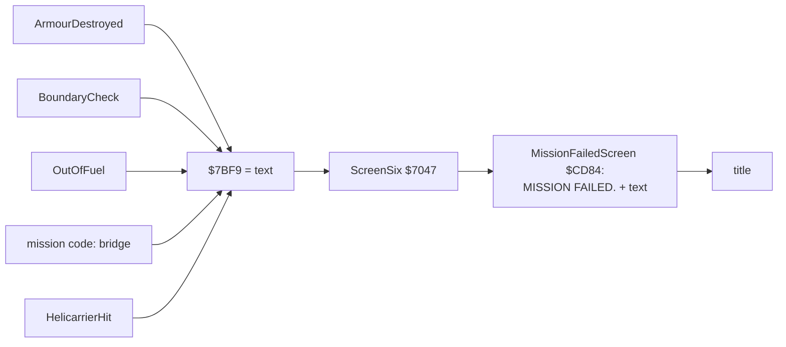

The point: one pointer is the whole failure state. Every cause writes its text's address and jumps to the same
screen.

## 10.11 The Grand Finale

LoadMissionIfAllowed `$759A` loads the mission the tape holds. It refuses a mission already completed (MissionDone:
`$6799` + n not 0). For mission 10 (index 9) it ANDs the nine flags `$6799-$67A1`: any 0 refuses it.

```text
$759A  CALL MissionDone      ; NZ: already done
$759D  RET NZ
$759E  LD A,$09
$75A0  CP C                  ; the Grand Finale?
$75A1  JR NZ,$75AF
$75A3  LD A,$FF
$75A5  LD HL,MissionsDone    ; $6799
$75A8  LD B,$09
$75AA  AND (HL)
$75AB  INC HL
$75AC  DJNZ $75AA
$75AE  RET Z                 ; one is missing: refused
$75AF  CALL LoadMission
```

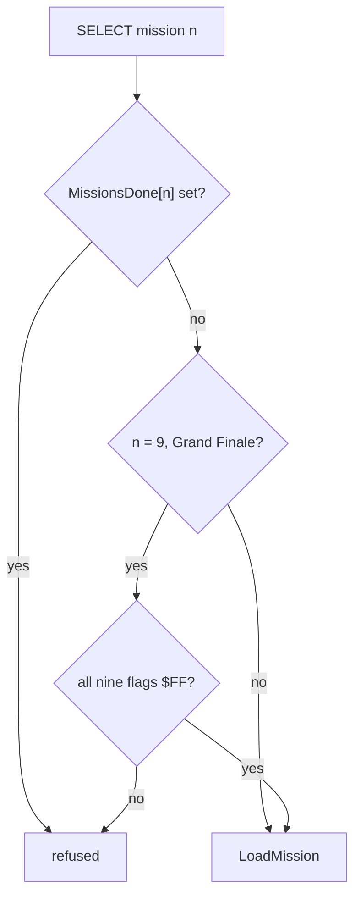

Witness: the m10 recording selects the Grand Finale with no mission done; LoadMissionIfAllowed returns at `$75AE`
and the status screen follows (L1 18 in m10, m2erbe, m2ocean, missions).

The point: the order of missions 1-9 is free, but each counts once, and the tenth needs all nine.

## 10.12 The score and the load / save codes

Score `$CC79` (bank 6) is a 32-bit number, low byte first: the sum of the completed missions' scores. The save code
packs Score and the ten MissionsDone flags into ten characters.

EncodePassword `$CE2E`:

- values 0-7: four bits of the score each, from Score's first byte, high nibble first; bit 4 is the flag of missions
  1-8;
- value 8: bit 0 the flag of mission 9, bit 1 the flag of mission 10, bits 2-4 the low three bits of the checksum;
- value 9: bits 3-7 of the checksum;
- the checksum is the XOR of the four score bytes.

PasswordToChars maps each value through PasswordAlphabet `$CF5F`, "9876543210ZYXWVUTSRQPONMLKJIHABC...": value 0 is
"9", 10 is "Z", 29 is "A".

```text
EncodePassword():
    bits = Score bytes 0..3, each high nibble first
    for i in 0..7: value[i] = next 4 bits | (MissionsDone[i] & $10)
    c = Score[0] ^ Score[1] ^ Score[2] ^ Score[3]
    value[8] = (MissionsDone[8] & 1) | (MissionsDone[9] & 2) | (c & 7) << 2
    value[9] = (c >> 3) & $1F
    text = alphabet[value[i]] for i in 0..9

DecodePassword():                       # the inverse; Z when the checksum agrees
    for k in 0..3: Score[k] = (value[2k] << 4 | value[2k+1] & $0F) & $FF
    flags from bit 4 of values 0-7 and bits 0, 1 of value 8
    return c(Score) == (value[8] & $1C) >> 2 | value[9] << 3
```

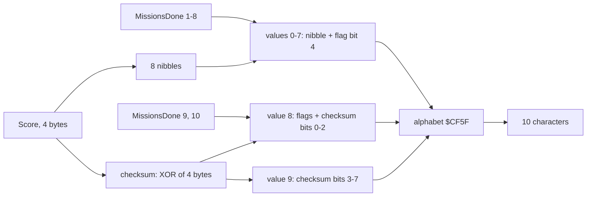

```text
$CE36  LD HL,$6799          ; MissionsDone
$CE39  LD DE,PasswordValues ; $CEFB
$CE3C  LD B,$08
EncodeLoop:
$CE3E  LD A,$04
$CE40  CALL ScoreBits       ; the next 4 bits of the score
$CE43  LD C,A
$CE44  LD A,(HL)            ; MissionsDone[i]
$CE45  INC HL
$CE46  AND $10              ; its bit 4
$CE48  OR C
$CE49  LD (DE),A            ; value i
$CE4A  INC DE
$CE4B  DJNZ EncodeLoop
$CE4D  LD A,(HL)            ; mission 9
$CE4E  INC HL
$CE4F  AND $01
$CE51  LD C,A
$CE52  NOP
$CE53  LD A,(HL)            ; mission 10
$CE54  AND $02
$CE56  OR C
$CE57  LD C,A
$CE58  LD HL,Score
$CE5B  XOR A
$CE5C  LD B,$04
ChecksumLoop:
$CE5E  XOR (HL)             ; the XOR of the score bytes
$CE5F  INC HL
```

Worked examples:

1. Nothing done, Score 0: every value is 0, the code is "9999999999". The menu recording shows this code on the save
   screen at frame 10 817.
2. Mission 1 done with 4000 points (Score = `A0 0F 00 00`), worked from the code: the nibbles are A, 0, 0, F, 0, 0, 0,
   0; value 0 = `$0A` | `$10` = 26; the checksum is `$A0` XOR `$0F` = `$AF`; value 8 = (`$AF` AND 7) << 2 = 28;
   value 9 = `$AF` >> 3 = 21. The values 26, 0, 0, 15, 0, 0, 0, 0, 28, 21 give "J99U9999HO".
3. Recorded, m1complete frame 22240: mission 1 done, Score 500 (`F4 01 00 00`): value 0 = 15 | 16 = 31 "C", then
   4 "5", 0 "9", 1 "8", four 0 "9999"; the checksum `$F4` XOR `$01` = `$F5`: value 8 = 5 << 2 = 20 "P", value 9 =
   `$F5` >> 3 = 30 "B". The screen shows "C5989999PB".
4. Recorded, m4complete frame 22035: missions 1 and 4 done, Score 2500 (`C4 09 00 00`): value 0 = 12 | 16 = 28 "H",
   4 "5", 0 "9", value 3 = 9 | 16 = 25 "K", "9999"; the checksum `$CD`: 20 "P", 25 "K". The screen shows
   "H59K9999PK".

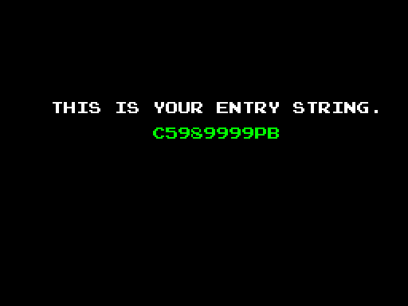

*m1complete frame 22240: SAVE GAME after mission 1, the code "C5989999PB" of example 3. Screenshot of the recording.*

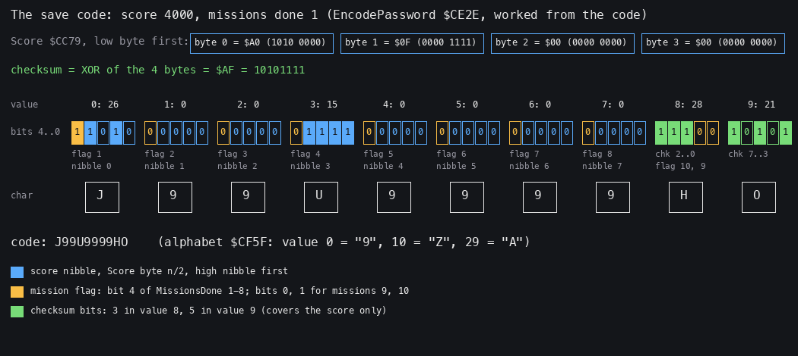

*Figure 10.1. The second worked example, score 4000 with mission 1 done, packed into "J99U9999HO": the four score
bytes, the checksum `$AF`, the ten 5-bit values coloured by what they carry, the characters. Computed from the code's
rules, not from a recording: `python3 tools/fig_gameplay.py password --score 4000 --done 1
docs/img/gameplay/save-code.png`.*

How to read it: blue bits are the score's nibbles in order, orange the mission flags, green the checksum; value 0 is
`1 1010`: the flag of mission 1 and the high nibble of `$A0`.

Witness: EncodePassword and DecodePassword have L1 1 each in the menu recording (the code typed at frames
1764-1962, the save code at 10 817). The second example was not typed in a recording.

The point: the code holds the whole campaign: 32 bits of score, ten flags and a 5-bit checksum in 50 bits. The
checksum covers only the score, so the mission flags of a code can be edited freely (section 10.13).

## 10.13 Notable features

**Self-modifying operands as variables.** The game keeps its state in the operands of its own instructions:

- the player's coarse X and Y in `LD A,n` at `$BC12` and `$BC1D`, written once a pass and read by both the spawner
  and BoundaryCheck;
- the spawner's list pointer, count and index (`$BBF2`, `$BBF9`, `$BC33`);
- the collision pass counter (`$C7BD`) and the dx, dy of the box test (`$C8BE`, `$C8D5`);
- the three words of Random (`$A77C`, `$A77F`, `$A787`);
- the gates `NOP` / `RET` at PickupAnnounce `$DB71`, PlaceHelicarrier `$D52E`, BoundaryCheck `$D4B8`;
- the mission code's shared gun timer at `$E7AA`.

Witness: every one is written in the traces of death frames 7598, 8121 and 7980 (animations 7.1-7.3).

**The collision timers.** CollisionPass schedules each pair by distance and speed instead of testing all pairs
([doc 07.10](07-objects.md#710-collisions-collisionpass)).

**Enemies made at the camera.** The spawners place their children around the camera, not around themselves, and the
leash removes them 3 coarse units away (doc 07.9).

**Wrecks are never freed.** ActivateMissionObjects skips destroyed list records, so a wreck's record is never
despawned: each building destroyed holds one of the 20 general records until the mission ends. Witness: death frame
16 000, the wreck of list record 26 in record 8, 16.6 coarse units from the tank.

**The PlayerHit E = 3 quirk.** The subsystem index is Random / `$55`; for Random = 255 it is 3, one past the three
pointers of the side. For side 1 and 2 it reads the next side's first pointer; for side 3 it reads `$834A`, the first
slot record of the stores screen, as a pointer, and subtracts the damage from whatever byte it names, unless that
byte has b7 set. Known only from the code.

```text
$CAF3  SUB $55
$CAF5  JR C,$CAFA
$CAF7  INC E                ; E = 0, 1, 2, or 3 when A = 255
$CAF8  JR $CAF3
...
$CB0B  SLA E
$CB0D  ADD HL,DE            ; $8338 + 6 (side - 1) + 2E
```

**The `CP $06` that does nothing.** In CollisionPass both branches after `CP $06` (`$C897`) load A = L; a test meant
to cap the delay at 6 was left without effect.

**The rough-ground speed nobody reads.** PlayerStep writes 1.25 x |speed| into IX+7 and `$7E8E` on terrain 0 and 6,
then restores IX+7 at once. Nothing resident reads `$7E8E`; the `.ann` says rough ground "slows by a quarter", but the
tank's speed is not changed.

**The top armour stores before it tests.** The top path stores the wrapped value (armour frame 18423: `$FD`), the
side path tests before storing.

**R in the random numbers.** Random adds the refresh register, so the same keys give another game after any change of
the code path (doc 07.13).

**Left by the authors.** DevMissionLoader `$CE68`, a tape loader for a file "MISSHDR:0:" that nothing calls; its
second byte `$CE69` is reused as the terrain type, which is why the listing names the terrain type
`DevMissionLoader+1`. PushLeftover `$D203` in bank 3 holds 509 bytes of `$E5`, the trace of a `PUSH HL` clear. The
Helicarrier variant `$DB1A` aimed at the player is not called. Twelve `NOP`s at `$CF26` are room for a patch in the
password code.

## 10.14 What no recording reached

- **A completed mission** other than 1 and 4: the goal hooks of missions 2, 3 and 5-10 are read from their blocks
  (missions 1 and 4: m1complete, m4complete, section 10.9).
- **FAILED TO MAKE PICKUP, PLAYER DESERTION, TANK DESTROYED ON BRIDGE**: known only from the code.
- **A guided missile hitting**: MissileLock ran in play2, the launch after a lock (`$C171`, `$C25C`) did not.
- **Missions 2-10 in play**: their goal hooks are read from `src/res/missions`, not traced. Mission 2's Ocean block is
  damaged ([doc 03](03-build-and-load.md)).
- **The Grand Finale loaded**: refused in m10; its own code is read from the block only.
