# 10. Gameplay logic

What this covers: the rules of Battle Command as code. The player drives one Mauler tank through a mission's world,
destroys the goal objects, and is picked up by the Helicarrier. The enemies are made around the tank and chase it.
Damage comes off four armour gauges and nine subsystem gauges. A mission ends in success, or in one of six
failures; there are no lives. This document gives:

- the order of the work in a pass;
- the tank: steering, speed, terrain, fuel, the boundary;
- the enemies: where they come from, how they attack, the leash;
- damage: PlayerHit, the armour, the subsystems, the death by armour;
- kills and the score;
- every weapon, the Dragonfly and the payload limit;
- debris;
- the goals of the ten missions, the pickup and completion;
- every failure and its cause, and the mission clock, which causes none;
- the Grand Finale, the total score and the load / save codes;
- the notable features, and what no recording reached.

The records, the templates, the spawn path and the collision pass are [doc 07](07-objects.md); the object kinds'
state machines are [doc 07.9](07-objects.md#79-the-object-kinds-as-state-machines). The mission flow around play
(briefing, stores, the end screens) is [doc 04](04-game-loop.md); the controls are [doc 05](05-controls.md).

The recordings it rests on ([WALKTHROUGH 6.0](../WALKTHROUGH.md#60-the-recordings), opened as in
[doc 07](07-objects.md)):

- `death` (stage 1): Blast Em Mission with the Turret for 12 000 frames: enemy units, one hit on the tank (frame
  8121), kills, no death. Sampled at every frame 7590-9600 (`work/docs/bcC/death-1.jsonl`).
- `fuel` (stage 2): a POKE, Fuel `$7C57` = 32 at frame 7704; the tank driven north until the fuel failure (frame
  7860). Sampled at every frame 7690-7910 (`work/docs/bcC/fuel-player.jsonl`).
- `armour` (made for this document, `work/docs/bcC/rec/armour`): a POKE at frame 7704 sets the four armour bytes
  `$8301-$8304` to 1; the death plan's keys; the first hit (frame 18423) destroys the tank. Recorded with
  `python3 tools/rec_armour.py --work work/docs/bcC/rec/armour --port-base 37370 --start
  work/stage1/explore/loaded.szx`; the POKE is on the recording's machine only, never in the image.
- `m1complete`, `m4complete` (stage 2, `work/stage2/rec/`, `work/stage2/complete-NOTES.md`): Blast Em Mission and
  then Railway Ambush completed (the goal, H, the Helicarrier, the report, the save code); the Immunity POKE only
  for the long drives, the original byte back before any shot.
- `play`, `play2` (stage 1): every store fitted and fired, the Dragonfly flown (L1 counts only).
- `menu` (stage 1): the load code typed, STATUS and the save code (frame 10 817).
- `m10` (stage 1): the Grand Finale refused.

A sample of frame N is the memory at the start of frame N. A trace puts an instruction in the frame where it ran.
A [pass](README.md#terms) is one turn of PlayLoop `$6A0C`, 7 to 12 TV frames.

## 10.1 A pass: the order of the work

PlayLoop `$6A0C` is one 3D frame of the normal view. Its first half draws; its tail, PlayLoopTail `$6A57`, moves
the world. The order decides what a frame shows: the objects are drawn where the previous pass left them, then they
move.

```text
$6A0C  CALL PickupAnnounce          ; the goal message, once
$6A0F  CALL StartViewPass           ; the 3D frame begins
$6A12  CALL PlayKeys
$6A15  CALL SetCamera
...                                 ; ground, segments, clip window
$6A24  CALL ActivateMissionObjects  ; spawn / free 16 list records
$6A27  CALL TransformObjects        ; to view space, the depth tree
$6A2A  CALL Bank3Step               ; debris
$6A2D  CALL CameraSinCosAgain
$6A30  CALL DrawRadar
$6A33  CALL DrawObjectsInOrder
$6A36  XOR A
$6A37  LD (PlayerStep+1),A          ; re-arm PlayerStep's first JR
$6A3A  LD (FirstFrameHook),A
$6A3D  CALL CollisionPass           ; pairs, handlers
$6A40  CALL DrawSightOverlay
...                                 ; four CALL NoAction
$6A57  CALL RequestViewBlit         ; the back buffer to the screen
$6A5A  CALL MessageOnce
$6A5D  CALL UpdateSlotBars
$6A60  CALL RunObjectHandlers       ; every step handler, the tank first
$6A63  CALL FlickerPlayer
$6A66  CALL LoopHook                ; the mission's goal hook
$6A69  CALL FirstFrameHook
$6A6C  LD A,$00                     ; the view-change flag ($6A6D)
$6A6E  AND A
$6A6F  JR Z,PlayLoop
```

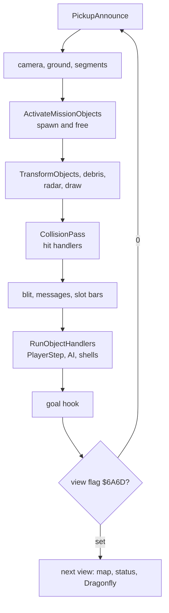

Witness: PlayLoop has L1 410 entries in five recordings (one per view change; the loop itself runs from the jump at
the end); CollisionPass and RunObjectHandlers have L1 3550 each, one a pass.

The point: collisions are found before the steps. A shell that the step of pass n moves into the tank is caught by
the collision pass of pass n + 1, after it has been drawn on top of the tank once.

## 10.2 The tank: PlayerStep

PlayerStep `$A8C7` is record 0's step handler. Each pass it does, in order:

1. **Terrain.** TerrainCollision (vector `$67F1`, `$CC3C`) tests the tank against the segments and sets the terrain
   type in `$CE69` (3 when nothing is hit).
2. **Walls.** Type 2 or `$80`: the speed is negated, the tank is moved back (MoveObject), and the step handler
   becomes BounceDecay `$CC09` for the next passes.
3. **Brake.** With the key S down (KeyState b1, KeyCode `$53`) `$A8F2` jumps to `$A9C0`, which makes BrakeKey
   `$A9C9` the step handler; the rest of this pass is skipped ([doc 05](05-controls.md)).
4. **Road.** Terrain 0 (a segment of style 0, the road; every segment of mission 1 is style 0) and style 6 store
   1.25 x |speed| (with the speed's sign) in `$7E8E` (read only by the speed bar); other terrain stores the speed. IX+7 is written and
   restored around it, so the tank's own speed does not change (section 10.13).
5. **Fuel.** When the speed is not 0: Fuel `$7C57` -= (|speed| >> 4) OR 1. A borrow goes to OutOfFuel `$A94E`.
6. **Boundary.** BoundaryCheck `$D4B8` (section 10.3).
7. **Move.** MoveObject `$BFD1`: X += speed x sin(heading), Y += speed x cos(heading).
8. **Throttle.** speed = speed - StepY `$985F` (`$F8` = -8 while Q is held), clamped below `$30` forward and `$18`
   backward (47 and -23).
9. **Steering and fire** (PlayerSteering `$A985`): heading += turn / 2; the fire cooldown; the fire key calls the
   current store's fire routine (section 10.7).

```text
PlayerStep(tank):
    terrain = TerrainCollision(tank)               # 3 when no segment is hit
    if terrain in (2, $80):
        tank.speed = -tank.speed; MoveObject(tank)
        tank.step = BounceDecay; return
    if key S down: tank.step = BrakeKey; return     # $A9C0
    road_speed = 1.25 x tank.speed if terrain in (0, 6) else tank.speed    # to $7E8E: the speed bar only
    if tank.speed != 0:
        cost = (|tank.speed| >> 4) | 1
        if Fuel < cost: FailReason = "RAN OUT OF FUEL"; ScreenSix(); return
        Fuel -= cost
        BoundaryCheck()
        MoveObject(tank)
    s = tank.speed - StepY                         # StepY = -8 with Q held
    limit = 48 if s >= 0 else 24
    if |s| >= limit: s = sign(s) x (limit - 1)
    tank.speed = s
    PlayerSteering(tank)
```

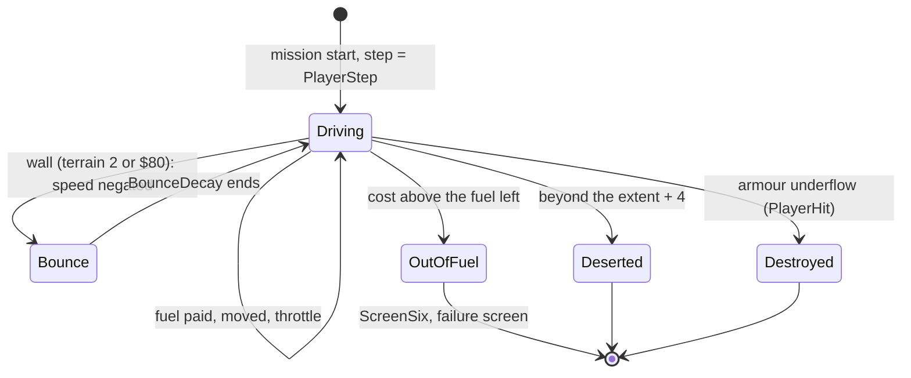

The fuel and the throttle in the code:

```text
$A935  CALL ApiVector08     ; |speed|, Z when 0
$A938  JR Z,$A961           ; standing: no fuel, no move
$A93A  SRL A
$A93C  SRL A
$A93E  SRL A
$A940  SRL A                ; |speed| >> 4
$A942  OR $01               ; at least 1
$A944  LD B,$00
$A946  LD C,A
$A947  LD HL,(Fuel)
$A94A  SBC HL,BC
$A94C  JR NC,$A958
OutOfFuel:
$A94E  LD HL,$CCED          ; "RAN OUT OF FUEL"
$A951  LD (FailReason),HL   ; $7BF9
$A954  CALL ScreenSix
$A957  RET
$A958  LD (Fuel),HL         ; the Infinite Fuel POKE writes 42 here
$A95B  CALL BoundaryCheck
$A95E  CALL ApiVector00     ; MoveObject
$A961  LD A,(StepY)
$A964  NEG
$A966  ADD A,(IX+$07)       ; speed - StepY
```

Worked example, the fuel recording (samples of the speed and the fuel word, `fuel-player.jsonl`):

| Sample | Speed | Fuel | Cost of the pass before |
| --- | --- | --- | --- |
| 7714 | 3 | 32 | 0: speed 0, no fuel |
| 7723 | 8 | 31 | (3 >> 4) OR 1 = 1 |
| 7752 | 31 | 28 | 1 |
| 7763 | 39 | 27 | (31 >> 4) OR 1 = 1 |
| 7772 | 47 | 24 | (39 >> 4) OR 1 = 3 |
| 7842 | 47 | 3 | 3 |
| 7852 | 47 | 0 | 3: no borrow, 0 is stored |
| 7861 | 47 | 0 | 3 > 0: borrow, `$7BF9` = `$CCED` |

The speed rises 3, 8, 15, 23, 31, 39, 47 and stays at the limit. A pass lasts 9 to 11 TV frames.


*Animation 10.1. The fuel recording, frames 7700-7910, every third frame (49 pictures): the tank drives north, the
fuel runs out, the completion report says "MISSION FAILED. / RAN OUT OF FUEL.". Drawn by `python3
../../kit/screen_anim.py --work work/docs/bcC/fuel --from 7700 --to 7910 --step 3 --scale 2
docs/img/play/fuel-failure.gif`.*

How to read it: the 3D view moves forward with the cockpit fixed; at frame 7862 MissionFailedScreen draws the
report.


*Animation 10.2. PlayerStep in the fuel recording (POKE: Fuel = 32), frame 7860, T 56 900 to 61 300, 40 pictures:
the terrain scan, the fuel subtraction that borrows, OutOfFuel writing `$7BF9` and ScreenSix setting the view flag.
Drawn by `python3 ../../kit/routine_anim.py --work work/docs/bcC/fuel --listing build/game.lst --window
7860:56900-7860:61300 --pc A8C7-A9C0,CC3C-CCFF --view buffer:7C50:16x1:hex --range 7B00-7CFF --pictures 40 --out
docs/img/routines/PlayerStep.gif`.*

How to read it:

- Left: the bytes `$7C50-$7C5F`; the fuel word `$7C57-$7C58` reads `00 00` (paid down to 0 in frame 7851); the memory
  grid above is `$7B00-$7CFF`, where `$7BF9-$7BFA` take `$CCED`.
- Right: PlayerStep at `$A8C7`, TerrainCollision's scan (`$CC3C`-`$CC55`), then `$A935`-`$A957`: the cost of 3, the
  borrow, OutOfFuel; ScreenSix and SetScreen are "other".

The trace (`work/docs/bcC/pc-ps.txt`) runs `$A8C7`-`$A935` at T 57 033-60 709 and `$A938`-`$A954` at T 60 751-60 872:
the `JR NC` at `$A94C` falls through, so the fuel is never stored again.

See also the chart of speed, Y and fuel in [doc 07.11](07-objects.md#711-the-players-state).

Witness: the fuel recording, failure cause set during frame 7860 (sample 7861), MissionFailedScreen at 7862. The
`.ann` still calls OutOfFuel static; the fuel recording runs it (bcC-src-changes).

The point: fuel is spent by distance, not by time. A tank that stands still uses none; at full speed it uses 3 a
pass, so the 16 128 of a full tank last about 5400 passes, about 15 minutes of driving at 6 passes a second.

## 10.3 The boundary: AWOL and desertion

BoundaryCheck `$D4B8` compares the player's coarse X and Y (the operands `$BC12` and `$BC1D` that
ActivateMissionObjects patched) with the mission's half extents (`$DBD0`, `$DBD1`). X is tested first; Y only when X
is inside:

- inside on both axes: the state `$7578` = 0, the warning line is cleared;
- beyond the extent on an axis, up to 4 more: state 1, "GOING AWOL" is printed once;
- more than 4 beyond: state 2, `$7BF9` = `$CCD8` "PLAYER DESERTION", ScreenSix `$7047`.

```text
BoundaryCheck():
    d = |player_coarse_x|; e = |extent_x|                  # ($BC12), ($DBD0)
    if d > e:                                              # X beyond: Y is not looked at
        if d > e + 4: Desert() else: Awol()
        return
    d = |player_coarse_y|; e = |extent_y|                  # ($BC1D), ($DBD1)
    if d > e + 4: Desert()
    elif d > e:   Awol()
    elif SetAwolState(0) changed: clear the warning line   # inside on both axes

Desert(): if SetAwolState(2) changed: FailReason = "PLAYER DESERTION"; ScreenSix()
Awol():   if SetAwolState(1) changed: print "GOING AWOL"
```

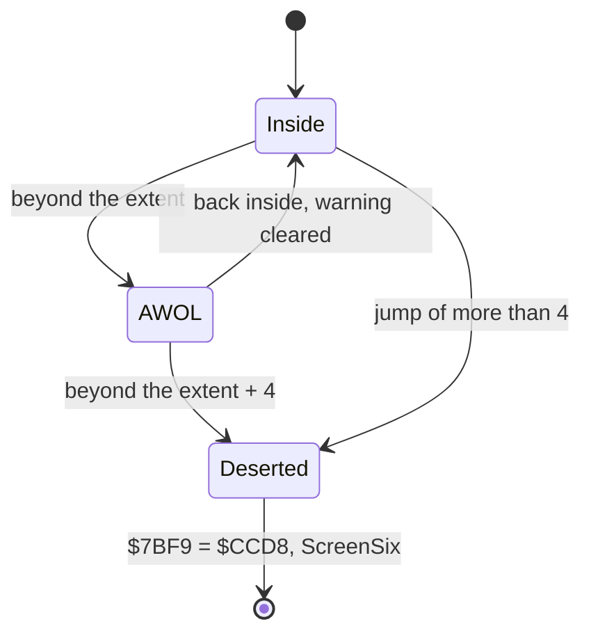

The first byte of BoundaryCheck is a gate: `NOP` in play, `RET` written by the view change (PlayLoopTail's exit
writes `$C9` to it) so the check does not run in other views.

Witness: BoundaryCheck has L1 3096 and SetAwolState `$D4E9` L1 3053 in five recordings. No recording drove out of the extents; the AWOL text and the
desertion are known only from the code. Mission 1's frame is drawn in [doc 07.3](07-objects.md#73-the-road-map-vertices-and-segments).

The point: the playfield has a soft edge and a hard edge 4 coarse units further, both checked on coarse units that
were computed once a pass for the spawner.

## 10.4 The enemies

The enemies are made by spawners around the camera, chase the tank, fire, and are removed when the tank is 3 coarse
units away ([doc 07.9](07-objects.md#79-the-object-kinds-as-state-machines) has each state machine and the step at
work).

The rules, in short:

- **Supply.** A spawner (mission 1: types 4, 6 and the flag 19) keeps three children. A dead or removed child is
  replaced on the next pass with a free record, one child a pass, 3 coarse units from the camera on one axis and
  -1 to +3 on the other, as long as the spawner itself has a record (within 9 coarse units).
- **Chase.** A unit turns toward the tank by at most 8 heading steps a pass. Only when it is aligned does it fire,
  speed up to its top speed (40) and move.
- **Fire.** The whole mission has one gun timer (the operand of `LD A,n` at `$E7A9`). Every aligned firer
  decrements it once a pass; a shot resets it to 8-15 or 24-31 calls (19.5 on average). So one aligned unit fires
  about once every 20 passes, two about once every 10: the fire rate grows with the number of units aligned on the
  tank.
- **Leash.** A unit more than 3 coarse units from the camera on an axis is removed.
- **Morale.** A unit with fewer than 2 hit points flees; with fewer than 4 near the tank it wanders and returns.

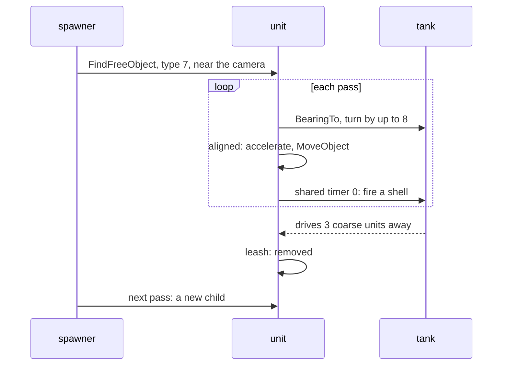


*Animation 10.3. The death recording, frames 7990-8135, every third frame: the enemy tank (record 7) ahead, its
shell coming in, "TANK HIT" on the message screen after the hit of frame 8121. Drawn by `python3
../../kit/screen_anim.py --work work/docs/bcC/death --from 7990 --to 8135 --step 3 --scale 2 --delay 90 --hold 2000
docs/img/play/enemy-attack.gif`.*

How to read it: the 3D view shows the units as the renderer draws them; the message screen in the cockpit prints
"TANK HIT".

Worked example: record 7 between the samples of frames 7980 and 8057 (`death-1.jsonl`):

| Sample | Heading | X (low, mid) | Y (low, mid) |
| --- | --- | --- | --- |
| 7980 | 247 | `$DFC1` | `$CF2F` |
| 7990 | 245 | `$DFAC` | `$CF7C` |
| 8000 | 245 | `$DFA1` | `$CFA2` |
| 8010 | 244 | `$DF95` | `$CFC8` |
| 8029 | 243 | `$DF7D` | `$D014` |
| 8057 | 241 | `$DF55` | `$D085` |

The heading falls by one on most passes (six steps in the nine passes 7981-8057) as the bearing to the moving tank
changes; between 7990 and 8000 Y grows by 38 (`$26`) and X falls by 11: speed 40 on heading 245, 11 steps of 256 west
of north, 11 / 256 x 360 = 15.5 degrees (40 x cos 15.5 = 38.5, 40 x sin 15.5 = 10.7).

The path of three units and the tank over the world is [figure 7.2](07-objects.md#73-the-road-map-vertices-and-segments).

Witness: the death samples, frames 7590-9600: record 7 (type 7, the tank of the worked example) is made at 7601 and
freed at 9044; record 8 (type 26) lives 7605-8963; record 12 holds type 9 from 7612 to 8625, then type 28 shells
(8730-8863, 8897-9024), each freed when its lifetime ends or it hits; the shell hit on the tank is at 8121.

The point: one timer paces all the enemies' fire, but each aligned unit drains it, so the pressure grows with the
number of units facing the tank; the spawners refill the field around the tank wherever it goes.

**Missions 2-10** ([doc 07.14](07-objects.md#714-the-units-of-missions-2-10)) carry relocated copies of the same unit
library, tuned by a few constants:

- In missions 2 and 3 Close holds while a unit has 2 hit points or more, so their chase units stay near the tank and
  fire (in mission 1 Close always falls through to Wander).
- The homing carriers of missions 2, 3, 4 and 8 become fixed turrets at once (the sentry limit is `CP $04` and every
  one has fewer than 4 hit points).
- Mission 2's leash is `$1000` (4 coarse units).
- The shells of missions 2, 3, 4 and 8 do 1 point of damage (mission 1: 3; its homing shell 4).
- Every unit turns by up to 8 a pass: the D loaded before M1TurnToPlayer (8, 16, 1) is dead, `$E55E` loads
  `LD D,$02`.

## 10.5 Damage: PlayerHit, the armour and the subsystems

PlayerHit `$CAA5` is the tank's collision handler, called by CollisionPass with IY = the other record.

1. A wreck (IY +2 b6) does nothing.
2. A type 4 hitter goes to HitObstacle `$CB6C`: the tank is pushed back from a building.
3. Otherwise SetMessage prints "TANK HIT".
4. A hitter at height `$30` or more hits the top: `$8304` -= damage (+`$14`). The byte is stored before the test,
   so an underflow leaves the wrapped value.
5. A lower hitter hits a side. HitSide `$CB4C` takes the hitter's view-space x (+`$2F`/+`$30`, negated when the
   rear view is on), not a bearing: |x| <= `$60` is side 2 (the front), else a positive x is side 1 and a negative
   x side 3. There is no rear side. `$8300` + side -= damage, tested before the store.
6. Then a subsystem of that side: E = Random / `$55` (0, 1, 2, or 3 when Random is 255); the pointer is at
   `$8338 + 6 (side - 1) + 2E`; the gauge loses the damage, with a floor of 0; a gauge with b7 set is skipped.
7. Unless the hitter's +3 b4 is set (shells have it), the tank's speed is negated, it is moved, and SetBounce runs:
   the knock-back.
8. Any armour underflow goes to ArmourDestroyed `$CB38`: `$7BF9` = `$CCBE` "FAILED TO MAKE PICKUP" when the goal
   flag `$68E8` is set, else `$CCAB` "UNIT DESTROYED"; JP ScreenSix `$7047`.

```text
PlayerHit(tank, hitter):
    if hitter.wreck: return
    if hitter.type == 4: HitObstacle(); return
    SetMessage("TANK HIT")
    if hitter.height >= $30:
        armour[top] -= hitter.damage            # stored even when it wraps
        if borrow: ArmourDestroyed()
    else:
        side = HitSide(hitter.view_x)            # 1, 2 (front) or 3
        if armour[side] < hitter.damage: ArmourDestroyed()
        armour[side] -= hitter.damage
        e = Random() / $55                       # 0-2, 3 when Random = 255
        gauge = pointer[$8338 + 6 (side - 1) + 2 e]
        if gauge >= 0: gauge = max(0, gauge - hitter.damage)
    if not hitter.no_knockback:
        tank.speed = -tank.speed; MoveObject(tank); SetBounce()

ArmourDestroyed():
    FailReason = "FAILED TO MAKE PICKUP" if GoalFlag else "UNIT DESTROYED"
    ScreenSix()
```

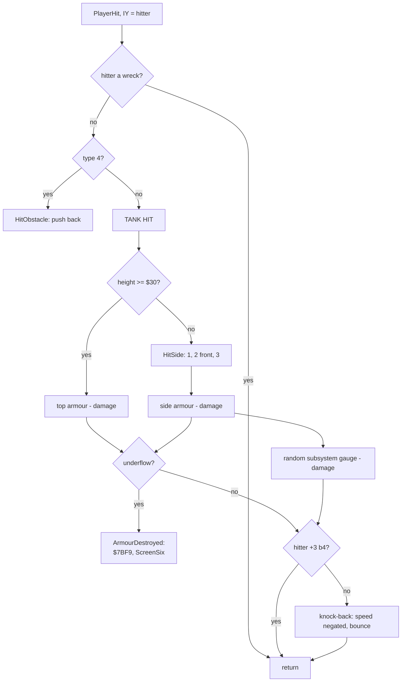

The nine subsystem pointers `$8338-$8349` lead to the gauges `$68AB + 6k`, k = 0-8. StoresToGauges `$CC1B` (bank 6)
sets gauge k from record k of DamageBoardRecords `$834A`: `$5F` when the record is not 0, else 0. Records 0-4 are the
damage board's five fixed icons (`$10`, `$11`, `$12`, `$0F`, `$0E`), so gauges 0-4 always start at `$5F`; records
5-8 are the four WeaponSlots, so gauges 5-8 (`$68C9-$68DB`) are the slots, `$5F` when a store is fitted.

| Side (HitSide) | E = 0 | E = 1 | E = 2 | E = 3 (Random = 255) |
| --- | --- | --- | --- | --- |
| 1 (x > `$60`) | `$68AB` gauge 0 | `$68C3` gauge 4 | `$68C9` gauge 5, slot 1 | `$68CF` (side 2's first) |
| 2, the front | `$68CF` gauge 6, slot 2 | `$68D5` gauge 7, slot 3 | `$68DB` gauge 8, slot 4 | `$68BD` (side 3's first) |
| 3 (x < -`$60`) | `$68BD` gauge 3 | `$68B1` gauge 1 | `$68B7` gauge 2 | the word at `$834A`: `$0010`, a ROM address |

A slot's gauge worn down to 0 disables its store: when the slot is selected, SelectWeapon reads SlotGauges `$68C9` +
6 x slot (`$C5CA`), and at 0 prints DamagedText and installs NoAction as the fire and aim routines (`$C605`,
[doc 05](05-controls.md)). The damage board (key D) draws all nine gauges with their icons.

The top-armour path and the failure:

```text
$CAB3  CALL SetMessage      ; TANK HIT
$CAB6  LD L,(IY+$05)
$CAB9  LD H,(IY+$06)
$CABC  AND A
$CABD  LD BC,$0030
$CAC0  SBC HL,BC           ; hitter height - $30
$CAC2  JR C,$CAD1          ; low: a side
$CAC4  LD A,(Armour+3)     ; $8304, the top armour
$CAC7  SUB (IY+$14)        ; - damage
$CACA  LD (Armour+3),A     ; stored first
$CACD  JR C,ArmourDestroyed
$CACF  JR $CB1E            ; to the knock-back test
ArmourDestroyed:
$CB38  LD A,($68E8)        ; the goal flag
$CB3B  AND A
$CB3C  JR Z,$CB43
$CB3E  LD HL,$CCBE         ; FAILED TO MAKE PICKUP
$CB41  JR $CB46
$CB43  LD HL,$CCAB         ; UNIT DESTROYED
$CB46  LD (FailReason),HL  ; $7BF9
$CB49  JP ScreenSix
```

Worked example, death frame 8121. The hitter is record 15, the type 28 homing shell: height 64, damage 4, flags
`$17`.

1. Not a wreck, type 28: "TANK HIT".
2. Height 64 >= 48: the top. `$8304` = `$7F` - 4 = `$7B`; no borrow.
3. Flags `$17` have b4: no knock-back. The tank keeps speed 47 (sample 8122).


*Animation 10.4. PlayerHit in the death recording, frame 8121, T 58 400 to 59 400, 40 pictures. Drawn by
`python3 ../../kit/routine_anim.py --work work/docs/bcC/death --listing build/game.lst --window
8121:58400-8121:59400 --pc CAA5-CC3B,C900-C93F --view buffer:8300:16x6:hex --range 8300-83FF --pictures 40 --out
docs/img/routines/PlayerHit.gif`.*

How to read it:

- Left: `$8300-$835F`: the armour at `$8301-$8304` (row 1), the subsystem pointers from `$8338`, the damage-board
  records from `$834A`.
- `$8304` turns yellow when it goes from `$7F` to `$7B`.
- Right: the code; SetMessage and the sound are "other".

The death by armour, in the armour recording: a POKE at frame 7704 set all four armour bytes to 1. In frame 18423
the type 28 shell in record 19 (height 64, damage 4) hits the tank at X = -7292, Y = -11766 from X = -7526,
Y = -11547.

1. Height 64: the top. `$8304` = 1 - 4 = `$FD`, stored, with a borrow.
2. ArmourDestroyed: the goal flag is 0, so `$7BF9` = `$CCAB`.
3. ScreenSix `$7047`: the completion report shows "MISSION FAILED. / UNIT DESTROYED.".

The samples agree: `$8301-$8304` = `01 01 01 FD` and `$7BF9` = `$CCAB` from the sample of frame 18424.


*Animation 10.5. The armour recording (POKE: armour 1), frame 18423 T 69 900 to frame 18424 T 1200, 40 pictures:
PlayerHit takes the top path, the armour wraps to `$FD`, ArmourDestroyed writes `$7BF9`. Drawn by `python3
../../kit/routine_anim.py --work work/docs/bcC/arm --listing build/game.lst --window 18423:69900-18424:1200 --pc
CAA5-CC3B --view buffer:8300:16x6:hex --range 7B00-7BFF --pictures 40 --out docs/img/routines/ArmourDestroyed.gif`.*

How to read it: the left view shows `$8300-$835F`; the memory grid above it is `$7B00-$7BFF`, where `$7BF9`-`$7BFA`
are written; the right column runs PlayerHit from `$CAA5`, then `$CB38`.


*Animation 10.6. The armour recording (POKE: armour 1), frames 18330-18560, every third frame, identical pictures
dropped (28 pictures): the shell comes in, "TANK HIT", the completion report draws over the view, "MISSION FAILED. /
UNIT DESTROYED.". Drawn by `python3 ../../kit/screen_anim.py --work work/docs/bcC/arm --from 18330 --to 18560 --step 3
--scale 2 --delay 80 --hold 2500 docs/img/play/armour-death.gif`.*

Witness: death frame 8121 (top armour `$7F` to `$7B`, the only hit in 12 000 frames); armour frame 18423 (a POKE
recording). The side path and the subsystems: m1complete, PlayerHit 44 runs (frames 15765-21558): the top branch
(`$CAC4`) 4, the side branch (`$CAD1`, HitSide) 40, the subsystem damage (`$CAFA-$CB1D`) 40; the armour went from
`7F 7F 7F 7F` to `54 7F 57 70` (`work/stage2/complete-NOTES.md`).

The point: the height of a shell picks the armour. In mission 1 the shells 10, 12, 28 and 31 fly at 48 or more and
hit the top, which has no subsystems; the shells 8 and 24, at 16 and 20, hit a side and wear a subsystem gauge too.
In m1complete 40 of the 44 hits were side hits (all 40 with a subsystem), 4 top hits. The quirk at E = 3
is in [section 10.13](#1013-notable-features).

## 10.6 Kills and the score

An enemy or a building with the hit handler `$67DC` goes to HitTest `$B660` when it is hit.

1. A hitter without +3 b6 (not a weapon) does nothing.
2. HitPoints `$B6B1`: +`$13` -= the hitter's +`$14`. Positive: no kill. Zero or a borrow: a kill.
3. On a kill: UnregisterCollision, Debris `$B6D1` (pieces only when the object is in view, +2 b5).
4. A list object (+0 not `$FF`) goes to KillMissionObject `$B67D`: MarkDestroyed `$B6BD` sets b1 and clears b7 of its
   list record; the record keeps its place as a wreck (+2 b6 set, b2 cleared; +3 b0 and b2 cleared).
5. Any other object is freed (+2 = 0).
6. AddKillScore `$B692`: the kill sound, then the 32-bit score `$68E2` += +`$1E`/+`$1F`.

```text
HitTest(obj, hitter):
    if not hitter.is_weapon: return
    obj.hp -= hitter.damage
    if obj.hp > 0 and no borrow: return
    Unregister(obj); Debris(obj)
    if obj.index != $FF:
        list[obj.index].destroyed = 1; list[obj.index].alive = 0
        obj.wreck = 1; obj.step_on = 0
    else:
        obj.state = 0
    MissionScore += obj.score
```

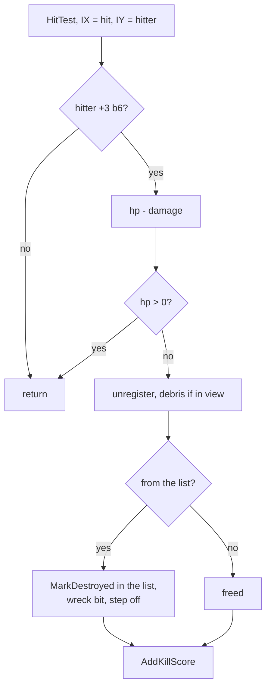

```text
AddKillScore:
$B692  CALL SoundKill
$B695  LD L,(IX+$1E)
$B698  LD H,(IX+$1F)       ; the object's score
$B69B  LD BC,($68E2)
$B69F  ADD HL,BC
$B6A0  LD ($68E2),HL       ; low word
$B6A3  LD BC,($68E4)
$B6A7  LD HL,$0000
$B6AA  ADC HL,BC
$B6AC  LD ($68E4),HL       ; high word with the carry
$B6AF  SCF
$B6B0  RET
```

Worked example, death frame 8531. Record 5 (`$771C`, list record 27, type 15, a hut: 1 hit point, score 250) is hit
by a turret shell (type `$81`, damage 1, flags `$57`).

1. The shell has +3 b6: a weapon.
2. HitPoints: 1 - 1 = 0: a kill.
3. Debris throws the hut's pieces (the hut is in view).
4. List record 27 gets b1, loses b7; record 5 becomes a wreck.
5. The score goes from 0 to 250 (`$000000FA`) in the sample of frame 8532.


*Animation 10.7. HitTest in the death recording, frame 8531, T 14 000 to 17 200, 50 pictures. Drawn by `python3
../../kit/routine_anim.py --work work/docs/bcC/death --listing build/game.lst --window 8531:14000-8531:17200 --pc
B660-B765,C900-C93F --view buffer:771C:20x3:hex --range 6800-68FF --pictures 50 --out docs/img/routines/HitTest.gif`.*

How to read it: the view is record 5 (60 bytes, 20 a row): +`$13` (row 1, byte 19) goes to 0, +2 gets the wreck
bit; the memory grid above is `$6800-$68FF`, where the score `$68E2` is written last; the code runs HitTest, Debris,
KillMissionObject, MarkDestroyed, AddKillScore.

Witness: death frame 8531 (trace `work/docs/bcC/pc-kill.txt`: HitTest at T 14 115, Debris at 15 969, MarkDestroyed
at 16 799, AddKillScore at 17 030). The score reaches 500 by frame 13 660 (a second 250 kill).

The point: the score of a mission is the sum of what was destroyed. Hills and trees score 0, buildings 250-500, the
fuel dumps of mission 1 (its goal, template 33) 250 each, every enemy vehicle 2000. m1complete: `$68E2` = 250 at
frame 15787, 500 at 16137, the two dumps; m4complete: 2000 at 8247 from an enemy vehicle, while the train, the points
and the station score 0. The score counts only when the mission is completed (section 10.12).

## 10.7 The weapons

The tank carries four slots ([doc 07.12](07-objects.md#712-the-weapon-slots-and-the-weapon-records)). A slot's store
type indexes the store-type table `$7B89` + 8 x type: four routine words, read from `build/game.bin`.

| Store type | Store | K (word 0) | J (word 1) | Fire (word 2) | Select (word 3) | What it makes |
| --- | --- | --- | --- | --- | --- | --- |
| 1 | Phoenix RRSA | `$B8FE` IR view up | `$B909` IR view down | `$C13E` | `$C11E` | `$83`, radar lock |
| 2 | Banshee RRSS | `$6BB0` | `$6BB0` | `$C14D` | `$C12C` | `$82`, radar lock |
| 3 | K-40 Mortar | `$B8B9` elevation up | `$B8C4` elevation down | `$B59F` | `$B8CC` | `$80`, ballistic |
| 4 | Turret | `$6BB0` | `$6BB0` | `$B568` | `$C510` | `$81`, straight |
| 5 | Phoenix IRSA | `$B8FE` | `$B909` | `$C20D` | `$C11E` | `$85`, IR lock |
| 6 | Banshee IRSS | `$6BB0` | `$6BB0` | `$C21D` | `$C12C` | `$84`, IR lock |
| 7 | Dragonfly | `$6BB0` | `$6BB0` | `$C2BC` | `$C12C` | `$86`, flown |
| 8 | K-90 Cluster | `$6BB0` | `$6BB0` | `$CF3F` | `$CF30` | `$87`, parachute blast |
| 9 | Sleeper mine | `$CFF4` timer up | `$CFE9` timer down | `$D005` | `$CF26` | `$88`, timed mine |
| 10 | SLAM Laser | `$D0F5` on | `$D104` off | `$6BB0` | `$D45E` | no object: the laser |
| 11 | Skeet bomb | `$6BB0` | `$6BB0` | `$D24C` | `$D24B` | `$89`, weaving bomb |
| 12 | Phantasm | `$D2E4` auto on | `$D30B` auto off | `$D319` | `$D46A` | `$8A`, the decoy |
| 13 | Spectre | `$D2F7` auto on | `$D30B` auto off | `$D31F` | `$D34E` | `$8B`, parachute bomb |

How to read it:

- `$6BB0` is NoAction, a `RET`.
- K and J are the aim keys ([doc 05.10](05-controls.md#510-the-play-keys-and-the-weapon-keys)): SelectWeapon
  patches words 0 and 1 into the `JP` operands `$6B55` (K) and `$6B50` (J).
- The store names come from WeaponRecords (bank 6 `$C373`) and the stores texts: type 11 has 12 rounds and 200 kg
  (the Skeet bomb), type 12 8 rounds and 100 kg (the Phantasm), type 13 12 rounds and 100 kg (the Spectre). The
  model word of each record matches the template it fires (Sleeper `$8739` = `$88`'s model; K-90 and Spectre
  `$7F5B`, the parachute model their bombs take at the top of the climb; Skeet `$7ECA` = `$89`'s).

The resident templates ([doc 07.5](07-objects.md#75-the-templates-and-the-object-types), ShellTemplate80 `$B3CA`):

| Type | Store | Height | Speed | Box | Damage | Step | Hit |
| --- | --- | --- | --- | --- | --- | --- | --- |
| `$80` | K-40 Mortar | 40 | 96 | 32 | 1 | MortarShellStep `$B5E8` | Explode `$B8AB` |
| `$81` | Turret | 56 | 96 | 32 | 1 | CannonShellStep `$B592` | Explode |
| `$82` | Banshee RRSS | 48 | 120 | 16 | 2 | `$C453`, flat | `$B8A8` |
| `$83` | Phoenix RRSA | 56 | 120 | 16 | 2 | `$C4A5`, follows the height | `$B8A8` |
| `$84` | Banshee IRSS | 56 | 120 | 16 | 2 | `$C4A5`, follows the height | `$B8A8` |
| `$85` | Phoenix IRSA | 56 | 120 | 16 | 2 | `$C453`, flat | `$B8A8` |
| `$86` | Dragonfly | 64 | 120 | 16 | 2 | DragonflyStep `$C391` | `$C365` |
| `$87` | K-90 Cluster | 56 | 96 | 32 | 127 | ClusterRise `$CF4A` | Explode |
| `$88` | Sleeper mine | 56 | 127 | 32 | 31 | MineFall `$D048` | `$D0E9`, a `RET` |
| `$89` | Skeet bomb | 64 | 64 | 32, 64, 32 | 4 | SkeetZigZag `$D2AE` | Explode |
| `$8A` | Phantasm | 56 | 96 | 32 | 1 | PhantasmStep `$D405` | `$6BB0`, a `RET` |
| `$8B` | Spectre | 56 | 96 | 64 | 31 | SpectreStep `$D369` | Explode |

All have flags `$57`: a step, no knock-back (b4), a weapon (b6, so HitTest counts their hits,
[section 10.6](#106-kills-and-the-score)). Hit points 0, top speed 127, radius 10.

### The fire path, the rounds and the slot hooks

PlayerSteering counts the fire cooldown `$A9FD` down once a pass. At 0, the fire key (bit of `$6D43`) calls
the slot's fire routine through the operand at `$A9B9`. Most fire routines run the same three steps:

1. SelectAmmoPointer `$D3C6` puts the slot's rounds byte (`$836D` + 6 x slot) into ConsumeAmmo's operand `$B551`.
2. ConsumeAmmo `$B550` returns M when the rounds are 0, else takes a projectile record
   (FindProjectileSlot), plays SoundFire and stores the rounds less one.
3. LaunchProjectile `$B5A7` (or a copy of it) sets the type (ObjectSetType, vector `$67C7`), registers the collision
   (vector `$67CA`), copies 8 bytes from the camera `$67A5` (heading word, X, Y) to +`$21`-+`$28`, writes the
   elevation's two speeds and calls SetFireCooldown `$A9F7` (8 passes).

```text
LaunchProjectile(type):                  # A = type, the slot's rounds pointer already in $B551
    if rounds == 0: return M
    rec = FindProjectileSlot();  if none: return
    rounds -= 1
    ObjectSetType(rec, type); RegisterCollision(rec)
    rec.heading, rec.x, rec.y = camera.heading, camera.x, camera.y
    rec.speed = |Sine8[elevation + $C0]|     # the operand $B5C8
    rec.vz    = Sine8[elevation]             # the operand $B5C5, to +$31
    rec.pitch = 0; rec.flags |= $40
    PrintAmmo(); FireCooldown = 8
```

```text
$B5C4  LD A,$00             ; operand $B5C5: Sine8[e], the vertical speed
$B5C6  EX AF,AF'
$B5C7  LD A,$00             ; operand $B5C8: Sine8[e + $C0]
$B5C9  CALL ApiVector08     ; |A|
$B5CC  LD (IX+$07),A        ; the speed
$B5CF  EX AF,AF'
$B5D0  LD (IX+$31),A        ; the vertical speed
```

The elevation e is one byte, 64 a right angle. SetElevation `$CF32` (and ShowMortarRange `$B8CC` for the mortar)
reads SinCos8 `$A899` (through the vector `$67E8`) at e + `$C0` and writes the two operands; Sine8 at `$6300` peaks at
127. The weapons that fly a curve set their own elevation:

| e | Set by | Speed | Vertical speed |
| --- | --- | --- | --- |
| 32 | the mortar at the start (`$B8BA`) | 91 | 91 |
| 28 | the mortar after four J (play) | 99 | 81 |
| 20 | the K-90 select ElevationZero `$CF30` | 113 | 60 |
| 30 | the Sleeper select PrintElevation `$CF26`, LaunchPhantasm, LaunchSpectre | 95 | 86 |

Four calls in PlayLoop (`$6A43`-`$6A56`), `LD A,slot` / `CALL NoAction` once per slot, are the **slot hooks**:
SelectWeapon stores the address of the current slot's `CALL` operand (`$6A46` + 5 x slot) in `$C53D`, and a weapon
that needs a routine every pass writes it there. The Sleeper's countdown display, the auto-fire of the Phantasm and
the Spectre and the SLAM laser run through them. A hook keeps running when another slot is selected; it runs in the
normal view only (DragonflyViewLoop `$6AB9` has no hooks).

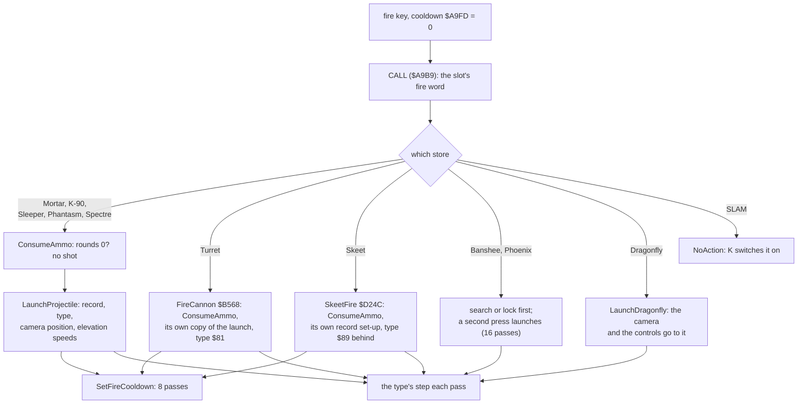

Witness: ConsumeAmmo L1 4 in play and 6 in play2; LaunchProjectile 3 and 4; SetFireCooldown 3 and 6
(`work/stage1/play/l1.json`, `play2/l1.json`).

The point: a weapon is a template plus a step. The engine gives every projectile the camera's place and the fire
key's cooldown; what a weapon does after that lives in its step handler.

### K-40 Mortar (`$80`)

The elevation is the operand `$B8BA`, 32 in the image. K (MortarElevationUp `$B8B9`) raises it by one up to 63, J
(MortarElevationDown `$B8C4`) lowers it down to 1; both end in ShowMortarRange `$B8CC`, which writes the two launch
speeds and prints the elevation in degrees, e x 256 / 182 (32 is 45). FireMortar `$B59F` launches type `$80` at
height 40.

MortarShellStep `$B5E8` moves the shell, adds the vertical speed +`$31` to the height and takes 5 off the vertical
speed (`RET PE` keeps it when the subtraction would overflow). A height below 0 frees the shell (RemoveObject
`$B8B1`): the shell that reaches the ground vanishes without debris. Only a hit explodes it (Explode `$B8AB`, its
collision handler).

```text
MortarShellStep(shell):
    MoveObject(shell)                      # speed x sin, cos of the heading
    shell.height += shell.vz
    if shell.height < 0: RemoveObject(shell); return
    shell.vz -= 5                          # gravity, kept at -128
```

```text
$B5E8  CALL ApiVector00     ; MoveObject
$B5EB  LD D,$00
$B5ED  LD A,(IX+$31)        ; the vertical speed, signed
$B5F0  AND A
$B5F1  JP P,$B5F5
$B5F4  DEC D
$B5F5  LD E,A
$B5F6  LD L,(IX+$05)
$B5F9  LD H,(IX+$06)
$B5FC  AND A
$B5FD  ADC HL,DE            ; height + vz
$B5FF  JP M,RemoveObject    ; below the ground: gone
$B602  LD (IX+$05),L
$B605  LD (IX+$06),H
$B608  LD E,$05
$B60A  AND A
$B60B  SBC A,E              ; vz - 5
$B60C  RET PE
$B60D  LD (IX+$31),A
```

Worked example, the play recording's shells at e = 28 (39 degrees): speed 99, vertical speed 81. The heights after
each pass are 121, 197, 268, 334, 395, ...; the top is 737; the 34th pass takes the height below 0. The shell flies 34
passes x 99 = 3366 world units, 3.3 coarse units. At the start value e = 32 (45 degrees): 38 passes, 3458 units, top
914.

Witness: play, frames 8717-8864: the select (ShowMortarRange at 8717), J four times (MortarElevationDown 8761-8781),
two shots (FireMortar 8800 and 8864). MortarShellStep runs 68 times, 2 x 34, as the example gives; RemoveObject runs
twice (9044, 9136) and Explode never: both shells came down on open ground.

The point: the mortar is the only aimed curve. Its reach is set by one byte, and the most it gives, 3492 units at e = 29
(about 41 degrees: 36 passes at speed 97, vertical speed 84; e = 32, 45 degrees, gives 3458), is about the radius in which the spawner keeps its units.

### Banshee and Phoenix: the locks and the flight (`$82`-`$85`)

The four missiles share one launch, LaunchMissile `$C3DE`, and differ in how they find a target and how they fly.
None of them fires without a target: the first press searches, a second press after a lock launches.

| Store | Lock | Height test at the lock | Flight step | Follows the target's height | Checks the target's serial |
| --- | --- | --- | --- | --- | --- |
| 2 Banshee RRSS | TargetInCone | yes | `$C453` | no | no |
| 1 Phoenix RRSA | TargetInCone | yes | `$C4A5` | yes, 1/16 of the gap left a pass | yes |
| 6 Banshee IRSS | MissileSeek | no (`$C276` = 0) | `$C4A5` | yes | yes |
| 5 Phoenix IRSA | MissileSeek | yes (`$C276` = `$FF`) | `$C453` | no | no |

**The radar lock** (FireBansheeRr `$C14D`, FirePhoenixRr `$C13E`). The gate is the offset of `JR` at TargetInCone
`$C197` (its operand `$C198`): 1 in the image (search allowed), 0 when a target is locked. The fire routine stores
the type in LaunchMissile's operand `$C41D`. With the gate not 0 it sets the gate to `$39` (the `JR` then leads to
the test at `$C1D2`), hooks TargetInCone into the depth-tree walk (`$BF40`) and runs FindMissileTarget `$BF24`. The
walk takes the `+2` child first, so it visits the objects from near to far. The test takes the first object that:

- overlaps the eye in height: |height - eye `$67AD`| < its half height + the tank's (TargetBearingCheck `$C1ED`);
- is present (+2 not 0), within 6 heading steps of the tank's heading (BearingTo through `$67C1`);
- is no shell or weapon (+3 AND `$50` = 0) and no wreck (+2 b6 clear).

A hit closes the gate (0) and starts the sight timer `$C4CE` = 16: DrawSightOverlay `$C4CD` blinks the sight mask for
16 passes, then ResetSightTimer `$C506` opens the gate (1) again. A press while the gate is 0 launches at the locked
record (the operand `$C16F`). With nothing found the gate stays `$39` and the next press searches again; no round is
used.

**The IR lock** (FireBansheeIr `$C21D`, FirePhoenixIr `$C20D`, then MissileLock `$C227`). With the lock flag (the
operand `$C22F`) 0, it hooks MissileSeek `$C267` into the walk and searches. MissileSeek tests the objects near to far:
present, the height test when `$C276` is set, then on the screen (the view-space x +`$2F` >> 6 through OnScreenX).
The first object on the screen ends the search: when it is a vehicle (+3 b5, the flags `$2F` of the enemy units) its
record goes to `$C25A` and the lock flag is set; any other object blocks the line and gives no lock. With the lock
flag set, a press goes to `$C252`: an IR missile prefers a Spectre (type `$8B`, FindTypeInCone `$C174`, present and in
view) to the locked record, then launches. The IR lock does not expire.

```text
FireRadarMissile(type):                  # $C14D, $C13E
    LaunchMissile.type = type
    if gate == 0: LaunchMissile(locked); return
    gate = $39; walk the depth tree, near to far, with:
        if overlaps the eye in height and present and |bearing - heading| < 6
           and not (shell or weapon) and not wreck:
            locked = obj; gate = 0; SightTimer = 16          # the walk ignores the rest

FireIrMissile(type, height_test):        # $C21D (no test), $C20D (test)
    LaunchMissile.type = type
    if lock_flag: LaunchMissile(Spectre in view or seek_target); lock_flag = 0; return
    walk near to far with:
        if present and (not height_test or overlaps the eye) and on the screen:
            if obj.flags b5: seek_target = obj; lock_flag = set
            stop the walk
    if lock_flag: SightTimer = 16

LaunchMissile(target):                   # $C3DE
    if rounds == 0 or no record: return
    rounds -= 1; IrViewHeight = the tank's height
    m = new record of LaunchMissile.type at the camera, heading = the tank's
    m.target = target (+$32); m.serial_seen = target.serial (+$35); m.life = 70 (+$31)
    gate = 1; FireCooldown = 16; the missile sound
```

```text
$C15A  EX AF,AF'            ; A' = $39
$C15B  LD HL,TargetInCone
$C15E  LD A,(TargetInCone+1); the gate
$C161  AND A
$C162  JR Z,$C16E           ; locked: launch
$C164  LD ($BF40),HL        ; the walk calls TargetInCone
$C167  EX AF,AF'
$C168  LD (TargetInCone+1),A; gate = $39: the test at $C1D2
$C16B  JP FindMissileTarget
$C16E  LD DE,$0000          ; operand $C16F: the locked record
$C171  JP LaunchMissile
...
$C1A8  LD A,(IY+$02)        ; present?
$C1AB  AND A
$C1AC  RET Z
$C1AD  CALL ApiVector01     ; BearingTo the candidate
$C1B0  LD C,A
$C1B1  LD A,(PlayerHeading)
$C1B4  AND A
$C1B5  SBC A,C
$C1B6  CALL ApiVector08     ; |heading - bearing|
$C1B9  CP $06
$C1BB  RET NC               ; outside the cone
$C1BC  LD A,(IY+$03)
$C1BF  AND $50              ; a shell or a weapon
$C1C1  RET NZ
$C1C2  LD A,(IY+$02)
$C1C5  AND $40              ; a wreck
$C1C7  RET NZ
$C1C8  XOR A
$C1C9  LD (TargetInCone+1),A; gate = 0: locked
$C1CC  LD A,$10
$C1CE  LD (DrawSightOverlay+1),A ; the sight blinks 16 passes
```

The flight. MissileStep `$C453` (types `$82`, `$85`): MoveObject, TurnToward the target (`$C47C`, +`$32`, at most 4
heading steps a pass), the lifetime +`$31` less one; at 0, or when the target's +2 is 0, the missile ends. HomingMissileStep `$C4A5`
(types `$83`, `$84`) first compares the serial seen at the launch (+`$35`) with the target's +`$20`: a reused record
ends the missile; then the same turn and lifetime, and the height becomes target + gap / 16 each pass (four `SRA H` /
`RR L` on own - target, then the target added): each pass leaves 1/16 of the gap and closes 15/16 of it, so the
height nearly snaps to the target's; then SetHeightAndMove `$C4C4` stores it and moves. A missile that ends calls `$B61E` (HitTest through `$67DC` with the
target as the hitter: no weapon, so it returns at once) and clears +2; it is not unregistered from the collision table
(SUSPECTED: the pair rows keep a freed record until the record is reused). The collision handler MissileHit `$B8A8`
calls ResetSightTimer (the gate opens) and falls into Explode.

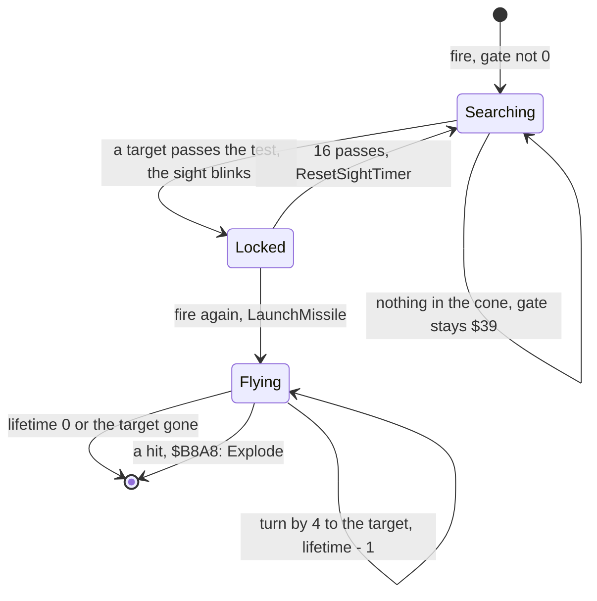

Worked example, from the templates and the code: a missile turns by at most 4 of 256 a pass at speed 120. A full
circle takes 64 passes, 64 x 120 = 7680 world units, a turning radius of 7680 / 2 pi, about 1220 units: a target
closer than that on the beam is missed and circled. Its 70 passes reach 8400 units, a little more than 8 coarse
units (of 1024).

Witness: no recording launches a missile. play: FireBansheeRr at 8509 and 8577, TargetInCone 7 runs,
TargetBearingCheck 7, no lock. play2: FirePhoenixRr at 9016 and 9084 (TargetInCone 11 runs), FireBansheeIr at 8731
and 8793 and FirePhoenixIr at 16065 and 16134 (MissileLock 4 runs, MissileSeek 19); LaunchMissile, `$C453` and
`$C4A5` have no run. The launch, the flight and the hit are known only from the code.

The point: the missiles need a target in front, and the two pairs aim differently: the radar pair takes any
standing object in a 6-step cone at the eye's height, the IR pair only the first vehicle on the screen. The IR pair's
steps are swapped against the RR pair's: the Banshee IRSS, a surface-to-surface missile, follows the target's height,
the Phoenix IRSA, surface-to-air, flies flat. The Phoenix select (SelectPhoenix `$C11E`) turns on the IR view, whose
eye height `$B8FF` K and J raise and lower by 8 ([doc 06](06-rendering.md)).

### The Dragonfly (`$86`)

LaunchDragonfly `$C2BC` takes a round and spawns type `$86` at the camera with the tank's heading, lifetime 100 at
+`$31` and +0 = `$FF`. It then hands the game to the Dragonfly:

- the camera record `$B9F4` = the Dragonfly (the operand `$C302`, written with the new record);
- the tank's +3 b0 is cleared: RunObjectHandlers skips PlayerStep, so the tank stands, spends no fuel and reads no
  keys;
- NextView = DragonflyViewLoop `$6AB9` and the view flag `$6A6D` is set: the view changes
  ([doc 04](04-game-loop.md), [doc 05.9](05-controls.md#59-driving-turning-and-the-dragonfly));
- the fire word `$A9B9` = DragonflyRetake `$C31B`.

DragonflyStep `$C391`, its step:

```text
DragonflyStep(fly):
    if the fire key bit ($6D43): clear it; RecallDragonfly(); return
    fly.life -= 1; if fly.life == 0: DragonflyEnd(fly); return       # $C365
    fly.heading += StepX / 2
    h = fly.height - 2 x StepY                    # Q: StepY = -8, so +16 a pass
    if (going down and h >= 0) or (going up and h < 512): fly.height = h
    MoveObject(fly)                               # speed 120

RecallDragonfly():                                # $C33E
    $A9B9 = LaunchDragonfly; fly.step = $67BE (MoveObject only)
    NextView = StartMission; view flag set; CameraToPlayer()   # camera $B9F4 = $75F0, tank +3 b0 set
```

```text
$C391  LD HL,PointerZones+1 ; the fire key bit
$C394  LD A,(HL)
$C395  AND A
$C396  JR Z,$C39D
$C398  LD (HL),$00
$C39A  JP RecallDragonfly
$C39D  LD A,(IX+$31)
$C3A0  DEC A
$C3A1  JR Z,$C365           ; lifetime over
$C3A3  LD (IX+$31),A
$C3A6  LD A,(StepX)
$C3A9  SRA A
$C3AB  ADD A,(IX+$22)       ; heading + StepX / 2
$C3AE  LD (IX+$22),A
$C3B1  LD L,(IX+$05)
$C3B4  LD H,(IX+$06)
$C3B7  LD A,(StepY)
$C3BA  ADD A,A
$C3BB  NEG                  ; -2 x StepY
```

DragonflyEnd `$C365`, also its collision handler: unregister, +2 = 0, RecallDragonfly when the Dragonfly view is
still on, the fire word back to LaunchDragonfly, cooldown 8. After a recall the Dragonfly is not freed: its step is
the bare MoveObject vector, so it flies straight on, with no lifetime, until it hits something (from the code).
DragonflyRetake `$C31B` takes the Dragonfly view back while one is out; the fire word leads there only while the tank
steps with a Dragonfly in the air, and no recording runs it.

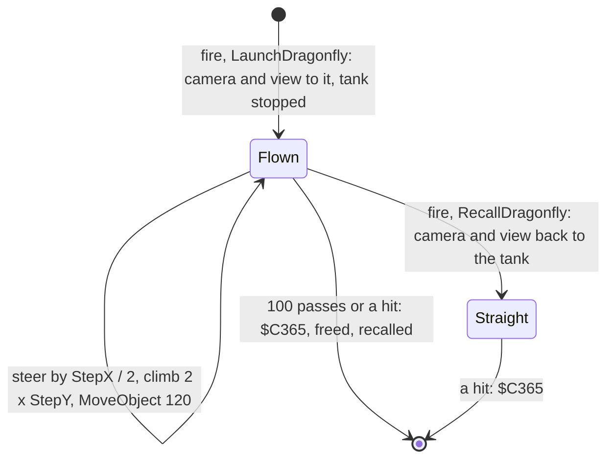

Worked example: Q held gives StepY = -8, so the Dragonfly climbs 16 a pass from 64; the cap is 511, so 27 passes take
it to 496 and the 28th is refused. Its 100 passes make 99 moves (the 100th pass ends it before MoveObject): 99 x 120 = 11 880 world units, about 11.6
coarse units. The hit
does damage 2.

Witness: play: LaunchDragonfly at 9050, DragonflyStep 25 runs 9051-9237, RecallDragonfly and CameraToPlayer at 9237
(the fire key in flight). `$C365` has no run: the recalled Dragonfly hit nothing while the recording lasted.

The point: the Dragonfly is a guided shell with the camera on it. While it flies the tank is a parked object; it
can still be hit.

### Sleeper mine (`$88`)

The timer is the operand `$CFF5`, 0 in the image: K (MineTimerCode `$CFF4`) counts it up 0-119 and wraps to 0, J
(SetMineTimer `$CFE9`) down, from 0 to 120. The select PrintElevation `$CF26` sets e = 30. DropMine `$D005` launches
type `$88` and halves both speeds, turns it to the tank's heading + 128 (thrown backwards) and keeps the slot hook's
address at +`$34`.

1. MineFall `$D048`: MoveObject, height += vertical speed, vertical speed - 5, until the height is below 0.
2. Landed: height 32, the slot hook = MineHud `$D093` (it prints the mine's +`$31` when its slot is the current one),
   step = MineCountdown `$D0B2`, +`$31` = the timer (MineArm `$D08C`).
3. MineCountdown: +`$31` - 1 a pass; at 0 the hook goes back to NoAction, the high bytes of the box (+`$0C`, +`$10`)
   and of the radius (+`$17`) become 8, Debris is thrown, b5 of +2 is cleared, and the step becomes `$D0EA`.
4. `$D0EA`: 8 passes, then Explode.

```text
MineCountdown(mine):                     # $D0B2
    if mine.timer: mine.timer -= 1; return
    slot_hook(mine.+$34) = NoAction
    mine.step = $D0EA
    mine.box_x_hi = mine.box_y_hi = mine.radius_hi = 8; mine.timer = 8
    Debris(mine); mine.state &= $DF

MineBlast(mine):                          # $D0EA
    mine.timer -= 1
    if mine.timer == 0: Explode(mine)
```

```text
$D0B2  LD A,(IX+$31)
$D0B5  AND A
$D0B6  JR Z,$D0BD
$D0B8  DEC A
$D0B9  LD (IX+$31),A
$D0BC  RET
$D0BD  LD L,(IX+$34)        ; the slot hook's operand
$D0C0  LD H,(IX+$35)
$D0C3  LD (HL),$B0          ; NoAction
$D0C5  INC HL
$D0C6  LD (HL),$6B
$D0C8  LD (IX+$18),$EA
$D0CC  LD (IX+$19),$D0      ; step $D0EA
$D0D0  LD A,$08
$D0D2  LD (IX+$0C),A        ; box x, high byte
$D0D5  LD (IX+$10),A        ; box y, high byte
$D0D8  LD (IX+$17),A        ; radius, high byte
$D0DB  LD (IX+$31),A        ; 8 passes
$D0DE  CALL ApiVector11     ; Debris
```

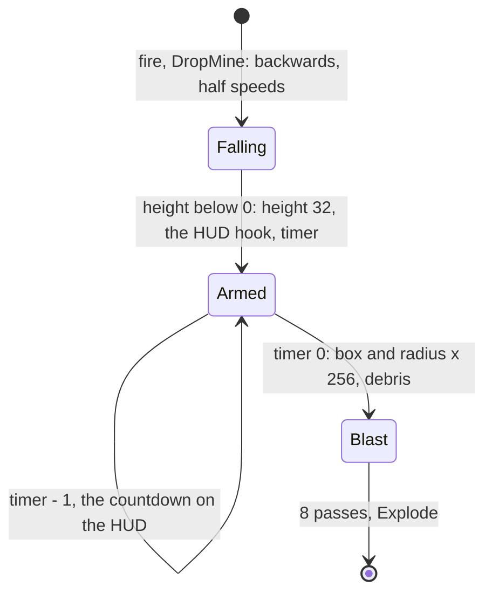

Worked example, play2: four J presses take the timer 0, 120, 119, 118, 117. With e = 30 the mine leaves at speed
95 / 2 = 47 and vertical speed 86 / 2 = 43 from height 56; it lands on the 20th pass, 20 x 47 = 940 world units
behind the tank, and waits 117 passes. The blast record has the box half sizes `$0820` = 2080 and the radius
`$080A` = 2058: CollisionPass ([doc 07.10](07-objects.md#710-collisions-collisionpass)) finds overlaps up to about
2058 units plus the other's radius, and every due pair in those 8 passes takes 31. Its own hit handler `$D0E9` is a
`RET`: nothing sets a mine off early. Until the blast the mine lies with a box of 32 and damage 31, so a unit that
drives over it takes 31 a test.

Witness: play2: PrintElevation at 9229, SetMineTimer 4 runs (9273-9294), DropMine at 9307 and 9374, MineFall 40 runs
(2 x 20), MineArm 2, MineCountdown 37 runs (9455-9687), MineHud 23. The play left the mission before either timer
reached 0: the blast is known only from the code. PlayerHit has no weapon test, so the tank on its own mine, or in its
blast, takes the damage on a side like any hit (from the code).

The point: the Sleeper is a delayed area weapon, the only one whose blast enlarges its radius; it is left behind,
for the chasing units.

### K-90 Cluster (`$87`)

FireClusterBomb `$CF3F` launches type `$87` at the elevation its select set (20). Damage 127: what it hits it kills
(hit points up to 127). Three steps:

1. ClusterRise `$CF4A`: the mortar's flight while the vertical speed is 0 or more; at the first negative one, the
   step becomes ClusterParachute `$CF80` and the model `$7F5B` (the parachute).
2. ClusterParachute: no move; height - 8 a pass; below 300 the step becomes ClusterBlast `$CFAE`, the model `$D5D0`.
3. ClusterBlast: the box half sizes x and y + 200 a pass, height - 20 a pass; below 0, Explode.

```text
ClusterParachute(bomb):                  # $CF80
    bomb.height -= 8
    if bomb.height < 300:
        bomb.step = ClusterBlast; bomb.model = $D5D0; bomb.+$31 = 8

ClusterBlast(bomb):                      # $CFAE
    bomb.box_x += 200; bomb.box_y += 200; bomb.+$31 += 8
    bomb.height -= 20
    if bomb.height < 0: Explode(bomb)
```

```text
$CF80  LD L,(IX+$05)
$CF83  LD H,(IX+$06)
$CF86  LD BC,$0008
$CF89  AND A
$CF8A  SBC HL,BC            ; height - 8
$CF8C  LD (IX+$05),L
$CF8F  LD (IX+$06),H
$CF92  LD BC,$012C          ; 300
$CF95  AND A
$CF96  SBC HL,BC
$CF98  RET NC
$CF99  LD (IX+$18),$AE      ; step ClusterBlast
$CF9D  LD (IX+$19),$CF
$CFA1  LD (IX+$1C),$D0      ; model $D5D0
$CFA5  LD (IX+$1D),$D5
```

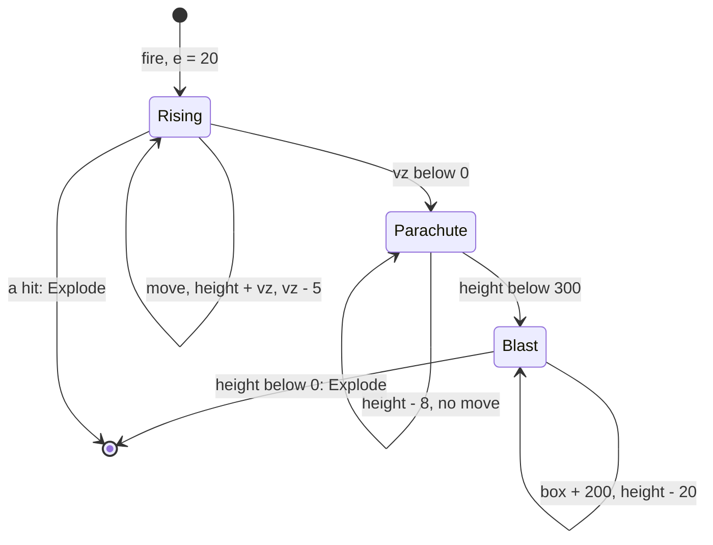

Worked example, e = 20 (speed 113, vertical speed 60): the climb adds 60, 55, ..., 5, 0 over 13 passes, and the 14th
sees -5: the top is 56 + 390 = 446, reached 14 x 113 = 1582 world units ahead. The parachute takes 19 passes from 446
to 294 (the 18th leaves 302). The blast takes 15 passes from 294 to -6, its box growing from 32 to 3032. The radius
stays 10, so the pass tests the boxes only when the distance estimate is below 10 + the other's radius, and the
heights must overlap: an object 64 high with a half height of 128 is reached from height 223 down.

Witness: play2: ElevationZero at 16278, FireClusterBomb at 16355, ClusterRise 14 runs (16356-16465),
ClusterParachute 19 (16473-16617), ClusterBlast 15 (16627-16762), Explode at 16762: the counts of the example.

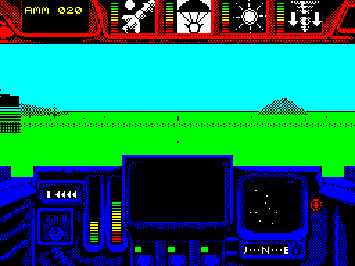

*Animation 10.8. The play2 recording, frames 16350-16770, every sixth frame: the view ahead while the K-90 fired at 16355
climbs, hangs and bursts 1582 units in front (the black specks late in the run are in its blast phase, 16627-16762);
the TANK HIT messages are enemy shells. Drawn by `python3 ../../kit/screen_anim.py --work work/docs/bcC/play2 --from 16350 --to 16770 --step 6 --scale
2 --delay 90 --hold 2000 docs/img/play/k90-cluster.gif` (the instance opened on `work/stage1/rec/play2/session.ttd`).*

The point: the K-90 is slow and sure. It stops 1582 units ahead, hangs for 19 passes, then kills whatever lies under
it.

### Phantasm and Spectre (`$8A`, `$8B`)

Both fire one bomb per fire press, or one every 17 passes once K has armed the auto-fire: K (`$D2E4`, `$D2F7`) puts
PhantasmCode `$D3D6` or SpectreCode `$D324` into the slot hook with a counter of 16 (the operands `$D3EB`, `$D335`);
the hook counts it down each pass and, at the wrap, launches. J (AutoFireOff `$D30B`) puts NoAction back. Both
launch at e = 30 and climb like the mortar; at the top they part. LaunchPhantasm (`$D3FA`) and LaunchSpectre
(`$D344`) set e = 30 through SetElevation `$CF32`, which writes the launch operands `$B5C5` / `$B5C8` that every
LaunchProjectile shares: after an auto-fire shot, the mortar's or the K-90's next shot flies at e = 30 too, whatever
its own elevation shows, until its K, J or select writes the operands again (from the code; no recording shows it).

- **Phantasm** (LaunchPhantasm `$D3F7`, PhantasmStep `$D405`): at the first negative vertical speed the step becomes
  PhantasmSpin `$D43B` and the model `$D934`. It no longer moves: heading + 2 and height - 4 a pass; below 0 it is
  unregistered and freed. Its hit handler is NoAction: nothing destroys it; damage 1.
- **Spectre** (SpectreStep `$D369`): at the top the step becomes SpectreDrift `$D3AD`,
  the model `$7F5B` (the parachute), a speed of Random AND 15 and a random heading. It drifts and falls 8 a pass;
  below 0 RemoveObject. Damage 31, Explode on a hit.

```text
AutoFire(slot):                           # PhantasmCode $D3D6, SpectreCode $D324, a slot hook
    counter -= 1
    if counter < 0: counter = 16; Launch(slot)      # one bomb every 17 passes, while rounds last

PhantasmSpin(p):                          # $D43B
    p.heading += 2; p.height -= 4
    if p.height < 0: Unregister(p); p.state = 0

SpectreDrift(s):                        # $D3AD
    MoveObject(s); s.height -= 8
    if s.height < 0: RemoveObject(s)
```

```text
$D38E  LD (IX+$18),$AD      ; the Spectre at the top: step SpectreDrift
$D392  LD (IX+$19),$D3
$D396  LD (IX+$1C),$5B      ; model $7F5B, the parachute
$D39A  LD (IX+$1D),$7F
$D39E  CALL ApiVector06     ; Random
$D3A1  AND $0F
$D3A3  LD (IX+$07),A        ; speed 0-15
$D3A6  CALL ApiVector06
$D3A9  LD (IX+$22),A        ; any heading
```

**The decoy.** Mission 1's homing shell, type 28 (fired by type 26, [doc 07.9](07-objects.md)), runs `$EAAA` as its
first step: it scans records 1-23 for a type byte `$8A`.

```text
$EAAA  CALL $EAF3           ; a record of type $8A?
$EAAD  JR C,$EAC4           ; none
$EAAF  LD DE,$0001
$EAB2  AND A
$EAB3  SBC HL,DE            ; HL = the record
$EAB5  LD (IX+$32),L
$EAB8  LD (IX+$33),H
$EABB  LD (IX+$18),$CE      ; step $EACE for good
$EABF  LD (IX+$19),$EA
$EAC3  RET
$EAC4  CALL M1ShellStep     ; none: home on the player
$EAC7  LD IY,$75F0
$EACB  JP TurnToward
...
$EAF3  LD HL,$762D          ; record 1, +1
$EAF6  LD DE,$003C
$EAF9  LD B,$17
$EAFB  LD A,(HL)
$EAFC  CP $8A               ; the type only, not +2
$EAFE  RET Z
$EAFF  ADD HL,DE
$EB00  DJNZ $EAFB
$EB02  SCF
$EB03  RET
```

With no Phantasm the shell turns to the player every pass (TurnToward with IY = `$75F0`). Once one is found, its step
is `$EACE` for good: M1ShellStep, TurnToward the Phantasm's record, and the height 1/32 of the way to its height a
pass. The scan reads the type byte alone: a freed record keeps its type until another object takes it, so a
Phantasm that has come down still draws the shells to where it was (from the code).

The other missions' homing shells copy this step with their own decoy type: missions 1, 5, 6 and 10 look for `$8A`
(the Phantasm), missions 3 and 4 for `$8B` (the Spectre: `$E978`, `$E90B`). In missions 2 and 8 the "homing" shell
(types 18 and 20) runs the plain shell step (`$E7F7`, `$E96B`) and flies straight, so no decoy matters there
([doc 07.14](07-objects.md#714-the-units-of-missions-2-10)).

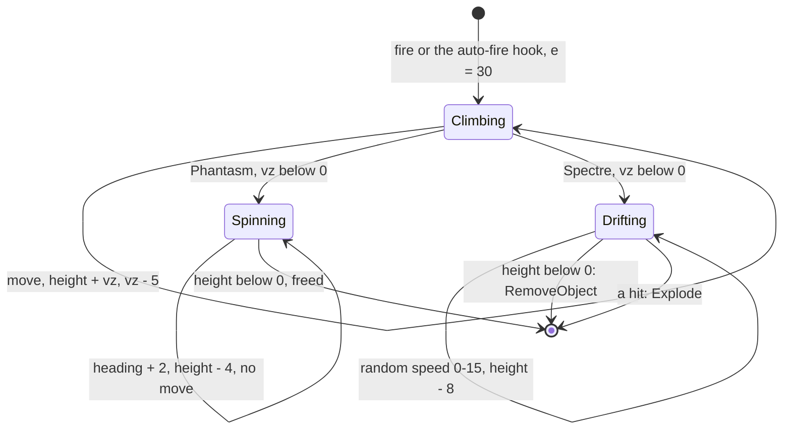

Worked example, e = 30 (speed 95, vertical speed 86): the climb adds 86, 81, ..., 1 over 18 passes and the 19th sees
-4: the top is 56 + 783 = 839, reached 19 x 95 = 1805 world units ahead. The Phantasm then spins down 4 a pass: 210
passes in place: at the 11 frames a pass of the play recording, about 2300 frames, 46 seconds. The Spectre falls 8 a
pass: 105 passes, drifting up to 15 x 105 = 1575 units on a random heading.

Witness: play (the Phantasm): its select `$D46A` at 9322, J four times (9365-9386), FirePhantasm at 9406, PhantasmStep
19 runs (9407-9537), PhantasmSpin 104 runs (9545-10692): 104 x 4 = 416 of its 839, still in the air when the play
ends. play2 (the Spectre): its select `$D34E` at 16563, J three times (16611-16627), FireSpectre at 16644,
SpectreStep 19 runs (16646-16830), SpectreDrift 47 runs (16840-17310), cut by the end of that game. No recording
has a Phantasm and a homing shell at once; the decoy is known only from the code. No recording arms the auto-fire.

The point: the Phantasm is the counter to the homing shell: it hangs in the air for most of a minute, cannot be shot
down, and takes every homing shell fired while it exists. The Spectre is the slow-falling cousin of the K-90 with a
smaller punch and a random drift.

### Skeet bomb (`$89`)

SkeetFire `$D24C` spawns type `$89` at the camera's X and Y, height 64, speed 64, heading the tank's + 128
(backwards), with +`$31` = 8 (the leg), +`$32` = 8 (the turn a pass) and +`$33` = 10 (the legs). It alternates two
steps:

- SkeetZigZag `$D2AE` (the template's step): MoveObject, heading + the turn; at the end of the leg the turn's sign is
  flipped, the next straight leg is 8 passes (the first) or 16, and the step becomes SkeetStraight `$D28C`;
- SkeetStraight: MoveObject; at the end of the leg the legs count falls by one; below 0, Explode; else a turning leg of
  17 passes.

```text
SkeetZigZag(b):                           # $D2AE
    MoveObject(b); b.heading += b.turn
    b.leg -= 1; if b.leg >= 0: return
    b.leg = 7 if b.legs == 10 else 15
    b.step = SkeetStraight; b.turn = -b.turn

SkeetStraight(b):                            # $D28C
    MoveObject(b)
    b.leg -= 1; if b.leg >= 0: return
    b.legs -= 1; if b.legs < 0: Explode(b); return
    b.leg = 16; b.step = SkeetZigZag
```

```text
$D2BB  LD A,(IX+$31)
$D2BE  DEC A
$D2BF  LD (IX+$31),A
$D2C2  RET P                ; the leg goes on
$D2C3  LD A,(IX+$33)
$D2C6  CP $0A               ; the first leg?
$D2C8  JR NZ,$D2CE
$D2CA  LD A,$07
$D2CC  JR $D2D0
$D2CE  LD A,$0F
$D2D0  LD (IX+$31),A
$D2D3  LD (IX+$18),$8C      ; step SkeetStraight
$D2D7  LD (IX+$19),$D2
$D2DB  LD A,(IX+$32)
$D2DE  NEG                  ; the turn changes side
$D2E0  LD (IX+$32),A
```

Worked example: the first turn lasts 9 passes (+72 heading steps, 101 degrees), the first straight 8; then ten
rounds of a 17-pass turn (136 steps, 191 degrees, the side changing each time) and a 16-pass straight; the eleventh
straight ends in Explode. 9 + 8 + 10 x (17 + 16) = 347 passes, at 64 units a pass about 22 000 units of a weaving
path behind the tank. A hit on the way explodes it; damage 4.

Witness: play2: its select `$D24B` (a `RET`) at 16853, SkeetFire at 16931, SkeetZigZag 26 runs (16932-17212) = 9 +
17, SkeetStraight 13 runs (17021-17310) = 8 + 5 of the second straight, cut by the end of that game at 17310.

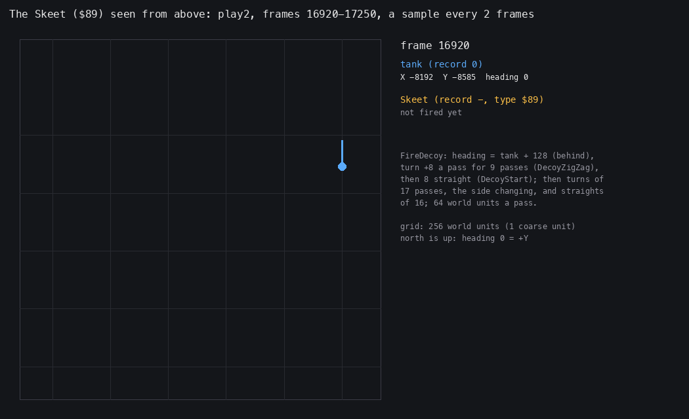

*Animation 10.9. The Skeet's track in play2, seen from above: the object table sampled every 2 frames from 16920 to
17250 (TTD `memory_at`), the tank (record 0, blue, standing until 17150) and the Skeet (record 19, type `$89`, amber)
with their headings. It leaves backwards (heading = the tank's + 128), turns 9 passes, runs 8 straight, then turns
the other way for 17. The front view does not show it (it flies behind the tank), so this is drawn from the samples:
`python3 tools/sample_objects.py work/docs/bcC/play2 16920 17312 2 work/docs/bcC/skeet.jsonl`, then
`python3 tools/fig_gameplay.py skeet --samples work/docs/bcC/skeet.jsonl --to 17250 docs/img/gameplay/skeet-path.gif`.
The game is paused by the quit prompt from about 17250.*

The point: the Skeet guards the tank's back. It leaves behind the tank and weaves for over a minute (347 passes at the
10 frames a pass of play2) through the ground the chasing units must cross; nothing in the mission code aims at it.

### SLAM Laser (store 10)

The SLAM has no projectile and no fire routine (word 2 is NoAction). K (SlamOn `$D0F5`) puts SlamHook `$D115` into
the slot hook and prints the "on" text `$FDD7`; J (SlamOff `$D104`) puts NoAction back and prints `$FDE1`. The select
SelectSlam `$D45E` prints the text that matches the hook. While it is on, the hook runs once a pass (SlamHook saves the
slot and calls SlamFire `$D11C`):

1. SlamScan `$D1A0` lists, at `$D21B`, the collision rows (+`$3B`) of the present records 1-23 whose +3 AND `$50`
   is `$10`: the enemy shells. No shell: nothing happens and no round is used.
2. One round (the rounds byte - 1; 0 rounds: nothing).
3. SlamTimers `$D1CF`: for each, the pair timer of the shell's row with record 0, the tank (the first byte of
   the row, through the row pointers `$C78C`), as |pass counter `$C7BD` - timer| into `$D233`.
4. SlamPickShell `$D1F5` is meant to take the smallest, the pair due soonest, but its minimum search starts at 0
   (`LD DE,$0000`; nothing writes the operand `$D1FD`) and takes a value only when `CP E` carries, which never happens
   with E = 0: D stays 0, and the SLAM always shoots the first shell in the list (the lowest record).
5. That record gets Debris and +2 = 0; its view-space position goes into the vertex work area (`$FD02`, `$FE02`,
   `$FF02`) beside fixed points, RunScript `$990F` draws the beam with the script at `$FEBB`, and the sound `$D839`
   plays.

```text
SlamHook():                               # $D115, a slot hook, once a pass while on
    shells = [rec.row for rec in records 1..23 if rec.present and rec.flags & $50 == $10]
    if not shells: return
    if rounds == 0: return
    rounds -= 1
    t = [|pass - timer(row, tank)| for row in shells]       # SlamTimers, computed and not used
    best, r = 0, shells[0]                    # SlamPickShell: E = 0, D = 0
    for i, v in enumerate(t):
        if v < best: best, r = v, shells[i]   # CP E: never true, nothing is below 0
    Debris(record[r]); record[r].state = 0
    draw the beam from the fixed points to record[r]'s view position; sound
```

```text
$D125  LD A,($D21B)         ; the first listed row, $FF when none
$D128  AND A
$D129  RET M
$D12A  LD HL,($B551)        ; the rounds
$D12D  LD A,(HL)
$D12E  DEC A
$D12F  RET M
$D130  LD (HL),A
$D131  LD ($C527),A
$D134  CALL PrintAmmo
$D137  CALL SlamTimers      ; the timers
$D13A  CALL SlamPickShell   ; meant: the smallest; in fact the first listed
$D13D  LD HL,$75F0
$D140  LD B,A
$D141  LD DE,$003C
$D144  ADD HL,DE
$D145  DJNZ $D144           ; record A
$D147  PUSH HL
$D148  PUSH HL
$D149  POP IX
$D14B  CALL ApiVector11     ; Debris
$D14E  LD (IX+$02),$00      ; the shell is gone
...
SlamPickShell:
$D1F5  LD HL,$D21B          ; the listed rows
$D1F8  EXX
$D1F9  LD HL,$D233          ; their values
$D1FC  LD DE,$0000          ; E = the minimum so far: 0, D = its index: 0
$D1FF  LD C,E               ; C = the index
$D200  EXX
$D201  LD A,(HL)
$D202  INC HL
$D203  EXX
$D204  AND A
$D205  JP M,$D212           ; $FF: the end of the list
$D208  LD A,(HL)
$D209  INC HL
$D20A  CP E                 ; value < 0? never: no carry
$D20B  JR NC,$D20F
$D20D  LD E,A               ; never reached
$D20E  LD D,C
$D20F  INC C
$D210  JR $D200
$D212  LD HL,$D21B
$D215  LD B,$00
$D217  LD C,D               ; D = 0
$D218  ADD HL,BC
$D219  LD A,(HL)            ; the first listed row
```

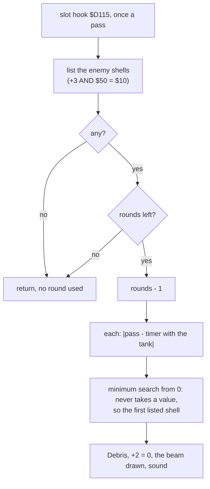

Worked example, from the code: two shells in rows 15 and 16, the pass counter at 40, their timers with the tank 52
and 41. The values are 12 and 1: the shell of row 16 is due first, but the search compares 12 and 1 with E = 0, `CP E`
never carries, D stays 0 and row 15, the first listed, is shot. Each round stops one shell; the laser reaches any shell in the record
table, with no range.

Witness: play2: SelectSlam at 23071 and SlamOff (J) three times, 23118-23134; K never runs, so `$D115` has
no run. Known only from the code. Two flaws of the code, not seen in a run: the shell is freed without
UnregisterCollision; and the scan, after a match, goes on two bytes short (+`$3C` instead of +`$3E`), so the records
after the first shell are read from their +0 and +1 (SUSPECTED: a wrong row may be listed when two shells are in the
air).

The point: the SLAM is the anti-shell weapon. It needs no aim and no key once on: every pass with an enemy shell in
the air costs one round and removes the first shell in the record table; the schedule it computes is never used.

### The payload limit

FitOrRemoveWeapon `$C173` (bank 6), on the stores screen, counts the slots that already hold the store, refuses a
store fitted "most fitted" times (MaxNumberExceeded), then adds its weight to the payload operand and refuses a total
of 1001 kg or more (PayloadExceeded).

```text
FitOrRemoveWeapon(slot, store):
    if slot is full: RemoveWeapon(slot); return
    n = number of slots with store.type
    if n == store.most: MaxNumberExceeded(); return
    w = payload + store.weight
    if w >= 1001: PayloadExceeded(); return
    payload = w
    slot = (store.type, store.weight, store.rounds)
```

```text
$C1B6  LD HL,(PayloadWeightOp+1)  ; the payload so far
$C1B9  ADD HL,BC                  ; + the store's weight
$C1BA  LD (SlotWeightOp+1),BC
$C1BE  PUSH HL
$C1BF  LD BC,$03E9                ; 1001
$C1C2  AND A
$C1C3  SBC HL,BC
$C1C5  POP BC                     ; the new total
$C1C6  JP NC,PayloadExceeded
$C1C9  LD (PayloadWeightOp+1),BC  ; accepted
```

Worked example: Turret (400 kg) and Dragonfly (500 kg) make 900 kg. A Phoenix RRSA (250 kg) would make 1150: refused.
A Spectre (100 kg) makes exactly 1000: accepted.

Witness: play and play2 fit every store; the play recording's POKE at `$C1C6` (the `JP NC`) lifts the payload test
(WALKTHROUGH 6.0).

The point: the weapons share one engine. A store is four routine words and a template; the payload limit of 1000 kg
is the only balance between them, and the Turret alone weighs 400.

## 10.8 Debris

Debris `$B6D1` throws the pieces of a destroyed object into bank 3's particle list DebrisRecords `$CFEC`: 8 records
of 20 bytes. It does nothing unless the object was in view this pass (+2 b5), so an object killed off the screen
leaves no pieces.

| Offset | Field | Set by Debris |
| --- | --- | --- |
| +0 | flags, `$FF` live, 0 free | `$FF` |
| +1-+3 | X, 24-bit world units | the object's +`$23`-+`$25` |
| +4-+6 | Y, 24-bit | the object's +`$26`-+`$28` |
| +7, +8 | height | the object's +5, +6 |
| +`$0A` | spin angle | |
| +`$0F`, +`$10` | X and Y speed, signed | Random >> 2: -32 to 31 (DebrisVelocityB `$B75C`) |
| +`$11` | vertical speed | 32 + (Random AND 31): 32 to 63 |
| +`$12`, +`$13` | two spin steps | Random >> 2 OR 7, AND `$F8` when negative: 7, 15, 23, 31 or -8 to -32 (DebrisVelocity `$B74B`) |

The number of pieces is the template's byte at +`$0A` of the object (4 for most mission 1 types); a piece that finds
no free record of the eight is dropped. Bank3Step, called once a pass from PlayLoop (`$6A2A`), runs MoveAllDebris
`$D1EC`, which calls MoveDebris `$D16B` for each live record:

```text
Debris(obj):                         # $B6D1, the kill path of HitTest and KillTree
    if not obj.in_view: return       # +2 b5
    repeat obj[$0A] times:
        p = the first free record of DebrisRecords, else stop
        p.x, p.y, p.height = obj.x, obj.y, obj.height; p.flags = $FF
        p.vx = Random >> 2; p.vy = Random >> 2; p.vz = 32 + (Random AND 31)
        p.spin1, p.spin2 = DebrisVelocity(), DebrisVelocity()

MoveDebris(p):                       # once a pass for every live piece
    p.x += p.vx; p.y += p.vy                     # 24-bit, the speed sign-extended
    h = p.height + p.vz
    if h < 0: p.flags = 0; return                # below the ground: freed
    p.height = h
    if p.vz - 5 overflows (below -128): p.flags = 0; return
    p.vz -= 5                                    # gravity
    p.angle += p.spin1 + p.spin2
```

```text
MoveDebris (bank 3), the height:
$D1AB  LD D,$00
$D1AD  LD A,(IX+$11)     ; the vertical speed, sign-extended into DE
...
$D1B6  LD L,(IX+$07)
$D1B9  LD H,(IX+$08)
$D1BC  AND A
$D1BD  ADC HL,DE         ; height + vz
$D1BF  JP M,$D1CF        ; negative: freed
$D1C2  LD (IX+$07),L
$D1C5  LD (IX+$08),H
$D1C8  LD E,$05
$D1CA  AND A
$D1CB  SBC A,E           ; vz - 5
$D1CC  JP PO,$D1D4       ; no overflow: keep it
$D1CF  XOR A
$D1D0  LD (IX+$00),A     ; the piece is freed
$D1D3  RET
$D1D4  LD (IX+$11),A
```

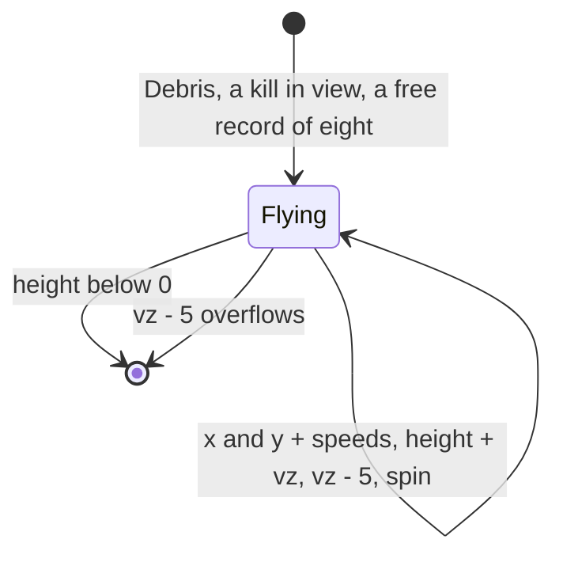

Worked example: the hut of death frame 8531 (type 15, height 32, +`$0A` = 4 pieces). A piece thrown with vz = 40 and
vx = 20:

1. Pass 1: height 32 + 40 = 72, vz 35, X + 20.
2. Passes 2-8: 107, 137, 162, 182, 197, 207, 212 (vz 0 after pass 8).
3. Pass 9: 212 + 0 = 212, vz -5; then 207, 197, ... down to 32 at pass 17 (vz -45).
4. Pass 18: 32 - 45 = -13: below the ground, freed. The piece flew 18 passes and drifted 18 x 20 = 360 units.

The overflow test frees a piece only after vz has fallen below -128, 33 or more passes after the throw; a piece
thrown from the ground lands first (vz = 63 lands at pass 27), so that branch matters only for an object high up.

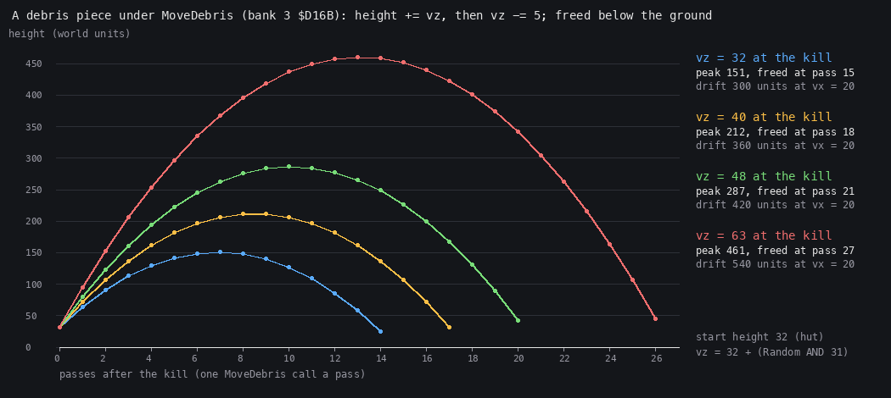

*Figure 10.1. The height of one piece of the hut (start height 32) for four start speeds, computed from the code's
rules, not from a recording: `python3 tools/fig_gameplay.py debris --height 32 --vz 32,40,48,63 --vx 20
docs/img/gameplay/debris-flight.png`.*

How to read it: one curve a start speed vz, one dot a pass; the curve ends at the last pass above the ground, and the
legend gives the peak, the pass that frees the piece and the drift at vx = 20.

Witness: MoveDebris runs 661 times in death and play2; the kill of death frame 8531 runs Debris from T 15 969
(`pc-kill.txt`). The flight numbers are from the code: no sample of bank 3 was taken.

The point: debris is cosmetic and costs nothing out of sight: an object off the screen dies without pieces, and at
most eight pieces fly at once, each for 15 to 27 passes.

## 10.9 Goals, the Helicarrier and completion

Each mission's goal is a routine in its block, called every pass from `$6A66`. It reads the destroyed bits (b1) of
its target list records and sets the goal flag `$68E8` = `$FF`.

```text
GoalHook1:                  ; mission 1, $EB60
$EB60  LD A,($DE74)         ; list record 55, fuel dump 1
$EB63  AND $02
$EB65  RET Z
$EB66  LD A,($DE7C)         ; list record 56, fuel dump 2
$EB69  AND $02
$EB6B  RET Z
$EB6C  LD A,$FF
$EB6E  LD ($68E8),A         ; the goal is met
$EB71  RET
```

The ten goal hooks, disassembled from `src/res/missions` (the list index is (address - list) / 8):

| Mission | Catalogue goal | Hook | What it tests |
| --- | --- | --- | --- |
| 1 Blast Em Mission | destroy the two fuel dumps | `$EB60` | records 55 and 56 (type 33) destroyed |
| 2 Missile Battery | find the missile base and destroy it | `$E2F4` | records 6 and 8 (type 10) destroyed |
| 3 Hostage Rescue | rescue one of the northern hostages | `$E322` | record 2 (type 22, the hostage) destroyed: its hit handler `$E311` takes the tank's touch once the gate is down (doc 07.14) |
| 4 Railway Ambush | ambush a supply train, then destroy the station | `$E927` | records 2 (type 8, the engine) and 11 (type 13, the station) destroyed, and byte +7 of record 3 equal to `$FB`: `$DCCF`, carriage 1's Y high byte on the siding's last leg. So: throw the points (`$E638`), wreck the train on the siding (the engine dies on the buffer stop's model `$F0A8`), destroy the station (doc 07.14) |
| 5 Night Moves | attack an enemy airfield | `$EA0E` | records 0-4 all destroyed (AND over five) |
| 6 Escort Duty | ensure the convoy's safe arrival | `$EB93` | a `RET`: the flag is set by `$E463` when a truck of the convoy touches the destination; losing the trucks fails nothing (doc 07.14) |
| 7 Satellite Search | recover a lost satellite | `$EA6F` | `CALL $F03D` (inverts `$6758-$675F`); the flag is set by `$E3B2` when the tank touches the satellite while it is behind the camera; a weapon hit destroys the satellite through HitTest and the goal is lost (doc 07.14) |
| 8 River Raid | destroy the supply vessels and the power station | `$E97F` | records 12, 16, 19, 23 (type 13) and 0 (type 6) destroyed |
| 9 Hideout | demolish the secret hideout | `$E8B5` | `CALL $EC2E`, then record 39 (type 9) destroyed |
| 10 Grand Finale | the final and toughest mission | `$EA07` | records 2 and 3 (type 12) destroyed |

When the flag is set:

1. PickupAnnounce `$DB71` (a `NOP` gate) prints "MISSION COMPLETE PROCEED TO PICKUP" once and writes `RET` over its
   gate.
2. The key H calls the Helicarrier (PlaceHelicarrier `$D52E`, once: it writes `RET` over its own `NOP` gate): record
   21, type `$8C`, height 104. Its X and Y mid/high words are the pad's (`$DBF1`, copied to `$7E82`; the words at
   `$7E89` / `$7E8C`) plus sin and cos of the player's heading divided by 4: 31 or 32 units of 256, so it appears
   about 8 000 world units (7 936-8 192) from the pad, on the side the tank faces. When |pad| - |camera| < 8 units of
   256 on both axes (a comparison of absolute values, not a distance: in mission 1, pad (0, 32), it holds whenever
   the camera is more than 24 units of 256 north or south of the X axis), it also writes the word `$DB1A` into
   +`$31`/+`$32`.
3. HelicarrierWait `$DB24` (its step, set by HelicarrierInit `$DB00`) flies it each pass: TurnToward and MoveObject
   toward the pseudo-record `$7E65`, whose X / Y at `$7E88` / `$7E8B` are the pad's. The test is the Helicarrier's own
   position, not the tank's: within 3 units of 256 (768 world units) on both axes, HelicarrierArrival `$DB61` makes
   HelicarrierTurn `$DAC4` the step and puts the CPL of the pad pseudo-record's heading at +`$31`.
4. HelicarrierTurn adds 8 to the heading each pass until it is within 8 of +`$31`, then makes HelicarrierDescent
   `$DADE` the step; the descent lowers it 8 a pass from 104 until the height is below 32 (24), and the step becomes
   `$6BB0` (NoAction): parked. Pads: mission 1 world (0, 8192), mission 4 world (-20480, 4096).
5. HelicarrierHit `$DAAB`, the Helicarrier's collision handler, has three branches, with no test of the parked
   state:
   - the other record's +3 b7 clear (not the player's family): HitTest, as for any target;
   - the player (+3 = `$87`) with the goal flag set: JP `$67EE`, ScreenFour, mission complete;
   - the player without the goal flag: ScreenSix and `$7BF9` = `$CC94` (only "MISSION FAILED.").
   So the tank completes the mission by touching the Helicarrier at any moment after the goal, even in flight.
6. MissionCompleteScreen `$CD1E` (bank 6): Score `$CC79` += the mission score `$68E2`, MissionsDone `$6799` + n =
   `$FF`, the mission's completion text, MissionsCompleted + 1. Score and MissionsDone are written 32 frames after
   HelicarrierHit, before the report is drawn.

```text
PlaceHelicarrier():                  # $D52E, the key H, once
    gate = RET
    h = record 21; Unregister(h); ObjectSetType(h, $8C); RegisterCollision(h)
    s, c = SinCos8(player.heading)
    h.x_mid = pad.x_mid + s / 4; h.y_mid = pad.y_mid + c / 4      # units of 256
    if |pad.x_mid| - |camera.x_mid| < 8 and |pad.y_mid| - |camera.y_mid| < 8: h[$31] = $DB1A

HelicarrierWait(h):                  # $DB24, each pass
    TurnToward(h, pad); MoveObject(h)
    if |pad.x_mid - h.x_mid| < 3 and |pad.y_mid - h.y_mid| < 3:
        h.step = HelicarrierTurn; h[$31] = NOT pad.heading

HelicarrierTurn(h):                  # $DAC4
    h.heading += 8
    if |h.heading - h[$31]| < 8: h.step = HelicarrierDescent

HelicarrierDescent(h):               # $DADE
    h.height -= 8
    if h.height < 32: h.step = NoAction                          # parked at 24

HelicarrierHit(h, other):            # $DAAB
    if not other.flags b7: HitTest(h, other)                     # 0 hit points
    elif GoalFlag: ScreenFour()                                  # $67EE: mission complete
    else: ScreenSix(); FailReason = $CC94                        # "MISSION FAILED." alone
```

```text
HelicarrierHit:
$DAAB  LD A,(IY+$03)
$DAAE  AND $80               ; the player's family?
$DAB0  JP Z,ApiVector10      ; no: HitTest
$DAB3  LD A,(GoalFlag)       ; $68E8
$DAB6  AND A
$DAB7  JP NZ,ApiVector16     ; ScreenFour: mission complete
$DABA  CALL ScreenSix
$DABD  LD HL,$CC94           ; "MISSION FAILED." alone
$DAC0  LD (FailReason),HL
$DAC3  RET
HelicarrierTurn:
$DAC4  LD A,(IX+$22)
$DAC7  ADD A,$08             ; turn 8 a pass
$DAC9  LD (IX+$22),A
$DACC  SUB (IX+$31)          ; against the pad's heading
$DACF  CALL ApiVector08      ; |difference|
$DAD2  CP $08
$DAD4  RET NC
$DAD5  LD (IX+$18),$DE       ; the step becomes HelicarrierDescent $DADE
$DAD9  LD (IX+$19),$DA
$DADD  RET
```

The word `$DB1A` is HelicarrierCode: `LD IY,$75F0`, `LD HL,$67A8`, `EXX`, `JR $DB2C`, the flight of HelicarrierWait
aimed at the player (IY = record 0) instead of the pad. No jump through +`$31`/+`$32` was found, and
HelicarrierArrival overwrites +`$31`; whether the variant ever runs is not settled (SUSPECTED: not run).

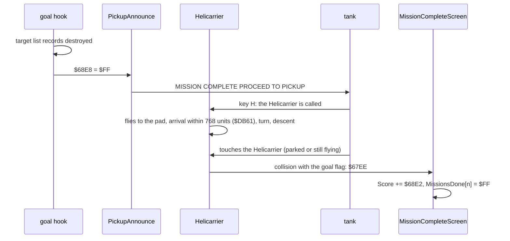

Witness: the completion recordings m1complete and m4complete (WALKTHROUGH 6.0, `work/stage2/complete-NOTES.md`). No earlier recording completes a mission: c1 ends in play, and MissionCompleteScreen (bank 6 `$CD1E`) has no run in its L1 (page 6), against one in m1complete.

| Event | m1complete | m4complete |
| --- | ---: | ---: |
| goal hook first run (one a pass) | 7595 (GoalHook1 `$EB60`, 1504 runs) | 3217 (GoalHook4 `$E927`, 2237 runs) |
| goal records destroyed | 15786, 16136 (records 55, 56) | 8836 (engine), 14213 (station) |
| goal flag `$68E8` = `$FF`, PickupMessage `$DB77` | 16138 | 14214-14215 |
| H: HelicarrierWait first run | 16239 | 14336 |
| HelicarrierArrival `$DB61` | 17099 | 15435 |
| turn `$DAC4`, descent `$DADE` | 17109-17205, 17213-17311 | 15442-15504, 15510-15575 |
| HelicarrierHit `$DAAB`, then `$67EE` | 21558 | 21299 |
| MissionCompleteScreen `$CD1E`; Score, MissionsDone written | 21560-21721; 21590 | 21301-21462; 21331 |


*m1complete frame 21533: the Helicarrier parked on the pad, the tank about to drive into it; the pickup message is
still in the message line. Screenshot of the recording (bank 5).*

The hooks of missions 1 and 4 are witnessed; the other eight are read from their blocks. Mission 4's `$FB` test is
the siding: shooting the points (record 10, type 11, hit handler `$E638`, frames 3819 and 4010) writes `$60` to
`$E7C0-$E7C2`, the next train runs onto the siding, where the records' Y word is `$FBFF` (byte +7 = `$FB`; on the
main line Y is 0); the engine destroyed there (8836) stops the train with record 3 at `$FB`, and the station (14213)
completes the goal.

The point: the goal is data plus a few lines of code per mission. Most goals are "these list records destroyed",
read from the same bit that keeps a wreck from respawning; the Escort Duty and Satellite Search goals live in their
missions' own code.

## 10.10 Failure and its causes

A mission fails when a routine writes a text address to `$7BF9` and calls ScreenSix `$7047`. MissionFailedScreen
`$CD84` (bank 6) shows "MISSION FAILED." (`$CC94`) and the text; then the game returns to the title. There are no
lives.

| Cause | Text (bank 6) | Set by | Witness |
| --- | --- | --- | --- |
| armour underflow | `$CCAB` UNIT DESTROYED | ArmourDestroyed `$CB38` | armour frame 18423 (POKE) |
| armour underflow after the goal | `$CCBE` FAILED TO MAKE PICKUP | ArmourDestroyed | known only from the code |
| beyond the extent + 4 | `$CCD8` PLAYER DESERTION | BoundaryCheck `$D4CE` | known only from the code |
| fuel | `$CCED` RAN OUT OF FUEL | OutOfFuel `$A94E` | fuel frame 7860 (POKE) |
| the bridge | `$CD01` TANK DESTROYED ON BRIDGE | BridgeHit `$B64E` (resident), the hit handler of mission 2's type 3 | known only from the code |
| the Helicarrier hit before the goal | `$CC94` alone | HelicarrierHit `$DAAB` | known only from the code |

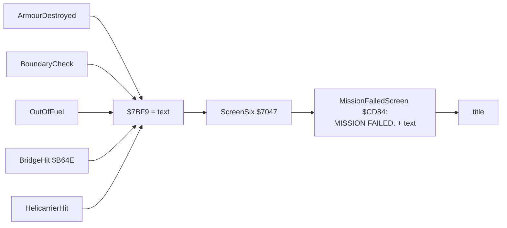

The bridge: BridgeHit `$B64E` follows KillSwitchObject `$B61E` in the resident code; mission 2's
template 3 (the bridge) names it as its hit handler. It runs HitTest; on a kill it looks at `$A8C8`, the operand of
PlayerStep's first `JR`. PlayLoop clears that byte before every collision pass (`$6A37`), and HitObstacle `$CB6C`
writes `$25` there when the tank touches a type 4 object in the same pass. So a bridge destroyed while the tank is
against such an object fails the mission:

```text
BridgeHit:                   ; $B64E, mission 2 type 3
$B64E  LD A,(IX+$02)
$B651  CALL HitTest          ; NC: not destroyed
$B654  RET NC
$B655  LD A,($A8C8)          ; the tank touched a type 4 object this pass?
$B658  AND A
$B659  RET Z
$B65A  LD HL,$CD01           ; TANK DESTROYED ON BRIDGE
$B65D  JP $CB46              ; FailReason = HL, ScreenSix
```

KillSwitchObject `$B61E` itself serves mission 5's type 29 and mission 8's types 8 and 9: on a kill it switches off
the two segments that the switch table (`$DBDF`) gives for this object: c = its list index - `$DBDD` (the first
switch object), the table's bytes c and c + 1 less `$DBDE` (the first switchable segment) index the switch flags at
`$7BFD` ([doc 07.14](07-objects.md#714-the-units-of-missions-2-10)).

The point: one pointer is the whole failure state. Every cause writes its text's address and jumps to the same
screen.

### No time limit: the mission clock

The clock counts but never fails a mission. MissionTimeSetup `$85F5` copies the header's clock start (`$DBFE`: minutes,
hours; mission 1 0 and 8) to MissionClock `$68EB` / `$68EC`, clears the seconds `$68EA`, and writes `RET` over
ClockTick's `NOP` gate `$7DFB` until play. The interrupt calls ClockTick (`$83A4`) every frame it is taken:

```text
ClockTick():                     # $7DFB, from the interrupt
    if gate == RET: return
    divider -= 1                 # the operand $7DFD, 50 at the start
    if divider != 0: return
    divider = 1                  # so from now on every interrupt is a second
    seconds += 1; at 60: seconds = 0, minutes += 1; at 60: minutes = 0, hours += 1; at 24: hours = 0
```

```text
ClockTick:
$7DFB  NOP               ; the gate: RET outside play
$7DFC  LD A,$32          ; the divider (operand $7DFD)
$7DFE  DEC A
$7DFF  LD ($7DFD),A
$7E02  RET NZ
$7E03  LD A,$01          ; reloaded with 1, not 50
$7E05  LD ($7DFD),A
$7E08  LD HL,MissionClock
$7E0B  LD A,(HL)
$7E0C  CP $3B            ; 59 seconds?
$7E0E  JR NC,$7E13
$7E10  INC A
$7E11  LD (HL),A
$7E12  RET
```

```mermaid
stateDiagram-v2
  [*] --> Stopped: MissionTimeSetup, gate RET, clock = header start
  Stopped --> FirstSecond: play opens the gate
  FirstSecond --> Running: 50 interrupts, divider reloaded with 1
  Running --> Running: one second per interrupt; 59 s, 59 min, 23 h wrap
```

Worked example: mission 1 starts at 08:00:00. After the first 50 interrupts the clock reads 08:00:01; from then on
each interrupt taken adds a second, so a game minute is 60 interrupts, 1.2 s of real time when none is lost, and the
clock passes 09:00 after about 3 650 interrupts, 73 s. After 24 game hours (about 29 real minutes) it wraps to
00:00:00 and play goes on: nothing reads the clock to end the mission. The hours do matter elsewhere: TimeOfDay
`$8836` looks the hour up in HourTable `$88F8`.

Witness: ClockTick has L1 69 895 in eleven recordings (one a frame); m1complete reads `$68EB` going up about once
every 62-66 frames (`work/stage2/complete-NOTES.md`, which names `$68EB` the seconds: it is the minutes, 60 taken
interrupts plus the lost ones).

## 10.11 The Grand Finale

LoadMissionIfAllowed `$759A` loads the mission the tape holds. It refuses a mission already completed (MissionDone:
`$6799` + n not 0). For mission 10 (index 9) it ANDs the nine flags `$6799-$67A1`: any 0 refuses it.

```text
$759A  CALL MissionDone      ; NZ: already done
$759D  RET NZ
$759E  LD A,$09
$75A0  CP C                  ; the Grand Finale?
$75A1  JR NZ,$75AF
$75A3  LD A,$FF
$75A5  LD HL,MissionsDone    ; $6799
$75A8  LD B,$09
$75AA  AND (HL)
$75AB  INC HL
$75AC  DJNZ $75AA
$75AE  RET Z                 ; one is missing: refused
$75AF  CALL LoadMission
```

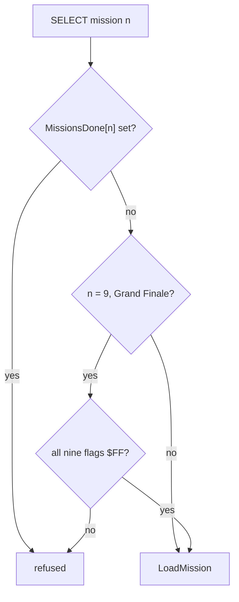

Witness: the m10 recording selects the Grand Finale with no mission done; LoadMissionIfAllowed returns at `$75AE`
and the status screen follows (L1 18 in m10, m2erbe, m2ocean, missions).

The point: the order of missions 1-9 is free, but each counts once, and the tenth needs all nine.

## 10.12 The score and the load / save codes

Score `$CC79` (bank 6) is a 32-bit number, low byte first: the sum of the completed missions' scores. The save code
packs Score and the ten MissionsDone flags into ten characters.

EncodePassword `$CE2E`:

- values 0-7: four bits of the score each, from Score's first byte, high nibble first; bit 4 is the flag of missions
  1-8;
- value 8: bit 0 the flag of mission 9, bit 1 the flag of mission 10, bits 2-4 the low three bits of the checksum;
- value 9: bits 3-7 of the checksum;
- the checksum is the XOR of the four score bytes.

PasswordToChars maps each value through PasswordAlphabet `$CF5F`, "9876543210ZYXWVUTSRQPONMLKJIHABC...": value 0 is
"9", 10 is "Z", 29 is "A".

```text
EncodePassword():
    bits = Score bytes 0..3, each high nibble first
    for i in 0..7: value[i] = next 4 bits | (MissionsDone[i] & $10)
    c = Score[0] ^ Score[1] ^ Score[2] ^ Score[3]
    value[8] = (MissionsDone[8] & 1) | (MissionsDone[9] & 2) | (c & 7) << 2
    value[9] = (c >> 3) & $1F
    text = alphabet[value[i]] for i in 0..9

DecodePassword():                       # the inverse; Z when the checksum agrees
    for k in 0..3: Score[k] = (value[2k] << 4 | value[2k+1] & $0F) & $FF
    flags from bit 4 of values 0-7 and bits 0, 1 of value 8
    return c(Score) == (value[8] & $1C) >> 2 | value[9] << 3
```

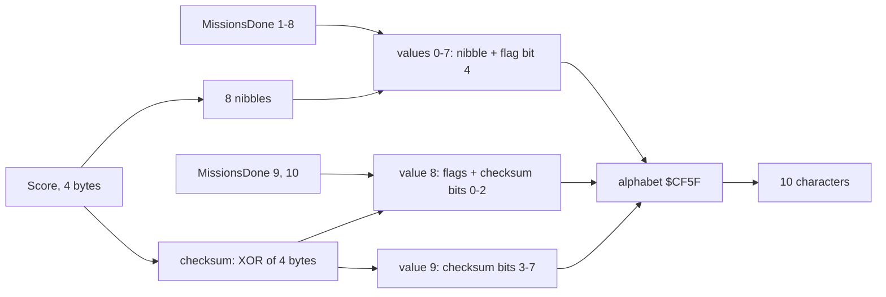

```text
$CE36  LD HL,$6799          ; MissionsDone
$CE39  LD DE,PasswordValues ; $CEFB
$CE3C  LD B,$08
EncodeLoop:
$CE3E  LD A,$04
$CE40  CALL ScoreBits       ; the next 4 bits of the score
$CE43  LD C,A
$CE44  LD A,(HL)            ; MissionsDone[i]
$CE45  INC HL
$CE46  AND $10              ; its bit 4
$CE48  OR C
$CE49  LD (DE),A            ; value i
$CE4A  INC DE
$CE4B  DJNZ EncodeLoop
$CE4D  LD A,(HL)            ; mission 9
$CE4E  INC HL
$CE4F  AND $01
$CE51  LD C,A
$CE52  NOP
$CE53  LD A,(HL)            ; mission 10
$CE54  AND $02
$CE56  OR C
$CE57  LD C,A
$CE58  LD HL,Score
$CE5B  XOR A
$CE5C  LD B,$04
ChecksumLoop:
$CE5E  XOR (HL)             ; the XOR of the score bytes
$CE5F  INC HL
```

Worked examples:

1. Nothing done, Score 0: every value is 0, the code is "9999999999". The menu recording shows this code on the save
   screen at frame 10 817.
2. Mission 1 done with 4000 points (Score = `A0 0F 00 00`), worked from the code: the nibbles are A, 0, 0, F, 0, 0, 0,
   0; value 0 = `$0A` | `$10` = 26; the checksum is `$A0` XOR `$0F` = `$AF`; value 8 = (`$AF` AND 7) << 2 = 28;
   value 9 = `$AF` >> 3 = 21. The values 26, 0, 0, 15, 0, 0, 0, 0, 28, 21 give "J99U9999HO".
3. Recorded, m1complete frame 22240: mission 1 done, Score 500 (`F4 01 00 00`): value 0 = 15 | 16 = 31 "C", then
   4 "5", 0 "9", 1 "8", four 0 "9999"; the checksum `$F4` XOR `$01` = `$F5`: value 8 = 5 << 2 = 20 "P", value 9 =
   `$F5` >> 3 = 30 "B". The screen shows "C5989999PB".
4. Recorded, m4complete frame 22035: missions 1 and 4 done, Score 2500 (`C4 09 00 00`): value 0 = 12 | 16 = 28 "H",
   4 "5", 0 "9", value 3 = 9 | 16 = 25 "K", "9999"; the checksum `$CD`: 20 "P", 25 "K". The screen shows
   "H59K9999PK".


*m1complete frame 22240: SAVE GAME after mission 1, the code "C5989999PB" of example 3. Screenshot of the recording.*


*Figure 10.2. The second worked example, score 4000 with mission 1 done, packed into "J99U9999HO": the four score
bytes, the checksum `$AF`, the ten 5-bit values coloured by what they carry, the characters. Computed from the code's
rules, not from a recording: `python3 tools/fig_gameplay.py password --score 4000 --done 1
docs/img/gameplay/save-code.png`.*

How to read it: blue bits are the score's nibbles in order, orange the mission flags, green the checksum; value 0 is
`1 1010`: the flag of mission 1 and the high nibble of `$A0`.

Witness: EncodePassword and DecodePassword have L1 1 each in the menu recording (the code typed at frames
1764-1962, the save code at 10 817). The second example was not typed in a recording.

The point: the code holds the whole campaign: 32 bits of score, ten flags and an 8-bit checksum in 50 bits (32 + 10 + 8). The
checksum covers only the score, so the mission flags of a code can be edited freely (section 10.13).

## 10.13 Notable features

**Self-modifying operands as variables.** The game keeps its state in the operands of its own instructions:

- the player's coarse X and Y in `LD A,n` at `$BC12` and `$BC1D`, written once a pass and read by both the spawner
  and BoundaryCheck;
- the spawner's list pointer, count and index (`$BBF2`, `$BBF9`, `$BC33`);
- the collision pass counter (`$C7BD`) and the dx, dy of the box test (`$C8BE`, `$C8D5`);
- the three words of Random (`$A77C`, `$A77F`, `$A787`);
- the gates `NOP` / `RET` at PickupAnnounce `$DB71`, PlaceHelicarrier `$D52E`, BoundaryCheck `$D4B8`, ClockTick
  `$7DFB`;
- the mission code's shared gun timer at `$E7AA`.

Witness: every one is written in the traces of death frames 7598, 8121 and 7980 (animations 7.1-7.3).

**The collision timers.** CollisionPass schedules each pair by distance and speed instead of testing all pairs
([doc 07.10](07-objects.md#710-collisions-collisionpass)).

**Enemies made at the camera.** The spawners place their children around the camera, not around themselves, and the
leash removes them 3 coarse units away (doc 07.9).

**Wrecks are never freed.** ActivateMissionObjects skips destroyed list records, so a wreck's record is never
despawned: each building destroyed holds one of the 20 general records until the mission ends. Witness: death frame
16 000, the wreck of list record 26 in record 8, 16.6 coarse units from the tank.

**The PlayerHit E = 3 quirk.** The subsystem index is Random / `$55`; for Random = 255 it is 3, one past the three
pointers of the side. For sides 1 and 2 it reads the next side's first pointer (the table in section 10.5); for side
3 it reads the word at `$834A`, the first two bytes of DamageBoardRecords, `$0010`, as a gauge pointer. The byte at
`$0010` is in ROM and has b7 set (`$C3` in the 48K ROM), so it is skipped, and a write there would be lost anyway: the
quirk does nothing. Known only from the code; which ROM is paged at that moment is not checked.

```text
$CAF3  SUB $55
$CAF5  JR C,$CAFA
$CAF7  INC E                ; E = 0, 1, 2, or 3 when A = 255
$CAF8  JR $CAF3
...
$CB0B  SLA E
$CB0D  ADD HL,DE            ; $8338 + 6 (side - 1) + 2E
```

**The `CP $06` that does nothing.** In CollisionPass both branches after `CP $06` (`$C897`) load A = L; a test meant
to cap the delay at 6 was left without effect.

**The road speed only the bar reads.** PlayerStep writes 1.25 x |speed| into IX+7 and `$7E8E` on terrain 0 (the
road, style 0) and 6, then restores IX+7 at once. The only reader of `$7E8E` is bank 6 DrawSpeedBar `$D612`
(`LD A,($7E8E)`, then |A| >> 1 lines), so on the road the speed bar is 1.25 x longer (up to 29 lines for 58 instead of
23 for 47), while the move uses the plain speed: the road gives no speed bonus (BrakeKey writes `$7E8E` too).

**The top armour stores before it tests.** The top path stores the wrapped value (armour frame 18423: `$FD`), the
side path tests before storing.

**R in the random numbers.** Random adds the refresh register, so the same keys give another game after any change of
the code path (doc 07.13).

**Left by the authors.** DevMissionLoader `$CE68`, a tape loader for a file "MISSHDR:0:" that nothing calls; its
second byte `$CE69` is reused as the terrain type, which is why the listing names the terrain type
`DevMissionLoader+1`. PushLeftover `$D203` in bank 3 holds 509 bytes of `$E5`, the trace of a `PUSH HL` clear. The
Helicarrier variant HelicarrierCode `$DB1A`, aimed at the player, is only stored as a word by PlaceHelicarrier
(section 10.9); no jump to it was found. Twelve `NOP`s at bank 6 `$CF26` (in PasswordToChars) are room for a patch in
the password code; bank 0 `$CF26` is another routine, PrintElevation.

## 10.14 What no recording reached

- **A completed mission** other than 1 and 4: the goal hooks of missions 2, 3 and 5-10 are read from their blocks
  (missions 1 and 4: m1complete, m4complete, section 10.9).
- **FAILED TO MAKE PICKUP, PLAYER DESERTION, TANK DESTROYED ON BRIDGE**: known only from the code.
- **A guided missile hitting**: MissileLock ran in play2, the launch after a lock (`$C171`, `$C25C`) did not.
- **Missions 2-10 in play**: their goal hooks are read from `src/res/missions`, not traced. Mission 2's Ocean block is
  damaged ([doc 03](03-build-and-load.md)).
- **The Grand Finale loaded**: refused in m10; its own code is read from the block only.
