# 1. Game design

What this covers:

- the game as a player meets it: the premise and the goal;
- every screen: the loading screen, the menu and the demo, READY?, play, the HUD, a life lost, game over, the name
  entry and the hall of fame;
- the ball and how the player steers it;
- the rules as the game plays them: the platforms, the walls, the objects, the exit, the timer, lives, the score and
  the extra life from the bottle;
- the 100 levels as a contact sheet, and what follows level 99;
- the modes: one or two players, the demo, the cheat.

The recordings it rests on ([WALKTHROUGH 6.0](../WALKTHROUGH.md#60-the-recordings); all on the 48K):

| Recording | What it shows |
| --- | --- |
| `c1` | power-on, the tape at ROM speed, the menu, level 0 played by keys, the timer run down to 0 |
| `menu` | the demo, the three control methods, the pause, two players, the cheat |
| `gameover` | three lives lost by S, game over, the hall of fame |
| `twoname` (stage 2) | two players to the end, both names entered (scores POKEd to 2000 and 2100, said in its `record.json`) |
| `fire` (stage 2) | level 38 with Water POKEd to 0: the death by fire |
| `scoreloop`, `rightspike`, `exitbelow` (integration) | the points loop on level 87; the right spike death on level 75; the exit entered from below (level 0's record POKEd, said in its `record.json`) |
| `rec/l83`, `rzx/l01`, `rzx/l68`, `rzx/l99` | a level finished, locks opened, a fall and the spikes, the wrap from level 99 to level 0 |
| the RZX | someone else's run through all 100 levels (xmikex and Jamie Angus, SPIN 0.5), replayed level by level |

Every rule below is read from the code and seen in a recording, unless it says "known only from the code".

## 1.1 The premise

Bumpy is a bouncing ball.
It never stops bouncing.
Each level is one screen: six rows of six platforms, with prizes, keys, hammers, water drops and bottles on them.

The goal of a level:

1. take every prize (fruit, sweets and the other kinds of object worth points);
2. the last prize opens an exit on one cell;
3. land on the exit.

The player does not move the ball freely.
At each landing the player picks the next jump: left, right, up a cell, or on the spot.
The platforms decide the rest: some crumble, some burn, some push, some stop the ball, some kill it.
So each level is a route puzzle played against the bounce.

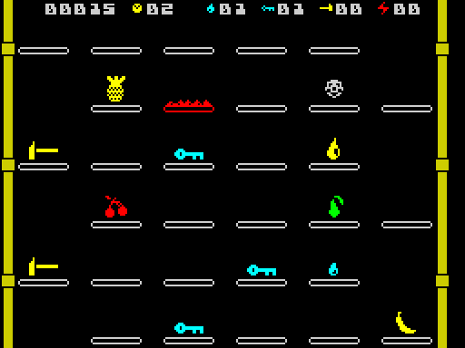

*Level 0 (`c1`, frame 15 086, `kit/screen_shot.py`). The HUD at the top: score, lives, water, keys, hammers, level.
The ball bounces on the second row, fifth cell; the burning platform is the third cell of the second row.*

The game is a 1989 conversion of an Amstrad CPC game by Loriciels.
The Spectrum version is by Luis Jorge Garcia and J250 (the loading screen and the menu say so).
It keeps the CPC's pictures and coordinates and draws them on the Spectrum screen ([doc 6](06-rendering.md)).

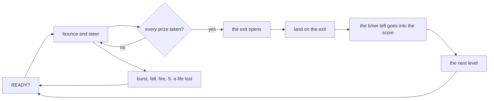

The point: one ball, one screen, one rule set: the puzzle is the route, and the bounce is the clock.

## 1.2 Every screen

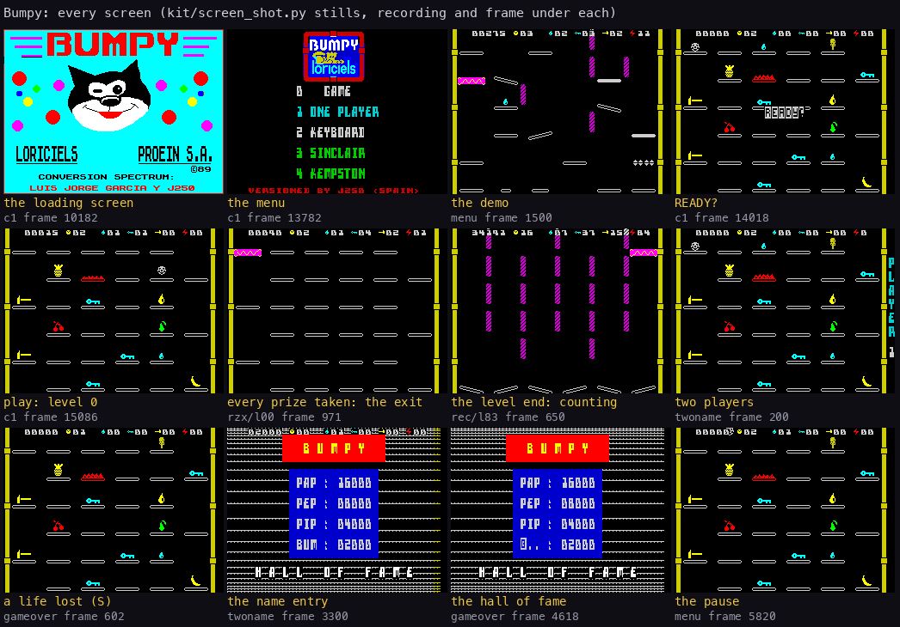

*Twelve screens of the game (`python3 tools/fig_screens.py`, from the stills of `kit/screen_shot.py`; recording and
frame under each).*

| Screen | When | What is on it |
| --- | --- | --- |
| the loading screen | the tape's fourth block | BUMPY, a cat's face, LORICIELS, PROEIN S.A., "CONVERSION SPECTRUM: LUIS JORGE GARCIA Y J250" |
| the menu | after the load, after every game | the logo; 0 GAME, 1 ONE PLAYER (or TWO PLAYERS), 2 KEYBOARD, 3 SINCLAIR, 4 KEMPSTON; "VERSIONED BY J250 (SPAIN)" |
| the demo | after 3000 idle frames (60 s) of the menu, every other time | the game plays level 10 by itself from a list of moves, with 2 of each store |
| the hall of fame | the other time-outs of the menu, 750 frames (15 s); after a game that scored enough | BUMPY, four names and scores (PAP 16000, PEP 8000, PIP 4000, POP 1700 at power-on), HALL OF FAME |
| READY? | the start of each life and each level | the level drawn, "ready?" over it; with two players "PLAYER 1" or "PLAYER 2" and "PLAYER n" down the right edge |
| play | | the 6 × 6 cells between two yellow side panels, the HUD on the top row |
| the level end | the ball on the exit | the ball sinks into the exit, then the score counts up |
| a life lost | a burst, a fall, a fire, or S | a pause of 50 frames, then READY? on the same level |
| the pause | H in play | the screen stays as it is until a key |
| the name entry | game over with a score not below the 4th entry | the hall of fame with the new line, three letters chosen by left and right |

The HUD, left to right ([doc 8](08-hud-and-text.md)):

| Field | Variable | Digits |
| --- | --- | --- |
| score | Score `$AAFB` | 5 |
| lives (a ball) | Lives `$AB01` | 2 |
| water (a drop) | Water `$AAFD` | 2 |
| keys (a key) | Keys `$AAFE` | 2 |
| hammers (a hammer) | Hammers `$AAFF` | 2 |
| level (a flash) | Level `$AB00` | 2 |

The timer is not on the HUD.
The player sees it only at the level's end, when what is left is counted into the score.

The point: the game has few screens, all plain; the information a player needs is the HUD's six numbers, and the one
that matters most, the timer, is hidden.

## 1.3 The ball and the controls

The ball bounces in place on its cell all the time.
A bounce takes 16 steps, one step a frame when the game keeps up ([doc 4](04-game-loop.md)).
At the end of each bounce, at the landing, the game reads the controls and picks the next move:

| Held at the landing | The next move |
| --- | --- |
| left | a jump one cell to the left (16 steps) |
| right | a jump one cell to the right |
| up or fire, pressed during the bounce | the spring: a rise to the cell above (8 steps) |
| down, while rising | the rise turns into a bounce |
| nothing | another bounce on the spot |

A jump left or right lands on the cell beside it.
If that cell has no platform, the ball falls one row at a time until it meets one.
From the bottom row it falls off the screen, and a life is lost.

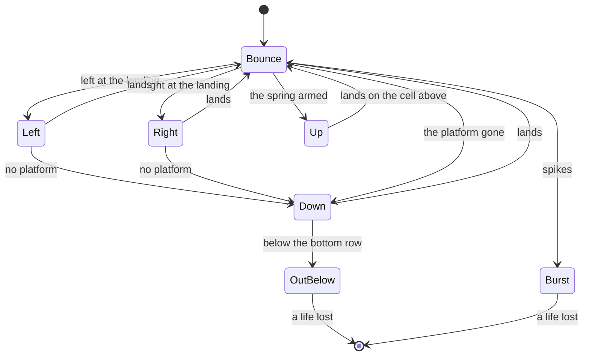

The controls (the menu's choices 2, 3 and 4; [doc 5](05-controls.md)):

| | Keyboard | Sinclair (keys 6-0) | Kempston |
| --- | --- | --- | --- |
| up | Q | 9 | up |
| down | A | 8 | down |
| left | O | 6 | left |
| right | P | 7 | right |
| fire (the spring) | SPACE | 0 | fire |
| pause | H | H | H |
| back to the menu | R | R | R |
| lose a life | S | S | S |

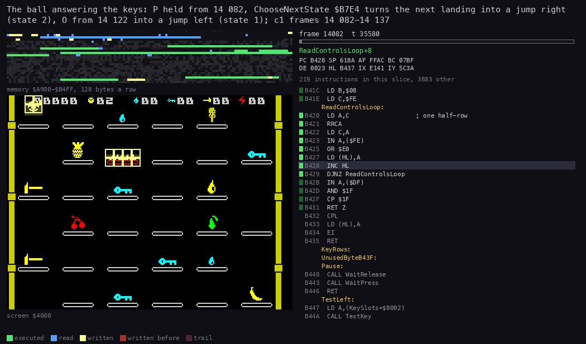

*The ball answering the keys on level 0 (`c1`, frames 14 082-14 138): P held, the next landing picks state 2 (right)
at about frame 14 095; O picks state 1 (left) at about 14 134. `python3 R/kit/routine_anim.py --work
work/docs/bmA/c1 --window 14082:0-14138:0 --listing build/game.lst --pc B3D0-B470,B6CB-B6DA,B7E4-B872 --range
A900-B4FF --pictures 110 --out docs/img/routines/ChooseNextState.gif`.*

Worked example, from `c1`: the ball bounces on level 0.
The player holds P; at the landing (about frame 14 095) the move becomes "right", and 16 steps later the ball is one
cell to the right.
O at the landing of frame 14 134 sends it back left.
Q during the next bounce arms the spring, and at the landing of frame 14 184 the ball rises to the row above
([shot](img/play/c1-014200-spring.png)).

The point: the player chooses only at landings, once every 16 steps; timing a key to a landing is the game's skill.

## 1.4 The platforms, walls and objects

Each cell has a platform (or none), maybe a wall on its right, and maybe an object
([src/res/levels/README.md](../src/res/levels/README.md); [doc 10](10-gameplay-logic.md) gives each one as code).

| Platform | What the ball meets |
| --- | --- |
| none | it falls through to the cell below |
| plain | it bounces |
| crumbling (three stages) | it wears one stage at each bounce or when the ball leaves, then it is gone |
| stopper | the ball stops dead and waits for left or right |
| conveyor left, conveyor right | the ball is pushed a cell left or right |
| on fire (plain or stopper) | a water drop puts the fire out; without water the ball burns and a life is lost |
| bricks | eight layers, knocked off one at a time from below; a hammer breaks into a whole brick |
| spikes | the ball bursts: a life lost |
| the exit | appears when the last prize is taken; landing on it ends the level |

| Wall (on the cell's right) | What it does |
| --- | --- |
| lock 1, 2, 3 | each key lowers it one stage; at lock 1 a key opens it |
| solid (animated) | no key opens it |

| Object | Taken by landing on its cell |
| --- | --- |
| hammer | Hammers + 1 |
| key | Keys + 1 |
| water drop | Water + 1 |
| bottle | an extra life: Lives + 1, at most 99 |
| a prize (36 kinds) | 15 points; the last one opens the exit |

The stores (water, keys, hammers, lives) each stop at 99.

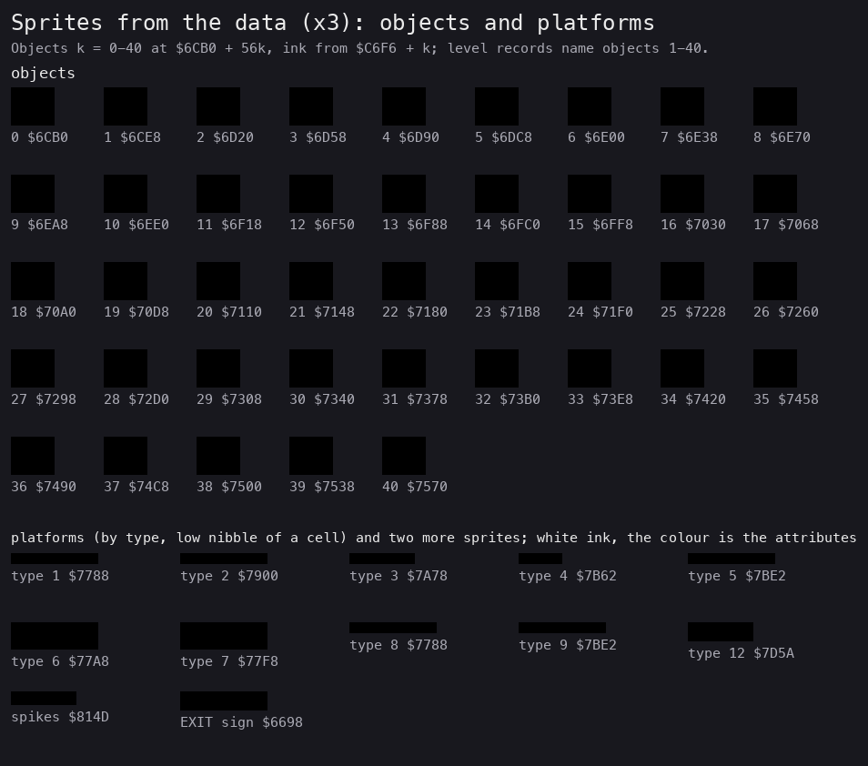

*The object pictures and the platforms, from the image (`tools/fig_sprites.py`).*

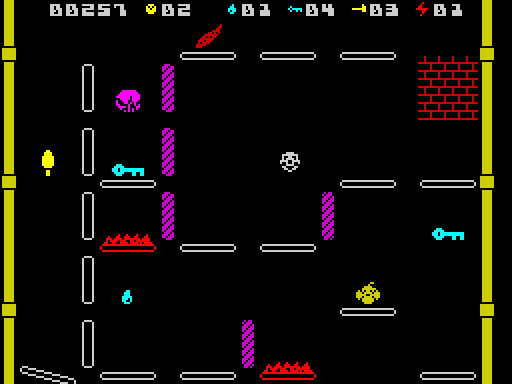

*Level 1 with its locks (`rzx/l01`, frame 100). By [frame 700](img/play/l01-000700-locks-open.png) the keys have
opened them.*

Worked example, level 0 ([shot](img/play/c1-015086-play.png)): the record is
`level 00 start 0 exit 0 prizes 6` in `src/res/levels/levels.txt`.

- six prizes: a pineapple, a pear, a cherry and three more;
- four keys, two hammers, two water drops;
- one burning platform, the third cell of the second row: landing on it with no water costs a life;
- after the sixth prize the exit opens on cell 0, the top-left cell, where the ball started
  ([the RZX's level 0](img/play/rzx-l00-000971-exit-open.png)).

The point: the level's objects are both the goal (the prizes) and the tools (water, keys, hammers) the platforms and
walls demand.

## 1.5 Lives, deaths, the timer and the score

Lives:

- a game starts with 2 spare lives (InitPlayers `$BB96`);
- a bottle gives one more, at most 99 (TakeBottle `$BA1C`);
- there is no extra life for points.

The five ways to lose a life:

| Death | How | Seen in |
| --- | --- | --- |
| the spikes | landing on platform 12, or rising into spikes above | `rzx/l68` frame 924 ([shot](img/play/l68-000932-burst.png)); from the side, `rightspike` frame 60 ([shot](img/play/rightspike-000060-burst.png)) |
| the fall | no platform under the bottom row | `rzx/l68` frame 686 ([shot](img/play/l68-000700-fall.png)) |
| the fire | landing on a burning platform without water | `fire` frame 41 ([shot](img/play/fire-000070-burst.png)) |
| S | the self-destruct key, for a level that cannot be finished | `gameover` frame 602 |
| the timer | never: at 0 nothing happens | `c1` frame 18 186 ([shot](img/play/c1-018186-timer-zero.png)) |

After a lost life the level starts again from its record: every prize, platform and lock is back.
The water, keys and hammers go back to what the player had when the level started.
The score keeps the points of the prizes taken before the death, and those prizes are back on the level (LoseLife
`$BA93` saves the score with the record).
`scoreloop` shows it on level 87: three times the RZX player's first 330 passes (six prizes and the bottle), then S;
each round adds 90 points and leaves the lives where they were, 16 → 17 → 16
([before S](img/play/scoreloop-000400-before-s.png), [after S](img/play/scoreloop-000484-after-s.png),
[the second round](img/play/scoreloop-000934-before-s.png)).

The timer starts at 1000 at READY? and loses one each turn of the main loop.
It stops at 0, and play goes on.
What is left at the level's end is added to the score, one point a tick, with a sound for each.

The score:

```asm
TakePrizeScore:
  B9B1  LD BC,$000F             ; 15 points a prize
  B9B4  JP AddScore
AddScore:
  BA47  AND A
  BA48  LD HL,(Score)
  BA4B  ADD HL,BC
  BA4C  LD (Score),HL
  BA4F  CALL ScoreToHud
  BA52  AND A
  BA53  LD A,(PrizesLeft)
  BA56  DEC A
  BA57  LD (PrizesLeft),A
  BA5A  CP $00
  BA5C  CALL Z,OpenExit         ; the last prize opens the exit
  BA5F  RET
```

```text
a prize:        Score += 15; PrizesLeft -= 1; if PrizesLeft == 0: OpenExit
the level end:  while Timer > 0: Timer -= 1; Score += 1
```

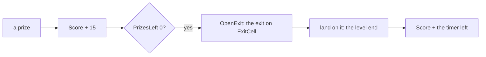

Worked example, `rec/l83`: the last prize is taken at frame 341 and PrizesLeft reads 0 at frame 344
([the exit open](img/play/l83-000400-exit-open.png)).
The ball lands on the exit, BallState is 8 from frame 521, and the count of the timer starts at about frame 600
([shot](img/play/l83-000650-count.png)).
A level's score is 15 × its prizes plus the timer left: level 0 gives at most 6 × 15 + 1000 = 1090.
Over the 100 levels there are 647 prizes, 9705 points.

The point: the timer is the score's larger part, so a fast route pays more than a careful one, and nothing else hurries
the player.

## 1.6 The 100 levels

Every level is a record of 75 bytes ([doc 7](07-objects.md)).
The levels as the RZX shows them at their start, 25 a sheet:

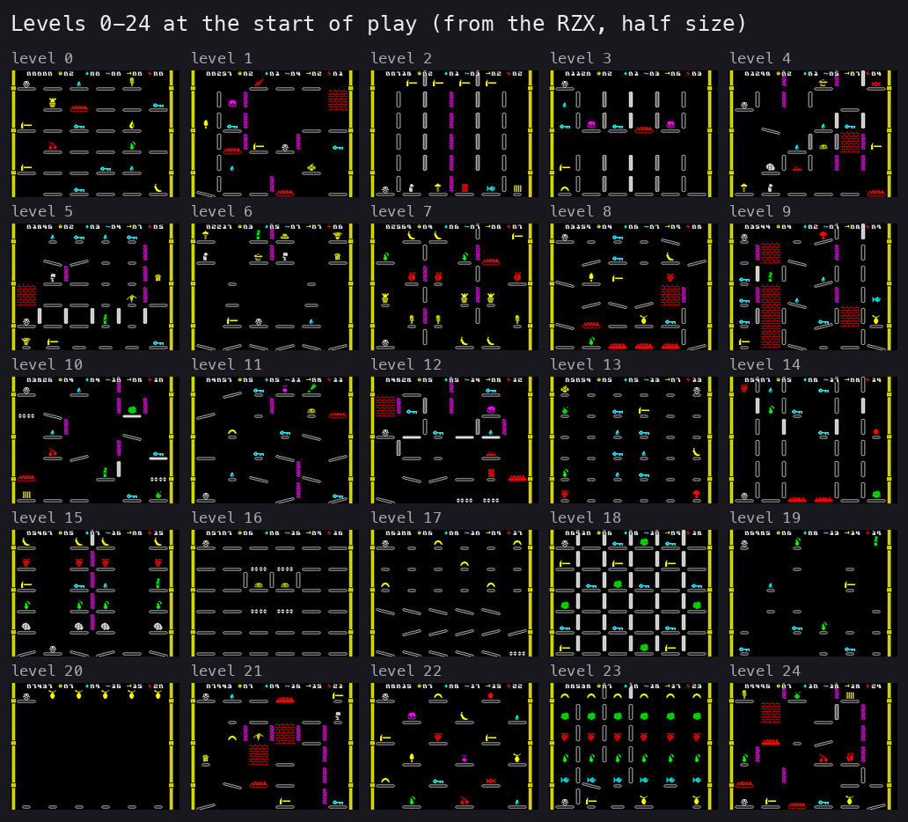

*Levels 0-24 at the start of play, from the RZX's level starts (`tools/rzx_levels.py`, half size).*

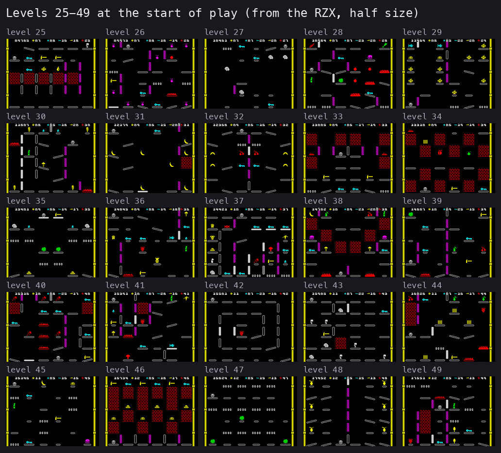

*Levels 25-49.*

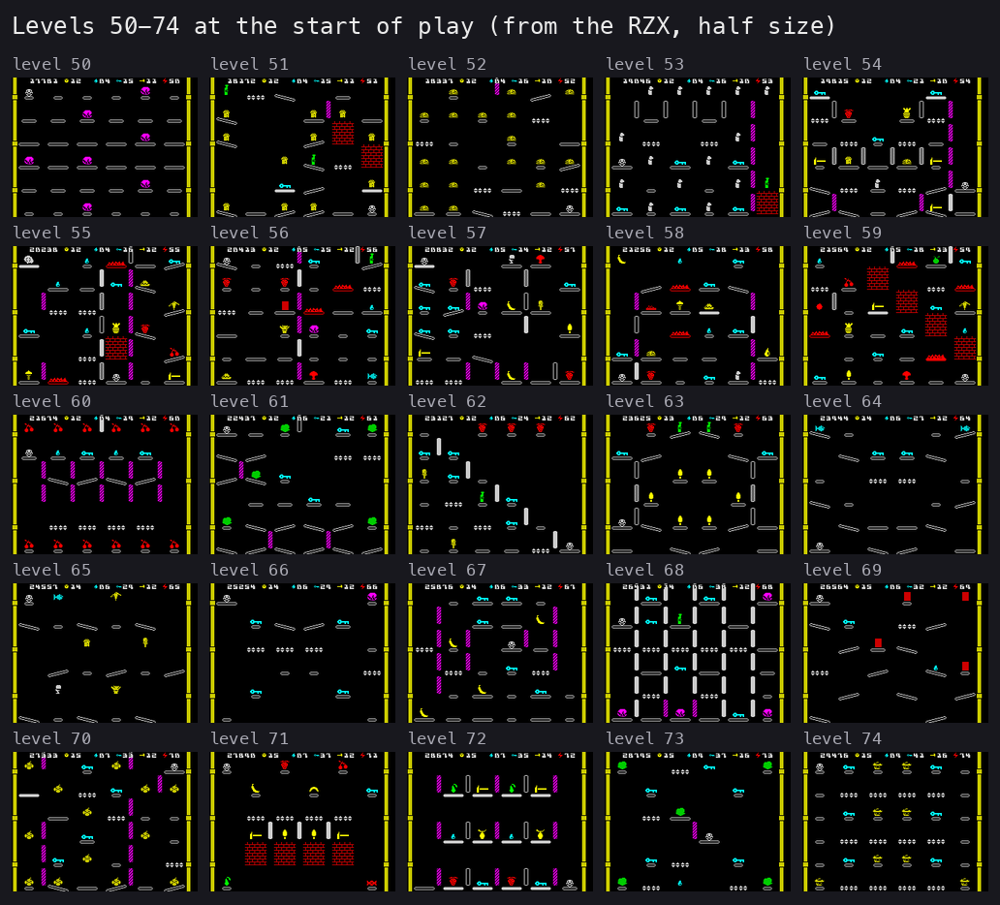

*Levels 50-74.*

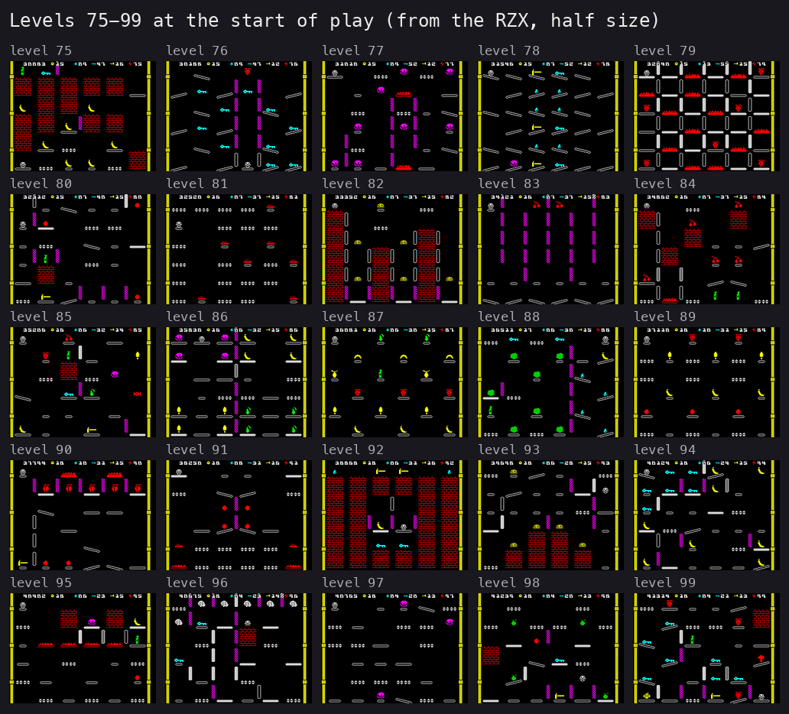

*Levels 75-99.*

The same levels drawn from the data alone are in [doc 2](02-architecture.md#25-the-levels-as-data).

What the 100 levels hold (counted from `src/res/levels/levels.txt`):

| Thing | In all | Levels with it |
| --- | ---: | ---: |
| prizes | 647 (1 to 32 a level, 36 kinds) | 100 |
| keys | 207 | |
| hammers | 67 | |
| water drops | 57 | |
| bottles | 30 | 27 |
| plain platforms | 390 | 63 |
| crumbling platforms (three stages) | 263, 169, 486 | 58, 53, 77 |
| stoppers | 93 | 30 |
| conveyors left, right | 158, 160 | 55, 58 |
| burning platforms (plain, stopper) | 40, 30 | 26, 12 |
| bricks | 144 | 35 |
| spikes | 248 | 55 |
| locks (stage 1, 2, 3) | 153, 46, 190 | 40, 20, 46 |
| solid walls | 326 | 65 |
| empty cells | 1419 | 94 |

The early levels teach one thing at a time: level 0 has plain platforms and one fire, level 1 brings locks and bricks.
The later ones combine everything.
The exit is on the start cell in 14 levels.

The point: 100 hand-made puzzles from a handful of parts; the difficulty is in the arrangement, not in new rules.

## 1.7 After level 99

The level count wraps: after level 99 comes level 0 again, with the score and the stores kept.
NextLevel `$B2D5` stores Level + 1, and 100 becomes 0.
There is no ending screen and no message.

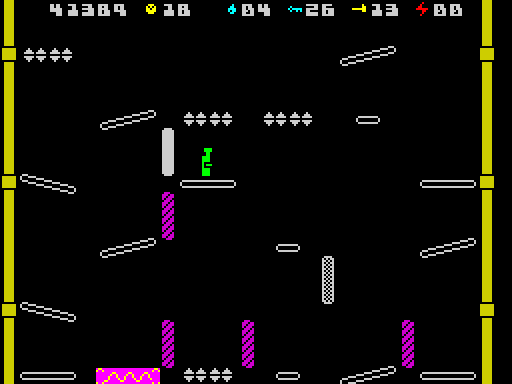

*The end of level 99 (`rzx/l99`, frame 1154).*

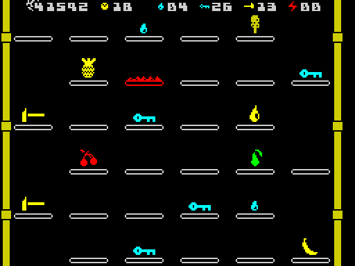

*Level 0 again, the score kept (`rzx/l99`, frame 1685).*

The RZX's run ends this way: its player went through all 100 levels without losing a life, gained 16 extra lives from
bottles, and stopped at level 0 again.

The point: the game has no end; the hall of fame is the only goal past level 99.

## 1.8 Modes

| Mode | How | What changes |
| --- | --- | --- |
| one player | menu 0 | |
| two players | menu 1 toggles ONE PLAYER / TWO PLAYERS, then 0 | the players take turns; the turn passes only when a life is lost. Player 2's ball is drawn from its own pictures. Each player has his own record of score, stores, level and lives |
| the demo | the menu idle for 3000 frames | level 10, 2 of each store, the moves from DemoMoves `$D25A`; no READY?, no pause; at its level end GameOverPause and the menu |
| the cheat | hold R, SPACE and V when the game starts | 99 of everything, from level 0 (`menu` frame 12 656, [shot](img/play/menu-012656-cheat.png)) |
| the pause | H in play | waits for the key to be released, then for any key |

A second, "practice" cheat on D is cut off in this release: the D key's routine is a single `RET`
(CheatModeSwitch `$ADDF`), so CheatMode `$ADDD` is never set.
Known only from the code.

Worked example, `twoname`: player 1 starts at READY? with "PLAYER 1" ([shot](img/play/twoname-000200-two-ready.png)).
He loses a life by S, and player 2 gets the screen.
When player 1 has no lives left his record is marked out, and player 2 plays on alone.
Each game over with a score not below the hall of fame's fourth entry asks for a name
([the name entry](img/play/twoname-003300-name.png)).

The point: two players share one level sequence each, in turns decided by deaths, never by time.
