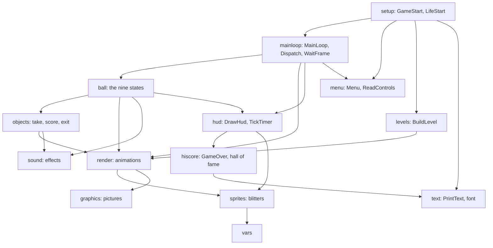
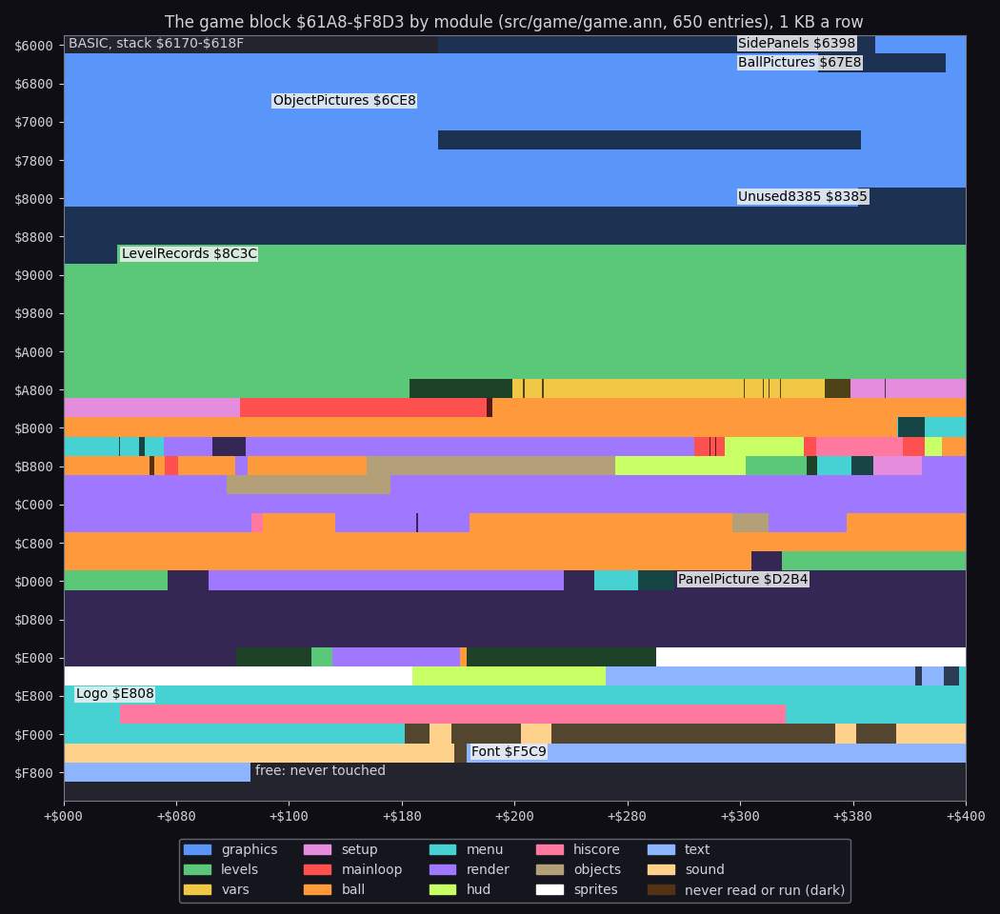
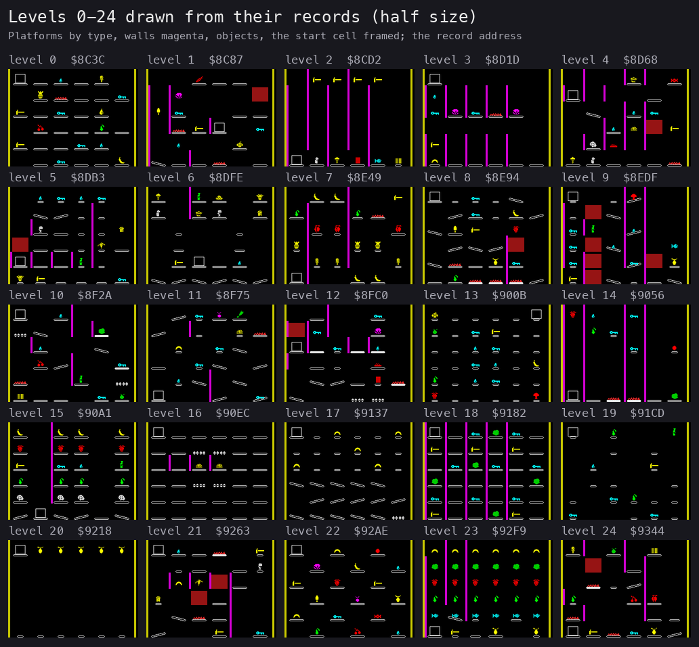
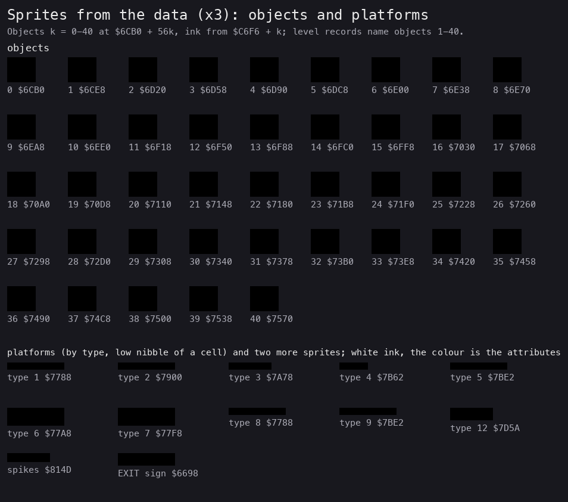
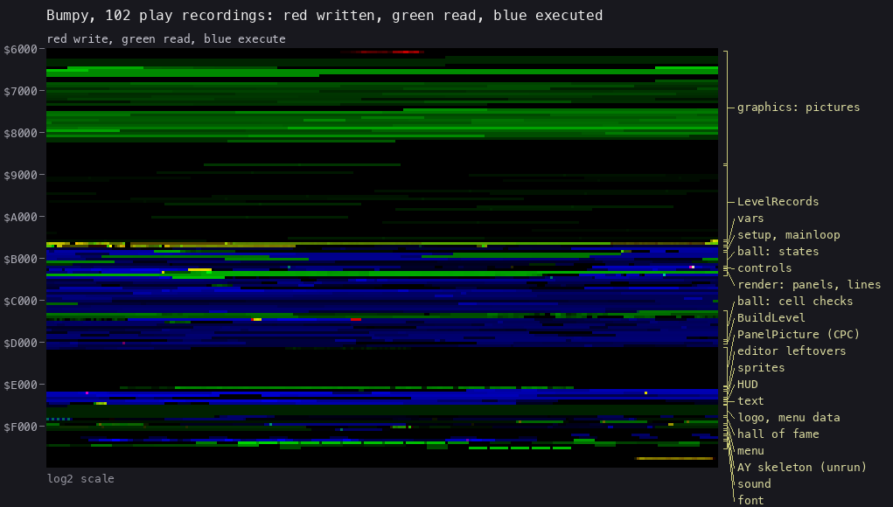
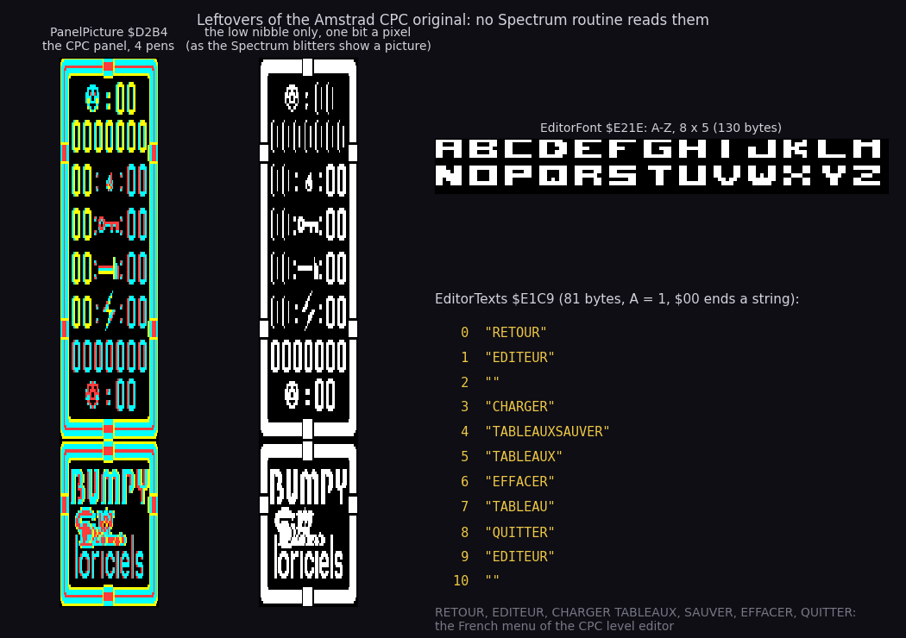
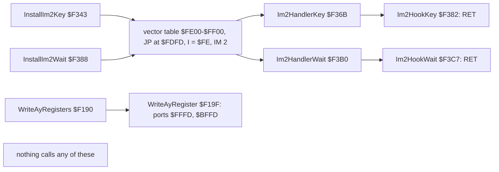
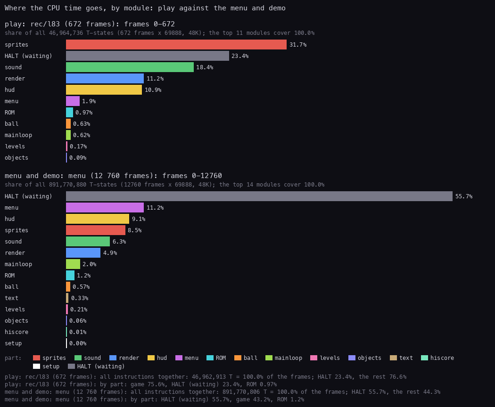
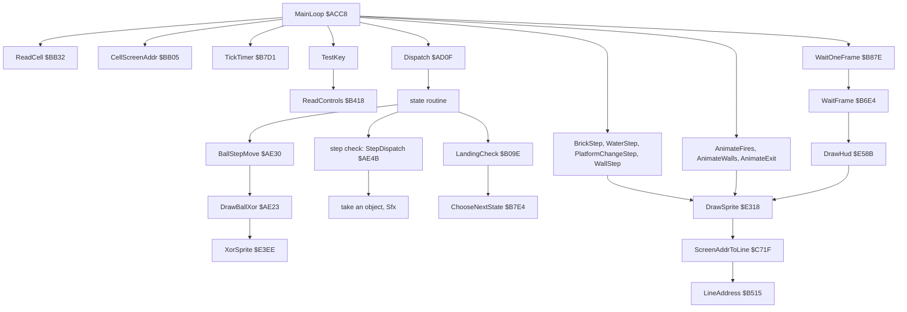
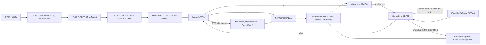

# 2. Architecture

What this covers:

- the machine budget and the images;
- the module map: the 14 modules of the source and where each lies;
- the memory map, as stage 2 named every byte;
- the state variables and the levels as data;
- the heatmap and the stack;
- the leftovers: the CPC original's panel, its level editor's texts and font, the unrun 128K AY skeleton
  `$F183-$F3C7`;
- the frame budget and the main loop's call graph;
- the stages from power-on to play.

The recordings it rests on ([WALKTHROUGH 6.0](../WALKTHROUGH.md#60-the-recordings)):

| Recording | Used for |
| --- | --- |
| `c1` | power-on, the original tape at ROM speed, the menu and play on level 0 |
| `menu`, `gameover` | from a snapshot after a fast load: the menu, the demo, the controls, the game over, the hall of fame |
| `rzx/l00`-`rzx/l99` | the RZX's own state at each level's start, replayed by its keys |
| `rec/l83` (stage 2) | level 83 solved by our script: the frame budget in play (2.9) |
| `work/stage1/l1-play.json` | the L1 builds of the 102 play recordings merged (129 994 frames, `tools/l1merge.py`): the memory use (2.6, 2.7) |

The source is `src/game/game.ann`, one entry a line (doc 12, generated at integration, lists them all).
Every number below that is not a measurement is counted from it.

## 2.1 The machine budget

A 48K Spectrum, nothing else.
One 38 700-byte block at `$61A8-$F8D3` is loaded and entered at `$AB7C`.
The game uses the beeper (port `$FE`), the keyboard and a Kempston stick on port `$DF` ([doc 5](05-controls.md)).
There is no paging, no AY, no second screen: the game draws straight into `$4000`.
The ROM serves the BASIC loader and the interrupt (IM 1, `$0038`), and its bytes are the noise of three sound
primitives (RomNoise reads `$04xx`, RumbleLow from `$0000`, RumbleHigh from `$1770`; [doc 9](09-sound.md)).

| Part | Bytes | Where |
| --- | ---: | --- |
| screen | 6912 | `$4000-$5AFF` |
| system variables, BASIC, free, the stack | 1704 | `$5B00-$61A7`; the stack at `$6170-$618F` (2.7) |
| the game: code | 10 956 | 429 routines in 12 modules (2.3; graphics and vars hold no code) |
| the game: data | 27 744 | the pictures 10 900, the level records 7500, the font 768, the texts, the tables, the variables |
| of which never read or run | 7903 | 55 entries whose titles say so (never read, never called, unrun, unused, leftover), each counted from its start to the next entry; the CPC leftovers among them (2.8) |
| above the game | 1836 | `$F8D4-$FFFF`, never touched |

The point: a single block, no loader code and no packer; a fifth of it is the CPC original's dead weight.

## 2.2 The images

| Image | How | What it is |
| --- | --- | --- |
| as loaded | block 5 of `BUMPY.TAP` (`work/mkgame/original.bin`) | `$61A8-$F8D3` byte for byte |
| at the entry | SkoolKit `tap2sna.py -s 43900` (`work/stage1/images/entry.z80`), and `c1` at frame 13 357 (T 19 678), the first fetch of `$AB7C` | the same bytes as loaded: no unpacker, no relocation. SP is `$6190` (from `CLEAR 24999` and `USR`) |
| in play | the RZX's level 0 play start (`work/stage1/rzx/levels/play-000172.z80`) and every level's start | 125 bytes in 49 runs differ from the entry image, every one a variable or a self-modified operand |
| rebuilt | `tools/build.sh` from `src/` | the whole TAP, identical to the original |

What play changes, the entry image against play (`work/stage1/NOTES.md`):

- the variables `$A9FD-$AB7B` (2.4) and the players `$ADDB-$ADDE`;
- the key buffer KeyRows `$B436-$B43E` and the active controls KeySlots `$F083-$F08B`;
- data bytes kept inside the code: the result bytes of the screen-address divide `$C74E-$C751` (ScanInRow, CharRow,
  ByteColumn, PixelLine) and `$C774-$C777` (DivQuotient, DivRemainder), SpectrumColumn `$B52C`, the blitters'
  SpriteHeight `$E3E4`, the printer's state `$E714-$E716` (TextDouble, TextRow, TextColumn), the menu's MenuTimer
  `$EFED-$EFEE` and the colour bytes `$F015`, `$F025` inside its text;
- four self-modified instructions: `$B3F5-$B3F6` (TestKeyBit's `BIT b,(IX+d)`, [doc 5](05-controls.md)), `$D01D` (the
  displacement of `LD C,(IX+d)` that picks an object's ink), `$E30F` (the colour operand of PaintAttrs' `LD (HL),n`), and `$F5A0`, the mask of RomRumble's `F59F AND n` (the
  ROM-noise pitch), set by RumbleLow to `$F0` (`F595`) and by RumbleHigh to `$0E` (`F5B6`) before each rumble; it is
  not in the level 0 diff, because no rumble has played by then.

The pictures and the level records are never written: a level is copied into a buffer and changed there.

The point: the code runs where `LD-BYTES` put it, and play writes only to the variables, to data bytes kept between routines and to four instructions.

## 2.3 The module map

The source cuts the block into 14 modules (`kit/mkgame.py` writes one `.asm` a module, in address order).
A module is a topic, not a range: most of them are spread over several runs, because the original's routines lie in
the order its authors wrote them.

| Module | Entries | Bytes | Code | Runs | Main ranges | What it holds |
| --- | ---: | ---: | ---: | ---: | --- | --- |
| graphics | 28 | 10 900 | 0 | 1 | `$61A8-$8C3B` | the CPC mode-1 pictures: side panels, ball, objects, platforms, walls, fire, burst, bricks |
| levels | 15 | 8350 | 409 | 5 | `$8C3C-$A9FC`, `$CF2E-$D075` | LevelRecords, BuildLevel, the cell reader, the colours and cell addresses, the editor leftovers |
| vars | 75 | 383 | 0 | 1 | `$A9FD-$AB7B` | the variables (2.4) |
| setup | 10 | 387 | 382 | 2 | `$AB7C-$ACC7` | GameStart, NewGame, LifeStart, the cheat's stock |
| mainloop | 26 | 375 | 180 | 5 | `$ACC8-$ADE5` | MainLoop, Dispatch, StateTable, WaitFrame, WaitKeyOrSecond, Delay |
| ball | 138 | 4153 | 3452 | 8 | `$ADE6-$B3B0`, `$C778-$CF0B` | the nine states, the per-step checks, landing, ChooseNextState, the deaths |
| menu | 44 | 2035 | 537 | 5 | `$B3B1-$B470`, `$EF33-$F182` | ReadControls, TestKeyBit, the menu, the control sets, the demo moves, the logo |
| render | 192 | 7246 | 2913 | 10 | `$B471-$B6CA`, `$BBCD-$C4D4`, `$D076-$E0C3` | attributes, side panels, the CPC-to-Spectrum line table, the cells and their animations, the CPC panel picture |
| hud | 18 | 476 | 453 | 4 | `$E58B-$E666` | DrawHud, the numbers, the timer, LoseLife |
| hiscore | 18 | 867 | 525 | 3 | `$EC40-$EF32` | GameOver, the hall of fame, the name entry |
| objects | 13 | 508 | 457 | 3 | `$B958-$BA70`, `$BCB9-$BD72` | taking an object, AddScore, OpenExit, the object inks |
| sprites | 8 | 747 | 746 | 1 | `$E2A0-$E58A` | DrawSprite, XorSprite, XorBricks |
| text | 11 | 1179 | 370 | 2 | `$E667-$E7F6`, `$F5C9-$F8D3` | PrintText and the font |
| sound | 54 | 1094 | 532 | 1 | `$F183-$F5C8` | the 14 effects, the beeper primitives, the unrun AY skeleton |

The modules call each other in one direction: the state machine on top, the drawing at the bottom.





*The game block by module, 1 KB a row (`python3 tools/fig_arch.py`, from `src/game/game.ann`). Dark: entries no
routine reads or runs. The large dark blocks are the CPC leftovers: Unused8385, PanelPicture, the AY skeleton.*

Worked example: the address `$C750`.
`modules.py` (`work/docs/bmA/modules.py`) finds it in the run `$C71F-$C777` of render: ScreenAddrToLine `$C71F`.
`$C750` is ByteColumn, one of the four result bytes `$C74E-$C751` that ScreenAddrToLine stores (2.2) around its call
to DivideHLbyBC `$C752` (the divisor, `$50`, is in BC: `C734 LD BC,$0050`); `C74A LD (ByteColumn),A` writes it.

The point: the modules are the case's own reading; the image is the original's order, with ball, render and menu code
scattered over the whole block.

## 2.4 The state variables

All the variables lie in one run, `$A9FD-$AB7B`, apart from the players `$ADDB-$ADDE`, the key buffer and the menu
(2.6).
The names are game.ann's; [doc 7](07-objects.md) gives every one.

| Address | What | Witness |
| --- | --- | --- |
| BallStep `$A9FF`, BallState `$AA00` | the ball's step and state ([doc 4](04-game-loop.md#46-the-state-dispatcher-ad0f-and-statetable-ad29)) | `work/stage2/rzx-states.tsv` |
| LevelRecord `$AA20-$AA46` | the level's record: 36 cells, BallCell `$AA44`, PrizesLeft `$AA45`, ExitCell `$AA46` | every level start |
| CellObjects `$AA47`, CellPlatforms `$AA6B`, CellWalls `$AA8F`, CellBurning `$AAB3`, BrickLayers `$AAD7` | the five 36-byte grids | BuildLevel `$CF2E` |
| Score `$AAFB`, Water `$AAFD`, Keys `$AAFE`, Hammers `$AAFF`, Level `$AB00`, Lives `$AB01` | the current player's working copy, 7 bytes `$AAFB-$AB01` | the HUD in every recording |
| Timer `$AB04` | 1000 at LifeStart, minus 1 a pass, held at 0 | `c1` 15 436-18 186 |
| `$AB06-$AB08` | water, keys and hammers at the level's start | LoseLife `$BA93` |
| Player1Record `$AB09`, Player2Record `$AB10` | the two players' records; lives `$FA` marks a player out | `twoname` |
| CurrentPlayer `$ADDB`, PlayerCount `$ADDC` | the player whose turn it is; 1 or 2 players | `twoname` |
| MenuChoice `$B3B1`, DemoFlag `$ABA6`, DemoInputPtr `$ABA4` | 0 one player, 2 two, 4 the demo; 1 in the demo; the demo's pointer (`$D25A` at the start) | `menu` frames 250-4000 |
| KeyRows `$B436-$B43E` | the 8 keyboard half-rows (`$7FFE` first) and the Kempston byte | ReadControls `$B418` |
| KeySlots `$F084-$F08B` | the controls in play: up, down, left, right, fire, fire, pause, quit (row × 8 + bit) | LoadControls `$F0AA` |
| HallOfFame `$EEB3` + 32 × n | four entries: the name at +6, the score at +18 (PAP 16000, PEP 8000, PIP 4000, POP 1700 at power-on) | the image (`src/res/tables/hall-of-fame.txt`); `gameover` frame 4618 shows it after a 2000-point entry replaced POP |

The point: the whole game state is 383 bytes in one run, the two 7-byte player records included, plus the four player
bytes `$ADDB-$ADDE` and the controls `$F083-$F08B`; a snapshot of those three runs is a save game.

## 2.5 The levels as data

The 100 levels are 75-byte records at LevelRecords `$8C3C` + 75 × level (`$8C3C-$A987`).
BuildLevel `$CF2E` copies the current one to `$AA20` and splits its 36 cell bytes into the grids ([doc 7](07-objects.md)
decodes a record byte by byte).

| Record bytes | Copied to | What |
| --- | --- | --- |
| 0-35 | `$AA20-$AA43` | one byte a cell, 6 × 6, left to right, top to bottom: the high nibble the wall on the cell's right, the low nibble the platform |
| 36 | `$AA44`, `$AB1A` | the ball's start cell |
| 37 | `$AA45` | the number of prizes (objects 5 and up) |
| 38 | `$AA46` | the exit's cell: the last prize opens the exit there |
| 39-74 | `$AA47-$AA6A` | the object on each cell, 0 none or 1-40 |

The maps drawn from the records alone (`tools/fig_levelmap.py`) and the same levels as the RZX shows them at their start
match level for level:



*Levels 0-24 from their records (`tools/fig_levelmap.py`). The rest: [25-49](img/maps/data-levels-25-49.png),
[50-74](img/maps/data-levels-50-74.png), [75-99](img/maps/data-levels-75-99.png); the RZX's starts:
[0-24](img/maps/levels-00-24.png), [25-49](img/maps/levels-25-49.png), [50-74](img/maps/levels-50-74.png),
[75-99](img/maps/levels-75-99.png).*

The pictures, drawn from the image (`tools/fig_sprites.py`):



*The objects 1-40 (ObjectPictures `$6CE8`, kind k at `$6CB0` + 56k), the platforms (`$7788-$7D5A`), the walls `$7E5C`,
the exit, the flames, the burst and the bricks, at their CPC addresses ([doc 6](06-rendering.md)).*

The point: the levels are 7500 bytes of plain data, one record a level, with nothing packed.

## 2.6 The memory map

From the L1 builds of the 102 play recordings (`work/stage1/l1-play.json`, 129 994 frames; `c1` is left out
because the ROM's RAM test and the load touch every byte).
"Use" is what the recordings did: x executed, r read, w written, `.` never touched.

| Range | Use | Entries | What |
| --- | --- | --- | --- |
| `$4000-$5AFF` | w | | the screen, drawn directly |
| `$5B00-$616F` | . | | system variables and BASIC, idle after the load |
| `$6170-$618F` | w | | the machine stack (2.7) |
| `$61A8-$6397` | . | UnusedPicture61A8 | 496 bytes of CPC picture |
| `$6398-$6697` | r | SidePanels | the two side panels, 2 × 192 lines each |
| `$6698-$6707` | . | ExitSign | the EXIT sign, read only by the unrun DrawExitSign `$D08E` |
| `$6708-$67E7` | r / . | BlankPicture, Unused6758 | the blank picture that erases a cell |
| `$67E8-$6CE7` | r | BallPictures | the ball: 16 pictures for player 1, 16 for player 2 at `$6A68` |
| `$6CE8-$75A7` | r | ObjectPictures | the objects 1-40 |
| `$75A8-$7787` | . | UnusedPicture75A8 | 480 bytes of CPC picture |
| `$7788-$8384` | r | Platform1Pictures ... BrickPicture | platforms, crumbling pieces, walls and locks, the exit, flames, steam, the burst, the bricks |
| `$8385-$8C3B` | . | Unused8385 | 2231 bytes of CPC pictures |
| `$8C3C-$A987` | r | LevelRecords | the 100 level records |
| `$A988-$A9FC` | . | LevelsEnd | 117 zeros |
| `$A9FD-$AB7B` | w | vars | the variables (2.4) |
| `$AB7C-$ADE5` | x | setup, mainloop | GameStart, LifeStart, MainLoop, StateTable, the READY? texts, the players |
| `$ADE6-$B3B0` | x | ball | the ball's drawing, the nine states and their step tables |
| `$B3B1-$B470` | x | menu | ReadControls, KeyRows, TestKeyBit, Pause |
| `$B471-$B6CA` | x / r | render | attributes, the side panels, LineAddress `$B515` and SpectrumLines `$B52D` |
| `$B6CB-$BBCC` | x | mainloop, hud, hiscore, ball, objects, levels, setup | TestKey, WaitFrame, GameOver, ChooseNextState, Delay, the objects, LoseLife, CellScreenAddr and ReadCell `$BB05-$BB55`, CheatStock `$BB56`, PracticeStock `$BB7D`, InitPlayers `$BB96` |
| `$BBCD-$C4D4` | x | render | the animated cells: crumbling, springs, bricks, fires, water, walls, the exit |
| `$C4D5-$C4E1` | x | hiscore | GameOverDelay |
| `$C4E2-$CF0B` | x | ball, render, objects | the per-step checks, the screen-address divide `$C71F`, the object inks |
| `$CF0C-$D259` | x | render, levels | BuildLevel `$CF2E`, the cell drawers, the wall drawers |
| `$D25A-$D2B3` | r | DemoMoves, DemoPad | the demo's moves |
| `$D2B4-$E0C3` | . | PanelPicture | the CPC status panel, 3600 bytes (2.8) |
| `$E0C4-$E29F` | r / . | LevelLeftover, LevelColours, CellAddresses, WallAddresses, BrickSteps, EditorTexts, EditorFont | the level tables, and the editor leftovers |
| `$E2A0-$E58A` | x | sprites | the blitters |
| `$E58B-$E666` | x | hud | DrawHud |
| `$E667-$E7F6` | x | text | PrintText `$E667` and its state |
| `$E7F7-$EC3F` | x / r | menu | DrawLogo and Logo `$E808` |
| `$EC40-$EF32` | x | hiscore | the hall of fame, the name entry, the table `$EEB3` |
| `$EF33-$F182` | x | menu | Menu `$EF33`, its texts, the control sets |
| `$F183-$F3C7` | . | sound | the AY skeleton, never run (2.8) |
| `$F3C8-$F5C8` | x | sound | the effects and the beeper primitives ([doc 9](09-sound.md)) |
| `$F5C9-$F8D3` | r | Font | the font, characters 32-127 |
| `$F8D4-$FFFF` | . | | free, never touched |

The point: code and data alternate all over the block; only the pictures and the levels are in one piece.

## 2.7 The heatmap and the stack



*What the 102 play recordings did with `$6000-$FFFF` (red written, green read, blue executed, log scale), with the
stage-2 regions. `python3 R/kit/heatmap.py work/stage1/l1-play.json docs/img/arch/heatmap-play.png --from 6000
--to FFFF --cell 3 --regions work/docs/bmA/regions2.txt --panels composite --columns 1`.*

What it shows:

- the pictures in green at the top, with dark bands where the CPC leftovers lie (`$75A8`, `$8385`);
- the level records almost dark: each recording reads only the records of the levels it starts;
- the variables in yellow and red at `$AA00`;
- the code in blue from `$AB7C`, with the dark block of PanelPicture at `$D2B4-$E0C3`;
- the dark AY skeleton before the sound at `$F3C8`.

The stage-1 heatmap of all 103 recordings, `c1` included, is [here](img/arch/heatmap.png): `c1`'s RAM test and load
write every byte once, which shows as a faint floor.

The stack: `USR` enters with SP `$6190`.
The lowest byte written below `$61A8` in play is `$6170`, so the game uses 32 bytes of stack (`$6170-$618F`) in all
102 play recordings.

The point: the heatmap and the module map agree: the large never-read entries of game.ann are dark in the play recordings.

## 2.8 The leftovers

Bumpy was an Amstrad CPC game by Loriciels, converted for the Spectrum by Luis Jorge Garcia and J250 (1989).
The Spectrum release keeps much of the CPC program that it never uses.



*PanelPicture `$D2B4`, EditorFont `$E21E` and EditorTexts `$E1C9` drawn from the image (`python3 tools/fig_arch.py`).
The panel is the CPC game's status column: lives, score, water, keys, hammers, level and the BUMPY loriciels logo.*

| Leftover | Address | Bytes | What it was | Why it is dead |
| --- | --- | ---: | --- | --- |
| PanelPicture | `$D2B4-$E0C3` | 3600 | the CPC status panel, 18 bytes × 200 lines | the Spectrum's HUD is a row of digits at the top (doc 8); DrawPanelA/B `$CF0C`/`$CF1D` are never called |
| EditorTexts, EditorFont | `$E1C9-$E29F` | 81 + 130 | the CPC level editor's menu, in French (RETOUR, EDITEUR, CHARGER TABLEAUX, SAUVER, EFFACER, QUITTER) and its 8 × 5 letters | no editor on the Spectrum |
| UnusedPicture61A8, UnusedPicture75A8, Unused8385 | `$61A8`, `$75A8`, `$8385` | 496, 480, 2231 | CPC pictures | no routine reads them (`src/res/leftovers`) |
| LevelLeftover | `$E0C4` | 85 | small numbers | not read |
| the effects' AY register images | `$F3CF`, `$F3E6`, ... `$F500` | 14 × 16 | AY registers R0-R13 and two zeros for each effect (src/res/sound/ay-images.csv) | each effect loads HL with them and calls a beeper primitive that ignores HL (doc 9) |
| the firmware stubs | `$B747-$B754` (and three unread `$C9` at `$B744`, HudRowAttrsEnd) | 14 | the CPC firmware calls (a border flash, a level choice) | each is a `RET` |
| DrawExitSign, ExitSign | `$D08E`, `$6698` | | the EXIT sign | never called |
| PrintOnceUponATime | `$E7C6` | | "Erase Una Vez ..." (Spanish: the Proein heritage) | never called |
| the AY skeleton | `$F183-$F3C7` | 581 | a 128K music driver's frame | never called (below) |

### The AY skeleton `$F183-$F3C7`

The block before the effects holds the frame of a 128K music driver.
Nothing calls any of it, and no recording, `c1` included, ran a byte of it.

```asm
WriteAyRegister:
  F19F  CP $07                  ; register 7, the mixer: keep the I/O bits clear
  F1A1  JR NZ,WriteAyRegisterSkip
  F1A3  LD B,A
  F1A4  LD A,$3F
  F1A6  AND C
  F1A7  LD C,A
  F1A8  LD A,B
WriteAyRegisterSkip:
  F1A9  DI
  F1AA  LD E,C
  F1AB  LD BC,$FFFD             ; select the register
  F1AE  OUT (C),A
  F1B0  LD A,E
  F1B1  LD BC,$BFFD             ; write the value
  F1B4  OUT (C),A
  F1B6  EI
  F1B7  RET
InstallIm2Key:
  F343  DI
  F344  LD HL,$FDFF             ; $FD over $FDFF-$FF00 (the vectors $FE00-$FF00)
  F347  LD DE,$FE00
  F34A  LD BC,$0101
  F34D  LD (HL),$FD
  F34F  LDIR
  F351  LD A,$C3                ; JP Im2HandlerKey at $FDFD
  F353  LD ($FDFD),A
  F356  LD HL,Im2HandlerKey
  F359  LD ($FDFE),HL
  F35C  LD A,$FE
  F35E  LD I,A
  F360  IM 2
```

```text
Random:            H = R; L = R XOR H; A = R XOR (the byte at HL)
WriteAyRegisters:  for r in 0..13: WriteAyRegister(r, the next byte at HL)
WriteAyRegister:   register 7 masked to $3F; OUT ($FFFD) = r; OUT ($BFFD) = value
DelayAfterFrame:   HALT, then 512 loops
BuildLineTable:    the 192 line addresses at $F206 (over this code)
InstallIm2Key:     $FDFF-$FF00 = $FD (the vectors $FE00-$FF00), JP Im2HandlerKey at $FDFD, I = $FE, IM 2, read the keys
InstallIm2Wait:    the same with Im2HandlerWait, then wait for a key
Im2Handler*:       save every register, CALL the hook (a RET), restore, EI, RETI
```



The hooks are where a music player would go: called 50 times a second, writing the AY with WriteAyRegisters.
The player itself is not in the release.
So the 48K and the 128K play Bumpy alike, with the beeper only (known only from the code; every recording is on the
48K).

Worked example: if InstallIm2Key ran, it would fill `$FDFF-$FF00` with `$FD` (258 bytes: `$FDFF` set first, then
`LDIR` with BC = `$0101` from `$FDFF` to `$FE00`) and put `JP $F36B` at `$FDFD-$FDFF`, so `$FDFF` ends as the JP's high
byte.
An interrupt with any byte on the bus would read its vector word in `$FE00-$FF00` (I = `$FE`, the low byte from the bus), find `$FDFD`, and jump to the handler.
That memory is above the game block, in the 1836 free bytes: the only use the game would ever have made of them.

The point: the release is a port that kept the CPC program's data and a 128K frame without its music; 7903 bytes are
never touched.

## 2.9 The frame budget and the call graph

Where the T-states of a frame go, in play and in the menu:



*T-states by module (`python3 R/kit/fig_budget.py --by module`): play in `rec/l83` against the `menu` recording.*

| Module | Play (`rec/l83`) | Menu and demo (`menu`) |
| --- | ---: | ---: |
| sprites | 31.7 % | 8.5 % |
| the `HALT` (idle) | 23.4 % | 55.7 % |
| sound | 18.4 % | 6.3 % |
| render | 11.2 % | 4.9 % |
| hud | 10.9 % | 9.1 % |
| menu (the key reads) | 1.9 % | 11.2 % |
| ROM (the IM 1 handler) | 0.97 % | 1.2 % |
| ball | 0.63 % | 0.57 % |
| mainloop | 0.62 % | 2.0 % |
| levels, objects, text, hiscore, setup | 0.26 % | 0.61 % |

The game is three quarters busy in play.
The blitters take a third of all time, and the beeper almost a fifth: a sound stops everything else.

The main loop's call graph (one pass, [doc 4](04-game-loop.md#44-mainloop-acc8-one-pass)):



The point: everything that draws goes through two blitters and one address conversion, so their cost sets the game's
speed ([doc 6](06-rendering.md)).

## 2.10 The stages from power-on to play



The load, with the frame of each stage in `c1` (the code block 3211-13 356, the entry 13 357, the menu 13 782), is in
[doc 3, 3.2](03-build-and-load.md#32-the-loader), the cycle from the menu on in
[doc 4](04-game-loop.md#42-the-game-cycle).

The point: the path from the tape to play has no stage of its own: BASIC loads three blocks and jumps in.
