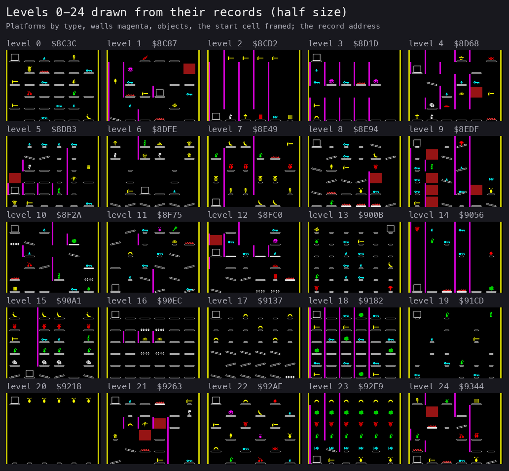
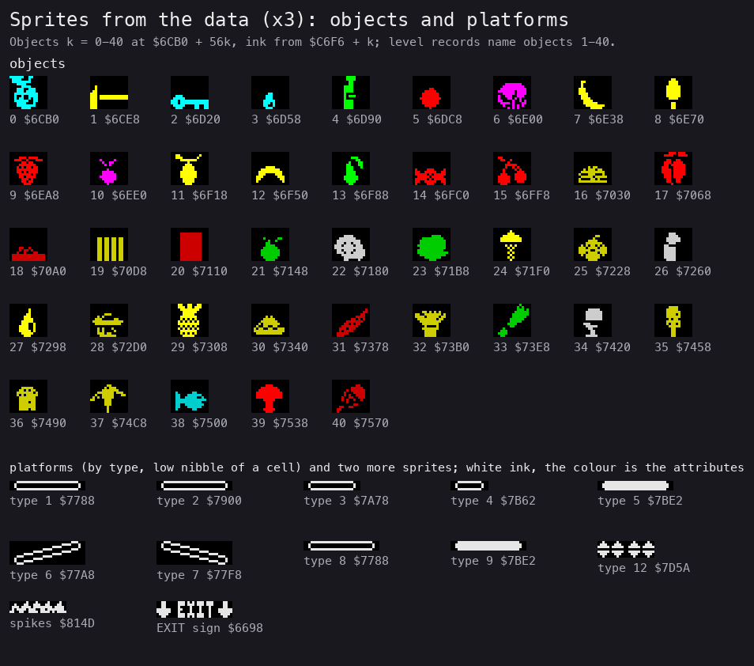
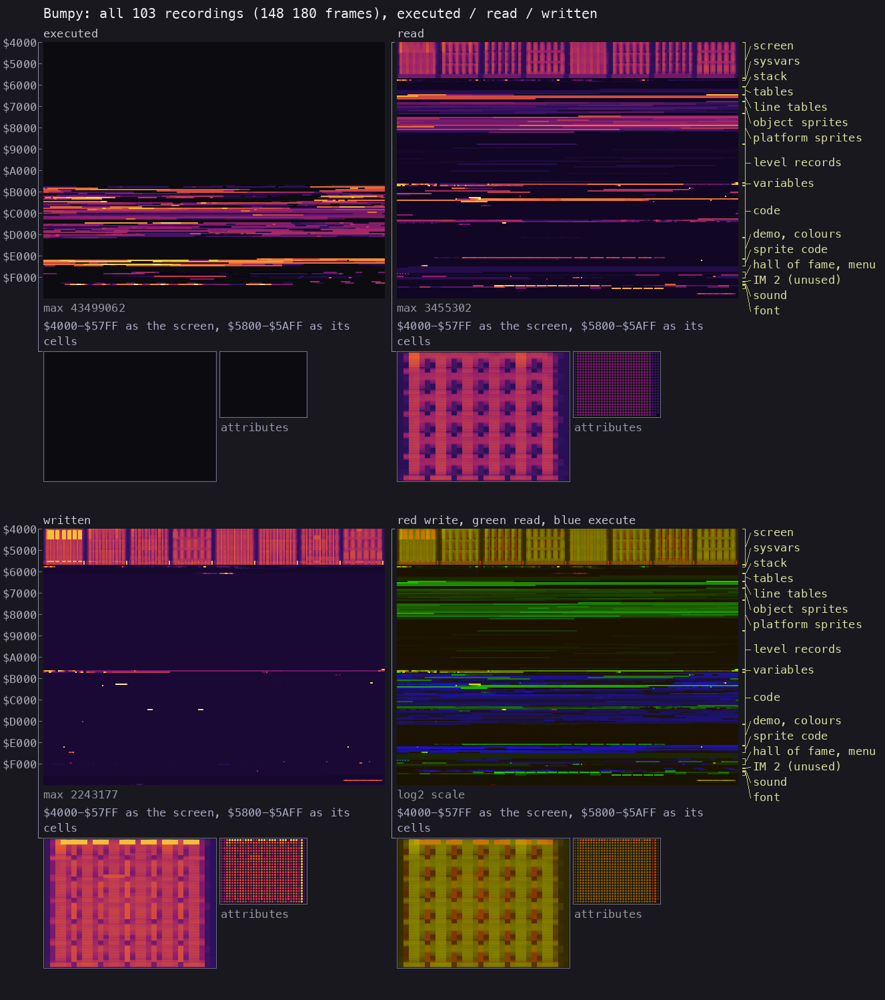
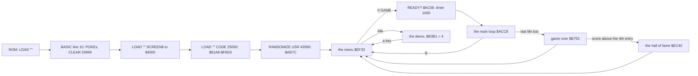

# 2. Architecture

What this covers: the machine budget, the images, the levels as data, the memory map (a figure), the stages from the
medium to play. The recordings it rests on ([WALKTHROUGH 6.0](../WALKTHROUGH.md#60-the-recordings)): c1 (power-on,
the original tape at ROM speed), `menu` and `gameover` (from a snapshot taken after a fast load), and
`rzx/l00`-`rzx/l99` (replays of the ZXDB RZX from its own state at each level start).

<!-- Figures this document needs (GUIDE.md 4.2), remove each line when it is in: -->
<!-- - the main loop's call graph (stage 2) -->

## 2.1 The machine budget

A 48K Spectrum, nothing else: one 38 700-byte block at `$61A8-$F8D3`, entered at `$AB7C`, the beeper (port `$FE`,
`$F510-$F5BA`), the keyboard, and a Kempston stick on port `$DF` ([doc 3](03-build-and-load.md),
[WALKTHROUGH 5](../WALKTHROUGH.md#5-tool-gaps-found-and-fixed-in-unreal-ng)). No paging, no AY, no second screen: the
game draws straight into `$4000`. The ROM is used for its interrupt handler (IM 1, `$0038`) and by the BASIC loader.

| Part | Bytes | Where |
| --- | --- | --- |
| screen | 6912 | `$4000-$5AFF` |
| ROM system variables, BASIC, free | 1704 | `$5B00-$61A7` (the BASIC loader, then free; the stack at `$6170-$618F`) |
| the game: data | about 24 200 | `$61A8-$AB7B` (tables, sprites, the 100 level records, the variables), `$D240-$E29F`, `$E7C1-$EC3F` and others (2.4) |
| the game: code | about 14 500 | `$AB7C-$D23F`, `$E2A0-$E7C0`, `$EC40-$F0E7`, `$F183-$F5BA` |
| above the game | 1836 | `$F8D4-$FFFF`, never touched in play |

## 2.2 The images

| Image | How | What it is |
| --- | --- | --- |
| as loaded | `case.json` `image_cmd`: block 5 of `BUMPY.TAP` (`work/mkgame/original.bin`) | `$61A8-$F8D3` byte for byte |
| at the entry | SkoolKit `tap2sna.py -s 43900` (`work/stage1/images/entry.z80`), and c1 at frame 13 357 (T 19 678), the first fetch of `$AB7C` | the same bytes as loaded: there is no unpacker and no relocation. SP `$6190` (from `CLEAR 24999` and `USR`) |
| in play | the RZX's level 0 play start (`work/stage1/rzx/levels/play-000172.z80`); every level's start (`rzx/levels/lvl-*.z80`) | 125 bytes in 49 runs differ from the entry image, every one a variable or a self-modified operand (below) |

What play changes (the entry image against play, `work/stage1/NOTES.md`): `$A9FE` (the sprite width), `$AA01-$AB2E`
(the level buffer `$AA20-$AA6A`, its unpacked cells `$AA6B-$AAB2`, the game state `$AAFB-$AB0F`), `$ADDB-$ADDE` (the
players), `$B3F5-$B3F6`, `$B439`, `$B43E` (the key buffer), `$B52C`, `$C74E-$C751`, `$C774`, `$C776`, `$D01D` (the
displacement of `LD C,(IX+d)` that picks an object's ink), `$E30F`, `$E3E4`, `$E714-$E716`, `$EFED-$EFEE`, `$F015`,
`$F025` (the menu), `$F083-$F089` (the active key table). The sprites and the level records are never written in any
recording (the "written" panel of 2.5): a level is copied into a buffer and changed there.

### The state variables

| Address | What | Witness |
| --- | --- | --- |
| `$AAFB-$AAFC` | the score (a word) | the HUD in every recording |
| `$AAFD`, `$AAFE`, `$AAFF` | water drops, keys, hammers carried | c1 frames 14 162 and 14 990; the POK file (hammers 47386 = `$B91A`) |
| `$AB00` | the level, 0-99 (`$B2D5` wraps 100 to 0) | `rzx/levels/levels.tsv`; `rzx/l99` frame 1154 |
| `$AB01` | lives, 2 at the start | c1 frame 14 018; `gameover` frames 602 and 1080 |
| `$AB04-$AB05` | the level timer: 1000 at READY? (`$AC06`), minus 1 a pass (`$B7D1`), held at 0. At the level's end what is left is counted into the score, a point a step (`$B35F`, with the tick `$F4F9`) | c1 15 436-18 186 (at 0 nothing happens) |
| `$AB06-$AB08` | the water, keys and hammers a life starts with | code `$BA9F-$BAAE` |
| `$AB09-$AB0F`, `$AB10-$AB16` | players 1 and 2: score, water, keys, hammers, level, lives (swapped at `$BABE`) | code |
| `$AB1A` | the ball's start cell | code `$CF89` |
| `$AA45` | prizes left on the level (record byte 37); at 0 `$BCB9` opens the exit | code `$BA53`; `rzx/l00` frame 971 |
| `$ADDB`, `$ADDC` | the player whose turn it is; the number of players | code |
| `$B3B1`, `$ABA6`, `$ABA4` | the menu's choice (0 one player, 2 two players, 4 the demo); 1 in the demo; the demo's input pointer (`$D25A` at the start) | code `$EF97`, `$AB95`; `menu` frames 250-4000 |
| `$B436-$B43E` | the key buffer: 8 keyboard rows (`$7FFE` first) and the Kempston byte | code `$B418` |
| `$F084-$F08B` | the active key table: up, down, left, right, fire, fire, pause, abort (row x 8 + bit) | code `$F0B8` |
| `$EEB3` + 32 x n | the hall of fame, four entries of 32 bytes: the name at +6 (three letters), the score at +18 (PAP 16000, PEP 8000, PIP 4000, POP 1700) | code `$EC4F-$EC6D`; `gameover` frame 4618 |

## 2.3 The levels

The 100 levels are 75-byte records at `$8C3C` + 75 x level (`$8C3C-$A987`). `$CF2E` (called from `$AC7D`, `$AC86`,
`$ACBF`) picks the colours by the level mod 7 from the table `$E119` (three bytes a level), clears `$AA20-$AAFA`,
copies the record to `$AA20` and splits its first 36 bytes into the platform and wall grids:

| Record bytes | Copied to | What |
| --- | --- | --- |
| 0-35 | `$AA20-$AA43` | one byte a cell of the 6 x 6 grid, left to right, top to bottom. The low nibble (to `$AA6B` + cell) is the platform type, handled through `$C5A8`; the high nibble (to `$AA8F` + cell) a wall on the cell, handled through `$C5C2` |
| 36 | `$AA44`, `$AB1A` | the ball's start cell |
| 37 | `$AA45` | the number of prizes on the level: its objects of kind 5 and up (true for all 100 levels) |
| 38 | `$AA46` | the exit's cell: when the last prize is taken `$BCB9` writes platform type 11 there (the magenta exit, [the shot](img/play/rzx-l00-000971-exit-open.png)) |
| 39-74 | `$AA47-$AA6A` | the object on each cell, 0 none or a kind 1-40 |

Platform types in use: 1-10 and 12 (11 is the exit, never in the data); walls 1-4. Objects by their sprites: kind 1 a
hammer, 2 a key, 3 a water drop, 4 a green bottle (its use not seen yet), 5-40 prizes; 1 to 33 objects a level. Over
the 100 levels: 67 hammers, 207 keys, 57 drops, 30 bottles and prizes of 36 kinds. Each object is a 16 x 14 sprite at
`$6CB0` + 56 x kind (one byte a 4-pixel nibble), its ink at `$C6F6` + kind.

The maps drawn from the records alone (`tools/fig_levelmap.py`, each level labelled with its record's address), and the
same levels as the RZX shows them at their start (`tools/fig_levels.py`), match level for level:

- from the data: [levels 25-49](img/maps/data-levels-25-49.png), [50-74](img/maps/data-levels-50-74.png),
  [75-99](img/maps/data-levels-75-99.png);
- from the RZX's level starts: [0-24](img/maps/levels-00-24.png), [25-49](img/maps/levels-25-49.png),
  [50-74](img/maps/levels-50-74.png), [75-99](img/maps/levels-75-99.png).

The sprites, all drawn from the image (`tools/fig_sprites.py`): the objects 0-40 with their addresses and inks, the
platform types (1 `$7788`, 2 `$7900`, 3 `$7A78`, 4 `$7B62`, 5 `$7BE2`, 6 `$77A8`, 7 `$77F8`, 8 = 1 with the spikes
`$814D`, 9 = 5 with the spikes, 10 the bricks `$8345` drawn by `$E4BB`, 12 `$7D5A`), and the EXIT sign `$6698`:

## 2.4 The memory map

From the L1 builds of the 102 play recordings (`work/stage1/l1-play.json`, 129 994 frames: `menu`, `gameover`,
`rzx/l00`-`l99`; c1 is left out because the ROM's RAM test and the load touch every byte; `tools/memmap.py`). "Use"
is what the recordings did with the bytes: x executed, r read only, w written, `.` never touched.

| Range | Use | What |
| --- | --- | --- |
| `$4000-$5AFF` | w | the screen, drawn directly |
| `$5B00-$616F` | . | system variables and BASIC, idle after the load |
| `$6170-$618F` | w | the machine stack (2.5) |
| `$61A8-$6397` | . | the start of the block; to identify (stage 2) |
| `$6398-$6697` | r | a 768-byte table (three 256-byte pages); to identify |
| `$6698-$6707` | . / r | the EXIT sign's sprite `$6698` |
| `$6708-$6757`, `$67E8-$6A67` | r | the screen line address tables the sprite routines use |
| `$6CB0-$75A7` | r | the 41 object sprites, 56 bytes each (kind 0 is never placed) |
| `$75A8-$7787` | . | data never read in the recordings |
| `$7788-$8384` | r | the platform sprites, the spikes `$814D`, the bricks `$8345` |
| `$8385-$8C3B` | . | 2231 bytes of data never read |
| `$8C3C-$A987` | r | the 100 level records (read only for the levels started inside a recording: each RZX replay starts after its level's copy) |
| `$A9FD-$AB7B` | w | the variables: the level buffer `$AA20`, the grids `$AA6B` and `$AA8F`, the state `$AAFB-$AB1C` |
| `$AB7C-$D23F` | x | the game's code: the entry `$AB7C`, the main loop `$ACC8`, the state dispatch table `$AD29` with handlers `$AE5F-$B2C2`, the input `$B3B5-$B43E`, the frame wait `$B6E4`, the platform and wall handlers (tables `$C5A8`, `$C5C2`), the inks `$C6F6`, the level unpack `$CF2E`; tables between the routines (`$AE9B`, `$B52D-$B6BE`, `$C4E2-$C6B5`) |
| `$D240-$E118` | . / r | the demo's input from `$D25A` (48 bytes read in 4000 demo frames); `$D300-$E118` holds 3600 bytes never read |
| `$E119-$E29F` | r | the level colours (`$E119`, three bytes a level mod 7) and a table at `$E131` read when the exit opens |
| `$E2A0-$E7C0` | x | the sprite and screen routines: `$E318` (store), `$E3E5`/`$E3EE` (XOR), `$E4BB` (the bricks), `$E58B` (called before each frame wait) |
| `$E808-$EC3F` | r | 1080 bytes read in the menu and the hall of fame; to identify |
| `$EC40-$EDC5` | x | the hall of fame: the insertion and the name entry (`$EC40`) |
| `$EDE1-$EF32` | r | its texts and the table `$EEB3` |
| `$EF33-$F0E7` | x | the menu (`$EF33`), its texts, the key tables `$F084` and `$F09x` |
| `$F0E8-$F182` | r | menu data |
| `$F183-$F3C7` | . | the random routine (`LD A,R` at `$F184`) and an IM 2 setup (`$F343`, `$F388`: I = `$FE`, vectors at `$FDFD`, handlers `$F36B`, `$F3B0`), never executed in any recording, c1 included |
| `$F3C8-$F50F` | x | 14 sound effects, each a parameter list and a call to a primitive; 13 heard in the recordings, `$F483` never |
| `$F510-$F5BA` | x | the beeper primitives (`$F510`, `$F513`, `$F521`, `$F534`, `$F54C`, `$F560`, `$F579`, `$F58C`, `$F5AD`) |
| `$F5BB-$F8D3` | r / . | the font from `$F641` (the characters used were read) |
| `$F8D4-$FFFF` | . | not part of the game, never touched |

## 2.5 The heatmap and the stack

All 103 recordings merged (`tools/l1merge.py`, `work/stage1/l1-all.json`: c1, `menu`, `gameover` and the 100 RZX
levels, 148 180 frames; drawn by `kit/heatmap.py` with the regions of 2.4). c1's ROM RAM test and load write every
byte once, which shows as the faint floor of the "written" panel; the bright rows are the screen, the variables at
`$AA00-$AB5E` and the self-modified operands:

The stack: `USR` enters with SP `$6190`; the lowest byte written below `$61A8` in play is `$6170`, so the game uses 32
bytes of stack (`$6170-$618F`) in all 102 play recordings. The 1269 bytes below it (`$5C7B-$616F`) stay free.

## 2.6 The stages from power-on to play

The main loop and the frame: [WALKTHROUGH 1](../WALKTHROUGH.md#1-one-recording-from-power-on); the state machine and
the order of work inside a pass go into doc 4 at stage 2.
