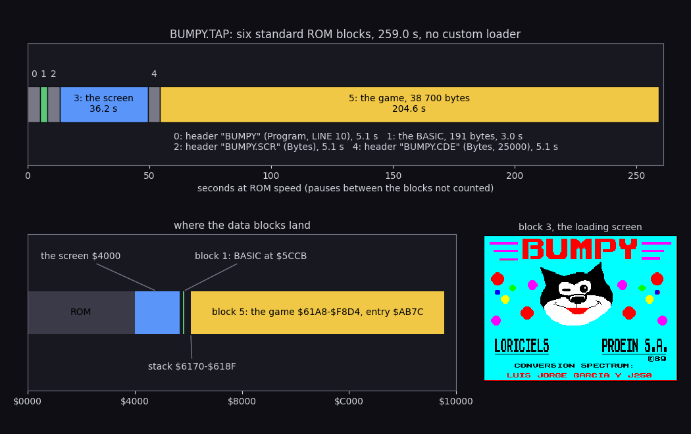
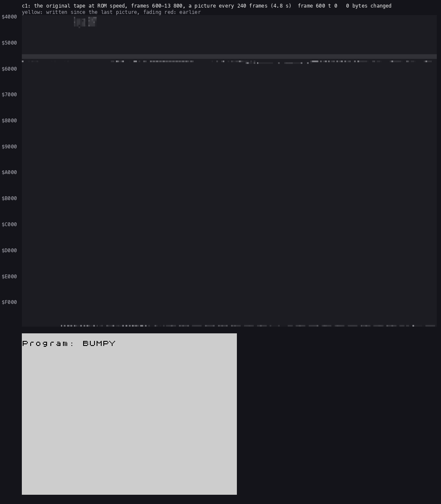
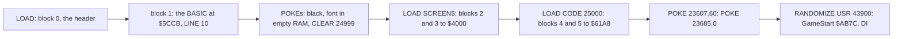
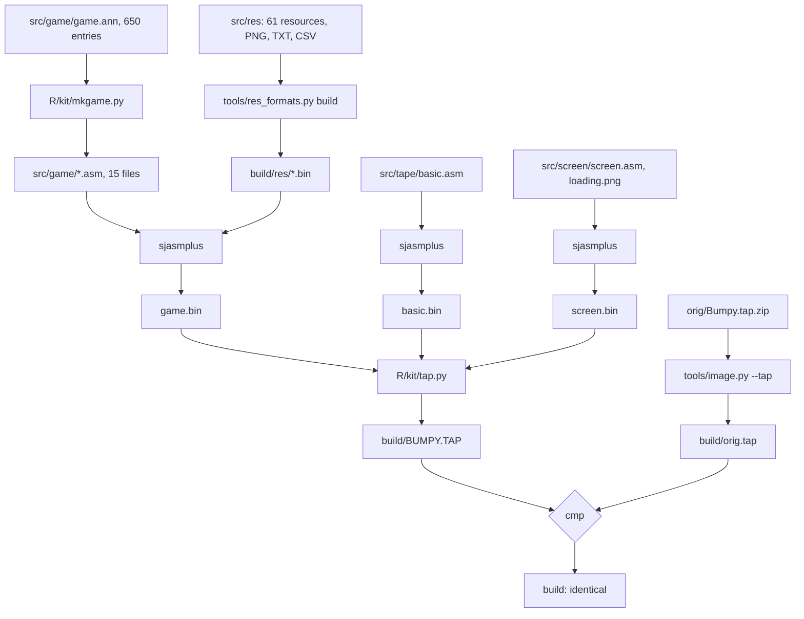
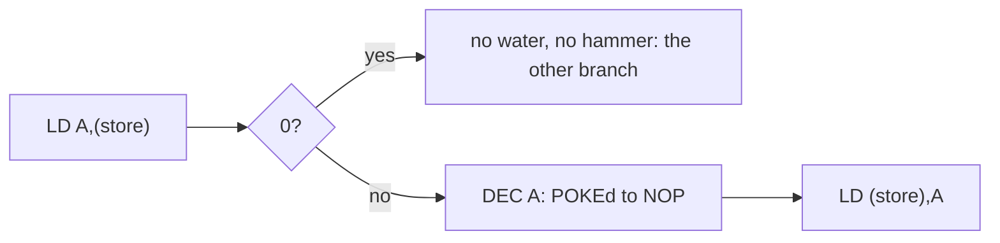

# 3. Build and load

What this covers:

- the tape block by block, as a picture and as the load ran;
- the BASIC loader and what each of its POKEs does;
- the source build that gives the tape back byte for byte;
- the standard Spectrum releases;
- the POKEs and hacks, decoded against the code.

The recordings it rests on: `c1` (power-on, `LOAD ""` typed, the original tape at ROM speed;
[WALKTHROUGH 1](../WALKTHROUGH.md#1-one-recording-from-power-on)), traced by our instance on port 37460 for the load
animation (`work/docs/bmA/c1`).

## 3.1 The tape block by block

`orig/Bumpy.tap.zip`'s `BUMPY.TAP`, listed by `kit/tapblocks.py list` (the times at ROM speed, pauses not
included).
Every block is a standard ROM block.
There is no custom loader, no packer and no protection, so there is no unpack to animate.

| Block | Kind | Name | Length | Loads at | ROM-speed time | What it is |
| --- | --- | --- | --- | --- | --- | --- |
| 0 | header, Program | "BUMPY" | 191 | | 5.1 s | autostart `LINE 10` |
| 1 | data | | 191 | PROG `$5CCB` | 3.0 s | the loader (3.2) |
| 2 | header, Bytes | "BUMPY.SCR" | 6912 | (header `$8000`) | 5.1 s | `LOAD "" SCREEN$` ignores the header's address and loads to `$4000` |
| 3 | data | | 6912 | `$4000-$5AFF` | 36.2 s | the loading screen (the same bytes as the zip's `SCRSHOT/BUMPY.SCR`) |
| 4 | header, Bytes | "BUMPY.CDE" | 38 700 | `$61A8` (25000) | 5.1 s | |
| 5 | data | | 38 700 | `$61A8-$F8D4` | 204.6 s | the whole game: code, data, pictures, the 100 level records |

Total 259.0 s at ROM speed (12 971 frames).



*The six blocks on a time line, where the data blocks land, and the loading screen
(`python3 tools/fig_tape.py`, from `orig/Bumpy.tap.zip`; each block's time from its bits at the ROM's pulse lengths).*

In `c1` the game's first instruction `$AB7C` runs at frame 13 357 (T 19 678 of the frame), after typing `LOAD ""` and
the pauses between the blocks.



*The load in `c1`, frames 600 to 13 800, a picture every 240 frames: `$4000-$FFFF` as a grid (each byte's last write)
with the screen beside it. The screen fills in its thirds, then the game block rises from `$61A8` to `$F8D4`.
`python3 R/kit/memanim.py --work work/docs/bmA/c1 --from 600 --to 13800 --step 16773120 --from-address 4000
--to-address FFFF --screen --cell fit docs/img/load/tape-load.gif` (16 773 120 T = 240 frames).*

The point: the medium is the plainest kind: three files loaded by the ROM, which is why every copy of the game can be
compared piece by piece (3.4).

## 3.2 The loader

The BASIC is one line (`tools/basic_list.py`, `src/tape/basic.asm`):

```basic
10 POKE 23624,0: POKE 23693,0: POKE 23607,128: CLEAR 24999: LOAD "" SCREEN$: PRINT: BRIGHT 1: OVER 1: PAPER 5:
   LOAD "" CODE 25000: POKE 23607,60: POKE 23685,0: RANDOMIZE USR 43900
```

Between `PAPER 5:` and `LOAD` the line holds the bytes `$0A $00`, which the listing shows as `{10}{00}`.

What each statement does:

| Statement | System variable | Effect |
| --- | --- | --- |
| `POKE 23624,0` | BORDCR `$5C48` | black border, black lower-screen text |
| `POKE 23693,0` | ATTR-P `$5C8D` | black on black: the "Bytes:" messages are invisible |
| `POKE 23607,128` | CHARS high byte `$5C37` | the ROM's font is taken from `$8100`, all zeros at this time: the tape messages print as blanks |
| `CLEAR 24999` | RAMTOP | RAMTOP at `$61A7`: the stack just below the game, `USR` enters with SP `$6190` |
| `LOAD "" SCREEN$` | | the loading screen to `$4000` |
| `PRINT: BRIGHT 1: OVER 1: PAPER 5:` | | cosmetic: the attributes of later prints |
| `LOAD "" CODE 25000` | | the game to `$61A8` |
| `POKE 23607,60` | CHARS | the ROM font back |
| `POKE 23685,0` | SCR-CT `$5C8C` | no "scroll?" prompt |
| `RANDOMIZE USR 43900` | | `CALL $AB7C`: GameStart |

```text
hide the tape messages: border black, ink = paper, font in empty RAM
RAMTOP = 24999
load the screen block to $4000
load the code block to 25000 ($61A8)
restore the font; no scroll prompt
call 43900 ($AB7C)
```



The code is entered at `$AB7C` (`DI`) with the image exactly as `LD-BYTES` left it.
The entry image's `$61A8-$F8D4` equals block 5 byte for byte (`work/stage1/images/code.bin` against `entry.z80`).
So the game has no unpacking or relocation stage.
What changes between the entry and play: [doc 2, 2.2](02-architecture.md#22-the-images).

Worked example, the font trick: CHARS `$5C36` holds the font address minus 256.
`POKE 23607,128` makes it `$8000`, so a character c prints from `$8000` + 8 × c.
"B" (66) prints from `$8210`.
At the moment of the `LOAD`, `$8000-$83FF` is still the zeros the ROM's RAM test left, so every message is blank.
When the code block arrives, `$8000` holds platform pictures, which is why the font must be put back before any print.

The point: the loader only hides the tape messages and calls the game; there is nothing to break and nothing to
unpack.

## 3.3 The source build

The source gives back the original tape, every byte of it.
`tools/build.sh` builds it and compares:

```sh
python3 tools/res_formats.py build --out build/res      # the resources: PNG, text, CSV back to bytes
sjasmplus src/tape/basic.asm                             # basic.bin, $5CCB, 191 bytes
sjasmplus src/screen/screen.asm                          # screen.bin, $4000, 6912 bytes
sjasmplus src/game/game.asm                              # game.bin, $61A8, 38 700 bytes
python3 R/kit/tap.py BUMPY.TAP basic:BUMPY:10:basic.bin code:BUMPY.SCR:32768:screen.bin:32768 \
    code:BUMPY.CDE:25000:game.bin:32782                  # six blocks, flags and checksums
python3 tools/image.py --tap orig.tap                    # the original, from orig/Bumpy.tap.zip
cmp BUMPY.TAP orig.tap                                   # "build: identical"
```

The `.asm` files are not edited by hand.
`R/kit/mkgame.py` writes them from the annotation files (`src/game/game.ann`, `src/tape/basic.ann`,
`src/screen/screen.ann`): one line an entry, its name, title, description and witness.
The header's quirks are kept: "BUMPY.SCR" says 32768 although it loads to `$4000`, and "BUMPY.CDE"'s second parameter
is 32782.



Worked example, one resource: a level.
`src/res/levels/levels.txt` holds level 0 as text (its cells, start, prizes, exit and objects).
`res_formats.py build` turns it back into the 75 bytes of LevelRecords `$8C3C`, and game.asm INCBINs the 100 records.
`python3 tools/res_formats.py check` converts every resource back to its bytes and to the same file again: 0 bad.
So a level can be edited as text and the game rebuilt.

The point: the source is the game: one command rebuilds the original tape, and every human-editable thing is a file.

## 3.4 The releases

The standard Spectrum releases, compared with the original by `tools/copy_compare.py` (the code cut in 151 pieces,
each piece searched for in the copy):

| Release | What it is | Against the original |
| --- | --- | --- |
| Loriciels 1989, `Bumpy.tap.zip` (ZXDB 763, release 0) | the original: `BUMPY.TAP`, six blocks | the source of this case |
| Proein Soft Line 1989, `Bumpy (Proein).tzx` (ZXDB release 1, Spain) | the re-release on tape, a real dump with irregular pauses | the three data blocks byte for byte |
| Proein Soft Line 1989, `Bumpy (Proein).dsk` (+3 disk) | the disk release | another build: the code's first 18 901 bytes (`$61A8-$AB7C`) are the same; from `$AB7D` it differs in 22 places (89 of 151 pieces found) |

The other copies are transfers, conversions to TR-DOS and Microdrive, cracks and translations; the case's
[README](../README.md) lists them all.
None of them is a release of its own.

The point: one game, one build: the Loriciels and Proein tapes are the same bytes, and only the +3 disk was rebuilt.

## 3.5 The POKEs and the hacks

ZXDB's POKE file (`Bumpy (1989)(Loriciels).pok`) and the zip's `POKES/BUMPY.POK` give:

| POKE | Address | Routine | The byte | What it does |
| --- | --- | --- | --- | --- |
| 47771,0 | `$BA9B` | LoseLife | `DEC A` (`$3D`) to `NOP` | infinite lives |
| 47386,0 | `$B91A` | HitBrickDown | `DEC A` | infinite hammers |
| 51576,0 | `$C978` | LeftUseKey | `DEC A` | infinite keys (a lock on the left) |
| 52155,0 | `$CBBB` | RightUseKey | `DEC A` | infinite keys (on the right) |
| 51717,0 | `$CA05` | LeftPutOutFire | `DEC A` | infinite water (landing left) |
| 52296,0 | `$CC48` | RightPutOutFire | `DEC A` | infinite water (landing right) |
| 52807,0 | `$CE47` | DownPutOutFire | `DEC A` | infinite water (landing down) |
| 43776,n | `$AB00` | Level | the level variable | not a start level: InitPlayers `$BB96` zeroes both records and LifeStart copies the record over `$AB00`. POKEd during play, it takes effect at the level's end: NextLevel stores n + 1 and saves it to the record |

Every POKE of a store has the same pattern in the code:

```asm
LoseLife:
  BA93  LD A,(Lives)
  BA96  CP $00
  BA98  JP Z,GameOver
  BA9B  DEC A                   ; POKE 47771,0: NOP
  BA9C  LD (Lives),A
```

```text
if store == 0: the other branch
store = store - 1        ; the POKE makes this store = store
```



Worked example, infinite lives: the ball falls out with Lives `$AB01` = 2.
LoseLife reads 2, it is not 0, so `DEC A` would make it 1.
With `$BA9B` = 0 the `NOP` leaves 2, and the store writes 2 back.
The HUD still shows 2 at the next DrawHud.

ZXDB's known-errors note gives one more POKE: 46124,31.
`$B42C` is the operand of `IN A,($DF)` at `$B42B` in ReadControls.
With 31 (`$1F`) the game reads the Kempston stick from port `$1F`, the address a standard Kempston interface decodes
([doc 5](05-controls.md)).

The hacks of the game (Andy Tacker, Bill Gilbert, Master Studio's Russian translation) are other builds: 37 to 143
of the 151 code pieces (README).
They change texts and the cracks' loaders, not the game.

The game has a cheat of its own, R+SPACE+V at the start of a game, which gives 99 of everything
([doc 5](05-controls.md)).

The point: every store in the game is lowered by one `DEC A`, so each POKE is a single byte; the Kempston POKE fixes
the game's only hardware fault.
