# 4. Game loop

What this covers:

- the game cycle from GameStart `$AB7C`: the menu, a new game, LifeStart, play, the level end, a life lost, game
  over and the hall of fame;
- one pass of MainLoop `$ACC8`, step by step, with what each step costs;
- the frame wait WaitFrame `$B6E4` and the state dispatcher `$AD0F` with its table StateTable `$AD29`;
- the IM 1 frame, the windows with interrupts off, and the Kempston read ReadControls `$B418`;
- a typical pass and the heaviest pass against the beam;
- the length of a pass over the whole RZX;
- the level end through the dispatcher;
- every delay and timer.

The recordings it rests on (WALKTHROUGH 6.0; all on the 48K):

| Recording | Used for |
| --- | --- |
| `c1` | power-on and the original tape at ROM speed; LifeStart at frame 13 915, keyboard play on level 0 from 14 018. Frames 14 082-14 137 give the interrupt count with no stick on port `$DF` |
| `rec/l83` (stage 2, `work/stage2/rec/l83`) | level 83 solved by `tests/inputs/solve-l83.txt`. The last prize at frames 341-344, the exit open, state 8 at 521, level 84 at 524. Traced over frames 340-350 (`MainLoop.gif`, `OpenExit.gif`, both beam timelines) and 518-530 (`LevelEnd.gif`) |
| `rzx/l21` | the RZX's level 21 replayed: state 8 at frame 1390, the timer counted 1462-1478, LifeStart at 1529, level 22 built 1534-1538 |
| `rzx/l68` | the RZX's level 68 replayed: the ball falls out at frame 686 (interrupt count over 682-715) |
| `menu` | the menu recording, for the budget of the menu and the demo (4.9) |
| the RZX itself | `tools/rzx_passes.py` and `tools/rzx_states.py` play the whole RZX in SkoolKit's simulator, no emulator instance (`work/stage1/passes.tsv`, `work/stage2/rzx-states.tsv`) |

Conventions:

- **A frame** is 1/50 s of the 48K, 69 888 T.
- **A pass** is one turn of the main loop, from MainLoop `$ACC8` through the frame wait and the state routine back to
  `JP MainLoop` ([terms](README.md#terms)).
- Times are T-states in the frame, 0 at the frame's start. `kit/beam_timeline.py` draws the 48K raster: 224 T a line,
  the first screen line at about T 14 336.
- On our instance the interrupt is taken at about T 1825 of a frame. The ROM's IM 1 handler `$0038` then runs to
  about T 3007 (about 1200 T).
- A trace puts an instruction in the frame where it ran. A value read with `time_travel memory_at` is the memory at
  the start of the frame named. PrizesLeft `$AA45` reads 1 at frame 343 and 0 at 344 in `rec/l83`, while AddScore ran
  in frame 343.
- The traces were taken on our own instance (port 37460) by the kit tools and kept in
  `work/docs/bmA/<recording>/traces/`.

## 4.1 The shape of the program

Bumpy is locked to the frame.
Every pass of the main loop ends in a `HALT`, so a pass is one frame or a whole number of frames.

- **A pass** does the animations of the level, one tick of the timer, the quit, cheat and pause keys, the HUD, the
  frame wait, and one step of the ball.
- **The interrupt** is the ROM's IM 1 handler. The game installs no handler of its own: the IM 2 code in the image is
  never run (4.12, doc 2).
- **The game's clock is the pass.** The timer loses one a pass. A bounce has 16 steps, one a pass. When a pass takes
  two frames, the ball and the timer both slow down. Nothing makes up for it.

Four passes in five take one frame (4.8).
The longer ones are passes where the beeper plays with interrupts off, or where a big picture is drawn.

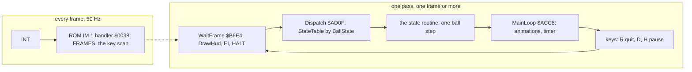

The point: the frame is the game's tick, and the work of a pass decides how many frames the tick lasts.

## 4.2 The game cycle

The program has no state variable of its own above the ball.
Its state is the place in the code: the menu, LifeStart, the main loop, the level end, LoseLife, GameOver.
The ball's state BallState `$AA00` only matters inside the main loop.

The cycle, from the code:

```text
GameStart:        DI
GameRestart:      Menu                       ; returns MenuChoice: 0 one player, 2 two, 4 the demo
                  DemoFlag = 0, CheatMode = 0
                  if MenuChoice is not 0 or 2: DemoFlag = 1, DemoInputPtr = DemoMoves
                  PlayerCount = 1 or 2
NewGame:          clear the attributes, draw the side panels, InitPlayers
                  R, SPACE and V all held: CheatStock (doc 5, 5.7)
                  CurrentPlayer = 1
LifeStart:        reset the ball and the flags, Timer = 1000
                  copy the player's record to the working copy $AAFB
                  BuildLevel, PrintText "READY?" (not in the demo)
                  DrawHud, wait for no key, wait for a key, ChooseNextState
                  BuildLevel again, DrawHud, WaitFrame
MainLoop:         passes until a state routine leaves it:
                    state 8  -> LevelEnd -> next level -> LifeStart (a game) or GameOverPause (the demo)
                    state 6/7, fire, S -> LoseLife -> LifeStart, or GameOver
                    R held   -> BackToMenu -> GameRestart
GameOver:         score not below the 4th hall of fame entry ($EF25): EnterHallOfFame
                  two players and the other not out: hand over -> LifeStart
                  else GameOverPause -> BackToMenu -> GameRestart
```

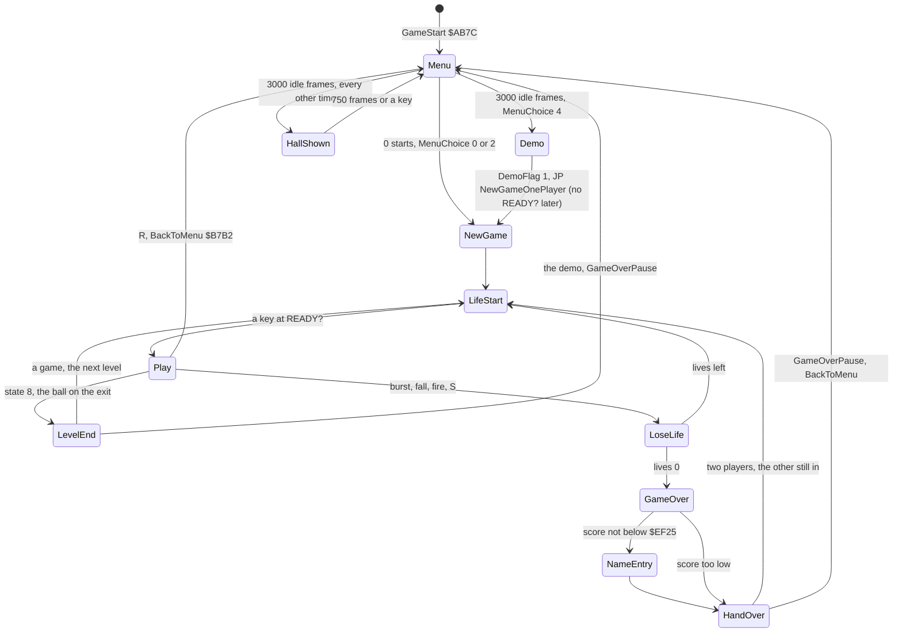

Worked example, `twoname` (stage 2): two players lose three lives each by S.
Each LoseLife hands the turn over, so LifeStart runs with CurrentPlayer `$ADDB` alternating 1, 2, 1, 2.
Player 1's last life ends in GameOver with a score POKEd to 2000, which is not below `$EF25` (1700): the name entry
runs ([EnterName.gif](img/routines/EnterName.gif), doc 8).
The hand-over (GameOver `B7A6 JP SwitchToPlayer2`, `$BAF1`, which falls into LoseLifeWait `$BAF6`) then gives player 2
his last life.
His GameOver goes through the name entry, finds player 1 marked `$FA` and ends in GameOverPause `$B7A9`.

Witnesses: LifeStart L1 62, LevelEnd L1 102, GameOverPause L1 3, WaitKeyOrSecond L1 60 (game.ann).

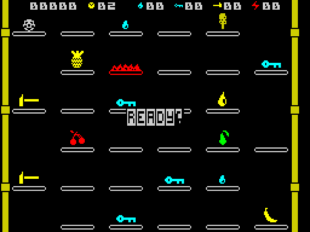

*READY? at LifeStart (`c1`, frame 14 018, `kit/screen_shot.py`). The level is built, the HUD drawn; the game waits for
no key, then for a key.*

The point: one flat loop of code, with no state variable, carries the whole game; the ball's state is the only
dispatch.

## 4.3 LifeStart `$ABD8`: every level and every life

LifeStart is the door to the main loop.
It runs at a new game, after every level end and after every life lost.
So the level is always rebuilt from its record, and a lost life restarts the level from scratch.

What it does:

1. Resets the ball: BallState `$AA00` = 0, BallStep `$A9FF` = 0, SpringArmed `$AA13` = 0, and the animation flags
   (ExitOpen, BrickActive, FireOutActive, CrumbleActive, CrumblePending, LockActive, TakeoffDrawn).
2. Timer `$AB04` = 1000 (`LD HL,$03E8`).
3. Copies the current player's 7-byte record (`$AB09` or `$AB10`) to the working copy `$AAFB`: score, water, keys,
   hammers, level, lives.
4. Clears the play area and runs BuildLevel `$CF2E` (the record of the level to `$AA20`, and the picture: doc 6).
5. Prints READY? (one player), PLAYER 1 READY? or PLAYER 2 READY?; the demo skips the text.
6. Keeps water, keys and hammers in `$AB06-$AB08`: LoseLife puts them back.
7. A game: DrawHud, WaitRelease `$B401`, WaitPressHeld `$B6DD`, then ChooseNextState `$B7E4`. The key that ends
   READY? is read again as the first move.
8. ClearPlayArea and BuildLevel again (the text is gone), DrawHud, WaitFrame, and falls into MainLoop.

```asm
LifeStartReady:
  ACB0  CALL DrawHud            ; the HUD, wait for no key, then for a key
  ACB3  CALL WaitRelease
  ACB6  CALL WaitPressHeld
  ACB9  CALL ChooseNextState
LifeStartGo:
  ACBC  CALL ClearPlayArea      ; the play area again without the text
  ACBF  CALL BuildLevel
  ACC2  CALL DrawHud
  ACC5  CALL WaitFrame
MainLoop:
  ACC8  AND A
```

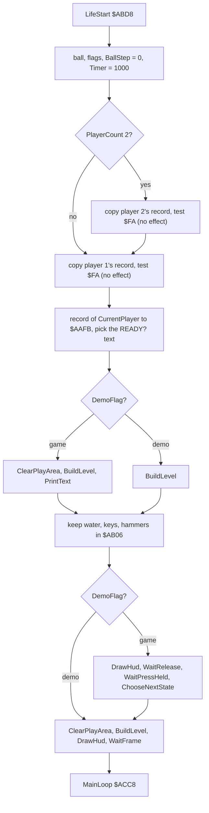

Worked example, `rzx/l21`: the level end of level 21 finishes at frame 1528.
LifeStart runs at 1529.
BuildLevel draws level 22 from frame 1534 T 58 988 to frame 1538 T 66 474: four frames for one level.
PrintText puts READY? up at 1539 T 3166, and the wait for a key starts at 1539 T 36 301.

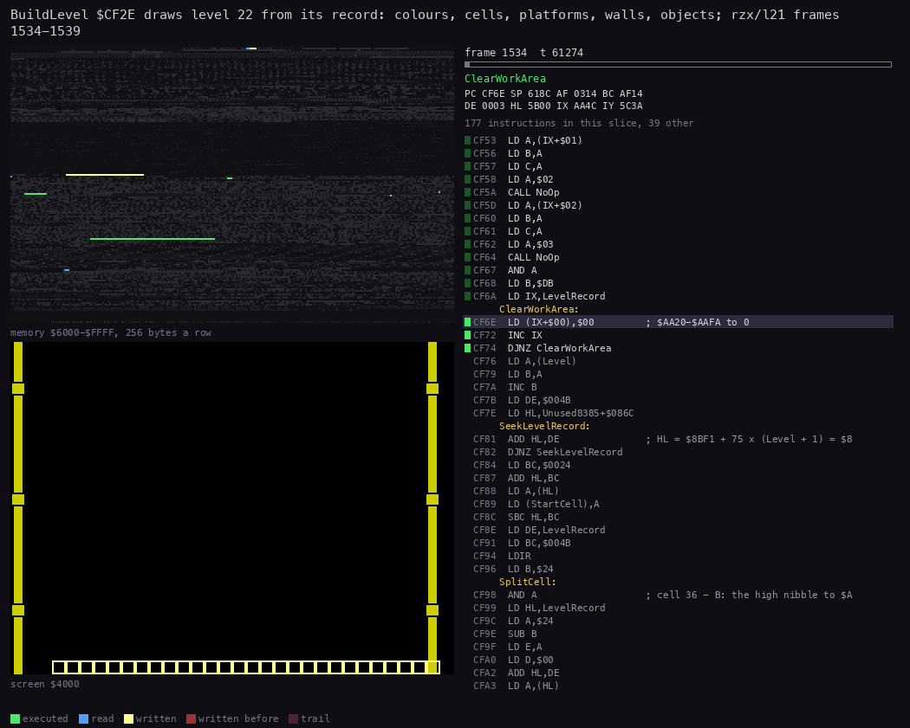

*BuildLevel `$CF2E` draws level 22 after LifeStart (`rzx/l21`, frames 1534 T 58 000 to 1539 T 3200).
`python3 R/kit/routine_anim.py --work work/docs/bmA/l21 --window 1534:58000-1539:3200 --listing build/game.lst
--pc CF2E-D075,D0A4-D2B3 --range 6000-FFFF --pictures 90 --out docs/img/routines/BuildLevel.gif`. Doc 6 takes the drawing apart.*

The test of `$FA` after each record copy (`JR Z` to the very next line) does nothing: with two players both copies
are always made, with one player only player 1's (`AC15 JR Z,LifeStartPlayer1` skips player 2's).
Known only from the code; it is harmless, because the third copy picks the right record.

The point: a life is not resumed but restarted, from the level's record and the stores the player had at its start.

## 4.4 MainLoop `$ACC8`: one pass

The main loop is 26 instructions and a dispatch.
It does the level's animations first, then the keys, then the wait, then the ball.

```asm
MainLoop:
  ACC8  AND A
  ACC9  CALL ReadCell             ; the platform under the ball to CellPlatform $AB1C
  ACCC  CALL CellScreenAddr       ; the ball's cell on the screen
  ACCF  CALL BrickStep            ; a brick being broken
  ACD2  CALL WaterStep            ; a fire being put out
  ACD5  CALL PlatformChangeStep   ; a crumbling platform
  ACD8  CALL WallStep             ; a lock opening
  ACDB  CALL AnimateFires         ; every fourth pass
  ACDE  CALL AnimateWalls         ; every fourth pass
  ACE1  CALL AnimateExit          ; the open exit, every second pass
  ACE4  CALL TickTimer            ; Timer $AB04 - 1, held at 0
  ACE7  CALL BottleFlashOff       ; a CPC border flash, now a RET
  ACEA  LD A,$2B                  ; R: back to the menu
  ACEC  CALL TestKey
  ACEF  JP NZ,BackToMenu
  ACF2  LD A,$32                  ; D: the cheat switch (a RET)
  ACF4  CALL TestKey
  ACF7  CALL NZ,CheatModeSwitch
  ACFA  LD A,(DemoFlag)
  ACFD  CP $00
  ACFF  JR Z,MainLoopPause
  AD01  JR MainLoopWait
MainLoopPause:
  AD03  LD A,(KeySlots+$0006)     ; in a game: the pause key
  AD06  CALL TestKey
  AD09  CALL NZ,Pause
MainLoopWait:
  AD0C  CALL WaitOneFrame         ; the frame wait
Dispatch:
  AD0F  LD A,(BallState)          ; jump to StateTable[BallState AND 15]
  ...
  AD27  JP (IX)
```

The same in pseudocode:

```text
loop:
    CellPlatform = platform of the ball's cell
    BrickStep, WaterStep, PlatformChangeStep, WallStep     ; each runs only when its flag is set
    AnimateFires, AnimateWalls, AnimateExit                ; fires and walls every fourth pass, the exit every second pass while open
    if Timer > 0: Timer -= 1
    BottleFlashOff                                         ; FirmwareStub: nothing
    if key R: goto BackToMenu
    if key D: CheatModeSwitch                              ; RET
    if not demo and pause key: Pause                       ; wait release, wait press
    WaitFrame                                              ; DrawHud, EI, HALT
    jump StateTable[BallState AND 15]                      ; one ball step, ends in JP MainLoop
```

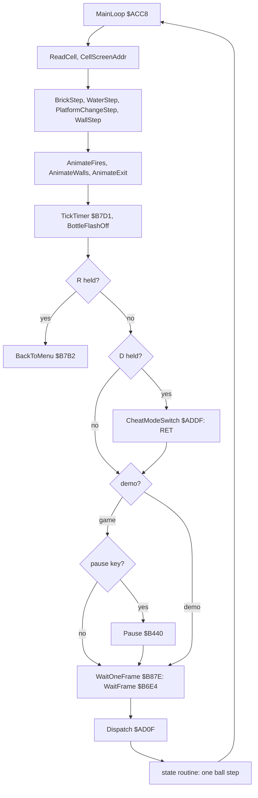

Every key test is a full keyboard read: TestKey calls ReadControls `$B418`, which reads all eight half-rows and the
Kempston port.
A pass makes about four of them: R, D, the pause key, and the state routine's own (S in the bounce, the moves at a
landing).

Worked example, `rec/l83` frame 349, the pass of the first step of a right jump (BallState 2, BallStep 0 at the frame's
start, 1 after the step):

| T in frame 349 | What runs |
| ---: | --- |
| 1825 | the interrupt; the ROM handler to 3007 |
| 3051 | Dispatch `$AD0F`: BallState 2, StateTable+4, BallRight |
| 3051-19 028 | the ball's step: erase and draw the ball by XOR, the screen-address divides, a key read (ReadControls at 10 778) |
| 19 028 | `JP MainLoop` |
| 19 028-22 621 | the animations, the timer, the R, D and pause keys |
| 22 621 | WaitFrame: DrawHud |
| 38 612 | `HALT` |

The work of this pass is 36 896 T, by module (kit `fig_budget.py` on the trace):

| Module | T | Share |
| --- | ---: | ---: |
| hud (DrawHud) | 16 018 | 43 % |
| sprites (the ball by XOR) | 10 296 | 28 % |
| render (screen addresses) | 3754 | 10 % |
| menu (ReadControls, TestKey) | 2917 | 8 % |
| ball | 1249 | 3 % |
| ROM (the IM 1 handler) | 1192 | 3 % |
| mainloop | 986 | 3 % |
| the rest (the pass's total less the seven modules) | 484 | 1 % |

DrawHud redraws the whole HUD every pass: score, lives, hammers, water, keys and level, each digit a picture.
It costs more than the ball.

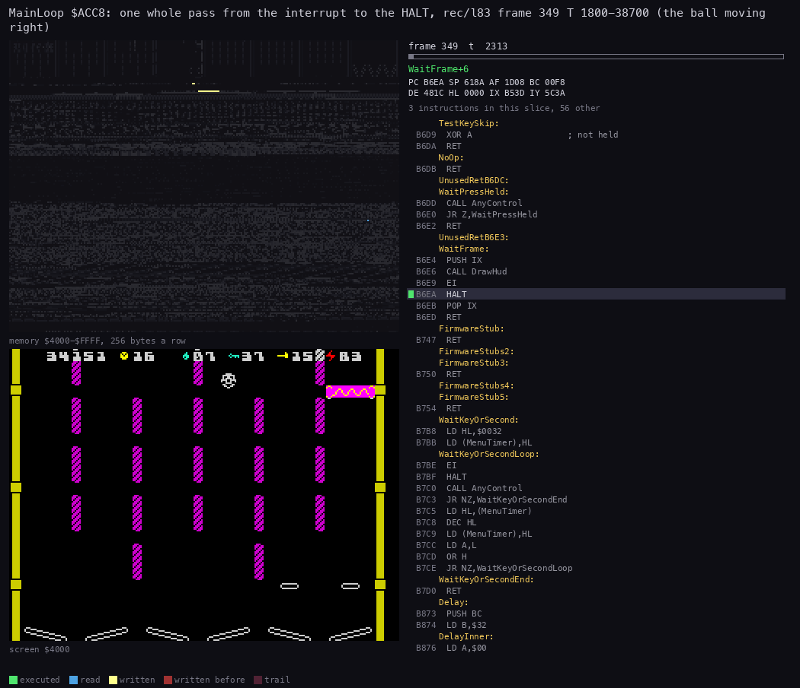

*One pass (`rec/l83`, frame 349, T 1800 to 38 700: from the interrupt to the `HALT`).
`python3 R/kit/routine_anim.py --work work/docs/bmA/l83 --window 349:1800-349:38700 --listing build/game.lst
--pc AB7C-F5BA --range 4000-FFFF --pictures 72 --out docs/img/routines/MainLoop.gif`. The PC walks Dispatch, BallRight and its XOR, MainLoop's
calls, then DrawHud.*

Witness: MainLoop L1 93 416 and TickTimer L1 93 414 over all recordings (game.ann).
Every pass runs TickTimer (R is tested after it, at `ACEA`); the 2 are probably recordings that end inside a pass
before `ACE4`.

The point: a pass is the animations, the keys, the HUD, then one ball step; the HUD is the largest single cost.

## 4.5 WaitFrame `$B6E4`: the frame wait

WaitFrame draws the HUD and waits for the next interrupt.

```asm
WaitFrame:
  B6E4  PUSH IX
  B6E6  CALL DrawHud
  B6E9  EI
  B6EA  HALT
  B6EB  POP IX
  B6ED  RET
WaitOneFrame:
  B87E  CALL WaitFrame
```

```text
WaitFrame:
    DrawHud                 ; PaintHudAttrs, Score, Lives, Hammers, Water, Keys, Level
    enable interrupts
    halt until the next INT ; the ROM handler runs, then here
```

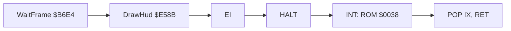

Two facts make it the game's clock:

- the HUD is drawn just before the `HALT`;
- the ball's step comes right after the `HALT` (4.6), at the top of the frame, while the beam is still in the top
  border.

WaitOneFrame `$B87E` is the same wait under another name.
The main loop calls it at `$AD0C`.
The level end, the burst and the pause between lives call it where frames pass without a pass.

Worked example: in `rec/l83` frame 349, DrawHud starts at T 22 621 and the `HALT` is at T 38 612.
The beam is then on screen line 108.
The next INT comes at frame 350 T 1825, so the pass waits 33 100 T.

Witness: WaitFrame L1 97 266, WaitOneFrame L1 97 227 (game.ann). WaitFrame runs 3850 more times than MainLoop: the
level ends, the deaths and the pause between lives.

The point: the `HALT` sits after the HUD and before the ball, so the ball's step starts in the top border of the next
frame; it ends on screen line 21 at the latest (4.8).

## 4.6 The state dispatcher `$AD0F` and StateTable `$AD29`

After the wait, one jump picks the ball's step.

```asm
Dispatch:
  AD0F  LD A,(BallState)        ; jump to StateTable[BallState AND 15]
  AD12  AND $0F
  AD14  RLA
  AD15  LD E,A
  AD16  LD D,$00
  AD18  LD IX,StateTable
  AD1C  ADD IX,DE
  AD1E  LD E,(IX+$00)
  AD21  LD D,(IX+$01)
  AD24  PUSH DE
  AD25  POP IX
  AD27  JP (IX)
StateTable:
  AD29  DEFW BallBounce,BallLeft,BallRight,BallUp,BallDown,BallStopped,BallBurst,BallFallOut,LevelEnd
```

`RLA` doubles A only because `AND $0F` cleared the carry.

| BallState | Routine | Steps | What it does |
| ---: | --- | ---: | --- |
| 0 | BallBounce `$AE5F` | 16 | a bounce in place |
| 1 | BallLeft `$AEDB` | 16 | a jump one cell left |
| 2 | BallRight `$AF55` | 16 | a jump one cell right |
| 3 | BallUp `$AFCF` | 8 | a rise to the cell above, 4 lines a step |
| 4 | BallDown `$B064` | 8 | a fall to the cell below |
| 5 | BallStopped `$B11A` | | on a stopper: Delay 2 a pass, wait for a key |
| 6 | BallBurst `$B14A` | 10 | the burst, on spikes or fire |
| 7 | BallFallOut `$B20A` | 5 | out below the bottom row |
| 8 | LevelEnd `$B2C2` | | the level end (4.10), never returns to the loop |

States 0-5 end each step with `JP MainLoop`; the last steps of 6 and 7 jump to LoseLife `$BA93` (BurstEnd `B1D1`,
LostStep5 `B2B5`), and 8 runs on to LifeStart.
Bounce, left, right and down end their last step in LandingCheck `$B09E`, which picks the next state (ChooseNextState
`$B7E4`, doc 5 and doc 10); up calls ChooseNextState directly (BallUpEnd `B009`); BallStopped waits for a key and
has no landing.

```text
Dispatch:
    i = (BallState AND 15) * 2
    jump to the word at StateTable + i
```

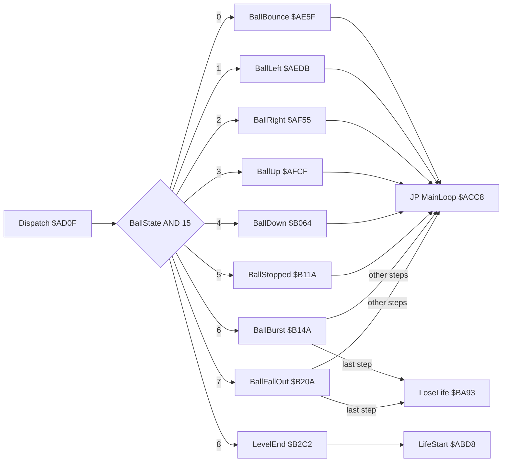

Worked example, `rec/l83`: the ball rises into the exit cell (platform 11; UpStep4 lets the ball into a cell above
with platform 0, 10 or 11).
At the up move's last step BallUpEnd `$B004` sets BallStep 0 and calls ChooseNextState (`B009`) directly.
ChooseNextState finds CellPlatform `$AB1C` = `$0B` and stores 8 in BallState (SetStateLevelEnd `$B86D`).
At the next pass, Dispatch computes 8 AND 15 = 8, doubled to 16.
StateTable + 16 = `$AD39` holds `$B2C2`, LevelEnd.
In `rec/l83` BallState is 8 from frame 521; LevelEnd stores Level `$AB00` = 84 by frame 524.

A state of 9-15 would take ReadyText's bytes `$AD3B`, which follow the table, as addresses (`$0B16`, `$140D`, `$0207`,
`$6572`, `$6461`, `$3F79`, `$1600`: the ROM and the picture area): a crash.
Only the demo can store one: ChooseDemoState `B806-B807` and BallStopped `B128-B129` copy a DemoMoves byte into
BallState, DemoMoves holds 9s, and a 9 becomes 3 only if the spring armed (SetStateUp at `B80F`); LoadSpring refuses on
platforms 0 and 6-12.
The demo in `menu` runs without a crash, so its list never leaves a 9 unarmed (known only from the code and that one
run).

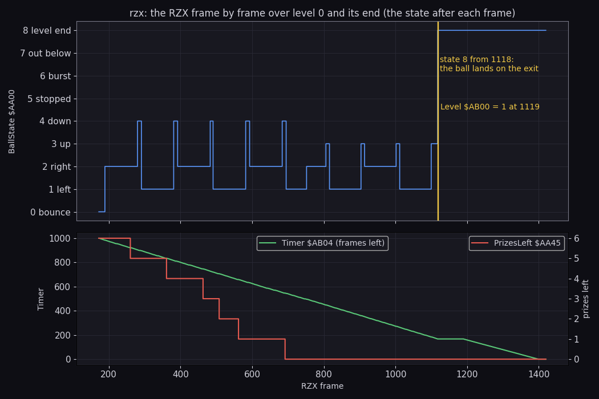

*BallState `$AA00`, PrizesLeft `$AA45` and the timer frame by frame over the RZX's level 0 (RZX frames 172-1420, the
state after each frame, `work/stage2/rzx-states.tsv`). State 8 from frame 1118, Level = 1 at 1119.
`python3 tools/fig_loop.py`.*

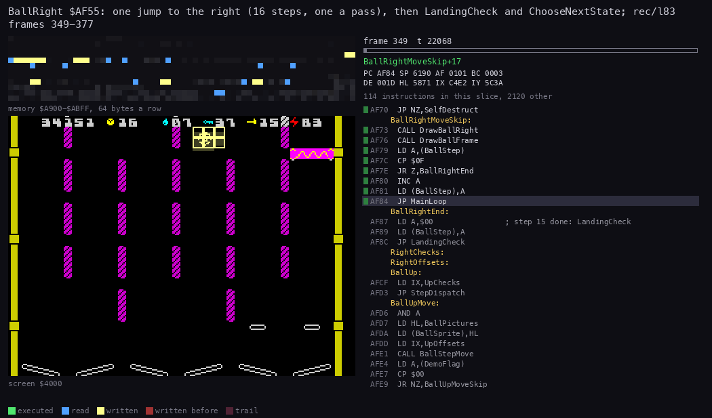

*Sixteen dispatches to BallRight: frames 349-376 hold steps 0-15, and the landing at 377 picks the next state
(`rec/l83`, frames 349-378). `python3 R/kit/routine_anim.py --work work/docs/bmA/l83 --window 349:1800-378:1800
--listing build/game.lst --pc AF55-AFCE,B882-B8D0,ADE6-AE5E,CA8D-CCCF,B09E-B0F9,B7E4-B872 --range A900-AB7F
--pictures 100 --out docs/img/routines/BallRight.gif`.*

The point: the whole of the ball's behaviour is nine routines behind one table, and the main loop never looks at the
state itself.

## 4.7 The IM 1 frame and the windows with interrupts off

The game runs in IM 1 with the ROM's handler.
The handler counts FRAMES `$5C78` and scans the keyboard into the ROM's variables.
The game reads the keyboard itself and never looks at either.

Interrupts are switched off and on all through a pass:

| Where | What |
| --- | --- |
| GameStart `$AB7C` | `DI` once at the start |
| ReadControls `$B418` | `DI` first; `EI` at `$B434` only when the stick port gave something other than `$1F` in its low 5 bits |
| WaitFrame `$B6E9` | `EI` before the `HALT` |
| every sound primitive (`$F510-$F5AD`) | `DI` at its start, `EI` at its end; TripleSweep (SfxExtraLife, SfxLevelEnd) re-enables them after its first sweep, since SweepFromE ends with `F51F EI` (doc 9) |
| the ROM handler | ends with `EI` |

ReadControls, the only keyboard reader:

```asm
ReadControls:
  B418  DI
  B419  LD HL,KeyRows
  B41C  LD B,$08
  B41E  LD C,$FE
ReadControlsLoop:
  B420  LD A,C                  ; one half-row, $7FFE first
  B421  RRCA
  B422  LD C,A
  B423  IN A,($FE)
  B425  OR $E0
  B427  LD (HL),A
  B428  INC HL
  B429  DJNZ ReadControlsLoop
  B42B  IN A,($DF)              ; the Kempston stick
  B42D  AND $1F
  B42F  CP $1F
  B431  RET Z                   ; nothing on the port: return with interrupts off
  B432  CPL
  B433  LD (HL),A               ; KeyRows+8 $B43E: 0 = pressed, like the keys
  B434  EI
  B435  RET
```

```text
ReadControls:
    disable interrupts
    for each of the 8 half-rows: KeyRows[i] = IN($FE) OR $E0
    s = IN($DF) AND $1F                 ; A holds the last row: the port is $xxDF
    if s == $1F: return                 ; interrupts stay off
    KeyRows[8] = NOT s
    enable interrupts
```

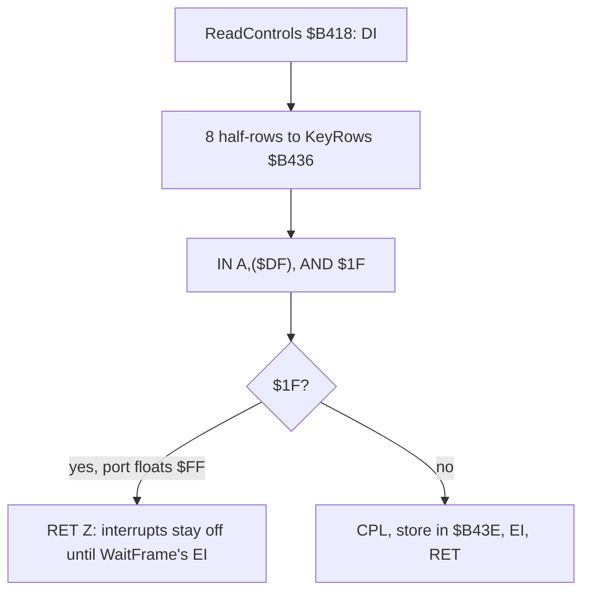

So whether interrupts are on in a pass depends on the machine's port `$DF`:

- **No device answers `$DF`.** The port floats `$FF`, the routine returns by `RET Z`, and interrupts stay off from the
  first key test of the pass to WaitFrame's `EI`.
- **A device answers `$DF`.** A Kempston interface decoding A5 (or unreal-ng's Kempston mouse, which answers `$xxDF`
  with its counters) makes the routine reach `EI`.

Measured on our instance, from the traces:

| Recording, frames | Port `$FFDF` reads | ReadControls ends | INTs taken |
| --- | --- | --- | --- |
| `c1` 14 082-14 137 | `$FF` | `RET Z` 211 times | 50 in 56 frames |
| `rec/l83` 340-349 | `$00` | `EI` at `$B434` | 8 in 10 frames (the pickup sound, with `DI`) |
| `rzx/l68` 682-715 | | | 14 in 34 frames (the fall-out sound) |

An INT that comes while interrupts are off is lost: the Z80 samples the INT line for about 32 T only.
That costs nothing in a one-frame pass, because the `HALT` comes before the next INT.
In a longer pass, the INTs under `DI` are lost and the `HALT` waits for the next one.
Either way a pass ends on an INT, so pass lengths are whole frames (4.8).
The only thing lost is the ROM's FRAMES count, which the game never reads.

What an emulator must do: decode port `$DF` (A7-A5 = 110) for the stick, or leave it floating `$FF`.
A port that reads anything else with no stick fitted reads as a direction held (doc 5).

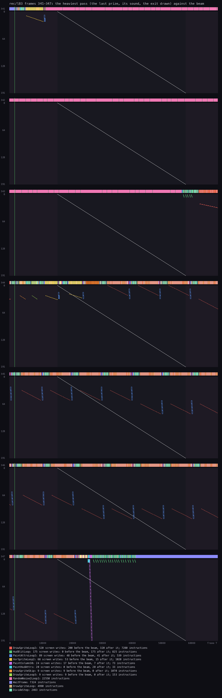

*The heaviest pass against the beam (`rec/l83`, frames 340-350). The pickup sound runs with interrupts off from frame
341 to 343: two INTs are lost. `python3 R/kit/beam_timeline.py --work work/docs/bmA/l83 --window 340:0-350:0
--listing build/game.lst --frames 340-349 --out docs/img/loop/beam-heaviest.png`.*

The point: interrupts serve only to end the `HALT`; the game loses them freely, and its timing does not care.

## 4.8 A pass against the beam, and the length of a pass

A typical pass fits in one frame with half a frame to spare.

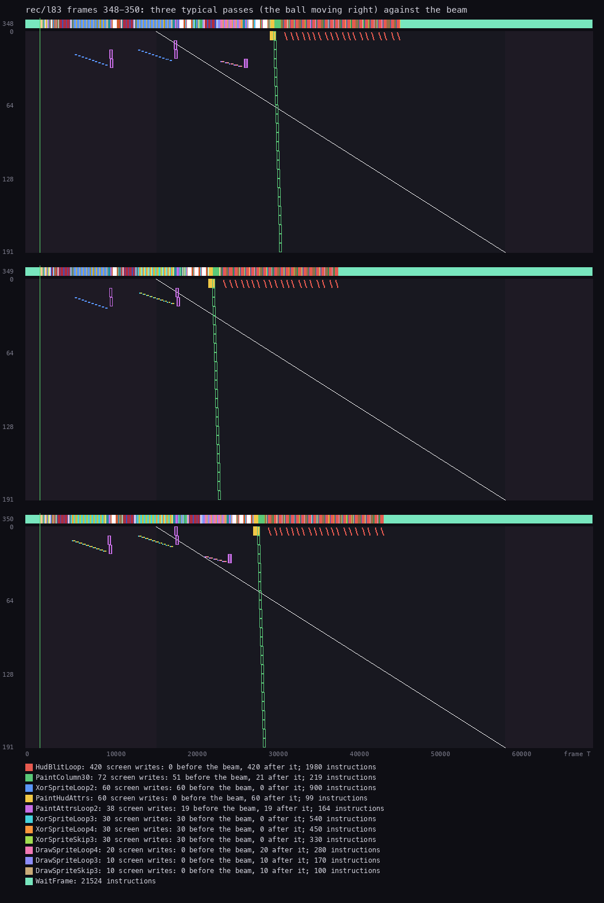

*Three passes against the beam (`rec/l83`, frames 348-350): the ball's step at the top of the frame, MainLoop's calls,
DrawHud, the `HALT`. `python3 R/kit/beam_timeline.py --work work/docs/bmA/l83 --window 348:0-352:0
--listing build/game.lst --frames 348-350 --out docs/img/loop/beam-typical.png`.*

The ball's step runs from T 3051 to T 19 028.
The beam reaches the first screen line at T 14 336 and line 21 at T 19 028.
So a ball in the top cells can be drawn under the beam, and a ball lower down never is.
DrawHud runs from T 22 621, when the beam is on line 37, below the HUD's top row (doc 8).
New digits therefore appear in the next frame.

Over the whole RZX, `tools/rzx_passes.py` logged every fetch of `$B6E9` and `$B6EB` (frames 172-150 434, 75 591
passes).
In play (75 475 passes, 96 804 frames):

| Frames a pass | Passes | Share |
| ---: | ---: | ---: |
| 1 | 59 952 | 79.4 % |
| 2 | 11 686 | 15.5 % |
| 3 | 2127 | 2.8 % |
| 4 | 1459 | 1.9 % |
| 5 | 244 | 0.3 % |
| 6 | 6 | |
| 7 | 1 | |

The work of a pass is 35 367 T at the median and 140 254 T at the 95th percentile.
The game averages 1.28 frames a pass: 39 passes a second.

The two-frame passes are the sound effects and the open exit.
When the exit is open, AnimateExit redraws it with DrawSprite: about one pass in seven then takes 4 frames.

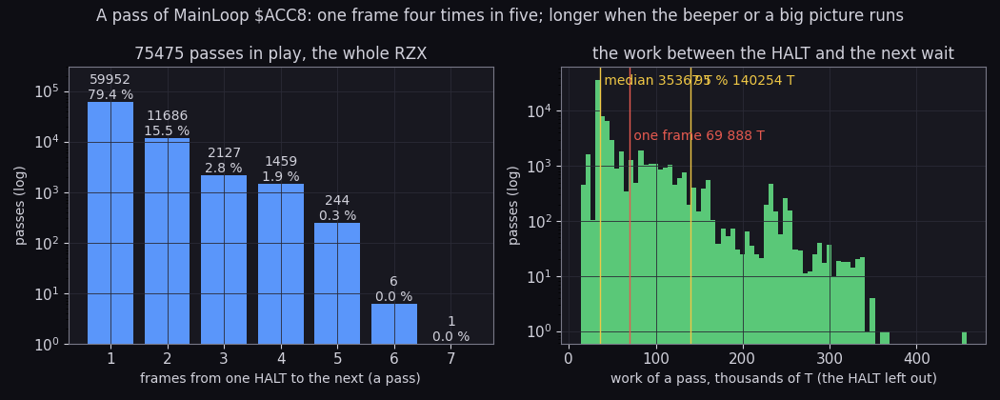

*Frames a pass and the work of a pass, over the RZX's play (`work/stage1/passes.tsv`, `tools/rzx_passes.py`).
`python3 tools/fig_loop.py`.*

The point: the game is a 50 Hz game most of the time and slows itself down, never skips, when it has more to do.

## 4.9 The heaviest pass: the last prize

The heaviest pass in play takes 7 frames.
It is RZX frame 125 362 on level 83, and `rec/l83` replays it at frames 341-347: 460 524 T of work.

The ball takes the last prize.
The pickup runs three things, one after the other:

1. SfxPickup plays RandomNoise2 `$F534`: 185 462 T, frames 341-343, with interrupts off;
2. AddScore adds 15; PrizesLeft `$AA45` goes from 1 to 0 (1 at the start of frame 343, 0 at 344);
3. OpenExit draws the exit at ExitCell: the sprites take 182 806 T, the screen-address divides 61 163 T, the HUD
   19 535 T.

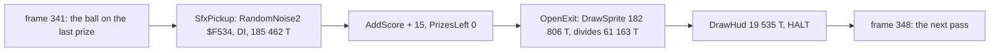

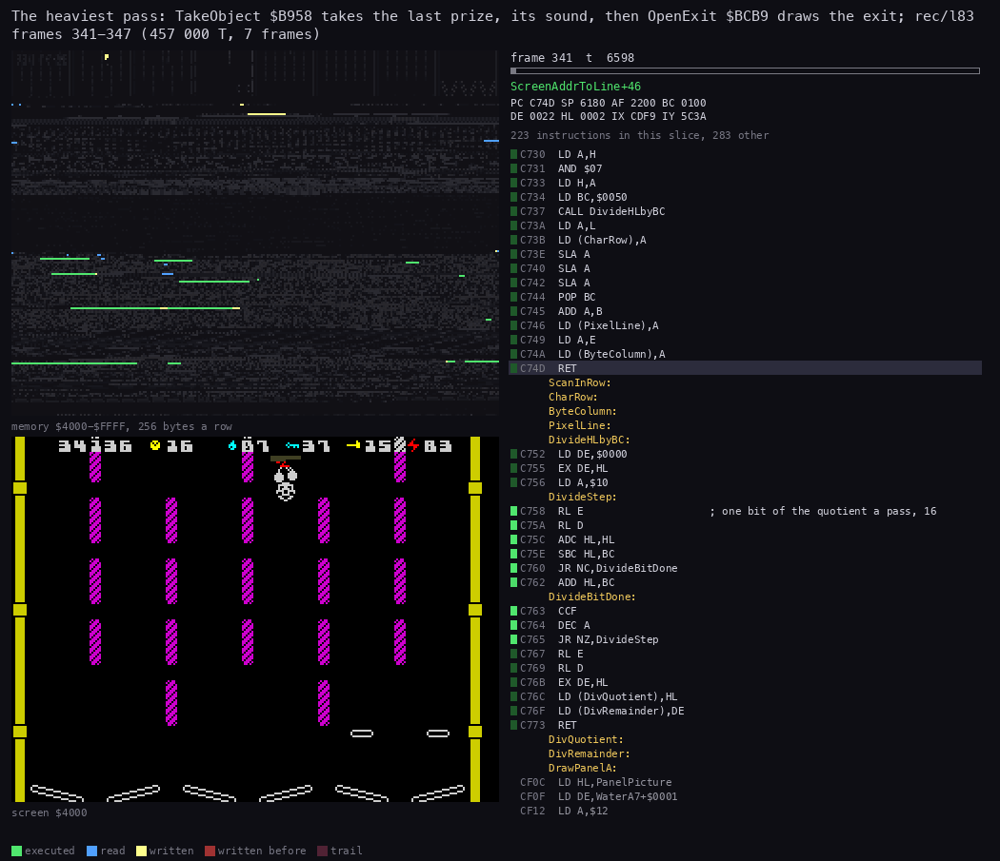

*The pass that takes the last prize and opens the exit (`rec/l83`, frames 341 T 1800 to 347 T 43 000).
`python3 R/kit/routine_anim.py --work work/docs/bmA/l83 --window 341:1800-347:43000 --listing build/game.lst
--pc B958-BA70,BCB9-BD20,F3F6-F40C,F534-F54B,E2A0-E3E4,C71F-C777 --range 4000-FFFF --pictures 96
--out docs/img/routines/OpenExit.gif`.*

The whole play budget, by module, against the menu:

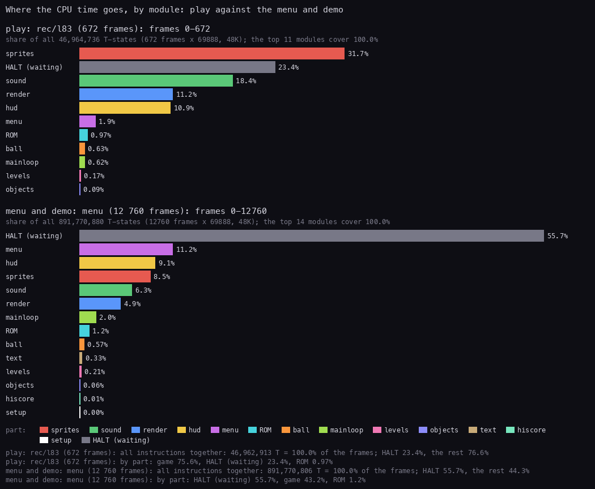

*Where the T-states go (`rec/l83` play, against the `menu` recording). Play: sprites 31.7 %, the `HALT` 23.4 %, sound
18.4 %, render 11.2 %, hud 10.9 %. `python3 R/kit/fig_budget.py --by module` (doc 2).*

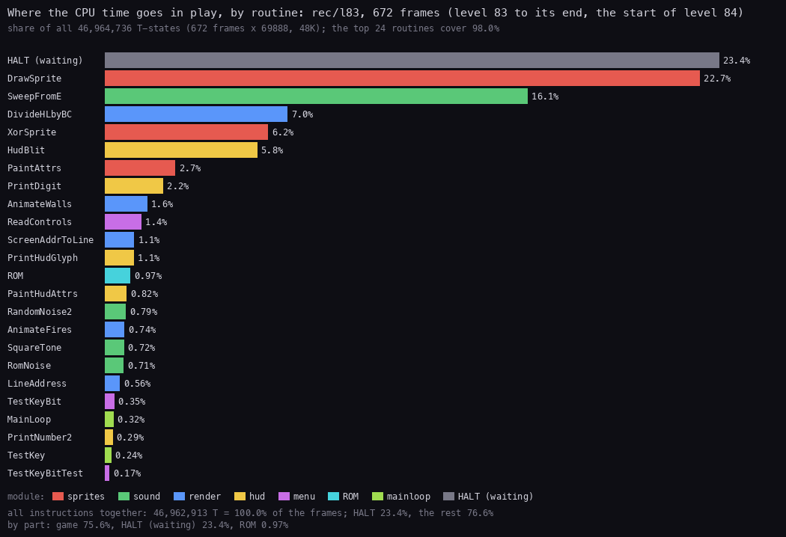

*The 24 heaviest routines in `rec/l83` (`python3 R/kit/fig_budget.py --by routine --top 24`,
`work/stage2/rec/l83/l1.json`).*

The point: the sound and the exit picture, not the ball, set the worst pass; the beeper alone takes almost three
frames.

## 4.10 The level end through the dispatcher

State 8 sends the dispatcher to LevelEnd `$B2C2`, which never returns to the main loop.
It runs its own frames with WaitOneFrame and `HALT`, then jumps to LifeStart.

```text
LevelEnd:
    Level += 1; if Level == 100: Level = 0          ; NextLevel $B2D5
    repeat 9:                                       ; the ball sinks one line a step
        erase the ball's top line, move it one line down, draw it
        WaitOneFrame; AnimateExit, AnimateFires, AnimateWalls; WaitOneFrame
    erase the last line; SfxLevelEnd
    repeat 15: EI; HALT
    while Timer > 0:                                ; no HALT here
        Timer -= 1; SfxTimerTick; Score += 1; print the score
    save the working copy to the player's record
    demo: GameOverPause; game: WaitKeyOrSecond, LifeStart
```

```asm
NextLevel:
  B2D5  LD A,(Level)            ; Level $AB00 + 1, 100 becomes 0
  B2D8  AND A
  B2D9  INC A
  B2DA  CP $64
  B2DC  JR NZ,LevelEndSet
  B2DE  LD A,$00
  ...
LevelEndTick:
  B367  DEC HL                  ; one point
  B368  LD (Timer),HL
  B36B  CALL SfxTimerTick
  B36E  LD A,$03
  B370  LD (HudColumn),A
  B373  LD HL,(Score)
  B376  INC HL
  B377  LD (Score),HL
  B37A  CALL PrintNumber5
  B37D  JR LevelEndTimer
```

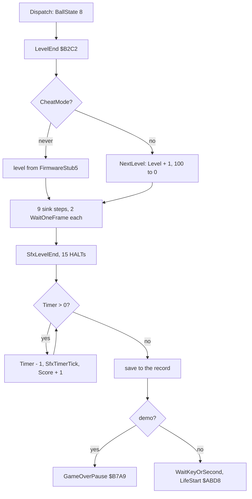

Worked example, `rec/l83`: BallState is 8 from frame 521, and Level reads 84 at 524.
The 9 sink steps take 18 frames ([shot](img/play/l83-000540-sink.png)).
The sound and the 15 `HALT`s follow, and the count of the timer starts at about frame 600
([shot](img/play/l83-000650-count.png)).
Each tick is a SweepDown sound with interrupts off and a reprint of the score: about 1.3 frames a point.
A level finished with 400 left on the timer spends about 520 frames, ten seconds, counting.
That is why the level ends of the RZX take 114 to 1285 frames.

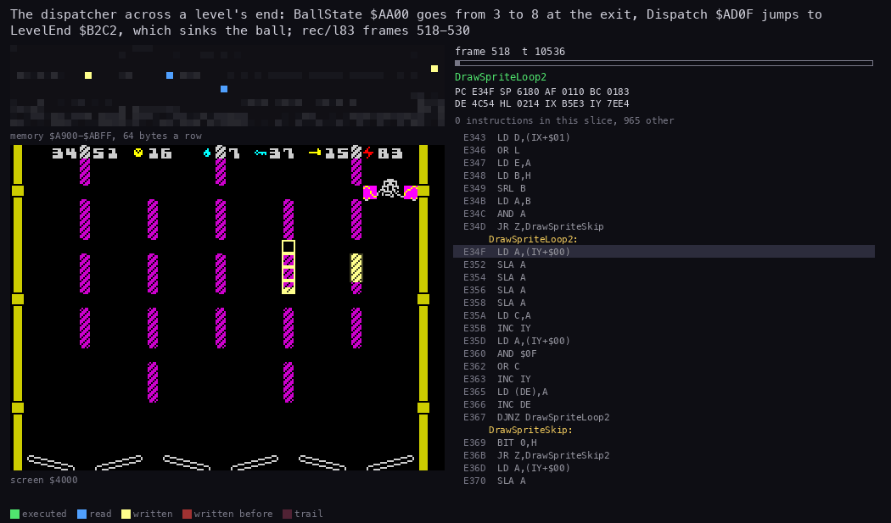

*The dispatcher across the level end of level 83 (`rec/l83`, frames 518-530): Dispatch picks BallUp (state 3), then
LevelEnd once BallState is 8; the hex view is the ball's variables at `$A900-$AB7F`. `python3 R/kit/routine_anim.py
--work work/docs/bmA/l83 --window 518:1800-530:1800 --listing build/game.lst --pc AD0F-AD3A,B2C2-B3B0,B7E4-B872
--range A900-AB7F --pictures 96 --out docs/img/routines/LevelEnd.gif`.*

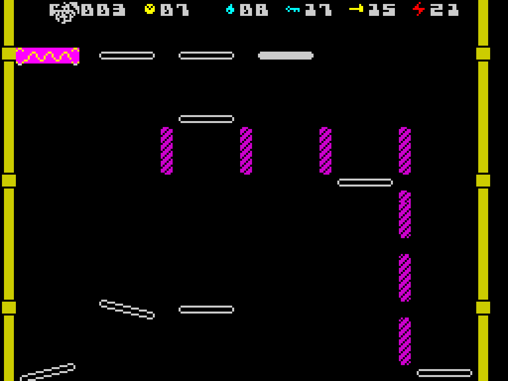

*The level end of level 21 on the screen (`rzx/l21`, frames 1384-1542, every second frame): the sink, the count, level
22 built, READY?. `python3 R/kit/screen_anim.py --work work/docs/bmA/l21 --from 1384 --to 1542 --step 139776 --scale 4
--delay 80 --hold 1500 docs/img/play/level-end-l21.gif` (139 776 T, two frames, a picture).*

After level 99, NextLevel stores 0 and the game goes on at level 0 with the score kept
([shot](img/play/rzx-l99-001685-level-0-again.png); `rzx/l99` frame 1685).

The point: the level end is a program of its own inside state 8, paced by its own waits; the timer count has no frame
wait at all, so its length is set by the beeper.

## 4.11 Delays and timers

| Timer or delay | Where | Unit | Length |
| --- | --- | --- | --- |
| Timer `$AB04` | TickTimer `$B7D1`, every pass | a pass | 1000 at LifeStart, held at 0; the rest scored at the level end, a point a tick. At 0 nothing happens ([shot](img/play/c1-018186-timer-zero.png)) |
| a bounce, a left or right jump | BallStep `$A9FF` | a pass | 16 steps |
| a move up or down | BallStep | a pass | 8 steps |
| the burst | BallStep | a pass | 10 steps |
| the fall out | BallStep | a pass | 5 steps |
| AnimateFires, AnimateWalls | MainLoop | a pass | every fourth pass |
| the level end sink | LevelEnd | 2 frames a step | 9 steps, 18 frames |
| the level end pause | `$B359` | `EI: HALT` | 15 frames |
| the timer count | `$B35F` | one tick, no `HALT` | about 1.3 frames a point |
| WaitKeyOrSecond `$B7B8` | between levels, after a life, before the menu | `EI: HALT` | 50 frames or a key |
| the pause after a life | LoseLife `$BA93` | WaitOneFrame | 50 frames, then WaitKeyOrSecond |
| Delay `$B873` | BallStopped (B = 2), GameOverDelay (B = 200), the hall of fame's border flash | B × 50 loops of `LD A,0: DJNZ` | 1036 T a unit (20 T a loop) |
| GameOverPause `$B7A9` | the demo's end, game over | 20 × GameOverDelay (2 × Delay 200, 414 400 T, then `EI: HALT`) | 20 × 6 or 7 frames, about 2.6 s |
| MenuTimer | Menu `$EF33` | `EI: HALT` | 3000 frames to the demo or the hall of fame; the hall of fame 750 frames |
| the bottle's sound | TakeBottle `$BA1C`: SfxExtraLife, TripleSweep twice | interrupts off for the first of each call's three sweeps | a 40-frame pass (16 in the RZX, one per bottle) |

TickTimer:

```asm
TickTimer:
  B7D1  LD HL,(Timer)
  B7D4  LD A,H
  B7D5  CP $00
  B7D7  JR Z,TickTimerLowByte
TickTimerDec:
  B7D9  DEC HL
  B7DA  LD (Timer),HL
  B7DD  RET
TickTimerLowByte:
  B7DE  LD A,L                  ; high byte 0: stop at 0
  B7DF  CP $00
  B7E1  RET Z
  B7E2  JR TickTimerDec
```

The timer counts passes, not frames.
At 1.28 frames a pass, 1000 ticks last about 26 seconds of play, not 20.
In `c1` the timer reaches 0 on level 0 and play goes on (frame 18 186).

The point: every delay in play is counted in passes, so a slow pass slows the whole game evenly, the timer included.

## 4.12 Known only from the code

- The `$FA` tests in LifeStart do nothing (4.3).
- A BallState of 9-15 would jump through ReadyText's bytes; only the demo's list could store one, and the recorded demo never does (4.6).
- The cheat mode's level choice in LevelEnd (`$B2C9`): CheatMode `$ADDD` is never set (doc 5).
- The IM 2 set-ups InstallIm2Key `$F343` and InstallIm2Wait `$F388` are never called: the game stays in IM 1 (doc 2).
