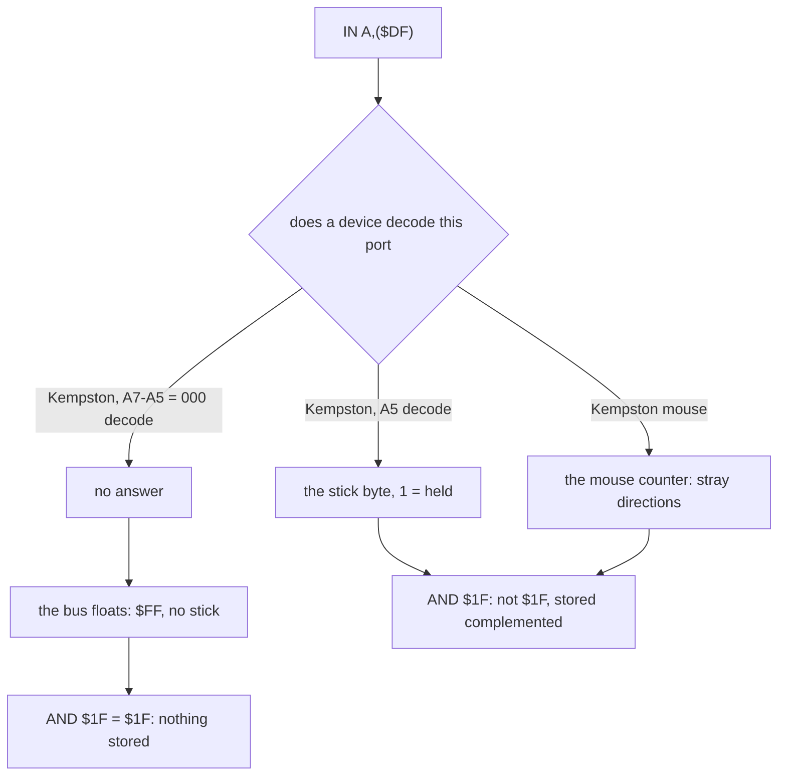
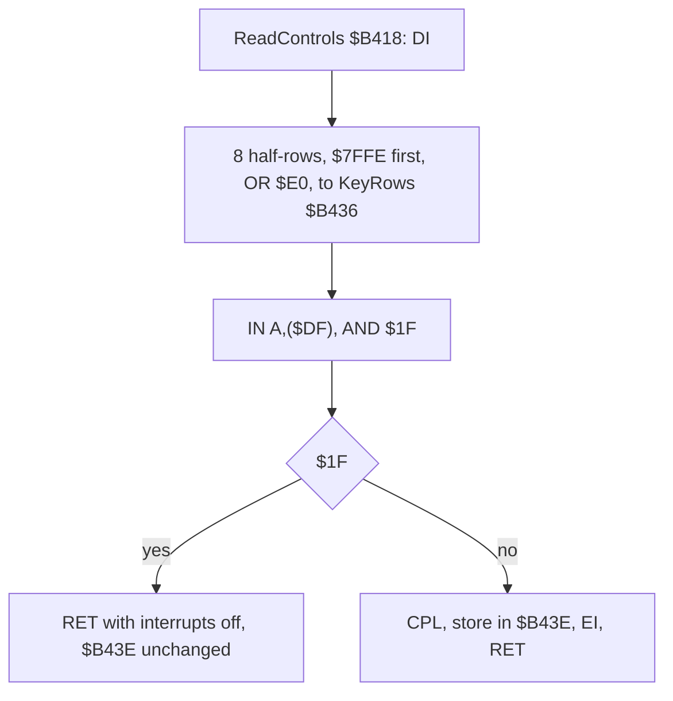
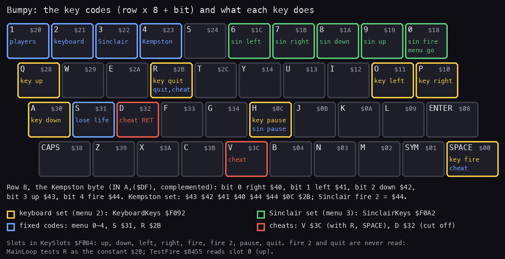
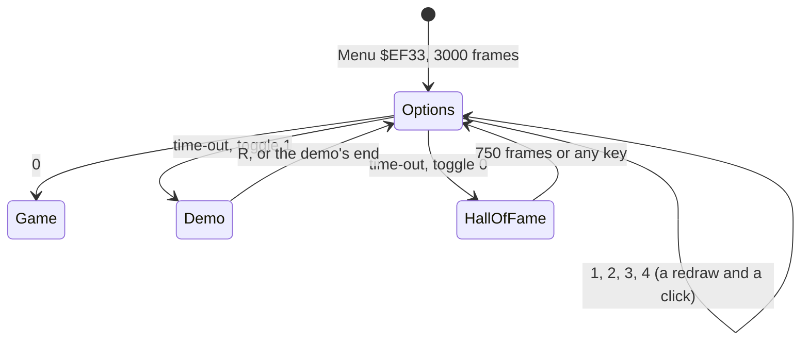
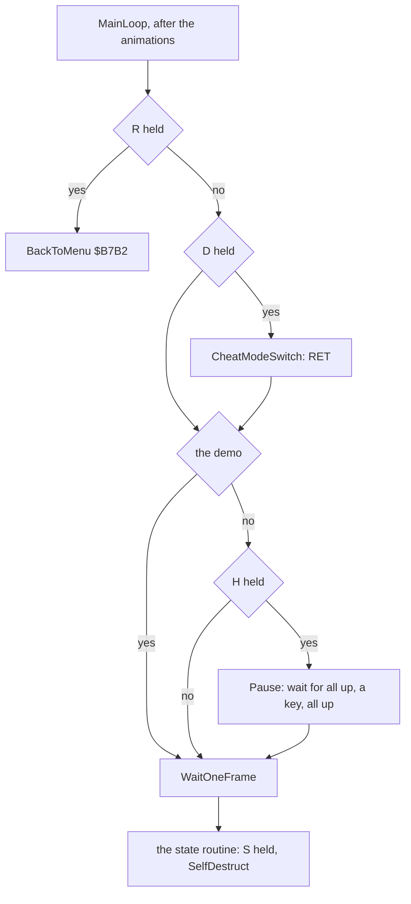
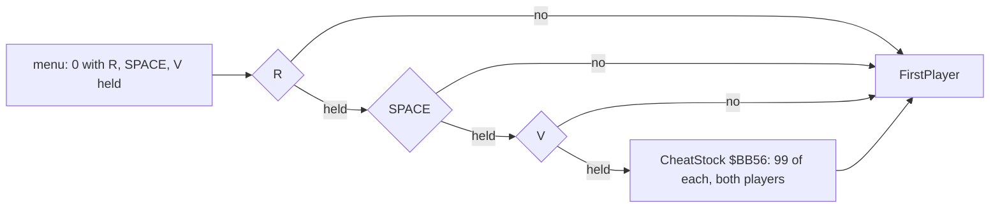
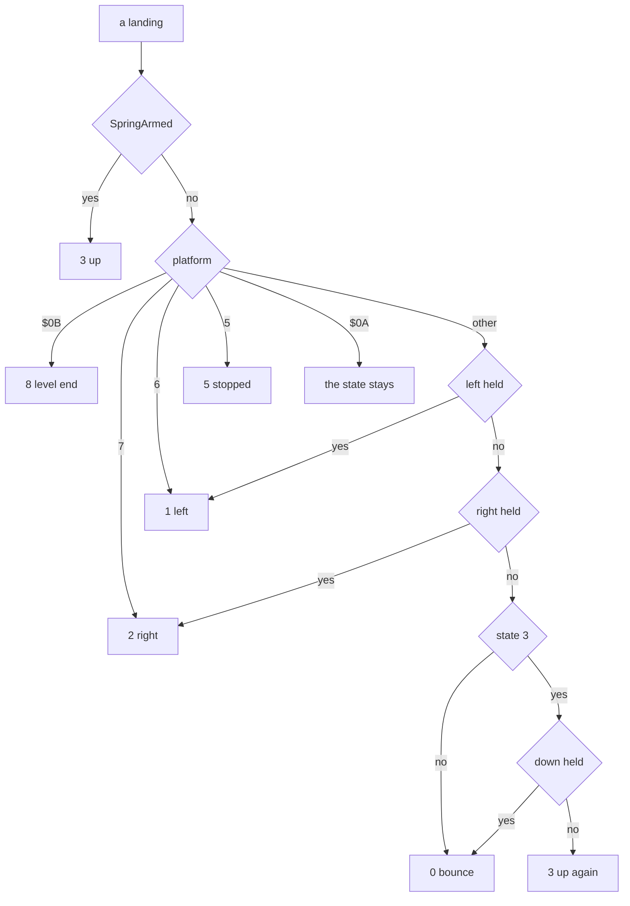
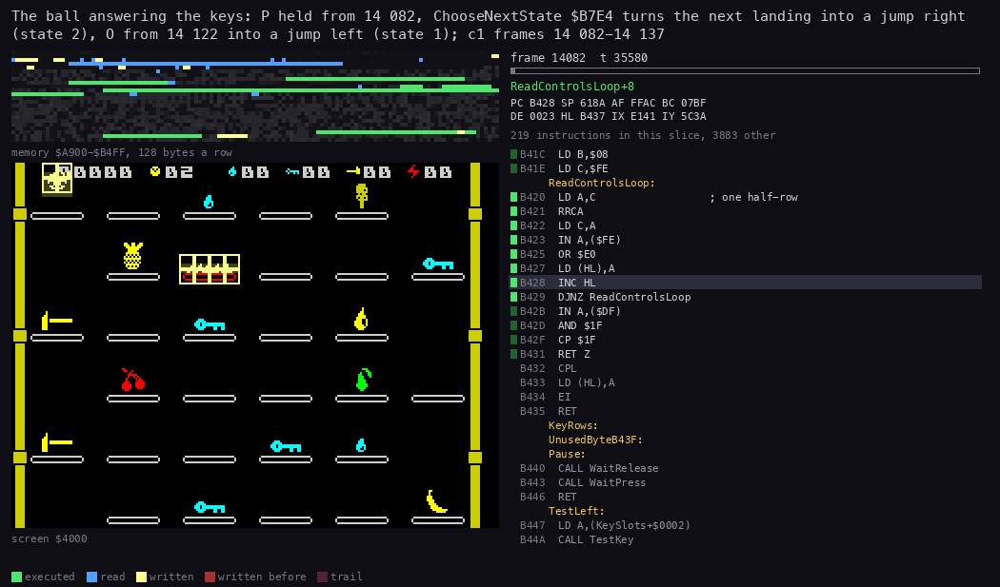
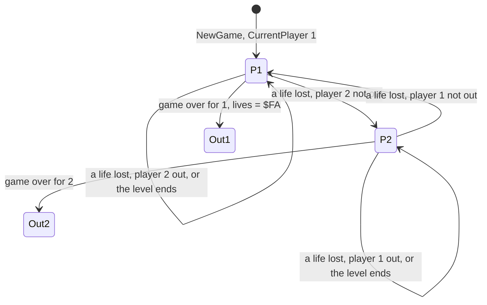

# 5. Controls

What this covers:

- the devices and their ports: the keyboard on port `$FE` and a Kempston stick on port `$DF`, and what an emulator
  must decode;
- ReadControls `$B418`, which reads them all into 9 bytes, and its open DI window;
- the key codes and TestKeyBit `$B3D0`, which patches its own `BIT` instruction;
- the three control sets and LoadControls `$F0AA`;
- the menu keys and the menu's time-out;
- the keys in play: pause, quit, lose a life, and the cut-off D key;
- the cheat R + SPACE + V;
- from a key to the ball: ChooseNextState `$B7E4`;
- the demo's move list and the two-player turns.

The recordings it rests on ([WALKTHROUGH 6.0](../WALKTHROUGH.md#60-the-recordings); all on the 48K):

| Recording | Used for |
| --- | --- |
| `c1` | the menu at frame 13 782 (1 twice, 2, 0); keyboard play on level 0 from 14 018; the keys traced over frames 14 082-14 137 |
| `menu` | a fast-load snapshot with a Kempston fitted and the mouse quiet: the demo, the three control sets, the pause (H at 5756), R back to the menu, two players (8320), the cheat (12 656) |
| `gameover` | S three times (lives lost at 602, 1080, game over at 1458) |
| `twoname` (stage 2) | two players to the end, both names entered |

Conventions:

- **A key code** is `row × 8 + bit`: row 0-7 is a keyboard half-row in ReadControls' order, row 8 the Kempston byte.
- **Held** means the bit reads 0, as the Spectrum's keyboard gives it; the Kempston byte is complemented to match.
- **A landing** is the end of a move, where the next move is chosen (doc 10).

## 5.1 The devices and the ports

The game reads two devices and nothing else:

| Device | Port | Read by | Bits used |
| --- | --- | --- | --- |
| the keyboard | `$7FFE`, `$BFFE`, ... `$FEFE` (eight half-rows) | ReadControls `$B418` | bits 0-4, 0 = held |
| a Kempston stick | `$DF`, with A = the last half-row's byte, so `$FFDF` with no key held | ReadControls `$B42B` | bits 0-4, 1 = held: right, left, down, up, fire |

The game has no Kempston port of its own choosing: the instruction is `IN A,($DF)`.
Port `$DF` is `1101 1111`: A5 is 0, A7 and A6 are 1.

What an emulator must decode:

- **A stick fitted.** The stick must answer when A5 = 0 whatever A7 and A6 are.
  A Kempston that decodes A7-A5 = 000 (port `$1F` only) never answers, and the stick does nothing.
  unreal-ng's Kempston card decodes A7-A5 = 000 by default.
  `emulator_manage slots_set slot=edge.1 options="decode=a5"` makes it answer `$DF` (stage 2 notes, leftover 3).
- **No stick.** The port must read with all five low bits 1 (`$FF`), or the game takes the stray bits as a stick held.
  unreal-ng's Kempston mouse answers `$xxDF` with its counters: Y = 85 gives low bits `$15`, which the game stores
  complemented as `$EA`, a stick held (WALKTHROUGH, problem table). The mouse must be off, or its counters set so the
  low bits are `$1F`.
- **The ZXDB fix.** POKE 46124,31 changes the port byte at `$B42C` from `$DF` to `$1F`
  ([doc 3, 3.5](03-build-and-load.md#35-the-pokes-and-the-hacks)), so a Kempston at `$1F` answers.



Worked example: `c1` (no stick, the mouse quiet) reads `$FF` from port `$FFDF` in all 211 reads of frames
14 082-14 137 ([doc 4, 4.7](04-game-loop.md#47-the-im-1-frame-and-the-windows-with-interrupts-off)).
The game sees no stick.
The first `menu` recording, with the mouse at Y = 85, stored `$EA` at `$B43E` and stuck at READY?: WaitRelease
`$B401` waits for "nothing held", and the mouse held "left, up and fire" for ever.

Witness: ReadControls L1 925 798, in every recording.

The point: the stick port is a single constant byte; whatever answers it, or fails to, is read as a stick.

## 5.2 ReadControls `$B418`

ReadControls reads the 8 half-rows and the stick into KeyRows `$B436-$B43E`, 9 bytes.

```asm
ReadControls:
  B418  DI
  B419  LD HL,KeyRows
  B41C  LD B,$08
  B41E  LD C,$FE
ReadControlsLoop:
  B420  LD A,C                  ; one half-row
  B421  RRCA
  B422  LD C,A
  B423  IN A,($FE)
  B425  OR $E0
  B427  LD (HL),A
  B428  INC HL
  B429  DJNZ ReadControlsLoop
  B42B  IN A,($DF)
  B42D  AND $1F
  B42F  CP $1F
  B431  RET Z                   ; no stick bit: return, interrupts still off
  B432  CPL
  B433  LD (HL),A               ; KeyRows[8], 0 = held like the keys
  B434  EI
  B435  RET
```

```text
ReadControls:
    disable interrupts
    c = $FE
    for row in 0..7:
        c = c rotated right                      ; $7F, $BF, $DF, $EF, $F7, $FB, $FD, $FE
        KeyRows[row] = IN (c * 256 + $FE) OR $E0
    s = IN ($DF) AND $1F                         ; A still holds the last row's byte
    if s == $1F: return                          ; interrupts stay off; KeyRows[8] is left as it was
    KeyRows[8] = NOT s
    enable interrupts
```



Two flaws follow from the early `RET Z`:

- **Interrupts stay off** until the next `EI` (WaitFrame's, at the end of the pass).
  [Doc 4, 4.7](04-game-loop.md#47-the-im-1-frame-and-the-windows-with-interrupts-off) measures it: the game loses
  no timing, because each pass ends in an `EI` and a `HALT`.
- **A released stick is never seen released.** When the stick is let go, the five bits are `$1F` and the store is
  skipped, so `$B43E` keeps the last held value.
  A real stick always answers, so this happens only when the device stops answering; the RZX replays set `$B43E` to
  `$FF` at their start for this reason (WALKTHROUGH, problem table).

Every key test calls ReadControls again: TestKey `$B6CB` reads all 9 bytes for each key it tests.
A pass in play reads the controls about 4 times (R, D, H, then S in the state routine), plus the landing's tests.

Witness: L1 925 798 ReadControls against L1 92 281 passes of MainLoop: about 10 reads a pass, counting the menu, the
waits and the landings.

The point: the controls are read fresh for every key test, with interrupts off, and the stick byte only changes when
the port says something is held.

## 5.3 Key codes and TestKeyBit `$B3D0`

A key code packs a row and a bit: code `$2B` is row 5 (`$FBFE`: Q W E R T), bit 3, the R key.
TestKeyBit turns the code into a `BIT b,(IX+d)` by writing into its own instruction:

```asm
TestKeyBit:
  B3D0  PUSH IX
  B3D2  LD IX,KeyRows
  B3D6  LD C,A
  B3D7  SRL A
  B3D9  SRL A
  B3DB  SRL A                   ; the row
  B3DD  LD (TestKeyBitTest+$0005),A   ; into the displacement at $B3F5
  B3E0  LD A,$07
  B3E2  AND C                   ; the bit
  B3E3  SLA A
  B3E5  SLA A
  B3E7  SLA A                   ; bit << 3
  B3E9  LD C,A
  B3EA  LD A,(TestKeyBitTest+$0006)   ; the BIT opcode byte at $B3F6
  B3ED  AND $C7
  B3EF  OR C
TestKeyBitTest:
  B3F0  LD (TestKeyBitTest+$0006),A
  B3F3  BIT 0,(IX+$00)          ; patched: BIT b,(IX+row)
  B3F7  POP IX
  B3F9  RET
TestKey:
  B6CB  PUSH AF
  B6CC  CALL ReadControls
  B6CF  POP AF
  B6D0  CALL TestKeyBit
  B6D3  JR NZ,TestKeySkip
  B6D5  LD A,$01
  B6D7  AND A                   ; held: NZ
  B6D8  RET
TestKeySkip:
  B6D9  XOR A                   ; not held: Z
  B6DA  RET
```

```text
TestKey(code):
    ReadControls
    row = code >> 3; bit = code AND 7
    patch BIT bit,(IX+row) at $B3F3
    Z from the BIT: the key is held when the bit is 0
    return NZ when held, Z when not
```

Worked example: TestKey with A = `$2B` (R).
The row is `$2B >> 3 = 5`, stored at `$B3F5`.
The bit is `$2B AND 7 = 3`; the opcode byte `$46 AND $C7 OR $18 = $5E`.
The instruction at `$B3F3` becomes `DD CB 05 5E`, `BIT 3,(IX+5)`: bit 3 of KeyRows + 5, the R key.

The Kempston codes are row 8: `$40` right, `$41` left, `$42` down, `$43` up, `$44` fire.
Since KeyRows[8] is the complemented stick byte, they test exactly like keys.



*Every key's code and what the game does with it: the keyboard set in yellow, the Sinclair set in green, the fixed
codes in blue, the cheats in red. How to read: each key shows its code (row × 8 + bit) at the top right and its use
below; the text under the keyboard gives row 8, the Kempston byte. Read from the built image (the three sets at
`$F092-$F0A9`) and the TestKey operands, no recording: `python3 tools/fig_controls.py`.*

Witness: TestKeyBit L1 423 995, in every recording.

The point: one 9-byte table and one self-patching `BIT` serve every key and the stick; any key or stick bit can go in
any slot.

## 5.4 The control sets and LoadControls `$F0AA`

The game keeps 8 codes in KeySlots `$F084`, in this order: up, down, left, right, fire, fire 2, pause, quit.
The menu's keys 2, 3 and 4 pick one of three sets, and LoadControls copies it into KeySlots when the game starts:

| Slot | KeyboardKeys `$F092` | SinclairKeys `$F0A2` | KempstonKeys `$F09A` | Read by |
| --- | --- | --- | --- | --- |
| 0 up | `$28` Q | `$19` 9 | `$43` stick up | TestUpOrFire `$B463` |
| 1 down | `$30` A | `$1A` 8 | `$42` stick down | TestDown `$B45C` |
| 2 left | `$11` O | `$1C` 6 | `$41` stick left | TestLeft `$B447` |
| 3 right | `$10` P | `$1B` 7 | `$40` stick right | TestRight `$B44E` |
| 4 fire | `$00` SPACE | `$18` 0 | `$44` stick fire | TestUpOrFire `$B463` |
| 5 fire 2 | `$00` SPACE | `$44` stick fire | `$44` stick fire | nothing |
| 6 pause | `$0C` H | `$0C` H | `$0C` H | MainLoop `$AD03` |
| 7 quit | `$2B` R | `$2B` R | `$2B` R | nothing: MainLoop tests `$2B` itself |

```asm
LoadControls:
  F0AA  LD A,(ControlChoice)    ; 0 keyboard, 1 Sinclair, 2 Kempston
  F0AD  ADD A,A
  F0AE  LD C,A
  F0AF  LD B,$00
  F0B1  LD HL,ControlSets
  F0B4  ADD HL,BC
  F0B5  LD E,(HL)
  F0B6  INC HL
  F0B7  LD D,(HL)
  F0B8  EX DE,HL
  F0B9  LD DE,KeySlots
  F0BC  LD BC,$0008
  F0BF  LDIR
  F0C1  RET
```

```text
LoadControls:
    KeySlots[0..7] = ControlSets[ControlChoice][0..7]
```

The Sinclair set is Interface 2's port 1 (keys 6-0, on half-row `$EFFE`), plus the Kempston fire in slot 5, which
nothing reads.
TestUpOrFire tests slot 4 first, then slot 0: up and fire both arm the spring.
TestFire `$B455` tests slot 0, the up key, despite its name; nothing calls it.

Worked example: `c1` at frame 13 782 presses 2 in the menu: ControlChoice `$F083` = 0.
At 0 (start), LoadControls copies `28 30 11 10 00 00 0C 2B` from `$F092` to `$F084`.
The bytes were already the same: KeySlots is stored with the keyboard set in the image.

Witness: LoadControls L1 8 (`c1`, `gameover`, `menu`, `twoname`); the `menu` recording plays the Sinclair set at
frames 6376-7252 and the Kempston set from 7400.

The point: the three sets differ only in the first five codes; pause and quit are H and R in all of them.

## 5.5 The menu keys and the time-out

The menu (Menu `$EF33`) tests five fixed codes once a frame:

| Key | Code | Does |
| --- | --- | --- |
| 0 | `$18` | starts: LoadControls, SetPlayersMode, return to GameRestart |
| 1 | `$20` | one player or two (MenuTogglePlayers) |
| 2 | `$21` | keyboard |
| 3 | `$22` | Sinclair |
| 4 | `$23` | Kempston |

```asm
MenuLoop:
  EF53  EI
MenuWait:
  EF54  HALT
  EF55  LD A,$18
  EF57  CALL TestKey
  EF5A  JR NZ,MenuWaitSkip      ; 0: start
  EF5C  LD A,$20
  EF5E  CALL TestKey
  EF61  JR NZ,MenuTogglePlayers ; 1
  ...                           ; 2, 3, 4: MenuSelectControls with A = 0, 1, 2
  EF7E  LD HL,(MenuTimer)
  EF81  DEC HL
  EF82  LD (MenuTimer),HL
  EF85  LD A,L
  EF86  OR H
  EF87  JR NZ,MenuLoop
  EF89  LD A,(MenuDemoToggle)
  EF8C  INC A
  EF8D  AND $01
  EF8F  LD (MenuDemoToggle),A
  EF92  JP Z,MenuShowHallOfFame
  EF95  LD A,$04
  EF97  LD (MenuChoice),A       ; the demo
  EF9A  RET
```

```text
Menu:
    print the options; MenuTimer = 3000
    every frame:
        0: LoadControls; MenuChoice = 2 * Players; return       ; 0 one player, 2 two
        1: Players = 1 - Players; redraw
        2, 3, 4: ControlChoice = 0, 1, 2; the chosen option white, the others green; redraw
        MenuTimer -= 1
        at 0: toggle; the demo (MenuChoice = 4) or the hall of fame for 750 frames, any key back
```



Each option plays SfxPickup and restarts the 3000-frame count (MenuRedraw `$EF44`).
GameRestart treats MenuChoice 4 like 1: any value but 0 and 2 starts the demo.

Worked example: `c1` reaches the menu at frame 13 782 and presses 1 twice, 2 and 0.
1 flips Players to 1 and back to 0; 2 keeps the keyboard; 0 starts a one-player game, and READY? is up at 14 018
([shot](img/play/c1-014018-ready.png)).

Witness: MenuWait L1 7022 (`c1`, `gameover`, `menu`, `twoname`); the time-out to the demo in `menu` (the demo from
frame 250 to 4000, [shot](img/play/menu-001500-demo.png)).

The point: the menu is a frame loop of five fixed key codes; nothing in it uses the control sets.

## 5.6 The keys in play

MainLoop tests three keys every pass, and every state routine tests S at every step:

| Key | Code | Where | Does |
| --- | --- | --- | --- |
| R | `$2B` | MainLoop `$ACEA` | back to the menu (BackToMenu `$B7B2`) |
| D | `$32` | MainLoop `$ACF2` | CheatModeSwitch `$ADDF`: a `RET` |
| H (slot 6) | `$0C` | MainLoop `$AD03`, not in the demo | Pause `$B440` |
| S | `$31` | BallBounce `$AE7A` and the other state routines, not in the demo | SelfDestruct `$BA71`: the ball is lost |

```asm
  ACEA  LD A,$2B
  ACEC  CALL TestKey
  ACEF  JP NZ,BackToMenu
  ACF2  LD A,$32
  ACF4  CALL TestKey
  ACF7  CALL NZ,CheatModeSwitch
  ACFA  LD A,(DemoFlag)
  ACFD  CP $00
  ACFF  JR Z,MainLoopPause
  AD01  JR MainLoopWait
MainLoopPause:
  AD03  LD A,(KeySlots+$0006)   ; in a game: the pause key
  AD06  CALL TestKey
  AD09  CALL NZ,Pause
Pause:
  B440  CALL WaitRelease
  B443  CALL WaitPress          ; any key or stick bit, then its release
  B446  RET
CheatModeSwitch:
  ADDF  RET
CheatModeOn:
  ADE0  LD A,$01                ; never reached
  ADE2  LD (CheatMode),A
```



- **Pause** waits for every key to be up, then for any key or stick bit, then for all up again.
  Nothing is drawn: the screen stays as it was, and the timer stops because no pass runs.
- **R** works in the demo too: it is the way out of the demo before its end.
- **S** costs a life like a fall: SfxLifeLost, then LoseLife ([doc 10](10-gameplay-logic.md)).
  In the demo SelfDestruct jumps back to MainLoop.
- **D** reaches a `RET`. The two instructions after it would set CheatMode `$ADDD`; CheatMode is never 1, so the
  level select in SelfDestruct and PracticeStock (3 of each tool at every life) are not executed in any recording.

Worked example: `menu`, frame 5756, H in keyboard play.
Pause waits; the timer `$AB04` holds its value until the key at frame 5924
([shot](img/play/menu-005820-pause.png)).
`gameover` presses S three times: lives 2 to 1 at frame 602, 1 to 0 at 1080, game over at 1458.

Witness: Pause in `menu`; SelfDestruct L1 12 (`gameover`, `twoname`); BackToMenu in `menu` (R after keyboard play).

The point: the in-play keys are fixed codes except the pause, which follows the control set.

## 5.7 The cheat R + SPACE + V

NewGame `$ABB4` tests three keys once, before the first life:

```asm
NewGame:
  ABB4  CALL ClearAttrs
  ABB7  CALL DrawSides
  ABBA  CALL InitPlayers
  ABBD  LD A,$2B                ; R
  ABBF  CALL TestKey
  ABC2  JR Z,FirstPlayer
  ABC4  LD A,$00                ; SPACE
  ABC6  CALL TestKey
  ABC9  JR Z,FirstPlayer
  ABCB  LD A,$3C                ; V
  ABCD  CALL TestKey
  ABD0  CALL NZ,CheatStock
CheatStock:
  BB56  LD IX,Player1Record
  BB5A  LD A,$63
  BB5C  LD (IX+$02),A           ; water 99
  BB5F  LD (IX+$03),A           ; keys 99
  BB62  LD (IX+$04),A           ; hammers 99
  BB65  LD (IX+$05),$00         ; level 0
  BB69  LD (IX+$06),A           ; lives 99
  BB6C  LD (IX+$09),A           ; the same for player 2 ($AB10)
  ...
```

```text
NewGame:
    if R and SPACE and V are all held as 0 is pressed in the menu:
        both players: water, keys, hammers, lives = 99; level 0
```



The keys must be held when 0 is pressed, since the test runs once.
R is also the quit key, but MainLoop has not started yet, so it does not quit.
The score is not touched.

Worked example: `menu`, frame 12 656: R, 1, 2, then 0 with R, SPACE and V held.
READY? shows water, keys, hammers and lives at 99 ([shot](img/play/menu-012656-cheat.png)).

Witness: CheatStock L1 1, in `menu` only.

The point: the cheat fills the counters but does not skip levels; the level select that would have done so is cut off
behind the D key's `RET`.

## 5.8 From a key to the ball: ChooseNextState `$B7E4`

The controls act on the ball at one moment only: the landing at the end of a move.
ChooseNextState picks the next state:

```asm
ChoosePlayState:
  B812  LD A,(SpringArmed)
  B815  CP $01
  B817  JR Z,SetStateUp         ; the spring was armed during the move
  B819  LD A,(CellPlatform)
  B81C  CP $0B
  B81E  JR Z,SetStateLevelEnd
  B820  AND A
  B821  CP $07
  B823  JR Z,SetStateRight      ; conveyor right
  B825  AND A
  B826  CP $06
  B828  JR Z,SetStateLeft       ; conveyor left
  B82A  AND A
  B82B  CP $05
  B82D  JR Z,SetStateStopped
  B82F  CP $0A
  B831  RET Z                   ; bricks: the state stays
  B832  CALL TestLeft
  B835  JR NZ,SetStateLeft
  B837  CALL TestRight
  B83A  JR NZ,SetStateRight
  B83C  LD A,(BallState)
  B83F  CP $03
  B841  JR Z,ChooseUpOrBounce
SetStateBounce:
  B843  LD A,$00
  B845  LD (BallState),A
  B848  RET
ChooseUpOrBounce:
  B849  CALL TestDown           ; going up: the down key turns it into a bounce
  B84C  JR NZ,SetStateBounce
  B84E  RET                     ; else it keeps going up
```

```text
ChooseNextState (a game):
    if SpringArmed: up
    elif platform == exit: level end
    elif platform == conveyor right: right
    elif platform == conveyor left: left
    elif platform == stopper: stopped
    elif platform == bricks: keep the state
    elif left held: left
    elif right held: right
    elif the state is up and down is not held: keep going up
    else: bounce
```



The spring is armed during a move, not at the landing.
Up or fire held at step 9 of a bounce, or of a move left or right, calls LoadSpring (TestUpOrFire `$B463`), and the
spring's frames play at steps 9, 11, 14 and 15.
So the player presses up during the second half of a bounce, and the ball rises at the landing.

Left beats right when both are held, and both beat the spring's absence: a key held at the landing always moves the
ball sideways, unless the platform is a conveyor, a stopper, bricks or the exit.
On a stopper the ball waits (BallStopped `$B11A`) and reads left, right and S every pass.

Worked example: `c1`, frames 14 082-14 138.
P is held; at the landing near frame 14 095, TestLeft is Z and TestRight NZ, so BallState becomes 2.
Sixteen passes later the ball is one cell to the right.
O at the landing of frame 14 134 gives state 1.



*The ball answers a key only at a landing. How to read: the code panel lights the key tests (TestKey, TestKeyBit)
every pass and ChooseNextState at each landing; the memory map shows KeyRows `$B436` read and BallState `$AA00`
written. `c1`, frames 14 082-14 138. `python3 R/kit/routine_anim.py --work work/docs/bmA/c1 --window 14082:0-14138:0
--listing build/game.lst --pc B3D0-B470,B6CB-B6DA,B7E4-B872 --range A900-B4FF --pictures 110
--out docs/img/routines/ChooseNextState.gif`.*

Witness: ChooseNextState runs at every landing in every recording; SetStateStopped L1 141 (`l` × 6, 26 RZX levels).

The point: the player steers by choosing at landings, about three times a second; the platform's type beats the keys.

## 5.9 The demo

The demo plays one player with the keys replaced by a list.
DemoMoves `$D25A` holds one byte a decision: 0-5 the next state at a landing, 9 "arm the spring" at a step 9.
GameStart points DemoInputPtr `$ABA4` at `$D25A`; each decision reads the next byte (from `$D25B`), so the first byte
is never read.

```text
at a landing in the demo (ChooseDemoState $B7FF):
    exit, conveyors: as in a game
    DemoInputPtr += 1; BallState = the byte
    if SpringArmed: up
at a step 9 in the demo:
    if the next byte is 9: LoadSpring          ; it peeks, without moving the pointer
```

The list is 50 bytes, the last non-zero one at `$D28B`:
`00 00 00 02 00 01 05 05 05 05 01 02 01 02 02 09 02 09 03 03 03 01 02 09 03 02 09 03 03 01 09 02 01 02 01 09 01 09 01
09 01 01 09 00 09 00 09 03 03 03`, then zeros.

Worked example: the first decisions read `00 00 02`: two bounces in place, then a move right.

Witness: the demo in `menu`, frames 250-4000 ([shot](img/play/menu-001500-demo.png)); 48 bytes read.

The point: the demo is a replay of decisions, not of keys, so it is as deterministic as the game.

## 5.10 Two players

Option 1 sets two players; MenuChoice 2 makes GameRestart store PlayerCount `$ADDC` = 2.
The players do not share a turn by level but by life: LoseLife saves the current player's 7 bytes and passes the turn.

```asm
  BAC6  LD A,(PlayerCount)
  BAC9  CP $01
  BACB  JR Z,LoseLifeWait
  BACD  LD A,(CurrentPlayer)
  BAD0  CP $01
  BAD2  JR Z,LoseLifePlayer1
  BAD4  LD IX,Player1Record
  BAD8  LD A,(IX+$06)
  BADB  CP $FA                  ; player 1 out?
  BADD  JR Z,LoseLifeWait
SwitchToPlayer1:
  BADF  LD A,$01
  BAE1  LD (CurrentPlayer),A
  BAE4  JR LoseLifeWait
LoseLifePlayer1:
  BAE6  LD IX,Player2Record     ; player 1 was in play: is player 2 out?
  BAEA  LD A,(IX+$06)
  BAED  CP $FA
  BAEF  JR Z,LoseLifeWait
SwitchToPlayer2:
  BAF1  LD A,$02
  BAF3  LD (CurrentPlayer),A
```



Both players use the same control set.
A finished level does not pass the turn: a good player keeps the keys.

Worked example: `twoname` plays two players to the end ([shot](img/play/twoname-000200-two-ready.png)): each life
lost shows the other player's READY? text, and both enter a name at the end (doc 8).

Witness: `twoname`, `menu` from frame 8320 ([shot](img/play/menu-008320-two-players.png)).

The point: two players are two 7-byte records swapped at each life lost.

## 5.11 Known only from the code

- ReadControlMask `$B3B2` (all 8 slots into a bit mask at ControlMask `$B3CE`) is called only by InstallIm2Key in
  the AY skeleton, which nothing runs.
- TestFire `$B455` has no caller; slots 5 (fire 2) and 7 (quit) are never read by slot.
- CheatModeOn `$ADE0`, PracticeStock `$BB7D` and the level select in SelfDestruct `$BA80` are not executed in any
  recording: CheatMode is never set.
- With no device on port `$DF`, a real 48K reads the floating bus, which carries screen bytes while the ULA fetches
  the picture. The game would then see stray stick bits; no recording tested it (the emulator's port reads `$FF`).
