# 6. Rendering

What this covers:

- the screen layout: 36 cells of 40 × 32 pixels, the HUD row and the side panels;
- how the game still draws in Amstrad CPC coordinates, and how ScreenAddrToLine `$C71F` and LineAddress `$B515` turn
  a CPC address into a Spectrum one;
- the three blitters (DrawSprite `$E318`, XorSprite `$E3EE` and XorBricks `$E4C4`) and the nibble packing that turns
  a CPC picture into a Spectrum one;
- colour: PaintAttrs `$E2A3` and the object inks;
- the pictures;
- the level drawn from its record, and code against the screen on a real frame;
- the ball: XOR drawing and erasing;
- the cell animations: fire, walls, the exit, wear, locks, bricks, water;
- the drawing against the beam.

There is no back buffer, no scrolling and no sprite mask: every picture goes straight to the screen, either stored or
XORed.

The recordings it rests on ([WALKTHROUGH 6.0](../WALKTHROUGH.md#60-the-recordings); all on the 48K):

| Recording | Used for |
| --- | --- |
| `rzx/l21` | level 22 drawn by BuildLevel, frames 1534-1539 (6.6) |
| `rec/l83` (stage 2) | a play frame (frame 100) under the layout; the ball's move and the beam, frames 348-378 (6.7, 6.9) |
| `rzx/l01` | the bricks, frames 147-157 (6.8) |
| the RZX itself | the call counts of the witness lines (`src/game/game.ann`) |

Conventions:

- **A CPC address** is an address in the Amstrad's screen layout, `$C000 + s × $800 + r × 80 + b`: line `s` (0-7) of
  character row `r`, byte column `b` (0-79).
- **A line** is a Spectrum pixel line, 0-191 from the top; **x** is a pixel column, 0-255.
- The asm is from `build/game.lst`; `...` marks lines left out.

## 6.1 The screen layout

The board is 6 × 6 cells of 40 × 32 pixels, 240 × 192 in all, between two yellow side panels.

| Part | Where | Drawn by |
| --- | --- | --- |
| the side panels | character columns 0 and 30, all 24 rows; yellow | DrawSides `$B488` once a game; SetPlayAttrs `$B4F8` |
| the board | x 8-247: columns 1-29 and half of 30 | ClearPlayArea `$B4CE`, BuildLevel `$CF2E` |
| cell `c` | its platform on line `26 + 32 × (c / 6)`, x = `8 + 40 × (c mod 6)` | CellAddresses `$E131` + 2c |
| wall `c` | 8 pixels wide, 24 lines, at the right of cell `c`: x = `40 + 40 × (c mod 6)` | WallAddresses `$E179` + 2c |
| the HUD | character row 0, over the top cells | DrawHud `$E58B`, every pass (doc 8) |

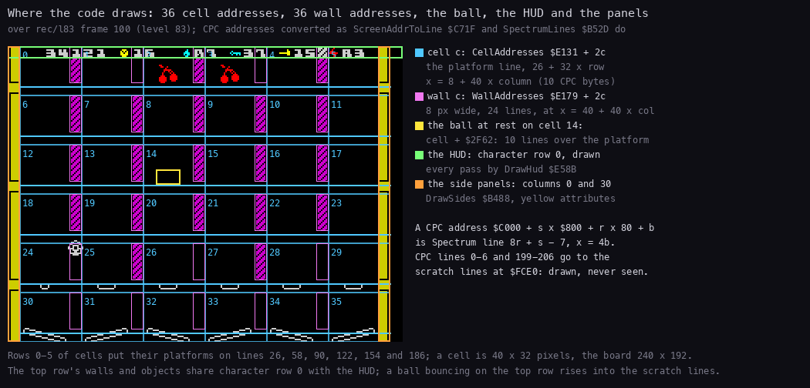

*The 36 cells and their walls are fixed boxes on a 40-pixel grid; the HUD shares row 0 with the top cells.
How to read: blue boxes and numbers are the cells (the thick line is the platform's line from CellAddresses), magenta
outlines the 30 wall places (WallAddresses), the yellow box the ball at rest on cell 14, green the HUD row, orange the
side panels. Over `rec/l83` frame 100 (level 83, [shot](img/play/l83-000100-play.png)).
`python3 tools/fig_render.py layout`, from the built image's tables.*

Witness: CellScreenAddr `$BB05` L1 98 391; every frame of every recording has this layout.

The point: the layout is two tables of 36 CPC addresses; everything a cell shows is drawn at a fixed offset from its
entry.

## 6.2 From a CPC address to a Spectrum byte

The game was written for the Amstrad CPC, and its drawing code still works in CPC addresses.
Every picture goes through two conversions before a byte is written:

```asm
ScreenAddrToLine:
  C71F  LD BC,$C000
  C722  AND A
  C723  SBC HL,BC               ; the offset in the CPC screen
  C725  LD A,H
  C726  SRL A
  C728  SRL A
  C72A  SRL A
  C72C  LD (ScanInRow),A        ; s = offset / $800
  C72F  PUSH AF
  C730  LD A,H
  C731  AND $07
  C733  LD H,A
  C734  LD BC,$0050
  C737  CALL DivideHLbyBC       ; (offset mod $800) / 80
  C73A  LD A,L
  C73B  LD (CharRow),A          ; r
  C73E  SLA A
  C740  SLA A
  C742  SLA A
  C744  POP BC
  C745  ADD A,B
  C746  LD (PixelLine),A        ; 8r + s, the CPC line
  ...                           ; the remainder to ByteColumn
LineAddress:
  B515  LD A,(PixelLine)
  B518  LD L,A
  B519  LD H,$00
  B51B  ADD HL,HL
  B51C  EX DE,HL
  B51D  LD IX,SpectrumLines     ; $B52D: 207 words
  B521  ADD IX,DE               ; IX = the Spectrum line's address
  B523  LD A,(ByteColumn)
  B526  SRL A
  B528  LD (SpectrumColumn),A   ; b / 2
  B52B  RET
```

```text
ScreenAddrToLine(a):
    o = a - $C000
    s = o / $800                       ; the line in the character row
    r = (o mod $800) / 80              ; DivideHLbyBC, 16 rounds of shift and subtract
    b = (o mod $800) mod 80
    PixelLine = 8r + s; ByteColumn = b
LineAddress:
    IX = SpectrumLines + 2 * PixelLine ; CPC lines 0-6 and 199-206 point at scratch, $FCE0
    SpectrumColumn = b / 2             ; 2 CPC bytes (8 pixels) make one Spectrum byte
```

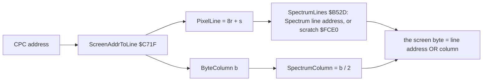

SpectrumLines maps CPC line `n` to Spectrum line `n - 7`: the first 7 CPC lines and the last 8 go to a scratch area
at `$FCE0`, so a picture that runs off the board's top or bottom is drawn and never seen.
The CPC screen is 200 lines of 80 bytes (320 pixels in mode 1); the game used 240 of those pixels and 192 lines plus
the margins, which is why the board fits the Spectrum's 256 × 192 with one column to spare on each side.

Worked example: cell 14, CellAddresses + 28 = `$CBD6`.
The offset is `$0BD6`: s = `$0BD6 / $800` = 1, and `$03D6` = 982 = 12 × 80 + 22, so r = 12 and b = 22.
PixelLine = 8 × 12 + 1 = 97, the Spectrum line 90.
SpectrumColumn = 22 / 2 = 11, x = 88: the third cell of row 2, at 8 + 40 × 2 = 88.

Witness: ScreenAddrToLine L1 324 616, 277 064 calls for pictures in the recordings.

The point: every picture pays a division by 80 to stay in CPC coordinates; the port kept the Amstrad's drawing code
and changed only the last step.

## 6.3 The blitters and the nibble packing

A CPC mode 1 byte holds 4 pixels of 2 bits each: pixel `i` is bit `7 - i` (the high nibble, plane 0) and bit
`3 - i` (the low nibble, plane 1).
The Spectrum has one bit a pixel, so the port keeps one plane: two CPC bytes make one Spectrum byte.

| Routine | Writes | Keeps | Spectrum byte | Used for |
| --- | --- | --- | --- | --- |
| DrawSprite `$E318` | stores | the low nibbles | `(b0 << 4) OR (b1 AND $0F)` | panels, the exit, the HUD, blanks |
| XorSprite `$E3EE` | XORs | the low nibbles | the same, XORed | the ball, platforms, objects, walls, cracks |
| XorBricks `$E4C4` | XORs | the high nibbles | `(b0 AND $F0) OR (b1 >> 4)` | the bricks only |
| DrawSpriteColoured `$E2A0`, XorSpriteColoured `$E3E5` | as above | | | then PaintAttrs with the ink in C |

```asm
DrawSprite:
  E318  PUSH BC
  ...
  E31D  LD A,B
  E31E  LD (SpriteHeight),A
  E321  EX DE,HL
  E322  CALL ScreenAddrToLine
  E325  CALL LineAddress
  ...
  E32A  DI                      ; interrupts off for the whole picture
  ...
  E338  LD A,(ByteColumn)
  E33B  BIT 0,A
  E33D  JR NZ,DrawSpriteLoop3   ; an odd CPC column: start half a byte in
DrawSpriteLoop:
  E33F  PUSH BC
  E340  LD A,(IX+$00)
  E343  LD D,(IX+$01)           ; this line's Spectrum address
  E346  OR L                    ; plus the column
  E347  LD E,A
  E348  LD B,H
  E349  SRL B                   ; width / 2 Spectrum bytes
  ...
DrawSpriteLoop2:
  E34F  LD A,(IY+$00)
  E352  SLA A
  E354  SLA A
  E356  SLA A
  E358  SLA A                   ; b0's low nibble to the left half
  E35A  LD C,A
  E35B  INC IY
  E35D  LD A,(IY+$00)
  E360  AND $0F                 ; b1's low nibble to the right half
  E362  OR C
  E363  INC IY
  E365  LD (DE),A               ; XorSprite has XOR (HL) before its store
  E366  INC DE
  E367  DJNZ DrawSpriteLoop2
  ...
  E37C  INC IX
  E37E  INC IX                  ; the next line's entry
  E380  POP BC
  E381  DJNZ DrawSpriteLoop
  ...
  E386  EI
```

```text
DrawSprite(cpc address, picture, lines B, width SpriteWidth in CPC bytes):
    ScreenAddrToLine; LineAddress
    disable interrupts
    for each line:
        d = SpectrumLines[line] OR SpectrumColumn
        if the CPC column is even:
            for each pair (b0, b1): *d++ = (b0 << 4) OR (b1 AND $0F)
            an odd width: a last *d++ = b0 << 4
        else:
            *d++ = b0 AND $0F, then pairs shifted by one CPC byte
        the next line: IX += 2 (the next SpectrumLines entry)
    enable interrupts
```

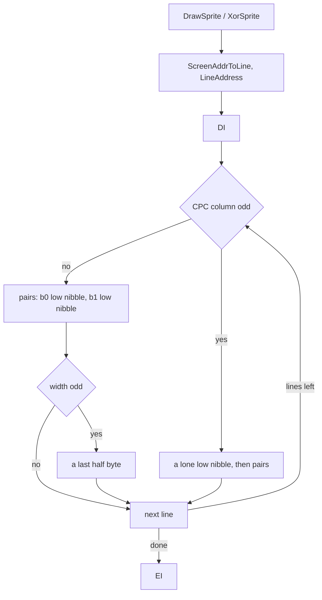

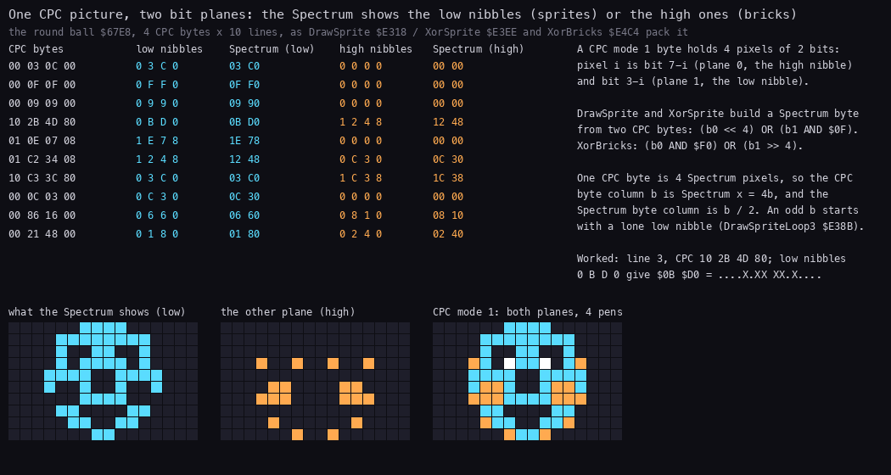

*The Spectrum shows one of the CPC picture's two bit planes; the ball's low plane is its outline, the high plane only
its shading. How to read: the table gives the round ball's 40 bytes, their nibbles and the Spectrum bytes each blitter
makes; below, the three pictures: the low plane the Spectrum shows, the high plane it drops, and the 4-pen CPC
picture. From the built image, no recording: `python3 tools/fig_render.py nibbles`.*

Worked example: the round ball `$67E8`, line 3, is `10 2B 4D 80`.
DrawSprite takes the low nibbles 0, B, D, 0 and makes `$0B` and `$D0`: `....X.XX XX.X....`.
XorBricks would take the high nibbles 1, 2, 4, 8 and make `$12 $48`, the shading, which is why the bricks, drawn in
plane 0 on the CPC, need a blitter of their own.

Witness: DrawSprite L1 91 481, XorSprite L1 228 035, XorBricks L1 204 (`fire`, `l98`, 6 RZX levels).

The point: the port is a nibble filter; every CPC picture survives as one of its planes, chosen per blitter.

## 6.4 The pictures

All pictures are CPC bytes in the image; `src/res/sprites/` holds each as a PNG, and the sheet shows them with their
addresses:

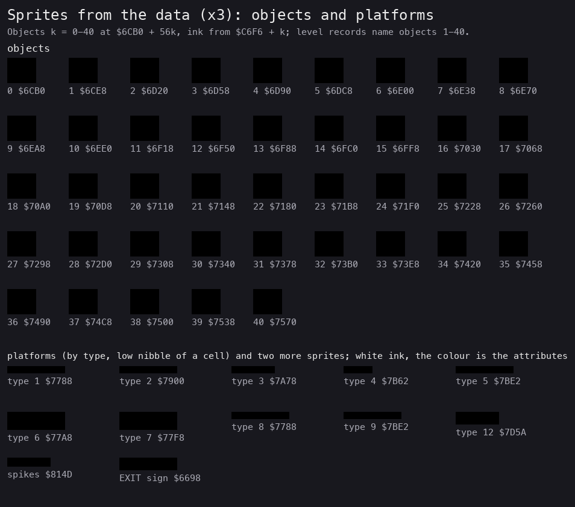

*The object pictures (`$6CB0` + 56 × kind, 4 CPC bytes × 14 lines) in their inks, and the platforms. How to read:
each picture is drawn in its low plane, as the Spectrum shows it, with its address. From the image, no recording:
`python3 tools/fig_sprites.py`.*

| Picture | Address | Size (CPC bytes × lines) | Drawn by |
| --- | --- | --- | --- |
| the round ball | `$67E8` | 4 × 10 | XorSprite, ink 7 |
| the rolling ball, 15 frames | `$6810-$6A40` | 4 × 10 | XorSprite (BallFramesRight `$C4E2`, BallFramesLeft) |
| the objects 1-40 | `$6CB0 + 56 × k` | 4 × 14 | XorSpriteColoured, ink ObjectInks `$C6F6` + k |
| the plain platform | `$7788` | 8 × 4 | XorSprite |
| the walls, 4 turning frames | `$7E5C + 48 × f` | 2 × 24 | XorSprite, ink `$83` |
| the flames, 3 frames | `$814D + 30 × f` | 6 × 5 | DrawSpriteColoured, ink `$C2` |
| the exit's frames | ExitFrames `$C522` table | 6 × 5 | DrawSpriteColoured, ink `$5E` |
| a brick row | `$8345` | 8 × 8 | XorBricksColoured, ink `$82` |
| the burst, 6 frames | `$81F5-$830D` | 4 × 14 | doc 10 |
| the blank | `$6708` | any | DrawSprite: the eraser |

The point: the pictures are a CPC sprite bank; a third of each byte's information is thrown away on the Spectrum.

## 6.5 Colour

PaintAttrs colours the character cells under the picture just drawn, with one attribute in C:

```asm
PaintAttrs:
  E2A3  LD A,C
  E2A4  AND $07
  E2A6  RET Z                   ; ink 0: no colour at all
  E2A7  BIT 7,C
  E2A9  JR Z,PaintAttrsSkip
  E2AB  RES 7,C                 ; bit 7: the area is 8 lines taller
  E2AD  LD A,(SpriteHeight)
  E2B0  ADD A,$08
  E2B2  LD (SpriteHeight),A
  ...
  E2E4  LD DE,$5800
  E2E7  ADD HL,DE               ; the first attribute cell
  E2E8  LD A,C
  E2E9  LD (PaintAttrsLoop2+$0001),A   ; the attribute into the loop's LD (HL),n
  ...
```

```text
PaintAttrs(C):
    if C AND 7 == 0: return
    if C bit 7: height += 8; C bit 7 cleared       ; the flag doubles as "one cell more"
    rows = (height + 7) / 8 from CharRow - 1; columns = (width + column bit 0 + 1) / 2 from ByteColumn / 2
    every cell = C                                 ; patched into the loop
```

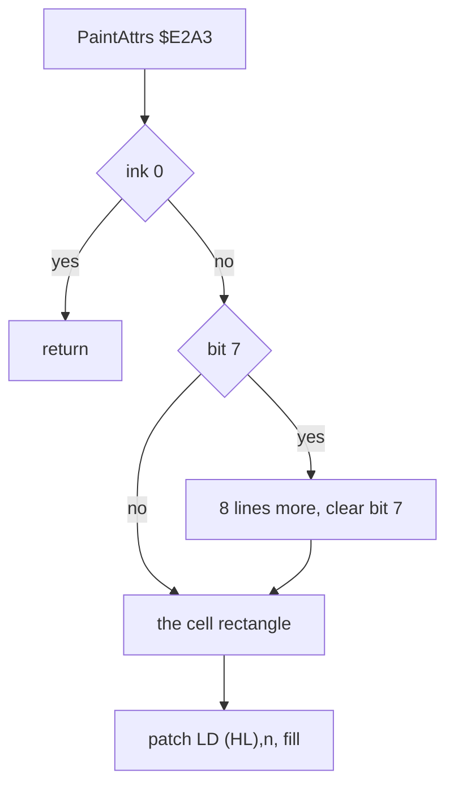

Colour is by cell, so it clashes:

- the ball is drawn with C = 7: every move repaints the cells under it white ink on black;
- an object takes its ink from ObjectInks; a prize that shares a cell with the ball turns white until it is drawn
  again;
- the side panels are yellow (6) and the play area ink 7 (SetPlayAttrs).

Worked example: level 22's prize 6 on cell 7 (6.6) is XORed with C = `$43` (BRIGHT, magenta).
Its CPC address is the cell's + `$FF62` = `$C9EE`: s = 1, r = 6, b = 14, so line 42 and x 56.
PaintAttrs starts at character row r - 1 = 5 and column b / 2 = 7, and fills (14 + 7) / 8 = 2 rows of
(4 + 0 + 1) / 2 = 2 cells: rows 5-6, columns 7-8, lines 40-55 and x 56-71, all `$43`.

Witness: PaintAttrs L1 275 682.

The point: one attribute per picture, written after the pixels; Bumpy accepts the clash rather than masking.

## 6.6 The level drawn

BuildLevel (doc 7, 7.2) draws each cell through two jump tables: PlatformDrawTable `$C5A8` by the platform type,
WallDrawTable by the wall type, with the object between them.

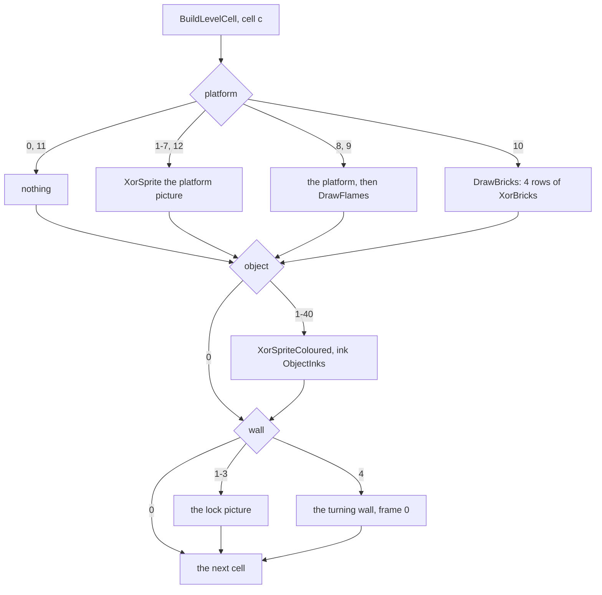

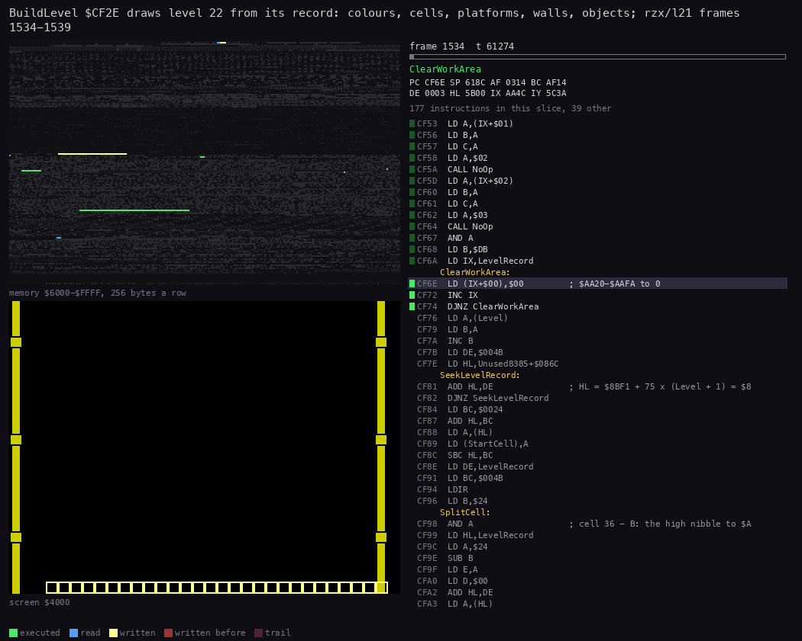

*The level is drawn cell by cell, top left first, platform then object then wall. How to read: the code panel walks
BuildLevelCell and the platform routines; the screen fills from cell 0 to cell 35; the ball appears last on cell 0.
`rzx/l21`, frame 1534 T 58 000 to frame 1539 T 3200. `python3 R/kit/routine_anim.py --work work/docs/bmA/l21
--window 1534:58000-1539:3200 --listing build/game.lst --pc CF2E-D075,D0A4-D2B3 --range 6000-FFFF --pictures 90
--out docs/img/routines/BuildLevel.gif`.*

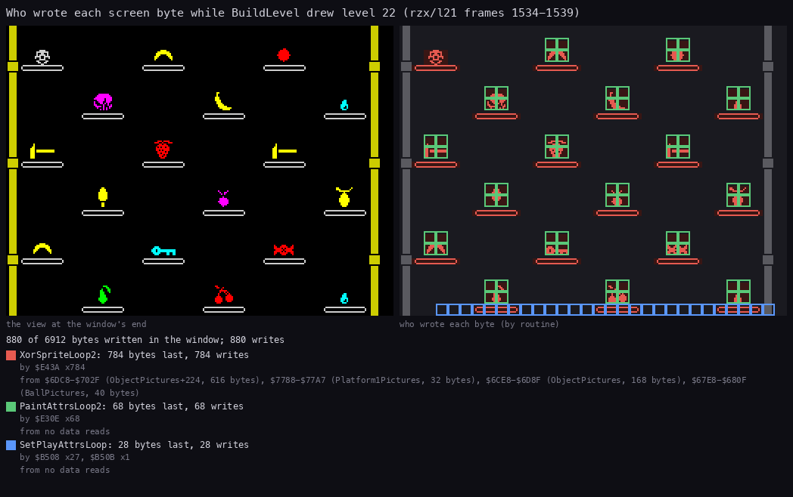

*Every byte of level 22 came from one loop: XorSpriteLoop2, the XOR blitter. How to read: left, the screen at the
window's end; right, each written byte coloured by the routine that wrote it last (red XorSpriteLoop2, 784 bytes;
green PaintAttrsLoop2, 68 attribute bytes; blue SetPlayAttrsLoop, 28); the list gives the pictures read.
`rzx/l21`, frame 1534 T 58 000 to frame 1539 T 3200. `python3 R/kit/writers_map.py --work work/docs/bmA/l21
--window 1534:58000-1539:3200 --listing build/game.lst --sources --out docs/img/render/writers-build-l22.png`.*

Worked example: level 22 has only plain platforms and objects, so the whole board is XORed: the platforms come from
`$7788-$77A7` (Platform1Pictures, 32 bytes), the objects from `$6CE8-$702F`, and the ball from `$67E8`.
Since the play area was cleared just before, XOR and store give the same picture.

Witness: BuildLevel L1 94, every life start.

The point: building a level is 36 small blits and a few attribute fills, under 5 frames for level 22 (frame 1534 T 58 000 to 1539 T 3200).

## 6.7 The ball: XOR on, XOR off

The ball is XORed at its new place and XORed off its old place each step.
BallStepMove `$AE30` moves the address by the step's offset and erases the old picture:

```asm
BallStepMove:
  AE30  LD HL,(BallScrAddr)
  AE33  LD (BallOldAddr),HL
  AE36  LD A,(BallStep)
  AE39  RLA
  AE3A  LD E,A
  AE3B  LD D,$00
  AE3D  ADD IX,DE
  AE3F  LD E,(IX+$00)
  AE42  LD D,(IX+$01)           ; the step's offset, a CPC address delta
  AE45  ADD HL,DE
  AE46  LD (BallScrAddr),HL
  AE49  JR EraseBallOld
EraseBallOld:
  AE18  LD HL,(BallSprite)      ; XOR the sprite at the previous address
  AE1B  CALL PlayerBallSprite
  AE1E  LD DE,(BallOldAddr)
  AE22  EX DE,HL
DrawBallXor:
  AE23  LD A,$04
  AE25  LD (SpriteWidth),A
  AE28  LD B,$0A
  AE2A  LD C,$07
  AE2C  CALL XorSpriteColoured
  AE2F  RET
```

```text
a step:
    old = BallScrAddr
    BallScrAddr += Offsets[BallStep]       ; $0800 one line down, $0050 one character row, wrapping like the CPC
    XOR BallSprite at old                  ; the old picture off
    choose the new picture (round, or a rolling frame)
    XOR it at BallScrAddr                  ; on
```

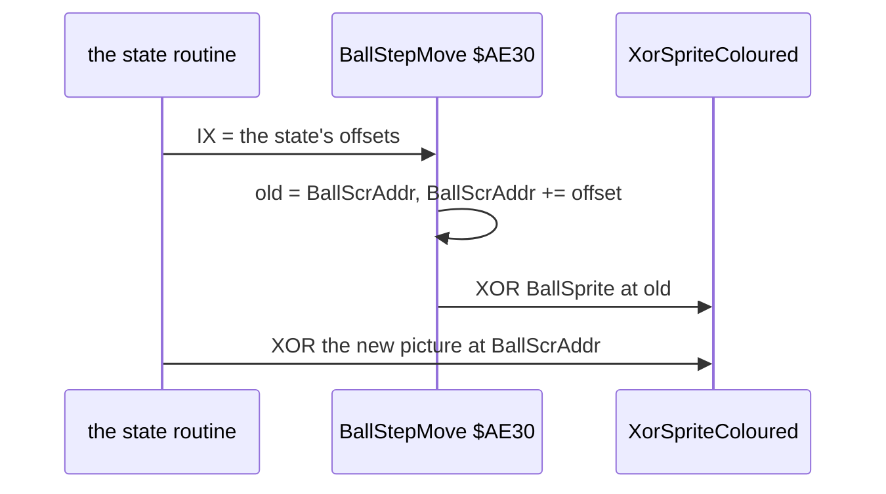

The offsets are CPC address deltas: `$E000` is 4 lines up, `$1FB0` is 4 lines down then one character row up, so
both are the same 4-line rise in the CPC's interleave.
XOR needs no saved background, and a ball over a platform or an object leaves both intact when it moves on.
The cost is flicker: between the erase and the redraw the ball is missing, and a ball crossing a picture shows the
XOR of both.

Worked example: `rec/l83`, the jump right at frames 349-377 ([doc 4, 4.6](04-game-loop.md#46-the-state-dispatcher-ad0f-and-statetable-ad29)).
At each of the 16 steps BallStepMove adds RightOffsets[step]; the right move draws the rolling frame
BallFramesRight[step], and step 15 the round ball again.

Witness: BallStepMove L1 91 187; DrawBallXor L1 182 818, two for each step.

The point: one picture of 40 bytes, XORed twice a step, is the whole sprite engine.

## 6.8 The cell animations

Seven things change on the board while the ball moves, each driven from MainLoop one step a pass:

| Animation | Routine | Period | Picture | Blitter |
| --- | --- | --- | --- | --- |
| the flames | AnimateFires `$BBCD` | every 4 passes, 3 frames, every burning cell | `$814D + 30 × f` | DrawSpriteColoured, ink `$C2` |
| the turning walls | AnimateWalls `$BC30` | every 4 passes, 4 frames, every type 4 wall | `$7E5C + 48 × f` | XorSprite, ink `$83` |
| the open exit | AnimateExit `$BD21` | every 2 passes, 4 frames | ExitFrames `$C522` | DrawSpriteColoured, ink `$5E` |
| a platform wearing | PlatformChangeStep `$C19D` | 4 or 9 steps, one a pass | cracks | XorSprite |
| a lock opening | WallStep `$C43E` | 2 or 7 steps | lock pictures | XorSprite, then DrawSprite of the blanks |
| a brick layer | BrickStep `$BE94` | 4 steps | the layer cleared in a checker | direct stores of 0 |
| a fire put out | WaterStep `$BFF3` | 8 or 9 steps | drops and steam | XorSprite |

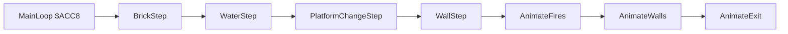

Each one-shot animation (wear, lock, brick, water) has one slot: a flag, a step and a step table.
A second wear started before the first ends would take the slot over, but the ball cannot leave two worn cells within
4 passes, so no recording shows it.

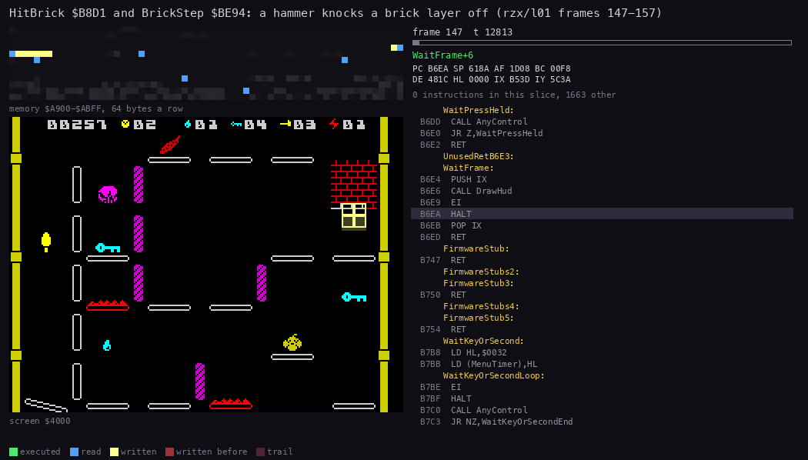

*The brick crumble clears its layer in four checkered passes, one a pass. How to read: HitBrick starts it, then
BrickStep and BrickCrumble1-4 light in turn; the screen loses the layer in a checker pattern. `rzx/l01`, frames
147-157. `python3 R/kit/routine_anim.py --work work/docs/bmA/l01 --window 147:0-158:0 --listing build/game.lst
--pc B8D1-B957,BE94-BFF2 --range A900-AB7F --pictures 60 --out docs/img/routines/BrickStep.gif`.*

The wear and the lock have their animations in [doc 7, 7.3 and 7.4](07-objects.md#73-the-platforms-and-how-they-change);
the exit's in [doc 4, 4.9](04-game-loop.md#49-the-heaviest-pass-the-last-prize).

Worked example: AnimateFires counts FireTick `$AA0C` to 4, steps FireFrame `$AA16` (1, 2, 3, 1 ...), and stores
frame `$814D + 30 × (f - 1)` over every cell whose CellBurning byte is 1.
Level 1's two fires (cells 19 and 33) therefore change picture together, every 4 passes.

Witness: AnimateFires and AnimateWalls L1 93 190 each (every pass); BrickStep L1 92 281.

The point: the board animates on a few counters shared by all cells; nothing on it moves but the ball.

## 6.9 The drawing against the beam

The ball's step runs right after the `HALT`, at the top of the frame, and the HUD just before the next `HALT`
([doc 4, 4.5 and 4.8](04-game-loop.md#48-a-pass-against-the-beam-and-the-length-of-a-pass)):

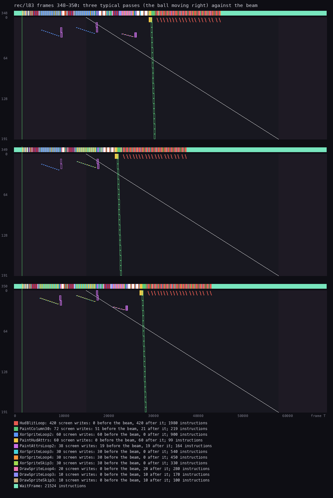

*The ball is drawn while the beam is still above it, so it never tears below the top rows. How to read: one row a
frame; colour bands are the routines by T-state, the beam's line marked. `rec/l83`, frames 348-350.
`python3 R/kit/beam_timeline.py --work work/docs/bmA/l83 --window 348:0-352:0 --listing build/game.lst
--frames 348-350 --out docs/img/loop/beam-typical.png`.*

In `rec/l83` the ball's step runs from T 3051 to T 19 028, while the beam reaches the first screen line at T 14 336.
A ball on rows 1-5 is erased and redrawn before the beam reaches it.
A ball on the top row can be caught half drawn: its erase and redraw overlap the beam's first lines.
DrawHud runs from about T 22 621, when the beam is below the HUD's row, so new digits show in the next frame, whole.

Worked example: the ball on cell 14 (platform line 90) is drawn by about T 19 000; the beam reaches line 80, the
ball's top, at 14 336 + 80 × 224 = T 32 256, long after.

Witness: the beam timelines of `rec/l83` frames 340-350 (doc 4).

The point: the game does not wait for the beam; the order of the pass (ball first, HUD last) is what keeps it clean.

## 6.10 Known only from the code

- XorSprite's half byte for an odd width at an even column (`$E442`) is not executed in any recording: no XORed
  picture has an odd width at an even column.
- XorBricks' odd-column path `$E530-$E58A` is not executed in any recording: the bricks lie at even columns.
- DrawExitSign `$D08E` and the CPC picture at `$61A8` (UnusedPicture61A8) are not drawn in any recording.
- The high planes of all pictures but the bricks are never shown: the shading of the CPC version.
