# 7. Objects

What this covers:

- the level record, 75 bytes at LevelRecords `$8C3C`, byte by byte, with level 22 decoded in full;
- BuildLevel `$CF2E`: the record copied and split into the work area `$AA20-$AAFA`;
- the 13 platform types and how they change in play: wear, fire, bricks, the exit;
- the 5 wall types and the locks a key lowers;
- the objects (tools, prizes and the bottle) and TakeObject `$B958`;
- how the ball meets the level: by cell numbers, and for walls by a byte of the screen;
- the game variables;
- why nothing in a level is random.

Bumpy has no moving object but the ball.
Its "objects" are the 36 cells of a level, each with a platform, a wall on its right and one thing to take.
The ball is in doc 10; this document is the data the ball meets.

The recordings it rests on ([WALKTHROUGH 6.0](../WALKTHROUGH.md#60-the-recordings); all on the 48K):

| Recording | Used for |
| --- | --- |
| `rzx/l21` | the RZX's level 21 replayed; level 22 built at frames 1534-1538 (7.2) |
| `rzx/l01` | the RZX's level 1: a brick layer knocked off at frames 147-157, a platform worn at 484-495, a lock opened in three stages at 586-625 |
| `c1` | level 0 by keys: a water drop taken at frame 14 127 (7.5) |
| the RZX itself | the counts of every pick-up, lock and brick (the witness lines of `src/game/game.ann`) |

Conventions:

- **A cell** is one of the 36 places of a level, numbered 0-35 left to right and top to bottom.
  Cell `c` is in row `c / 6` and column `c mod 6`.
- **A pass** is one turn of the main loop (doc 4); every animation below moves one step a pass.
- **L1 n** is how many times a routine ran in all the recordings (the witness line of `game.ann`).
- The asm is from `build/game.lst`; `...` marks lines left out.

## 7.1 The level record

Every level is 75 bytes, stored one after another from level 0 at LevelRecords `$8C3C`.
Level `L` starts at `$8C3C + 75 × L`; level 99 ends at `$A987`, and 117 zero bytes (LevelsEnd `$A988-$A9FC`) follow.

| Offset | Bytes | Meaning |
| --- | ---: | --- |
| +0..+35 | 36 | the cells, row by row from the top; each byte is `wall << 4 OR platform` |
| +36 | 1 | the start cell of the ball |
| +37 | 1 | the prizes to take before the exit opens |
| +38 | 1 | the cell where the exit opens |
| +39..+74 | 36 | the object on each cell: 0 none, 1 hammer, 2 key, 3 water, 4 bottle, 5-40 a prize |

```text
record(L) = LevelRecords + 75 * L
for c in 0..35:
    platform[c] = record[c] AND 15        ; 0-12
    wall[c]     = record[c] >> 4          ; 0-4, the wall on the right of cell c
    object[c]   = record[39 + c]          ; 0-40
start  = record[36]
prizes = record[37]
exit   = record[38]
```

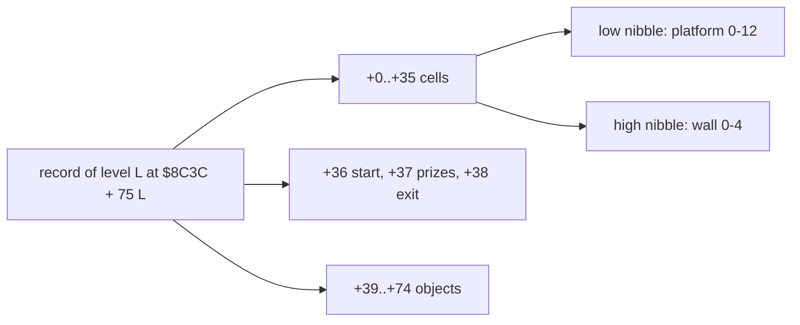

Worked example: level 22, the level the RZX enters at frame 1534 of `rzx/l21`.
Its record is at `$8C3C + 75 × 22 = $92AE`.

| Bytes | Values | Decoded |
| --- | --- | --- |
| +0..+5 | `01 00 01 00 01 00` | row 0: plain platforms on cells 0, 2 and 4, nothing on 1, 3 and 5 |
| +6..+11 | `00 01 00 01 00 01` | row 1: plain on 7, 9 and 11 |
| +12..+35 | the same two rows twice more | a checkerboard of 18 plain platforms; no wall anywhere |
| +36 | `00` | the ball starts on cell 0, top left |
| +37 | `0C` | 12 prizes to take |
| +38 | `05` | the exit opens on cell 5, top right, a cell with no platform yet |
| +39..+44 | `00 00 0C 00 05 00` | prize kinds 12 on cell 2 and 5 on cell 4 |
| +45..+50 | `00 06 00 07 00 03` | prizes 6 on cell 7 and 7 on cell 9; a water drop on cell 11 |
| +51..+56 | `01 00 09 00 01 00` | hammers on cells 12 and 16; prize 9 on cell 14 |
| +57..+62 | `00 08 00 0A 00 0B` | prizes 8, 10 and 11 on cells 19, 21 and 23 |
| +63..+68 | `0C 00 02 00 0E 00` | prize 12 on cell 24; a key on cell 26; prize 14 on cell 28 |
| +69..+74 | `00 0D 00 0F 00 03` | prizes 13 and 15 on cells 31 and 33; water on cell 35 |

Twelve objects are kinds 5 to 40, so byte +37 matches the prizes on the board.
That holds in all 100 records: byte +37 is always the count of kinds 5-40.

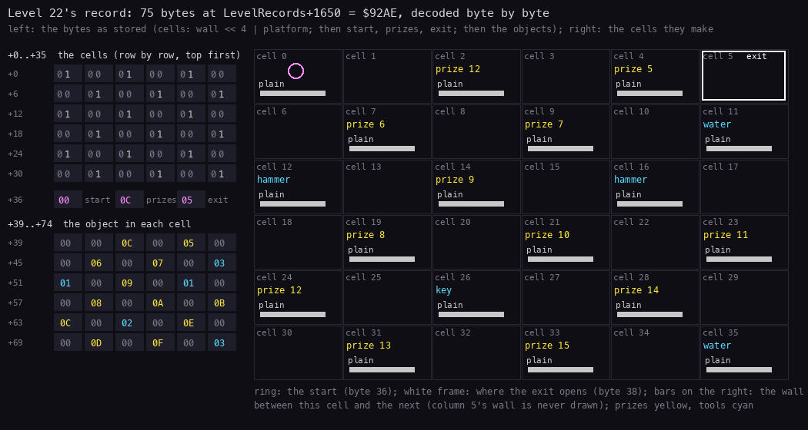

*Level 22's record is a checkerboard: every cell byte is `00` or `01`, and every object sits on a `01` cell.
How to read: left, the 75 bytes as stored, the wall nibble and the platform nibble of each cell coloured apart; right,
the cells they make, the start ringed, the exit's cell framed white. Drawn from `src/res/levels/levels.txt`, no
recording: `python3 tools/fig_record.py --level 22`.*

Level 1 uses most of the types at once, so its record is a better map of the nibbles:

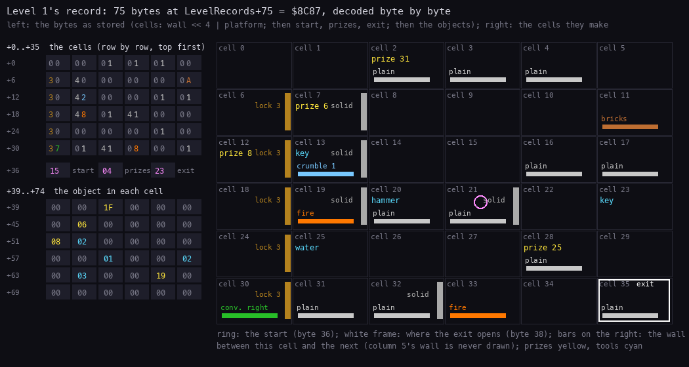

*Level 1 packs locks, solid walls, fire, bricks, a conveyor and a crumbling platform into 36 bytes.
How to read: byte `30` is a 3-stage lock over an empty cell; `42` a solid wall over a crumbling platform; `48` a solid
wall over fire; `37` a lock over a conveyor to the right; `0A` bricks. In the objects, `1F`, `06`, `08` and `19` are
prizes, `01` a hammer, `02` keys, `03` water. `python3 tools/fig_record.py --level 1`.*

Objects do not need a platform under them.
252 of the objects in the 100 records sit on an empty cell; the ball takes them as it rises or falls through (7.7).
Level 1's prize on cell 7 is one: the cell has a wall and no platform.

Witness: the 88 levels the RZX reaches read their records in `rzx/l00`-`rzx/l99`; stage 2's level recordings
(`work/stage2/rec`) read the others. The contact sheet of all 100 is in
[doc 1, 1.6](01-game-design.md#16-the-100-levels).

The point: a level is a 6 × 6 table of nibbles and a 6 × 6 table of object kinds; nothing is placed freely, so every
rule of the game is a rule about a cell and its neighbours.

## 7.2 BuildLevel `$CF2E`: the record into the work area

At every life start, BuildLevel clears the work area, copies the record, splits the cells and draws them.

```asm
ClearWorkArea:
  CF6E  LD (IX+$00),$00         ; $AA20-$AAFA to 0 (B = $DB, 219 bytes)
  CF72  INC IX
  CF74  DJNZ ClearWorkArea
  CF76  LD A,(Level)
  CF79  LD B,A
  CF7A  INC B
  CF7B  LD DE,$004B
  CF7E  LD HL,Unused8385+$086C  ; $8BF1
SeekLevelRecord:
  CF81  ADD HL,DE               ; HL = $8BF1 + 75 x (Level + 1) = $8C3C + 75 x Level
  CF82  DJNZ SeekLevelRecord
  CF84  LD BC,$0024
  CF87  ADD HL,BC
  CF88  LD A,(HL)
  CF89  LD (StartCell),A        ; byte +36 kept apart
  CF8C  SBC HL,BC
  CF8E  LD DE,LevelRecord       ; $AA20
  CF91  LD BC,$004B
  CF94  LDIR
  CF96  LD B,$24
SplitCell:
  CF98  AND A                   ; cell 36 - B
  CF99  LD HL,LevelRecord
  CF9C  LD A,$24
  CF9E  SUB B
  CF9F  LD E,A
  CFA0  LD D,$00
  CFA2  ADD HL,DE
  CFA3  LD A,(HL)
  CFA4  LD (CellByte),A
  CFA7  AND $F0
  CFA9  RRA
  CFAA  RRA
  CFAB  RRA
  CFAC  RRA                     ; the high nibble
  CFAD  LD IX,CellWalls         ; $AA8F
  CFB1  ADD IX,DE
  CFB3  LD (IX+$00),A
  CFB6  LD A,(CellByte)
  CFB9  AND $0F                 ; the low nibble
  CFBB  LD IX,CellPlatforms     ; $AA6B
  CFBF  ADD IX,DE
  ...                           ; LD (IX+$00),A; DJNZ SplitCell
```

```text
BuildLevel:
    LevelColours row (Level mod 7) + 1 -> NoOp      ; the CPC inks, a RET on the Spectrum
    clear $AA20-$AAFA
    StartCell = record(Level)[36]
    copy record(Level), 75 bytes, to $AA20          ; cells, start, prizes, exit, objects in place
    for c in 0..35:
        CellWalls[c]     = cell[c] >> 4
        CellPlatforms[c] = cell[c] AND 15
    for c in 0..35:
        PlatformDrawTable[platform]                 ; 8, 9: CellBurning[c] = 1; 10: BrickLayers[c] = 8
        if object: XOR its picture, ink ObjectInks[kind]
        WallDrawTable[wall]
    BallCell = StartCell; draw the ball
```

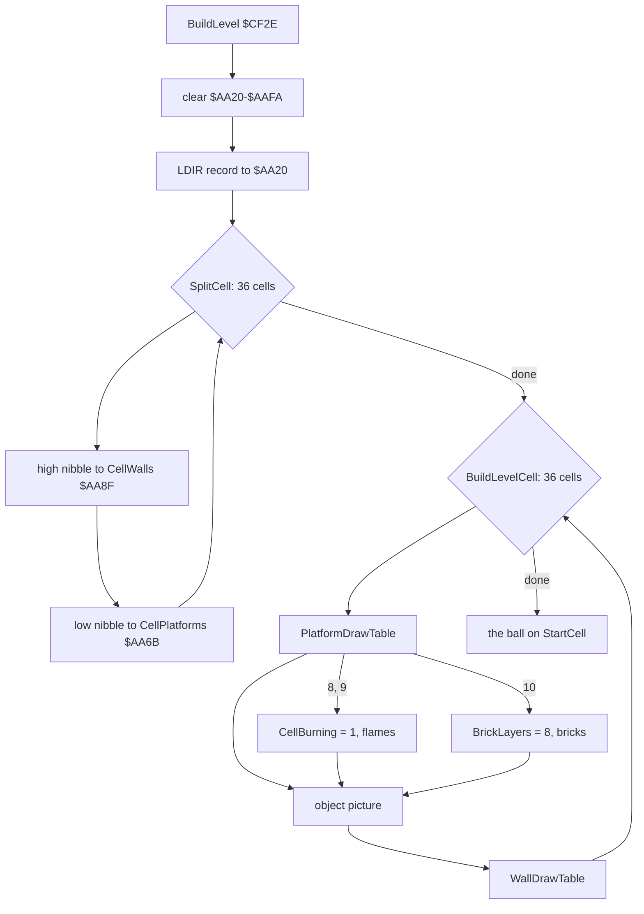

The copy leaves the objects in place: CellObjects `$AA47` is the record's bytes +39..+74 at `$AA20 + 39`.
So the work area is the record with four more tables after it (`$AA6B`, `$AA8F`, `$AAB3`, `$AAD7`, 36 bytes each,
ending at `$AAFA`).

| Address | Size | Name | Filled by |
| --- | ---: | --- | --- |
| `$AA20` | 36 | LevelRecord | the copy; the raw cell bytes, not read again after the split |
| `$AA44` | 1 | BallCell | the copy (the start); the builder's loop cell; then the ball's cell |
| `$AA45` | 1 | PrizesLeft | the copy; AddScore counts it down |
| `$AA46` | 1 | ExitCell | the copy |
| `$AA47` | 36 | CellObjects | the copy; TakeObject clears a cell |
| `$AA6B` | 36 | CellPlatforms | SplitCell; changed by wear, water, bricks and the exit |
| `$AA8F` | 36 | CellWalls | SplitCell; lowered by keys |
| `$AAB3` | 36 | CellBurning | DrawFlames `$D14B` (1 for types 8 and 9); ExtinguishFire clears it |
| `$AAD7` | 36 | BrickLayers | DrawBricks `$D180` (8 for type 10); HitBrick counts it down |

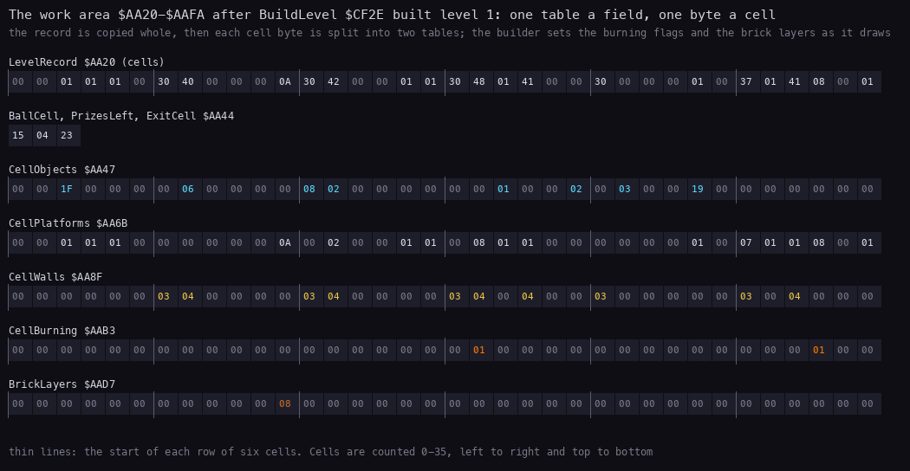

*The work area after BuildLevel built level 1: the record and its five tables of 36 bytes.
How to read: one row of boxes is one table, one box one cell; the thin lines start each row of six cells. The lock
nibbles `3` and the wall nibbles `4` of the record become CellWalls; the fire on cells 19 and 33 sets CellBurning;
the bricks on cell 11 set BrickLayers to 8. Computed from the record the way the builder does, no recording:
`python3 tools/fig_record.py --level 1`.*

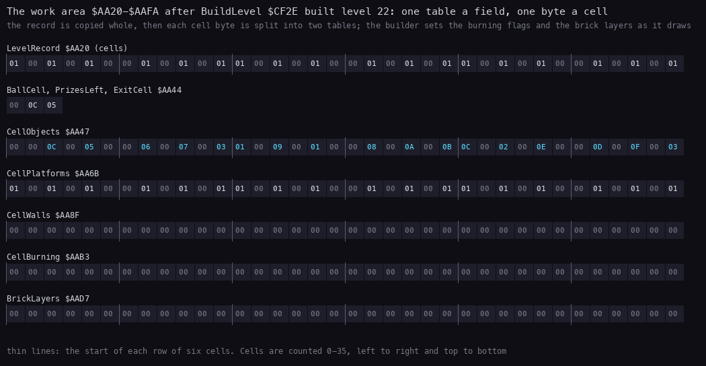

*The same for level 22, the level of the BuildLevel animation. How to read: as above, one table a row of boxes.
Computed from the record, no recording: `python3 tools/fig_record.py --level 22`.*

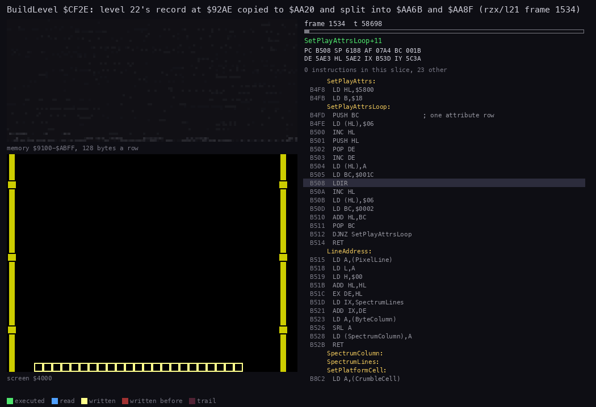

*BuildLevel copies level 22's record and splits it, then starts drawing. How to read: the memory map runs from `$9100`
to `$ABFF`, 128 bytes a row; the record's row at `$92AE` is read (blue), `$AA20-$AA6A` written by the LDIR (yellow),
then `$AA6B` and `$AA8F` filled one byte a cell while the code panel walks SplitCell; the last pictures draw the first
platform. `rzx/l21`, frame 1534 T 58 000 to frame 1535 T 30 000, 3896 instructions.
`python3 R/kit/routine_anim.py --work work/docs/bmA/l21 --window 1534:58000-1535:30000 --listing build/game.lst
--pc CF2E-D05F --range 9100-ABFF --pictures 60 --title '...' --out docs/img/routines/BuildLevel-record.gif`, the title
as shown.*

Worked example: level 22, cell 7 holds `01`.
SplitCell stores `01 >> 4 = 0` at CellWalls + 7 = `$AA96` and `01 AND 15 = 1` at CellPlatforms + 7 = `$AA72`.
PlatformDrawTable[1] is PlatDraw1, the plain platform.
CellObjects + 7 = `$AA4E` holds 6, so the prize picture `$6CB0 + 56 × 6 = $6E00` is XORed on with ink ObjectInks[6] =
`$43`, bright magenta.

Witness: BuildLevel L1 102; a life start out of the demo builds the level twice, before READY? (`$AC7D`) and after the
key (LifeStartGo, `$ACBF`); the demo builds once (`$AC86`) (doc 4, 4.3).

The point: the record never changes, and a life always starts from it, so a lost life rebuilds the level as it was,
prizes, locks and bricks included (doc 10).

## 7.3 The platforms and how they change

The low nibble of a cell is its platform.
CellPlatform `$AB1C` holds the ball's own; ReadCell `$BB32` reads it every pass.

| Type | Platform | In play | Becomes |
| ---: | --- | --- | --- |
| 0 | none | the ball falls through | |
| 1 | plain | a bounce | |
| 2 | crumbling, new | a bounce, then wears | 3 once the ball leaves |
| 3 | crumbling, cracked | a bounce, then wears | 4 once the ball leaves |
| 4 | crumbling, last | a bounce, then falls away | 0 once the ball leaves |
| 5 | stopper | the ball stops and waits for a key (BallStopped) | |
| 6 | conveyor left | the next move is left | |
| 7 | conveyor right | the next move is right | |
| 8 | plain on fire | death without water; with water a drop is spent | 1 |
| 9 | stopper on fire | as 8 | 5 |
| 10 | bricks | a wall for the side moves; a ceiling for the jump up | 0 when the 8 layers are gone |
| 11 | the exit | the level ends | written by OpenExit only |
| 12 | spikes | the ball bursts | |

Over the 100 records the types count: 0 × 1419, 1 × 390, 2 × 263, 3 × 169, 4 × 486, 5 × 93, 6 × 158, 7 × 160,
8 × 40, 9 × 30, 10 × 144, 12 × 248.
No record holds type 11.
The exit's cell can hold any type in the record (31 of them are empty, 5 are spikes); OpenExit overwrites it.

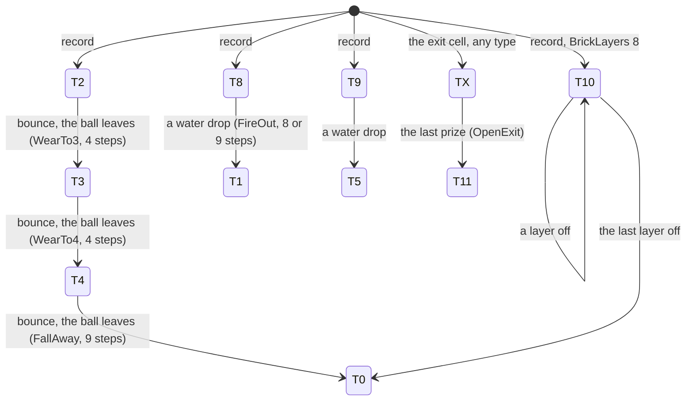

### Wear: types 2, 3 and 4

A bounce on a crumbling platform arms its change; the change plays only once the ball has left the cell.

```asm
StartWearTo3:
  C3D5  AND A
  C3D6  LD HL,(CellScrAddr)
  C3D9  LD (CrumbleAddr),HL     ; where to draw, fixed now
  C3DC  LD A,$01
  C3DE  LD (CrumblePending),A   ; $AA14: armed, not yet running
  C3E1  LD HL,CrumbleSteps2
  C3E4  LD (CrumbleSteps),HL
  C3E7  LD A,$00
  C3E9  LD (CrumbleStep),A
  C3EC  LD A,(BallCell)
  C3EF  LD (CrumbleCell),A
  C3F2  LD A,$03
  C3F4  LD (CrumbleNewType),A
  C3F7  RET
PlatformChangeStep:
  C19D  AND A
  C19E  LD A,(CrumbleActive)    ; $AA15, copied from $AA14 when the ball has left
  C1A1  CP $00
  C1A3  RET Z
  C1A4  LD IX,(CrumbleSteps)
  C1A8  LD A,(CrumbleStep)
  ...                           ; jump to CrumbleSteps[CrumbleStep], CrumbleStep + 1
```

```text
a bounce, step 0, on platform 2, 3 or 4:
    CrumbleAddr = the cell's screen address; CrumbleCell = BallCell
    CrumbleNewType = 3, 4 or 0; CrumbleSteps = the matching table
    CrumblePending = 1
the next move's step 5 (left, right), step 3 (up) or the bounce's step 1
(LeftPendingCrumble `$C8FC`, RightPendingCrumble `$CB42`, UpStep3 `$CD5C`, BounceStep1 `$C7D3`);
a fall does not start it: its step 4 only plays one more step of a change already running:
    CrumbleActive = CrumblePending
every pass, PlatformChangeStep:
    if CrumbleActive: run CrumbleSteps[CrumbleStep], CrumbleStep += 1
        the first step writes CellPlatforms[CrumbleCell] = CrumbleNewType
        the last step clears CrumblePending and CrumbleActive
```

Worked example: `rzx/l01`, frames 484-495.
The ball bounced on a type 2 platform and jumped away.
PlatformChangeStep runs WearTo3Step1 (CellPlatforms of the cell becomes 3, the platform XORed off, the first crack
on), then the next three steps, one a pass.

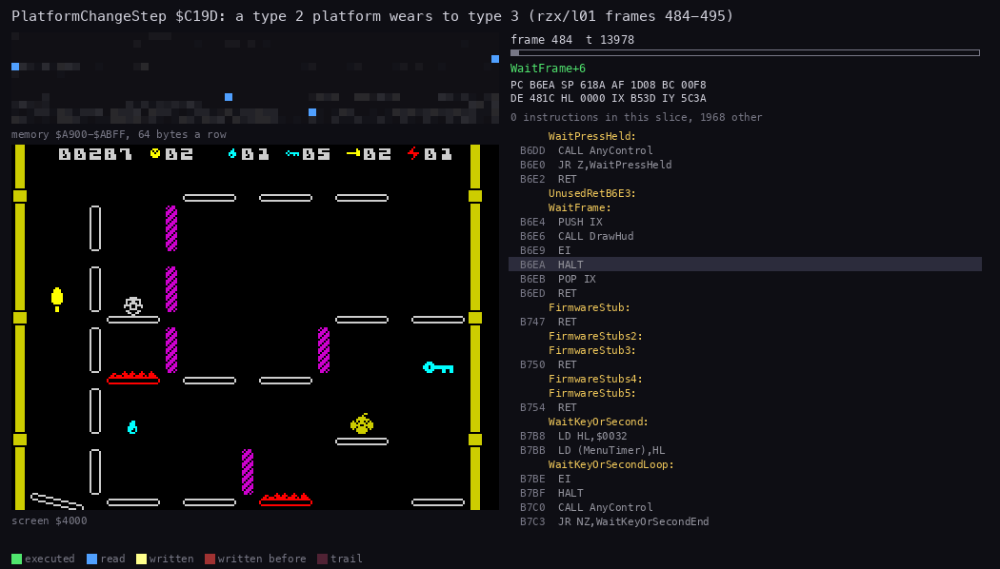

*A type 2 platform becomes type 3 while the ball is elsewhere. How to read: the code panel lights
PlatformChangeStep and one WearTo3 step a pass; the screen shows the platform XORed off and the cracks XORed on, one
picture a pass. `rzx/l01`, frames 484-495. `python3 R/kit/routine_anim.py --work work/docs/bmA/l01
--window 484:0-496:0 --listing build/game.lst --pc C19D-C43D --range A900-AB7F --pictures 60
--out docs/img/routines/PlatformChangeStep.gif`.*

Witness: StartWearTo3 220 runs, StartWearTo4 328, StartFallAway 672 (the RZX and 9-11 stage 2 levels).

### Fire: types 8 and 9

A burning platform kills a ball that lands on it without water (doc 10).
With water, the move's step 9 (left, right) or step 0 (down) spends a drop and plays FireOutLeft, FireOutRight or
FireOutDown, one step a pass.
ExtinguishFire `$C10C` clears CellBurning and turns 8 into 1, 9 into 5:

```asm
ExtinguishFire:
  C10C  AND A
  C10D  LD A,(BallCell)
  C110  LD D,$00
  C112  LD E,A
  C113  LD HL,CellBurning
  C116  ADD HL,DE
  C117  LD (HL),$00             ; no longer burning
  C119  LD HL,CellPlatforms
  C11C  ADD HL,DE
  C11D  LD A,(HL)
  C11E  LD (HL),$01             ; 8 becomes 1
  C120  CP $08
  ...                           ; JR Z,ExtinguishFireDraw; LD (HL),$05: 9 becomes 5
```

Witness: ExtinguishFire L1 55; 49 fires put out (`menu`, `l10`, `l36`, `l56`, `l59` and 28 RZX levels).

### The exit: type 11

OpenExit `$BCB9` stores `$0B` in CellPlatforms[ExitCell], draws the open exit over the cell and arms AnimateExit
`$BD21` (4 pictures, one every 2 passes).
Its code and timing are in [doc 4, 4.9](04-game-loop.md#49-the-heaviest-pass-the-last-prize).

The point: a platform's type is one byte the ball reads when it lands, and every change is a write to that byte plus a
short XOR animation queued for the next passes.

## 7.4 The walls and the locks

The high nibble is the wall on the right side of a cell.
A wall stands between cell `c` and cell `c + 1`; the wall nibble of column 5 is never drawn.

| Type | Wall | What the ball does | In the records |
| ---: | --- | --- | ---: |
| 0 | none | passes | 2885 |
| 1 | lock, last stage | turns back; with a key the lock opens for good (7 steps) | 153 |
| 2 | lock, middle stage | turns back; with a key it becomes 1 (2 steps) | 46 |
| 3 | lock, full | turns back; with a key it becomes 2 (2 steps) | 190 |
| 4 | solid, animated | always turns back | 326 |

The side moves do not read CellWalls to find a wall.
At step 5 they read one byte of the screen beside the ball (LeftWallCheck `$C907`; RightWallCheck is its mirror):

```asm
LeftWallCheck:
  C907  AND A
  C908  LD HL,(BallScrAddr)
  C90B  PUSH IX
  C90D  CALL ScreenAddrToLine   ; the CPC address to a line and a byte column
  C910  CALL LineAddress        ; the Spectrum line's address
  C913  LD L,(IX+$00)
  C916  LD H,(IX+$01)
  C919  LD A,(ByteColumn)
  C91C  SUB $02                 ; two CPC bytes to the left
  C91E  SRL A                   ; to a Spectrum column
  C920  OR L
  C921  LD L,A
  C922  POP IX
  C924  LD A,(HL)               ; the screen byte
  C925  CP $00
  C927  JP Z,BallLeftMove       ; nothing drawn: no wall
  C92A  CP $7C
  C92C  JP Z,LeftWallBlocked    ; the solid wall's pattern
  C92F  AND A
  C930  LD A,(Keys)
  C933  CP $00
  C935  JP Z,LeftWallBlocked    ; no key
  ...                           ; A = BallCell - 1, WallScreenAddr
  C945  LD HL,CellWalls
  C948  ADD HL,DE
  C949  LD A,(HL)
  C94A  CP $01
  C94C  JR Z,LeftOpenLock1
  C94E  CP $02
  C950  JR Z,LeftOpenLock2
  C952  CP $03
  C954  JR Z,LeftOpenLock3
  C956  JR LeftWallBlocked
LeftOpenLock1:
  C958  LD (HL),$00             ; the lock is gone (2 to 1, 3 to 2 below it)
```

```text
LeftWallCheck (move left, step 5):
    b = the screen byte on the ball's line, two CPC bytes to the left
    if b == 0: go on                         ; no wall drawn there
    if b == $7C or Keys == 0: turn back      ; BallStep 11, BallState 2, SfxWallBounce
    w = CellWalls[BallCell - 1]
    if w in 1..3:
        CellWalls[BallCell - 1] = w - 1
        LockAnimSteps = LockOpenSteps(w); LockActive = 1; LockStep = 0
        Keys = Keys - 1
    turn back                                ; the ball comes back even when the lock opened
```

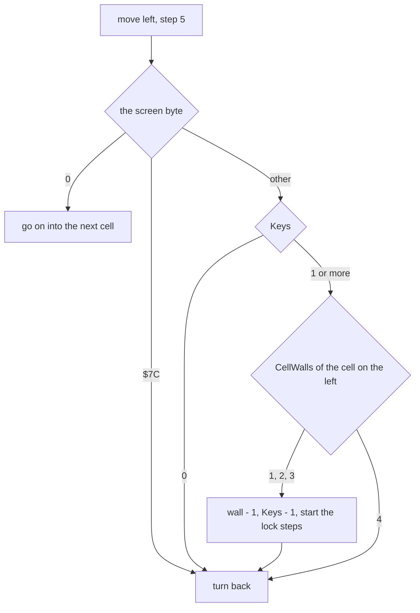

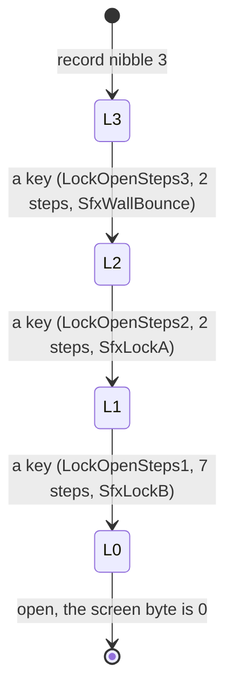

A solid wall never lets the ball through: either its picture gives `$7C` on the tested line, or the code goes on to
CellWalls, finds 4 and turns back.
An opened lock is passable only after its last step stores the blank picture, since until then the screen byte is
not 0.
WallStep `$C43E` plays the steps, one a pass, from MainLoop.

Worked example: `rzx/l01`, frames 586-625, the right move (RightStep5 `$CB2F` mirrors LeftStep5).
The ball, on cell 30 with five keys, jumps right into the type 3 lock on its right three times.
At each RightStep5 the screen byte is the lock's pattern, Keys is not 0 and CellWalls + 30 (`$AAAD`) holds a lock:

| Frame | CellWalls + 30 | Keys | written at | WallStep plays | sound |
| ---: | --- | --- | --- | --- | --- |
| 588 | 3 → 2 | 5 → 4 | `$CBAF` RightOpenLock3, `$CBBC` | Lock3Step1 (588), Lock3Step2 (591) | SfxWallBounce |
| 603 | 2 → 1 | 4 → 3 | `$CBA5` RightOpenLock2, `$CBBC` | Lock2Step1 (603), Lock2Step2 (606) | SfxLockA |
| 619 | 1 → 0 | 3 → 2 | `$CB9B` RightOpenLock1, `$CBBC` | Lock1Step1 (619), Lock1Step2 (623) | SfxLockB |

Each time the ball turns back; at frame 623 the lock's last step stores the blank and the way is open.

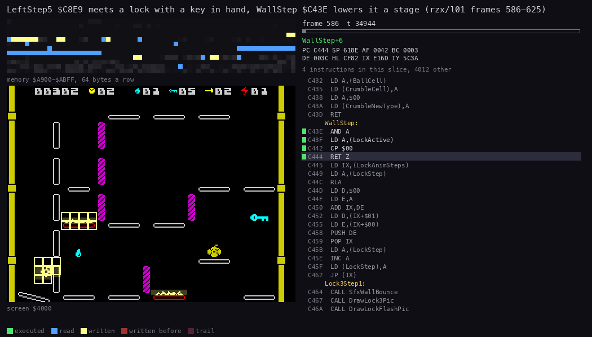

*Three keys lower a type 3 lock stage by stage, and the ball comes back each time. How to read: RightStep5 reads the
screen byte, finds a lock and a key, and writes CellWalls + 30 and Keys; WallStep then lights one lock step a pass at
the wall's place. `rzx/l01`, frames 586-625. `python3 R/kit/routine_anim.py --work work/docs/bmA/l01 --window
586:0-626:0 --listing build/game.lst --pc CB2C-CBEC,C43E-C4E1 --range A900-AB7F --pictures 80 --title '...'
--out docs/img/routines/WallStep.gif`, the title as shown.*

Witness: RightStep5 L1 1266, LeftStep5 L1 993; Lock3Step1 L1 24 (`l36`, `l96`, 18 RZX levels); 97 locks opened for good
(LockOpenSteps1) in the recordings.

The point: the wall test is a pixel test, so the drawn picture and the table must agree; the key logic reads the table
only after the screen said "something is there".

## 7.5 The objects and TakeObject `$B958`

An object is a kind 1-40 in CellObjects.
The ball takes it at a fixed step of each move: the bounce's step 13, left and right step 13, up step 6, down step 5
(doc 10).

| Kind | Object | Effect | Sound | Witness |
| ---: | --- | --- | --- | --- |
| 1 | hammer | Hammers + 1, at most 99 | SfxPickup | TakeHammer L1 63, 58 hammers |
| 2 | key | Keys + 1, at most 99 | SfxPickup | TakeKey L1 204, 183 keys |
| 3 | water drop | Water + 1, at most 99 | SfxPickup | TakeWater L1 66, 54 drops |
| 4 | bottle | Lives + 1, at most 99 | SfxExtraLife | TakeBottle L1 23; the RZX's own run takes 16 |
| 5-40 | prize | Score + 15, PrizesLeft - 1; at 0 the exit opens | SfxPickup | AddScore L1 709 |

```asm
TakeObject:
  B958  AND A
  B959  LD A,(CellObject)       ; $AB1D, set by ReadCell
  B95C  LD HL,BallPictures2+$0248
  B95F  CP $00
  B961  RET Z
  ...                           ; XOR the picture off ($6CB0 + 56 kind), ink 7
  B97D  LD A,(BallCell)
  B980  LD D,$00
  B982  LD E,A
  B983  LD HL,CellObjects
  B986  ADD HL,DE
  B987  LD (HL),$00             ; the cell is empty now
  B989  AND A
  B98A  LD A,(CellObject)
  B98D  CP $05
  B98F  JR NC,TakePrize
  ...                           ; JP (ObjectHandlers + 2 kind)
TakePrize:
  B9A7  LD A,(ObjectFlag)
  B9AA  CP $04
  B9AC  JR Z,TakePrizeQuiet
  B9AE  CALL SfxPickup
TakePrizeScore:
  B9B1  LD BC,$000F
  B9B4  JP AddScore
AddScore:
  BA47  AND A
  BA48  LD HL,(Score)
  BA4B  ADD HL,BC
  BA4C  LD (Score),HL
  BA4F  CALL ScoreToHud
  BA52  AND A
  BA53  LD A,(PrizesLeft)
  BA56  DEC A
  BA57  LD (PrizesLeft),A
  BA5A  CP $00
  BA5C  CALL Z,OpenExit
  BA5F  RET
```

```text
TakeObject:
    k = CellObject
    if k == 0: return
    XOR the object's picture off the cell
    CellObjects[BallCell] = 0
    if k >= 5:                         ; a prize
        the sound, unless ObjectFlag == 4 (then ObjectFlag = 0)
        Score += 15; print it
        PrizesLeft -= 1; if 0: OpenExit
    else: jump to ObjectHandlers[k]    ; hammer, key, water, bottle
```

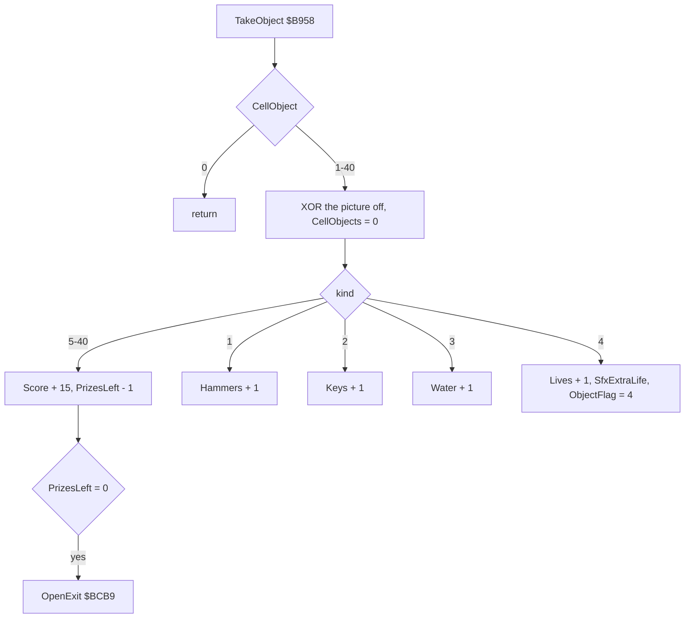

The prize kinds differ only in picture and ink: every prize is worth 15 points.
The 36 prize pictures at `$6CB0 + 56 × kind` are on the sprite sheet of [doc 6](06-rendering.md#64-the-pictures).

ObjectFlag `$ABA7` is a "be quiet" flag.
The bottle and a spent water drop set it to 4.
The next bounce sound or pick-up sound is then skipped and the flag cleared, so the bottle's 38-frame jingle (doc 9)
is not followed by a click.

Worked example: `c1`, level 0 played by keys.
At frame 14 127 the ball reaches a cell holding kind 3 (TakeObject at T 3259).
TakeObject XORs the drop off, clears CellObjects, and jumps through ObjectHandlers + 6 to TakeWater `$B9DE`.
Water `$AAFD` goes from 0 to 1 at frame 14 129 (after SfxPickup, which keeps the interrupts off), WaterToHud prints
it, and DrawHud shows it again at frame 14 130.

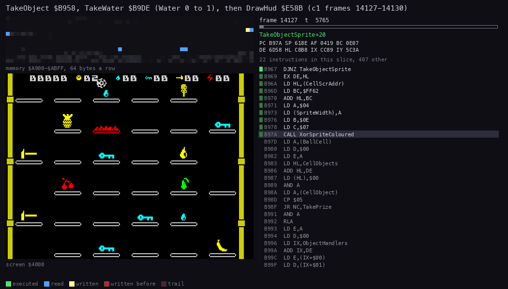

*A water drop is taken and counted on the HUD in the same pass. How to read: TakeObject and TakeWater write
CellObjects and Water `$AAFD` in the memory map; DrawHud then reprints the counters. `c1`, frame 14 127 T 1800 to
frame 14 130 T 30 000. `python3 R/kit/routine_anim.py --work work/docs/bmA/c1 --window 14127:1800-14130:30000
--listing build/game.lst --pc B958-BA46,E58B-E666 --range A900-AB7F --pictures 60
--out docs/img/routines/DrawHud.gif`.*

Witness: TakeObject L1 8264 (it runs at every take step and returns at once on an empty cell); OpenExit L1 105,
92 exits opened.

The point: four kinds change a counter, the rest are points; the counters are what the player spends on fires, locks
and bricks.

## 7.6 Bricks and hammers

Type 10 is a brick wall of 8 layers in one cell (BrickLayers `$AAD7`).
The side moves cannot enter it (doc 10).
The jump up meets it as a ceiling: HitBrick `$B8D1` runs at every step of the up move (0-7), whenever the ball's cell
holds bricks.

```asm
HitBrick:
  B8D1  AND A
  B8D2  LD HL,BrickSteps        ; $E1C1: 5, 4, 3, 2, 1, 8, 7, 6
  B8D5  LD A,(BallStep)
  ...
  B8DC  LD A,(HL)
  B8DD  LD B,A                  ; the layer count met at this step
  B8DE  LD HL,BrickLayers
  ...
  B8EB  LD A,(HL)
  B8EC  LD (CellByte),A
  B8EF  SUB B
  B8F0  CP $00
  B8F2  RET NZ                  ; not touching yet
HitBrickContact:
  ...                           ; the layer's screen address to BrickLayerAddr
  B907  LD A,$04
  B909  LD (BallState),A        ; the ball goes down
  B90C  LD A,(BallStep)
  B90F  CP $05
  B911  JR NZ,HitBrickMirror
  B913  LD A,(Hammers)          ; an intact brick needs a hammer
  B916  CP $00
  B918  JR Z,HitBrickNoHammer
  B91A  DEC A
  B91B  LD (Hammers),A
  B91E  CALL HammersToHud
HitBrickMirror:
  B921  AND A
  B922  LD A,(BallStep)
  B925  CP $00
  B927  JR Z,HitBrickMirrorSkip
  B929  LD B,A
  B92A  LD A,$08
  B92C  SUB B                   ; the way down mirrors the way up
HitBrickMirrorSkip:
  B92D  LD (BallStep),A
  ...                           ; BrickActive = 1, BrickAnimStep = 0
HitBrickLayer:
  B93A  LD A,(CellByte)
  B93D  DEC A
  B93E  LD HL,(CellIndex)
  B941  LD (HL),A               ; one layer less
  B942  CP $00
  B944  RET NZ
  ...                           ; 0 layers: CellPlatforms = 0
```

```text
HitBrick (up move, BallStep s):
    if BrickLayers[cell] != BrickSteps[s]: return       ; not at the brick's underside yet
    BallState = down
    if s == 5 (an intact brick): need a hammer; Hammers -= 1
    BallStep = 8 - s (0 stays 0)                         ; the way down mirrors the way up
    start the crumble animation (BrickStep, 4 passes)
    BrickLayers[cell] -= 1; at 0 the platform becomes 0
```

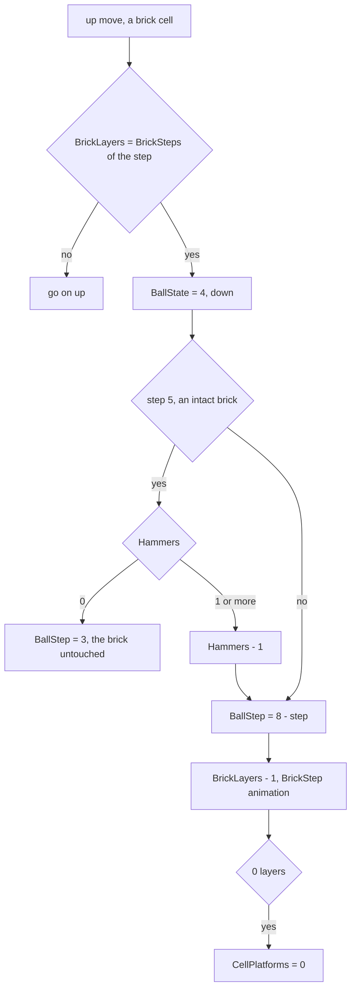

The layer count is a height: a whole brick (8) is met at step 5, a brick with 1 layer left at step 4, each step 4
lines higher.
Each contact takes one layer, so a brick needs a hammer for the first hit and then 7 more jumps.

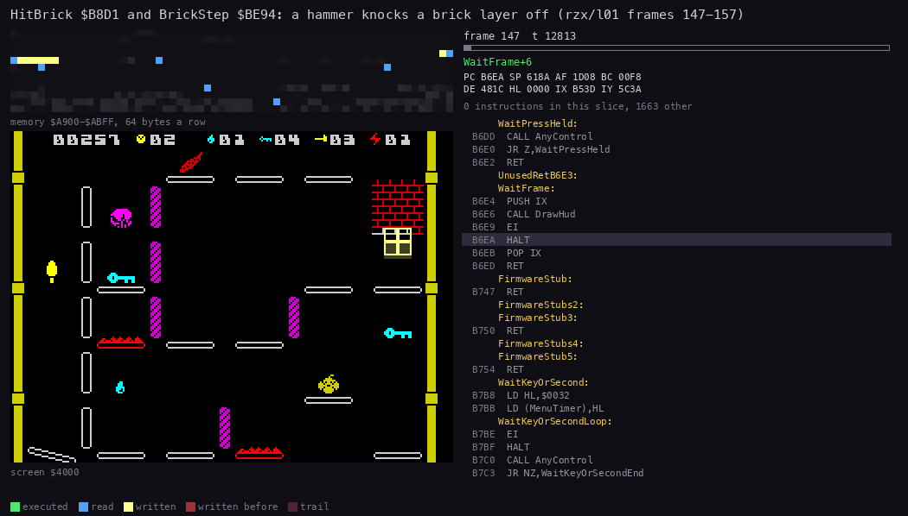

*The ball hits a brick from below, a layer goes, and the ball comes back down. How to read: HitBrick writes
BrickLayers and BallState; BrickStep then clears the layer in four checkered passes. `rzx/l01`, frames 147-157.
`python3 R/kit/routine_anim.py --work work/docs/bmA/l01 --window 147:0-158:0 --listing build/game.lst
--pc B8D1-B957,BE94-BFF2 --range A900-AB7F --pictures 60 --out docs/img/routines/BrickStep.gif`.*

Witness: HitBrick L1 1837; 369 contacts, 47 at step 5 (each with a hammer), 46 bricks gone.
HitBrickNoHammer `$B952` is not executed in any recording: no recording jumps up under an intact brick without a
hammer.

The point: bricks are the only platform with a counter, and the counter doubles as a height.

## 7.7 How the ball meets the level

There is no test between shapes.
The ball's position is a cell number, BallCell `$AA44`, and every test is a table read at that cell or a neighbour:

| Test | Where | Cell read |
| --- | --- | --- |
| the platform and object under the ball | ReadCell `$BB32`, every pass | BallCell |
| the object | TakeObject, at the take step | BallCell |
| the wall on the left or right | LeftWallCheck, RightWallCheck, step 5 | the screen byte; then CellWalls[cell - 1] or [cell] |
| the next cell sideways | the move's step 8 | cell ± 1; bricks (`$0A`) there send the ball back |
| the cell above | the up move, step 4 | cell - 6: none, bricks or the exit let the ball on; spikes burst it; 1-9 bump it back (BallBumpCeiling `$B00F`); the top row bumps it back |
| the cell above, entered | the up move, step 5 | BallCell - 6 |
| the cell below, entered | the down move, step 3 | BallCell + 6 |
| a brick above | HitBrick, the up move | BrickLayers[cell] |
| the landing | LandingCheck `$B09E` | a platform: the next state; none: fall a cell; none on the bottom row: out below (state 7) |

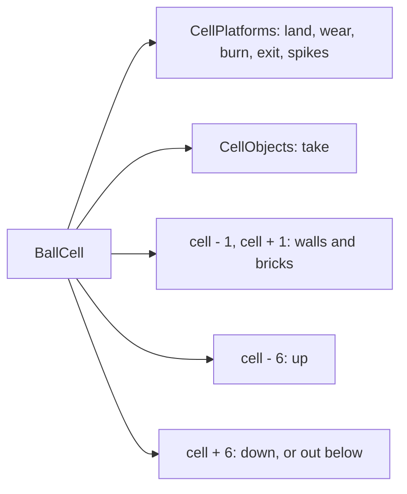

Worked example: the jump right of `rec/l83` frames 349-377 (the BallRight animation of
[doc 4, 4.6](04-game-loop.md#46-the-state-dispatcher-ad0f-and-statetable-ad29)).
At step 5 the screen byte right of the ball is 0, so there is no wall.
At step 8 BallCell becomes the next cell.
At step 13 TakeObject reads CellObjects of that cell.
At step 15 the landing reads its platform and picks the next state.

The point: the ball crosses a cell boundary at one step, so every rule is decided at a known step of a known move;
doc 10 lists them.

## 7.8 The game variables

The level's variables are the work area of 7.2.
The player's are after it; LifeStart copies them in and LoseLife copies them out (doc 4, 4.3):

| Address | Name | Size | Meaning |
| --- | --- | ---: | --- |
| `$A9FF` | BallStep | 1 | the step of the ball's move |
| `$AA00` | BallState | 1 | 0-8 ([doc 4, 4.6](04-game-loop.md#46-the-state-dispatcher-ad0f-and-statetable-ad29)) |
| `$AA03` | BallScrAddr | 2 | the ball's CPC screen address |
| `$AA13` | SpringArmed | 1 | a jump up is armed (doc 10) |
| `$AA14`, `$AA15` | CrumblePending, CrumbleActive | 2 | a platform's wear (7.3) |
| `$AA18-$AA1D` | LockAnimAddr, LockAnimSteps, LockStep, LockActive | 6 | a lock's opening (7.4) |
| `$AAFB` | Score | 2 | the current player's score |
| `$AAFD` | Water | 1 | drops, 0-99 |
| `$AAFE` | Keys | 1 | keys, 0-99 |
| `$AAFF` | Hammers | 1 | hammers, 0-99 |
| `$AB00` | Level | 1 | 0-99 |
| `$AB01` | Lives | 1 | 0-99 |
| `$AB04` | Timer | 2 | 1000 at a life's start, one off a pass (doc 10) |
| `$AB06-$AB08` | WaterAtStart, KeysAtStart, HammersAtStart | 3 | the tools at the life's start |
| `$AB09`, `$AB10` | Player1Record, Player2Record | 7 + 7 | score, water, keys, hammers, level, lives (`$FA` = out) |
| `$AB1C-$AB1E` | CellPlatform, CellObject, CellWall | 3 | the ball's cell |
| `$ABA7` | ObjectFlag | 1 | the quiet flag (7.5) |

Witness: the variables are read in every recording; `work/stage2/rzx-states.tsv` holds BallState, PrizesLeft, Level
and the timer after every RZX frame.

The point: one copy of the player's state lives at fixed addresses; two players take turns by copying 7 bytes.

## 7.9 Nothing is random

Every level is the same at every start: the record is copied as stored, and no routine places or moves an object.
The only random numbers are the R register in two sound primitives, RandomNoise1 and RandomNoise2, used by three
effects (SfxPickup, SfxLockA, SfxLockB; doc 9).
Random `$F183` belongs to the AY skeleton and is dead code, never called (doc 2, 2.8).
Stage 2 traced the drift of a replay from the RZX to how keys are read, never to chance (`work/stage2/NOTES.md`).

Witness: the RZX replays all 100 levels in step with the recording (doc 4, 4.8), and `scoreloop` plays the same keys
three times from level 87's start and takes the same six prizes and the bottle each time; that no gameplay routine
reads R is known only from the code.

The point: a level is a fixed puzzle; the same moves solve it every time, which the stage 2 solutions in
`tests/inputs/` rely on.

## 7.10 Known only from the code

- ReadWallCell `$BB4A` (CellWall `$AB1E` from CellWalls) has no caller, so CellWall is never written.
- TakeNothing `$B9BE`, ObjectHandlers[0], is never reached: TakeObject returns on kind 0 first.
- HitBrickNoHammer `$B952` is not executed in any recording (7.6).
- LevelLeftover `$E0C4`, 85 bytes of small numbers, is never read.
- LevelColours `$E119` is read at every build, but its values go to NoOp `$B6DB`: the CPC version's inks.
- No record holds platform type 11 or a wall nibble above 4 (all 100 records, `tools/fig_record.py`).
