# 8. HUD and text

What this covers:

- the one font, 96 glyphs at Font `$F5C9`, and the five HUD icons in it;
- PrintText `$E667`, the string printer, with its control codes and the bug in two of them;
- PrintChar `$E717` and DrawGlyph `$E73E`, which put a character on the screen;
- every string of the game and where it is printed;
- the HUD row: DrawHud `$E58B`, the digits, the icons and the colours;
- the count of the timer into the score at a level's end;
- the hall of fame: its records, the place a score takes, and the name entry by left and right.

Bumpy has two printers.
PrintText draws whole strings anywhere on the screen, with colours and double height.
HudBlit `$E644` draws one glyph at a time on the top character row, in a fixed place, with no colour.

The recordings it rests on ([WALKTHROUGH 6.0](../WALKTHROUGH.md#60-the-recordings); all on the 48K):

| Recording | Used for |
| --- | --- |
| `c1` | the menu (frame 13 782), READY? printed at frame 13 926 (8.3), a water drop counted on the HUD at frame 14 128 (8.6) |
| `twoname` (stage 2) | both players' game overs; the names B U M (frames 3030-3237) and Z A P (frames 4625-4781) entered (8.8, 8.9) |
| `gameover` | a score of 2000 entered as the fourth record (frame 4618) |
| `rec/l83` | level 83 ended: the timer counted into the score from about frame 594 (8.7) |

Conventions:

- **A character cell** is 8 × 8 pixels; the screen is 32 columns by 24 rows.
- **A pass** is one turn of the main loop (doc 4).
- **L1 n** is how many times a routine ran in all the recordings (the witness line of `game.ann`).
- The asm is from `build/game.lst`; `...` marks lines left out.

## 8.1 The screens with text

| Screen | Printed by | Text | Shot |
| --- | --- | --- | --- |
| the menu | Menu `$EF33` | MenuBackdropText `$F0E8`, MenuText `$EFEF` | [c1 frame 13 782](img/play/c1-013782-menu.png) |
| a life starts | LifeStart `$AC4A` | ReadyText `$AD3B`, Player1ReadyText `$AD48`, Player2ReadyText `$AD84` | [twoname frame 200](img/play/twoname-000200-two-ready.png) |
| play | DrawHud `$E58B` | the HUD row: score, lives, water, keys, hammers, level | [rec/l83 frame 100](img/play/l83-000100-play.png) |
| a level's end | LevelEnd `$B2C2` | the score on the HUD, one point at a time | [rec/l83 frame 650](img/play/l83-000650-count.png) |
| the hall of fame | ShowHallOfFame `$ED1A` | HofTitleText `$EDEF`, the four records at HallOfFame `$EEB3` | [gameover frame 4618](img/play/gameover-004618-hall-of-fame.png) |

The game has no "game over" text.
After the last life the border flashes, and the hall of fame follows if the score is good enough (8.8).

The point: every text but the HUD goes through PrintText, so the strings are data that carry their own colour and
place.

## 8.2 The font

The font is 96 glyphs of 8 bytes, characters 32 to 127, at Font `$F5C9-$F8C8`.
Characters 97-122 are not lower case: they are capitals with a bar under them.
Characters 123-127 are the HUD icons: a ball, a drop, a key, a hammer and a flash.
The digits 48-57 are the glyphs PrintDigit `$E62B` uses.

The code reaches a glyph as `$F4C9 + 8 × A`.
`$F4C9` is Font − 256, so character 32 lands on Font's first glyph.
The listing names that constant `SfxSpikeDeathParams+$000E`, because the address falls inside that table.
It is only a base for the multiply.

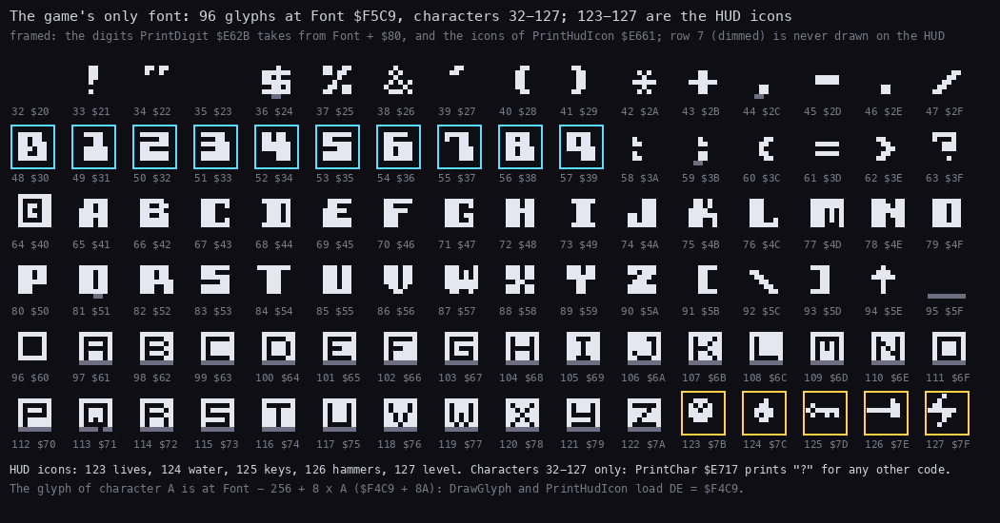

*The game's one font, as stored. How to read: each cell is one glyph, magnified 5 times, with its code in decimal and
hex; blue frames are the digits, yellow frames the HUD icons; the dimmed bottom row is row 7, which the HUD never
draws. No recording: the bytes of `build/game.bin`. `python3 tools/fig_text.py font`.*

The image holds a second font, EditorFont `$E21E`, from the CPC level editor.
Nothing in the game reads it (doc 2).

The point: one 768-byte font serves the menu, the hall of fame and the HUD, and five of its glyphs are pictures.

## 8.3 PrintText `$E667`: strings with control codes

PrintText reads a string at HL until a zero byte.
A byte from `$01` to `$16` that it knows is a control code; any other byte goes to PrintChar.

| Code | Bytes after it | Does |
| --- | --- | --- |
| `$16` | row, column | AT: sets TextRow `$E715` and TextColumn `$E716` |
| `$01` | none | single height: TextDouble `$E714` = 0 |
| `$02` | none | double height: TextDouble = 1 |
| `$10` | ink | TextAttr `$E713` bits 0-2 |
| `$11` | paper | TextAttr bits 3-5 |
| `$12` | flash | meant for TextAttr bit 7; always clears it (the bug below) |
| `$13` | bright | meant for TextAttr bit 6; always clears it for 0 and 1 (the bug below) |
| `$14` | attribute | TextAttr = the byte |
| `$15` | none | TextAttr = TextVars `$E712`, the default (7) |
| `$00` | none | the end; TextAttr = TextVars |
| `$0D` | none | (in PrintChar) a new line |
| `$09` | none | (in PrintChar) skip a column |

```text
PrintText(HL):
    loop:
        A = (HL); HL += 1
        case A:
            $16: TextRow = (HL); TextColumn = (HL+1); HL += 2
            $01: TextDouble = 0
            $02: TextDouble = 1
            $10: TextAttr = TextAttr AND $F8 OR (byte AND 7)
            $11: TextAttr = TextAttr AND $C7 OR (byte * 8 AND $38)
            $12: TextAttr = TextAttr AND $7F OR (RR(byte) AND $80)      ; RR through a clear carry: always 0
            $13: TextAttr = TextAttr AND $BF OR (RR(RR(byte)) AND $40)  ; 0 for the values 0 and 1
            $14: TextAttr = byte
            $15: TextAttr = TextVars
            $00: TextAttr = TextVars; return
            else: PrintChar(A)
```

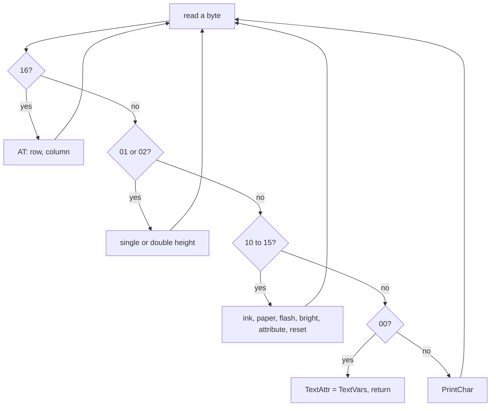

```asm
PrintText:
  E667  LD A,(HL)
  E668  INC HL
  E669  CP $16
  E66B  JR Z,PrintTextAt
  ...
  E68D  AND A
  E68E  JR Z,PrintTextEnd
  E690  CALL PrintChar
  E693  JR PrintText
PrintTextEnd:
  E695  LD A,(TextVars)
  E698  LD (TextAttr),A
  E69B  RET
PrintTextAt:
  E69C  LD C,(HL)
  E69D  INC HL
  E69E  LD B,(HL)
  E69F  INC HL
  E6A0  LD (TextRow),BC
  E6A4  JR PrintText
```

### The FLASH and BRIGHT bug

The code reaches PrintTextFlash through `CP $12` and `JR Z`.
A `CP` that finds the two equal leaves the carry clear.
`RR A` rotates through the carry, so bit 0 goes into the carry and a 0 comes into bit 7.
For FLASH 1 the result is 0, and `AND $80` keeps nothing.
BRIGHT rotates twice: bit 0 goes to the carry, then back into bit 7, and `AND $40` again keeps nothing.
`RRCA` instead of `RR A` would have worked, because it copies bit 0 into bit 7.

```asm
PrintTextFlash:
  E6D9  LD A,(HL)
  E6DA  INC HL
  E6DB  RR A
  E6DD  AND $80
  E6DF  LD C,A
  E6E0  LD A,(TextAttr)
  E6E3  AND $7F
  E6E5  OR C
  E6E6  LD (TextAttr),A
  E6E9  JP PrintText
PrintTextBright:
  E6EC  LD A,(HL)
  E6ED  INC HL
  E6EE  RR A
  E6F0  RR A
  E6F2  AND $40
  ...
```

Worked example: the menu's last line is `16 17 03 01 10 02 13 01 56 45 ...` at `$F040`.
AT 23, 3; single height; INK 2 makes TextAttr `$02`.
BRIGHT 1: the first `RR A` gives 0 with the carry set, the second gives `$80` with the carry clear, and `AND $40`
gives 0.
TextAttr stays `$02`: dark red, not bright.
The [menu shot](img/play/c1-013782-menu.png) shows "VERSIONED BY J250 <SPAIN>" in dark red under the options.

Witness: PrintText L1 46 858; the BRIGHT code runs at each menu drawing; no string uses FLASH.

### READY? printed

Worked example: `c1`, frame 13 926.
ReadyText `$AD3B` is `16 0B 0D 14 07 02 72 65 61 64 79 3F 00`.
That is AT 11, 13; attribute 7; double height; "ready?"; the end.
Six glyphs are drawn, each 16 lines high, in columns 13-18 of rows 11 and 12.

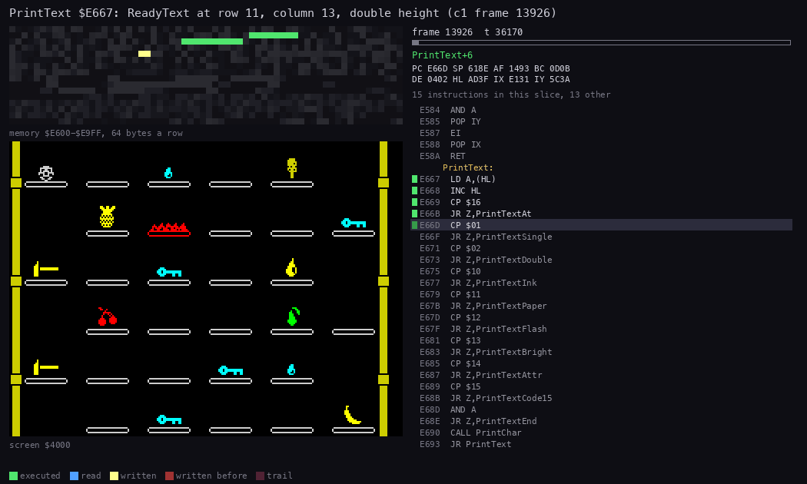

*PrintText walks ReadyText and draws "ready?" at row 11 over the new level. How to read: the listing on the right
follows the dispatch at each byte; the memory map shows the string and TextRow, TextColumn and TextAttr read and
written; the screen shows each glyph as it lands. `c1`, frame 13 926, T 35 900 to T 52 100.
`python3 R/kit/routine_anim.py --work work/docs/bmA/c1 --window 13926:35900-13926:52100 --listing build/game.lst
--pc E667-E7C8 --range E600-E9FF --pictures 60 --out docs/img/routines/PrintText.gif`.*

The glyphs of "ready?" are codes 97-122 and 63, so the screen shows capitals with a bar under them.
Nothing prints over READY? to erase it.
When a key is pressed, LifeStart `$ACBC` clears the play area and builds the level again (doc 7).

The point: one printer with a few codes is the whole text system; two of its codes do nothing, and no string needs
them to work.

## 8.4 PrintChar `$E717` and DrawGlyph `$E73E`

PrintChar handles the two layout codes and replaces anything outside 32-127 with "?".
DrawGlyph copies the glyph's 8 bytes to the 8 pixel lines of the character cell, then writes the attribute.
At double height each glyph byte goes to two lines in a row, so the glyph covers the cell and the one below.
The line addresses come from SpectrumLines `$B52D` (doc 6).
Its entry `8 × row + 7` is the cell's top line, because the table is indexed by CPC line, the Spectrum line + 7.

```text
PrintChar(A):
    if A = $0D: NewLine                    ; column 0, row + 1, 24 -> 0
    elif A = $09: NextColumn               ; column + 1, 32 -> NewLine
    elif A < 32 or A >= 128: DrawGlyph('?')
    else: DrawGlyph(A)

DrawGlyph(A):
    glyph = $F4C9 + 8 * A; k = 0
    for line in 0..7:
        screen[SpectrumLines[8*row + 7 + k] + column] = glyph[line]; k += 1
        if TextDouble: screen[SpectrumLines[8*row + 7 + k] + column] = glyph[line]; k += 1
    attr[$5800 + 32*row + column] = TextAttr
    if TextDouble: attr[$5800 + 32*(row+1) + column] = TextAttr
    NextColumn
```

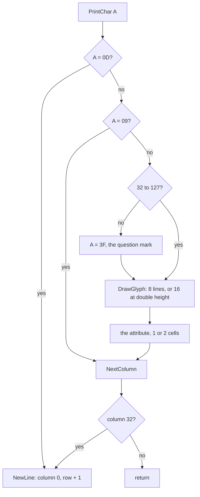

```asm
DrawGlyph:
  E73E  LD DE,SfxSpikeDeathParams+$000E
  E741  LD L,A
  E742  LD H,$00
  E744  ADD HL,HL
  E745  ADD HL,HL
  E746  ADD HL,HL
  E747  ADD HL,DE
  E748  LD BC,$08FF
  E74B  LD IX,SpectrumLines+$000E
  E74F  LD A,(TextRow)
  ...
DrawGlyphLoop:
  E75F  LD D,(IX+$01)
  E762  LD A,(TextColumn)
  E765  OR (IX+$00)
  E768  LD E,A
  E769  LDI
  E76B  INC IX
  E76D  INC IX
  E76F  LD A,(TextDouble)
  E772  AND A
  E773  JR Z,DrawGlyphSkip
  E775  DEC HL
  ...
DrawGlyphSkip:
  E786  DJNZ DrawGlyphLoop
```

Worked example: the "r" of READY? at row 11, column 13, double height.
The glyph is at `$F4C9 + 8 × $72 = $F859`.
Its first byte goes to lines 88 and 89, its last to lines 102 and 103.
The attribute 7 goes to `$5800 + 32 × 11 + 13 = $596D` and to `$598D` below it.

The "PLAYER" of the two-player texts is printed down column 31, one letter per AT.
Each letter at column 31 moves the column to 32, so NextColumn calls NewLine; the next AT puts the place back.

Witness: PrintChar L1 34 443, DrawGlyph L1 34 375.
The 68 runs that did not draw are the `$09` codes of the hall of fame title: 17 a drawing, 4 drawings.
NewLine L1 49 (`menu`, `twoname`), all from column 31.

The point: the printer works in character cells, so text never clashes with itself, but it overwrites the graphics
that share its cells.

## 8.5 Every string

| Address | Name | Decoded | Printed by |
| --- | --- | --- | --- |
| `$AD3B` | ReadyText | AT 11,13; ATTR 7; double; "ready?" | LifeStart, one player |
| `$AD48` | Player1ReadyText | AT 9,12 ATTR 5 "PLAYER 1"; AT 12,13 ATTR 7 "ready?"; then "PLAYER" down column 31 (rows 4-14) and "1" at row 17 | LifeStart, two players, player 1 |
| `$AD84` | Player2ReadyText | the same with "PLAYER 2" and "2" | LifeStart, player 2 |
| `$ADBF` | BlankReadyText | the end byte alone | known only from the code: no instruction loads it |
| `$E7CD` | OnceUponATimeText | `$1F 02 0A`, ATTR `$38`, single "Erase ", double "Una Vez ..." | PrintOnceUponATime `$E7C6`, which nothing calls |
| `$EDEF` | HofTitleText | red bars of spaces (ATTR `$57`) at rows 1 and 3; a blue box (ATTR `$0F`) at rows 6-17; "B U M P Y" in yellow on red at row 2; "H A L L   O F   F A M E" at row 20 | ShowHallOfFame |
| `$EEB3` + 32n | the four records | AT row,10; ATTR `$0F`; double; name, " : ", five digits | PrintHallOfFame `$ED2D` |
| `$EFEF` | MenuText | "0   GAME" (row 8), "1 ONE PLAYER" (11), "2 KEYBOARD" (14), "3 SINCLAIR" (17), "4 KEMPSTON" (20), all double; "VERSIONED BY J250 <SPAIN>" single at row 23 | Menu |
| `$F063` | PlayersTexts | "ONE PLAYER" and "TWO PLAYERS", 16 bytes each | copied into MenuText (below) |
| `$F0E8` | MenuBackdropText | spaces in red-on-black, blue and bright attributes behind the logo, rows 0-7, columns 11-19 | Menu |

The menu changes its strings in place instead of keeping several copies.
MenuTogglePlayers copies 11 bytes of PlayersTexts over "ONE PLAYER" at MenuText + `$16`.
MenuSelectControls `$EFC6` sets the ink bytes of KEYBOARD, SINCLAIR and KEMPSTON (MenuText + `$26`, + `$36`, + `$46`)
to 4, green, and the chosen one to 7, white.
In the [menu as `c1` first shows it](img/play/c1-013700-entry.png) (frame 13 700) KEYBOARD is white, SINCLAIR and
KEMPSTON green.
The [two-player menu](img/play/twoname-005300-hall.png) shows "TWO PLAYERS" in the line where "ONE PLAYER" was.

The hall of fame title spaces its letters with `$09`, not with blanks.
A `$09` moves the column without drawing, so the white bars drawn by DrawHofLines `$ED95` show between the letters.

OnceUponATimeText starts with `$1F`, the Amstrad CPC firmware's LOCATE code.
PrintText does not know it: `$1F` and `$0A` would each print "?".
It is a leftover of the CPC original; no recording ran PrintOnceUponATime (known only from the code).

The point: the texts are short and placed by hand, and the menu edits its own strings instead of choosing among
several.

## 8.6 The HUD row

The HUD is character row 0, pixel lines 1-7.

| Columns | Icon | Value | Attribute of the icon |
| --- | --- | --- | --- |
| 3-7 | none | Score `$AAFB`, five digits | the digits `$07` |
| 9, 10-11 | 123 ball | Lives `$AB01` | `$46` bright yellow |
| 14, 15-16 | 124 drop | Water `$AAFD` | `$45` bright cyan |
| 18, 19-20 | 125 key | Keys `$AAFE` | `$45` bright cyan |
| 22, 23-24 | 126 hammer | Hammers `$AAFF` | `$46` bright yellow |
| 26, 27-28 | 127 flash | Level `$AB00`, the index 0-99 | `$42` bright red |

There is no timer on the HUD.
The player sees the timer only as it is counted into the score at the level's end (8.7).

DrawHud `$E58B` redraws all of it every pass.
The frame wait `$B6E4` calls it just before its `HALT`, and LifeStart calls it twice.
PaintHudAttrs `$B6EE` first copies the 20 bytes of HudRowAttrs `$B730` to the attribute row, skipping the gaps.
It also paints column 30 with `$06` for the right panel.
Then six routines print the values: ScoreToHud, LivesToHud, HammersToHud, WaterToHud, KeysToHud and LevelToHud.

```text
DrawHud:
    PaintHudAttrs                       ; 20 attributes of row 0, column 30 of all 24 rows
    column = 3;  PrintNumber5(Score)
    column = 9;  icon(123); PrintNumber2(Lives)
    column = 22; icon(126); PrintNumber2(Hammers)
    column = 14; icon(124); PrintNumber2(Water)
    column = 18; icon(125); PrintNumber2(Keys)
    column = 26; icon(127); PrintNumber2(Level)

PrintDigit(HL, DE):                      ; DE = 10000, 1000, 100, 10 or 1
    C = 0
    while HL >= DE: HL -= DE; C += 1
    HudBlit(Font + $80 + 8 * C)          ; the glyph "0" + C

HudBlit(glyph):
    for line in 1..7: screen[line, column] = glyph[line - 1]    ; glyph row 7 is not drawn
    column += 1
```

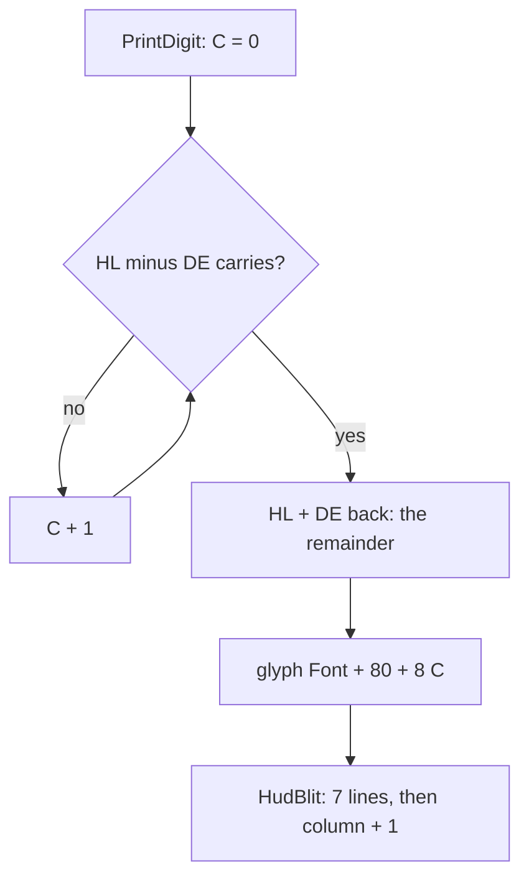

```asm
PrintDigit:
  E62B  LD C,$00
PrintDigitLoop:
  E62D  AND A
  E62E  SBC HL,DE
  E630  JR C,PrintDigitSkip
  E632  INC C
  E633  JR PrintDigitLoop
PrintDigitSkip:
  E635  ADD HL,DE
  E636  LD DE,Font+$0080
PrintHudGlyph:
  E639  PUSH HL
  E63A  LD L,C
  E63B  LD H,$00
  E63D  ADD HL,HL
  E63E  ADD HL,HL
  E63F  ADD HL,HL
  E640  ADD HL,DE
  E641  LD BC,$07FF
HudBlit:
  E644  LD IX,SpectrumLines+$0010
  E648  LD D,(IX+$01)
  E64B  LD A,(HudColumn)
  E64E  OR (IX+$00)
  E651  LD E,A
HudBlitLoop:
  E652  LDI
  E654  DEC DE
  E655  INC D
  E656  DJNZ HudBlitLoop
```

HudBlit takes the address of line 1 once and then steps down with `INC D`.
That works because the lines of one character row are `$0100` apart on the Spectrum screen.

Worked example: a score of 34 191 (the [count shot](img/play/l83-000650-count.png)).
PrintDigit with 10 000 subtracts 3 times and leaves 4191: the glyph "3".
With 1000 it subtracts 4 times and leaves 191: "4".
With 100, once, 91 left: "1"; with 10, 9 times: "9"; with 1: "1".
A digit 9 costs ten subtractions and a 0 one, so the HUD's cost depends a little on the numbers.

The values are two digits.
A byte of 100 or more would give a tens "digit" past "9", the glyphs ":" and on.
Every pick-up and the bottle stop at 99 (`CP $63`), so this is known only from the code.

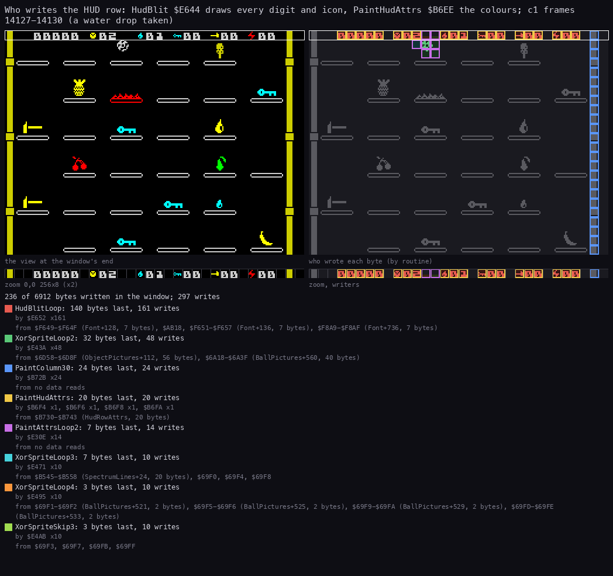

*HudBlit writes the HUD's pixels and PaintHudAttrs its colours, every pass. How to read: the left screen is the end of
the window; on the right each byte written in the window is coloured by the routine that wrote it, and the zoom below
is row 0 at twice the size; the list says what each writer read. The ball and the drop's cell come from the sprite
routines (doc 6). `c1`, frame 14 127 T 1800 to frame 14 130 T 30 000 (a water drop taken).
`python3 R/kit/writers_map.py --trace work/docs/bmA/c1/traces/14127_1800-14130_30000.uatr --listing build/game.lst
--sources --zoom 0,0,256,8 --title '...' --out docs/img/hud/writers-hud.png`.*

The window holds three passes.
HudBlitLoop wrote 140 bytes with 161 writes: the same 7 lines of 20 cells, again and again.

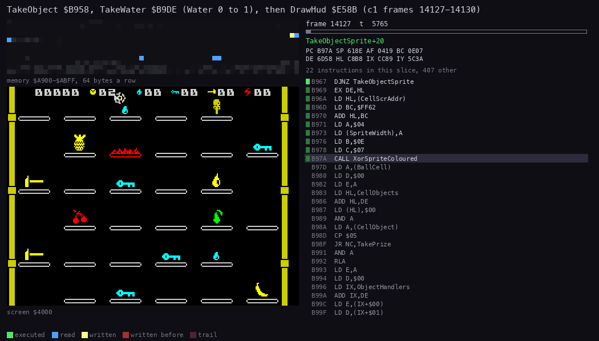

*The water count goes from 0 to 1 in the pass the drop is taken. How to read: TakeWater writes Water `$AAFD` in the
memory map; then DrawHud runs and the digits at columns 15-16 change on the screen. `c1`, frame 14 127 T 1800 to
frame 14 130 T 30 000. `python3 R/kit/routine_anim.py --work work/docs/bmA/c1 --window 14127:1800-14130:30000
--listing build/game.lst --pc B958-BA46,E58B-E666 --range A900-AB7F --pictures 60
--out docs/img/routines/DrawHud.gif`.*

Witness: DrawHud L1 95 989, PaintHudAttrs L1 95 989, HudBlit L1 1 952 744 (about 20 glyphs a pass).

The top row of cells (doc 6) shares character row 0 with the HUD.
A wall or an object of the top row is drawn there by the sprite routines, and the next DrawHud prints over it.
In the [count shot](img/play/l83-000650-count.png) a wall of the top row runs through the hammers' digits.

The point: the HUD costs a fixed part of every pass, 20 glyphs and 44 attributes, and in exchange nothing has to
remember what changed.

## 8.7 The timer counted into the score

The timer `$AB04` starts at 1000, and TickTimer `$B7D1` takes one off each pass, stopping at 0.
When the ball sinks into the exit, LevelEnd `$B2C2` stores the next level and sinks the ball in 9 steps.
Then it plays SfxLevelEnd (38.6 frames, doc 9) and waits 15 frames.
Then it counts the timer into the score, one point at a time.

```text
LevelEndTimer:
    while Timer != 0:
        Timer -= 1
        SfxTimerTick                       ; 84 161 T, 1.2 frames
        Score += 1
        PrintNumber5(Score) at column 3    ; the HUD's score only
```

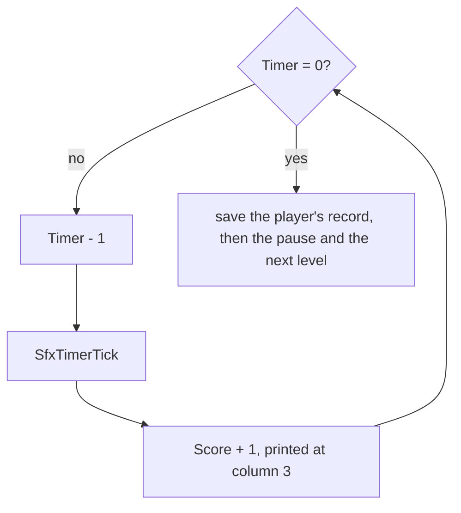

```asm
LevelEndTimer:
  B35F  LD HL,(Timer)
  B362  LD A,H
  B363  CP $00
  B365  JR Z,LevelEndTimerLow
LevelEndTick:
  B367  DEC HL
  B368  LD (Timer),HL
  B36B  CALL SfxTimerTick
  B36E  LD A,$03
  B370  LD (HudColumn),A
  B373  LD HL,(Score)
  B376  INC HL
  B377  LD (Score),HL
  B37A  CALL PrintNumber5
  B37D  JR LevelEndTimer
LevelEndTimerLow:
  B37F  LD A,L
  B380  CP $00
  B382  JP Z,LevelEndSave
  B385  JR LevelEndTick
```

Worked example: `rec/l83`.
At frame 522 the score is 34 151 and the timer 711; Level already reads 84.
At frame 672 the score is 34 208 and the timer 653: 58 points counted.
The count starts near frame 594, after the sinking, SfxLevelEnd and the 15 frames.
So a point takes about 1.3 frames, and the whole 711 takes about 950 frames, 19 seconds.
During the count the HUD's level number already shows 84 ([shot](img/play/l83-000650-count.png)).

Witness: LevelEnd L1 101 (`menu`, the `rec/l*` recordings, 88 of the RZX level recordings).

The point: the count is paced by its own sound, so a fast level, which leaves more of the timer, also has a longer
count.

## 8.8 The hall of fame

### The records

HallOfFame `$EEB3` is four records of 32 bytes.
Each record is a PrintText string followed by its score as a word.

| Offset | Bytes | Meaning |
| --- | --- | --- |
| +0..+2 | `$16` row column | AT; PrintHallOfFame rewrites the row to 7, 10, 13 or 16 |
| +3..+4 | `$14 $0F` | white on blue |
| +5 | `$02` | double height |
| +6..+8 | 3 | the name |
| +9..+11 | " : " | |
| +12..+16 | 5 | the score as ASCII digits: what is shown |
| +17 | `$00` | the end |
| +18..+19 | word | the score: what is compared |
| +20..+31 | 12 | zero, unused |

At power-on the table is PAP 16 000, PEP 8000, PIP 4000 and POP 1700.
It lives only in memory: a new load resets it.

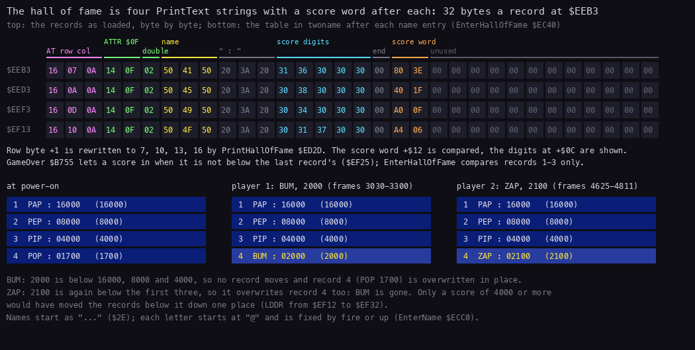

*The hall of fame is four PrintText strings, each with its score word, and `twoname` replaces the fourth twice. How
to read: the top rows are the 128 bytes as loaded, coloured by field; the three tables below are the records after
power-on, after player 1's entry and after player 2's. `twoname`, frames 3030-3300 and 4625-4811; the tables are
computed the way EnterHallOfFame inserts and match `twoname`'s last state (ZAP 2100 at `$EF13`).
`python3 tools/fig_text.py hof`.*

### Who gets in, and where

GameOver `$B755` compares the score with the fourth record's word at HallOfFame + `$72` = `$EF25`.
If the score is not below it, EnterHallOfFame `$EC40` runs.

EnterHallOfFame first flashes the border: 250 times the 8 colours from 7 down to 0, with Delay `$B873` (B = 2)
between them.
Counted from the code, the flash takes about 4.3 million T-states, 62 frames.
Then it looks for the place, comparing with records 1, 2 and 3 only.
At the first record whose score is not above the new one, the records from there to record 3 move down one place.
The move is an `LDDR` from `$EF12` to `$EF32`, and record 4 is lost.
If none of the three is beaten, record 4 is overwritten without a compare, since GameOver has compared it already.
The record gets the score word, the name "..." (`$2E`) and the five digits from ScoreToDigits `$ED4C`.

```text
GameOver:
    if Score >= HallOfFame[3].score: EnterHallOfFame

EnterHallOfFame:
    flash the border 250 x 8 colours
    place = 3
    for i in 0..2:
        if Score >= HallOfFame[i].score: place = i; break
    move records place..2 down one (record 3 lost)
    record = HallOfFame[place]
    record.score = Score; record.name = "..."; record.digits = Score as 5 digits
    ShowHallOfFame
    EnterName(record)
```

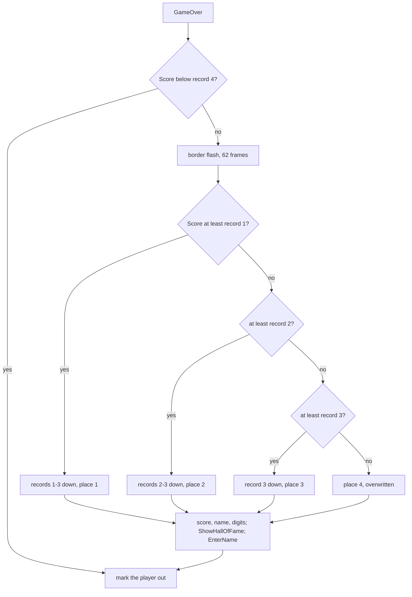

```asm
GameOverHiScore:
  B764  PUSH IX
  B766  PUSH AF
  B767  AND A
  B768  LD HL,(Score)
  B76B  LD IX,HallOfFame+$0072
  B76F  LD D,(IX+$01)
  B772  LD E,(IX+$00)
  B775  SBC HL,DE
  B777  CALL NC,EnterHallOfFame
...
EnterHallOfFame:
  EC40  LD B,$FA
  ...
  EC57  LD IX,HallOfFame
  EC5B  DI
  EC5C  PUSH IY
  EC5E  LD IY,$0060
  EC62  LD B,$03
EnterHallOfFameLoop3:
  EC64  PUSH BC
  EC65  LD E,(IX+$12)
  EC68  LD D,(IX+$13)
  EC6B  LD HL,(Score)
  EC6E  AND A
  EC6F  SBC HL,DE
  EC71  JR NC,EnterHallOfFameSkip
  ...
  EC87  DJNZ EnterHallOfFameLoop3
  ...
EnterHallOfFameSkip:
  EC8E  POP BC
  EC8F  LD DE,HallOfFame+$007F
  EC92  LD HL,HallOfFame+$005F
  EC95  PUSH IY
  EC97  POP BC
  EC98  LDDR
```

A tie gets in: `SBC` with no carry means "equal or more".
A tie also goes above the old record with the same score.

ShowHallOfFame `$ED1A` clears the screen with a black border.
It draws the white bars with DrawHofLines `$ED95`, pairs of lines from the table HofLineRows `$EDE1`.
Then it prints HofTitleText and the records.
The menu shows the same screen on every second time-out, for 750 frames (MenuShowHallOfFame `$F165`, doc 5).

Worked example: `twoname`.
Player 1's score is POKEd to 2000 before his last life (the recording's script says so).
2000 is not below POP's 1700, so EnterHallOfFame runs.
2000 is below 16 000, 8000 and 4000, so the fourth record is overwritten with "... : 02000"
([shot](img/play/twoname-002300-name-start.png), the first letter already "@").
Player 2 then scores 2100, which beats BUM's 2000 and none of the first three: ZAP overwrites BUM.
The recording's last state holds "ZAP : 02100" at `$EF13`.
No recording put a score into places 1-3, so the `LDDR` move is known only from the code.

Witness: EnterHallOfFame L1 3 (`gameover`, `twoname`), ShowHallOfFame L1 4, PrintHallOfFame L1 714.

The point: the table is a list of strings ready to print, and putting a score in means moving strings, not sorting
numbers.

## 8.9 The name entry

EnterName `$ECC0` takes three letters.
Each letter starts as "@" (`$40`).
Right steps it up, left steps it down, and fire or up fixes it.
Right wraps from "Y" to "@", and left from "@" to "Z", so "Z" is reached only by left.
The keys are read every 5 frames, and the records are printed again each time.

```text
EnterName(record):
    WaitRelease
    for each of the 3 letters of record.name:
        letter = '@'
        loop:
            if TestUpOrFire: WaitRelease; break
            if TestRight: letter += 1; if letter >= 'Z': letter = '@'
            elif TestLeft: letter -= 1; if letter < '@': letter = 'Z'
            PrintHallOfFame
            5 x HALT
```

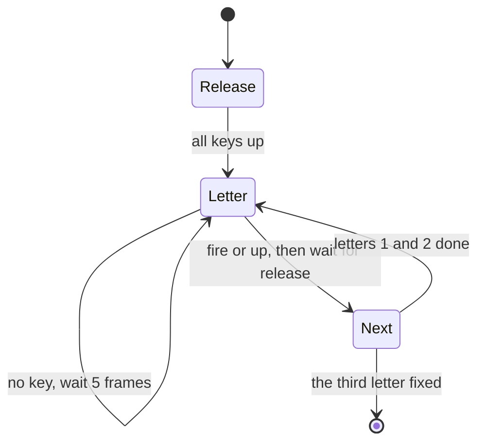

```asm
EnterName:
  ECC0  CALL WaitRelease
  ECC3  LD HL,(NewRecordPtr)
  ECC6  LD BC,$0006
  ECC9  ADD HL,BC
  ECCA  LD (NameLetterPtr),HL
  ECCD  LD B,$03
EnterNameLoop:
  ECCF  LD (HL),$40
  ECD1  PUSH BC
EnterNameLoop2:
  ECD2  CALL TestUpOrFire
  ECD5  JR NZ,EnterNameSkip5
  ECD7  CALL TestRight
  ECDA  JR Z,EnterNameSkip2
  ECDC  LD HL,(NameLetterPtr)
  ECDF  LD A,(HL)
  ECE0  INC A
  ECE1  CP $5A
  ECE3  JR C,EnterNameSkip
  ECE5  LD A,$40
EnterNameSkip:
  ECE7  LD (HL),A
  ECE8  JR EnterNameSkip4
EnterNameSkip2:
  ECEA  CALL TestLeft
  ECED  JR Z,EnterNameSkip4
  ECEF  LD HL,(NameLetterPtr)
  ECF2  LD A,(HL)
  ECF3  DEC A
  ECF4  CP $40
  ECF6  JR NC,EnterNameSkip3
  ECF8  LD A,$5A
EnterNameSkip3:
  ECFA  LD (HL),A
EnterNameSkip4:
  ECFB  CALL PrintHallOfFame
  ECFE  EI
  ECFF  HALT
  ...
  ED07  HALT
  ED08  JR EnterNameLoop2
EnterNameSkip5:
  ED0A  CALL WaitRelease
  ED0D  LD HL,(NameLetterPtr)
  ED10  INC HL
  ED11  LD (NameLetterPtr),HL
  ED14  POP BC
  ED15  DJNZ EnterNameLoop
  ED17  RET
```

The upward wrap test is off by one.
`INC A`, `CP $5A` and `JR C` keep the letter only while it is below "Z".
So right goes "X", "Y", "@", and "Z" is skipped going up.
Going down, `CP $40` and `JR NC` allow "@", and below it comes "Z".
The entry's alphabet is "@" and A-Z, but Z only by left from "@".

Worked example: `twoname`, player 1 spells B U M (`tests/inputs/twoname.txt`).

| Frames | Keys | Letter |
| --- | --- | --- |
| 3032, 3039 | P, P | "@" to "A" to "B" |
| 3045 | SPACE | "B" fixed |
| 3085-3114 | O six times | "@" to "Z", "Y", "X", "W", "V", "U" |
| 3120 | SPACE | "U" fixed |
| 3160-3231 | P thirteen times | "@" to "A" ... "M" |
| 3237 | SPACE | "M" fixed |

Player 2 spells Z A P the same way.
O once gives "Z", P once gives "A", and O eleven times goes from "@" down to "P".
The [shot at frame 3300](img/play/twoname-003300-name.png) shows "BUM : 02000" as the fourth record.

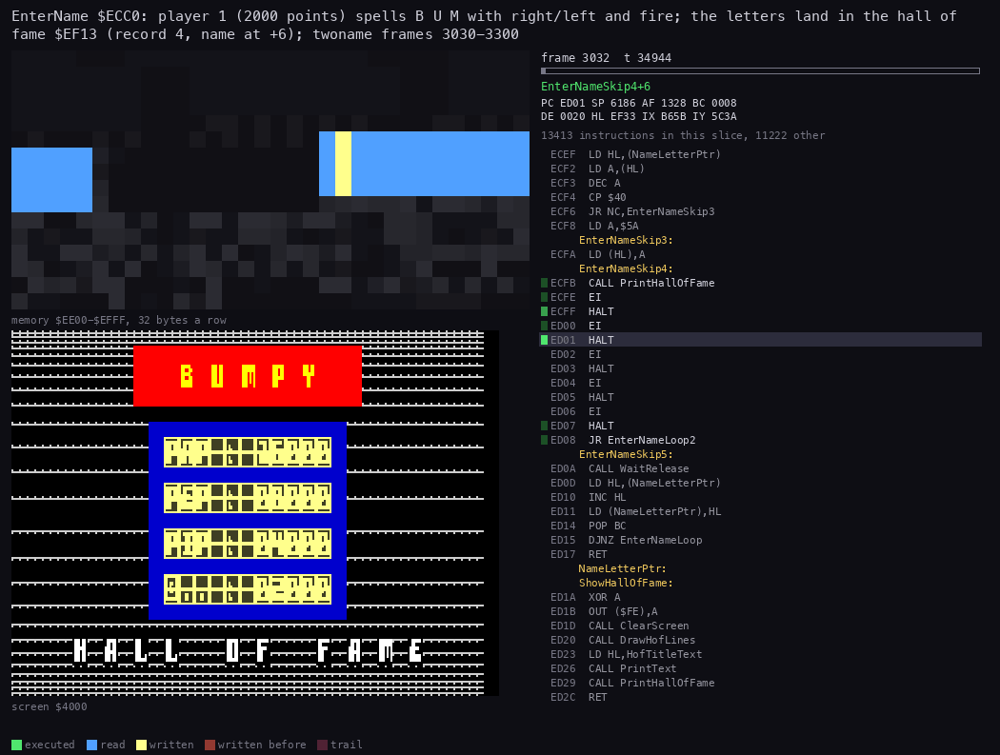

*Player 1 picks B, U and M by right and left, five frames a step. How to read: the listing on the right is EnterName
and PrintHallOfFame; the memory map is `$EE00-$EFFF`, where the name bytes at `$EF19-$EF1B` are written; the screen
shows the four records printed again after each step. `twoname`, frames 3030-3300 (T 0 to T 0). Traced from the
recording opened again with `python3 R/kit/rs.py open --work work/docs/bm/twoname --ttd
work/stage2/rec/twoname/session.ttd --model 48K --ranges 4000-FFFF --port-base 37600`, then
`python3 R/kit/routine_anim.py --work work/docs/bm/twoname --window 3030:0-3300:0 --listing build/game.lst
--pc ECC0-ED94 --range EE00-EFFF --pictures 108 --title '...' --out docs/img/routines/EnterName.gif`.*

In the `gameover` recording the name was left as "@..".
Its script pressed B, U, M and ENTER, keys the entry does not read
([shot](img/play/gameover-004618-hall-of-fame.png), frame 4618).

Witness: EnterName L1 3 (`gameover`, `twoname`).
In `twoname` the right test (`$ECD7`) ran 316 times and the left test (`$ECEA`) 300 times.

The point: three letters by joystick, as on the CPC, with one letter that only the left direction reaches.

## 8.10 Known only from the code

- FLASH and BRIGHT in PrintText never set their bit; no string uses FLASH, and the menu's BRIGHT 1 has no effect (8.3).
- BlankReadyText `$ADBF` and OnceUponATimeText `$E7CD` (with PrintOnceUponATime `$E7C6`) are never printed.
- A HUD value of 100 or more would print a glyph past "9" (8.6).
- A score that beats record 3 moves the table down with `LDDR`; no recording reached 4000 points before a game over.
