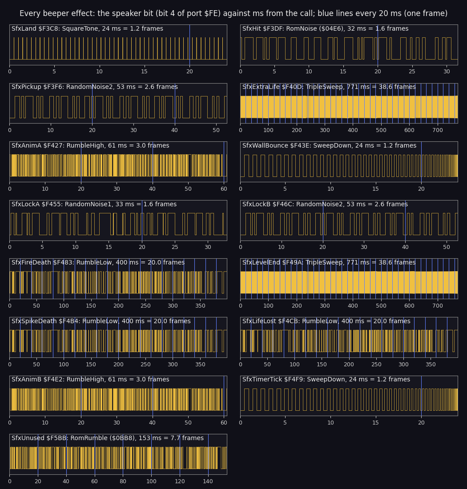
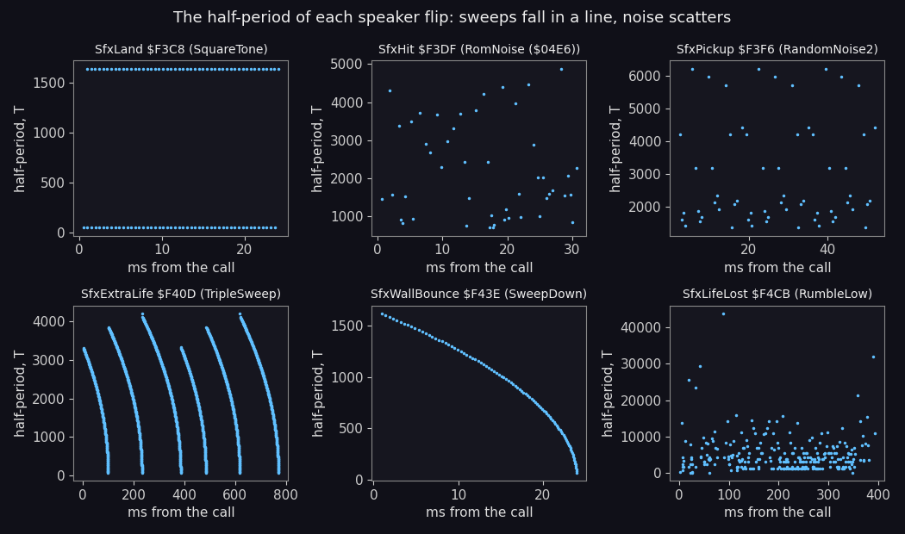
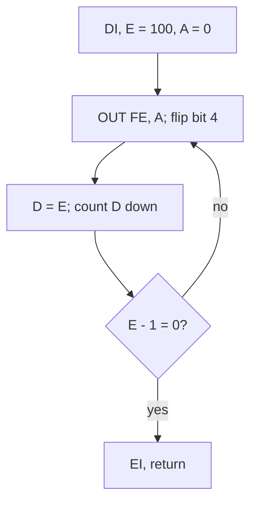
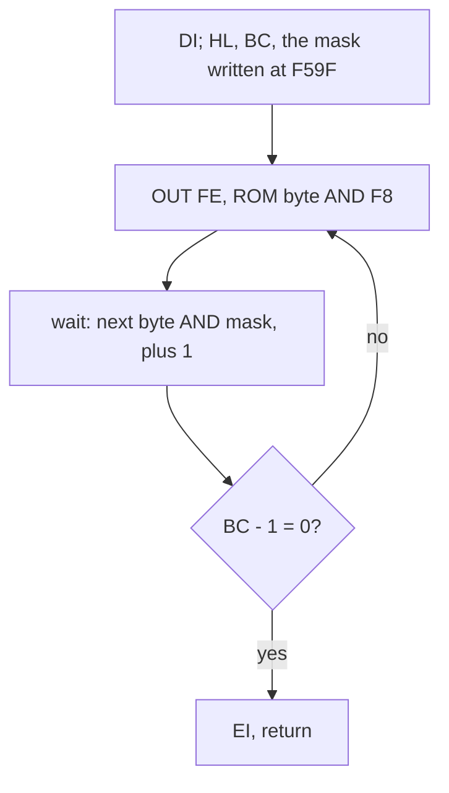
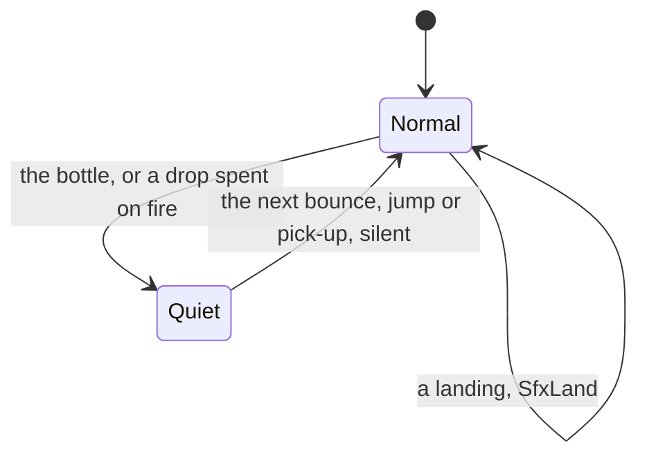
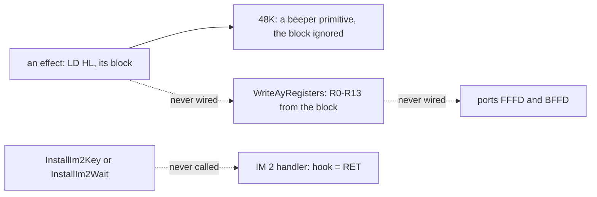

# 9. Sound

What this covers:

- the 14 beeper effects and the one nothing calls, each rendered as a short WAV;
- the 7 primitives that make them, with their loops and their cost in frames;
- what an effect costs the game: interrupts off, the game stopped;
- the quiet flag that skips a click after the bottle or a water drop;
- the AY register blocks behind every effect, and the unrun 128K AY code at `$F183-$F3C7`.

Bumpy on the 48K has no music.
Every sound is an effect played by the CPU on the speaker, bit 4 of port `$FE`, with interrupts off.
The game stops while an effect plays.

The recordings it rests on ([WALKTHROUGH 6.0](../WALKTHROUGH.md#60-the-recordings); all on the 48K):

| Recording | Used for |
| --- | --- |
| `c1` | landings and a water drop picked up (frames 14 096-14 133) |
| `rzx/l01` | a brick layer (frame 149), a jump (484), a lock opened in three stages (588, 603, 619) |
| `fire` | the death on fire (frame 41) |
| `rzx/l68` | a life lost by falling out (frame 690) |
| `rec/l83` | a prize (frame 341), the level end and the timer's count (frames 522-672) |
| none | the sound itself: each effect run on SkoolKit's Z80 simulator from its entry (`tools/fig_sound.py`) |

The frames in the witness column are the first call of the effect in a cached access trace of that recording.

Conventions:

- **A frame** is 69 888 T-states, 20 ms at 3.5 MHz.
- **A flip** is a change of the speaker bit; a half-period is the time between two flips.
- **L1 n** is how many times a routine ran in all the recordings (the witness line of `game.ann`).
- The asm is from `build/game.lst`; `...` marks lines left out.
- Never play the WAVs from a script: they are for a reader to open.

## 9.1 The effects

Every effect is three instructions: `LD HL` with its parameter block, a `CALL` of a primitive, and `RET`.
SfxExtraLife and SfxLevelEnd call their primitive twice.

| Effect | Primitive | Played when | OUTs | flips | T-states | frames | WAV | L1 | First traced call |
| --- | --- | --- | ---: | ---: | ---: | ---: | --- | ---: | --- |
| SfxLand `$F3C8` | SquareTone | a bounce or a move lands on a platform | 100 | 99 | 84 511 | 1.21 | [land](img/sound/land.wav) | 2605 | `c1` 14 096 T 3415 |
| SfxHit `$F3DF` | RomNoise | the first step of a jump up from a platform that is not bricks | 100 | 49 | 110 676 | 1.58 | [hit](img/sound/hit.wav) | 1314 | `rzx/l01` 484 T 3310 |
| SfxPickup `$F3F6` | RandomNoise2 | a prize, key, drop or hammer; a menu option | 100 | 61 | 184 317 | 2.64 | [pickup](img/sound/pickup.wav) | 1034 | `c1` 14 127 T 12 159 |
| SfxExtraLife `$F40D` | TripleSweep × 2 | the bottle | 1402 | 1399 | 2 699 370 | 38.62 | [extra-life](img/sound/extra-life.wav) | 20 | `menu`, `l10`, `l36`, `l45`, `l68` (no trace) |
| SfxAnimA `$F427` | RumbleHigh | a water drop starts to fall on a fire | 900 | 470 | 212 982 | 3.05 | [water](img/sound/water.wav) | 55 | `menu`, `l10`, `l36`, `l56`, `l59` (no trace) |
| SfxWallBounce `$F43E` | SweepDown | a wall turns the ball back; a lock 3 lowered | 100 | 99 | 84 161 | 1.20 | [wall-bounce](img/sound/wall-bounce.wav) | 119 | `rzx/l01` 588 T 23 947 |
| SfxLockA `$F455` | RandomNoise1 | a lock 2 lowered | 100 | 62 | 115 077 | 1.65 | [lock-a](img/sound/lock-a.wav) | 38 | `rzx/l01` 603 T 23 939 |
| SfxLockB `$F46C` | RandomNoise2 | a lock 1 lowered (opened) | 100 | 61 | 184 317 | 2.64 | [lock-b](img/sound/lock-b.wav) | 117 | `rzx/l01` 619 T 23 939 |
| SfxFireDeath `$F483` | RumbleLow | a landing on fire with no water | 600 | 268 | 1 398 730 | 20.01 | [fire-death](img/sound/fire-death.wav) | 1 | `fire` 41 T 3448 |
| SfxLevelEnd `$F49A` | TripleSweep × 2 | the ball has sunk into the exit | 1402 | 1399 | 2 699 370 | 38.62 | [level-end](img/sound/level-end.wav) | 101 | `rec/l83`, between 522 and 594 (no trace) |
| SfxSpikeDeath `$F4B4` | RumbleLow | spikes | 600 | 268 | 1 398 730 | 20.01 | [spike-death](img/sound/spike-death.wav) | 13 | 8 RZX levels (no trace) |
| SfxLifeLost `$F4CB` | RumbleLow | a fall out below; the S key | 600 | 268 | 1 398 730 | 20.01 | [life-lost](img/sound/life-lost.wav) | 20 | `rzx/l68` 690 T 5612 |
| SfxAnimB `$F4E2` | RumbleHigh | a brick layer knocked off | 900 | 470 | 212 982 | 3.05 | [brick](img/sound/brick.wav) | 409 | `rzx/l01` 149 T 21 724 |
| SfxTimerTick `$F4F9` | SweepDown | one point of the timer counted in | 100 | 99 | 84 161 | 1.20 | [timer-tick](img/sound/timer-tick.wav) | 5598 | `rec/l83`, 58 calls in frames 594-672 |
| SfxUnused `$F5BB` | RomRumble | nothing calls it | 900 | 426 | 536 425 | 7.68 | [unused](img/sound/unused.wav) | 0 | known only from the code |

The numbers come from the simulator, which counts no contention.
The code and its delays are above `$8000`, so only the `OUT` may wait for the ULA, a few T-states at most.

The three death effects share RumbleLow and its fixed ROM samples, so fire, spikes and a fall sound the same.
SfxLockB and SfxPickup are the same primitive with the same timing: opening a lock sounds like a pick-up.

The names SfxAnimA and SfxAnimB are the listing's.
SfxAnimA is called only by the water-drop animations WaterA1 `$C019`, WaterB1 `$C04C` and WaterC1 `$C07F`.
SfxAnimB is called only by BrickCrumble1 `$BEBB`.



*Every effect as the speaker sees it: the bit toggles in sweeps, noise and long rumbles. How to read: one panel an
effect, the speaker bit against milliseconds from the call; the blue lines are frame boundaries, every 20 ms; the
panel's title gives the primitive and the length. No recording: each effect run on SkoolKit's simulator from its
entry, T 0 being the first instruction. `python3 tools/fig_sound.py waves`.*



*Sweeps fall in a line and noise scatters: the half-periods show which primitives are tones. How to read: one dot a
flip, its half-period in T-states against the time of the flip; SquareTone has two values (the "on" delay and the
short "off"), SweepDown one falling line, TripleSweep six falling lines from two calls. No recording: the simulator, as
above. `python3 tools/fig_sound.py pitch`.*

The point: fifteen effects from seven loops; the effects that matter to the player are told apart by length and
character, not by pitch.

## 9.2 The primitives

All seven turn interrupts off at the start and on at the end.
TripleSweep is the exception inside: each SweepFromE it calls ends with `EI`, so its second and third sweeps run with
interrupts on.
None reads its parameter block, except RomNoise, which uses the block address's low byte.

| Primitive | Address | Loop | Delay of each half-period |
| --- | --- | --- | --- |
| SquareTone | `$F54C` | 100 half-periods | 100 turns of `DEC D / JR NZ` after the bit goes off, none after it goes on |
| SweepDown, SweepFromE | `$F510`, `$F513` | E from 100 (or the given E) down to 1 | E turns: the pitch rises |
| RandomNoise1 | `$F521` | 100 | R turns; the bit is R's bit 4 |
| RandomNoise2 | `$F534` | 100 | `$50` + (R AND `$3F`) turns; the bit is R's bit 4 |
| RomNoise | `$F560` | 100 | `$28` + (ROM byte AND `$3F`); bit and delay from the ROM at `$0400` + L |
| TripleSweep | `$F579` | three SweepFromE | E = R + `$8C`, with R set to `$3F` first; the third from E = 0, a full 256 |
| RomRumble | `$F598` | BC samples | (next ROM byte AND mask) + 1 turns of a 20-T loop; `OUT` the ROM byte AND `$F8` |

RumbleLow `$F58C` (600 samples from `$0000`, mask `$F0`), RumbleHigh `$F5AD` (900 from `$1770`, mask `$0E`) and
SfxUnused (900 from `$0BB8`, mask `$38`) only set HL, BC and the mask, then jump to RomRumble.
The mask is written into the `AND` at `$F59F`: the code changes itself.

### SweepDown: a rising tone

```text
SweepFromE(E):
    A = 0
    repeat:
        OUT ($FE), A            ; the speaker bit 4
        A = A XOR $10
        wait E turns            ; DEC D / JR NZ, 16 T a turn
        E = E - 1
    until E = 0
```



```asm
SweepDown:
  F510  DI
  F511  LD E,$64
SweepFromE:
  F513  XOR A
SweepFromELoop:
  F514  OUT ($FE),A
  F516  XOR $10
  F518  LD D,E
SweepFromELoop2:
  F519  DEC D
  F51A  JR NZ,SweepFromELoop2
  F51C  DEC E
  F51D  JR NZ,SweepFromELoop
  F51F  EI
  F520  RET
```

Worked example: SfxTimerTick.
The first half-period is 100 turns of 16 T plus the loop's 36 T, about 1617 T: 1082 Hz for a full period.
The last is one turn, 65 T: about 27 kHz, past hearing.
So each tick is a chirp of 24 ms, rising out of hearing ([timer-tick.wav](img/sound/timer-tick.wav)).
In `rec/l83` it plays 58 times between frames 594 and 672, about 1.3 frames apart.

### SquareTone: a pulse train

```text
SquareTone:
    A = 0
    repeat 100 times:
        OUT ($FE), A
        A = A XOR $10
        if A != 0: wait 100 turns       ; the bit just written was 0: a long "off" half
```

```asm
SquareTone:
  F54C  DI
  F54D  LD E,$64
  F54F  XOR A
SquareToneLoop:
  F550  OUT ($FE),A
  F552  XOR $10
  F554  JR Z,SquareToneSkip
  F556  LD D,$64
SquareToneLoop2:
  F558  DEC D
  F559  JR NZ,SquareToneLoop2
SquareToneSkip:
  F55B  DEC E
  F55C  JR NZ,SquareToneLoop
  F55E  EI
  F55F  RET
```

Worked example: SfxLand.
The simulator gives half-periods of 1643 T off and 46 T on: a period of 1689 T, 2072 Hz.
The speaker is on for 3 % of each period, a narrow pulse.
Fifty periods take 84 511 T, 1.21 frames.
That narrow pulse is the bounce click the player hears 2605 times in the recordings.

### The noises

RandomNoise1 and RandomNoise2 take both the bit and the delay from R, the refresh register.
R counts instruction fetches, so the noise depends on where the program was; the simulator starts R at 0.
RomNoise reads the ROM from `$0400` + L, where L is the low byte of the block address: SfxHit's `$F3E6` gives `$04E6`.

```asm
RandomNoise2:
  F534  DI
  F535  LD E,$64
RandomNoise2Loop:
  F537  LD A,R
  F539  AND $10
  F53B  OUT ($FE),A
  F53D  LD A,R
  F53F  AND $3F
  F541  ADD A,$50
  F543  LD D,A
RandomNoise2Loop2:
  F544  DEC D
  F545  JR NZ,RandomNoise2Loop2
  F547  DEC E
  F548  JR NZ,RandomNoise2Loop
  F54A  EI
  F54B  RET
```

### TripleSweep: the jingle

TripleSweep sets R to `$3F`, so the two R-based start values are the same every time.
It sweeps from E = R + `$8C` twice, then once more from E = 0, which counts a full 256.
SfxExtraLife and SfxLevelEnd call it twice: six sweeps, 38.6 frames.

```asm
TripleSweep:
  F579  DI
  F57A  LD A,$3F
  F57C  LD R,A
  F57E  LD B,$02
TripleSweepLoop:
  F580  LD A,R
  F582  ADD A,$8C
  F584  LD E,A
  F585  CALL SweepFromE
  F588  DJNZ TripleSweepLoop
  F58A  JR SweepFromE
```

SweepFromE ends with `EI`, and TripleSweep does not turn them off again.
So the second and third sweeps run with interrupts on, and an interrupt during them runs the IM 1 handler in the
middle of the tone: a short gap that the simulator, which has no interrupts, does not show.

### RomRumble: the ROM as samples

```text
RomRumble(HL, BC, mask):
    repeat BC times:
        OUT ($FE), (HL) AND $F8     ; border 0; bits 3 (MIC) and 4 (speaker) from the ROM
        HL += 1
        wait ((HL) AND mask) + 1 turns of 20 T
```



```asm
RumbleLow:
  F58C  DI
  F58D  LD HL,$0000
  F590  LD BC,$0258
  F593  LD A,$F0
  F595  LD (RomRumble+$0008),A
RomRumble:
  F598  LD A,(HL)
  F599  INC HL
  F59A  AND $F8
  F59C  OUT ($FE),A
  F59E  LD A,(HL)
  F59F  AND $3F
  F5A1  INC A
RomRumbleLoop:
  F5A2  NOP
  F5A3  DEC A
  F5A4  JR NZ,RomRumbleLoop
  F5A6  DEC BC
  F5A7  LD A,B
  F5A8  OR C
  F5A9  JR NZ,RomRumble
  F5AB  EI
  F5AC  RET
```

Worked example: SfxLifeLost on RumbleLow.
The mask `$F0` keeps the high nibble of each ROM byte, so a delay runs from 1 to 241 turns.
The first 600 bytes of the ROM give 268 flips over 1 398 730 T, 20.0 frames ([life-lost.wav](img/sound/life-lost.wav)).
In `rzx/l68` it starts at frame 690, T 5612, when the ball falls out below.

The MIC bit 3 also comes from the ROM byte.
On a real Spectrum the MIC output moves the speaker level a little; the WAVs use bit 4 only.

The point: the noises are read from the ROM or from R, so the conversion needed no sample data of its own.

## 9.3 What an effect costs

Every primitive runs with interrupts off, apart from TripleSweep's later sweeps.
The Spectrum's frame interrupt is a pulse of 32 T, and one that arrives with interrupts off is lost.
Either way the main loop does not run during an effect, so the pass that played it lasts as long as the sound.

| Length | Effects | What the player sees |
| --- | --- | --- |
| about 1.2 frames | SfxLand, SfxWallBounce, SfxTimerTick | a pass of two frames instead of one |
| 1.6-3 frames | SfxHit, SfxPickup, SfxLockA, SfxLockB, SfxAnimA, SfxAnimB | a short stop |
| 20 frames | the three deaths | the game frozen for 0.4 s while the ball bursts |
| 38.6 frames | SfxExtraLife, SfxLevelEnd | the game frozen for 0.77 s |

Worked example: the timer's count in `rec/l83`.
SfxTimerTick takes 1.20 frames and PrintNumber5 a little more, so each point costs a pass of about 1.3 frames.
A level finished with 711 left on the timer spends about 950 frames on the count (doc 8).

Witness: in `c1` the pass that took the drop at frame 14 127 is the one with SfxPickup at T 12 159; the
next landing's SfxLand is at frame 14 133.

The point: on the 48K the sound is paid for in game time, and the longest pauses in Bumpy are its sounds.

## 9.4 The quiet flag

ObjectFlag `$ABA7` decides whether the next bounce and pick-up make a sound.

| Value | Set by | Effect |
| --- | --- | --- |
| 1 | BounceSound `$C799`, LeftSound `$C868`, RightSound `$CAAE`, before SfxLand | none: a normal landing |
| 4 | TakeBottle `$BA1C`; a water drop spent on a fire (`$CA0C`, `$CC4F`, `$CE4E`) | the next bounce, jump or pick-up is silent |
| 0 | the silent branch that read the 4 | back to normal |



```asm
BounceStep0:
  C778  LD A,(ObjectFlag)
  C77B  CP $04
  C77D  JR Z,BounceQuiet
  ...
BounceQuiet:
  C7BA  LD A,$00
  C7BC  LD (ObjectFlag),A
  C7BF  JR BounceDispatch
```

Worked example: the bottle's SfxExtraLife lasts 38.6 frames and sets the flag to 4.
The landing that follows plays no SfxLand, so the jingle is not cut by a click.

Witness: TakeBottle L1 20, 16 bottles taken (doc 7); BounceStep0 L1 1199.

The point: one byte keeps the long jingles clean.

## 9.5 The AY blocks and the 128K code nobody runs

Each effect loads HL with a 16-byte block that the beeper primitives do not read.
The blocks have the form of AY-3-8912 register images: 14 bytes for registers 0-13, then two zeros.
WriteAyRegisters `$F190` writes exactly that: registers 0-13 from the 14 bytes at HL.
The blocks are the effects of a machine with an AY chip, the CPC original or a 128K version; the 48K code passes them
to the beeper and ignores them.

`python3 tools/fig_sound.py ay` reads every block as registers:

| Effect | Tone A, B, C (period) | Noise | Mixer | Volumes | Envelope period, shape | Tones at 1 MHz (Hz) | Envelope cycle at 1 MHz (ms) |
| --- | --- | ---: | --- | --- | --- | --- | ---: |
| SfxLand `$F3CF` | 436, 0, 180 | 0 | `$E8` | `$11` `$11` `$11` | 900, 9 | 143, -, 347 | 230 |
| SfxHit `$F3E6` | 1236, 400, 680 | 0 | `$F8` | `$11` `$11` `$11` | 2500, 9 | 51, 156, 92 | 640 |
| SfxPickup `$F3FD` | 200, 200, 200 | 0 | `$F8` | `$11` `$11` `$11` | 2000, 9 | 312, 312, 312 | 512 |
| SfxExtraLife `$F417` | 60, 400, 100 | 20 | `$FA` | `$11` `$11` `$11` | 5000, 9 | 1042, 156, 625 | 1280 |
| SfxAnimA `$F42E` | 3000, 404, 300 | 10 | `$F7` | `$15` `$18` `$1A` | 1000, 9 | 21, 155, 208 | 256 |
| SfxWallBounce `$F445` | 90, 300, 90 | 0 | `$F8` | `$11` `$11` `$11` | 2500, 9 | 694, 208, 694 | 640 |
| SfxLockA `$F45C` | 90, 500, 90 | 0 | `$F8` | `$11` `$11` `$11` | 2500, 9 | 694, 125, 694 | 640 |
| SfxLockB `$F473` | 90, 700, 90 | 0 | `$F8` | `$11` `$11` `$11` | 2500, 9 | 694, 89, 694 | 640 |
| SfxFireDeath `$F48A` | 904, 2404, 1300 | 22 | `$F4` | `$15` `$18` `$1A` | 9000, 9 | 69, 26, 48 | 2304 |
| SfxLevelEnd `$F4A4` | 100, 100, 100 | 0 | `$F8` | `$11` `$11` `$11` | 2500, 15 | 625, 625, 625 | 640 |
| SfxSpikeDeath `$F4BB` | 904, 2404, 1300 | 22 | `$F4` | `$15` `$18` `$1A` | 9000, 9 | 69, 26, 48 | 2304 |
| SfxLifeLost `$F4D2` | 904, 2404, 1300 | 22 | `$F4` | `$15` `$18` `$1A` | 9000, 9 | 69, 26, 48 | 2304 |
| SfxAnimB `$F4E9` | 904, 2404, 1300 | 22 | `$F4` | `$15` `$18` `$1A` | 500, 9 | 69, 26, 48 | 128 |
| SfxTimerTick `$F500` | 50, 50, 50 | 0 | `$F8` | `$11` `$11` `$11` | 400, 9 | 1250, 1250, 1250 | 102 |

Every volume has bit 4 set, so the envelope shapes every effect.
Shape 9 is a single fall to silence; shape 15, on SfxLevelEnd, a single rise then silence.
The three deaths share one block, as they share one beeper primitive, and the brick is the same noise with a short
envelope.
The three locks differ only in tone B: 300, 500 and 700, a falling pitch as the lock opens.
On the 48K the lock stages get SweepDown, RandomNoise1 and RandomNoise2 instead.

The rest of the AY code, all at `$F183-$F3C7`, is never called (known only from the code):

| Address | Routine | What it would do |
| --- | --- | --- |
| `$F183` | Random | a random byte from R and memory |
| `$F190` | WriteAyRegisters | registers 0-13 from 14 bytes at HL |
| `$F19F` | WriteAyRegister | register A = C through ports `$FFFD` and `$BFFD`; register 7 masked with `$3F` so the AY's I/O ports stay inputs |
| `$F1C8` | DelayAfterFrame | a `HALT` and a loop of 512 |
| `$F1D5` | BuildLineTable | the 192 screen line addresses at `$F206` |
| `$F343`, `$F388` | InstallIm2Key, InstallIm2Wait | IM 2 with a vector table at `$FDFF-$FEFF`, I = `$FE`, a `JP` at `$FDFD` |
| `$F36B`, `$F3B0` | Im2HandlerKey, Im2HandlerWait | save all registers, call a hook, `RETI` |
| `$F382`, `$F3C7` | Im2HookKey, Im2HookWait | a `RET`: the place where a per-frame music player would go |

```asm
WriteAyRegisters:
  F190  LD B,$0E
WriteAyRegistersLoop:
  F192  PUSH BC
  F193  LD A,$0E
  F195  SUB B
  F196  LD C,(HL)
  F197  INC HL
  F198  CALL WriteAyRegister
  F19B  POP BC
  F19C  DJNZ WriteAyRegistersLoop
  F19E  RET
WriteAyRegister:
  F19F  CP $07
  F1A1  JR NZ,WriteAyRegisterSkip
  F1A3  LD B,A
  F1A4  LD A,$3F
  F1A6  AND C
  F1A7  LD C,A
  F1A8  LD A,B
WriteAyRegisterSkip:
  F1A9  DI
  F1AA  LD E,C
  F1AB  LD BC,$FFFD
  F1AE  OUT (C),A
  F1B0  LD A,E
  F1B1  LD BC,$BFFD
  F1B4  OUT (C),A
  F1B6  EI
  F1B7  RET
```



Worked example: SfxTimerTick's block `32 00 32 00 32 00 00 F8 11 11 11 90 01 09 00 00`.
Tones A, B and C all have period 50, 1250 Hz on a 1 MHz AY; the mixer `$F8` turns the three tones on and the noise off.
The volumes `$11` hand the level to the envelope; the envelope period `$0190` = 400 with shape 9 falls to silence in
about 102 ms.
On the 48K the same call plays a 24 ms SweepDown chirp.

Witness: WriteAyRegisters, the IM 2 installers and their handlers all have L1 0; nothing in the image calls them.

The point: the 48K version kept the AY version's data and code and replaced only the calls; a 128K build would need
little more than the `CALL`s and an IM 2 hook.

## 9.6 Known only from the code

- SfxUnused `$F5BB`: a RomRumble from `$0BB8` with mask `$38`, 7.7 frames; nothing calls it.
- The AY code at `$F183-$F3C7` and the reading of the 16-byte blocks as AY registers (9.5).
- RandomNoise1 and 2 depend on R; a real run differs from the simulator's in detail, not in length.
