# 10. Gameplay logic

What this covers:

- the ball: nine states, five moves from fixed tables, and the moment the player decides (the landing);
- the spring and the up move, the fall, the ceiling;
- how each platform, wall and object acts on the ball (the details are in [doc 7](07-objects.md));
- every death: the spikes, the fire, the fall out, the S key; and why the timer is not one;
- LoseLife: what a death takes and what it leaves;
- the timer, the score, the extra life, the two players, and what follows level 99;
- the difficulty of the 100 levels;
- the notable features, and what no recording reached.

The recordings it rests on ([WALKTHROUGH 6.0](../WALKTHROUGH.md#60-the-recordings); all on the 48K):

| Recording | Used for |
| --- | --- |
| the RZX (`work/stage2/rzx-states.tsv`) | the state, step, cell, spring, lives and timer after each of its 150 438 frames: a spring jump (frames 788-825), a bottle (frame 7840), the 100 levels and the wrap |
| `c1` | bounces in place and a water drop taken (frames 14 082-14 137), the timer at 0 (frames 15 436-18 186) |
| `rec/l83` | a right jump (frames 349-378) |
| `rzx/l01` | a platform worn (frames 484-495) |
| `rzx/l68` | the RZX's level 68 replayed, drifting from the RZX: a fall out (frames 682-715) and a burst on spikes (frames 920-947) |
| `fire` | level 38, Water `$AAFD` POKEd to 0, the ball moved left onto a burning platform (frame 41) |
| `gameover`, `twoname` | lives lost by S, the game over, two players |
| `scoreloop` | level 87 from the RZX's play start: the RZX's first 330 passes, then S, three times (score 36 081 → 36 171 → 36 261 → 36 351, lives 16 → 17 → 16 each round) |
| `rightspike` | level 75 from the RZX's play start, right held: RightSpikeDeath, the burst from frame 56 (its pictures at 61-71), Lives 15 → 14 at frame 76 |
| `exitbelow` | level 0 with its start, prize count and exit POKEd (start 21, 1 prize, exit 15): the prize at frame 215, the rise into the exit from cell 21, level 1 from frame 275 |

Conventions:

- **A pass** is one turn of MainLoop `$ACC8`: one step of the ball, then the frame wait. Most passes take one frame,
  some two ([doc 4](04-game-loop.md#48-a-pass-against-the-beam-and-the-length-of-a-pass)).
- **A step** is one dispatch of the ball's state: BallStep `$A9FF` counts them.
- **A cell** is one of the 36 places of the board, 6 rows of 6 (BallCell `$AA44`, 0-35, row by row from the top).
  Each cell has one platform type and one object ([doc 7](07-objects.md)).
- **The landing** is the end of a move, where ChooseNextState `$B7E4` picks the next one.
- **L1 n** is how many times a routine ran in all the recordings (the witness line of `game.ann`).
  A count from stage 1's recordings only says so (`work/stage1/l1-all.json`); a count over every recording's
  `l1.json` says `work/**/l1.json`.
- The asm is from `build/game.lst`; `...` marks lines left out.

## 10.1 The ball: nine states and five fixed moves

The ball is the only thing the player moves.
It is always in one of nine states, BallState `$AA00`.
The dispatcher jumps to the state's routine once a pass ([doc 4](04-game-loop.md#46-the-state-dispatcher-ad0f-and-statetable-ad29)).

| State | Routine | Steps | What the ball does |
| ---: | --- | ---: | --- |
| 0 | BallBounce `$AE5F` | 16 | bounces in place, 18 lines high |
| 1 | BallLeft `$AEDB` | 16 | jumps one cell left, 40 pixels, 18 lines high |
| 2 | BallRight `$AF55` | 16 | jumps one cell right |
| 3 | BallUp `$AFCF` | 8 | rises one row, 32 lines, 4 a step |
| 4 | BallDown `$B064` | 8 | falls one row, 4 lines a step |
| 5 | BallStopped `$B11A` | | waits on a stopper for left, right or S |
| 6 | BallBurst `$B14A` | 10 | bursts: a life is lost |
| 7 | BallFallOut `$B20A` | 5 | drops out under the bottom row: a life is lost |
| 8 | LevelEnd `$B2C2` | | sinks into the exit; the timer is counted; the next level |

There is no physics.
Each move adds one word of its offset table to the ball's screen address each step (BallStepMove `$AE30`).
The tables are BounceOffsets `$AEBB`, LeftOffsets `$AF35`, RightOffsets `$AFAF`, UpOffsets `$B054` and
DownOffsets `$B10A`.
The address is a CPC screen address; [doc 6](06-rendering.md) explains the conversion.

The tables give these heights and widths, step by step (lines above the platform, pixels from the start):

| Step | 0 | 1 | 2 | 3 | 4 | 5 | 6 | 7 | 8 | 9 | 10 | 11 | 12 | 13 | 14 | 15 |
| --- | ---: | ---: | ---: | ---: | ---: | ---: | ---: | ---: | ---: | ---: | ---: | ---: | ---: | ---: | ---: | ---: |
| height: bounce, left, right | 4 | 8 | 11 | 14 | 16 | 17 | 18 | 18 | 18 | 17 | 16 | 14 | 11 | 8 | 4 | 0 |
| right: x | 4 | 4 | 8 | 8 | 12 | 16 | 20 | 20 | 24 | 28 | 32 | 32 | 36 | 40 | 40 | 40 |
| left: x | 0 | 0 | −4 | −8 | −8 | −12 | −16 | −20 | −20 | −24 | −28 | −32 | −32 | −36 | −36 | −40 |

The arc looks like gravity: 4 lines a step at the start, 0 at the top.
It is a hand-made table, the same height for the three moves.
The up and down moves have no arc and no acceleration: 4 lines every step.

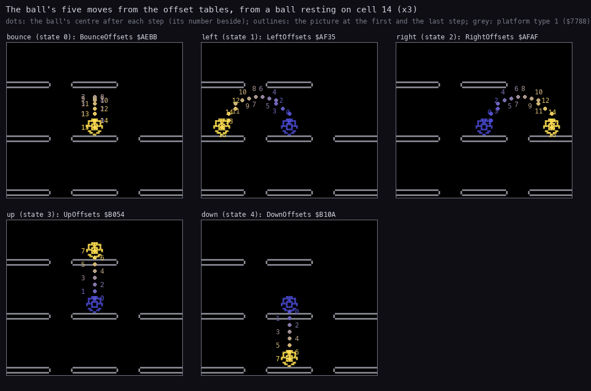

*The five moves as the tables draw them. How to read: each panel is one move from a ball resting on cell 14; the dots
are the ball's centre after each step, numbered; the outlines are the pictures at the first and the last step.
No recording: the tables of `build/game.bin`. `python3 tools/fig_ball.py arcs`.*

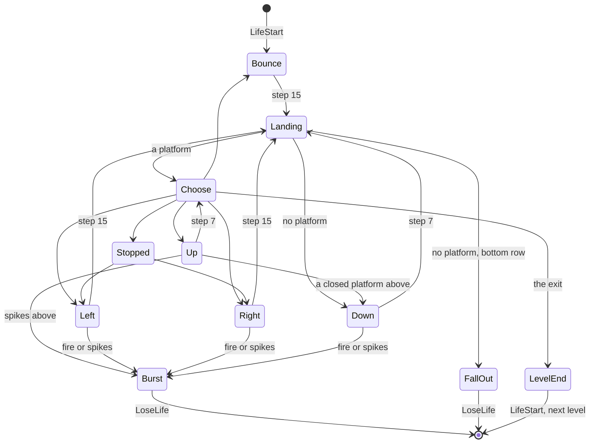

Witness: BallBounce L1 19 355, BallLeft 15 441, BallRight 19 049, BallUp 19 058, BallDown 19 927, BallStopped 827,
BallBurst 126, BallFallOut 40.

The point: the ball's whole motion is five tables of words and one routine that adds them; the game is a board game
played on a fixed clock.

## 10.2 One move, step by step

Each state routine sets IX to its check table and jumps to StepDispatch `$AE4B`.
StepDispatch jumps to the check of the current step.
Most checks do nothing and fall through to the move; a few look at the board.
The move adds the offset, redraws the ball, adds one to BallStep, and returns to MainLoop.

```text
BallRight (one pass):
    check = RightChecks[BallStep]       ; the board, the sound, the spring, the object
    run check                           ; may end the move: a wall, a death
    BallScrAddr += RightOffsets[BallStep]
    if S held and not the demo: SelfDestruct
    draw the ball
    if BallStep == 15: BallStep = 0; LandingCheck
    else: BallStep += 1
```

```asm
StepDispatch:
  AE4B  LD A,(BallStep)
  AE4E  RLA
  AE4F  LD E,A
  AE50  LD D,$00
  AE52  ADD IX,DE
  AE54  LD E,(IX+$00)
  AE57  LD D,(IX+$01)
  AE5A  PUSH DE
  AE5B  POP IX
  AE5D  JP (IX)                 ; the check of this step
...
BallRightMove:
  AF5C  AND A
  AF5D  LD IX,RightOffsets
  AF61  CALL BallStepMove       ; BallScrAddr += RightOffsets[BallStep]
  AF64  LD A,(DemoFlag)
  AF67  CP $00
  AF69  JR NZ,BallRightMoveSkip
  AF6B  LD A,$31
  AF6D  CALL TestKey            ; S
  AF70  JP NZ,SelfDestruct
BallRightMoveSkip:
  AF73  CALL DrawBallRight
  AF76  CALL DrawBallFrame
  AF79  LD A,(BallStep)
  AF7C  CP $0F
  AF7E  JR Z,BallRightEnd
  AF80  INC A
  AF81  LD (BallStep),A
  AF84  JP MainLoop
BallRightEnd:
  AF87  LD A,$00
  AF89  LD (BallStep),A
  AF8C  JP LandingCheck
```

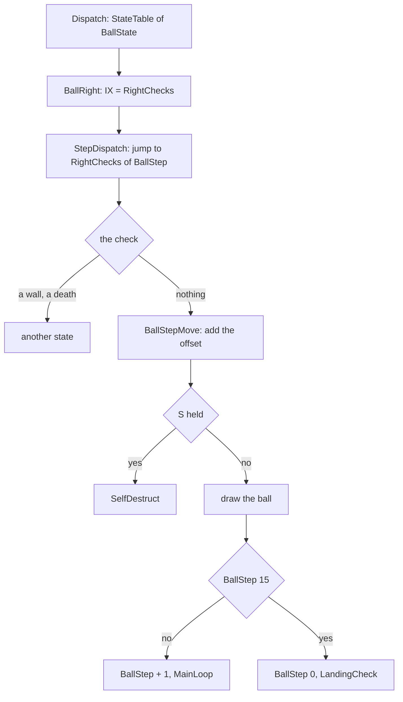

What each check does, per state and step:

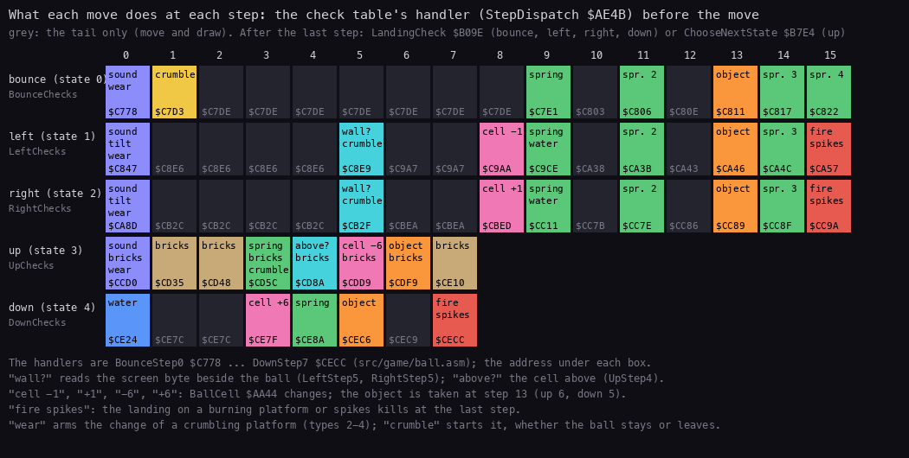

*Each move's check table. How to read: a row is a state, a column a step; a coloured box is a check that looks at the
board (its job and its address), a grey one only moves. "wear" arms a crumbling platform's change, "crumble"
starts it; "bricks" is HitBrick, at all eight up steps. The landing comes after the last column. No recording: the
check tables of `build/game.bin`. `python3 tools/fig_ball.py steps`.*

The checks fall at fixed steps:

- step 0: the landing sound, and a crumbling platform's change is armed (`$C778`, `$C847`, `$CA8D`, the up move's
  `$CCD0`); it starts at step 5 of a side move, step 3 going up or step 1 of a bounce in place;
- step 5 of a side move: a wall beside the ball turns it back ([doc 7](07-objects.md#74-the-walls-and-the-locks));
- step 8 of a side move: BallCell changes by 1 (the ball is over the next cell);
- step 9: the spring may be armed (10.4); on a side move, a drop of water puts out a fire ahead;
- step 13: the object of the cell is taken (step 6 going up, step 5 going down);
- step 15: fire or spikes under the ball kill it (10.7).

Worked example: `rec/l83`, a right jump.
The dispatcher calls BallRight in frames 349-376, steps 0 to 15.
The cell changes at step 8.
In frame 377 LandingCheck runs and ChooseNextState picks the next move.

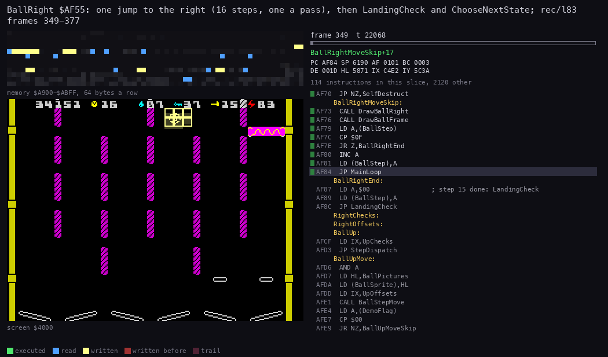

*Sixteen steps of BallRight, then the landing. How to read: the code panel lights the check of each step, then
BallStepMove and the drawing; the memory map shows BallStep `$A9FF` and BallScrAddr `$AA03` written each pass.
`rec/l83`, frames 349-378 (frame 349 T 1800 to frame 378 T 1800). `python3 R/kit/routine_anim.py
--work work/docs/bmA/l83 --window 349:1800-378:1800 --listing build/game.lst
--pc AF55-AFCE,B882-B8D0,ADE6-AE5E,CA8D-CCCF,B09E-B0F9,B7E4-B872 --range A900-AB7F --pictures 100
--out docs/img/routines/BallRight.gif`.*

A bounce in place runs the same way with BounceChecks and BounceOffsets.
In `c1` the ball bounces in place in frames 14 082-14 095, then moves right and takes a water drop.

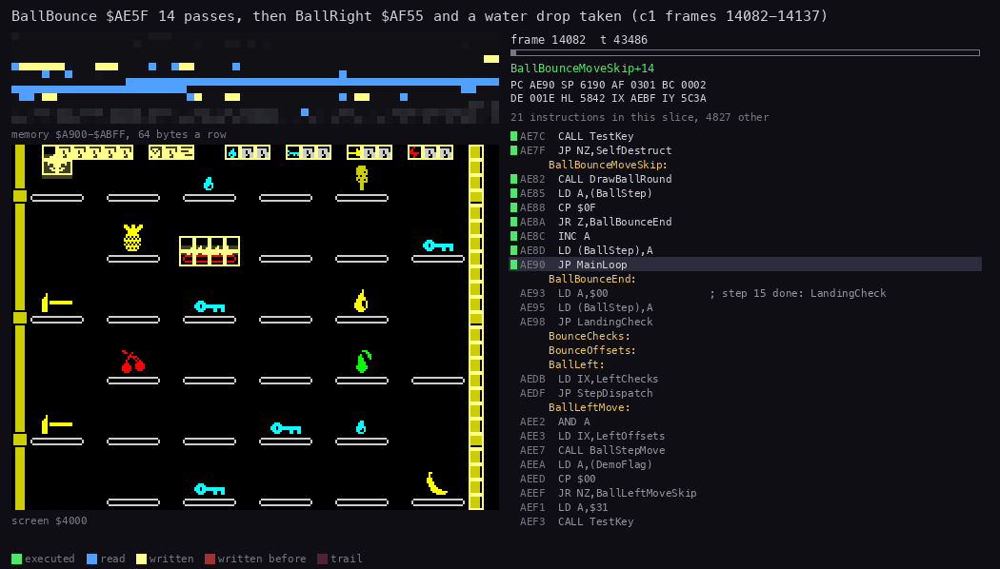

*BallBounce in place, then a jump right that takes a water drop. How to read: in the first quarter the code panel
stays in BallBounce and its checks, and the ball goes up and down on its cell; then BallRight runs and TakeObject
`$B958` clears the drop. `c1`, frames 14 082-14 137 (the whole cached trace, frame 14 082 T 0 to frame 14 138 T 0).
`python3 R/kit/routine_anim.py --trace work/docs/bmA/c1/traces/14082_0-14138_0.uatr --listing build/game.lst
--pc AE5F-AEDA,C778-C846,AF55-AFCE,CA8D-CCCF,B09E-B0F9,B7E4-B872,B958-BA46,BD73-BDD5 --range A900-AB7F
--pictures 90 --out docs/img/routines/BallBounce.gif`.*

Witness: StepDispatch L1 92 830; BallStepMove L1 92 310.

The point: the board is read at a handful of fixed steps; between them the ball only moves.

## 10.3 The landing: LandingCheck `$B09E`

At the end of a bounce, a side move or a fall, LandingCheck looks at the platform of the ball's cell.
A platform means a landing: ChooseNextState picks the next state.
No platform means a fall of one row (state 4).
No platform on the bottom row means the ball drops out of the board (state 7, a life lost).

```text
LandingCheck:
    if BallCell >= 30:                          ; the bottom row
        if CellPlatform == 0: BallState = 7     ; out
        else: ChooseNextState
    elif CellPlatform == 0:
        BallState = 4                           ; fall one row
        if the cell below holds bricks: ChooseNextState
    else: ChooseNextState
```

```asm
LandingCheck:
  B09E  AND A
  B09F  LD A,(BallCell)
  B0A2  CP $1E
  B0A4  JR NC,LandingBottom     ; cell 30-35
  B0A6  AND A
  B0A7  LD A,(CellPlatform)
  B0AA  CP $00
  B0AC  JR Z,LandingFall
  B0AE  CALL ChooseNextState
  B0B1  JP MainLoop
LandingFall:
  B0B4  LD A,$04                ; in the air: fall (state 4)
  B0B6  LD (BallState),A
  B0B9  LD A,(BallCell)
  B0BC  ADD A,$06               ; the cell below
  B0BE  LD D,$00
  B0C0  LD E,A
  B0C1  LD HL,CellPlatforms
  B0C4  ADD HL,DE
  B0C5  LD A,(HL)
  B0C6  CP $0A
  B0C8  JP NZ,MainLoop
  B0CB  CALL ChooseNextState    ; bricks below: decide at once
  B0CE  JP MainLoop
LandingBottom:
  B0D1  AND A
  B0D2  LD A,(CellPlatform)
  B0D5  CP $00
  B0D7  JP Z,LandingLost
  B0DA  CALL ChooseNextState
  B0DD  JP MainLoop
LandingLost:
  B0E0  LD A,$07                ; no platform on the bottom row: state 7
  B0E2  LD (BallState),A
  B0E5  LD A,$00
  B0E7  LD (BallStep),A
  B0EA  JP MainLoop
```

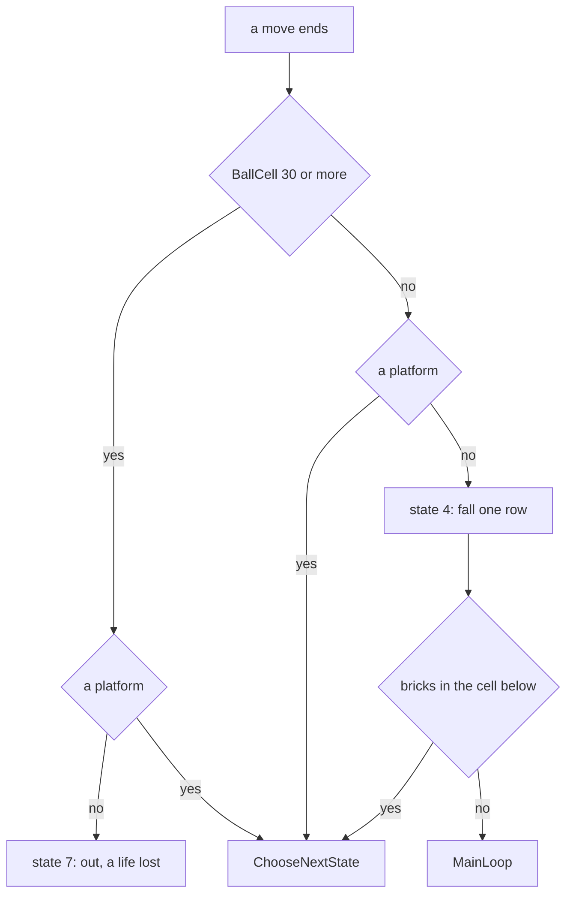

ChooseNextState is the only place where the keys steer the ball.
[Doc 5](05-controls.md#58-from-a-key-to-the-ball-choosenextstate-b7e4) gives its code and its diagram.
Its order:

1. the spring armed during the move: up (3);
2. the exit (platform 11): the level end (8);
3. a conveyor: right (platform 7) or left (platform 6);
4. a stopper (platform 5): stopped (5);
5. bricks (platform 10): the state stays;
6. left held: left; right held: right;
7. after an up move, with down not held: up again;
8. else: a bounce (0).

Worked example: the RZX, level 0, frames 788-825 (`work/stage2/rzx-states.tsv`, the state after each frame).

| RZX frame | State | Next step | Cell | Platform | Spring | What happens |
| ---: | ---: | ---: | ---: | ---: | ---: | --- |
| 788 | 2 | 0 | 34 | 1 | 0 | a landing on cell 34; right held: right again |
| 799 | 2 | 9 | 35 | 1 | 0 | step 8 has moved the ball over cell 35 |
| 800 | 2 | 10 | 35 | 1 | 1 | step 9: up held, LoadSpring arms the spring |
| 805 | 2 | 15 | 35 | 1 | 1 | the last step is next |
| 806 | 3 | 0 | 35 | 1 | 1 | the landing: SpringArmed, so up |
| 812 | 3 | 4 | 35 | 1 | 0 | step 3: SpringStep6 clears the spring |
| 814 | 3 | 6 | 29 | 0 | 0 | step 5: the ball is in cell 29, through its gap |
| 816 | 1 | 0 | 29 | 0 | 0 | the end of the up move: left held, so left |
| 825 | 1 | 9 | 28 | 1 | 0 | over cell 28, a platform: it lands there |

The ball went up through a gap and sideways onto the platform beside it, without ever standing in cell 29.

Witness: LandingCheck L1 6174; LandingLost (state 7) 8 times.
In stage 1's recordings LandingFall ran 1846 times in 5420 landings, and decided at once over bricks 66 times.

The point: the player steers only at landings; between two landings a move cannot be changed, only ended by S.

## 10.4 The spring and the up move

The spring is the only way up.
Up or fire held at step 9 of a bounce or a side move, or at step 4 of a fall (DownStep4 `$CE8A`, after it read the
new cell), calls LoadSpring `$BD73` (TestUpOrFire `$B463`).
LoadSpring arms the spring only on platforms 1-5: plain, crumbling and the stopper.
It copies the squeeze pictures of the platform type, 24 bytes from SpringPics `$C5D6` + 24 × (type - 1), found
through the pointer table SpringCurves `$C52A`, to SpringRecord `$AB35`.
It sets SpringArmed `$AA13`.
SpringStep1-4 squeeze the platform at steps 9, 11, 14 and 15 of a bounce or a side move; in a fall step 4 plays
SpringStep1 and 2 at once and step 7 SpringStep3 and 4.
At the landing ChooseNextState sees SpringArmed and starts the up move.
SpringStep5 and 6 release the platform in the up move's first steps; SpringStep6 `$BDCE` clears SpringArmed.

```asm
LoadSpring:
  BD73  XOR A
  BD74  LD A,(SpringArmed)
  BD77  CP $00
  BD79  RET NZ                  ; armed already
  BD7A  LD A,(CellPlatform)
  BD7D  CP $00
  BD7F  RET Z                   ; no platform
  BD80  CP $06
  BD82  RET NC                  ; conveyors, fire, bricks, exit, spikes: no
  BD83  AND $07
  BD85  RLA
  BD86  LD B,$02
  BD88  SUB B
  BD89  LD E,A                  ; 2 x (type - 1)
  BD8A  LD D,$00
  BD8C  LD IX,SpringCurves
  BD90  ADD IX,DE
  BD92  LD H,(IX+$01)
  BD95  LD L,(IX+$00)
  BD98  LD DE,SpringRecord
  BD9B  LD BC,$0018
  BD9E  LDIR                    ; the squeeze pictures of this type
  BDA0  LD A,$01
  BDA2  LD (SpringArmed),A
  BDA5  RET
```

The up move rises 4 lines a step for 8 steps.
UpStep4 `$CD8A` looks at the platform of the cell above before the ball reaches it:

- no cell above (the top row): BallBumpCeiling `$B00F`;
- a gap (0), bricks (10) or the exit (11): the ball goes on;
- spikes (12): UpSpikeDeath `$CDC6`, the burst;
- any other platform (1-9): BallBumpCeiling.

BallBumpCeiling moves the ball 2 lines up and back with a frame between, and sets state 4 with BallStep left at 4:
the fall resumes at DownStep4 and runs 4 steps, DownStep3 (BallCell + 6) is skipped, so the ball lands back on the
platform it left.
UpStep5 `$CDD9` moves BallCell to the cell above; UpStep6 takes its object.
Bricks in the ball's own cell are met by HitBrick at the up move's steps ([doc 7](07-objects.md#76-bricks-and-hammers)).

```asm
UpStep4:
  CD8A  LD A,(CellPlatform)
  CD8D  CP $0A
  CD8F  CALL Z,HitBrick         ; bricks in the ball's cell
  CD92  LD A,(BallState)
  CD95  CP $03
  CD97  JP NZ,BallDown          ; HitBrick sent the ball down
  CD9A  XOR A
  CD9B  LD A,(CrumbleActive)
  CD9E  CP $00
  CDA0  CALL NZ,PlatformChangeStep
  CDA3  AND A
  CDA4  LD A,(BallCell)
  CDA7  LD B,$06
  CDA9  SUB B
  CDAA  JP C,BallBumpCeiling    ; the top row
  CDAD  LD D,$00
  CDAF  LD E,A
  CDB0  LD HL,CellPlatforms
  CDB3  ADD HL,DE
  CDB4  LD A,(HL)               ; the platform above
  CDB5  CP $00
  CDB7  JP Z,BallUpMove         ; a gap: go on
  CDBA  CP $0C
  CDBC  JR Z,UpSpikeDeath
  CDBE  CP $0A
  CDC0  JP NC,BallUpMove        ; bricks, the exit: go on
  ...                           ; 1-9: BallBumpCeiling
```

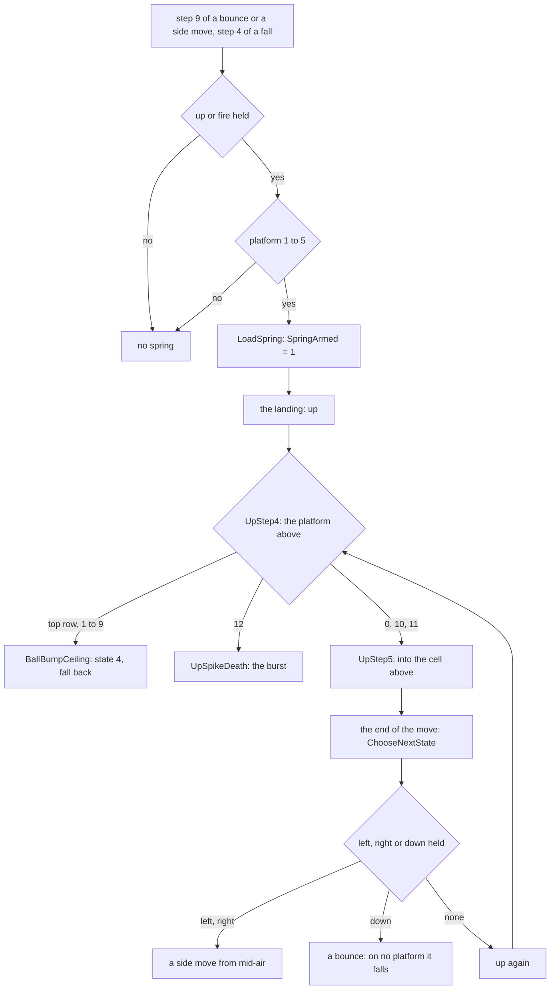

An up move that ends in a gap keeps going: ChooseNextState keeps state 3 unless a key is held.
The ball climbs row after row through the gaps until a platform stops it.
Then it falls back onto the last platform it passed.
The player leaves the column with left or right at the end of a row, as in the worked example of 10.3.

Witness: LoadSpring L1 2308, SpringStep6 1326, BallBumpCeiling 103.
In all the recordings ChooseUpOrBounce `$B849` ran 990 times and kept the ball going up 986 times
(`work/**/l1.json`): down was held at an up landing 4 times.

The point: one key press lifts the ball as high as the column is open; the skill is in stopping it.

## 10.5 The fall

A ball with nothing under it falls one row: state 4, 8 steps of 4 lines.
DownStep0 `$CE24` spends a water drop on a burning platform below.
DownStep3 moves BallCell 6 on; DownStep5 takes the object; DownStep7 `$CECC` kills on fire or spikes.
Then LandingCheck runs again: the ball keeps falling, row by row, until a platform or the bottom.

```text
BallDown, 8 steps:
    step 0: if the platform below burns and Water > 0: Water -= 1; the fire goes out
    step 3: BallCell += 6
    step 5: take the object
    step 7: if the platform burns: the fire death; if spikes: the spike death
    after step 7: LandingCheck
```

```asm
DownStep0:
  CE24  AND A
  CE25  LD A,(BallCell)
  CE28  ADD A,$06               ; the cell below
  CE2A  LD D,$00
  CE2C  LD E,A
  CE2D  LD HL,CellPlatforms
  CE30  ADD HL,DE
  CE31  LD A,(HL)
  CE32  CP $08
  CE34  JR Z,DownPutOutFire
  CE36  AND A
  CE37  CP $09
  CE39  JR Z,DownPutOutFire
  CE3B  AND A
  CE3C  JP BallDownMove
DownPutOutFire:
  CE3F  LD A,(Water)
  CE42  CP $00
  CE44  JP Z,BallDownMove       ; no water: the fire stays
  CE47  DEC A
  CE48  LD (Water),A
  CE4B  CALL WaterToHud
  ...
```

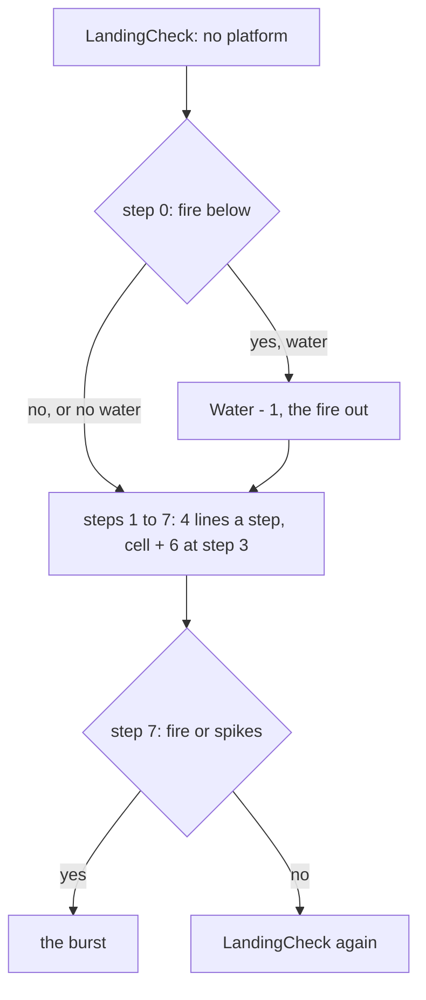

Worked example: the RZX, level 5, frames 7830-7842.
The ball falls into cell 27 and takes the bottle there at step 5 (10.10).
It lands at the end of the fall, and state 0 starts at frame 7842.

A fall out of the board is in 10.7.

Witness: BallDown L1 19 927; DownStep0 L1 2264; DownStep7 L1 2719.

The point: falling is free and safe, except onto fire without water or onto spikes; the board is a set of chutes.

## 10.6 Platforms, walls and objects as the ball meets them

Doc 7 decodes every type; this table says when the ball feels it.

| Platform | When | What the ball does |
| ---: | --- | --- |
| 0, none | the landing | falls (10.5); on the bottom row drops out |
| 1, plain | the landing | lands; the spring works |
| 2, 3, 4, crumbling | step 0 of the next move arms, step 5 (side), 3 (up) or 1 (bounce in place) starts | the platform wears a stage whether the ball stays or leaves ([doc 7](07-objects.md#wear-types-2-3-and-4)); 4 falls away, and a ball still bouncing on it falls through |
| 5, stopper | the landing | BallStopped: waits for left, right or S |
| 6, 7, conveyors | the landing | the next move is left or right, whatever the keys |
| 8, 9, burning | step 9 or the fall's step 0, then the last step | water is spent and the platform becomes 1 or 5; without water the ball burns |
| 10, bricks | the side moves and the up move | a wall or a ceiling; a hammer knocks a layer off ([doc 7](07-objects.md#76-bricks-and-hammers)) |
| 11, the exit | the landing | the level end |
| 12, spikes | the landing, or from below | the burst |

Walls are met at step 5 of a side move.
A solid wall, or a lock without a key, turns the ball back (SfxWallBounce).
A key lowers a lock a stage ([doc 7](07-objects.md#74-the-walls-and-the-locks)).

Objects are taken at step 13 of a side move or a bounce, step 6 going up, step 5 going down:

| Object | Effect |
| --- | --- |
| a prize | Score + 15, PrizesLeft − 1; the last one opens the exit |
| a hammer, a key, a water drop | Hammers, Keys or Water + 1, at most 99 |
| the bottle | Lives + 1, at most 99 (10.10) |

A platform's effect, the wear of a crumbling platform:

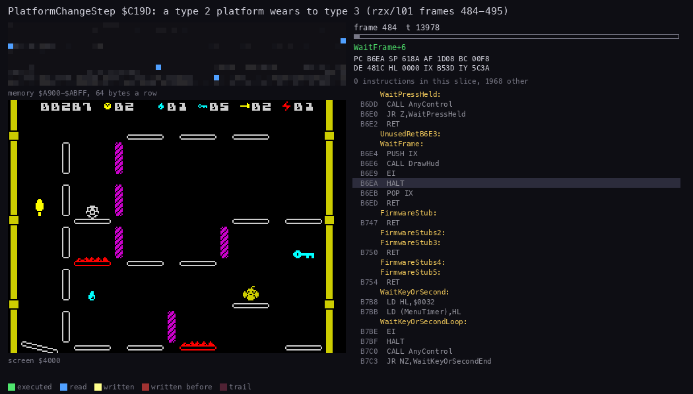

*A type 2 platform becomes type 3 after the ball has jumped away from it. How to read: the code panel lights PlatformChangeStep and
one WearTo3 step a pass; the screen shows the platform XORed off and the cracks XORed on. `rzx/l01`, frames 484-495.
`python3 R/kit/routine_anim.py --work work/docs/bmA/l01 --window 484:0-496:0 --listing build/game.lst
--pc C19D-C43D --range A900-AB7F --pictures 60 --out docs/img/routines/PlatformChangeStep.gif`.*

An object taken:

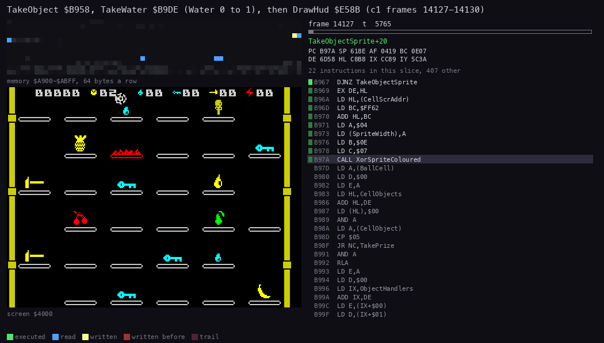

*A water drop is taken and counted on the HUD in the same pass. How to read: TakeObject and TakeWater write
CellObjects and Water `$AAFD` in the memory map; DrawHud then reprints the counters. `c1`, frame 14 127 T 1800 to
frame 14 130 T 30 000. `python3 R/kit/routine_anim.py --work work/docs/bmA/c1 --window 14127:1800-14130:30000
--listing build/game.lst --pc B958-BA46,E58B-E666 --range A900-AB7F --pictures 60
--out docs/img/routines/DrawHud.gif`.*

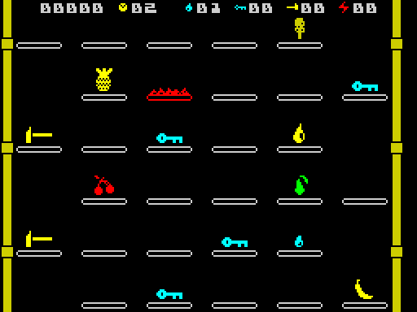

*The pass after the take. How to read: the drop of the top row's third cell is gone and the HUD shows 01 water.
`c1`, frame 14 130.*

Witness: TakeObject L1 8264; the wear, the locks and the bricks have their witnesses in doc 7.

The point: every rule of the board fires at a fixed step of a move, so a player can learn exactly where a decision
falls.

## 10.7 The deaths

Five things can end a life; the timer is not one of them.

| Death | Where | Routine | Sound | Then | Seen |
| --- | --- | --- | --- | --- | --- |
| spikes, landing | the last step of a side move or a fall | LeftSpikeDeath `$CA75`, RightSpikeDeath `$CCB8`, DownSpikeDeath `$CEF4` | SfxSpikeDeath | the burst, 10 steps | DownSpikeDeath 4 times (`rzx/l45`, `l56`, `l68` twice), LeftSpikeDeath once (`rzx/l56`), RightSpikeDeath once (`rightspike`, the burst at frame 66, [shot](img/play/rightspike-000066-burst.png)) |
| spikes, from below | step 4 of the up move | UpSpikeDeath `$CDC6` | SfxSpikeDeath | the burst from step 3 | 8 times (`rzx/l35`, `l45`, `l51`, `l56`, `l59`, `l96` twice, `l97`) |
| fire | the last step of a side move or a fall, with Water 0 | LeftFireDeath `$CA7A`, RightFireDeath `$CCBD`, DownFireDeath `$CEF9` | SfxFireDeath, 20 frames | the burst | once, `fire` frame 41 (LeftFireDeath, Water POKEd to 0) |
| the fall out | a landing on the bottom row with no platform | LandingLost `$B0E0`, BallFallOut `$B20A` | SfxLifeLost | LoseLife | 8 times (`rzx/l10`, `l36`, `l51` three times, `l59`, `l68`, `l98`) |
| S | any step of a move, not in the demo | SelfDestruct `$BA71` | SfxLifeLost | LoseLife | 15 times (`gameover`, `twoname`, `scoreloop` 3) |
| the timer | never | | | | `c1`: 0 from frame 15 436 to 18 186, the ball still bouncing |

The deaths in the recordings come from the drifting replays of the RZX, from the POKE in `fire`, from `rightspike`, or
from S.
The RZX's own run never lost a life: its Lives only rise, 2 to 18, in `rzx-states.tsv`.

```text
the last step of a side move (LeftStep15; the same at RightStep15 and DownStep7):
    if the spring is armed: its last picture
    if CellPlatform is 8 or 9: SfxFireDeath; finish the step; BallBurstStart
    elif CellPlatform is 12: SfxSpikeDeath; finish the step; BallBurstStart
    else: the move as usual
BallBurst, 10 steps: the burst pictures, a frame each; then LoseLife
BallFallOut, 5 steps: the ball drops below the bottom row; SfxLifeLost; LoseLife
```

```asm
LeftStep15:
  CA57  LD A,(SpringArmed)
  CA5A  CP $00
  CA5C  CALL NZ,SpringStep4
  CA5F  LD A,(CellPlatform)
  CA62  CP $08
  CA64  JR Z,LeftFireDeath
  CA66  AND A
  CA67  CP $09
  CA69  JR Z,LeftFireDeath
  CA6B  AND A
  CA6C  CP $0C
  CA6E  JP Z,LeftSpikeDeath
  CA71  AND A
  CA72  JP BallLeftMove
LeftSpikeDeath:
  CA75  CALL SfxSpikeDeath
  CA78  JR LeftDeath
LeftFireDeath:
  CA7A  CALL SfxFireDeath
LeftDeath:
  CA7D  AND A
  CA7E  LD IX,LeftOffsets
  CA82  LD A,$04
  CA84  LD (SpriteWidth),A
  CA87  CALL BallStepMove       ; the last step, then BallBurstStart
...
BallBurstStart:
  B0ED  LD A,$06
  B0EF  LD (BallState),A
  B0F2  LD A,$00
  B0F4  LD (BallStep),A
  B0F7  JP MainLoop
```

A burning platform kills only with Water at 0.
At step 9 of a side move, or step 0 of a fall, the ball spends a drop on the platform ahead and the fire goes out
(`$C9F0`-`$CA0C`, `$CE32`-`$CE4E`).
So with water the check at the last step finds platform 1 or 5, not 8 or 9.

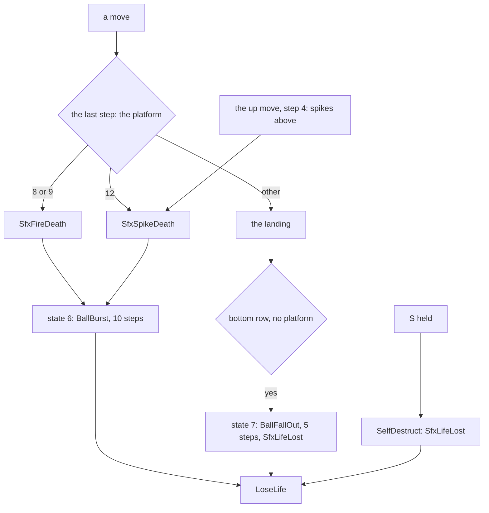

Worked example, the fire: `fire` starts at level 38 with Water POKEd to 0.
The ball moves left onto cell 31, platform 9, a burning stopper.
At frame 41 LeftStep15 finds platform 9 and calls SfxFireDeath, 20 frames with interrupts off.
The burst follows; LoseLife takes Lives from 10 to 9.

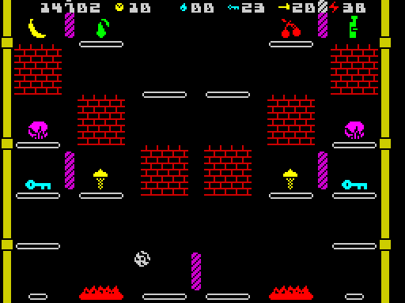

*The ball over cell 32, moving left to the flames of cell 31. How to read: the flames are the burning platform; the HUD
shows 00 water and 10 lives. `fire`, frame 30.*

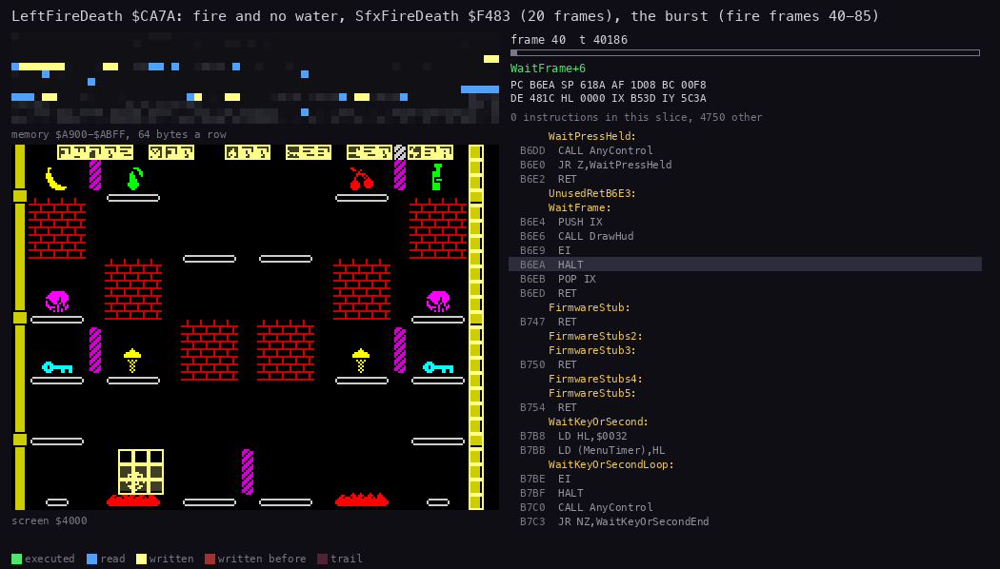

*The fire death, its sound and the burst. How to read: the code panel lights LeftStep15 and LeftFireDeath, then sits in
the sound's loop (`$F58C`) for 20 frames; then BallBurst draws its pictures, one a frame, and LoseLife runs. `fire`,
frames 40-85. `python3 R/kit/routine_anim.py --work work/docs/bmA/fire --window 40:0-86:0 --listing build/game.lst
--pc CA57-CA8C,F483-F499,F58C-F5BA,B14A-B209,BA93-BB04 --range A900-AB7F --pictures 80
--out docs/img/routines/LeftFireDeath.gif`.*

Worked example, the spikes: `rzx/l68` lands the ball on spikes; BallBurst runs in frames 920-947.

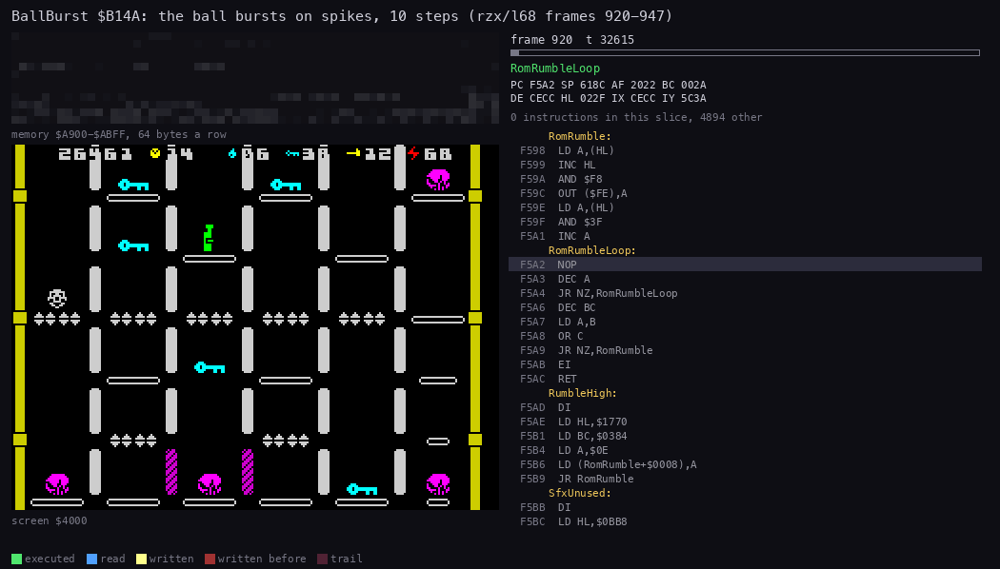

*BallBurst on spikes. How to read: each step waits a frame and draws the next burst picture (BurstFrame1-6) over the
ball; the last one blanks it and jumps to LoseLife. `rzx/l68`, frames 920-947. `python3 R/kit/routine_anim.py
--work work/docs/bmA/l68 --window 920:0-948:0 --listing build/game.lst --pc B14A-B209,AD0F-AD3A --range A900-AB7F
--pictures 60 --out docs/img/routines/BallBurst.gif`.*

Worked example, the fall out: in `rzx/l68` the ball lands on the bottom row where there is no platform.
LandingLost sets state 7.
BallFallOut runs in frames 682-715; SfxLifeLost plays from frame 690.

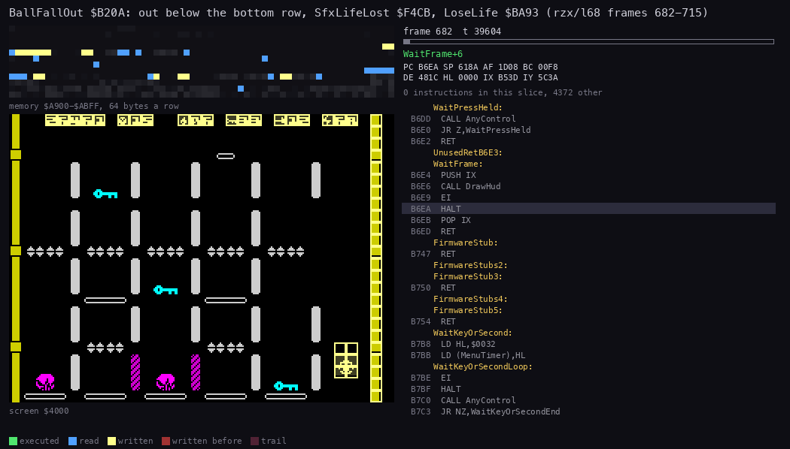

*The ball drops out under the bottom row. How to read: LostStep1-5 move the ball down and draw fewer of its lines each
step; LostStep5 calls SfxLifeLost and jumps to LoseLife. `rzx/l68`, frames 682-715. `python3 R/kit/routine_anim.py
--work work/docs/bmA/l68 --window 682:0-716:0 --listing build/game.lst --pc B20A-B2C1,BA93-BB04,F4CB-F4E1,F58C-F5BA
--range A900-AB7F --pictures 60 --out docs/img/routines/BallFallOut.gif`.*

Witness: BallBurst L1 126, BallFallOut L1 40, SelfDestruct L1 15, BallBurstStart L1 7 (6 spike landings and the fire).

The point: death is never a matter of time or chance; it is a fixed cell entered at a fixed step.

## 10.8 LoseLife `$BA93`: what a death takes

LoseLife ends the game when Lives is 0 (GameOver `$B755`).
Otherwise it takes one life.
It puts back the water, keys and hammers the player had at the level's start (WaterAtStart, KeysAtStart,
HammersAtStart, `$AB06`-`$AB08`, saved by LifeStart).
It saves 7 bytes from Score into the player's record, so the score is kept.
With two players it hands the turn to the other one, unless that one is out (`$FA`).
After 50 frames and a key or a second (WaitKeyOrSecond), LifeStart `$ABD8` builds the level again from its record.

```text
LoseLife:
    if Lives == 0: GameOver
    Lives -= 1
    Water, Keys, Hammers = their values at the level's start
    the player's record = Score and the stores (7 bytes)
    if two players and the other is not out: switch
    wait 50 frames, then a key or a second
    LifeStart: Timer = 1000; the level rebuilt from its record
```

```asm
LoseLife:
  BA93  LD A,(Lives)
  BA96  CP $00
  BA98  JP Z,GameOver
  BA9B  DEC A
  BA9C  LD (Lives),A
  BA9F  LD A,(WaterAtStart)
  BAA2  LD (Water),A
  BAA5  LD A,(KeysAtStart)
  BAA8  LD (Keys),A
  BAAB  LD A,(HammersAtStart)
  BAAE  LD (Hammers),A
  BAB1  LD DE,Player1Record
  BAB4  LD A,(CurrentPlayer)
  BAB7  CP $01
  BAB9  JR Z,LoseLifeSave
  BABB  LD DE,Player2Record
LoseLifeSave:
  BABE  LD HL,Score
  BAC1  LD BC,$0007
  BAC4  LDIR                    ; the score is kept
  ...
LoseLifeWait:
  BAF6  LD B,$32
LoseLifeWaitLoop:
  BAF8  PUSH BC
  BAF9  CALL WaitOneFrame
  BAFC  POP BC
  BAFD  DJNZ LoseLifeWaitLoop
  BAFF  CALL WaitKeyOrSecond
  BB02  JP LifeStart
```

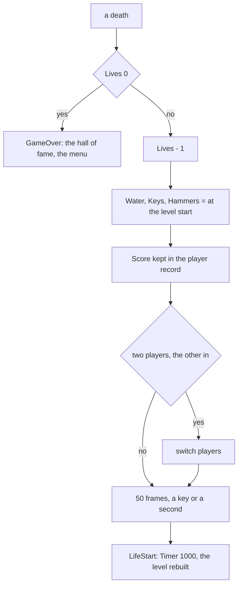

The level is rebuilt from its record in the level table, and the record is never written back.
So everything comes back: the prizes, the bottle, the locks, the worn platforms, the bricks.

Worked example: `fire`.
The level starts with 9 drops; the POKE sets Water to 0 after LifeStart saved 9.
After the death the HUD shows 9 drops again, and 9 lives.

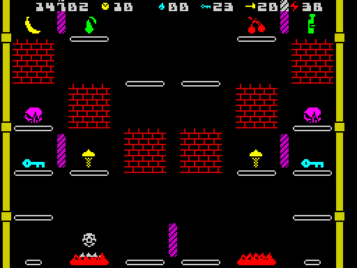

*The burst after the fire. How to read: the burst picture sits on cell 31; the HUD still shows 0 water, before
LoseLife. `fire`, frame 70.*

Witness: LoseLife L1 38, 34 lives lost and 4 game overs (`gameover` and `twoname` two each).
The hand-over between players ran in `twoname` (`$BADF`, `$BAF1`).

The point: a death costs a life and the tools spent on the level, never points, and gives the level back whole.

## 10.9 The timer

Timer `$AB04` is set to 1000 by LifeStart at every level and every life (`$AC06`).
TickTimer `$B7D1` takes one off each pass of MainLoop and stops at 0.
Nothing reads it in play: at 0 the game goes on.
At the level end the rest is counted into the score (10.10).

```text
TickTimer (each pass):
    if Timer != 0: Timer -= 1
```

```asm
TickTimer:
  B7D1  LD HL,(Timer)
  B7D4  LD A,H
  B7D5  CP $00
  B7D7  JR Z,TickTimerLowByte
TickTimerDec:
  B7D9  DEC HL
  B7DA  LD (Timer),HL
  B7DD  RET
TickTimerLowByte:
  B7DE  LD A,L                  ; high byte 0: stop at 0
  B7DF  CP $00
  B7E1  RET Z
  B7E2  JR TickTimerDec
```

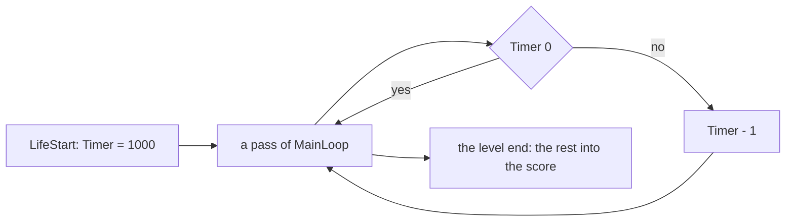

The timer counts passes, not frames.
A pass that takes two frames takes only one off the timer.
In the RZX the pass after the landing of frame 788 ends at frame 790, and the timer goes from 463 to 462.
So the 1000 last 1000 passes, between 20 and 40 seconds.

Worked example: `c1` lets the timer run out.
It reaches 0 at frame 15 436; at frame 18 186 the ball still bounces.

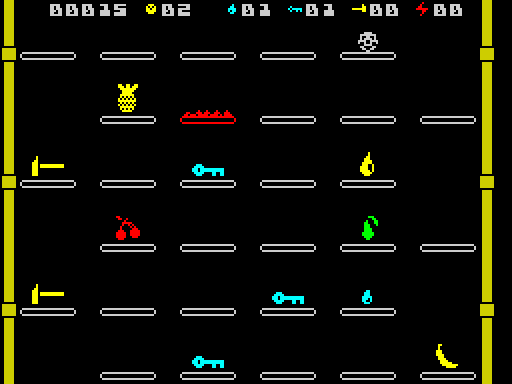

*Nearly 3000 frames after the timer reached 0, the game goes on. How to read: the ball bounces on the top row; the HUD
shows 2 lives, as at the start, and has no timer. `c1`, frame 18 186.*

Witness: TickTimer L1 93 414.

The point: the timer is a bonus clock, not a limit; it pays for speed and never punishes slowness.

## 10.10 The score and the extra life

Points come from two places:

- a prize: 15 points (TakePrizeScore `$B9B1`, AddScore `$BA47`);
- the level end: the timer's rest, one point a tick (LevelEndTimer `$B35F`, [doc 8](08-hud-and-text.md)).

Score `$AAFB` is a 16-bit word.
AddScore adds with no check, so a score past 65 535 would wrap to a small number.
There is no extra life for points.

The extra life is the bottle, object 4.
TakeBottle `$BA1C` sets the quiet flag and plays SfxExtraLife (38.6 frames).
It calls a CPC firmware stub with B = C = `$1A` (a RET here) and sets BorderFlash.
It adds a life, up to 99.

```text
TakeBottle:
    ObjectFlag = 4                  ; no landing click next
    SfxExtraLife
    BorderFlash = 1
    if Lives != 99: Lives += 1
    LivesToHud
```

```asm
TakeBottle:
  BA1C  LD A,$04
  BA1E  LD (ObjectFlag),A
  BA21  CALL SfxExtraLife
  BA24  LD B,$1A
  BA26  LD C,B
  BA27  CALL FirmwareStub       ; a RET
  BA2A  LD A,$01
  BA2C  LD (BorderFlash),A
  BA2F  LD A,(Lives)
  BA32  CP $63
  BA34  JR Z,TakeBottleStore    ; 99 at most
  BA36  INC A
TakeBottleStore:
  BA37  LD (Lives),A
  BA3A  JP LivesToHud
```

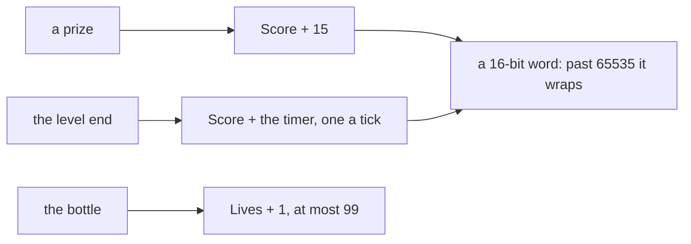

Worked example, the score: the RZX goes through all 100 levels and shows 41 592 at level 0 again.
The 647 prizes give 9705; the rest, 31 887, is the timer counted at 100 level ends.
The timer read at the first frame of each level's state 8 sums to 31 894 (`rzx-states.tsv`), 7 more.
MainLoop runs TickTimer before the frame wait and the dispatch, so the sample can fall before the pass's last tick:
at 81 of the 100 entries into state 8 the timer is one below the previous frame's, at 12 it is already 0, and at 7
(frames 32 719, 38 253, 45 351, 63 132, 92 792, 110 448, 117 040) it is unchanged, one tick still to come:
31 894 - 7 = 31 887.
Level 14 ends with 0 left, level 92 with 815.

Worked example, the bottle: the RZX, level 5.
The ball takes the bottle at step 5 of a fall into cell 27.
The RZX frames 7830-7839 all show the ball at that step; at frame 7840 Lives reads 3.

Witness: AddScore L1 709; TakeBottle L1 23; the RZX's 16 bottles take Lives from 2 to 18.

The point: the timer is worth three times all the prizes together; the score is mostly a measure of speed.

## 10.11 Two players

Two players take turns, and the turn changes only when a life is lost (LoseLife, 10.8).
Each player's score and stores live in a 7-byte record (Player1Record `$AB09`, Player2Record `$AB10`).
A player who is out is marked `$FA`; the other one plays on alone.
The controls and the menu are in [doc 5](05-controls.md#510-two-players).

```text
at a death, two players:
    if the other player is not out: the other player plays
    else: the same player again
```

Worked example: `twoname`.
Both players lose their lives by S, the turn passing at each death, then both enter their names.

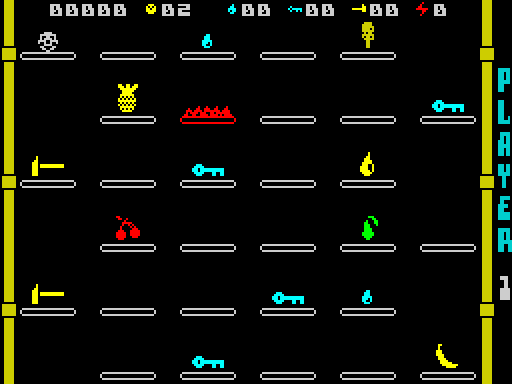

*Player 1's turn in a two-player game. How to read: the right panel spells PLAYER 1; the HUD shows that player's
record. `twoname`, frame 200.*

Witness: the hand-overs `$BADF` and `$BAF1` ran in `twoname`; GameOver ran there twice.

The point: a second player is a second record and a turn rule, nothing more; the level does not change between them.

## 10.12 After level 99

NextLevel `$B2D5` stores Level + 1 before the ball sinks, and 100 becomes 0.
Everything else is kept: the score, the lives, the stores.
The game has no ending.

```asm
NextLevel:
  B2D5  LD A,(Level)
  B2D8  AND A
  B2D9  INC A
  B2DA  CP $64
  B2DC  JR NZ,LevelEndSet
  B2DE  LD A,$00                ; 100 becomes 0
LevelEndSet:
  B2E0  AND A
  B2E1  LD (Level),A
```

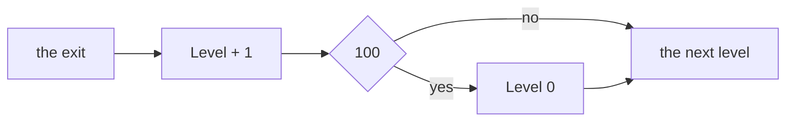

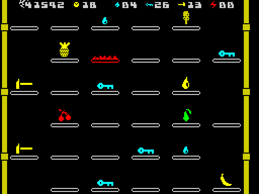

*Level 0 after level 99. How to read: the HUD keeps the score 41 592 and 18 lives; the level digits show 00.
`rzx/l99`, frame 1685.*

Witness: `rzx/l99` reaches level 0 again; NextLevel ran at all 101 level ends of the recordings.

The point: the game loops forever; only the 16-bit score limits a second loop (10.15).

## 10.13 The difficulty

The rules never change: no level is faster, and no new part arrives after the first levels.
The difficulty is the layout: how many crumbling platforms the route must use, how many locks stand in the way, how
many deadly cells there are.

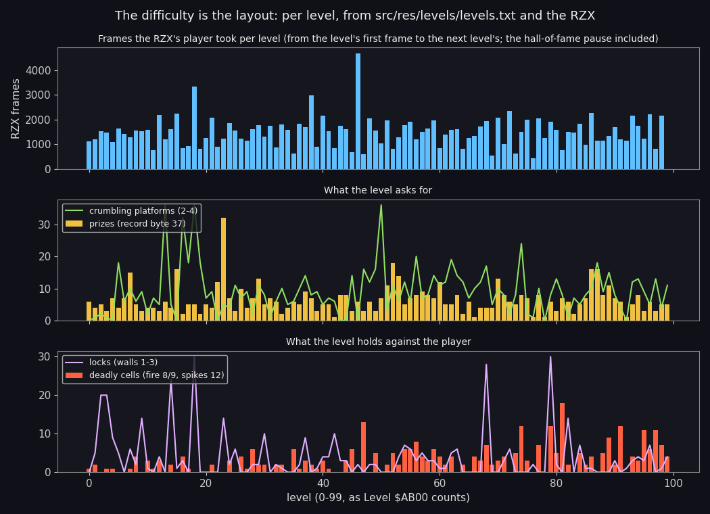

*Per level, the RZX player's time against what the level holds. How to read: top, the frames the RZX's player spent;
middle, the crumbling platforms and the prizes; bottom, the locks and the deadly cells. The RZX and
`src/res/levels/levels.txt`. `python3 tools/fig_ball.py levels`.*

Worked example: the five longest levels of the RZX.

| Level | RZX frames | Crumbling | Locks | Deadly cells | Prizes |
| ---: | ---: | ---: | ---: | ---: | ---: |
| 46 | 4688 | 0 | 2 | 0 | 6 |
| 18 | 3351 | 36 | 30 | 0 | 5 |
| 38 | 2996 | 8 | 0 | 2 | 7 |
| 72 | 2347 | 2 | 6 | 0 | 6 |
| 86 | 2260 | 10 | 1 | 4 | 16 |

Level 18 is long for its parts: 36 crumbling platforms and 30 locks.
Level 46, the longest, has almost none of them: its route alone is the puzzle.
The shortest is level 76, 422 frames.

The point: a level is a puzzle with one fixed rule set; the counts of its parts do not predict how long it takes.

## 10.14 Notable features

- **No physics, five tables.** Every move is a fixed list of offsets: the bounce is 18 lines high in every level, and
  the up and down moves have no acceleration.
- **The keys act only at landings.** Between two landings only S and the spring (at step 9 of a bounce or a side move, step 4 of a fall) are read.
- **The spring lifts the ball as high as the column is open.** ChooseNextState keeps the up move until a key is
  held; 986 of the 990 up landings in the recordings went on up.
- **The arcs are not mirror images.** The right move goes 4 pixels right at its first step; the left move rises two
  steps straight before it goes left (10.1).
- **The timer counts passes and kills nobody.** It is a bonus that runs slower when the game is busy.
- **A death keeps the points and gives the level back.** Prizes, the bottle and the locks return; the score does not
  go back. A level with a bottle can be played for points without end: take the prizes and the bottle, press S,
  start again with the same lives and more points. `scoreloop`: three rounds on level 87, 90 points each, lives
  16 → 17 → 16 each time.
- **The game never ends.** Level 99 leads to level 0 with everything kept.
- **Nothing is random.** The board is the same at every start; the ball's path is fixed by the keys at the landings
  ([doc 7](07-objects.md#79-nothing-is-random)).
- **The exit can be reached from below.** UpStep4 lets the ball rise into a cell whose platform is the exit, and the
  landing at the end of the up move ends the level. `exitbelow` (level 0's record POKEd so that the exit opens above
  the start): UpStep5 `$CDD9` takes the ball into cell 15, the exit, and level 1 follows
  ([below the exit](img/play/exitbelow-000243-below-exit.png), [in it](img/play/exitbelow-000275-in-exit.png)).

## 10.15 What no recording reached

- RightFireDeath `$CCBD` and DownFireDeath `$CEF9`: L1 0; they mirror LeftFireDeath (RightSpikeDeath ran in
  `rightspike`).
- SetStateDown `$B861`: no caller; a fall is always set by LandingCheck, BallBumpCeiling or HitBrick (`$B907`).
- A score past 65 535 and the wrap of the 16-bit word; the hall of fame would then compare the small number.
- Lives, water, keys or hammers at 99, where the stores stop growing.
- A second loop of the 100 levels beyond level 0's start.
- The cheat mode's level choice at the level end and at S (`$B2C9`, `$BA80`): FirmwareStub5 is a stub, so the level
  it gives is not known.
  It is dead code in any case: CheatMode `$ADDD` is written only at `$AB85` (cleared) and by CheatModeOn `$ADE0`,
  which follows the RET of CheatModeSwitch `$ADDF` and is never executed, so the level choice never runs.
