# Chuckie Egg: walkthrough

How the reverse was done, step by step, and which unreal-ng call answered each question. Terms:
[docs/README.md](docs/README.md). Recipes: `../recipes/`.

Every recording is named with its load (ROM speed or the fast LD-BYTES trap) beside every frame number.

## 0. The medium

Asked: which of the candidate media is the original A'n'F release, what is on it, and where does each block land?

The candidates were copied unchanged from the local collection into `work/candidates/<zxart id>/` (a TAP, the Pick &
Choose TZX, four zipped SCLs, three TAPs). ZXDB (the local `catalog-sources/zxdb/v1.0.242/zxdb.sqlite`, entry 958)
names a third tape that was not among them: download 6194, `/pub/sinclair/games/c/ChuckieEgg.tzx.zip`, release 0
(A'n'F Software, 1983), source type "O", "Original release". It is in the local ZXDB mirror
(`software/zxdb/files/pub/sinclair/games/c/`) and was copied to `work/candidates/zxdb-6194/` and `orig/`.

```bash
. work/env.sh
md5 orig/*; shasum orig/*; md5 work/candidates/*/*
unzip -o orig/ChuckieEgg.tzx.zip -d work/media/tzx6194                      # and each candidate into work/media/
python3 tools/tzxblocks.py list "work/media/tzx6194/Chuckie Egg.tzx"         # a text block + 4 ROM blocks
python3 ../../kit/tapblocks.py list "work/media/tap96200/Chuckie Egg.tap"     # and the three zxart TAPs
for i in 1 2 3 4; do python3 tools/tzxblocks.py "work/media/tzx6194/Chuckie Egg.tzx" $i work/stage1/blocks/o-$i.raw; done
cmp work/stage1/blocks/o-3.d work/stage1/blocks/z96201-3.d                    # (flag and checksum cut) no output
z80dasm -a -t -g 0x5EF3 work/stage1/blocks/bas-code.bin                       # the loader in the variables area
python3 tools/image.py work/mkgame/original.bin                               # the image; = c1's memory at the entry
python3 ../../kit/sig_scan.py work/mkgame/original.bin --base 0 --all --out work/stage1/sig-game.json   # no hit
```

Found:

- **The original is ZXDB download 6194.** ZXDB marks it "Original release"; its four data blocks are those of the
  Pick & Choose re-release (release 1, 1984) byte for byte, so both carry the same game. Every other candidate is a
  conversion, a crack or a translation; the README lists each with what differs. The TAP of the same entry (download
  6195) adds a wait for a key to the loader.
- **The tape** (doc 3, 3.1): a BASIC header "CHUCKIE" (LINE 10, an 18-byte program), the BASIC block (1624 bytes:
  line 10 `RANDOMIZE USR 24307` and a variables area holding the loading picture's graphics, a 297-byte loader at
  `$5EF3` and the picture's text), then two headerless blocks the loader reads with the ROM's LD-BYTES: `01 00` into
  ERR_SP `$5C3D`, and 18 900 bytes to `$8214-$CBE7`. The game is entered at `$A410`. The signal lasts 115.29 s
  (5774 frames).
- **ERR_SP as a protection**: the main loop reads ERR_SP on every pass (`$9858`) and hangs in a two-byte loop unless it
  holds `$0001` (doc 3, 3.1). The zxart TAPs 433872 and 433874 keep this block but longer (88 and 67 bytes, `01 00
  FE ...`, `FE` the parity byte of a two-byte load).
- **No known module**: the signature scan finds nothing.
- **The image's text** (a strings scan of `$8214-$CBE7`): the menu (`$AC7E-$AD2A`: "press S to start game", "press R
  to redefine keys", "press I for instructions", "press 1,2 or 3 to select key type", "1,2,3 or 4 players ?"), the
  HUD words and "game over player 1 level" (`$AD3F`), "OUT OF TIME !" (`$AD5A`), the hi-score congratulation and the
  name prompt (`$AD87-$AE0A`), "high score table" and the redefine prompts (`$ABF2`), the key-name table
  (`$AC5A`), the instructions (`$8336-$84E5`, the three key types), the title's "n.alderton", "players", "skill",
  "presents", "SOFTWARE" (`$9650-$975C`). And leftover assembler source text from the author's editor at `$B167-$B3A9`
  ("JR C,C10", "LD DE,22849", "C8 JP SCRL2", "INITG", "CALL 40000", "C15 LD HL,18529", "CALL SCROL") and `$C8B0`
  ("ALL CONV1"), in the slot before the first level map and after the last one (NOTES.md).
- **The level maps**: eight maps of 672 bytes (32 x 21 cells) at `$B3B0 + 672 x n` (`$B3B0-$C8AF`), selected by
  `$A6E1-$A6F4` (level AND 7, plus one, times `$2A0` from `$B110`); cell codes 0 empty, 1 and 2 a ladder's two
  columns, 3 an egg, 4 grain, 5 a platform, `$A8-$B5` the duck's cage; 12 eggs on every level (WALKTHROUGH 6).

## 1. One recording from power-on

Asked: what runs from power-on to play, and how is play paced?

`c1` records from power-on: the 48K with zeroed RAM and muted sound, `LOAD ""` typed and the original TZX played
(the BASIC header and block through the fast LD-BYTES trap, the two headerless blocks at signal speed, because the
loader calls LD-BYTES at `$0556` itself), then `tests/inputs/c1.txt` from frame 5700: the title, I (the instructions
page), 3, S, 1 (one player) and a short play on level 1 until a life is lost and the game waits.

```bash
. work/env.sh
python3 $RS capture --work work/stage1/c1 --media orig/ChuckieEgg.tzx.zip --model 48K --record-load --load-frames 12000 \
    --inputs tests/inputs/c1.txt --ranges 4000-FFFF --port-base 36200 --binary $BIN       # 8916 frames, session.ttd
python3 $RS stages --work work/stage1/c1                    # the code arrivals
python3 $RS build --work work/stage1/c1 --stage 2 --into work/game     # the game alone: frames 5292-8916
python3 $RS interrupts --work work/game
python3 tools/l1map.py work/game/l1.json --from 4000 --gap 32           # the memory map's source (doc 2)
```

| Stage | Arrival | Frame (load) | What runs |
| --- | --- | --- | --- |
| 0 | `$5EF3` | 246, T 30 897 (the BASIC block by the trap) | the loader in the BASIC variables area (`USR 24307`) |
| 1 | `$5FAB` | 361 | the loader's own tail, after the picture is drawn: the two `CALL $0556` |
| 2 | `$A410` | 5292, T 39 044 (the game block at signal speed, written by the ROM's `$05AE`) | the game |

Found, interrupts and the frame (first look; stage 2 reads the routines):

- **IM 2, a vector table of `$9C`**: the entry `$A410` sets I = `$B2` and IM 2 (`$A41A-$A41E`); `$B200-$B300` holds
  257 bytes of `$9C` in the image, so every interrupt goes to `$9C9C`, a `JP $9CC2`. The game sets IM 2 again at
  `$A66C` (after a player's turn) and at `$A8E9` (after the name entry, which runs under IM 1, NOTES).
- **The handler only plays phrases on port `$9F`** (`$9CC2-$9CE9`): if the countdown `$7373` is not `$FF` it counts
  it down, and at zero it takes the next pair from the pointer `$7374`: a new countdown and a byte for `OUT ($9F),A`.
  `$9CEB` starts a phrase from the table at `$C8C6` + 2 x n. It does nothing for the game's timing: no counter, no
  keyboard, no sound on the beeper. `re_session.py interrupts`: 3104 entries in 3624 frames of `work/game` (0.86 a
  frame), 106 T an entry, 0.1 % of the CPU.
- **DI / EI**: the game has no DI; its only EI is the handler's (`$9CE7`). Interrupts are lost while the ROM's BEEPER
  (`$03B5`, DI inside) plays the death tune and the like, which is why `c1` has fewer entries than frames.
- **No HALT in play, no frame sync**: the main loop `$9858-$99DC` runs as fast as the CPU goes. Each pass checks
  ERR_SP (`$9858`, doc 3.1), plays a step of a sound while `$7370` is not zero (`$9CA4`), runs `$A21C` and tests the
  hens against Harry (`$9E66`) while the flag `$7325` is set, then counts `$72DC` down; every `$82` = 130 passes (`$98BE`) it runs the slow work: the CAPS SHIFT + H / A keys, then a row of
  down-counters, each calling its task when it reaches zero (`$7345` reloaded with `$32`, `$734C` with `$0C`, `$733C`
  with 2, `$7346` with `$0A`, `$736B` with 3), the eggs and grain under Harry (`$99DF`), Harry's keys (`$9955-$99BF`)
  and drawing. The only HALT in the game is in the name entry (`$A8B0`).
- **Passes and ticks a frame** (L1 of `tour-type2`, 6.0: play from frame 850-900 to 8001, about 7120 frames, one
  life, no death): `$9858` ran 1 120 211 times and the slow work `$98BE` 8618 times (130 passes each, the ratio is
  exact), so about 157 passes and 1.21 slow ticks a frame: Harry, the hens and the timer move once every 0.83 frames
  on average, not once a frame. `idle-1p` (30 001 frames, five deaths and the title between) gives the same ratio:
  2 027 615 passes, 15 602 ticks.
- **The heaviest pass** (`tools/heavypass.py`, a second muted instance through the WebAPI: `skip_until` `$98BE`, then
  `skip_until` `$9858`, the beam's frame and T-state before and after; 300 slow ticks from each of three states with
  no key held: level 1 at the start of play, `work/stage1/bot/t4/base.szx`; level 3, `t10/base.szx`; level 4,
  `rec/levels-1-3/end.szx`; `work/stage1/heavypass.json`): the 130 light passes before a tick take 20 531-20 659 T
  (median; about 158 T a pass, 24 815 T at most); the pass with the slow work takes 29 999-31 426 T (median),
  27 334 T at least and 81 809 / 82 392 / 83 985 T at most, more than a frame (69 888 T). A tick is then about
  51 000 T in the median, 1.37 a frame with Harry standing; the recordings' 1.21 a frame is play with Harry moving, eggs taken and sounds (stage 2 splits the slow work by task).

```bash
python3 tools/heavypass.py --port-base 36210 --ticks 300 --out work/stage1/heavypass.json \
    work/stage1/bot/t4/base.szx work/stage1/bot/t10/base.szx work/stage1/rec/levels-1-3/end.szx
```

## 2. Static pass over the medium

## 3. The stages and the packers

## 4. The medium from source

## 5. Tool gaps found and fixed in unreal-ng

| Gap | Fix | unreal-ng commit |
| --- | --- | --- |

## 6. The game

### 6.0 The recordings

Asked: which recordings reach every part of the game, and how was each made?

Every recording after `c1` starts from `work/stage1/lab/x0/loaded.szx`: the original tape loaded on a fresh 48K the
way `c1` loads it (`tools/lab.py`, `Lab.load_tape`, which is `re_session.py`'s `corpus.load`), saved on the title
page 5700 frames after power-on. Its input script (in `tests/inputs/`) counts frames from that state.

The levels are played by a bot (`tools/bot.py search`): a best-first search over emulator states on one muted
instance. A node is a state reached by a list of (keys, frames) segments; its children hold one of twelve key sets
for 8 frames (right, left, up, down, jump, jump with right or left, nothing, and right or left with up or down,
because the game grabs a ladder only where Harry's x is a multiple of 8, `$9E98`, and the up or down key must be held
as he walks past). A child dies when the program leaves for the ROM (the death tune) or the lives at `$6EF0` drop;
it wins when the eggs left (`$6EE6`) drop. The heuristic is the distance in cells from Harry to the nearest egg over
the live map (`$61A8`: walk, ladders, falls, jumps of up to 4 cells across and 1 up); the closed set is Harry's
x / 6, y / 4, direction, lives and the time / 48 frames (so waiting for a hen to pass is a move). An egg that leaves
no way out alive over the next 48 frames is not taken, and when an egg cannot be reached the bot backs up one egg.
No POKE is used by the bot: every level it reports was played with the game's five lives.

The bot's findings about the game, each from its probes (`work/stage1/lab/phys.py`, `ladder.py`):

- Harry walks about 2 pixels a frame, a jump rises 11 pixels and lands about 37 pixels on (20 frames), a fall of 5
  rows (40 pixels) does not kill him;
- he takes a ladder only where x AND 7 = 0 with the up or down key held (`$9E98-$9ED7`).
- a fall is straight down and starts with a push off the edge: walking right off a platform at x 184 he falls at
  x 189 (`work/stage1/lab/egg3b.py`); a jump cannot be started in a fall, and a jump pressed on a ladder while he
  falls down it does nothing;
- he can jump sideways off a ladder while climbing: up 4 frames then right and jump took him from the ladder at
  x 120 to the platform at x 157 (level 3);
- a jump that crosses an egg's cell in the air does not take it: the jump right from x 157 on level 3 passed over the
  last egg and fell; the same jump from x 139 (9 frames left first) landed on the egg's platform and took it.

The last egg of level 3 (row 10, column 23, on a two-cell platform with a one-cell gap on its left and a platform
right above it) defeated the search: every approach from the right ends in the push off an edge, one column too far
right. A search for a cell (`bot.py search --target 16,10`: Harry standing on the ladder at columns 15-16 at the
egg's height) found the way to the left ladder, and the take-off was swept by hand (`egg3b.py`, one frame at a
time): up 4 frames, right and jump, left 9 frames, right and jump. `work/stage1/bot/t19.txt` is levels 1-3 with that
ending and the wait for level 4 (frame 7022).

Each recording is made with one command (the instance is started, muted, and stopped by it):

```bash
. work/env.sh
python3 tools/bot.py record --start work/stage1/lab/x0/loaded.szx --inputs tests/inputs/<name>.txt \
    --work work/stage1/rec/<name>       # session.ttd, l1.json, states.json, end.szx, screens/ every 50 frames
```

| Recording | Input script | Frames | What it reaches | POKE |
| --- | --- | --- | --- | --- |
| `c1` | `tests/inputs/c1.txt` | 8916 from power-on | the load, the title, the instructions, key type 3, one player, level 1 until a life is lost (section 1) | none |
| `idle-1p` | `tests/inputs/idle-1p.txt` | 30 001 | S, one player, no key: five lives lost to the hens on level 1 (deaths at frames 5150, 7550, 9900, 12 200, 14 600 by `states.json`), GAME OVER, the title and the high score table again | none |
| `tour-type2` | `tests/inputs/tour-type2.txt` | 8001 | the title with the high score table and the scroller, I (the instructions page), key type 2 (the cursor keys and joystick), S, two players, Harry walked with 8 and 5, a jump with 4 | none |
| `tour-redefine` | `tests/inputs/tour-redefine.txt` | 12 001 | I, R (the redefine page: Q A O P M), S, four players, Harry walked with P and O, a jump with M; then a death by the timer (TIME 000, "OUT OF TIME !" at frame 8750) and the turn passing to player 2 | none |
| `levels-1-3` | `tests/inputs/levels-1-3.txt` (`work/stage1/bot/t19.txt`) | 7023 | levels 1, 2 and 3 by the bot with the last egg of level 3 by hand (6.0 above), the bonus counted after each level, level 4 starting at frame 7022; no life lost | none |
| `fall-death` | `tests/inputs/fall-death.txt` | 3601 | levels 1 and 2 as `levels-1-3` to frame 2350, then Harry walks left into the gap of level 2's bottom floor (columns 6-7, no hen near): he sinks 7 pixels (y 23 to 16) and dies at frame 2710; the next life | none |
| `gameover-name` | `tests/inputs/gameover-name.txt` | 41 201 | levels 1-3 as `levels-1-3`, then no key on level 4: the five lives run out by the timer (one every 6450 frames: Harry stands where no hen comes), GAME OVER, "WELL DONE! YOU HAVE BEATEN ONE OF TODAYS HIGHEST SCORES" and the name prompt under IM 1 (frame 39 483), C E 1 typed, ENTER, the title with "CE1" first in the table | none |

### 6.1 The screens

Each screen is a recording's screenshot at the named frame (`work/stage1/rec/<recording>/screens/<frame>.png`,
doubled), in `docs/img/play/`.

| Screen | Recording, frame | Image |
| --- | --- | --- |
| The title with the high score table (ten entries of "A+F CHUCKIE EGG 001000") | `tour-type2`, 200 |  |
| The instructions page with the three key types | `tour-type2`, 300 |  |
| The redefine page, Q A O P M given | `tour-redefine`, 450 | 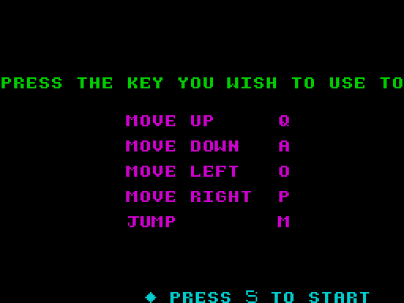 |
| "1,2,3 OR 4 PLAYERS ?" | `tour-type2`, 500 |  |
| "PLAYER 1" before a turn | `tour-type2`, 700 | 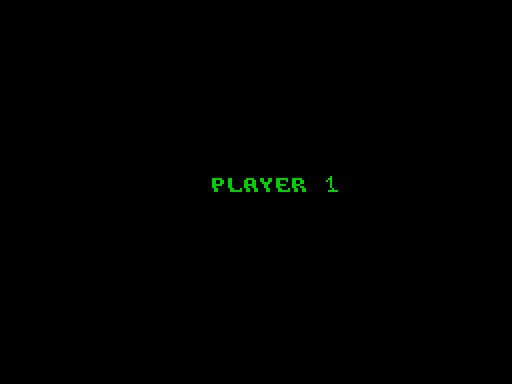 |
| Level 1, two players (two score fields) | `tour-type2`, 900 | 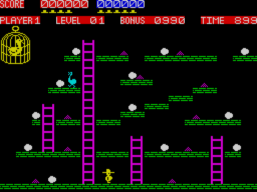 |
| Level 1, four players | `tour-redefine`, 1150 | 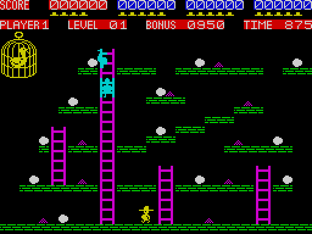 |
| A death by a hen: the screen holds while the tune plays, Harry is gone (Harry never moved and TIME is 652, so neither a fall nor the timer) | `idle-1p`, 7250 | 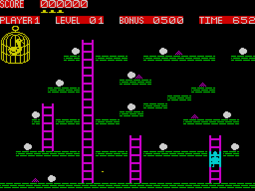 |
| TIME 000 | `tour-redefine`, 8600 | 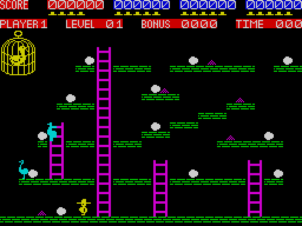 |
| "OUT OF TIME !" | `tour-redefine`, 8750 | 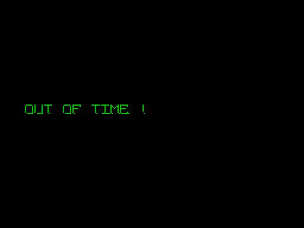 |
| Player 2's turn after player 1's life | `tour-redefine`, 9050 | 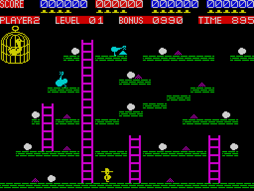 |
| GAME OVER | `idle-1p`, 14 600 | 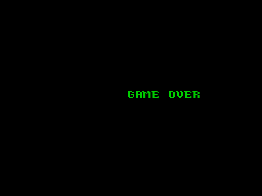 |
| A death by falling into a floor gap (level 2) | `fall-death`, 2710 | 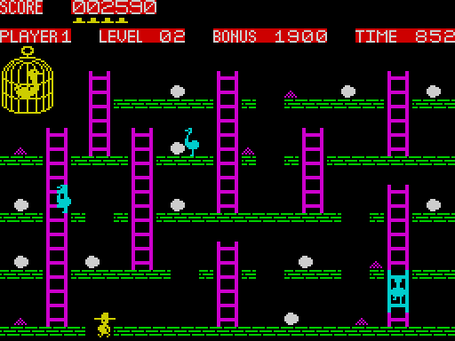 |
| The congratulation and the name prompt (IM 1, the ROM's keyboard) | `gameover-name`, 39 450 |  |
| The name typed: "CE1" | `gameover-name`, 39 600 |  |
| The title with the new entry first in the table | `gameover-name`, 39 700 |  |
| Level 1 | `levels-1-3`, 500 | 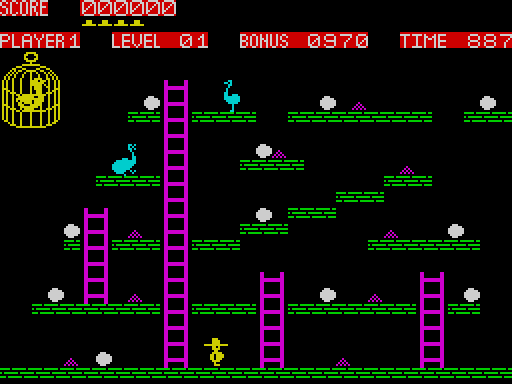 |
| Level 2 (gaps in the bottom floor) | `levels-1-3`, 2400 | 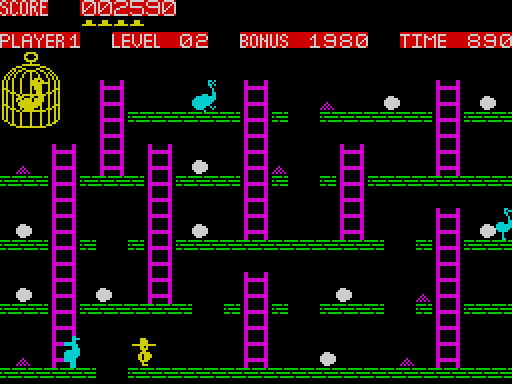 |
| Level 3 (a lift at columns 8-9) | `levels-1-3`, 4000 | 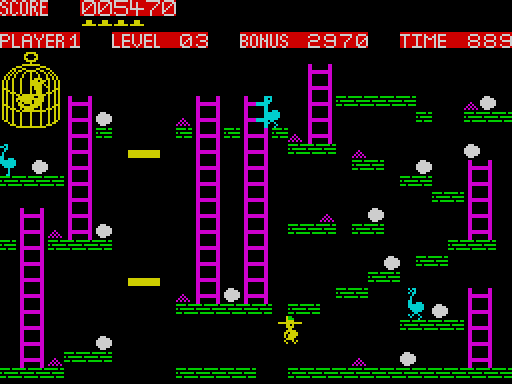 |
| Level 4 (a lift at columns 18-19) | `levels-1-3`, 7000 | 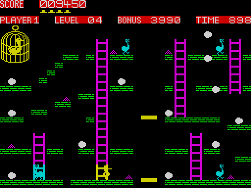 |

## 7. Review
