# 1. Game design

What this covers: the game as a player meets it. It describes every screen and mode, the play screen, the controls,
the cast and the eight maps. It then covers the rules, the scoring and the extra life, and the cycle of repeats that
makes the game harder after level 8. It ends with the turns of up to four players, the level end, a life lost, and
the game over with the name entry.

The recordings are those of WALKTHROUGH 6.0. Each is a `.ttd` session on the 48K, started from power-on (`c1`) or
from the bot's base at the title. None of them loads anything but the tape.

| Recording | What it shows |
| --- | --- |
| `c1` | Power-on, the tape, the title, the instructions, key type 3, one player, and level 1 until a life is lost |
| `idle-1p` | One player who presses no key: five lives lost to the hens, GAME OVER, and the title again |
| `tour-type2` | The title, the instructions, key type 2, two players, a walk and a jump |
| `tour-redefine` | The redefine page (Q A O P M), four players, a death by the timer, and the turn passing to player 2 |
| `levels-1-3` | Levels 1-3 played by the bot, with the bonus counted after each |
| `fall-death` | A walk into the gap in level 2's bottom floor |
| `gameover-name` | Levels 1-3, then no key on level 4: five lives lost to the hens, then the name entry under IM 1 |
| `levels-1-9` | Levels 1-9 played by the bot (recorded with `--exact`), ending on level 10 |

Every value quoted from memory was read with `time_travel memory_at`, which gives the memory at the start of the named
frame (`work/docs/ceA/mem.py` over the session in `work/docs/ceA/l19`). Every screenshot shows the screen at the end
of its frame (`kit/screen_shot.py`).

## 1.1 The game in one paragraph

Chuckie Egg (A&F Software, 1983) is a platform game. Hen-House Harry walks the platforms and climbs the ladders of a
hen house. He must pick up the twelve eggs of each level. Hens walk the same platforms and kill him at a touch. Grain
lies about the floors. It scores 50 points and stops both of the level's clocks for a while.

The two clocks in the HUD are the bonus and the time. The bonus is added to the score at the level end. When the time
reaches zero, Harry loses a life.

There are eight maps. After level 8 they come round again with other rules. On levels 9-16 the hens are gone and the
duck leaves its cage to hunt Harry; from level 17 the hens come back. Up to four players take turns, one life a turn.

**The point**: the whole game is one loop of collect, avoid and climb. Its depth comes from the two clocks and from
the cycle after level 8, not from new maps.

## 1.2 The screens and the modes

The game has eight modes: title, instructions, redefine, players, play, level end, life lost, and game over with the
name entry. Doc 4.2 draws their state machine as the code runs it. The diagram below follows what a player sees and
the key that leads on.

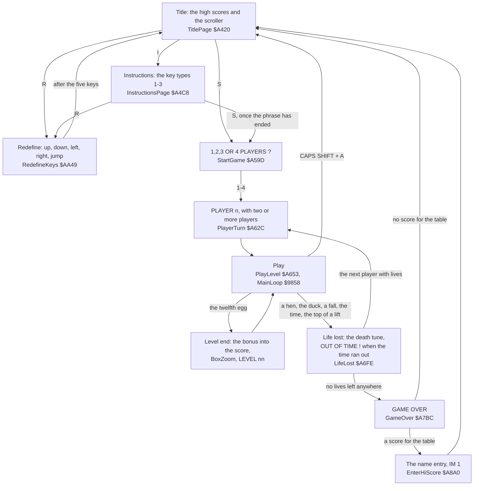

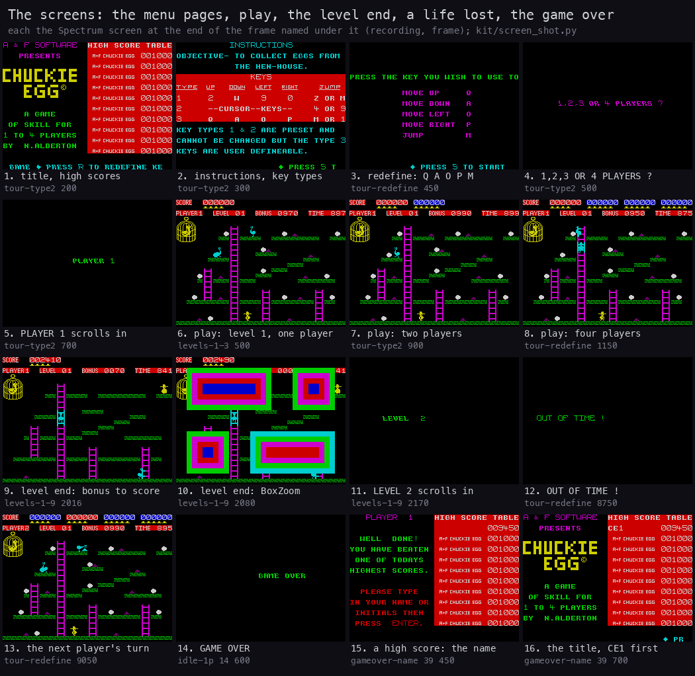

*The screens: the menu pages, play, the level end, a life lost and the game over. Each tile is the screen at the end
of the frame in its caption. The frames are `tour-type2` 200, 300, 500, 700 and 900; `tour-redefine` 450, 1150,
8750 and 9050; `levels-1-3` 500; `levels-1-9` 2016, 2080 and 2170; `idle-1p` 14 600; `gameover-name` 39 450 and
39 700. Made with `python3 tools/fig_design.py screens` from the screenshots in `docs/img/play/`.*

The table gives one line a mode and the screenshot that shows it at full size.

| Mode | What the player sees | Recording, frame | Screenshot |
| --- | --- | --- | --- |
| Title | The big CHUCKIE EGG, the A+F logo, the ten high scores, a scroller at the bottom | `tour-type2` 200 | [title.png](img/play/title.png) |
| Instructions | Eleven rows of text, the three key types, a flashing bar on the chosen type | `tour-type2` 300 | [instructions.png](img/play/instructions.png) |
| Redefine | Five prompts, each filled in with the key pressed | `tour-redefine` 450 | [redefine.png](img/play/redefine.png) |
| Players | "1,2,3 OR 4 PLAYERS ?" scrolled in | `tour-type2` 500 | [players-prompt.png](img/play/players-prompt.png) |
| A turn starts | "PLAYER 1" scrolled in, only with two or more players | `tour-type2` 700 | [player-turn.png](img/play/player-turn.png) |
| Play | The HUD and the map (1.3) | `levels-1-3` 500 | [level1.png](img/play/level1.png) |
| Play, two players | Two score fields in the HUD | `tour-type2` 900 | [level1-two-players.png](img/play/level1-two-players.png) |
| Play, four players | Four score fields | `tour-redefine` 1150 | [level1-four-players.png](img/play/level1-four-players.png) |
| Level end, the bonus | The bonus counts down into the score, 10 points a step | `levels-1-9` 2016 | [level-end-bonus.png](img/play/level-end-bonus.png) |
| Level end, the boxes | Nested attribute boxes close in (BoxZoom) | `levels-1-9` 2080 | [level-end-boxes.png](img/play/level-end-boxes.png) |
| Level end, the message | "LEVEL 2" scrolled in | `levels-1-9` 2170 | [level-message.png](img/play/level-message.png) |
| Life lost to the time | "OUT OF TIME !" | `tour-redefine` 8750 | [out-of-time.png](img/play/out-of-time.png) |
| The next player | "PLAYER 2" after player 1's life | `tour-redefine` 9050 | [player2-turn.png](img/play/player2-turn.png) |
| Game over | "GAME OVER" | `idle-1p` 14 600 | [game-over.png](img/play/game-over.png) |
| Name entry | "WELL DONE! ..." and a cursor in the table | `gameover-name` 39 450 | [name-prompt.png](img/play/name-prompt.png) |
| Title again | The new entry first in the table | `gameover-name` 39 700 | [title-new-entry.png](img/play/title-new-entry.png) |

- **The title tune and phrase 20 play only once.** They play the first time the title is shown (TitleTuneDone
  `$736F`). Later visits show the page in silence.
- **On the instructions page, S waits for the spoken phrase.** S does nothing until phrase 24 has ended (WaitPhrase
  `$A960`). The interrupt handler times the phrase even without a speech unit on port `$9F` (doc 4.5).
- **The abort key works only in play.** CAPS SHIFT + A drops one return address and jumps to Start `$A410`. The game
  in play is lost, and no high score is entered.

**The point**: every page leads on with one key. There is no options page beyond the key type and the number of
players.

## 1.3 The play screen

The top three character rows are the HUD. The other 21 rows are the map, 32 cells wide. Map row 20 is screen row 3,
and map row 0 is screen row 23: the code counts rows and y from the bottom.

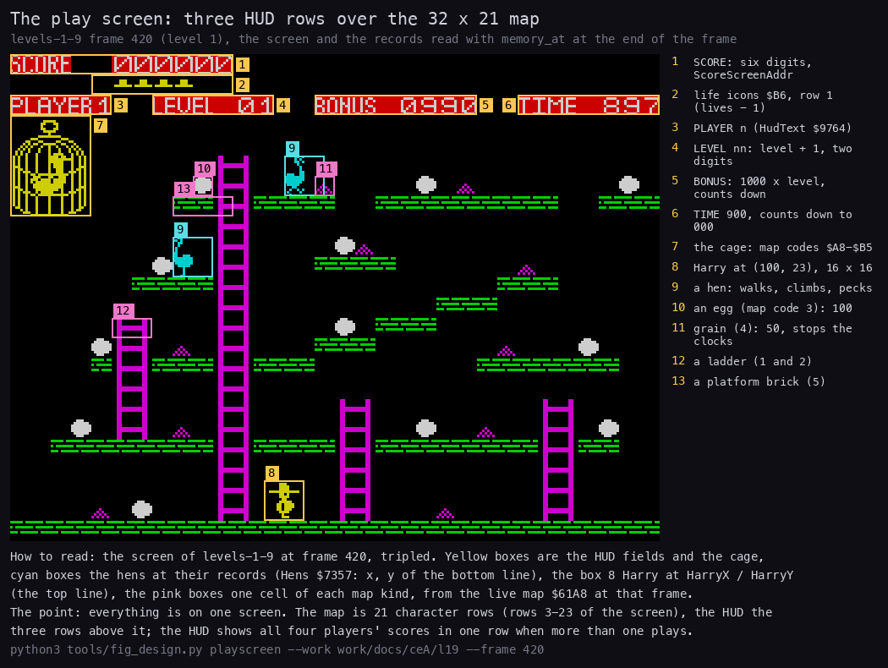

*Level 1 at the end of frame 420 of `levels-1-9`, one player, scaled by 2. The places of Harry, the duck and the
hens are read from memory at the start of frame 420 (`$72D8-$7377`). Made with
`python3 tools/fig_design.py playscreen --work work/docs/ceA/l19 --frame 420`.*

| No. | Part | What it holds | Where in memory |
| ---: | --- | --- | --- |
| 1 | SCORE | Six digits, printed by AddScore `$A3A7` | Score `$6EC8` |
| 2 | Life icons | One `$B6` icon for each life after the one in play, at most six | PlayerLives `$6EF0` |
| 3 | PLAYER n | The player in play | Player `$733B` |
| 4 | LEVEL nn | The level + 1, two digits | Level `$6EEB` |
| 5 | BONUS | Three digits and a printed 0 | BonusDigits `$733F` |
| 6 | TIME | Three digits | TimeDigits `$7342` |
| 7 | The cage | Map codes `$A8-$B5` at the top left | LiveMap `$61A8` |
| 8 | Harry | A 16 x 16 sprite at (HarryX, HarryY); y is the top of the sprite | `$72D8`, `$72D9` |
| 9 | A hen | A 16 x 16 sprite; y is its bottom line | Hens `$7357`, 4 bytes a hen |
| 10 | An egg | Map code 3 | LiveMap |
| 11 | Grain | Map code 4 | LiveMap |
| 12 | A ladder | Map codes 1 and 2, its two columns | LiveMap |
| 13 | A platform | Map code 5, a brick | LiveMap |

At frame 420 Harry stands at (100, 23), where SetupLevel `$AE9C` puts him on every level. The duck sits in its cage at
(8, 152). The two hens of level 1 are at (108, 136), walking right, and at (64, 104), walking left.

**The point**: the HUD is all text from one character set, so a sprite never crosses it. The map is a grid of 8 x 8
cells, and the game reads that grid to know where Harry may stand, climb or pick something up.

## 1.4 The controls

Harry has five actions: up, down, left, right and jump. There are three key sets. The player picks one on the
instructions page with 1, 2 or 3, or redefines set 3 with R. Doc 5 covers the keys in full.

| Type | Up | Down | Left | Right | Jump | Set at | Chosen by |
| ---: | --- | --- | --- | --- | --- | --- | --- |
| 1 | 2 | W | 9 | 0 | Z or M | `$8250` | nothing: the default (KeyType 6) |
| 2 | 7 | 6 | 5 | 8 | 4 or 9 | `$825C` | key 2: the cursor keys and the cursor joystick |
| 3 | Q | A | O | P | M or 1 | `$8268` | key 3, or R to redefine; the second jump key stays 1 |

- **Two fixed keys** are read once every slow tick (doc 4.4). CAPS SHIFT + H holds the game until S is pressed.
  CAPS SHIFT + A aborts to the title. Witness: `hold-abort` (WALKTHROUGH 6.0) holds at frame 1100, goes on at 1300
  and aborts at 1400 (doc 5.6).
- **A jump goes the way of the key held.** Left or right with the jump key gives a jump that way. The jump key alone
  jumps straight up. The direction is fixed when the jump starts.
- **The keys are read as port rows.** A key is down when `(IN (row x 256 + $FE) AND $1F) OR mask` is not `$1F`. So
  any keys can be held together.

The jump test, at the end of every slow tick, reads the two jump keys of the set in play:

```asm
MainLoopHarry:                  ; $9949
        LD HL,(HarryX)
        CALL PaintCells
        LD A,(JumpState)
        AND A
        JR NZ,MainLoopFoot      ; in the air or drifting: no new jump
        LD A,(KeyTable+9)       ; the first jump key's port row
        IN A,($FE)
        AND $1F
        LD C,A
        LD A,(KeyTable+8)       ; and its mask
        OR C
        CP $1F
        JR NZ,MainLoopJumpStart ; held: start a jump
        LD A,(KeyTable+11)      ; the second jump key
        ...
```

**The point**: the controls are digital and are read once a slow tick, about 1.2 times a frame (doc 4.6). A tap
shorter than a slow tick can be missed.

## 1.5 The cast

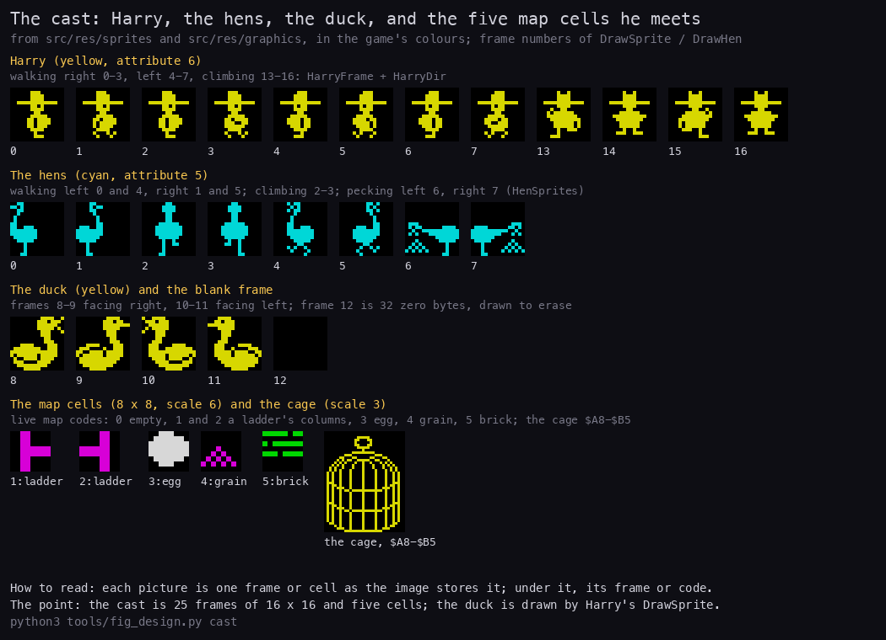

*Every frame of Harry, the hens and the duck, and the map cells. They are drawn from the sheets in `src/res/sprites/`
and `src/res/graphics/`, with the colours the game gives them (CellAttributes `$984F` and the sprites' yellow). Made
with `python3 tools/fig_design.py cast`.*

| Who | Frames | Moves | Kills Harry |
| --- | --- | --- | --- |
| Harry | Walking right 0-3, walking left 4-7, climbing 13-16 (the indices in Sprites `$8DF0`) | One pixel a slow tick on foot and on a ladder; jumps (doc 10) | |
| A hen | Walking left 0 and 4, walking right 1 and 5, climbing 2-3, pecking left 6, pecking right 7 | One step each time MoveHen `$911E` picks it: one hen every 3 slow ticks, every 2 from level 33 | At a touch: the box test in DrawHen `$929C`, and in HenTouches `$9E66` during a jump |
| The duck | Four frames, two a direction | Every 12 slow ticks, a step toward Harry of up to 5 pixels on each axis; it bounces at the edges | At a touch: the box test in DrawSprite `$9A4C` |

- **The hens eat grain.** A hen that meets grain in front of it stops and pecks it up. That grain is lost to Harry.
- **The duck stays in its cage on levels 1-8.** MoveDuck `$A0C8` steers it, then puts it back at (8, `$98`) while
  Level is under 8. From level 9 it flies free (doc 7).

**The point**: there are only three kinds of actor. The game gets harder through more hens, faster hens, or the duck.

## 1.6 The world: eight maps

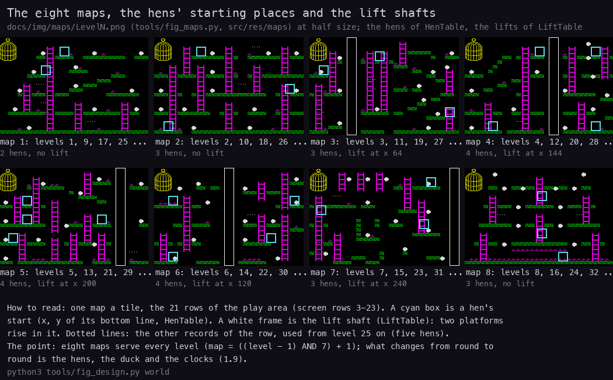

*The eight maps at half size, drawn from `src/res/maps/Level1-8.txt`. The hens' starting places come from HenTable
`$945B` (`src/res/tables/HenTable.csv`) and the lift shafts from LiftTable `$9787`. Made with
`python3 tools/fig_design.py world`.*

Each map holds 12 eggs. The table counts the grain in each map file. The hens are those HenTable gives the map on its
first pass (levels 1-8), and the lift column is from LiftTable.

| Map | Grain | Hens, levels 1-8 | Lift | Full map |
| ---: | ---: | ---: | --- | --- |
| 1 | 10 | 2 | none | [Level1.png](img/maps/Level1.png) |
| 2 | 7 | 3 | none | [Level2.png](img/maps/Level2.png) |
| 3 | 10 | 3 | x 64 | [Level3.png](img/maps/Level3.png) |
| 4 | 6 | 4 | x 144 | [Level4.png](img/maps/Level4.png) |
| 5 | 13 | 4 | x 200 | [Level5.png](img/maps/Level5.png) |
| 6 | 10 | 4 | x 120 | [Level6.png](img/maps/Level6.png) |
| 7 | 4 | 3 | x 240 | [Level7.png](img/maps/Level7.png) |
| 8 | 38 | 3 | none | [Level8.png](img/maps/Level8.png) |

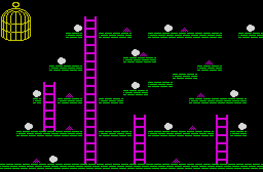

*Map 1, from `src/res/maps/Level1.txt` as PrintChar `$9C40` and PaintCells `$9538` draw it. No recording: the map is
drawn from the source. Made with `python3 tools/fig_maps.py`.*

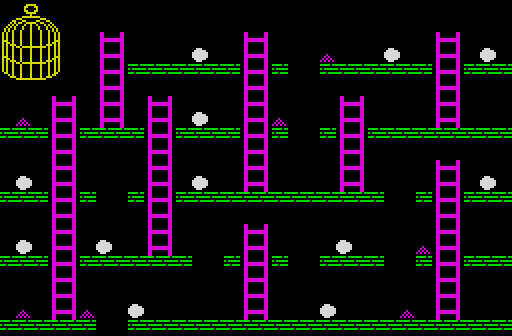

*Map 2. The bottom floor has gaps; `fall-death` falls through the one at columns 6-7. Made with
`python3 tools/fig_maps.py`.*

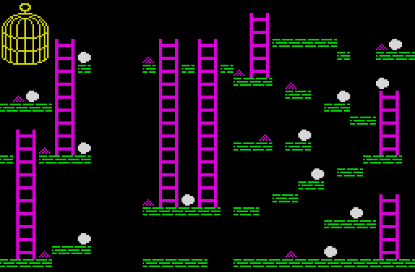

*Map 3, the first with a lift, at x 64. Made with `python3 tools/fig_maps.py`.*

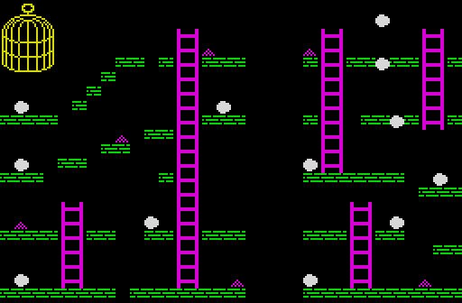

*Map 4: a lift at x 144 and four hens. Made with `python3 tools/fig_maps.py`.*

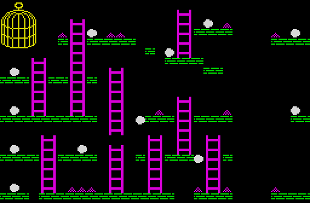

*Map 5: a lift at x 200. Made with `python3 tools/fig_maps.py`.*

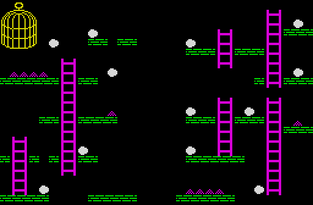

*Map 6: a lift at x 120 and eggs on short ledges. Made with `python3 tools/fig_maps.py`.*

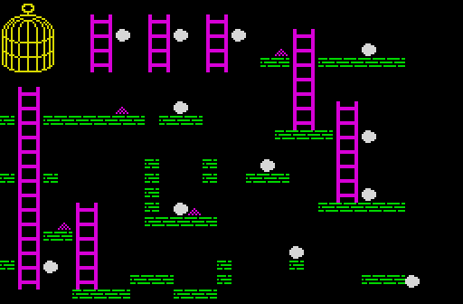

*Map 7: a lift at the right edge, x 240. Made with `python3 tools/fig_maps.py`.*

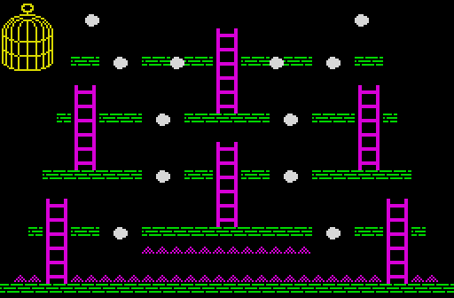

*Map 8: no lift, and 38 grains in the platform gaps. Made with `python3 tools/fig_maps.py`.*

- **A lift** is two platforms in one shaft. They rise one pixel every two slow ticks and start again at the bottom.
  Harry boards a platform by jumping onto it. If he rides it up to y `$A5`, the life ends (`$991E RET NC`).
- **The maps are copied, not shared.** StartGame copies map 1 into five slots of LiveMap `$61A8`: the one in play and
  one a player. A player's eggs and grain stay taken while the other players have their turns.

**The point**: eight hand-made maps carry the whole game. Lifts appear only on maps 3-7.

## 1.7 The rules

The rules below are as the code applies them. Doc 10 gives each routine with its witnesses.

1. **Eggs.** Harry takes an egg when the map cell at (HarryX + 8, HarryY - 8) holds code 3. That is the cell at his
   feet, half a sprite in from his left edge. The twelfth egg ends the level.
2. **Grain.** Code 4 in that cell is grain. It scores 50 points and sets BonusDelay and TimeDelay to `$FF`. Both
   clocks then wait 255 slow ticks before their next step, about 4 seconds.
3. **The bonus.** It starts at 1000 x min(level, 9) and loses 10 every 50 slow ticks. At 0 it stops. At the level end
   what is left of it is added to the score.
4. **The time.** It starts at 900, or less from level 17 (1.10). It loses 1 every 10 slow ticks, with a click. At 000
   the life ends, and LifeLost prints "OUT OF TIME !".
5. **Harry dies** in one of five ways:
   - **a hen touches him**: his x within the hen's x - 8 .. x + 5, and his y within its y .. y + `$1B` (`$92BC`; 11
     deaths in the builds);
   - **the duck touches him**: within 8 pixels across and 9 up or down (`$9BC8`). Known only from the code: no
     recording was killed by the duck;
   - **he falls below y `$10`**, through a gap in the bottom floor (`$A309`; `fall-death`, frame 2710);
   - **a lift carries him up to y `$A5`** (`$991E`). Known only from the code: no recording rode a lift to the top;
   - **the time reaches 000** (CountDown `$A1B8` with B = 1; `tour-redefine` frame 8750, the only time in the
     builds: OUT OF TIME `$A725` ran once).
6. **A fall from a height does not kill.** A jump, or a drift off an edge, falls until it lands on a platform or a
   ladder. Only a fall under the bottom of the map ends the life.

One routine handles both pickups. It runs on every slow tick:

```asm
TakeEggOrGrain:                 ; $99DF
        LD HL,(HarryX)
        LD A,H
        SUB $08                 ; y - 8: the cell row of his feet
        LD H,A
        LD A,L
        ADD A,$08               ; x + 8: the middle of the sprite
        LD L,A
        CALL MapCellAt
        CP $03
        JR NZ,TakeGrain
        LD (HL),$00             ; the egg is gone from LiveMap
        LD A,(Level)
        SRL A
        SRL A                   ; Level / 4
        CP $09
        JR C,TakeEggPoints
        LD A,$09
TakeEggPoints:
        LD B,A
        INC B                   ; 1 + min(Level / 4, 9)
        XOR A
TakeEggTimesTen:
        ADD A,$0A
        DJNZ TakeEggTimesTen    ; ten times that: AddScore counts in tens
        LD B,A
        CALL AddScore
        LD A,$FF
        LD (SoundSweep),A       ; the pickup sound
        LD HL,EggsLeft
        DEC (HL)
        RET NZ
        POP HL                  ; the twelfth egg: drop MainLoop's return address
        RET                     ; and return to PlayLevel: the level is complete
TakeGrain:
        CP $04
        RET NZ
        LD (HL),$00
        LD B,$05                ; 50 points
        CALL AddScore
        LD HL,$FFFF
        LD (BonusDelay),HL      ; BonusDelay and TimeDelay: 255 ticks to wait
        LD A,L
        LD (SoundSweep),A
        RET
```

In pseudocode:

```text
every slow tick:
    cell = LiveMap[row (HarryY - 8) / 8][column (HarryX + 8) / 8]
    if cell == egg:
        cell = empty
        score += 100 * (1 + min(Level / 4, 9))
        eggsLeft -= 1
        if eggsLeft == 0: leave the main loop (the level is complete)
    else if cell == grain:
        cell = empty
        score += 50
        bonusDelay = timeDelay = 255
```

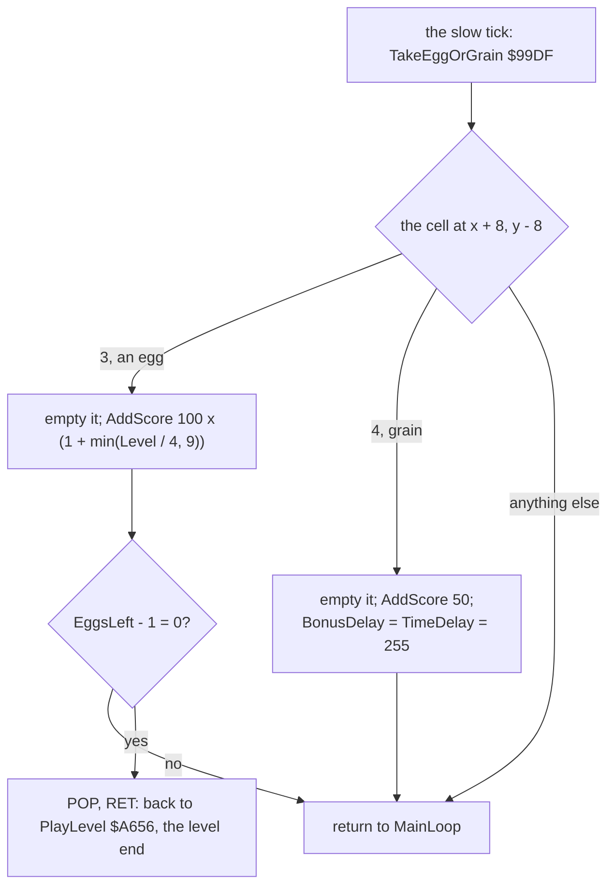

**The point**: Harry is never hurt, only killed. A death is a touch, a floor gap, the top of a lift or the clock. The
grain is worth more as a pause of both clocks than as points.

## 1.8 The scoring, with a worked tally

| What | Points | Where |
| --- | ---: | --- |
| An egg | 100 x (1 + min(Level / 4, 9)): 100 on levels 1-4, 200 on 5-8, up to 1000 from level 37 | TakeEggOrGrain `$99DF` |
| Grain | 50 | `$9A1A` |
| The bonus at the level end | What is left of it, plus 10 (below) | PlayLevel `$A675` |
| An extra life | Each change of the score's 10 000s digit | AddScore `$A3A7` |

**A worked tally: level 1 of `levels-1-9`.** The values were read from memory at the start of each frame.

| Frame | Score | Bonus | Time | Eggs left | What happened in the frame before |
| ---: | ---: | ---: | ---: | ---: | --- |
| 2007 | 1 500 | 880 | 841 | 1 | 11 eggs and 8 grains taken so far |
| 2008 | 1 680 | 800 | 841 | 0 | the twelfth egg (1 600), then 8 bonus steps |
| 2016 | 2 410 | 70 | 841 | 0 | the screenshot [level-end-bonus.png](img/play/level-end-bonus.png) is the end of this frame |
| 2017 | 2 490 | `$FF 9 9` | 841 | 0 | the bonus is all counted in; its digits read `$FF 9 9`, a count past 000 |

The sums check:

- 11 eggs x 100 = 1 100, and 8 grains x 50 = 400. Together they make the 1 500 of frame 2007.
- The twelfth egg makes 1 600.
- The bonus left is 880. Yet the score ends at 2 490, which is 1 600 + 890.

**The bonus pays 10 points more than it shows.** The level-end loop calls CountDown and then AddScore with B = 1, ten
points, on every step. When the bonus goes past 000, CountDown clears BonusRunning and returns. The loop still adds
the ten points of that step, and only then sees BonusRunning at 0.

```asm
PlayLevelBonus:                 ; $A675
        LD A,(BonusRunning)
        AND A
        JR Z,PlayLevelPause     ; the bonus is spent: on to the pause
        LD B,$00
        CALL CountDown          ; the bonus - 10; past 000 it sets BonusRunning to 0
        LD B,$01
        CALL AddScore           ; + 10 points, even on the step that went past 000
        LD HL,$1E04
        CALL Beep
        JR PlayLevelBonus
```

- A bonus that ran out in play gives nothing. CountDown has already cleared BonusRunning, so the loop adds nothing.
- The 88 steps of 880 and the extra one ran in frames 2007-2016, about 9 a frame.
- The bonus and the time stopped together. The bonus fell by 12 steps of 50 ticks (600 ticks), and the time by 59
  steps of 10 ticks (590 ticks). Each grain stops both clocks at once, so they keep in step.

**The point**: on level 1 the bonus is nearly as much as all the eggs together. A fast level with the grain taken
early scores about twice a slow one.

## 1.9 The extra life

AddScore keeps the 10 000s digit it last saw in LastTenThousands `$736E`. When the digit changes, the player in play
gets a life, and a life icon is drawn while fewer than six are shown.

```asm
        LD HL,LastTenThousands  ; $A3BB, after the tens are added
        LD A,(Score+1)          ; the 10 000s digit
        CP (HL)
        JR Z,AddScorePrint      ; the same digit: no life
        LD (HL),A
        LD A,(Player)
        ADD A,$EF
        LD H,$6E
        LD L,A                  ; HL = PlayerLives - 1 + player
        LD C,(HL)
        INC (HL)                ; one more life
        SUB $EF
        LD B,A
        LD A,C
        CP $06
        JR NC,AddScorePrint     ; six or more already: no icon
        ...                     ; icon $B6 at row 22, column 4 + lives + 7 x (player - 1)
```

**Witness**: `levels-1-9`, level 4. At the start of frame 7984 the score is 9 900 and the lives are 5. At the start of
frame 7985 the score is 10 000 and the lives are 6. The egg was taken during frame 7984. In all the builds the
10 000s digit changed six times (`$A3C4`), and one icon was drawn (`$A3D7`).

| Before: 9 900 points, 5 lives | After: 10 000 points, 6 lives |
| --- | --- |
| 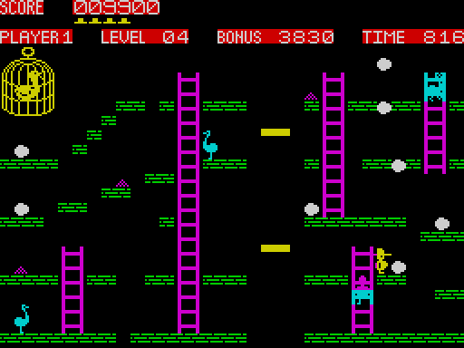 | 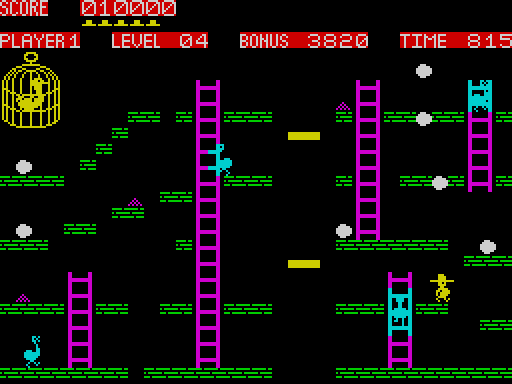 |

*Left: `levels-1-9` at the end of frame 7980. Right: at the end of frame 7990. Made with `kit/screen_shot.py` over the
session in `work/docs/ceA/l19`, scale 2.*

- The test compares digits, not thresholds. The score never falls, so each change of the digit is a new 10 000. From
  99 990 to 100 000 the digit goes from 9 to 0, which is a change too.
- By level 10, `levels-1-9` has 61 800 points and 10 lives. The HUD still shows six icons at most.

**The point**: a life every 10 000 points keeps a good player going. A level on maps 1-8 is worth about 2 000 to
10 000 points with its bonus.

## 1.10 The difficulty and the cycle of repeats

The level number grows without end. The map is (Level AND 7) + 1, so the eight maps repeat. Every other rule reads the
level number too. This gives cycles of eight levels with steps at levels 9, 17, 25 and 33 (Level counts from 0 for
level 1).

| Levels | Map | Hens | The duck | Hen period | Time at the start | Bonus at the start | An egg |
| --- | --- | --- | --- | ---: | ---: | ---: | ---: |
| 1-8 | 1-8 | HenTable: 2, 3, 3, 4, 4, 4, 3, 3 | caged | 3 ticks | 900 | 1 000-8 000 | 100 (1-4), 200 (5-8) |
| 9-16 | 1-8 | none | free | | 900 | 9 000 | 300, 400 |
| 17-24 | 1-8 | HenTable again | free | 3 ticks | 800 | 9 000 | 500, 600 |
| 25-32 | 1-8 | five on every map: all 20 bytes of the row | free | 3 ticks | 800 | 9 000 | 700, 800 |
| 33-48 | 1-8 | five | free | 2 ticks | 700 | 9 000 | 900, then 1 000 from 37 |
| 49 and up | 1-8 | five | free | 2 ticks | 600; 500 from 65; 400 from 81 | 9 000 | 1 000 |

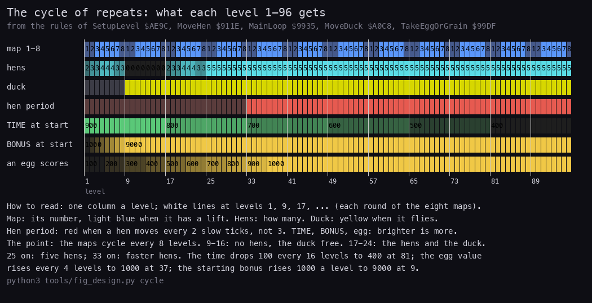

*The cycle of repeats for levels 1-96, computed by `level_rules()` in `tools/fig_design.py` from the rules of
SetupLevel `$AE9C`, MainLoop `$9935` and TakeEggOrGrain `$99DF`. No recording reaches past level 10; levels 1-10 are
checked against `levels-1-9`. Made with `python3 tools/fig_design.py cycle`.*

The rules as SetupLevel and the main loop compute them:

```text
map        = (Level AND 7) + 1
hens       = none                       if 8 <= Level <= 15
           = all five records of row    if Level >= 24
           = the row's count of hens    otherwise
duck free  = Level >= 8
hen period = 2 slow ticks if Level >= 32, else 3
time       = 100 * (9 - min(Level / 16, 5))
bonus      = 1000 * min(Level + 1, 9)
egg        = 100 * (1 + min(Level / 4, 9))
```

The time and the bonus, from SetupLevel:

```asm
        LD A,(Level)            ; $AEE1
        INC A
        CP $0A
        JR C,SetupLevelBonus
        LD A,$09                ; at most 9: the bonus's first digit
SetupLevelBonus:
        LD (BonusDigits),A
        ADD A,$9E
        LD (HudBonus),A
        LD A,(Level)            ; $AEF3
        SRL A
        SRL A
        SRL A
        SRL A                   ; Level / 16
        CP $05
        JR C,SetupLevelTime
        LD A,$05
SetupLevelTime:
        LD C,A
        LD A,$09
        SUB C                   ; 9 - min(Level / 16, 5): the time's first digit
        LD (TimeDigits),A
```

The hens, from SetupLevel:

```asm
        LD A,(Level)            ; $AF81
        CP $08
        JR C,SetupLevelHens
        CP $10
        JR C,SetupLevelIcons    ; levels 9-16: no hen
SetupLevelHens:
        AND $07
        LD HL,HenTable
        LD BC,$0015             ; 21 bytes a row
        INC A                   ; row (Level AND 7) + 1: row 0 is never read
SetupLevelHenRow:
        ADD HL,BC
        DEC A
        JR NZ,SetupLevelHenRow
        LD B,(HL)               ; the row's byte count: 4 a hen
        INC HL
        LD A,(Level)
        CP $18
        JR C,SetupLevelHenCopy
        LD B,$14                ; from level 25: all 20 bytes, five hens
SetupLevelHenCopy:
        LD DE,Hens
        ...                     ; B bytes copied to Hens $7357
```

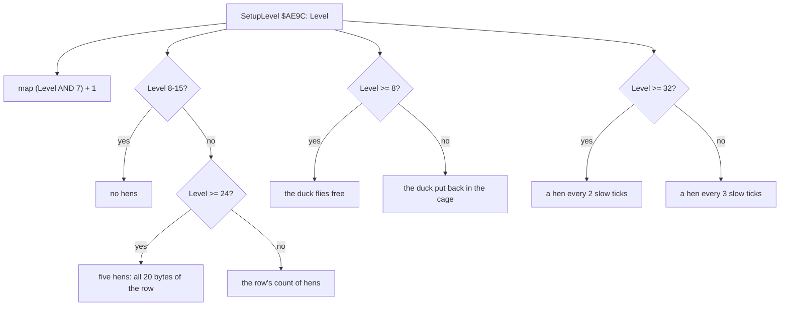

| Level 9 starts: map 1, no hens | The duck out of its cage | The duck closes in | Level 10: map 2 |
| --- | --- | --- | --- |
| 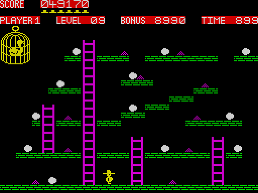 | 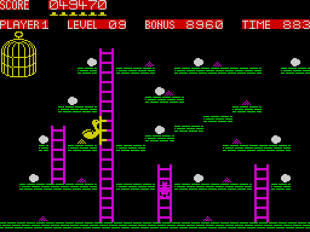 | 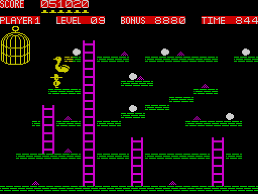 | 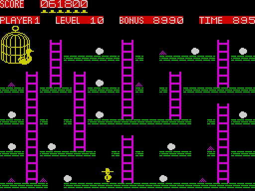 |

*`levels-1-9` at the end of frames 23 546, 23 700, 24 300 and 25 490, scale 2. The first and the last are the stage 1
screens (`work/stage1/rec/levels-1-9/screens/`); the middle two were made with `kit/screen_shot.py` over
`work/docs/ceA/l19`.*

**A worked example: level 9.** Level is 8.

- The map is (8 AND 7) + 1 = 1.
- Level is in 8-15, so there are no hens.
- Level is 8 or more, so the duck flies free.
- The time is 100 x (9 - 0) = 900, and the bonus is 1000 x min(9, 9) = 9 000.
- An egg scores 100 x (1 + 8 / 4) = 300.

The recording agrees. At the start of frame 23 546 the bonus reads 8 990 and the time 899: the level's first slow tick
has already taken one step off each. The duck is at (9, 151), one step from (8, 152); at the start of frame 23 700 it
is at (68, 92), heading for Harry. On level 8 the duck would have been put back at (8, 152).

- **Level 9 is no rest.** The duck ignores the platforms and steers toward Harry on both axes. The level has no hens,
  but it has a hunter.
- **Level 17 brings the hens back while the duck stays free**, and the time drops to 800.
- **Level 33 makes the hens faster**: one hen moves every 2 slow ticks instead of every 3, so each hen moves 1.5 times
  as often.
- Known only from the code: everything about levels 11 and up. No recording went past level 10.

**The point**: one byte, the level number, drives every rule through shifts and compares. The maps never change, but
after level 8 the game has three new phases.

## 1.11 Players and turns

1. StartGame asks "1,2,3 OR 4 PLAYERS ?". Each player starts with 0 points, 5 lives, level 1 and 12 eggs.
2. With more than one player, each turn starts with "PLAYER n" scrolled in and the speech phrase for that player.
3. A turn lasts one life. A level completed does not end the turn: the player plays on until he loses a life.
4. When a life is lost, the map in play is saved into the player's slot. The next player who still has lives is
   loaded: his level, eggs, score and map.
5. When a player's lives reach 0, "GAME OVER" is shown, with "PLAYER n" when others still play.
6. When no player has lives left, GameOver `$A7BC` runs the name entry for each player in turn.

**Witness**: `tour-redefine`, frames 8600-9050. Player 1's time reaches 000 ([time-zero.png](img/play/time-zero.png)),
"OUT OF TIME !" is shown, and player 2's turn starts ([player2-turn.png](img/play/player2-turn.png)).

**The point**: the players share one machine and one main loop. Each player's state lives in a slot and is swapped in
at his turn.

## 1.12 The key moments of a game

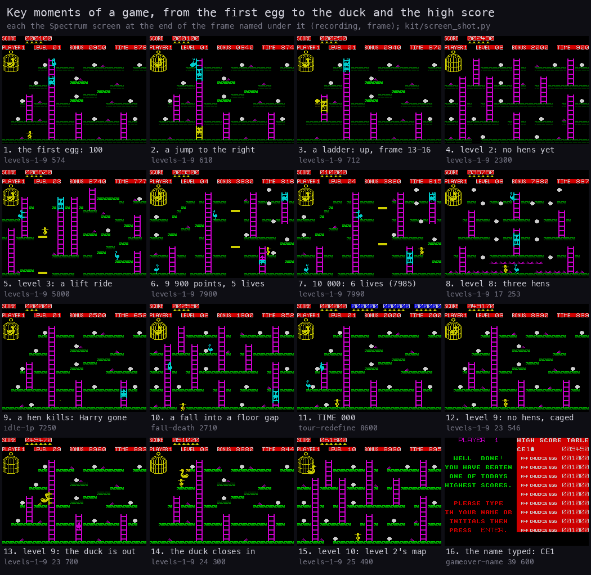

*Sixteen moments from five recordings: `levels-1-9` (574, 610, 712, 2300, 5800, 7980, 7990, 17 253, 23 546, 23 700,
24 300 and 25 490), `idle-1p` (7250), `fall-death` (2710), `tour-redefine` (8600) and `gameover-name` (39 600). Each
tile is the screen at the end of its frame. Made with `python3 tools/fig_design.py moments`.*

| Moment | Recording, frame | Screenshot |
| --- | --- | --- |
| The first egg: 100 points | `levels-1-9` 574 | [first-egg.png](img/play/first-egg.png) |
| A jump to the right | `levels-1-9` 610 | [jump.png](img/play/jump.png) |
| Up a ladder | `levels-1-9` 712 | [climb.png](img/play/climb.png) |
| Level 2 just drawn: no hens on the map yet | `levels-1-9` 2300 | [level-drawn.png](img/play/level-drawn.png) |
| Level 3: a lift ride | `levels-1-9` 5800 | [lift-ride.png](img/play/lift-ride.png) |
| The extra life | `levels-1-9` 7980, 7990 | 1.9 |
| Level 8: three hens | `levels-1-9` 17 253 | [level8.png](img/play/level8.png) |
| A hen kills: Harry is gone while the tune plays | `idle-1p` 7250 | [hen-death.png](img/play/hen-death.png) |
| A fall into the floor gap of map 2 | `fall-death` 2710 | [fall-death.png](img/play/fall-death.png) |
| TIME 000 | `tour-redefine` 8600 | [time-zero.png](img/play/time-zero.png) |
| Level 9 and the free duck | `levels-1-9` 23 546-25 490 | 1.10 |
| The name typed: CE1 | `gameover-name` 39 600 | [name-typed.png](img/play/name-typed.png) |

The other levels as they start are in [level2.png](img/play/level2.png), [level3.png](img/play/level3.png),
[level4.png](img/play/level4.png), [level5.png](img/play/level5.png), [level6.png](img/play/level6.png) and
[level7.png](img/play/level7.png) (WALKTHROUGH 6.1). The typing of the name is in
[name-entry.gif](img/play/name-entry.gif).

**The point**: the bot takes 1 600 to 6 300 frames a level (32 s to 2 min). Deaths and level ends are the only
breaks in play.

## 1.13 The level end, a life lost, and the game over

1. **The level end.** MainLoop returns to PlayLevel with no eggs left. The bonus is counted into the score (1.8), one
   beep (`$1E04`) a step. Then come two pauses of Delay 0 (about 24 frames each), BoxZoom, and "LEVEL nn" scrolled
   in. The level goes up by one, the next map is copied into the map in play, and the eggs are set to 12.
2. **A life lost.** MainLoop returns with eggs left. The death tune plays (24 notes, 4.8 s, under DI), then the death
   phrase. After a pause the screen is cleared. "OUT OF TIME !" is printed when the time digits read `$FF 9 9`. The
   lives go down by one.
3. **The game over.** BoxWipe runs twice, and the scores are turned into ASCII. Then each player's score is tested
   against the high score table.
4. **The name entry.** A score above one of the ten entries pushes the lower entries down. The page "WELL DONE! YOU
   HAVE BEATEN ONE OF TODAYS HIGHEST SCORES" is shown, with a cursor in the table.
   - The keyboard is read through the ROM under IM 1, from LAST_K `$5C08`. ENTER ends the name, and DELETE erases a
     character. Any code from `$20` up is stored.
   - The name has nine characters at most.
   - DELETE (`$A8C3`) is witnessed in `name-delete`, frame 63 (doc 5.8).
   - **Witness**: `gameover-name`, frames 39 483-39 700. "CE1" is typed, and it becomes the first entry.

**The point**: between levels the game spends a few seconds on effects. The name entry is the only place where the
ROM's keyboard routine runs.

## 1.14 What no recording reached

| What | Known from |
| --- | --- |
| A death by the duck | `$9BC8` |
| A lift carrying Harry to the top | `$991E` |
| Levels 11 and up: the hens back from 17, five hens from 25, faster hens from 33, less time from 17 | SetupLevel `$AE9C`, `$9944` |
| An egg worth more than 300 | `$99F3` |

**The point**: everything the recordings did not reach is a few compares in the code, all quoted above. No hidden mode
was found.
