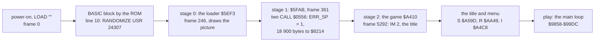

# 2. Architecture

What this covers: the machine budget, the memory map (a figure), stages from the medium to play, the frame, the main
loop's call graph, the module map. The recordings it rests on: `c1` (from power-on, the tape loaded, the menu and
play) and the bot's recordings of whole levels (WALKTHROUGH 6.0).

## 2.1 The memory map

The 48K's RAM as the game uses it, from `tools/l1map.py` over the L1 builds (executed, read, written; counts are of
`work/game`, the game window of `c1`, frames 5292-8916; the other recordings add reads to the level maps and no new
region, WALKTHROUGH 6.0).

| Range | Size | What | Use in `work/game` | Witness |
| --- | ---: | --- | --- | --- |
| `$4000-$5AFF` | 6912 | the screen | 816 202 reads, 694 120 writes | the game draws with OR and copies (`$930D`, `$A20C`) |
| `$5C00-$5CCA` | 203 | the system variables | ERR_SP `$5C3D` read on every pass; the rest is the ROM's (BEEPER, the name entry's LAST_K) | `$9858`, doc 3.1 |
| `$5CCB-$6322` | 1624 | the BASIC block: line 10, the picture's graphics, the loader, the picture's text | dead after the load; `$5DC0-$5DD3` (STKBOT / STKEND = `$5DC0`, set by the loader) is the ROM's calculator stack | doc 3.1; L1 writes only at `$5DC0-$5DD3` |
| `$61A8-$6EC7` | 3360 | five live maps of 672 bytes, one a player (the first is the current one), over the end of the BASIC block | 68 316 reads, 3429 writes | `$A5F4-$A602` (five copies of level 1), `$9E34` (a point's cell) |
| `$6EC8-$6EF3` | 44 | the scores, eggs left, levels and lives of the current player and players 1-4 | | `$A604-$A621` |
| `$6EF4-$729F` | 940 | not used | untouched | L1 |
| `$72A0-$7375` | 214 | the sprite buffer (`$72A0`, 48 bytes), Harry (`$72D8`), the game's counters and flags, the key table (`$732E`), the hens (`$7357`), the phrase player (`$7373`) | 2 235 417 reads, 1 489 448 writes | NOTES (the records) |
| `$7376-$8213` | 3742 | not used | untouched | L1 |
| `$8214-$824F` | 60 | zeros and a few map codes (`01 02`, `A8 A9`): a leftover | untouched | the bytes |
| `$8250-$8273` | 36 | the three key sets, 12 bytes each (six pairs of a port row and a mask, up first: `$9EC7` reads the first pair for the ladder): type 1 `$8250`, type 2 `$825C` (cursor keys), type 3 `$8268` (the one R redefines) | the chosen set is copied to `$732E` when a game starts (`c1` chose type 3: 12 reads at `$8268`) | `$B0A6-$B0BE` |
| `$8390-$84EF` | 352 | the instructions page's text, 11 rows of 32 | read by `$A4CD-$A4E2` | `$A4CD LD BC,$8390` |
| `$84F0-$88EF` | 1024 | the character set, 128 x 8 bytes, each stored bottom row first: codes 0-5 the map cells, `$0B-$1F` the HUD's labels, `$20-$7F` the font | 206 256 reads (with the text above) | `$9398 LD HL,$84F7`, `$93A2-$93A5` |
| `$89E0-$8B4F` | 368 | the HUD's digits and big characters, 8 bytes each, top row first | 38 856 reads | `$A201 LD HL,$89E0` |
| `$8B50-$8DEF` | 672 | 672 bytes of `$FF`: a map's size, never touched | untouched | the bytes |
| `$8DF0-$900F` | 544 | Harry, the duck and a blank sprite, 17 x 32 bytes | 94 144 reads | 2.3 |
| `$9010-$910F` | 256 | the hens, 8 x 32 bytes | 10 240 reads | 2.3 |
| `$911E-$B15E` | 8257 | the code, with tables between the routines (the hens of each level at `$945B`, the title and HUD text at `$9630-$9854`, the menu's text `$AC7C-$AE93`) | 28.7 million instructions | L1; NOTES |
| `$B15F-$B3AF` | 593 | leftover assembler source text, with the IM 2 table inside it | `$B2FF-$B300` read (the vector `$9C9C`) | `$A41A`; NOTES |
| `$B3B0-$C8AF` | 5376 | the eight level maps, 672 bytes each | the current level's map read when a level starts | `$A6E1-$A6F4` |
| `$C8B0-$CBE7` | 824 | more leftover source text (`$C8B0`), the phrase table for port `$9F` (`$C8C6`) and its phrases (`$C99C-$CB12`) | read by the phrase player | `$9CF2`, `$9CD3` |
| `$CBE8-$FF1D` | 13 110 | not used | untouched | L1 |
| `$FF1E-$FF3F` | 34 | the machine stack: the BASIC one, under RAMTOP | 5982 writes | no `LD SP` in the game |
| `$FF58-$FFFF` | 168 | the ROM's UDGs | untouched | |

- **The stack's low mark**: `$FF1E` over every recording (the lowest byte written in page `$FF00` of each L1
  build: `$FF1E` in `work/game` and `idle-1p`, `$FF20` in `fall-death`, `$FF22` in the others, the name entry under
  IM 1 in `gameover-name` included), so the game needs 34 bytes of stack; it starts at the BASIC stack the loader leaves (SP = `$FF3E` in play).


The figure sums the L1 builds of every stage 1 recording (`tools/l1merge.py`, then `kit/heatmap.py`, one row a
page of 256 bytes, time across): the code runs in `$911E-$B15E` only; reads go to the screen, the live maps
(`$61A8`), the records (`$72A0`), the key sets, the character set and the sprites (`$8250-$910F`) and the level maps
(`$B3B0`); writes go to the screen, the maps, the records and the stack page `$FF00`. Nothing above `$CBE7` but
the stack is touched.

```bash
python3 tools/l1merge.py work/stage1/l1-all.json work/game/l1.json work/stage1/rec/*/l1.json
python3 ../../kit/heatmap.py work/stage1/l1-all.json docs/img/heatmap.png --from 4000 --to FFFF \
    --title "Memory use over every stage 1 recording (L1)"
```



The stages, from the `c1` recording (`re_session.py stages`, WALKTHROUGH 1): the frames are those of `c1`, the BASIC
block loaded through the fast LD-BYTES trap and the two headerless blocks at signal speed.
## 2.2 Three images: as loaded, at the entry, at play

| Image | What it is | How it was made |
| --- | --- | --- |
| as loaded | the tape's bytes where the loader puts them: BASIC `$5CCB-$6322`, `01 00` at `$5C3D`, the game `$8214-$CBE7` | `tools/image.py work/mkgame/original.bin` (= `work/stage1/images/loaded.bin`) |
| at the entry | the memory of `c1` when `$A410` first runs (frame 5292) | `re_session.py build --work work/c1 --stage 2 --into work/game`, `work/game/start.bin` |
| at play | the memory at the first frame of level 1 (after S, 1 player) | `tools/szx.py work/stage1/bot/t4/base.szx` (the bot's start, `tests/inputs/menu-1p.txt` from the title) |

What changes (`cmp`-style runs over `$5B00-$FFFF`, `work/stage1/images/`):

- **Loaded to entry**: nothing in the game block or the BASIC block. The differences are the ROM's: the system
  variables (`$5C00-$5CCA`), the BASIC workspace just past the program (`$6323-$634B`) and the machine stack with
  the UDGs (`$FF18-$FFFE`). Nothing is unpacked or decrypted.
- **Entry to play**: still nothing in the game block `$8214-$CBE7`. The level setup does write into it, but only
  data: the HUD's text at `$9764-$978A` (`$AED2-$AF15`: the level's digits and the like) and the pointer at `$AD58`
  (`$A626 LD ($AD58),HL`, `$9F9E`), with the values they already hold at level 1. L1 of `c1` shows no other write
  above `$7400` except the stack: no code is modified, and every table (the level maps, the hens, the vector table) is
  read in place. What changes is RAM below the game:
  - `$61A8-$6EC7`: five live maps of 672 bytes, each a copy of level 1 (`$A5F4-$A5FC`). They lie over the end of the
    BASIC block (the loading picture's text `$601C-$631B`), which the game no longer needs;
  - `$6EC8-$6EF3`: the players' scores, eggs left, levels and lives (NOTES);
  - `$72A0-$7375`: the sprite buffer and the game's variables (Harry at `$72D8`, the hens at `$7357`);
  - `$FF1E-$FF3F`: the stack (the game keeps the BASIC stack).

## 2.3 The sprites, first look


*Every 16 x 16 sprite of the game and the six map cells, drawn from the image at the addresses under them
(`tools/sprites.py`). The map cells are stored bottom row first; the sheet draws them the way up they appear.*

| Sprite | Address | Size | Drawn by | Witness |
| --- | --- | --- | --- | --- |
| Harry walking right, four frames | `$8DF0-$8E6F` | 16 x 16, 32 bytes each | `$9A4C`, A = frame (0-3) + direction (0) | `$9DAF-$9DBE`: `LD A,($72DA); INC A; AND 3; ADD A,(IX+3); CALL $9A4C`, `$9A53`: `$8DF0` + A x 32 |
| Harry walking left, four frames | `$8E70-$8EEF` | 16 x 16 | `$9A4C`, direction 4 | `$9D5C LD (IX+3),4` |
| the duck, four frames | `$8EF0-$8F6F` | 16 x 16 | `$9A4C`, index 8-11 | the shapes; the index range between Harry's left frames and the blank one |
| blank (32 zero bytes) | `$8F70-$8F8F` | 16 x 16 | `$9A4C`, index 12 | read 6432 times in `c1` (L1) |
| Harry climbing, four frames | `$8F90-$900F` | 16 x 16 | `$9A4C`, direction `$0D` (13) | `$9F11 LD (IX+3),$0D` |
| the hens, eight frames | `$9010-$910F` | 16 x 16, 32 bytes each | `$92C2-$9330`: `$900E` + n x 32 (n 1-8), the rows read from the last pair upwards while the screen line goes up | `$92F6 LD HL,$900E`, `$9308-$9318`; L1 of `c1` reads `$9010-$910F` and nothing at `$900E` |
| the map cells 0-5: empty, the ladder's two columns, egg, grain, platform | `$84F0-$851F` | 8 x 8, drawn upwards | `$9391-$93A6`: the cell code x 8 from `$84F7`, `DEC D; DEC HL` | `$9398 LD HL,$84F7` |

- `$9A4C` copies the sprite into a buffer at `$72A0` three bytes wide (16 rows of two bytes and a zero, `$9A6F`),
  shifts it right by x AND 7 (`$9A80-$9A91`) and then walks the map cells under it (`$9A95` onwards). How it puts the
  sprite on the screen is stage 2's to read.
- The duck's frames and the blank sprite are named by their place in the table. Their callers (`$A113`, `$A18E`)
  run once the duck is free, from level 9.
- The hens' eight frames by their shapes: two pairs in profile (1-2 and 5-6), two climbing (3-4, from the back), two
  pecking (7-8, with grain on the ground). Which state picks which frame is stage 2's (doc 7).
